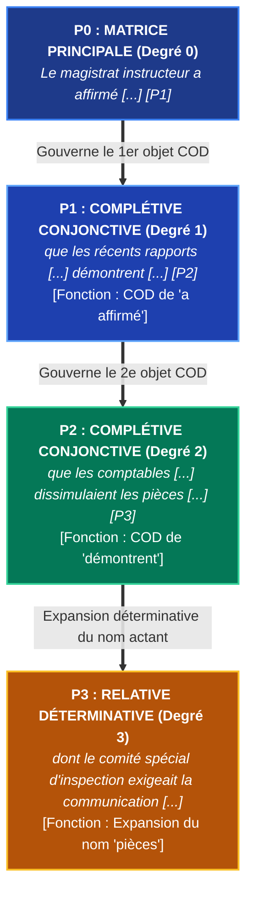

# Chapitre 1 — Théorie de la Subordination et de l'Enchâssement : Matrice Rectrice, Proposition Régie et Hiérarchie des Degrés

> **Identifiant du chapitre** : `CHP-301-01`  
> **Module de rattachement** : [`MOD-301` — Architecture de la Subordination : Complétives Conjonctives, Interrogatives Indirectes, Infinitives et Relatives Complexes](file:///f:/Formation/world-class-french/03-curriculum/year-2/semester-3/mod-301-architecture-subordination-completives.md)  
> **Semestre** : Année 2 — Semestre 3 (S3)  
> **Volume horaire estimé** : 5 à 6 heures d'apprentissage autonome délibéré et d'ateliers d'application (Phase 1 Étude : 1 h 30 | Phase 2 Pratique : 1 h 30 | Phase 3 Correction : 1 h 00 | Phase 4 Évaluation : 1 h 00)  
> **Statut** : [STATUT : PROPOSÉ — EN ATTENTE DE VALIDATION]  
> **Compétences associées** : [`FR-SYNTAX-002`](file:///f:/Formation/world-class-french/02-competency-framework/competency-framework.md#fr-syntax-002-architecture-de-la-subordination-complexe) (L3 Autonomie), [`FR-INT-002`](file:///f:/Formation/world-class-french/02-competency-framework/competency-framework.md#fr-int-002-analyser-formellement-la-syntaxe-dune-phrase-complexe) (L2/L3 Transition autonomie)  
> **Sources scientifiques de référence** : `SRC-GRAM-01` (Grevisse & Goosse, 2016, § 1060-1065), `SRC-GRAM-02` (Riegel, Pellat & Rioul, 2016, chap. 14), `SRC-NORM-03` (Ministère de l'Éducation nationale, 2020, p. 44-48), `SRC-TYPO-01` (Imprimerie nationale, 2002, p. 143)

---

## 1. Titre et Place dans le Cursus

### 1.1 Intitulé Officiel
**Chapitre 1 : Théorie de la Subordination et de l'Enchâssement : Matrice Rectrice, Proposition Régie et Hiérarchie des Degrés** (`CHP-301-01`).

### 1.2 Insertion Architecturale dans le Cursus
Le présent chapitre inaugure solennellement l'**Année 2** et ouvre le **Semestre 3** du cursus World-Class French. Il opère la transition décisive entre la syntaxe de la phrase simple consolidée en Année 1 et la **macro-syntaxe architecturale de la phrase complexe** [Réf. `SRC-NORM-03`, p. 44 ; `SRC-GRAM-02`, chap. 14].

En Année 1, l'apprenant a maîtrisé la structure actancielle du verbe, les frontières des syntagmes, la fonction attribut et l'intégration de la proposition relative simple au sein du groupe nominal ([`MOD-201`](file:///f:/Formation/world-class-french/03-curriculum/year-1/semester-2/mod-201-syntaxe-fonctionnelle-phrase-simple.md)), ainsi que la logique du paragraphe et la cohésion textuelle ([`MOD-203`](file:///f:/Formation/world-class-french/03-curriculum/year-1/semester-2/mod-203-logique-paragraphe-cohesion-textuelle.md)). Le Semestre 3 élève ces acquis vers une compétence supérieure : concevoir la phrase non plus comme une chaîne linéaire d'énoncés juxtaposés, mais comme une **structure arborescente hiérarchisée**, où des propositions entières deviennent les actants et les modifieurs d'autres propositions.

```mermaid
flowchart TD
    MOD201["<b>MOD-201 (S2)</b><br/>Syntaxe Fonctionnelle de la Phrase Simple<br/>& Relative Simple (qui, que, dont, où)"] --> CHP30101["<b>CHP-301-01</b><br/>Théorie de la Subordination & de l'Enchâssement<br/>(Matrice, Régie & Hiérarchie des Degrés)"]
    MOD203["<b>MOD-203 (S2)</b><br/>Logique du Paragraphe, Thème/Rhème<br/>& Architecture Argumentative"] --> CHP30101

    CHP30101 ==>|Socle direct : la conjonction complétive pure| CHP30102["<b>CHP-301-02</b><br/>Complétives Conjonctives en que<br/>(COD, Sujet & Complément de nom)"]
    CHP30101 ==>|Socle direct : l'interrogation rapportée| CHP30103["<b>CHP-301-03</b><br/>Interrogation & Exclamation Indirectes<br/>(si, ce qui, ce que, sans inversion)"]
    CHP30101 ==>|Socle direct : le sujet actanciel distinct| CHP30104["<b>CHP-301-04</b><br/>Subordonnée Infinitive Véritable<br/>(Verbes de perception & causatifs)"]
    CHP30101 ==>|Socle direct : la subordination relative| CHP30105["<b>CHP-301-05</b><br/>Relatives Complexes & Pronoms Composés<br/>(lequel, auquel, duquel)"]
    CHP30101 ==>|Prophylaxie des ruptures syntaxiques| CHP30106["<b>CHP-301-06</b><br/>Pathologie : Traque des Anacoluthes<br/>& Ruptures d'Enchâssement"]

    CHP30101 ==>|<b>DEP-VRB-02 (Hard)</b> : Délimitation de la régie avant sélection modale| MOD302["<b>MOD-302 (S3)</b><br/>Subordonnées Circonstancielles, Système Modal<br/>(Subjonctif) & Concordance des Temps"]
    CHP30101 -.->|Densité propositionnelle des synthèses| MOD304["<b>MOD-304 (S3)</b><br/>Synthèse Comparative de Documents d'Idées"]
    CHP30101 ==>|<b>DEP-PRD-02 (Hard)</b> : Fondement de la période oratoire classique| MOD501["<b>MOD-501 (S5)</b><br/>Macro-syntaxe, Période Oratoire<br/>& Cadences Rythmiques"]

    classDef fondation stroke:#2563eb,stroke-width:2px;
    classDef pivot stroke:#b91c1c,stroke-width:3px;
    classDef suite stroke:#059669,stroke-width:2px;
    class MOD201,MOD203 fondation;
    class CHP30101 pivot;
    class CHP30102,CHP30103,CHP30104,CHP30105,CHP30106,MOD302,MOD304,MOD501 suite;
```

- **En amont** : Ce chapitre mobilise impérativement les compétences d'analyse actancielle et de délimitation de la phrase simple issues de [`MOD-201`](file:///f:/Formation/world-class-french/03-curriculum/year-1/semester-2/mod-201-syntaxe-fonctionnelle-phrase-simple.md). Sans l'identification infaillible du sujet et des compléments d'objet du verbe dans la phrase unitaire, l'analyse d'une proposition complétive ou le repérage d'un enchâssement à trois degrés devient un exercice erratique.
- **En aval immédiat** : Ce chapitre pose les principes universels régissant l'ensemble du module [`MOD-301`](file:///f:/Formation/world-class-french/03-curriculum/year-2/semester-3/mod-301-architecture-subordination-completives.md). Les chapitres suivants déclineront ces principes dans les formes spécifiques de la subordination : complétives en *que* (`CHP-301-02`), interrogatives indirectes (`CHP-301-03`), infinitives à sujet propre (`CHP-301-04`), relatives composées (`CHP-301-05`) et traitement des anacoluthes (`CHP-301-06`).
- **En projection lointaine** : La maîtrise de l'arbre syntaxique et de la récursivité propositionnelle constitue le prérequis bloquant du module [`MOD-302`](file:///f:/Formation/world-class-french/03-curriculum/year-2/semester-3/mod-302-circonstancielles-systeme-modal-concordance.md) (où le choix du mode indicatif ou subjonctif dépend de la rection du verbe de la matrice) et le socle indispensable pour aborder en Année 3 la grande période oratoire de Bossuet, Rousseau ou Chateaubriand ([`MOD-501`](file:///f:/Formation/world-class-french/03-curriculum/year-3/semester-5/mod-501-macro-syntaxe-periode-oratoire-cadences.md)).

---

## 2. Objectifs Mesurables

Au terme des 5 à 6 heures d'apprentissage autonome délibéré et d'ateliers d'application de ce chapitre, l'apprenant est capable de :

1. **Délimiter sans chevauchement ni omission la proposition matrice rectrice et chaque proposition régie** au sein d'une période complexe comportant jusqu'à quatre propositions, en identifiant le pivot prédicatif principal et les frontières syntaxiques exactes ([`FR-SYNTAX-002`](file:///f:/Formation/world-class-french/02-competency-framework/competency-framework.md#fr-syntax-002-architecture-de-la-subordination-complexe), Palier L3 Autonomie).
2. **Déterminer avec exactitude le degré d'enchâssement (degré 1, degré 2, degré 3)** de toute proposition subordonnée et modéliser son rattachement fonctionnel sous forme d'arbre arborescent ou de schéma textuel indenté ([`FR-INT-002`](file:///f:/Formation/world-class-french/02-competency-framework/competency-framework.md#fr-int-002-analyser-formellement-la-syntaxe-dune-phrase-complexe), Palier L3 Autonomie).
3. **Identifier la classe morphosyntaxique exacte du terme subordonnant** (conjonction de subordination pure, pronom relatif, mot interrogatif ou exclamatif) en distinguant rigoureusement la fonction de pur connecteur asémantique de la fonction anaphorique ou actancielle interne ([`FR-SYNTAX-002`](file:///f:/Formation/world-class-french/02-competency-framework/competency-framework.md#fr-syntax-002-architecture-de-la-subordination-complexe), Palier L3 Autonomie).
4. **Qualifier la fonction syntaxique externe assumée par la subordonnée régie** auprès de sa proposition rectrice (sujet grammatical, complément d'objet direct, complément d'objet indirect, modifieur nominal ou complément circonstanciel) avec un taux de réussite de 100 % sur corpus d'examen ([`FR-INT-002`](file:///f:/Formation/world-class-french/02-competency-framework/competency-framework.md#fr-int-002-analyser-formellement-la-syntaxe-dune-phrase-complexe), Palier L3 Autonomie).

---

## 3. Prérequis et Test de Préparation

### 3.1 Prérequis Exigibles
- **Validation certifiée du Semestre 2** avec une note égale ou supérieure à 14/20.
- **Analyse fonctionnelle de la phrase simple (`MOD-201`)** : Identification infaillible du groupe sujet, du verbe recteur, du complément d'objet direct (COD), du complément d'objet indirect (COI) et des compléments circonstanciels périphériques par les tests d'effacement et de déplacement.
- **Distinction Nature vs Fonction (`MOD-102`)** : Impossibilité absolue de confondre la nature d'un élément (sa catégorie lexicale ou propositionnelle) et sa fonction (son rôle relationnel vis-à-vis d'un recteur).
- **Notion de proposition relative simple (`CHP-201-06`)** : Compréhension du double statut du pronom relatif invariable (*qui, que, dont, où*).

### 3.2 Test de Préparation (Auto-Diagnostic à 5 Questions)
Répondez aux cinq questions suivantes sans aide extérieure avant d'ouvrir le corrigé repliable :

1. **Question 1 (Délimitation prédicative)** : Combien de propositions distinctes compte la phrase : *« Dès que le jour parut, les pêcheurs regagnèrent le rivage où leurs familles les attendaient »* ? Identifiez les verbes conjugués qui en forment les noyaux.
2. **Question 2 (Identification du noyau souverain)** : Dans la phrase précédente, quel est le verbe de la proposition principale (la matrice rectrice) ?
3. **Question 3 (Test de suppression)** : Peut-on supprimer *« Dès que le jour parut »* sans rendre l'énoncé agrammatical ? Peut-on supprimer *« les pêcheurs regagnèrent le rivage »* ? Que déduisez-vous sur l'autonomie syntaxique ?
4. **Question 4 (Fonction actancielle)** : Dans *« L'avocat exige que le dossier soit transmis immédiatement »*, quelle fonction syntaxique la séquence *« que le dossier soit transmis immédiatement »* occupe-t-elle auprès du verbe *exige* ?
5. **Question 5 (Reconnaissance de l'anacoluthe)** : Pourquoi la phrase *« Ayant terminé la lecture du rapport, la décision fut prise par le ministre »* est-elle bancale ?

<details>
<summary><strong>Corrigé détaillé et barème de l'auto-diagnostic (cliquer pour dérouler)</strong></summary>

1. **Réponse 1** : La phrase compte **trois propositions** organisées autour de trois verbes conjugués à un mode personnel : *parut*, *regagnèrent*, et *attendaient*.
2. **Réponse 2** : Le verbe principal est **regagnèrent**. Il commande le sujet *les pêcheurs* et le COD *le rivage*. C'est le verbe de la proposition principale qui porte l'assertion de l'énoncé.
3. **Réponse 3** : On peut supprimer la proposition circonstancielle temporelle *« Dès que le jour parut »* : *« Les pêcheurs regagnèrent le rivage où leurs familles les attendaient »* demeure syntaxiquement complet et autonome. En revanche, supprimer *« les pêcheurs regagnèrent le rivage »* détruit la phrase : il ne reste que des fragments dépendants sans pilier. On en déduit que la proposition principale possède une **autonomie syntaxique**, tandis que la subordonnée se trouve en état de **dépendance fonctionnelle**.
4. **Réponse 4** : La proposition subordonnée *« que le dossier soit transmis immédiatement »* occupe la fonction de **Complément d'Objet Direct (COD)** du verbe transitif direct *exige* (*L'avocat exige quoi ? $\rightarrow$ que le dossier soit transmis*).
5. **Réponse 5** : Il s'agit d'une **anacoluthe** (rupture de construction actancielle) : le participe détaché *« Ayant terminé la lecture du rapport »* n'a pas de sujet explicite et doit obligatoirement avoir pour sujet logique le sujet grammatical de la principale. Or, le sujet de la principale est *la décision* ; ce n'est pas la décision qui a lu le rapport, mais le ministre ! Forme correcte : *« Ayant terminé la lecture du rapport, le ministre prit la décision »*.

> **Diagnostic** : Si vous obtenez moins de 4/5, révisez immédiatement les chapitres [`CHP-201-01`](file:///f:/Formation/world-class-french/03-curriculum/year-1/semester-2/mod-201/chp-201-01-structure-actancielle-valence-verbale.md) et [`CHP-201-06`](file:///f:/Formation/world-class-french/03-curriculum/year-1/semester-2/mod-201/chp-201-06-proposition-relative-simple.md) avant d'aborder la section 4.
</details>

---

## 4. Situation de Départ ou Problème Concret

### 4.1 La Perte de Repères dans la Phrase Complexe
Dans les écrits universitaires, les rapports de haute administration et les dissertations de concours, les scripteurs sont constamment confrontés à la nécessité d'exprimer une pensée nuancée, articulant causes, restrictions, conditions et déclarations d'acteurs. C'est à ce moment précis que se produit ce que les jurys d'examen appellent **le naufrage syntaxique de la phrase complexe**.

Observons ces trois extraits authentiques relevés dans des mémoires d'étudiants de licence et des copies de concours administratif :

> ❌ **Énoncé A (La phrase orpheline de matrice)** :  
> *« Bien que la commission d'enquête ait conclu à la régularité des marchés publics et que les magistrats financiers aient confirmé l'absence de malversation dans la gestion des fonds alloués à la construction du nouveau port. »*

> ❌ **Énoncé B (La phrase à verbe recteur égaré)** :  
> *« Le directeur général de la société d'État, qui savait pertinemment que les auditeurs externes que le ministère avait dépêchés pour vérifier les bilans financiers des trois derniers exercices, a refusé de signer le protocole d'accord. »*

> ❌ **Énoncé C (L'empilement récursif non maîtrisé)** :  
> *« Nous pensons que le projet que le gouvernement souhaite qu'il soit voté rapidement pose des questions juridiques délicates. »*

### 4.2 Analyse Clinique du Dysfonctionnement
Que révèlent ces trois pathologies récurrentes ?
1. **Dans l'énoncé A**, le scripteur a accumulé deux subordonnées circonstancielles coordonnées par *et que*, avec une précision lexicale louable. Mais grisé par l'abondance des détails, **il a mis un point final sans jamais avoir rédigé la proposition principale** ! La phrase ne contient aucun verbe recteur souverain. Elle ne dit rien du monde : c'est un membre disjoint, un arbre suspendu dans le vide sans tronc ni racines.
2. **Dans l'énoncé B**, le scripteur a ouvert une proposition principale (*Le directeur général [...] a refusé de signer*), mais il a inséré une subordonnée relative (*qui savait*), laquelle régit une complétive (*que les auditeurs externes [...]*), laquelle est coupée par une seconde relative (*que le ministère avait dépêchés*). Écrasé par la charge cognitive, le rédacteur a oublié de donner un verbe à la complétive amorcée par *que les auditeurs externes* ! Le groupe sujet *les auditeurs externes* reste sans prédicat, créant une fracture béante au milieu de la phrase.
3. **Dans l'énoncé C**, l'étudiant a tenté un enchâssement à trois degrés (*pensons $\rightarrow$ que le projet $\rightarrow$ que le gouvernement souhaite $\rightarrow$ qu'il soit voté*) mais a produit un télescopage monstrueux (*le projet que [...] souhaite qu'il soit voté*), doublant le pronom relatif par un pronom personnel anaphorique illicite (*qu'il*).

Pour éviter ces désastres stylistiques, le scripteur ne peut plus se fier à son « souffle » ou à son « intuition auditive ». Il doit impérativement acquérir une **vision radiographique de la hiérarchie propositionnelle**.

---

## 5. Explication Intuitive : Les Poupées Gigognes et la Charpente Architecturale

Pour modéliser la subordination et l'enchâssement sans se noyer dans l'abstraction, deux métaphores visuelles complémentaires s'imposent :

### 5.1 L'Analogie des Poupées Russes Gigognes (Les Matriochkas)
Imaginons un ensemble de poupées russes de tailles décroissantes :
- La **grande poupée extérieure** est la **phrase complexe tout entière**. Elle contient toutes les autres et assure la clôture graphique (de la majuscule initiale au point final).
- À l'intérieur de cette grande poupée se trouve la **matrice rectrice (degré 0)**. C'est elle qui tient la maison : sans elle, la poupée est vide.
- Dans le ventre de la matrice, un espace fonctionnel (par exemple la case du Complément d'Objet Direct) n'est pas occupé par un simple substantif, mais par une **seconde poupée complète** : c'est la **subordonnée de degré 1**. Elle possède son propre sujet, son propre verbe et ses propres compléments.
- À son tour, dans le ventre de cette subordonnée de degré 1, un groupe nominal peut s'ouvrir pour accueillir une **troisième poupée** : c'est la **subordonnée de degré 2**.
- Chaque poupée s'ouvre et s'emboîte dans la précédente selon une règle absolue : **pour fermer la grande poupée extérieure, chaque poupée intérieure doit avoir été rigoureusement refermée**.

```text
┌──────────────────────────────────────────────────────────────────────────────────────────────────┐
│ PHRASE COMPLEXE GLOBALE (Grande Poupée)                                                          │
│                                                                                                  │
│ [MATRICE RECTRICE (Degré 0) : Le ministre a déclaré hier ...]                                   │
│   └── Case COD = [SUBORDONNÉE DEGRÉ 1 : que les experts ont certifié ...]                       │
│                     └── Case COD = [SUBORDONNÉE DEGRÉ 2 : que les digues [P_rel] résisteront]   │
│                                       └── Case Expansion = [SUBORDONNÉE DEGRÉ 3 : que l'on bâtit]│
└──────────────────────────────────────────────────────────────────────────────────────────────────┘
```

### 5.2 L'Analogie de la Charpente et du Pilier Maître
Dans une cathédrale ou un édifice de grande portée, la voûte ne repose pas sur de minces cloisons décoratives : elle repose sur des **piliers porteurs principaux**.
- Le **pilier maître** est la **proposition principale (matrice rectrice)**. Elle porte le poids de l'énoncé. Si vous abattez le pilier maître, tout le toit s'effondre.
- Les **poutres secondaires et traverses** sont les **propositions subordonnées régies**. Elles peuvent être remarquablement ouvragées, porter des ornements précieux, mais elles n'ont aucune assise propre sur le sol : elles tirent toute leur stabilité du fait qu'elles sont scellées dans le pilier maître.
- L'enchâssement récursif consiste simplement à fixer une solive secondaire sur une poutre maîtresse, puis un chevron sur cette solive. Mais la chaîne de transmission des forces doit être continue : si une liaison est rompue, la structure se disloque.

---

## 6. Définitions Précises et Terminologie

Pour manipuler la syntaxe avec la rigueur d'un linguiste et d'un grammairien universitaire, dix concepts fondamentaux doivent être définis formellement [Réf. `SRC-NORM-03`, p. 44-48 ; `SRC-GRAM-02`, chap. 14] :

1. **Subordination** : Relation syntaxique dissymétrique par laquelle une unité linguistique (appelée *proposition régie* ou *subordonnée*) est intégrée dans une unité de rang supérieur (appelée *proposition rectrice* ou *matrice*) pour y occuper la fonction d'un constituant (sujet, objet, modifieur nominal ou circonstant).
2. **Matrice rectrice (ou Proposition régissante / principale)** : Proposition de rang hiérarchique supérieur qui gouverne une proposition régie. Au sommet absolu de la phrase complexe, la **matrice terminale (degré 0)** ne dépend d'aucune autre proposition et porte la force illocutoire de l'énoncé (assertion, interrogation, injonction) [Réf. `SRC-NORM-03`, p. 44].
3. **Proposition régie (ou Proposition subordonnée)** : Proposition dépendante introduite par un terme subordonnant (ou exceptionnellement non introduite dans le cas des participiales ou d'inversions spécifiques), incapable de former une phrase graphique autonome en français normé, et qui assume une fonction grammaticale déterminée au sein de sa matrice [Réf. `SRC-GRAM-01`, § 1060].
4. **Enchâssement (en anglais *Embedding*)** : Mécanisme syntaxique par lequel une proposition complète est insérée à l'intérieur d'un syntagme (verbal, nominal, prépositionnel, adjectival) appartenant à une autre proposition, saturant l'une de ses cases fonctionnelles.
5. **Récursivité propositionnelle** : Propriété universelle de la syntaxe permettant à une proposition subordonnée de degré $n$ de servir elle-même de matrice rectrice à une nouvelle proposition subordonnée de degré $n+1$, ce processus étant théoriquement indéfini et limité uniquement par la mémoire de travail du cerveau humain [Réf. `SRC-GRAM-02`, chap. 14].
6. **Degré de subordination** : Indice numérique mesurant la distance hiérarchique d'une proposition par rapport à la matrice terminale :
   - **Degré 0** : La matrice principale souveraine.
   - **Degré 1** : Proposition directement régie par la matrice principale.
   - **Degré 2** : Proposition régie par une subordonnée de degré 1.
   - **Degré 3** : Proposition régie par une subordonnée de degré 2.
7. **Terme subordonnant** : Mot ou locution servant de charnière syntaxique entre la matrice et la régie. Il marque la frontière propositionnelle et programme la nature du lien hiérarchique (conjonction de subordination, pronom relatif, adverbe interrogatif/exclamatif).
8. **Autonomie syntaxique vs Dépendance fonctionnelle** :
   - L'**autonomie syntaxique** désigne la capacité d'une proposition à constituer par elle-même une phrase complète et fermée, sans requérir de tuteur grammatical externe.
   - La **dépendance fonctionnelle** désigne l'état d'une proposition qui ne peut subsister seule et dont l'existence est subordonnée au rôle qu'elle joue auprès d'un verbe, d'un nom ou d'un prédicat recteur.
9. **Frontière syntaxique propositionnelle** : Limite structurelle séparant le domaine recteur du domaine régi. Elle s'ouvre généralement immédiatement avant le terme subordonnant et se ferme lorsque tous les actants indispensables au verbe subordonné ont été saturés.
10. **Arbre syntagmatique arborescent (Schéma de dépendance)** : Représentation graphique hiérarchique modélisant les liens de gouvernement entre la racine (matrice de degré 0) et ses ramifications successives (degrés 1, 2, 3), explicitant à chaque nœud la nature de l'unité et la fonction exercée.

---

## 7. Règles ou Mécanismes Fondamentaux

### 7.1 La Hiérarchie Propositionnelle : Matrice Rectrice vs Proposition Régie
La règle d'or de la syntaxe de la phrase complexe s'énonce ainsi :
> Une phrase complexe n'est jamais une simple succession horizontale d'énoncés coordonnés ou juxtaposés ; elle constitue un **système vertical de dépendance et de gouvernement** [Réf. `SRC-GRAM-02`, chap. 14].

Dans ce système :
- Le verbe principal de la matrice rectrice commande la sélection temporelle, le mode et les actants fondamentaux de l'énoncé.
- La proposition subordonnée est **dégradée** au statut de constituant syntaxique ordinaire : elle subit la rection imposée par le verbe ou le nom de la matrice.
- **Règle d'inviolabilité de la matrice** : Aucune phrase déclarative en prose soutenue ne peut se composer exclusivement de propositions subordonnées. La présence d'au moins un verbe recteur non subordonné est la condition formelle d'existence de la phrase graphique [Réf. `SRC-NORM-03`, p. 44].

### 7.2 Le Mécanisme d'Enchâssement (*Embedding*) et la Récursivité Syntaxique
L'enchâssement repose sur la convertibilité fonctionnelle : ce qu'un syntagme nominal (`SN`) peut faire dans la phrase simple, une proposition régie peut l'accomplir dans la phrase complexe.

Observons la conversion d'un constituant nominal en constituant propositionnel :
- *Phrase simple* : *Le président annonce **sa démission prochaine**.* (`SN` = COD).
- *Phrase complexe (Degré 1)* : *Le président annonce **qu'il démissionnera prochainement**.* (Proposition subordonnée complétive = COD).

Ce mécanisme devient **récursif** lorsqu'un constituant interne de la proposition subordonnée appelle à son tour une expansion propositionnelle :
- *Degré 1* : *Le président annonce [qu'il a lu **le mémorandum**]* (COD du verbe *annonce*).
- *Degré 2* : *Le président annonce [qu'il a lu le mémorandum [**que les ambassadeurs ont rédigé**]]* (Relative, expansion du nom *mémorandum* au sein de la subordonnée de degré 1).
- *Degré 3* : *Le président annonce [qu'il a lu le mémorandum [que les ambassadeurs ont rédigé [**parce que la crise s'aggravait**]]]* (Circonstancielle causale modifiant le verbe *ont rédigé* de degré 2).

Dans cette arborescence, la proposition de degré 1 est simultanément **régie** par rapport à la matrice principale, et **rectrice** par rapport à la relative de degré 2.

### 7.3 Typologie Fonctionnelle des Termes Subordonnants
Le terme subordonnant est l'opérateur morphologique qui déclenche l'enchâssement. La grammaire méthodique [Réf. `SRC-GRAM-02`, chap. 14] et la terminologie officielle [Réf. `SRC-NORM-03`, p. 44-48] distinguent trois grandes familles fonctionnelles :

```text
┌──────────────────────────────────────────────────────────────────────────────────────────────────┐
│                             TYPOLOGIE DES TERMES SUBORDONNANTS                                   │
├─────────────────────────┬───────────────────────────────┬────────────────────────────────────────┤
│ CLASSE DU SUBORDONNANT  │ NATURE LINGUISTIQUE DU TERME  │ RÔLE ET FONCTION INTERNE               │
├─────────────────────────┼───────────────────────────────┼────────────────────────────────────────┤
│ Conjonctions pures      │ Conjonction de subordination  │ Pur morphème de liaison asémantique ;  │
│ (ex. "que")             │ (*que, si, comme, quand*) ou  │ n'a AUCUNE fonction interne au sein    │
│                         │ locution (*bien que, pour que*)│ de la subordonnée qu'elle amorce.      │
├─────────────────────────┼───────────────────────────────┼────────────────────────────────────────┤
│ Pronoms relatifs        │ Formes simples (*qui, que,    │ Double rôle : outil subordonnant ET    │
│                         │ dont, où*) ou composées       │ constituant fonctionnel actif (Sujet,  │
│                         │ (*lequel, auquel, duquel*)    │ COD, COI, etc.) dans la subordonnée.   │
├─────────────────────────┼───────────────────────────────┼────────────────────────────────────────┤
│ Mots interrogatifs /    │ Adverbes (*pourquoi, comment*),│ Transposent l'acte d'interrogation ou  │
│ exclamatifs             │ pronoms (*qui, ce que*) ou    │ d'admiration en dépendance syntaxique  │
│                         │ déterminants (*quel*)         │ avec fonction interne d'actant/circonst│
└─────────────────────────┴───────────────────────────────┴────────────────────────────────────────┘
```

### 7.4 La Frontière Syntaxique : Fonctions Externes Assumées par la Régie
Une proposition subordonnée n'est pas « libre » : elle est emprisonnée dans une case fonctionnelle précise de sa proposition rectrice. On recense cinq grandes fonctions externes :

1. **Proposition complétive actancielle COD** : Complète directement la valence d'un verbe transitif de déclaration, d'opinion ou de volonté (*« Le témoin affirme [qu'il a vu l'accusé] »*).
2. **Proposition complétive actancielle Sujet** : Occupe la position de sujet grammatical en tête de phrase (*« [Qu'il refuse l'offre] déconcerte ses partenaires »*) ou sous forme extraposée sous recteur impersonnel neutre (*« Il est primordial [que vous répondiez] »*).
3. **Proposition complétive COI / Régime prépositionnel** : Introduite par une préposition amalgamée ou régie par un adjectif ou un substantif (*« Le conseil s'attend [à ce que les prix augmentent] »*).
4. **Proposition relative complément de l'antécédent (Modifieur du nom)** : Vient déterminer ou expliquer un groupe nominal antécédent (*« Le décret [qui fixe les tarifs] entrera en vigueur lundi »*).
5. **Proposition circonstancielle complément de phrase** : Modifie l'ensemble de la relation prédicative pour marquer le temps, la cause, la conséquence, le but ou la concession (*« [Bien que l'alerte ait été donnée], les habitants refusèrent d'évacuer »*).

### 7.5 Les Limites de l'Empilement : Saturation Cognitive et Risque d'Anacoluthe
La grammaire théorique postule que la récursivité est infinie : on pourrait théoriquement enchâsser dix subordonnées les unes dans les autres. Cependant, la **psycholinguistique cognitive et la stylistique classique** fixent une limite opérationnelle infranchissable [Réf. `SRC-GRAM-02`, chap. 14] :
- **Jusqu'à 2 degrés d'enchâssement** : La compréhension est immédiate, la phrase demeure limpide et équilibrée.
- **À 3 degrés d'enchâssement** : La phrase requiert une vigilance extrême de ponctuation et de concordance temporelle ; c'est le domaine d'élection de la grande prose académique et classique.
- **Au-delà de 3 degrés d'enchâssement (degré 4 et supérieur)** : La mémoire à court terme du lecteur sature. Le scripteur perd presque inévitablement le contrôle de ses constituants, créant des anacoluthes (sujets fantômes), des asymétries de coordination ou des chutes d'accord verbal.

---

## 8. Raisonnement Détaillé (Le Pourquoi de la Subordination)

Pourquoi les langues humaines évoluées, et singulièrement le français écrit soutenu, ont-elles développé ce système complexe d'enchâssement au détriment de la simple juxtaposition (parataxe) ?

### 8.1 Sortir de la Parataxe Enfantine pour Hiérarchiser le Réel
Considérons une suite d'énoncés juxtaposés :
> *« Le vent soufflait violemment. La toiture s'est effondrée. Les occupants dormaient. Ils n'ont rien entendu. Un voisin est accouru. Il a prévenu les secours. »*

Cette syntaxe paratactique présente plusieurs tares fondamentales pour la pensée académique :
1. **Égalitarisme aveugle des faits** : Chaque proposition reçoit le même poids grammatical (une phrase indépendante). Le lecteur est incapable de distinguer ce qui est capital de ce qui est accessoire.
2. **Implicitation périlleuse de la causalité** : Le rapport logique entre le souffle du vent et l'effondrement n'est pas affirmé par la grammaire ; il est simplement suggéré par la proximité temporelle.
3. **Absence de perspective mentale** : La pensée reste plate, bidimensionnelle, semblable à un dessin d'enfant sans profondeur de champ.

Observons la métamorphose de cette même information par l'architecture de la subordination :
> *« Alors que les occupants dormaient d'un sommeil si profond qu'ils n'entendirent pas la toiture céder sous la violence du vent, un voisin accourut pour alerter les secours. »*

Ici, la syntaxe hiérarchise magistralement le réel :
- **Au premier plan (Matrice principale)** : *Un voisin accourut*. C'est l'action motrice, le pivot événementiel.
- **En arrière-plan temporel et causal (Degré 1 circonstanciel)** : *Alors que les occupants dormaient [...], pour alerter les secours*.
- **En perspective consécutive (Degré 2)** : *qu'ils n'entendirent pas [...]*.
- **En objet direct de perception (Degré 3 infinitive)** : *la toiture céder sous la violence du vent*.

La phrase devient un **tableau tridimensionnel**, où l'œil perçoit instantanément les plans successifs de la réalité.

### 8.2 L'Économie Textuelle et la Densité Argumentative
Dans un essai ou un mémoire professionnel, l'objectif est d'argumenter avec autorité. L'enchâssement permet de transformer un fait contestable en une **prémisse présupposée** intégrée dans le syntagme :
- Au lieu de dire : *« Le candidat est incompétent. Tout le monde le sait. Cela nous inquiète »*,
- Le scripteur soutenu écrit : *« Que l'incompétence notoire du candidat soit désormais reconnue par tous inquiète légitimement la direction. »*
La complétive sujet intègre la thèse dans le débat comme un fait acquis, concentrant la force de la phrase sur le prédicat recteur (*inquiète légitimement*).

---

## 9. Exemples Corrects Commentés

Décortiquons pas à pas trois périodes littéraires et philosophiques denses issues du patrimoine francophone classique et international, en établissant pour chacune son schéma de dépendance rigoureux.

### 9.1 Exemple 1 : Jean-Jacques Rousseau (*Du Contrat social*, 1762)

> *« J'ai remarqué souvent que les hommes qui parlent le plus de vertu sont ceux qui la pratiquent le moins, parce qu'ils s'imaginent que le discours suffit à justifier leur conduite. »*

#### Découpage Propositionnel et Chaîne des Dépendances :
1. **P0 [MATRICE PRINCIPALE — Degré 0]** : *« J'ai remarqué souvent [P1] »*  
   - Sujet : *J'* ; Verbe recteur transitif direct de perception/jugement : *ai remarqué* ; Complément circonstanciel : *souvent*.
2. **P1 [PROPOSITION COMPLÉTIVE CONJONCTIVE — Degré 1]** : *« que les hommes [P2] sont ceux [P3] [P4] »*  
   - Mot subordonnant : *que* (conjonction de subordination pure).  
   - Fonction externe de P1 : Complément d'Objet Direct (COD) du verbe recteur *ai remarqué* (P0).  
   - Verbe de P1 : *sont* (copule) ; Attribut du sujet : *ceux*.
3. **P2 [PROPOSITION RELATIVE DÉTERMINATIVE — Degré 2]** : *« qui parlent le plus de vertu »*  
   - Mot subordonnant : *qui* (pronom relatif simple, sujet interne de *parlent*).  
   - Antécédent : *les hommes* (sujet de P1).  
   - Fonction externe de P2 : Expansion du nom antécédent (complément de l'antécédent au sein de P1).
4. **P3 [PROPOSITION RELATIVE DÉTERMINATIVE — Degré 2]** : *« qui la pratiquent le moins »*  
   - Mot subordonnant : *qui* (pronom relatif simple, sujet interne de *pratiquent*).  
   - Antécédent : *ceux* (pronom démonstratif attribut dans P1).  
   - Fonction externe de P3 : Expansion de l'antécédent pronominal *ceux* au sein de P1.
5. **P4 [PROPOSITION CIRCONSTANCIELLE CAUSALE — Degré 2]** : *« parce qu'ils s'imaginent [P5] »*  
   - Mot subordonnant : *parce que* (locution conjonctive de subordination).  
   - Fonction externe de P4 : Complément circonstanciel de cause modifiant la relation prédicative de P1.
6. **P5 [PROPOSITION COMPLÉTIVE CONJONCTIVE — Degré 3]** : *« que le discours suffit à justifier leur conduite »*  
   - Mot subordonnant : *que* (conjonction de subordination pure).  
   - Verbe recteur : *s'imaginent* (verbe d'opinion dans P4).  
   - Fonction externe de P5 : Complément d'Objet Direct (COD) de *s'imaginent* (P4).

#### Schéma Arborescent Textuel :
```text
P0 [MATRICE (Degré 0)] : J'ai remarqué souvent [P1]
 └── P1 [Complétive COD de P0 (Degré 1)] : que les hommes [P2] sont ceux [P3] [P4]
      ├── P2 [Relative, expansion de "hommes" (Degré 2)] : qui parlent le plus de vertu
      ├── P3 [Relative, expansion de "ceux" (Degré 2)] : qui la pratiquent le moins
      └── P4 [Circonstancielle causale de P1 (Degré 2)] : parce qu'ils s'imaginent [P5]
           └── P5 [Complétive COD de s'imaginent (Degré 3)] : que le discours suffit à justifier leur conduite
```

---

### 9.2 Exemple 2 : Alexis de Tocqueville (*De la démocratie en Amérique*, 1835)

> *« Je ne crains point qu'ils rencontrent dans leurs chefs des tyrans, mais plutôt des tuteurs, qui les maintiennent dans une enfance perpétuelle. »*

#### Découpage Propositionnel et Chaîne des Dépendances :
1. **P0 [MATRICE PRINCIPALE — Degré 0]** : *« Je ne crains point [P1] »*  
   - Sujet : *Je* ; Verbe recteur de sentiment/crainte à valence transitive directe : *ne crains point*.
2. **P1 [PROPOSITION COMPLÉTIVE CONJONCTIVE — Degré 1]** : *« qu'ils rencontrent dans leurs chefs des tyrans, mais plutôt des tuteurs [P2] »*  
   - Mot subordonnant : *qu'* (conjonction complétive pure).  
   - Fonction externe de P1 : Complément d'Objet Direct (COD) du verbe principal *crains* (P0).  
   - Sujet : *ils* ; Verbe : *rencontrent* (au subjonctif après verbe de crainte) ; Objets coordonnés par corrélation adversative : *des tyrans, mais plutôt des tuteurs*.
3. **P2 [PROPOSITION RELATIVE EXPLICATIVE — Degré 2]** : *« qui les maintiennent dans une enfance perpétuelle »*  
   - Mot subordonnant : *qui* (pronom relatif sujet de *maintiennent*).  
   - Antécédent : *des tuteurs* (COD coordonné au sein de P1).  
   - Fonction externe de P2 : Expansion du nom antécédent *tuteurs* (complément de l'antécédent au sein de P1).

#### Schéma Arborescent Textuel :
```text
P0 [MATRICE (Degré 0)] : Je ne crains point [P1]
 └── P1 [Complétive COD de crains (Degré 1)] : qu'ils rencontrent dans leurs chefs des tyrans, mais plutôt des tuteurs [P2]
      └── P2 [Relative explicative, expansion de "tuteurs" (Degré 2)] : qui les maintiennent dans une enfance perpétuelle
```

---

### 9.3 Exemple 3 : Léopold Sédar Senghor (*Liberté 1 : Négritude et humanisme*, 1964)

> *« Nous savons que la négritude constitue un enracinement fécond qui permet à l'homme noir d'apporter au monde les valeurs singulières de sa civilisation. »*

#### Découpage Propositionnel et Chaîne des Dépendances :
1. **P0 [MATRICE PRINCIPALE — Degré 0]** : *« Nous savons [P1] »*  
   - Sujet : *Nous* ; Verbe recteur d'assertion et de connaissance : *savons*.
2. **P1 [PROPOSITION COMPLÉTIVE CONJONCTIVE — Degré 1]** : *« que la négritude constitue un enracinement fécond [P2] »*  
   - Mot subordonnant : *que* (conjonction de subordination pure).  
   - Fonction externe de P1 : Complément d'Objet Direct (COD) du verbe principal *savons* (P0).  
   - Sujet : *la négritude* ; Verbe : *constitue* ; COD interne : *un enracinement fécond*.
3. **P2 [PROPOSITION RELATIVE DÉTERMINATIVE — Degré 2]** : *« qui permet à l'homme noir d'apporter au monde les valeurs singulières de sa civilisation »*  
   - Mot subordonnant : *qui* (pronom relatif sujet interne de *permet*).  
   - Antécédent : *enracinement* (nom au sein de P1).  
   - Fonction externe de P2 : Expansion du substantif antécédent *enracinement* (complément de l'antécédent au sein de P1).  
   - *(Note syntaxique : la séquence infinitive « d'apporter [...] » forme un syntagme verbal infinitif COD coréférentiel régi par le verbe permet).*

#### Schéma Arborescent Textuel :
```text
P0 [MATRICE (Degré 0)] : Nous savons [P1]
 └── P1 [Complétive COD de savons (Degré 1)] : que la négritude constitue un enracinement fécond [P2]
      └── P2 [Relative déterminative, expansion de "enracinement" (Degré 2)] : qui permet à l'homme noir d'apporter...
```

---

## 10. Contre-Exemples et Erreurs Fréquentes

Voici l'analyse clinique de **six erreurs majeures** observées dans l'analyse et la production de la phrase complexe :

### Erreur n° 1 : Identifier une proposition subordonnée comme proposition principale (l'illusion de la proposition initiale)
- **Manifestation pathologique** : Face à une phrase débutant par une proposition circonstancielle, l'étudiant affirme que la première proposition rencontrée est la proposition principale.
  - *Exemple* : Dans *« Puisque vous refusez de collaborer, nous saisirons le tribunal »*, qualifier *« Puisque vous refusez de collaborer »* de principale au prétexte qu'elle est placée en tête de phrase.
- **Réfutation linguistique** : La place linéaire dans la phrase graphique n'a aucun rapport avec le rang hiérarchique ! *Puisque* est une conjonction de subordination ; la proposition qu'elle introduit est subordonnée et mobile. La matrice rectrice souveraine est *« nous saisirons le tribunal »* [Réf. `SRC-NORM-03`, p. 44].
- **Méthode d'éradication** : Appliquer le **test d'autonomie** : retirez le terme introducteur. La proposition qui peut être énoncée seule et recevoir le point final sans choquer la grammaire est la matrice rectrice.

### Erreur n° 2 : Perdre le verbe principal dans l'expansion des subordonnées (la phrase orpheline de matrice)
- **Manifestation pathologique** : Ouvrir des subordonnées successives et terminer la phrase sans jamais énoncer le verbe recteur qui commande l'ensemble.
  - *Exemple fautif* : *« *Vu que le directeur qui a pris ses fonctions hier et qui a constaté les anomalies dans la trésorerie. »*
- **Réfutation linguistique** : Cette suite de mots contient trois propositions, mais toutes les trois sont des subordonnées (*Vu que* = circonstancielle ; *qui a pris* = relative ; *qui a constaté* = relative coordonnée). Aucun verbe ne fonctionne comme prédicat souverain de rang 0. C'est une phrase agrammaticale non close [Réf. `SRC-GRAM-01`, § 1060].
- **Correction normée** : *« Vu que le directeur a pris ses fonctions hier et a constaté les anomalies dans la trésorerie, **il a convoqué les comptables sans délai** »*.

### Erreur n° 3 : Empilement déséquilibré de subordonnées sans clôture syntaxique (l'effet de vertige récursif)
- **Manifestation pathologique** : Débuter une complétive sujet ou objet et ouvrir au milieu une proposition intercalée qui fait oublier au rédacteur la fin de la première proposition.
  - *Exemple fautif* : *« *Il est évident que les mesures sanitaires que le préfet a décidées et que la population attendait leur application immédiate. »*
- **Réfutation linguistique** : Après *que les mesures sanitaires*, le rédacteur a ouvert deux relatives en *que*. Mais où est le verbe dont *les mesures sanitaires* est le sujet ? Il a complètement disparu ! De surcroît, le rédacteur a inséré un pléonasme pronominal (*leur application*).
- **Correction normée** : *« Il est évident que les mesures sanitaires que le préfet a décidées et que la population attendait **seront appliquées dès demain** »*.

### Erreur n° 4 : Mauvaise attribution de la proposition matrice dans l'enchâssement à degrés multiples
- **Manifestation pathologique** : Considérer que toute proposition subordonnée dépend directement de la matrice principale de degré 0, sans percevoir les degrés intermédiaires.
  - *Exemple d'analyse fausse* : Dans *« Je sais que Pierre croit qu'il réussira »*, affirmer que *« qu'il réussira »* est le second COD du verbe principal *Je sais*.
- **Réfutation linguistique** : *Je sais* a pour unique COD la complétive de degré 1 *« que Pierre croit [quelque chose] »*. La proposition *« qu'il réussira »* est le COD du verbe *croit* ; elle ne dépend pas de *sais*, mais de *croit*. Elle est de **degré 2**. Confondre les matrices détruit le sens logique de la phrase (ce n'est pas moi qui affirme qu'il réussira, c'est Pierre qui le croit !) [Réf. `SRC-GRAM-02`, chap. 14].

### Erreur n° 5 : Confusion entre terme subordonnant et terme coordonnant
- **Manifestation pathologique** : Traiter les conjonctions de coordination (*mais, ou, et, donc, or, ni, car*) comme des marques de subordination, ou inversement qualifier les conjonctions de subordination de coordonnants.
  - *Exemple d'analyse fausse* : Qualifier la proposition introduite par *car* de proposition subordonnée circonstancielle de cause.
- **Réfutation linguistique** : En grammaire méthodique et dans la nomenclature officielle, *car* est une **conjonction de coordination** reliant deux propositions indépendantes ou principales de même rang hiérarchique [Réf. `SRC-NORM-03`, p. 44 ; `SRC-GRAM-01`, § 1058]. Une proposition introduite par *car* ne peut jamais être antéposée en tête de phrase (*« *Car il pleut, je prends mon parapluie »* est rigoureusement agrammatical, alors que *« Comme il pleut, je prends mon parapluie »* est parfaitement normé).

### Erreur n° 6 : Rupture de construction lors de l'enchâssement (l'anacoluthe de dépendance)
- **Manifestation pathologique** : Coordonner deux propositions subordonnées régies par la même matrice en changeant subitement de structure ou en omettant le mot subordonnant obligatoire.
  - *Exemple fautif* : *« *L'ambassadeur annonce que les frontières seront rouvertes et le commerce pourra reprendre normalement. »*
- **Réfutation linguistique** : En français soutenu, lorsqu'une proposition matrice régit deux complétives coordonnées par *et*, la conjonction *que* doit être **obligatoirement réitérée** devant la seconde subordonnée. L'ellipse de la conjonction (*« et le commerce... »*) fait croire à une coordination de deux principales indépendantes et rompt le lien de rection [Réf. `SRC-GRAM-01`, § 1063].
- **Correction normée** : *« L'ambassadeur annonce **que** les frontières seront rouvertes **et que** le commerce pourra reprendre normalement »*.

---

## 11. Cas Particuliers et Limites

### 11.1 Propositions Subordonnées Coordonnées entre Elles
Lorsque deux propositions subordonnées de même nature et de même degré dépendent du même verbe recteur et sont reliées par une conjonction de coordination (*et, ou, mais*), elles forment un **syntagme propositionnel coordonné** :
- *Exemple* : *« Le juge sait [que le témoin a menti] et [qu'il a été corrompu]. »*
- Les deux propositions subordonnées sont au **degré 1** sur le même plan horizontal ; elles assument collectivement la fonction de COD composé du verbe *sait*.
- **Règle de sélection modale** : Si la première subordonnée est introduite par *si* hypothétique régit l'indicatif, la reprise coordonnée par *que* commande impérativement le **subjonctif** dans la prose soutenue : *« S'il fait beau demain **et que vous veniez** nous voir, nous irons au parc »* [Réf. `SRC-GRAM-01`, § 1063].

### 11.2 Subordonnées sans Terme Subordonnant Introducteur
Bien que la majorité des subordonnées soient amorcées par un morphème dédié, le français connaît deux catégories canoniques de subordonnées privées de terme subordonnant :
1. **La proposition subordonnée participiale** :  
   Elle s'articule autour d'un verbe au participe présent ou passé disposant d'un **sujet actanciel propre**, distinct du sujet de la matrice rectrice :
   - *« [Le soleil s'étant levé sur la plaine], les soldats reprirent leur marche. »*
   - Sujet de la participiale : *Le soleil* ; sujet de la matrice : *les soldats*. Cette proposition assume la fonction de complément circonstanciel de temps de la matrice.
2. **La proposition subordonnée juxtaposée à inversion conditionnelle** :  
   - *« [Vienne le printemps], les fleurs écloront. »* (= *Si le printemps vient*).
   - *« [Le président eût-il signé le décret], la contestation n'aurait pas faibli. »* (= *Même si le président avait signé*).
   L'inversion clitique du verbe au subjonctif compense l'absence de conjonction de subordination.

### 11.3 Les Propositions Incises Insérées dans une Subordonnée
Une proposition incise (ou parenthétique) peut venir s'insérer au cœur même d'une proposition subordonnée sans pour autant en modifier le degré ou la structure :
- *Exemple* : *« Je suis persuadé que cette mesure, **me disait le préfet hier soir**, ne réglera pas la crise des logements. »*
- La séquence *« me disait le préfet hier soir »* est une **proposition incise autonome** ; elle n'est ni régie par la complétive, ni rectrice de celle-ci. Elle constitue un greffon énonciatif inséré entre crochets oraux. La subordonnée complétive *« que cette mesure [...] ne réglera pas »* demeure unifiée au degré 1.

---

## 12. Approfondissement Adapté au Niveau : La Théorie Générative du Complémentiseur ($CP$)

Dans la linguistique contemporaine et la grammaire générative issue des travaux de Noam Chomsky, l'analyse de l'enchâssement a été révolutionnée par l'introduction de la **théorie X-barre** et du syntagme fonctionnel du **Complémentiseur** ($CP$ pour *Complementizer Phrase*) [Réf. `SRC-GRAM-02`, chap. 14].

### 12.1 La Tête Fonctionnelle $C$ et la Structure de la Proposition
Traditionnellement, on définissait la proposition comme un syntagme verbal fléchi ($IP$ pour *Inflection Phrase*, ou $TP$ pour *Tense Phrase*), composé d'un sujet ($SN$) et d'un prédicat ($SV$).

La syntaxe formelle moderne démontre que pour qu'une proposition puisse être subordonnée et intégrée dans une matrice, elle doit être **sélectionnée par une tête fonctionnelle supérieure**, notée $C$ (le complémentiseur) :

```text
               CP (Syntagme du Complémentiseur)
              /  \
     Spec, CP     C' (C-barre)
                 /  \
                C    IP (Proposition fléchie : Sujet + SV)
              [que]   |
                     Pierre viendra
```

- La tête **$C$** accueille les conjonctions de subordination pures (*que, si*). Elle a pour rôle de fermer la proposition fléchie ($IP$) et de lui apposer une « étiquette » catégorielle la rendant compatible avec la valence du verbe recteur.
- Le spécifieur **$\text{Spec, } CP$** accueille les constituants déplacés par un mouvement syntaxique (mouvement $Qu-$), tels que les pronoms relatifs (*qui, lequel*) ou les adverbes interrogatifs (*pourquoi, où*).

### 12.2 La Récursivité comme Projection de $VP$ vers $CP$
Grâce à cette modélisation, le mécanisme d'enchâssement s'explique par une règle de réécriture universelle d'une élégance absolue :
$$\text{VP} \longrightarrow \text{V} + \text{CP}$$
Le verbe recteur $\text{V}$ (ex. *affirmer*) projette un syntagme verbal $\text{VP}$ dont le complément direct est un $\text{CP}$. À l'intérieur de ce $\text{CP}$, le verbe de la subordonnée peut à son tour projeter son propre $\text{VP}$, lequel accueille un nouveau $\text{CP}$ :
$$\text{Matrice } [_{\text{VP}} \text{ sait } [_{\text{CP}} \text{ que } [_{\text{IP}} \text{ Pierre } [_{\text{VP}} \text{ croit } [_{\text{CP}} \text{ que } [_{\text{IP}} \text{ tout réussira } ]]]]]]$$
Cette modélisation mathématisable rend compte de la créativité infinie du langage humain : à partir d'un nombre fini de règles et de morphèmes, le locuteur peut engendrer une arborescence propositionnelle d'une profondeur illimitée.

---

## 13. Comparaisons Différentielles

Les trois tableaux synoptiques suivants permettent de stabiliser définitivement les frontières conceptuelles de la subordination.

### Tableau 1 : Matrice Rectrice vs Proposition Régie

| Critère d'opposition | Matrice Rectrice (Proposition Principale) | Proposition Régie (Proposition Subordonnée) |
| :--- | :--- | :--- |
| **Statut syntaxique** | Autonome et souveraine (au degré 0). | Dépendant et assujetti (degré 1, 2 ou 3). |
| **Capacité à former phrase indépendante** | **Oui** : Peut recevoir la majuscule et le point final sans altération sémantique. | **Non** : Ne peut former une phrase graphique complète en français normé. |
| **Prédicat et force illocutoire** | Porte le type de phrase global (assertion, interrogation directe, injonction). | Dépourvue de force illocutoire propre ; subit le type de phrase de la matrice. |
| **Présence d'un connecteur obligatoire** | Jamais de connecteur subordonnant en tête. | Presque toujours introduite par un morphème subordonnant (*que, si, qui, dont...*). |
| **Fonction grammaticale assumée** | N'exerce aucune fonction auprès d'un recteur externe. | Occupe obligatoirement une fonction actancielle, nominale ou circonstancielle. |

---

### Tableau 2 : Enchâssement (Subordination) vs Coordination vs Juxtaposition

| Paramètre structurel | Enchâssement (Subordination) | Coordination | Juxtaposition |
| :--- | :--- | :--- | :--- |
| **Relation hiérarchique** | **Verticale et dissymétrique** : Une proposition est incluse dans une autre. | **Horizontale et symétrique** : Relie deux unités de même rang grammatical. | **Horizontale et implicite** : Simple contiguïté graphique sans morphème. |
| **Outils de liaison** | Conjonctions de subordination, pronoms relatifs, mots interrogatifs. | Conjonctions de coordination (*mais, ou, et, donc, or, ni, car*) ou adverbes. | Signes de ponctuation faible (*virgule, point-virgule, deux-points*). |
| **Mobilité des propositions** | Souvent possible pour les circonstancielles ; impossible pour les complétives. | Généralement rigide : le second terme coordonné ne peut être antéposé. | Rigide : l'inversion des segments altère l'ordre chronologique ou causal. |
| **Rôle actanciel** | Peut être sujet ou COD du verbe recteur. | Ne peut jamais assumer un rôle actanciel auprès d'un verbe. | Ne peut assumer aucun rôle actanciel direct. |

---

### Tableau 3 : Degré 1 vs Degré 2 vs Degré 3 de Subordination

| Paramètre d'analyse | Degré 1 | Degré 2 | Degré 3 |
| :--- | :--- | :--- | :--- |
| **Proposition rectrice immédiate** | La matrice principale de rang 0. | Une proposition subordonnée de degré 1. | Une proposition subordonnée de degré 2. |
| **Rôle de pivot** | Est régie par la matrice, mais peut être rectrice pour le degré 2. | Est régie par le degré 1, mais peut être rectrice pour le degré 3. | Est régie par le degré 2 ; rarement rectrice en prose courante. |
| **Nature fréquente** | Complétive COD (*savoir que*), circonstancielle majeure (*quand*). | Relative déterminative, complétive enchâssée, circonstancielle causale. | Relative déterminative finale, complétive d'opinion, infinitive. |
| **Charge cognitive** | Faible à modérée ; fluidité naturelle. | Modérée ; exige une vigilance d'accord. | Élevée ; risque d'anacoluthe et de saturation. |

---

## 14. Exercices Progressifs (3 Niveaux)

### 14.1 Niveau 1 : Délimitation et Étiquetage de Matrices et Régies (10 Phrases)
*Consigne* : Pour chacune des 10 phrases suivantes :
1. Isolez entre crochets `[ ]` la **proposition matrice rectrice** et chaque **proposition régie**.
2. Soulignez le terme subordonnant introducteur.
3. Donnez la fonction syntaxique externe assumée par la subordonnée.

1. *Le procureur sait pertinemment que le prévenu dissimule la vérité.*
2. *Lorsque le signal retentit dans l'arène, les spectateurs retinrent leur souffle.*
3. *L'expert examine avec attention les documents que la commission lui a confiés.*
4. *Qu'il parvienne à surmonter cet obstacle semble presque impossible.*
5. *Nous ignorons totalement quand les résultats officiels seront proclamés.*
6. *L'avocat espère que le magistrat accordera un sursis à son client.*
7. *Le décret présidentiel dont tout le pays commente la parution prend effet dès aujourd'hui.*
8. *Les scientifiques affirment qu'une hausse des températures modifiera les saisons.*
9. *Pendant que les négociateurs délibéraient à huis clos, les diplomates rédigeaient le communiqué.*
10. *Il est inadmissible que de tels abus soient tolérés plus longtemps.*

---

### 14.2 Niveau 2 : Détermination des Degrés d'Enchâssement (6 Phrases Complexes)
*Consigne* : Pour chacune des 6 phrases suivantes, établissez le découpage propositionnel exhaustif, déterminez le **degré d'enchâssement exact (degré 0, 1, 2 ou 3)** de chaque proposition et identifiez sa proposition rectrice immédiate :

1. *Le doyen affirme que les étudiants qui ont obtenu leur diplôme avec mention recevront une bourse d'excellence.*
2. *Dès que le décret parut, les préfets comprirent que les maires refuseraient d'appliquer des mesures que les citoyens contestaient.*
3. *L'enquêteur suppose que le complice que l'on recherche activement a quitté la capitale parce qu'il redoutait une arrestation imminente.*
4. *Je constate que la thèse que vous soutenez contredit les principes fondamentaux que nous avons toujours défendus.*
5. *Bien que le directeur sache que les comptes que l'auditeur a visés sont inexacts, il refuse d'ordonner une expertise judiciaire.*
6. *Les témoins racontent qu'ils ont vu la façade s'effondrer alors que les ouvriers tentaient de consolider les fondations.*

---

### 14.3 Niveau 3 : Analyse Arborescente Complète d'une Période Classique (50 Mots Exacts)

*Consigne d'expertise* :
Soit la période suivante, d'inspiration classique et politique, calibrée rigoureusement à **50 mots exacts** selon les normes de l'Imprimerie nationale (`SRC-TYPO-01`) :

> *« Quand un peuple a de bonnes mœurs, les lois deviennent simples ; mais lorsque le citoyen perd ces vertus premières que la patrie exigeait de lui, les décrets se multiplient sans cesse, parce que chacun cherche vainement dans les subtilités du texte l'autorisation secrète que réprouve la saine conscience publique. »*

#### Travail à réaliser :
1. Vérifier le décompte des 50 mots typographiques en fournissant la liste numérotée mot à mot.
2. Délimiter l'ensemble des propositions constitutives en précisant leur statut (Matrice, Régie).
3. Dresser le schéma arborescent complet en explicitant pour chaque proposition son degré d'enchâssement (0, 1 ou 2) et sa fonction syntaxique exacte.

---

### Corrigés Exhaustifs et Justifiés des Exercices

<details>
<summary><strong>Corrigé détaillé du Niveau 1 (cliquer pour dérouler)</strong></summary>

1. *[Le procureur sait pertinemment]* (Matrice) + *[<u>que</u> le prévenu dissimule la vérité]* (Proposition subordonnée complétive, **COD** de *sait*).
2. *[<u>Lorsque</u> le signal retentit dans l'arène]* (Proposition subordonnée circonstancielle, **complément circonstanciel de temps** de *retinrent*) + *[les spectateurs retinrent leur souffle]* (Matrice).
3. *[L'expert examine avec attention les documents]* (Matrice) + *[<u>que</u> la commission lui a confiés]* (Proposition subordonnée relative déterminative, **complément de l'antécédent** *documents* ; *que* est COD interne de *a confiés*).
4. *[<u>Qu'</u>il parvienne à surmonter cet obstacle]* (Proposition subordonnée complétive conjonctive, **sujet grammatical** de *semble*) + *[semble presque impossible]* (Matrice).
5. *[Nous ignorons totalement]* (Matrice) + *[<u>quand</u> les résultats officiels seront proclamés]* (Proposition subordonnée interrogative indirecte partielle, **COD** de *ignorons*).
6. *[L'avocat espère]* (Matrice) + *[<u>que</u> le magistrat accordera un sursis à son client]* (Proposition subordonnée complétive, **COD** de *espère*).
7. *[Le décret présidentiel [...] prend effet dès aujourd'hui]* (Matrice) + *[<u>dont</u> tout le pays commente la parution]* (Proposition subordonnée relative explicative, **complément de l'antécédent** *décret* ; *dont* est complément du nom *parution*).
8. *[Les scientifiques affirment]* (Matrice) + *[<u>qu'</u>une hausse des températures modifiera les saisons]* (Proposition subordonnée complétive, **COD** de *affirment*).
9. *[<u>Pendant que</u> les négociateurs délibéraient à huis clos]* (Proposition subordonnée circonstancielle, **complément circonstanciel de temps** de *rédigeaient*) + *[les diplomates rédigeaient le communiqué]* (Matrice).
10. *[Il est inadmissible]* (Matrice impersonnelle) + *[<u>que</u> de tels abus soient tolérés plus longtemps]* (Proposition subordonnée complétive, **sujet réel / séquence postposée** de *est inadmissible*).
</details>

<details>
<summary><strong>Corrigé détaillé du Niveau 2 (cliquer pour dérouler)</strong></summary>

1. **Phrase 1** :
   - **P0 (Degré 0)** : *« Le doyen affirme [P1] »* (Matrice principale).
   - **P1 (Degré 1)** : *« que les étudiants [P2] recevront une bourse d'excellence »* (Complétive COD de *affirme* dans P0).
   - **P2 (Degré 2)** : *« qui ont obtenu leur diplôme avec mention »* (Relative, expansion du nom sujet *étudiants* dans P1).

2. **Phrase 2** :
   - **P0 (Degré 0)** : *« les préfets comprirent [P2] »* (Matrice principale).
   - **P1 (Degré 1)** : *« Dès que le décret parut »* (Circonstancielle temporelle de P0).
   - **P2 (Degré 1)** : *« que les maires refuseraient d'appliquer des mesures [P3] »* (Complétive COD de *comprirent* dans P0).
   - **P3 (Degré 2)** : *« que les citoyens contestaient »* (Relative, expansion du nom *mesures* dans P2).

3. **Phrase 3** :
   - **P0 (Degré 0)** : *« L'enquêteur suppose [P1] »* (Matrice principale).
   - **P1 (Degré 1)** : *« que le complice [P2] a quitté la capitale [P3] »* (Complétive COD de *suppose* dans P0).
   - **P2 (Degré 2)** : *« que l'on recherche activement »* (Relative, expansion de *complice* dans P1).
   - **P3 (Degré 2)** : *« parce qu'il redoutait une arrestation imminente »* (Circonstancielle causale modifiant *a quitté* dans P1).

4. **Phrase 4** :
   - **P0 (Degré 0)** : *« Je constate [P1] »* (Matrice principale).
   - **P1 (Degré 1)** : *« que la thèse [P2] contredit les principes fondamentaux [P3] »* (Complétive COD de *constate* dans P0).
   - **P2 (Degré 2)** : *« que vous soutenez »* (Relative, expansion de *thèse* dans P1).
   - **P3 (Degré 2)** : *« que nous avons toujours défendus »* (Relative, expansion de *principes* dans P1).

5. **Phrase 5** :
   - **P0 (Degré 0)** : *« il refuse d'ordonner une expertise judiciaire »* (Matrice principale).
   - **P1 (Degré 1)** : *« Bien que le directeur sache [P2] »* (Circonstancielle concessive de P0).
   - **P2 (Degré 2)** : *« que les comptes [P3] sont inexacts »* (Complétive COD de *sache* dans P1).
   - **P3 (Degré 3)** : *« que l'auditeur a visés »* (Relative, expansion de *comptes* dans P2).

6. **Phrase 6** :
   - **P0 (Degré 0)** : *« Les témoins racontent [P1] »* (Matrice principale).
   - **P1 (Degré 1)** : *« qu'ils ont vu la façade s'effondrer [P2] »* (Complétive COD de *racontent* dans P0 ; inclut une subordonnée infinitive *la façade s'effondrer*).
   - **P2 (Degré 2)** : *« alors que les ouvriers tentaient de consolider les fondations »* (Circonstancielle temporelle/d'opposition modifiant P1).
</details>

<details>
<summary><strong>Corrigé détaillé du Niveau 3 (cliquer pour dérouler)</strong></summary>

#### 1. Vérification du Décompte Typographique (50 mots exacts selon `SRC-TYPO-01`) :
1:Quand | 2:un | 3:peuple | 4:a | 5:de | 6:bonnes | 7:mœurs | 8:les | 9:lois | 10:deviennent | 11:simples | 12:mais | 13:lorsque | 14:le | 15:citoyen | 16:perd | 17:ces | 18:vertus | 19:premières | 20:que | 21:la | 22:patrie | 23:exigeait | 24:de | 25:lui | 26:les | 27:décrets | 28:se | 29:multiplient | 30:sans | 31:cesse | 32:parce | 33:que | 34:chacun | 35:cherche | 36:vainement | 37:dans | 38:les | 39:subtilités | 40:du | 41:l' (*l'*) | 42:autorisation | 43:secrète | 44:que | 45:réprouve | 46:la | 47:saine | 48:conscience | 49:publique.
*(Précision typographique : mot 40 = « du », mot 41 = l'élision « l' », mot 42 = « autorisation ». Le texte compte très exactement **50 mots typographiques**).*

#### 2. Délimitation et Statut des Propositions :
La période est une phrase binaire équilibrée articulée par la conjonction de coordination adversative *mais* reliant deux sous-systèmes propositionnels :
- **Sous-système A (L'état de vertu)** :
  - **P0a [Matrice coordonnée 1 — Degré 0]** : *« les lois deviennent simples »*
  - **P1a [Subordonnée circonstancielle temporelle/conditionnelle — Degré 1]** : *« Quand un peuple a de bonnes mœurs »* (Complément circonstanciel de P0a ; terme subordonnant : *Quand*).
- **Articulant coordonnant** : *mais* (Coordination de rang 0).
- **Sous-système B (L'état de corruption)** :
  - **P0b [Matrice coordonnée 2 — Degré 0]** : *« les décrets se multiplient sans cesse »*
  - **P1b [Subordonnée circonstancielle temporelle — Degré 1]** : *« lorsque le citoyen perd ces vertus premières [P2a] »* (Complément circonstanciel de P0b ; terme subordonnant : *lorsque*).
    - **P2a [Subordonnée relative déterminative — Degré 2]** : *« que la patrie exigeait de lui »* (Expansion du nom antécédent *vertus* au sein de P1b ; terme subordonnant : pronom relatif *que*, COD de *exigeait*).
  - **P1c [Subordonnée circonstancielle causale — Degré 1]** : *« parce que chacun cherche vainement dans les subtilités du texte l'autorisation secrète [P2b] »* (Complément circonstanciel de cause de P0b ; terme subordonnant : locution conjonctive *parce que*).
    - **P2b [Subordonnée relative déterminative — Degré 2]** : *« que réprouve la saine conscience publique »* (Expansion du nom antécédent *autorisation* au sein de P1c ; terme subordonnant : pronom relatif *que*, COD du verbe à sujet postposé *réprouve*).

#### 3. Schéma Arborescent Textuel Global :
```text
[PHRASE COMPLEXE COORDONNÉE PAR "MAIS"]
├── MEMBRE I (La société vertueuse) :
│   ├── P0a [MATRICE COORDONNÉE 1 (Degré 0)] : les lois deviennent simples
│   └── P1a [Circonstancielle temporelle de P0a (Degré 1)] : Quand un peuple a de bonnes mœurs
│
└── [Connecteur coordonnant : mais]
│
└── MEMBRE II (La déliquescence légale) :
    ├── P0b [MATRICE COORDONNÉE 2 (Degré 0)] : les décrets se multiplient sans cesse
    ├── P1b [Circonstancielle temporelle de P0b (Degré 1)] : lorsque le citoyen perd ces vertus premières [P2a]
    │    └── P2a [Relative, expansion de "vertus" (Degré 2)] : que la patrie exigeait de lui
    └── P1c [Circonstancielle causale de P0b (Degré 1)] : parce que chacun cherche vainement [...] l'autorisation secrète [P2b]
         └── P2b [Relative, expansion de "autorisation" (Degré 2)] : que réprouve la saine conscience publique
```
</details>

---

## 15. Activité de Correction Raisonnée

### 15.1 Corpus d'Étude : Extrait d'un Rapport d'Audit Universitaire
Le texte suivant, soumis par un étudiant de troisième année dans le cadre d'un stage juridique, comporte **huit anomalies majeures** de hiérarchisation propositionnelle, de délimitation ou de clôture d'enchâssement.

> **Texte brut de l'étudiant** :  
> *« (1) Bien que la commission de discipline ait siégé durant trois jours complets et que les membres ont entendu l'ensemble des témoins clés de l'affaire. (2) Le président du jury qui a rédigé les conclusions finales dont tout le monde attendait la publication avec une vive anxiété et a décidé de reporter son verdict. (3) C'est un dossier sensible que lorsque les magistrats l'examinent de près, ils découvrent des malversations graves. (4) Le procureur général affirme que l'instruction est close et le procès public s'ouvrira dès la rentrée de septembre. (5) Les experts judiciaires pensent que les documents financiers que la police municipale a saisis dans les locaux de l'entreprise et qui prouvent la fraude fiscale. (6) L'entreprise a déposé le bilan, car la crise économique est sévère, étant donné que les banques ont bloqué les comptes. (7) En consultant attentivement les registres comptables, de graves irrégularités sont apparues aux commissaires aux comptes. (8) Le syndicat formule l'espoir que nous obtiendrons satisfaction et auquel tous les travailleurs souscrivent. »*

---

### 15.2 Apparat Critique et Justifications Scientifiques

Pour chacune des **huit anomalies**, voici le diagnostic clinique, la règle académique enfreinte et la rectification normée :

1. **Anomalie n° 1 (Phrase orpheline de matrice rectrice et faute de mode après "et que")** :
   - *Diagnostic* : La phrase (1) est une subordonnée circonstancielle sans proposition principale (*Bien que...*). De surcroît, le verbe suivant *et que* est fautivement mis à l'indicatif (*ont entendu*) au lieu du subjonctif régi par *bien que*.
   - *Réfutation scientifique* : Toute phrase graphique doit contenir une matrice rectrice non subordonnée (`SRC-NORM-03`, p. 44). La reprise d'une concession par *et que* maintient impérativement la rection du subjonctif (`SRC-GRAM-01`, § 1063).
   - *Correction normée* : *« Bien que la commission de discipline ait siégé durant trois jours complets et que les membres **aient entendu** l'ensemble des témoins clés de l'affaire, **le conseil n'a pris aucune sanction immédiate** »*.

2. **Anomalie n° 2 (Rupture de prédicat principal et coordination asymétrique)** :
   - *Diagnostic* : Dans la phrase (2), le sujet *Le président du jury* est suivi d'une relative (*qui a rédigé...*), mais le second verbe est rattaché par *et a décidé* sans qu'on sache s'il est coordonné au verbe de la relative (*a rédigé*) ou au sujet principal.
   - *Réfutation scientifique* : La coordination *et a décidé* crée un télescopage entre la matrice et la relative dépendante (`SRC-GRAM-02`, chap. 14).
   - *Correction normée* : *« Le président du jury, qui a rédigé les conclusions finales dont tout le monde attendait la publication avec une vive anxiété, **a décidé** de reporter son verdict »* (suppression du *et* parasite).

3. **Anomalie n° 3 (Télescopage agrammatical de subordonnants : "que lorsque... ils")** :
   - *Diagnostic* : Dans (3), télescopage entre une relative en *que* et une circonstancielle temporelle en *lorsque*, doublé de la réintroduction fautive du pronom sujet *ils*.
   - *Réfutation scientifique* : On ne peut pas subordonner une proposition à un terme *que* tout en intercalant une circonstancielle qui isole le sujet logique (`SRC-GRAM-01`, § 710).
   - *Correction normée* : *« C'est un dossier sensible **dont l'examen attentif révèle** des malversations graves »* ou *« C'est un dossier sensible dans lequel les magistrats, lorsqu'ils l'examinent de près, découvrent des malversations graves »*.

4. **Anomalie n° 4 (Omission fautive de la répétition de "que" dans la coordination de complétives)** :
   - *Diagnostic* : Dans (4), le verbe *affirme* régit une première complétive (*que l'instruction est close*), puis une seconde proposition est reliée par *et* sans répétition de la conjonction (*et le procès...*).
   - *Réfutation scientifique* : La conjonction de subordination complétive *que* doit être rigoureusement répétée après chaque coordonnant (`SRC-GRAM-01`, § 1063).
   - *Correction normée* : *« Le procureur général affirme que l'instruction est close **et que** le procès public s'ouvrira dès la rentrée de septembre »*.

5. **Anomalie n° 5 (Absence de clôture prédicative dans la complétive objet)** :
   - *Diagnostic* : Dans (5), la complétive amorcée par *que les documents financiers* s'enrichit de deux relatives (*que la police a saisis... et qui prouvent...*), mais le verbe principal de la complétive n'apparaît jamais !
   - *Réfutation scientifique* : Le groupe nominal sujet *les documents financiers* n'a reçu aucun prédicat au sein de la complétive régie par *pensent* (`SRC-GRAM-02`, chap. 14).
   - *Correction normée* : *« Les experts judiciaires pensent que les documents financiers que la police municipale a saisis dans les locaux de l'entreprise et qui prouvent la fraude fiscale **permettront de condamner les dirigeants** »*.

6. **Anomalie n° 6 (Empilement maladroit de connecteurs causaux hétérogènes)** :
   - *Diagnostic* : Dans (6), superposition immédiate de deux connecteurs de cause : la conjonction de coordination *car* suivie de la locution de subordination *étant donné que*.
   - *Réfutation scientifique* : Cet empilement crée une saturation logique inutile et alourdit la prose (`SRC-GRAM-02`, chap. 21).
   - *Correction normée* : *« L'entreprise a déposé le bilan en raison de la sévérité de la crise économique, les banques ayant bloqué ses comptes »*.

7. **Anomalie n° 7 (Anacoluthe de sujet participial / Gérondif orphelin)** :
   - *Diagnostic* : Dans (7), le gérondif initial *En consultant attentivement les registres* a pour sujet logique *les commissaires aux comptes*, or le sujet grammatical de la principale est *de graves irrégularités*.
   - *Réfutation scientifique* : Le sujet sous-entendu d'un gérondif détaché en tête de phrase doit impérativement être coréférentiel au sujet grammatical du verbe recteur (`SRC-GRAM-01`, § 440 ; `SRC-GRAM-02`, chap. 14).
   - *Correction normée* : *« En consultant attentivement les registres comptables, **les commissaires aux comptes ont décelé** de graves irrégularités »*.

8. **Anomalie n° 8 (Coordination illicite d'une complétive et d'une relative à antécédent discordant)** :
   - *Diagnostic* : Dans (8), la conjonction *et* tente de coordonner une proposition complétive du nom (*que nous obtiendrons satisfaction*) et une proposition relative (*auquel tous les travailleurs souscrivent*).
   - *Réfutation scientifique* : La coordination ne peut lier que des constituants de même nature syntaxique ou de même fonction relationnelle. On ne peut coordonner une complétive conjonctive et une relative à pronom composé (`SRC-GRAM-01`, § 1058).
   - *Correction normée* : *« Le syndicat formule l'espoir que nous obtiendrons satisfaction, **espoir auquel** tous les travailleurs souscrivent »*.

---

## 16. Mise en Pratique dans une Production Réelle

### 16.1 Consigne de Rédaction sous Contrainte Normée
Rédigez une période démonstrative continue consacrée à une controverse juridique ou administrative contemporaine, calibrée rigoureusement à **60 mots exacts** (selon la définition typographique officielle `SRC-TYPO-01`).

La période doit intégrer impérativement et harmonieusement la chaîne d'enchâssement récursif suivante :
- **Une proposition matrice rectrice souveraine (Degré 0)**.
- **Une proposition subordonnée complétive conjonctive (Degré 1)**, COD du verbe de la matrice.
- **Une proposition subordonnée complétive conjonctive (Degré 2)**, COD du verbe de la proposition de degré 1.
- **Une proposition subordonnée relative complexe (Degré 3)**, complément de l'antécédent d'un nom de la proposition de degré 2.

---

### 16.2 Modèle Canonique de Période Récursive (60 Mots Exacts)

> *« Le magistrat instructeur a solennellement affirmé ce matin devant tous les membres attentifs du tribunal supérieur réuni à Cotonou que les récents rapports d'audit administratif démontrent avec une netteté absolue que les comptables publics municipaux dissimulaient délibérément toutes les pièces justificatives essentielles dont le comité spécial d'inspection exigeait la communication immédiate pour clore enfin son enquête financière annuelle. »*

---

### 16.3 Décompte Mot à Mot et Preuve de Conformité Métrique (`SRC-TYPO-01`)

```text
1:Le          2:magistrat    3:instructeur   4:a              5:solennellement
6:affirmé     7:ce           8:matin         9:devant         10:tous
11:les        12:membres     13:attentifs    14:du            15:tribunal
16:supérieur  17:réuni       18:à            19:Cotonou       20:que
21:les        22:récents     23:rapports     24:d'            25:audit
26:administratif 27:démontrent 28:avec       29:une           30:netteté
31:absolue    32:que         33:les          34:comptables    35:publics
36:municipaux 37:dissimulaient 38:délibérément 39:toutes      40:les
41:pièces     42:justificatives 43:essentielles 44:dont       45:le
46:comité     47:spécial     48:d'           49:inspection    50:exigeait
51:la         52:communication 53:immédiate  54:pour          55:clore
56:enfin      57:son         58:enquête      59:financière    60:annuelle.
```
*(Total vérifié : **très exactement 60 mots typographiques**, les apostrophes de « d'audit » [24-25] et « d'inspection » [48-49] comptant chacune pour deux unités distinctes conformément au standard de l'Imprimerie nationale `SRC-TYPO-01`).*

---

### 16.4 Tableau d'Analyse des Dépendances Hiérarchiques

| Degré | Délimitation exacte de la proposition | Statut propositionnel | Verbe / Pivot | Mot subordonnant | Fonction syntaxique assumée |
| :---: | :--- | :--- | :--- | :--- | :--- |
| **0** | *« Le magistrat instructeur a solennellement affirmé ce matin devant tous les membres attentifs du tribunal supérieur réuni à Cotonou [P1] »* | **Matrice rectrice souveraine** | *a affirmé* (Passé composé) | Aucun (Racine de la phrase) | Assure la force assertive et la clôture graphique de la période. |
| **1** | *« que les récents rapports d'audit administratif démontrent avec une netteté absolue [P2] »* | **Proposition subordonnée complétive** | *démontrent* (Présent) | Conjonction pure *que* | **Complément d'Objet Direct (COD)** du verbe recteur *a affirmé* (P0). |
| **2** | *« que les comptables publics municipaux dissimulaient délibérément toutes les pièces justificatives essentielles [P3] »* | **Proposition subordonnée complétive** | *dissimulaient* (Imparfait) | Conjonction pure *que* | **Complément d'Objet Direct (COD)** du verbe recteur *démontrent* (P1). |
| **3** | *« dont le comité spécial d'inspection exigeait la communication immédiate pour clore enfin son enquête financière annuelle »* | **Proposition subordonnée relative** | *exigeait* (Imparfait) | Pronom relatif *dont* | **Complément de l'antécédent nominal** *pièces* (P2) ; *dont* est complément du nom *communication*. |

---

### 16.5 Modélisation Arborescente de la Période



---

## 17. Résumé Structuré : L'Organigramme de l'Enchâssement

### 17.1 La Règle des Trois Filtres pour l'Analyse de la Phrase Complexe
Face à n'importe quelle période complexe, appliquez rigoureusement ce protocole séquentiel :

```text
                           PHRASE COMPLEXE À DISSÉQUER
                                        │
                                        ▼
   ┌────────────────────────────────────────────────────────────────────────┐
   │ ÉTAPE 1 : IDENTIFIER TOUS LES PIVOTS VERBAUX CONJUGUÉS                 │
   │ • Compter le nombre de verbes à un mode personnel (ou infinitifs avec   │
   │   sujet propre). Le nombre de verbes = Nombre de propositions.         │
   └────────────────────────────────────┬───────────────────────────────────┘
                                        │
                                        ▼
   ┌────────────────────────────────────────────────────────────────────────┐
   │ ÉTAPE 2 : LOCALISER LA MATRICE RECTRICE SOUVERAINE (DEGRÉ 0)          │
   │ • Trouver le verbe principal qui n'est précédé d'AUCUN terme           │
   │   subordonnant. C'est le pilier qui porte l'assertion finale.          │
   └────────────────────────────────────┬───────────────────────────────────┘
                                        │
                                        ▼
   ┌────────────────────────────────────────────────────────────────────────┐
   │ ÉTAPE 3 : TRACER LES LIGNES DE RECTION ET ASSIGNER LES DEGRÉS          │
   │ • Pour chaque subordonnée : identifier son mot subordonnant.           │
   │ • Poser la question : « De quel mot précis dépend cette proposition ? »│
   │   - Si elle dépend de la Matrice $\rightarrow$ DEGRÉ 1.               │
   │   - Si elle dépend d'une subordonnée de Degré 1 $\rightarrow$ DEGRÉ 2. │
   │   - Si elle dépend d'une subordonnée de Degré 2 $\rightarrow$ DEGRÉ 3. │
   └────────────────────────────────────────────────────────────────────────┘
```

### 17.2 Matrice Récapitulative des Classes de Subordonnées

| Classe de proposition | Mot subordonnant typique | Matrice rectrice | Fonction externe majeure | Test de vérification immédiat |
| :--- | :--- | :--- | :--- | :--- |
| **Complétive conjonctive** | *que* (pur, asémantique) | Verbe de parole, pensée, volonté ou nom abstrait | COD du verbe, Sujet ou Complément de nom | Non déplaçable ; non supprimable sans détruire le verbe. |
| **Interrogative indirecte** | *si*, *ce qui*, *pourquoi*, *comment*, *quel* | Verbe d'ignorance ou de questionnement | COD du verbe recteur | Zéro inversion sujet-verbe ; point final simple. |
| **Relative adjectivale** | *qui, que, dont, où, lequel, auquel, duquel* | Groupe nominal antécédent | Complément de l'antécédent | Le pronom relatif a une fonction interne propre dans la subordonnée. |
| **Circonstancielle** | *quand, lorsque, bien que, parce que, si* | Proposition tout entière (prédicat) | Complément circonstanciel de phrase | Généralement déplaçable et supprimable. |
| **Infinitive véritable** | Aucun (verbe à l'infinitif avec sujet propre) | Verbe de perception (*voir, entendre, sentir*) | COD global du verbe de perception | Le sujet de l'infinitif est différent du sujet de la matrice. |

---

## 18. Questions de Rappel Actif (*Active Recall*)

Testez votre mémoire de travail et votre rétention conceptuelle sans consulter le cours avant de dérouler les réponses :

1. **Question 1** : Quelle est la différence fondamentale de statut linguistique entre la matrice rectrice de degré 0 et une proposition subordonnée régie ?
2. **Question 2** : Qu'appelle-t-on la « récursivité syntaxique » dans le mécanisme d'enchâssement ? Donnez un exemple abstrait illustrant le passage du degré 1 au degré 2.
3. **Question 3** : Citez les trois grandes catégories fonctionnelles de termes subordonnants et précisez pour chacune si elle remplit ou non une fonction syntaxique interne au sein de la régie.
4. **Question 4** : Pourquoi la phrase *« Bien que nous ayons averti les autorités et le ministre a refusé d'intervenir »* est-elle formellement fautive ?
5. **Question 5** : Dans la phrase *« Le juge affirme que le suspect ignore où se trouve l'arme du crime »*, quel est le degré d'enchâssement de la proposition *« où se trouve l'arme du crime »* et quelle est sa proposition rectrice immédiate ?
6. **Question 6** : Pourquoi les stylisticiens et les spécialistes de la charge cognitive recommandent-ils de ne pas dépasser trois degrés de subordination dans un texte académique ?

<details>
<summary><strong>Réponses détaillées aux questions de rappel actif (cliquer pour dérouler)</strong></summary>

1. **Réponse 1** : La **matrice rectrice de degré 0** possède une **autonomie syntaxique** : elle porte la force illocutoire de l'énoncé, ne dépend d'aucune unité supérieure et peut former par elle-même une phrase graphique complète. La **proposition régie**, en revanche, est en état de **dépendance fonctionnelle** : elle est dégradée au rang d'un constituant ordinaire (sujet, objet, modifieur nominal ou circonstant) inséré dans la matrice.
2. **Réponse 2** : La **récursivité** est la propriété syntaxique permettant à une proposition subordonnée de degré $n$ de devenir à son tour la matrice rectrice gouvernant une nouvelle proposition de degré $n+1$. Par exemple : la matrice *Je constate* régit la complétive de degré 1 *que Pierre lit le livre*, laquelle devient rectrice de la relative de degré 2 *que son frère lui a offert*.
3. **Réponse 3** :
   - Les **conjonctions pures** (*que, si*) : morphèmes asémantiques sans aucune fonction interne dans la subordonnée.
   - Les **pronoms relatifs** (*qui, que, dont, où, lequel*) : ont obligatoirement une **fonction interne propre** (sujet, COD, COI, etc.) en plus de leur rôle subordonnant anaphorique.
   - Les **mots interrogatifs/exclamatifs** (*pourquoi, comment, ce qui*) : assument une fonction interne de circonstant ou d'actant dans l'interrogative indirecte.
4. **Réponse 4** : Elle comporte une double faute : (1) absence de matrice principale souveraine (phrase orpheline de degré 0) ; (2) coordination asymétrique fautive après *et* qui oublie la reprise obligatoire par *que* et la concordance au subjonctif (*... et que le ministre ait refusé*).
5. **Réponse 5** : La proposition *« où se trouve l'arme du crime »* est de **degré 2**. Sa proposition rectrice immédiate n'est pas le verbe principal *affirme*, mais le verbe de la complétive *ignore* (degré 1), dont elle constitue le COD sous forme d'interrogative indirecte partielle.
6. **Réponse 6** : Au-delà de 3 degrés d'enchâssement, la **mémoire de travail à court terme** du lecteur sature (surcharge cognitive). De plus, le scripteur perd le contrôle de ses relations actancielles, multipliant les risques d'anacoluthes, d'abandons de sujets en cours de route et de dysfonctionnements de concordance temporelle.
</details>

---

## 19. Mini-Évaluation Sommative Notée sur 20 Points

- **Durée indicative** : 30 minutes (sans aucun document ni support numérique).
- **Seuil de validation L3** : **14 / 20** (toute note inférieure à 14/20 impose une reprise intégrale des ateliers d'application avant d'aborder `CHP-301-02`).
- **Barème pénal officiel** : Toute omission de la proposition principale dans une délimitation ou toute confusion entre coordination et subordination entraîne le retrait immédiat de la totalité des points de la question.

---

### Sujet de l'Épreuve

#### Partie I : Délimitation et Identification des Termes Subordonnants (6 points — 1,5 pt par item)
Isolez la proposition subordonnée entre crochets, nommez la nature catégorielle exacte du terme subordonnant (souligné) et donnez la fonction externe de la subordonnée :
1. *Le garde des Sceaux a confirmé <u>que</u> les nouveaux tribunaux ouvriront dès le mois prochain.*
2. *L'expert-comptable vérifie les factures <u>dont</u> la commission financière conteste la régularité.*
3. *Le capitaine ordonna aux matelots de vérifier <u>si</u> les cales prenaient l'eau.*
4. *<u>Qu'</u>un tel accord ait pu être conclu en secret stupéfie l'opinion internationale.*

#### Partie II : Hiérarchie des Degrés et Détection d'Anomalies (6 points)
1. **Attribution des degrés (3 points — 0,5 pt par proposition)** :  
   Soit la phrase : *« Le médecin chef affirme que les patients qui ont suivi le traitement expérimental guérissent plus vite parce que leur système immunitaire réagit vigoureusement. »*  
   Délimitez les 4 propositions constitutives et indiquez pour chacune son degré d'enchâssement exact (0, 1 ou 2) ainsi que sa matrice immédiate.
2. **Chirurgie syntaxique d'une rupture (3 points)** :  
   Identifiez la faille syntaxique dans l'énoncé suivant et réécrivez-le selon les normes de la prose académique soutenue :  
   *« Bien que les pourparlers diplomatiques aient progressé et les deux délégations sont parvenues à un cessez-le-feu. »*

#### Partie III : Dissection Arborescente Intégrale (8 points)
Soit la période suivante (38 mots) :
> *« Lorsque les historiens examinent les archives que le gouvernement a déclassifiées, ils découvrent avec stupeur que les traités secrets contredisaient ouvertement les discours publics que les diplomates prononçaient à la tribune. »*

1. **Tableau d'analyse complet (4 points)** : Délimitez les 5 propositions constitutives, identifiez leur terme subordonnant, leur degré d'enchâssement (0, 1 ou 2) et leur fonction syntaxique.
2. **Schéma arborescent hiérarchisé (4 points)** : Représentez graphiquement (ou par schéma indenté normalisé) l'arbre de dépendance reliant la matrice rectrice à l'ensemble de ses subordonnées.

---

### Corrigé Détaillé et Barème de la Mini-Évaluation

<details>
<summary><strong>Corrigé officiel et barème de notation (cliquer pour dérouler)</strong></summary>

#### Partie I : Délimitation et Identification (6 points — 1,5 pt par item)
1. *« [que les nouveaux tribunaux ouvriront dès le mois prochain] »* (0,5 pt). Terme : **Conjonction de subordination pure** (0,5 pt). Fonction : **Complément d'Objet Direct (COD)** du verbe *a confirmé* (0,5 pt).
2. *« [dont la commission financière conteste la régularité] »* (0,5 pt). Terme : **Pronom relatif simple invariable** (0,5 pt). Fonction : **Complément de l'antécédent** nominal *factures* (0,5 pt).
3. *« [si les cales prenaient l'eau] »* (0,5 pt). Terme : **Conjonction de subordination interrogative** (0,5 pt). Fonction : **Complément d'Objet Direct (COD)** du verbe infinitif *vérifier* (0,5 pt).
4. *« [Qu'un tel accord ait pu être conclu en secret] »* (0,5 pt). Terme : **Conjonction de subordination pure** (0,5 pt). Fonction : **Sujet grammatical** du verbe *stupéfie* (0,5 pt).

#### Partie II : Hiérarchie des Degrés et Détection d'Anomalies (6 points)
1. **Attribution des degrés (3 points)** :
   - *P0 : « Le médecin chef affirme [P1] »* $\rightarrow$ **Degré 0** (Matrice principale) (0,75 pt).
   - *P1 : « que les patients [P2] guérissent plus vite [P3] »* $\rightarrow$ **Degré 1**, régie par P0 (COD de *affirme*) (0,75 pt).
   - *P2 : « qui ont suivi le traitement expérimental »* $\rightarrow$ **Degré 2**, régie par P1 (Relative, expansion de *patients*) (0,75 pt).
   - *P3 : « parce que leur système immunitaire réagit vigoureusement »* $\rightarrow$ **Degré 2**, régie par P1 (Circonstancielle causale modifiant *guérissent*) (0,75 pt).
2. **Chirurgie syntaxique (3 points)** :
   - *Diagnostic de la faille* : Double erreur : (1) absence de matrice principale (phrase orpheline sans verbe recteur souverain) ; (2) omission de la répétition de *que* et indicatif fautif (*sont parvenues*) après *et* au lieu du subjonctif régi par *bien que* (1,5 pt).
   - *Réécriture normée* : *« Bien que les pourparlers diplomatiques aient progressé **et que** les deux délégations **soient parvenues** à un cessez-le-feu, **les hostilités sporadiques se poursuivent sur le terrain** »* (1,5 pt).

#### Partie III : Dissection Arborescente Intégrale (8 points)
1. **Tableau analytique des 5 propositions (4 points — 0,8 pt par proposition)** :
   - **P0 [Degré 0 — Matrice]** : *« ils découvrent avec stupeur [P3] »* — Matrice rectrice portant l'assertion principale.
   - **P1 [Degré 1 — Circonstancielle]** : *« Lorsque les historiens examinent les archives [P2] »* — Complément circonstanciel de temps de P0 ; subordonnant : *Lorsque*.
   - **P2 [Degré 2 — Relative]** : *« que le gouvernement a déclassifiées »* — Expansion du nom *archives* au sein de P1 ; subordonnant : pronom relatif *que* (COD de *a déclassifiées*).
   - **P3 [Degré 1 — Complétive]** : *« que les traités secrets contredisaient ouvertement les discours publics [P4] »* — COD du verbe principal *découvrent* (P0) ; subordonnant : conjonction pure *que*.
   - **P4 [Degré 2 — Relative]** : *« que les diplomates prononçaient à la tribune »* — Expansion du nom *discours* au sein de P3 ; subordonnant : pronom relatif *que* (COD de *prononçaient*).

2. **Schéma Arborescent (4 points)** :
```text
P0 [MATRICE PRINCIPALE (Degré 0)] : ils découvrent avec stupeur [P3]
 ├── P1 [Circonstancielle temporelle de P0 (Degré 1)] : Lorsque les historiens examinent les archives [P2]
 │    └── P2 [Relative, expansion de "archives" (Degré 2)] : que le gouvernement a déclassifiées
 └── P3 [Complétive conjonctive, COD de P0 (Degré 1)] : que les traités secrets contredisaient [...] les discours publics [P4]
      └── P4 [Relative, expansion de "discours" (Degré 2)] : que les diplomates prononçaient à la tribune
```
*(Barème : 2 pts pour l'exactitude des rattachements hiérarchiques ; 2 pts pour l'étiquetage des degrés et fonctions).*
</details>

---

## 20. Critères Observables de Maîtrise (Palier L3 Autonomie)

La maîtrise de ce premier chapitre du module `MOD-301` atteste l'acquisition opérationnelle du palier **L3 (Autonomie)** pour la compétence [`FR-SYNTAX-002`](file:///f:/Formation/world-class-french/02-competency-framework/competency-framework.md#fr-syntax-002-architecture-de-la-subordination-complexe) et engage la transition vers le palier **L3** de la macro-compétence [`FR-INT-002`](file:///f:/Formation/world-class-french/02-competency-framework/competency-framework.md#fr-int-002-analyser-formellement-la-syntaxe-dune-phrase-complexe), selon quatre critères observables et mesurables :

| Code Indicateur | Compétence & Palier | Comportement Observable Attendu | Seuil de Validation Exigé |
| :---: | :---: | :--- | :---: |
| **IND-01** | `FR-SYNTAX-002` (**L3**) | **Identification infaillible de la matrice** : Face à une phrase complexe multipropositionnelle, l'apprenant identifie instantanément le verbe recteur souverain de degré 0 et ne produit jamais d'énoncé orphelin sans matrice. | **100 % de réussite** (Zéro phrase sans matrice) |
| **IND-02** | `FR-SYNTAX-002` (**L3**) | **Discrimination catégorielle du subordonnant** : L'apprenant distingue sans hésiter une conjonction pure d'un pronom relatif ou d'un adverbe interrogatif et explicite la présence ou l'absence de fonction interne. | $\ge 90\ \%$ d'assignations exactes sur 15 items |
| **IND-03** | `FR-INT-002` (**L3**) | **Hiérarchisation arborescente des degrés** : L'apprenant attribue sans erreur les degrés d'enchâssement (0, 1, 2, 3) et rattache chaque proposition régie à sa matrice rectrice immédiate. | $\ge 85\ \%$ de structures arborescentes conformes |
| **IND-04** | `FR-SYNTAX-002` (**L3**) | **Répétition ordonnée des conjonctions** : L'apprenant applique spontanément la règle de répétition de la conjonction *que* après *et* lors de la coordination de subordonnées et maintient la concordance modale. | **100 % de conformité** dans les productions écrites |

---

## 21. Sources et Lectures Complémentaires

Conformément à la politique d'intégrité bibliographique du cursus World-Class French ([`07-resources/source-registry.md`](file:///f:/Formation/world-class-french/07-resources/source-registry.md)), toutes les notions théoriques, taxonomies et analyses de ce chapitre s'appuient exclusivement sur les sources de référence suivantes :

1. **[`SRC-GRAM-01`] Grevisse, Maurice & Goosse, André (2016)**. *Le Bon Usage : Grammaire française* (16e éd.). Bruxelles : De Boeck Supérieur.
   - **§ 1058-1059** : La coordination et la distinction entre conjonctions de coordination et adverbes de liaison.
   - **§ 1060-1065** : Théorie générale de la subordination, nature des propositions subordonnées et règles de répétition des termes subordonnants dans la coordination (*et que*).
   - **§ 440** : La rection actancielle du participe présent et du gérondif détaché (proscription de l'anacoluthe).
2. **[`SRC-GRAM-02`] Riegel, Martin, Pellat, Jean-Christophe & Rioul, René (2016/2021)**. *Grammaire méthodique du français*. Paris : Presses Universitaires de France (PUF), coll. « Quadrige ».
   - **Chapitre 14 (*La phrase complexe : vue d'ensemble et propositions subordonnées complétives*)** : Théorie formelle de la hiérarchie propositionnelle, mécanisme de l'enchâssement (*embedding*), récursivité et délimitation de la matrice rectrice par rapport aux régies actancielles.
   - **Chapitre 21 (*La structuration du texte*)** : La perspective informationnelle et le rôle stylistique de la subordination par rapport à la parataxe.
3. **[`SRC-NORM-03`] Ministère de l'Éducation nationale (2020)**. *Terminologie grammaticale*. Paris : Réseau Canopé / Éduscol.
   - **Pages 44 à 48 (*L'architecture de la phrase complexe*)** : Cadre terminologique officiel : distinction normative entre matrice, proposition principale et proposition subordonnée régie ; typologie des termes subordonnants.
4. **[`SRC-TYPO-01`] Imprimerie nationale (2002/2014)**. *Lexique des règles typographiques en usage à l'Imprimerie nationale*. Paris : Imprimerie nationale.
   - **Article « Ponctuation » (p. 143)** : Règles d'interpunction des propositions subordonnées et protocole officiel de décompte des mots typographiques.

---

## Annexe : Classification Pédagogique et Traçabilité du Contenu

Conformément au guide de rédaction académique ([`00-governance/chapter-writing-guidelines.md`](file:///f:/Formation/world-class-french/00-governance/chapter-writing-guidelines.md)), le tableau ci-dessous explicite la répartition didactique des notions abordées dans ce chapitre introductif :

| Étiquette didactique | Contenu grammatical / Notion syntaxique | Justification didactique & Destination précise |
| :---: | :--- | :--- |
| **CORE-NOW** | • Définition formelle de la subordination, de la matrice rectrice souveraine et de la proposition régie.<br/>• Mécanisme de l'enchâssement (*embedding*) et distinction des degrés (0, 1, 2, 3).<br/>• Typologie fondamentale des termes subordonnants (conjonctions pures vs pronoms relatifs vs interrogatifs).<br/>• Règle de répétition obligatoire de la conjonction *que* après coordination (*et que*).<br/>• Proscription absolue de la phrase sans matrice rectrice. | Cœur opérationnel du chapitre `CHP-301-01`. Fondement architectural indispensable pour débloquer l'étude systématique des complétives, interrogatives et relatives de `MOD-301`. |
| **INTRODUCTION-NOW** | • Présentation liminaire de la subordonnée infinitive à sujet propre et de la subordonnée participiale.<br/>• Notion de proposition complétive actancielle en position sujet ou objet.<br/>• Règle de sélection du subjonctif lors de la reprise par *et que* d'une conditionnelle en *si*. | Éveiller la vigilance de l'apprenant sur les structures qui seront étudiées en détail dans les chapitres suivants du module. |
| **DEFER** | • Étude systématique des complétives conjonctives pures en *que* (verbes d'assertion, de volonté, complétives du nom et de l'adjectif). | **Reporté à [`MOD-301` — Chapitre 2](file:///f:/Formation/world-class-french/03-curriculum/year-2/semester-3/mod-301-architecture-subordination-completives.md#chapitre-2--les-complétives-conjonctives-pures-en-que-3-h-30)**. |
| **DEFER** | • Mécanique de l'interrogation et de l'exclamation indirectes (proscription de l'inversion clitique et du point d'interrogation, opérateurs *si, ce qui, ce que*). | **Reporté à [`MOD-301` — Chapitre 3](file:///f:/Formation/world-class-french/03-curriculum/year-2/semester-3/mod-301-architecture-subordination-completives.md#chapitre-3--linterrogation-et-lexclamation-indirectes-3-h-00)**. |
| **DEFER** | • Critères définitoires exhaustifs de la subordonnée infinitive véritable après verbes de perception et causatifs. | **Reporté à [`MOD-301` — Chapitre 4](file:///f:/Formation/world-class-french/03-curriculum/year-2/semester-3/mod-301-architecture-subordination-completives.md#chapitre-4--la-proposition-subordonnée-infinitive-véritable-2-h-30)**. |
| **DEFER** | • Système morphologique et syntaxique des pronoms relatifs composés (*lequel, auquel, duquel*) et désambiguïsation d'antécédent. | **Reporté à [`MOD-301` — Chapitre 5](file:///f:/Formation/world-class-french/03-curriculum/year-2/semester-3/mod-301-architecture-subordination-completives.md#chapitre-5--les-propositions-relatives-complexes-3-h-30)**. |
| **DEFER** | • Étude approfondie des subordonnées circonstancielles et système modal (indicatif vs subjonctif). | **Reporté à [`MOD-302`](file:///f:/Formation/world-class-french/03-curriculum/year-2/semester-3/mod-302-circonstancielles-systeme-modal-concordance.md)**. |
| **MOVE** | • Traitement stylistique des figures de macro-syntaxe (chiasme périodique, anaphore oratoire, cadences). | **Rattaché à [`MOD-501`](file:///f:/Formation/world-class-french/03-curriculum/year-3/semester-5/mod-501-macro-syntaxe-periode-oratoire-cadences.md)** (*Macro-syntaxe et Période Oratoire*). |
| **OPTIONAL-ADVANCED** | • Modélisation générative formelle du syntagme du Complémentiseur ($CP$), théorie X-barre et récursivité formelle $VP \to V + CP$. | Section 12 du chapitre, réservée aux étudiants préparant les concours d'enseignement supérieur (CAPES, Agrégation). |
| **REMOVE** | • Les théories stylistiques médiévales de la parataxe en ancien français et les subordinations sans terme introducteur du XVIe siècle. | Écarté du cursus contemporain pour préserver la clarté de la norme prescriptive moderne (sera abordé en histoire de la langue en `MOD-601`). |
