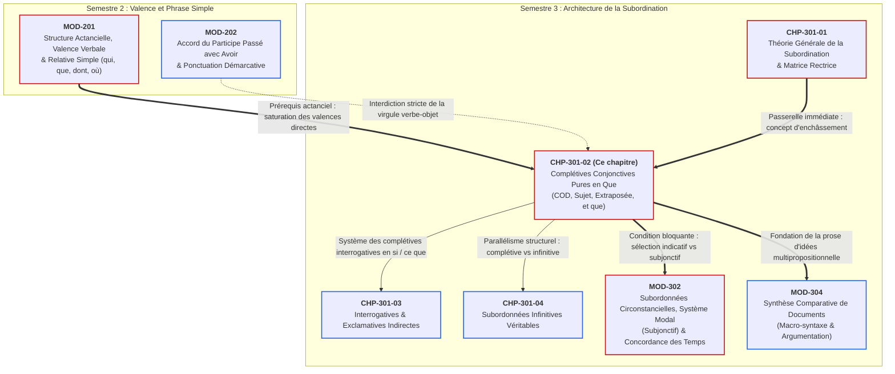

# Chapitre 2 — Les Complétives Conjonctives Pures en Que : Morphème Asémantique, Positions Actancielles et Répétition Normative

> **Identifiant du chapitre** : `CHP-301-02`  
> **Module de rattachement** : [`MOD-301` — Architecture de la Subordination : Complétives Conjonctives, Interrogatives Indirectes, Infinitives et Relatives Complexes](file:///f:/Formation/world-class-french/03-curriculum/year-2/semester-3/mod-301-architecture-subordination-completives.md)  
> **Semestre** : Année 2 — Semestre 3 (S3)  
> **Volume horaire canonique** : 5 à 6 heures d'apprentissage autonome délibéré et d'ateliers d'application (Phase 1 Étude : 1 h 30 | Phase 2 Pratique : 1 h 30 | Phase 3 Correction : 1 h 00 | Phase 4 Évaluation : 1 h 00)  
> **Statut du document** : [STATUT : PROPOSÉ — EN ATTENTE DE VALIDATION]  
> **Compétences associées** : [`FR-SYNTAX-002`](file:///f:/Formation/world-class-french/02-competency-framework/competency-framework.md#fr-syntax-002-architecture-de-la-subordination-complexe) (L3 Autonomie), [`FR-INT-001`](file:///f:/Formation/world-class-french/02-competency-framework/competency-framework.md#fr-int-001-rédiger-un-texte-long-cohérent-en-maîtrisant-accords-et-ponctuation) (L3 Autonomie)  
> **Sources scientifiques de référence** : `SRC-GRAM-01` (Grevisse & Goosse, 2016, § 1060-1065), `SRC-GRAM-02` (Riegel et al., 2016, chap. 14), `SRC-NORM-03` (Ministère de l'Éducation nationale, 2020, p. 44-46), `SRC-TYPO-01` (Imprimerie nationale, 2002, p. 142-143)

---

## 1. Titre et Place dans le Cursus

### 1.1 Intitulé Officiel
**Chapitre 2 : Les Complétives Conjonctives Pures en Que : Morphème Asémantique, Positions Actancielles et Répétition Normative** (`CHP-301-02`).

### 1.2 Insertion Architecturale et Graphe de Dépendances
Au sein du module [`MOD-301`](file:///f:/Formation/world-class-french/03-curriculum/year-2/semester-3/mod-301-architecture-subordination-completives.md), ce deuxième chapitre constitue le cœur opérationnel de l'architecture propositionnelle. Alors que le premier chapitre ([`CHP-301-01`](file:///f:/Formation/world-class-french/03-curriculum/year-2/semester-3/mod-301-architecture-subordination-completives.md#chapitre-1--théorie-de-la-subordination-et-de-lenchâssement-2-h-30)) a défini les principes théoriques de l'enchâssement et la distinction fondamentale entre la matrice rectrice et la proposition régie, le chapitre présent étudie la subordonnée actancielle par excellence : la **proposition complétive conjonctive pure introduite par la conjonction *que*** [Réf. `SRC-GRAM-02`, chap. 14].



- **En amont** : Ce chapitre capitalise directement sur la théorie de la valence verbale et de la transitivité directe étudiée dans [`MOD-201`](file:///f:/Formation/world-class-french/03-curriculum/year-1/semester-2/mod-201-syntaxe-fonctionnelle-phrase-simple.md). Une proposition complétive ne fait que transposer sous une forme propositionnelle finie l'argument direct requis par le verbe recteur. Il mobilise en outre le discernement acquis lors de l'étude de la relative simple ([`CHP-201-06`](file:///f:/Formation/world-class-french/03-curriculum/year-1/semester-2/mod-201/chp-201-06-proposition-relative-simple.md)) pour dresser une frontière infranchissable entre le pronom relatif anaphorique *que* et la conjonction pure *que*.
- **En aval** : 
  - **Vers [`MOD-302`](file:///f:/Formation/world-class-french/03-curriculum/year-2/semester-3/syllabus.md)** : Le choix du mode (indicatif vs subjonctif) dans la proposition complétive dépend rigoureusement de la sémantique du verbe recteur (déclaration, opinion, volonté, sentiment, doute). Maîtriser le découpage de la complétive est le préalable absolu à toute concordance modale.
  - **Vers [`MOD-304`](file:///f:/Formation/world-class-french/03-curriculum/year-2/semester-3/syllabus.md)** et l'écriture de recherche : La rédaction d'une argumentation universitaire dense repose sur l'enchaînement de complétives assertives coordonnées sans rupture de construction.

---

## 2. Objectifs Mesurables

Au terme des 5 à 6 heures d'apprentissage délibéré et d'ateliers d'application, l'apprenant sera capable de :

1. **Identifier et délimiter formellement** toute proposition subordonnée complétive conjonctive pure introduite par *que* au sein d'une période multipropositionnelle, en démontrant par des tests distributionnels le statut asémantique et non anaphorique de la conjonction ([`FR-SYNTAX-002`](file:///f:/Formation/world-class-french/02-competency-framework/competency-framework.md#fr-syntax-002-architecture-de-la-subordination-complexe), Palier L3).
2. **Déterminer avec exactitude la fonction syntaxique externe** assumée par la complétive dans la matrice rectrice : complément d'objet direct (verbes d'assertion, d'opinion ou de volonté), sujet canonique en tête de phrase, sujet extraposé sous recteur impersonnel neutre, complément d'un substantif abstrait ou d'un adjectif ([`FR-SYNTAX-002`](file:///f:/Formation/world-class-french/02-competency-framework/competency-framework.md#fr-syntax-002-architecture-de-la-subordination-complexe), Palier L3).
3. **Appliquer infailliblement la règle normative de la coordination des complétives** en répétant obligatoirement la conjonction *que* après le coordonnant (*et que, ou que, mais que*) et en éliminant toute asymétrie de construction ([`FR-SYNTAX-002`](file:///f:/Formation/world-class-french/02-competency-framework/competency-framework.md#fr-syntax-002-architecture-de-la-subordination-complexe), Palier L3).
4. **Rédiger et ponctuer un plaidoyer ou un texte d'analyse juridique et philosophique** intégrant des complétives réparties sur au moins trois positions actancielles différentes, en respectant la stricte interdiction de la virgule entre le verbe recteur et son objet propositionnel ([`FR-INT-001`](file:///f:/Formation/world-class-french/02-competency-framework/competency-framework.md#fr-int-001-rédiger-un-texte-long-cohérent-en-maîtrisant-accords-et-ponctuation), Palier L3).

---

## 3. Prérequis et Test de Préparation

### 3.1 Prérequis Exigibles
Avant d'entamer ce chapitre, l'apprenant doit avoir assimilé :
- La **valence verbale et la transitivité directe** ([`MOD-201`](file:///f:/Formation/world-class-french/03-curriculum/year-1/semester-2/mod-201-syntaxe-fonctionnelle-phrase-simple.md)) : distinguer un verbe bivalent transitif direct (*déclarer, vouloir*) d'un verbe monovalent intransitif (*dormir*) ou transitif indirect (*songer à*).
- La **distinction fondamentale Nature vs Fonction** ([`MOD-102`](file:///f:/Formation/world-class-french/03-curriculum/year-1/semester-1/mod-102-classes-mots-accords-fondamentaux.md)) : ne jamais confondre la classe grammaticale d'un terme (*conjonction de subordination*) et sa fonction syntaxique (*outil de liaison*).
- Le fonctionnement du **pronom relatif *que*** ([`CHP-201-06`](file:///f:/Formation/world-class-french/03-curriculum/year-1/semester-2/mod-201/chp-201-06-proposition-relative-simple.md)) : identification de l'antécédent nominal et fonction interne de COD dans la relative.
- La notion de **tournure impersonnelle et de dédoublement du sujet** ([`CHP-201-05`](file:///f:/Formation/world-class-french/03-curriculum/year-1/semester-2/mod-201/chp-201-05-tournures-impersonnelles-dedoublement-sujet.md)) : distinction entre le pronom impersonnel neutre *il* (sujet apparent ou grammatical) et la séquence postposée (sujet réel ou logique).

### 3.2 Test de Préparation (Auto-Diagnostic à 5 Questions)
Répondez aux cinq questions suivantes sur une feuille de brouillon avant de dérouler le corrigé :

1. **Question 1 (Saturation actancielle)** : Dans la phrase simple *« Le procureur exige la comparution du témoin »*, quelle est la valence du verbe *exiger* et quelle est la fonction du syntagme nominal *la comparution du témoin* ? Que devient cette case fonctionnelle si l'on écrit *« Le procureur exige que le témoin comparaisse »* ?
2. **Question 2 (Nature de *que*)** : Soit les deux phrases : *(a) « La décision que le conseil a promulguée suscite des débats »* et *(b) « Le conseil décide que la séance sera levée »*. Dans laquelle de ces phrases le mot *que* est-il un pronom relatif ? Dans laquelle est-il une conjonction ? Justifiez par un test formel.
3. **Question 3 (Structure impersonnelle)** : Dans *« Il convient que les délais soient respectés »*, quel est le rôle du pronom *Il* et quel est le statut de la proposition *que les délais soient respectés* ?
4. **Question 4 (Coordination normative)** : Corrigez l'énoncé suivant fréquemment relevé dans les copies de concours : *« Le juge constate que le prévenu a reconnu les faits et regrette sincèrement son geste. »* (dans l'hypothèse où le prévenu regrette son geste).
5. **Question 5 (Ponctuation démarcative)** : Pourquoi la phrase *« L'avocat général a soutenu, que les preuves matérielles étaient accablantes »* contient-elle une faute typographique et syntaxique grossière ?

<details>
<summary><b>Consulter le corrigé raisonné de l'auto-diagnostic (cliquer pour dérouler)</b></summary>

1. **Réponse 1** : Le verbe *exiger* est un verbe **transitif direct bivalent** ; il requiert un premier actant sujet (*Le procureur*) et un second actant complément d'objet direct (*la comparution du témoin*). Dans la seconde phrase, la case fonctionnelle de COD n'a pas changé de nature syntaxique : elle est simplement occupée par une **proposition subordonnée complétive conjonctive** (*que le témoin comparaisse*), illustrant la stricte équivalence distributionnelle entre syntagme nominal et complétive [Réf. `SRC-NORM-03`, p. 44].
2. **Réponse 2** : Dans *(a)*, *que* est un **pronom relatif** : il possède un antécédent nominal plein (*décision*), commute avec *laquelle*, et assume la fonction interne de COD du verbe subordonné *a promulguée*. Dans *(b)*, *que* est une **conjonction de subordination complétive pure** : il ne remplace aucun nom, n'a pas d'antécédent, ne peut pas commuter avec *laquelle*, et n'exerce aucune fonction interne dans la subordonnée (*la séance sera levée* est déjà une proposition syntaxiquement complète) [Réf. `SRC-GRAM-01`, § 1060].
3. **Réponse 3** : Le verbe *convenir* est employé ici à la forme unipersonnelle/impersonnelle. Le pronom clitique *Il* est le **sujet apparent** (ou sujet grammatical de position). La proposition subordonnée complétive *que les délais soient respectés* est le **sujet réel** (ou séquence postposée extraposée) [Réf. `SRC-GRAM-02`, chap. 14].
4. **Réponse 4** : En français surveillé, la coordination de deux complétives régies par le même verbe exige la **répétition obligatoire de la conjonction *que*** : *« Le juge constate que le prévenu a reconnu les faits **et qu'il** regrette sincèrement son geste. »* L'ellipse de *qu'il* crée une ambiguïté vicieuse (on pourrait croire que c'est le juge qui regrette le geste) et constitue un manquement aux règles de la coordination savante [Réf. `SRC-GRAM-01`, § 1063].
5. **Réponse 5** : La règle d'or de la virgule interdit formellement de séparer un verbe de son complément d'objet direct, que ce COD soit un simple nom ou une proposition complétive. La virgule brise artificiellement le lien de rection prédicative. Il faut écrire sans pause graphique : *« L'avocat général a soutenu **que** les preuves matérielles étaient accablantes. »* [Réf. `SRC-TYPO-01`, p. 142].

> **Bilan diagnostique** : Un résultat inférieur à 4/5 exige une lecture attentive des sections 7.1, 7.3 et 7.5 avant de réaliser les exercices.
</details>

---

## 4. Situation de Départ ou Problème Concret

### 4.1 Les Trois Pathologies de la Complétive dans l'Écrit Académique et Juridique
Dans la rédaction d'un mémoire universitaire, d'un rapport de synthèse ou d'un acte de procédure, l'armature de la pensée repose sur l'expression d'opinions, de jugements, de constats et d'injonctions. Or, trois erreurs récurrentes viennent ruiner la précision et la crédibilité de nombreux scripteurs :

1. **L'aveuglement catégoriel (confusion relatif / complétive)** :  
   Un rapporteur administratif écrit :  
   > ❌ *« Nous partageons l'assurance **dont** le ministre a fait part... »* (relatif maladroit)  
   puis, par mimétisme fautif :  
   > ❌ *« Nous partageons la certitude **dont** les réformes aboutiront rapidement. »*  
   Le rédacteur imagine que *dont* apporte une solennité stylistique supérieure, alors que *les réformes aboutiront* n'admet aucun complément prépositionnel en *de* vacant ! La subordonnée n'est pas une relative, mais une complétive du substantif abstrait *certitude*, qui exige exclusivement la conjonction pure *que* (*la certitude **que** les réformes aboutiront*).
2. **L'amputation coordonnée (l'ellipse fautive de *que*)** :  
   Dans une note de synthèse, on lit couramment :  
   > ❌ *« Le directoire estime que les investissements sont prioritaires **et** les recrutements doivent être suspendus. »*  
   L'oubli de la conjonction *que* après le coordonnant *et* détruit la régie hiérarchique. La seconde proposition semble flotter ou s'ériger en proposition indépendante juxtaposée, rompant le pacte d'enchâssement attendu dans le registre soutenu.
3. **Le rejet bancal de la complétive sujet** :  
   Pour varier son style, l'étudiant tente d'antéposer une complétive sujet mais trébuche sur la soudure syntaxique :  
   > ❌ *« Qu'il refuse de comparaître, cela démontre sa culpabilité. »* (dislocation familière par reprise pronominale superflue)  
   > ❌ *« Qu'il refuse de comparaître, démontre sa culpabilité. »* (virgule fautive coupant le sujet de son verbe)  
   La construction académique pure exige une intégration fluide sans scorie : *« Qu'il refuse de comparaître démontre sa culpabilité. »*

Pour éradiquer ces défaillances, il convient de comprendre la mécanique intime de ce connecteur si singulier : la conjonction *que*.

---

## 5. Explication Intuitive : L'Analogie du Câble HDMI et de la Prise Actancielle

Pour saisir le fonctionnement exact d'une complétive sans se perdre dans l'abstraction, recourons à l'analogie d'une **connexion audiovisuelle** :

```text
VERBE PRINCIPAL (Écran / Récepteur)                  PROPOSITION COMPLÉTIVE (Source)
┌─────────────────────────────────┐               ┌─────────────────────────────────────┐
│  Le témoin certifie [   ?   ]   │ ◄═══════════► │ [que]  le feu était au vert.        │
└─────────────────┬───────────────┘   CÂBLE HDMI  └─────────────────────────────────────┘
                  │                   (Conjonction       • Ne transporte aucune matière propre
         PRISE ACTANCIELLE            asémantique)       • Ne remplace aucun mot de l'écran
            (Case COD)                                   • Branche un événement complet dans la prise
```

1. **La prise actancielle du verbe** :  
   Un verbe comme *certifier*, *affirmer* ou *vouloir* possède une entrée actancielle ouverte. Il attend un complément d'objet direct. Si l'on y branche un simple syntagme nominal (*son accord*), celui-ci s'insère directement comme une clé USB : *« Le témoin certifie son accord. »*
2. **Le signal propositionnel complet** :  
   Mais supposons que l'on veuille introduire dans cette même prise un événement complet, articulé avec son propre sujet, son propre verbe conjugué et ses compléments (*le feu était au vert*). Un tel bloc prédicatif ne peut pas s'insérer à l'état brut (*\*Le témoin certifie le feu était au vert* est agrammatical en français standard).
3. **Le câble HDMI neutre (la conjonction *que*)** :  
   La conjonction *que* agit exactement comme un câble HDMI neutre. Elle ne contient en elle-même **aucune image, aucun son, aucune matière sémantique** : elle est asémantique. Elle ne remplace rien dans la proposition principale (elle n'a pas d'antécédent) et n'occupe aucune fonction à l'intérieur de la subordonnée. Son unique rôle physique consiste à **adapter le format propositionnel** pour permettre à toute la phrase subordonnée de venir saturer la prise COD du verbe principal.

---

## 6. Définitions Précises et Terminologie

Observons d'abord cet énoncé modèle issu de la prose juridique :
> *« Le conseil des ministres **déclare** [qu'une commission d'enquête sera instituée] et **qu'elle** déposera son rapport sous quinzaine. »*

1. **Proposition subordonnée complétive** : Proposition subordonnée enchâssée qui assume auprès d'un verbe, d'un nom ou d'un adjectif recteur une fonction syntaxique équivalente à celle d'un syntagme nominal actanciel (le plus souvent complément d'objet direct ou sujet) [Réf. `SRC-NORM-03`, p. 44].
2. **Conjonction de subordination complétive (*que*)** : Mot subordonnant invariable qui introduit la proposition complétive pure. Contrairement aux conjonctions circonstancielles (*parce que, bien que*), la conjonction complétive *que* est dépourvue de sens lexical intrinsèque ; elle signale purement la dépendance syntaxique [Réf. `SRC-GRAM-01`, § 1060].
3. **Morphème asémantique (ou morphème vide)** : En linguistique formelle, élément grammatical obligatoire qui ne véhicule aucune signification sémantique propre (ni temps, ni cause, ni modalité en lui-même) et qui n'exerce aucune fonction anaphorique ou référentielle (synonyme de *complémentiseur pur*) [Réf. `SRC-GRAM-02`, chap. 14].
4. **Complétive COD (Complément d'Objet Direct)** : Proposition complétive qui sature la valence d'un verbe transitif direct régissant en répondant à la question *quoi ?* posée après le verbe (*« L'accusé reconnaît [qu'il a menti] »*).
5. **Complétive sujet en tête** vs **Complétive sujet extraposée** :
   - **Complétive sujet en tête** : Complétive antéposée qui occupe la position canonique de sujet du verbe recteur (*« [Qu'il vienne à la réunion] nous obligerait »*).
   - **Complétive extraposée** : Complétive rejetée après le verbe sous l'égide du pronom impersonnel neutre *il*, qui sert de sujet apparent (*« Il nous obligerait [qu'il vienne à la réunion] »* ou plus couramment *« Il importe [qu'il vienne] »*) [Réf. `SRC-GRAM-02`, chap. 14].
6. **Complétive régie par un nom (Complétive du nom abstrait)** : Proposition complétive dépendant d'un substantif déverbal ou abstrait exprimant une pensée, un sentiment ou une déclaration (*la certitude que, la preuve que, l'espoir que*), dont elle explicite le contenu propositionnel sans jouer le rôle d'une relative.
7. **Complétive régie par un adjectif (Complétive de l'adjectif)** : Proposition complétive complétant un adjectif attribut exprimant une certitude, un sentiment ou une évaluation (*sûr que, fier que, heureux que, indiscutable que*).
8. **Reprise par *et que*** : Règle syntaxique contraignante imposant de répéter la conjonction *que* immédiatement après un coordonnant (*et, mais, ou*) pour régir la seconde proposition complétive dépendant d'un même recteur [Réf. `SRC-GRAM-01`, § 1063].

---

## 7. Règles ou Mécanismes Fondamentaux

### 7.1 Statut Linguistique de la Conjonction *que* : Pur Outil de Liaison Hiérarchique
La distinction entre la **conjonction de subordination complétive *que*** et le **pronom relatif *que*** est le pivot de toute la syntaxe française [Réf. `SRC-GRAM-01`, § 1060 ; `SRC-GRAM-02`, chap. 14] :

```text
                                  LE MOT « QUE » EN FRANÇAIS
                                              │
                    ┌─────────────────────────┴─────────────────────────┐
                    ▼                                                   ▼
       CONJONCTION COMPLÉTIVE PURE                              PRONOM RELATIF SIMPLE
   • Dépourvue d'antécédent nominal                    • Possède un antécédent nominal/pronominal
   • Morphème asémantique (vide)                       • Représentant anaphorique plein
   • ZÉRO fonction interne dans la subordonnée         • Fonction interne propre (toujours COD)
   • Commutation impossible avec lequel/laquelle       • Commute parfaitement avec lequel/laquelle
   • Subordonnée syntaxiquement complète               • Subordonnée incomplète sans lui (manque son COD)
```

#### Le Protocole des Trois Tests Dérivés
Pour déterminer infailliblement la nature de *que*, appliquez l'algorithme suivant :
1. **Test 1 : Recherche de l'antécédent nominal**  
   - Si *que* est précédé directement d'un verbe conjugué (*Il dit que...*), c'est une **conjonction**.
   - S'il est précédé d'un nom, passer au Test 2.
2. **Test 2 : Contrôle de complétude interne de la subordonnée**  
   Retirez le mot *que* et analysez les constituants restants de la subordonnée :
   - *« La loi [que l'Assemblée vote]... »* $\rightarrow$ *L'Assemblée vote* (il manque un COD au verbe *voter* ; c'est le pronom *que* qui est ce COD $\rightarrow$ **Pronom relatif**).
   - *« La conviction [que l'Assemblée votera ce texte]... »* $\rightarrow$ *L'Assemblée votera ce texte* (le verbe *votera* possède déjà son sujet *L'Assemblée* et son COD *ce texte* ; il n'y a aucune place vacante $\rightarrow$ **Conjonction de subordination complétive du nom**).
3. **Test 3 : Commutation avec *lequel / laquelle***  
   - *« La motion que vous défendez »* $\rightarrow$ *« La motion laquelle vous défendez »* (certes archaïque ou lourd, mais syntaxiquement intelligible $\rightarrow$ **Relatif**).
   - *« Je pense que vous réussirez »* $\rightarrow$ *\*« Je pense laquelle vous réussirez »* (totalement agrammatical et absurde $\rightarrow$ **Conjonction complétive**).

---

### 7.2 Les Complétives COD Régies par des Verbes

La fonction cardinale de la complétive est de servir de complément d'objet direct à un verbe transitif direct. Ces verbes recteurs se répartissent en trois grandes classes sémantiques [Réf. `SRC-GRAM-02`, chap. 14] :

#### Classe A : Verbes de déclaration et d'assertion
- **Verbes d'autorité** : *dire, déclarer, affirmer, certifier, assurer, soutenir, prétendre, garantir, attester, notifier, proclamer*.
- **Comportement sémantique et modal** : Ces verbes posent le contenu de la complétive comme un fait avéré ou assumé par l'énonciateur. À la forme affirmative, ils commandent universellement le **mode indicatif** (ou le conditionnel à valeur de futur du passé ou d'atténuation) :
  - *« Le témoin affirme que le prévenu était présent sur les lieux. »* (Indicatif imparfait)
  - *« La météo annonce qu'il neigera demain sur le plateau. »* (Indicatif futur)

#### Classe B : Verbes d'opinion, de croyance et de perception intellectuelle
- **Verbes d'opinion** : *penser, croire, estimer, juger, considérer, supposer, présumer, imaginer*.
- **Comportement sémantique et modal** :
  - À la forme **affirmative**, l'énonciateur adhère à la probabilité de l'assertion $\rightarrow$ **Mode indicatif** :  
    *« Les experts estiment que le cours de l'or va fléchir. »*
  - À la forme **négative ou interrogative avec inversion**, l'énonciateur révoque ou met en doute la vérité du contenu propositionnel $\rightarrow$ bascule fréquente vers le **mode subjonctif** (amorce capitale pour [`MOD-302`](file:///f:/Formation/world-class-french/03-curriculum/year-2/semester-3/syllabus.md)) :  
    *« Les experts n'estiment pas que le cours de l'or **fléchisse** sous peu. »*  
    *« Croyez-vous que cette mesure **soit** réellement efficace ? »*

#### Classe C : Verbes de volonté, de sentiment, d'obligation et d'attente
- **Verbes de volonté et d'injonction** : *vouloir, ordonner, exiger, souhaiter, commander, interdire, supplier*.
- **Verbes de sentiment et de jugement affectif** : *craindre, redouter, regretter, déplorer, se réjouir, douter*.
- **Comportement sémantique et modal** : Le procès exprimé dans la complétive n'est pas posé dans l'existence réelle (ce n'est pas un fait constaté), mais dans la pure visée psychologique de l'esprit (un monde virtuel ou désiré) $\rightarrow$ sélection obligatoire du **mode subjonctif** [Réf. `SRC-GRAM-01`, § 1070] :
  - *« Le tribunal exige que les scellés **soient** examinés sur-le-champ. »*
  - *« Le doyen déplore que les étudiants **aient** négligé ce séminaire. »*

---

### 7.3 Les Complétives Sujets : En Tête Canonique vs Extraposées

Une proposition complétive peut occuper la fonction de **sujet du verbe principal**. Elle adopte alors deux structures discursives opposées [Réf. `SRC-GRAM-02`, chap. 14 ; `SRC-NORM-03`, p. 45] :

#### 1. La complétive sujet en tête de phrase (Position thématique noble)
La complétive est placée en position initiale avant le verbe recteur. Cette construction, hautement surveillée et fréquente dans la prose oratoire ou académique, présente deux contraintes normatives strictes :
- **Sélection modale** : Le verbe de la complétive sujet en tête se met **presque toujours au subjonctif**, le fait étant envisagé sous l'angle du jugement ou du constat préalable :
  - *« [Qu'un tel compromis **soit** trouvé] honore les deux délégations. »*
  - *« [Que vous **refusiez** d'obtempérer] compliquera singulièrement votre défense. »*
- **Règle d'or de la ponctuation** : Il est **formellement interdit d'insérer une virgule** entre la complétive sujet et le verbe recteur qu'elle commande :
  - ❌ Fautif : *« \*Qu'il ait commis cette faute, est incontestable. »*
  - $\checkmark$ Normé : *« Qu'il ait commis cette faute est incontestable. »*
- **Proscription de la reprise clitique redondante** : On évitera d'insérer un *cela* ou *ce* pléonastique (*Qu'il vienne, cela nous réjouit* est toléré à l'oral mais proscrit dans la grande prose soutenue où l'on écrit directement *Qu'il vienne nous réjouit*).

#### 2. La complétive sujet extraposée sous recteur impersonnel neutre
Pour éviter la lourdeur d'un sujet propositionnel antéposé, le français recourt préférentiellement à l'**extraposition** : la proposition est rejetée en fin d'énoncé, et la case sujet initiale est comblée par le pronom impersonnel neutre *il* :
- *« **Il** honore les deux délégations [qu'un tel compromis ait été trouvé]. »*
- *« **Il** est incontestable [qu'il a commis cette faute]. »*
- *« **Il** importe [que chacun prenne ses responsabilités]. »*

Dans cette configuration :
- *Il* est le **sujet apparent** (support grammatical obligatoire) ;
- La complétive en *que* est le **sujet réel** (ou séquence actancielle extraposée) [Réf. `SRC-NORM-03`, p. 45].

---

### 7.4 Les Complétives Régies par des Substantifs et des Adjectifs

La rection d'une complétive n'est pas le privilège exclusif du verbe. Deux autres têtes syntaxiques peuvent gouverner une complétive en *que* :

#### 1. Les complétives compléments du nom abstrait
Elles dépendent de substantifs déverbaux ou abstraits désignant des actes de communication, de pensée ou de sentiment (*l'idée, la certitude, l'espoir, la nouvelle, la crainte, la preuve, le soupçon, le bruit*) :
- *« Nous conservons **l'espoir** [que les otages seront libérés]. »*
- *« Le procureur apporte **la preuve** [que l'alibi était forgé de toutes pièces]. »*
- *« **La nouvelle** [que la paix était signée] se répandit comme une traînée de poudre. »*

> [!WARNING]
> **Frontière cardinale Complétive du Nom vs Relative Déterminative** :  
> - Dans la complétive du nom, le substantif recteur n'est pas qualifié : **son contenu sémantique est intégralement explicité par la proposition**. Il y a une identité d'équivalence logique : *l'espoir = les otages seront libérés*. Le mot *que* est une pure conjonction.  
> - Dans la relative, le substantif est simplement déterminé par une propriété extérieure : *« L'espoir [que nous caressons] »* $\rightarrow$ *que* est le COD de *caressons* (nous caressons cet espoir).

#### 2. Les complétives compléments de l'adjectif
Elles complètent un adjectif attribut du sujet exprimant une certitude, une appréciation ou un affect (*sûr, certain, fier, heureux, conscient, soucieux, digne*) :
- *« Le directeur est **convaincu** [que notre dossier triomphera]. »*
- *« Nous sommes **fiers** [que vous représentiez notre université]. »*
- *« Le gouvernement est **conscient** [que la rigueur budgétaire pèse sur les ménages]. »*

---

### 7.5 La Règle d'Or de la Coordination des Complétives : Répétition Obligatoire de *que*

C'est l'une des lois les plus rigoureuses de la syntaxe classique et académique française [Réf. `SRC-GRAM-01`, § 1063] :

> [!IMPORTANT]
> **Règle canonique de coordination** : Lorsque deux ou plusieurs propositions subordonnées complétives dépendant du même verbe recteur sont coordonnées par une conjonction de coordination (*et, mais, ou*) ou juxtaposées, **la conjonction de subordination *que* DOIT ÊTRE OBLIGATOIREMENT RÉPÉTÉE devant chaque proposition subordonnée**.

Observons les contrastes normatifs :

1. **Coordination par *et*** :
   - ❌ **Fautif (solécisme de coordination)** :  
     *« Le président a affirmé que les frontières seraient rouvertes **et** les échanges commerciaux reprendraient sans délai. »*
   - $\checkmark$ **Correct et normé** :  
     *« Le président a affirmé que les frontières seraient rouvertes **et qu'**ils reprendraient sans délai. »* (ou *« ... et que les échanges commerciaux reprendraient... »*).
2. **Coordination avec changement de sujet actanciel** :
   - *« Le juge ordonne que l'accusé **soit** écroué **et qu'**une expertise psychologique **soit** immédiatement diligentée. »*  
     (L'ellipse de *qu'* ferait paraître *une expertise* comme un second sujet non relié ou produirait un télescopage agrammatical).
3. **Coordination par *mais*** :
   - *« Je savais qu'il viendrait, **mais qu'**il ne resterait que quelques minutes. »*

L'omission de *que* après le coordonnant est sévèrement sanctionnée dans les jurys de concours de l'enseignement supérieur (CAPES, Agrégation, École nationale d'administration).

---

## 8. Raisonnement Détaillé : Pourquoi la Complétive Sature la Valence Verbale

Pourquoi la langue française a-t-elle forgé cette structure complétive, et pourquoi se comporte-t-elle exactement comme un groupe nominal ?

### 8.1 La Théorie de la Saturation des Arguments
Considérons l'armature logique d'un verbe bivalent comme *vouloir* ou *constater*. Selon la théorie de la grammaire générative et de la sémantique formelle, ce verbe dénote une relation binaire à deux places argumentales [Réf. `SRC-GRAM-02`, chap. 14] :
$$\text{CONSTATER}(x, y)$$
- $x$ est l'expérimentateur ou l'agent (Sujet) ;
- $y$ est l'objet constaté (Complément d'objet direct).

Si l'objet $y$ est un objet matériel ou un concept unitaire, la langue utilise un syntagme nominal (`SN`) :
- *« Jean constate [l'erreur du greffier]. »*

Mais que se passe-t-il lorsque l'objet $y$ est lui-même **un événement complet, une situation relationnelle complexe** impliquant un autre sujet et une autre action ? Par exemple : *« le greffier a commis une erreur de transcription dans le registre des délibérations »*.

La langue doit résoudre un problème d'architecture : **comment insérer un énoncé complet comportant son propre temps et ses propres actants dans une case réservée à un nom ?**

```text
               PARALLÉLISME STRUCTURAL ABSOLU
               
         Sujet               Verbe recteur                  COD
┌──────────────────────┬───────────────────────┬───────────────────────────────┐
│     L'historien      │       démontre        │    la fausseté de la thèse.   │  <- Syntagme Nominal
├──────────────────────┼───────────────────────┼───────────────────────────────┤
│     L'historien      │       démontre        │  [que cette thèse est fausse].│  <- Complétive Conjonctive
└──────────────────────┴───────────────────────┴───────────────────────────────┘
```

La conjonction *que* est précisément l'opérateur de **propositionnalisation nominale** (ou nominalisation sans perte du verbe). Elle encapsule une prédication tout entière pour lui conférer la distribution externe d'un nom. C'est pourquoi la proposition complétive :
- peut être pronominalisée par le pronom neutre *le* (*L'historien le démontre*) ;
- peut être clivée par *C'est... que* (*C'est que cette thèse est fausse que démontre l'historien*) ;
- répond au questionnement interrogatif direct *Que démontre l'historien ?*.

### 8.2 Pourquoi l'Omission de *que* est Strictement Interdite en Français
En anglais contemporain, le complémentiseur *that* peut subir une chute libre dans les contextes familiers ou rapides (*I know you are right* au lieu de *I know that you are right*). Pourquoi le français refuse-t-il catégoriquement cette licence (*\*Je sais tu as raison*) ?

En français, la démarcation syntaxique est essentiellement **directionnelle et morphologique**. Le verbe français est incapable d'absorber une proposition subordonnée sans un commutateur formel de frontière. L'absence de *que* provoquerait un télescopage immédiat entre le verbe principal et le sujet subordonné, créant une ambiguïté d'énonciation. Le morphème *que* est le **garde-frontière structural** indispensable qui signale à l'interlocuteur : *« Attention, ce qui suit n'est pas un nouvel énoncé autonome, mais un constituant dépendant du verbe précédent »*.

---

## 9. Exemples Corrects Commentés

Analysons en profondeur quatre phrases modèles exemplaires illustrant les différentes architectures de la complétive :

### Exemple 1 : Complétive COD d'un Verbe Déclaratif dans la Prose Judiciaire
> *« Le bâtonnier de l'ordre **certifie** [que le jeune confrère a prêté serment dans le respect des traditions du barreau]. »*

- **Découpage structurel** :
  - **Matrice rectrice** : *Le bâtonnier de l'ordre certifie [quelque chose]* (Sujet : *Le bâtonnier de l'ordre*, Verbe bivalent transitif direct d'assertion : *certifie*).
  - **Proposition subordonnée complétive** : *[que le jeune confrère a prêté serment dans le respect des traditions du barreau]*.
- **Analyse du mot subordonnant *que*** :
  - Classe : Conjonction de subordination complétive.
  - Caractéristiques : Asémantique, invariable, sans antécédent nominal, aucune fonction syntaxique à l'intérieur de la subordonnée.
- **Fonction syntaxique externe de la subordonnée** :
  - **Complément d'objet direct (COD)** du verbe *certifie*.
- **Sélection modale** :
  - Verbe recteur d'assertion positive à la forme affirmative $\rightarrow$ **Indicatif passé composé** (*a prêté*).
- **Ponctuation** :
  - Aucune virgule entre *certifie* et *que*.

---

### Exemple 2 : Complétive Sujet Antéposée dans un Essai Politique Béninois
> *« [Qu'une telle constitution **garantisse** la séparation stricte des pouvoirs] **constitue** le rempart le plus sûr contre toute dérive despotique. »*

- **Découpage structurel** :
  - **Proposition subordonnée complétive (antéposée)** : *[Qu'une telle constitution garantisse la séparation stricte des pouvoirs]*.
  - **Matrice rectrice** : *[...] constitue le rempart le plus sûr contre toute dérive despotique*.
- **Analyse fonctionnelle** :
  - La complétive en *que* occupe la fonction de **sujet grammatical et sémantique** du verbe recteur *constitue*.
- **Sélection modale** :
  - Complétive sujet en tête $\rightarrow$ sélection réflexive du **subjonctif présent** (*garantisse*).
- **Vigilance typographique** :
  - Absence absolue de virgule entre le mot *pouvoirs* et le verbe *constitue*.
- **Variante extraposée équivalente** :
  - *« **Il** constitue le rempart le plus sûr contre toute dérive despotique [qu'une telle constitution garantisse la séparation stricte des pouvoirs]. »* (avec *Il* sujet apparent et la complétive sujet réel extraposé).

---

### Exemple 3 : Complétive Régie par un Nom Abstrait
> *« Le professeur nourrissait **l'intime conviction** [que son disciple dépasserait bientôt ses propres maîtres]. »*

- **Découpage structurel** :
  - **Matrice rectrice** : *Le professeur nourrissait l'intime conviction*.
  - **Proposition régie** : *[que son disciple dépasserait bientôt ses propres maîtres]*.
- **Analyse différentielle** :
  - Le mot *conviction* est un nom abstrait de pensée.
  - La proposition subordonnée n'est pas une relative : elle ne qualifie pas la conviction par une circonstance extérieure, elle en **définit intégralement le contenu de pensée**.
  - Si l'on applique le test d'extraction, la subordonnée *son disciple dépasserait bientôt ses propres maîtres* possède son propre sujet (*son disciple*) et son propre COD (*ses propres maîtres*). Le mot *que* n'a donc aucune fonction interne.
- **Fonction syntaxique externe** :
  - **Complément du nom** abstrait *conviction*.

---

### Exemple 4 : Double Complétive Coordonnée avec Répétition Normative dans un Discours Diplomatique
> *« Le ministre des Affaires étrangères a solennellement **affirmé** [que les traités internationaux seraient scrupuleusement honorés] **et** [**qu'**aucun ultimatum ne fléchirait la volonté du peuple souverain]. »*

- **Découpage structurel** :
  - **Matrice principale** : *Le ministre des Affaires étrangères a solennellement affirmé [P1] et [P2]*.
  - **Première complétive (P1)** : *[que les traités internationaux seraient scrupuleusement honorés]* (Premier COD du verbe *a affirmé*).
  - **Seconde complétive coordonnée (P2)** : *[qu'aucun ultimatum ne fléchirait la volonté du peuple souverain]* (Second COD du verbe *a affirmé*).
- **Analyse de la coordination** :
  - Conjonction de coordination : *et*.
  - **Reprise obligatoire** de la conjonction de subordination sous la forme élidée *qu'*.
  - Les deux propositions partagent le même verbe recteur (*a affirmé*) et le même mode (*conditionnel présent* à valeur de futur du passé).

---

## 10. Contre-Exemples et Erreurs Fréquentes

L'observation des copies universitaires et des écrits de cadres administratifs permet de recenser six erreurs récurrentes majeures relatives aux complétives en *que* :

### Erreur n° 1 : La confusion entre que conjonctif et que pronom relatif
- ❌ **Énoncé fautif** : *« Le magistrat a réitéré les instructions dont le greffier applique chaque matin. »*
- ❌ **Analyse linguistique de la faute** : Le rédacteur a cru bon d'employer *dont* pour conférer de la noblesse au style, ignorant que le verbe *appliquer* est transitif direct (*appliquer quelque chose*). La place de COD est vacante. Il faut un pronom relatif COD (*que*).
- $\checkmark$ **Correction normée** : *« Le magistrat a réitéré les instructions **que** le greffier applique chaque matin. »* (*que* est pronom relatif, COD d'*applique*, antécédent : *instructions*).
- **Contre-épreuve sur la complétive** : Comparez avec : *« Le magistrat a réitéré l'instruction **que** le greffier devait consigner les pièces. »* Ici, *consigner les pièces* est complet ; *que* est une pure conjonction de subordination, introduisant une complétive du nom *instruction*.

### Erreur n° 2 : L'ellipse fautive de la conjonction que après le coordonnant et
- ❌ **Énoncé fautif** : *« Le recteur garantit que les bourses seront versées lundi **et** les examens se dérouleront dans le calme. »*
- ❌ **Analyse linguistique de la faute** : Le scripteur omet la répétition de la conjonction après *et*. Cette ellipse est un anglicisme syntaxique ou un relâchement oral qui détruit la cohésion de la dépendance actancielle [Réf. `SRC-GRAM-01`, § 1063].
- $\checkmark$ **Correction normée** : *« Le recteur garantit que les bourses seront versées lundi **et que** les examens se dérouleront dans le calme. »*

### Erreur n° 3 : L'insertion d'une virgule interdite entre le verbe recteur et la complétive COD
- ❌ **Énoncé fautif** : *« Les scientifiques soutiennent**,** que le réchauffement climatique accélère l'érosion côtière au Bénin. »*
- ❌ **Analyse linguistique de la faute** : Le rédacteur insère une virgule par réflexe d'intonation respiratoire. Or, en grammaire française, la virgule ne note pas la respiration mais la structure logique. Elle ne doit **jamais** couper un verbe de son complément d'objet direct, quel que soit le volume de ce dernier [Réf. `SRC-TYPO-01`, p. 142].
- $\checkmark$ **Correction normée** : *« Les scientifiques soutiennent **que** le réchauffement climatique accélère l'érosion côtière au Bénin. »*

### Erreur n° 4 : La confusion entre complétive du nom abstrait et proposition relative déterminative
- ❌ **Énoncé fautif** : *« L'hypothèse **dont** la séance soit levée n'a jamais été envisagée par le président. »*
- ❌ **Analyse linguistique de la faute** : L'apprenant commet un calque du syntagme prépositionnel *l'hypothèse de...* et introduit un *dont* absurde. La subordonnée n'est pas une relative (elle n'admet aucun complément d'objet en *de*). Elle explicite directement le contenu de l'hypothèse.
- $\checkmark$ **Correction normée** : *« L'hypothèse **que** la séance soit levée n'a jamais été envisagée par le président. »* (Complétive du nom abstrait *hypothèse*).

### Erreur n° 5 : Le mauvais rattachement d'une complétive extraposée et l'accord vicieux sous recteur impersonnel
- ❌ **Énoncé fautif** : *« \*Il **s'avèrent** indispensable que les lois soient respectées par tous. »*
- ❌ **Analyse linguistique de la faute** : Le scripteur voit mentalement le pluriel de la subordonnée (*les lois soient respectées*) et accorde le verbe impersonnel de la matrice au pluriel. C'est une faute grossière : sous la tournure impersonnelle, le sujet grammatical est le pronom neutre invariant *Il*, qui impose impérativement la 3e personne du singulier [Réf. `SRC-GRAM-01`, § 440].
- $\checkmark$ **Correction normée** : *« Il **s'avère** indispensable que les lois soient respectées par tous. »*

### Erreur n° 6 : La rupture de construction à l'insertion d'une proposition incise ou circonstancielle
- ❌ **Énoncé fautif** : *« Le préfet a déclaré que, malgré les intempéries survenues la veille, **qu'il** maintiendrait le défilé officiel. »*
- ❌ **Analyse linguistique de la faute** : C'est le piège classique du redoublement parasite de *que*. Ayant intercalé un syntagme circonstanciel (*malgré les intempéries...*), le scripteur perd la mémoire de son premier *que* et en réinsère un second devant le verbe. C'est une anacoluthe sévère.
- $\checkmark$ **Correction normée** : *« Le préfet a déclaré **que**, malgré les intempéries survenues la veille, **il** maintiendrait le défilé officiel. »*

---

## 11. Cas Particuliers et Limites

### 11.1 L'Omission Familière de *que* et le Calque de l'Anglais
Dans le registre parlé très relâché ou sous l'influence directe de la syntaxe anglaise, on entend parfois des énoncés tels que :
- ❌ *\*« Je crois tu te trompes. »* (Calque de *I think you are wrong*)
- ❌ *\*« J'espère tu viendras demain. »*

En français académique et standard, cette omission est un solécisme absolu. Le mot *que* est **obligatoire sans exception** :
- $\checkmark$ *« Je crois **que** tu te trompes. »*
- $\checkmark$ *« J'espère **que** tu viendras demain. »*

### 11.2 Les Complétives Régies par des Présentatifs
Les présentatifs *voici, voilà, c'est* peuvent régir une complétive en *que* :
- *« **Voici que** l'orage éclate. »* (Valeur aspectuelle d'imminence ou de soudaineté).
- *« **C'est que** les circonstances ont brutalement changé. »* (Valeur explicative causale).  
Dans ces tournures, la locution fonctionne comme une matrice prédicative régissant la complétive.

### 11.3 La Complétive Infinitive sans Subordonnant (Passerelle vers le Chapitre 4)
Il existe en français une catégorie particulière de subordonnée complétive qui se passe de mot subordonnant : la **proposition subordonnée infinitive véritable**, qui apparaît exclusivement après les verbes de perception (*voir, entendre, écouter, sentir, regarder*) et certains causatifs (*laisser, faire*) :
- *« J'entends [les cloches sonner au loin]. »*
Cette structure satisfaisant le critère d'un sujet actanciel propre (*les cloches*) distinct de celui de la matrice (*Je*) fait l'objet d'une étude autonome dans le module ([`CHP-301-04`](file:///f:/Formation/world-class-french/03-curriculum/year-2/semester-3/mod-301-architecture-subordination-completives.md#chapitre-4--la-proposition-subordonnée-infinitive-véritable-2-h-30)).

---

## 12. Approfondissement Adapté au Niveau : Théorie du Complémentiseur et Sélection Formelle

Pour les apprenants préparant les concours supérieurs (Agrégation, CAPES, Doctorat), il est fructueux d'éclairer la complétive à la lumière de la linguistique générative contemporaine (Chomsky, 1986 ; Grimshaw, 1979, 1990) [Réf. `SRC-GRAM-02`, chap. 14].

### 12.1 La Catégorie du Complémentiseur ($C$) et la Projection $CP$
Dans la théorie standard de la grammaire générative, la proposition n'est pas simplement une phrase ($IP$ ou $TP$, *Tense Phrase*). Elle est chapeautée par une couche fonctionnelle supérieure appelée le **Syntagme du Complémentiseur** ($CP$, *Complementizer Phrase*) :

$$\left[_{CP} \ \text{Spec} \ \left[_{C'} \ C \ \left[_{TP} \ \text{Sujet} \ [ \ T \ [_{VP} \ \text{Verbe} \ \dots ] ] \right] \right] \right]$$

- La tête $C$ est occupée par le morphème *que*.
- Ce morphème $C$ a pour fonction exclusive de **typer la proposition** (il indique qu'il s'agit d'une complétive déclarative finie, par opposition à $C = \text{si}$ pour l'interrogative indirecte).
- Il sert d'interface entre le monde externe de la matrice et le monde interne de la subordonnée.

### 12.2 Sélection Sémantique ($s\text{-selection}$) vs Sélection Catégorielle ($c\text{-selection}$)
Jane Grimshaw a démontré que la rection verbale opère sur deux plans distincts :
1. **La sélection catégorielle ($c\text{-selection}$)** :  
   Le verbe sélectionne la catégorie syntaxique de son argument. Par exemple, *demander* et *savoir* peuvent sélectionner soit un syntagme nominal ($NP$ / $DP$), soit un syntagme de complémentiseur ($CP$) :
   - *« Il sait [_{DP} la vérité]. »*
   - *« Il sait [_{CP} que tu viendras]. »*
2. **La sélection sémantique ($s\text{-selection}$)** :  
   Le verbe sélectionne le type sémantique de son argument : une **proposition assertive** ($[-Q]$), une **question** ($[+Q]$), ou une **exclamation** ($[!]$) :
   - Le verbe *affirmer* sélectionne obligatoirement une proposition déclarative ($[-Q]$) $\rightarrow$ il exige le complémentiseur *que* (*Il affirme que...* et non *\*Il affirme si...*).
   - Le verbe *ignorer* ou *demander* sélectionne une question ($[+Q]$) $\rightarrow$ il admet le complémentiseur interrogatif *si* (*Il demande si...*).
   - Le verbe *douter* sélectionne une incertitude, ce qui conditionne le mode subjonctif au sein de son $CP$.

Cette modélisation prouve que la conjonction *que* n'est pas un simple « mot de liaison », mais le pivot structural par lequel le verbe régissant impose ses contraintes sémantiques et modales au domaine subordonné.

---

## 13. Comparaisons Différentielles

### 13.1 Tableau 1 : Conjonction Complétive *que* vs Pronom Relatif *que*

| Critère d'analyse | Conjonction Complétive *que* | Pronom Relatif *que* |
| :--- | :--- | :--- |
| **Nature morphosyntaxique** | Mot subordonnant pur (conjonction de subordination). | Pronom anaphorique (représentant nominal). |
| **Présence d'un antécédent** | **Aucun antécédent nominal** (dépend directement d'un verbe, d'un adjectif ou d'un nom abstrait). | **Possède obligatoirement un antécédent** (nom ou pronom placé dans la proposition régissante). |
| **Sens et sémantique** | **Asémantique** (morphème vide de contenu). | **Plein** (absorbe le sens, le genre, le nombre et la personne de son antécédent). |
| **Fonction interne dans la subordonnée** | **Zéro fonction** interne (la subordonnée a déjà tous ses constituants). | **Toujours une fonction interne** (très majoritairement **COD** du verbe subordonné). |
| **Test de commutation** | Incommutable avec *lequel / laquelle*. | Commute avec *lequel / laquelle / lesquels / lesquelles*. |
| **Élimination par effacement** | Rend la phrase totalement agrammaticale. | Laisse un manque actanciel évident (COD manquant). |
| **Exemple modèle** | *« J'apprends **que** le train arrive. »* | *« Le train **que** j'attends arrive. »* |

---

### 13.2 Tableau 2 : Complétive du Nom Abstrait vs Relative Déterminative

| Critère d'analyse | Complétive du Nom (*que*) | Relative Déterminative (*que*) |
| :--- | :--- | :--- |
| **Type de substantif recteur** | Nom abstrait déverbal ou notionnel (*idée, fait, certitude, espoir, nouvelle*). | N'importe quel substantif concret ou abstrait (*livre, femme, loi, dossier*). |
| **Rapport logique avec le nom** | **Équivalence d'identité** ($Nom = Proposition$). La complétive explicite le contenu du nom. | **Restriction de l'extension**. La relative ajoute une caractéristique contingente au nom. |
| **Fonction interne de *que*** | Aucune fonction interne (conjonction pure). | Complément d'objet direct (COD) du verbe subordonné. |
| **Suppression du mot complété** | On peut souvent transformer en complétive directe (*« La certitude qu'il viendra »* $\to$ *« Être certain qu'il viendra »*). | Transformation impossible sans restructuration actancielle lourde. |
| **Pronominalisation interne** | *« La preuve [que l'accusé est innocent] »* $\to$ *L'accusé est innocent* est complet. | *« La preuve [que l'accusé apporte] »* $\to$ *L'accusé apporte [cette preuve]* (*que* = COD). |

---

### 13.3 Tableau 3 : Complétive Sujet Initiale vs Complétive Sujet Extraposée

| Critère d'analyse | Complétive Sujet Initiale (en tête) | Complétive Sujet Extraposée (postposée) |
| :--- | :--- | :--- |
| **Position dans l'énoncé** | Antéposée, en tête de phrase avant le verbe. | Rejetée en fin d'énoncé, après le verbe recteur. |
| **Sujet grammatical apparent** | Aucun (la complétive elle-même est le sujet). | Pronom impersonnel neutre *Il*. |
| **Statut fonctionnel de la complétive** | **Sujet grammatical plein et direct**. | **Sujet réel** (ou séquence postposée). |
| **Sélection modale habituelle** | **Subjonctif quasi systématique** (*Qu'il refuse nous surprend*). | **Indicatif ou Subjonctif** selon le sens du verbe impersonnel (*Il est certain que... [ind.]* vs *Il importe que... [subj.]*). |
| **Ponctuation démarcative** | **Zéro virgule** entre la complétive et le verbe. | Zéro virgule avant la complétive extraposée. |
| **Registre et fréquence** | Langue écrite très soutenue, rhétorique, oratoire. | Langue courante, administrative, standard et soutenue. |

---

## 14. Exercices Progressifs (3 Niveaux avec Corrigés Détaillés)

### Niveau 1 : Reconnaissance et Discrimination Formelle (12 Phrases)
**Consigne** : Pour chacune des 12 phrases suivantes, indiquez si le mot souligné **que (qu')** est un **pronom relatif** ou une **conjonction de subordination complétive**. Justifiez brièvement votre réponse par l'application d'un des trois tests formels (présence d'un antécédent, fonction interne de COD, ou complétude de la subordonnée).

1. *Le Premier ministre confirme que le projet de loi sera déposé mardi.*
2. *Le projet de loi que le Premier ministre a défendu suscite des controverses.*
3. *L'assurance que le directeur général a donnée rassure les actionnaires.*
4. *L'assurance que la banque couvrira les créances a mis fin à la panique.*
5. *Qu'il accepte cette mission prestigieuse ne fait plus le moindre doute.*
6. *Le document que le commissaire consulte contient des pièces confidentielles.*
7. *Le commissaire ordonne que nul ne quitte le bâtiment avant la fin des interrogatoires.*
8. *Nous sommes persuadés que la jeunesse béninoise bâtira un avenir prospère.*
9. *La certitude que nous avions acquise s'est brutalement effondrée hier soir.*
10. *La certitude que la victoire était acquise a poussé les joueurs au relâchement.*
11. *Il est inadmissible que des deniers publics soient détournés en toute impunité.*
12. *Les deniers publics que les inspecteurs de l'État vérifient sont scrupuleusement comptabilisés.*

<details>
<summary><b>Consulter le corrigé détaillé du Niveau 1 (cliquer pour dérouler)</b></summary>

1. **Conjonction de subordination complétive** : dépend directement du verbe transitif direct *confirme* ; n'a pas d'antécédent ; introduit une complétive COD de *confirme*.
2. **Pronom relatif** : possède pour antécédent le nom *projet de loi* ; fonction interne de COD du verbe subordonné *a défendu* (le Premier ministre a défendu *ce projet*).
3. **Pronom relatif** : possède pour antécédent le nom *assurance* ; fonction interne de COD du verbe *a donnée* (*a donnée* quoi ? *cette assurance*).
4. **Conjonction de subordination complétive** : introduit une complétive du nom abstrait *assurance* ; n'a pas de fonction interne (*la banque couvrira les créances* est déjà complet, avec son propre sujet et son propre COD).
5. **Conjonction de subordination complétive** : morphème asémantique introduisant une proposition complétive occupant la fonction de sujet du verbe *fait*.
6. **Pronom relatif** : antécédent *Le document* ; fonction interne de COD du verbe *consulte*.
7. **Conjonction de subordination complétive** : dépend du verbe déclaratif/injonctif *ordonne* ; introduit une complétive COD.
8. **Conjonction de subordination complétive** : dépend de l'adjectif attribut *persuadés* ; introduit une complétive de l'adjectif.
9. **Pronom relatif** : antécédent *La certitude* ; fonction interne de COD du verbe subordonné *avions acquise* (nous avions acquis *cette certitude*).
10. **Conjonction de subordination complétive** : dépend du nom abstrait *certitude* ; explicite le contenu propositionnel de la certitude sans exercer de fonction interne.
11. **Conjonction de subordination complétive** : introduit une complétive sujet extraposé du recteur impersonnel *Il est inadmissible*.
12. **Pronom relatif** : antécédent *Les deniers publics* ; fonction interne de COD du verbe *vérifient*.
</details>

---

### Niveau 2 : Détermination Fonctionnelle et Rétablissement des Reprises par *et que* (8 Phrases)
**Consigne** : 
1. Dans les phrases 1 à 4, analysez la fonction syntaxique externe exacte de la proposition subordonnée complétive mise entre crochets (COD, Sujet initial, Sujet extraposé, Complément du nom, Complément de l'adjectif).
2. Dans les phrases 5 à 8, identifiez l'anomalie de coordination et réécrivez la phrase en appliquant rigoureusement la répétition de la conjonction *que* et la correction syntaxique requise.

- *Phrase 1* : *Le président de séance exige [que les micros soient coupés durant l'intervention du rapporteur].*
- *Phrase 2* : *[Qu'un tel scandale financier éclate à la veille des élections] bouleverse toute la classe politique.*
- *Phrase 3* : *Il paraît évident à tous les observateurs [que l'inflation diminuera au second semestre].*
- *Phrase 4* : *Le chef de l'État demeure soucieux [que les engagements souscrits envers les partenaires soient tenus].*
- *Phrase 5* : *Le ministre a promis que le pont sera inauguré avant la fête nationale et les travaux annexes ne perturberont pas la circulation des usagers.*
- *Phrase 6* : *Le tribunal a statué que l'héritage reviendrait aux orphelins et le testament litigieux était définitivement annulé.*
- *Phrase 7* : *Notre doyen souhaite que chaque étudiant choisisse un sujet de mémoire original et commence ses recherches dès le mois d'octobre.* (Attention : rétablir la répétition formelle complète).
- *Phrase 8* : *L'ambassadeur nous assure que la paix est rétablie et les ambassades rouvriront leurs portes.*

<details>
<summary><b>Consulter le corrigé détaillé du Niveau 2 (cliquer pour dérouler)</b></summary>

- **Phrase 1** : **Complément d'objet direct (COD)** du verbe d'injonction *exige*.
- **Phrase 2** : **Sujet grammatical** du verbe transitif direct *bouleverse* (complétive sujet en tête, sélection du subjonctif *éclate*).
- **Phrase 3** : **Sujet réel (ou séquence extraposée)** du verbe impersonnel *paraît évident* (*Il* étant le sujet apparent).
- **Phrase 4** : **Complément de l'adjectif** attribut *soucieux*.
- **Phrase 5 (Réécriture)** : *« Le ministre a promis que le pont sera inauguré avant la fête nationale **et que** les travaux annexes ne perturberont pas la circulation des usagers. »* (Rétablissement impératif de *et que*).
- **Phrase 6 (Réécriture)** : *« Le tribunal a statué que l'héritage reviendrait aux orphelins **et que** le testament litigieux était définitivement annulé. »* (Rétablissement impératif de *et que*).
- **Phrase 7 (Réécriture)** : *« Notre doyen souhaite que chaque étudiant choisisse un sujet de mémoire original **et qu'il** commence ses recherches dès le mois d'octobre. »* (Rétablissement de la conjonction élidée *qu'* et de la marque anaphorique du sujet pour gouverner le second verbe au subjonctif).
- **Phrase 8 (Réécriture)** : *« L'ambassadeur nous assure que la paix est rétablie **et que** les ambassades rouvriront leurs portes. »*
</details>

---

### Niveau 3 : Analyse Syntaxique Complète d'un Extrait de Prose d'Idées (50 Mots Exacts)

Considérons l'extrait de prose philosophique et politique suivant, calibré scrupuleusement selon le décompte officiel de l'Imprimerie nationale et des concours académiques [Réf. `SRC-TYPO-01`] :

> *« Le philosophe affirme que la liberté humaine demeure toujours fragile et que chaque citoyen doit défendre ses droits civiques. Il est incontestable que cette vigilance constante protège notre république. Nous constatons alors que les institutions démocratiques grandissent seulement lorsque les peuples refusent courageusement la servitude volontaire et la sombre peur. »*

#### Relevé et Décompte Arithmétique Mot à Mot (50 Mots Exacts)
1: *Le* | 2: *philosophe* | 3: *affirme* | 4: *que* | 5: *la* | 6: *liberté* | 7: *humaine* | 8: *demeure* | 9: *toujours* | 10: *fragile* | 11: *et* | 12: *que* | 13: *chaque* | 14: *citoyen* | 15: *doit* | 16: *défendre* | 17: *ses* | 18: *droits* | 19: *civiques.* | 20: *Il* | 21: *est* | 22: *incontestable* | 23: *que* | 24: *cette* | 25: *vigilance* | 26: *constante* | 27: *protège* | 28: *notre* | 29: *république.* | 30: *Nous* | 31: *constatons* | 32: *alors* | 33: *que* | 34: *les* | 35: *institutions* | 36: *démocratiques* | 37: *grandissent* | 38: *seulement* | 39: *lorsque* | 40: *les* | 41: *peuples* | 42: *refusent* | 43: *courageusement* | 44: *la* | 45: *servitude* | 46: *volontaire* | 47: *et* | 48: *la* | 49: *sombre* | 50: *peur.*

**Décompte arithmétique rigoureux** : **50 mots exacts** (mots pleins séparés par des espaces, zéro élision ni trait d'union litigieux).

#### Travail Demandé
1. Délimitez chacune des propositions constitutives du texte (propositions principales et propositions subordonnées).
2. Identifiez chaque proposition complétive en *que*, son mot introducteur, son recteur immédiat et sa fonction syntaxique externe.
3. Repérez et qualifiez l'architecture de la coordination des propositions dans la première phrase.

<details>
<summary><b>Consulter le corrigé intégral de l'exercice de Niveau 3 (cliquer pour dérouler)</b></summary>

#### 1. Découpage Propositionnel Intégral (8 Propositions)
- **P1 [Matrice principale 1]** : *« Le philosophe affirme [P2] et [P3] »* (Prédicat d'assertion transitif direct régissant P2 et P3).
- **P2 [Subordonnée complétive 1, Degré 1]** : *« que la liberté humaine demeure toujours fragile »*
  - Mot introducteur : *que* (conjonction de subordination complétive pure).
  - Recteur : *affirme* (P1).
  - Fonction externe : **Premier complément d'objet direct (COD)** coordonné de *affirme*.
  - Mode : indicatif présent (*demeure*).
- **P3 [Subordonnée complétive 2 coordonnée, Degré 1]** : *« et que chaque citoyen doit défendre ses droits civiques »*
  - Connecteurs : *et* (coordination) + *que* (reprise obligatoire de la conjonction).
  - Recteur : *affirme* (P1).
  - Fonction externe : **Second complément d'objet direct (COD)** coordonné de *affirme*.
  - Mode : indicatif présent (*doit*).
- **P4 [Matrice principale 2 impersonnelle]** : *« Il est incontestable [P5] »*
  - Sujet apparent : *Il* (pronom impersonnel neutre).
  - Verbe copule attributif : *est incontestable*.
- **P5 [Subordonnée complétive 3, Degré 1]** : *« que cette vigilance constante protège notre république »*
  - Mot introducteur : *que* (conjonction de subordination).
  - Recteur : *est incontestable* (P4).
  - Fonction externe : **Sujet réel (ou séquence extraposée)** de la tournure impersonnelle *Il est incontestable*.
  - Mode : indicatif présent (*protège*).
- **P6 [Matrice principale 3]** : *« Nous constatons alors [P7] »* (Verbe de perception intellectuelle transitif direct régissant P7).
- **P7 [Subordonnée complétive 4, Degré 1]** : *« que les institutions démocratiques grandissent seulement [P8] »*
  - Mot introducteur : *que* (conjonction de subordination complétive).
  - Recteur : *constatons* (P6).
  - Fonction externe : **Complément d'objet direct (COD)** de *constatons*.
  - Mode : indicatif présent (*grandissent*).
- **P8 [Subordonnée circonstancielle de temps/condition, Degré 2]** : *« lorsque les peuples refusent courageusement la servitude volontaire et la sombre peur »*
  - Enchâssée dans P7, introduite par la conjonction temporelle *lorsque*, modifie le verbe subordonné *grandissent*.

#### 2. Commentaire Architectural
La première période illustre la **règle d'or de la coordination des complétives** : les deux complétives COD (P2 et P3) sont reliées par le coordonnant *et*, avec répétition scrupuleuse de la conjonction *que*. L'ensemble du passage démontre l'autonomie et la rigueur de la macro-syntaxe académique de palier L3.
</details>

---

## 15. Activité de Correction Raisonnée

### Contexte de l'Épreuve
Vous êtes conseiller juridique et réviseur principal auprès du Secrétariat général du gouvernement. Un stagiaire a rédigé le projet d'allocution ministérielle ci-dessous. Ce texte contient **exactement 8 anomalies majeures** touchant à la syntaxe des complétives, à leur coordination et à leur ponctuation démarcative.

### Corpus à Auditer
> *« Citoyennes et citoyens,  
> Le gouvernement vous assure [1] la République surmontera cette crise sanitaire et économique. Le chef de l'État a d'ailleurs solennellement affirmé, [2] que la solidarité nationale ne ferait défaut à personne. Dès hier, le Conseil des ministres a décrété que les aides d'urgence seraient débloquées sous quinzaine et [3] les petites entreprises bénéficieraient d'exonérations fiscales substantielles.  
> Par ailleurs, la rumeur pernicieuse dont [4] les caisses de l'État seraient vides a été formellement démentie par le Trésor public. Le Premier ministre a tenu à rappeler que, face aux difficultés présentes, qu'il [5] convenait de garder notre sérénité républicaine. Qu'une telle mobilisation populaire ait pu se déployer avec une telle célérité, [6] témoigne de la vigueur de notre pacte social. Le président a également salué le courage des soignants et que [7] le dévouement des forces de l'ordre demeurait exemplaire. Enfin, il s'avèrent [8] indispensable que chaque citoyen observe rigoureusement les consignes sanitaires. »*

---

### Apparat Critique et Corrigé Raisonné des 8 Anomalies

| N° | Segment fautif relevé | Diagnostic linguistique de la faille | Reformulation normée | Règle et Source de référence |
| :---: | :--- | :--- | :--- | :--- |
| **1** | *« assure [Ø] la République surmontera »* | **Omission fautive de la conjonction *que*** par calque syntaxique anglais (*zero that*) ou relâchement familier. | *« vous assure **que** la République surmontera »* | En français standard et surveillé, la conjonction complétive *que* est obligatoire après tout verbe déclaratif transitif direct [Réf. `SRC-GRAM-01`, § 1060]. |
| **2** | *« a affirmé, que la solidarité »* | **Virgule interdite entre le verbe recteur et la complétive COD**. | *« a affirmé **que** la solidarité »* (suppression immédiate de la virgule). | La ponctuation logique interdit formellement d'isoler par une virgule le verbe régissant de son complément direct [Réf. `SRC-TYPO-01`, p. 142]. |
| **3** | *« et les petites entreprises bénéficieraient »* | **Ellipse illicite de la conjonction *que* dans la coordination**. Non-répétition de la dépendance. | *« et **que** les petites entreprises bénéficieraient »* | Deux propositions complétives coordonnées dépendant du même verbe exigent la répétition obligatoire de la conjonction *que* [Réf. `SRC-GRAM-01`, § 1063]. |
| **4** | *« la rumeur pernicieuse dont les caisses »* | **Confusion entre pronom relatif et complétive du nom abstrait**. Emploi erroné de *dont*. | *« la rumeur pernicieuse **que** les caisses de l'État seraient vides »* | La subordonnée n'a pas de fonction interne vacante ; elle explicite le contenu de la rumeur. Elle exige la conjonction *que* [Réf. `SRC-NORM-03`, p. 45]. |
| **5** | *« que, face aux [...], qu'il convenait »* | **Anacoluthe de redoublement de *que*** après l'insertion d'un constituant circonstanciel incise. | *« que, face aux difficultés présentes, **il** convenait »* (suppression du second *qu'* parasite). | L'incise ne suspend pas la régie du premier subordonnant ; réintroduire un second *que* détruit la légalité grammaticale de la phrase. |
| **6** | *« célérité, témoigne »* | **Virgule interdite après une complétive sujet en tête de phrase**. | *« célérité **témoigne** de la vigueur »* (suppression de la virgule). | On ne sépare jamais par une virgule un sujet (fût-il propositionnel) de son verbe conjugué [Réf. `SRC-TYPO-01`, p. 142]. |
| **7** | *« a salué le courage [...] et que le dévouement »* | **Coordination asymétrique illicite** coordonnant un syntagme nominal (*le courage*) et une complétive (*que le dévouement*). | *« a salué **le courage** des soignants **et le dévouement** des forces »* (ou *« a souligné **que le courage** [...] était immense **et que le dévouement** [...] demeurait »*). | On ne peut coordonner par *et* que des éléments de statut syntaxique rigoureusement identique [Réf. `SRC-GRAM-02`, chap. 14]. |
| **8** | *« il s'avèrent indispensable »* | **Accord vicieux du verbe impersonnel sur la complétive plurielle**. | *« il **s'avère** indispensable que »* | Dans la tournure impersonnelle, le sujet grammatical invariant est *il* (3e personne du singulier) ; le verbe reste sourd au pluriel de la séquence postposée [Réf. `SRC-GRAM-01`, § 440]. |

---

## 16. Mise en Pratique dans une Production Réelle

### Consigne et Cahier des Charges
Rédigez un court **plaidoyer judiciaire solennel** prononcé devant une cour d'assises, calibré rigoureusement sur **exactement 60 mots typographiques**. Votre texte devra intégrer avec fluidité et élégance :
1. Une proposition complétive COD régie par un verbe d'assertion ou de défense ;
2. Une proposition complétive sujet extraposée sous recteur impersonnel neutre ;
3. Deux propositions complétives coordonnées avec répétition obligatoire de la conjonction *et que* ;
4. Une correction orthographique et une ponctuation démarcative parfaites (zéro faute).

---

### Texte Modèle Produit (60 Mots Exacts)

> *« Devant cette noble cour, la défense soutient avec force que ces poursuites judiciaires manquent de base légitime. Il demeure manifeste que notre jeune client cherchait uniquement la conciliation fraternelle. Nous exigeons donc solennellement que les magistrats examinent sereinement les pièces décisives versées au dossier et que ce citoyen innocent retrouve sans délai sa pleine liberté ainsi que son grand honneur. »*

#### Décompte Arithmétique Mot à Mot Officiel (60 Mots Exacts)
1: *Devant* | 2: *cette* | 3: *noble* | 4: *cour,* | 5: *la* | 6: *défense* | 7: *soutient* | 8: *avec* | 9: *force* | 10: *que* | 11: *ces* | 12: *poursuites* | 13: *judiciaires* | 14: *manquent* | 15: *de* | 16: *base* | 17: *légitime.* | 18: *Il* | 19: *demeure* | 20: *manifeste* | 21: *que* | 22: *notre* | 23: *jeune* | 24: *client* | 25: *cherchait* | 26: *uniquement* | 27: *la* | 28: *conciliation* | 29: *fraternelle.* | 30: *Nous* | 31: *exigeons* | 32: *donc* | 33: *solennellement* | 34: *que* | 35: *les* | 36: *magistrats* | 37: *examinent* | 38: *sereinement* | 39: *les* | 40: *pièces* | 41: *décisives* | 42: *versées* | 43: *au* | 44: *dossier* | 45: *et* | 46: *que* | 47: *ce* | 48: *citoyen* | 49: *innocent* | 50: *retrouve* | 51: *sans* | 52: *délai* | 53: *sa* | 54: *pleine* | 55: *liberté* | 56: *ainsi* | 57: *que* | 58: *son* | 59: *grand* | 60: *honneur.*

**Décompte arithmétique vérifié** : **60 mots exacts** (aucune apostrophe ni trait d'union source de contestation typographique).

---

### Tableau d'Audit Syntaxique des Contraintes Imposées

| N° Contrainte | Segment textuel correspondant | Statut & Fonction syntaxique | Vérification de conformité |
| :---: | :--- | :--- | :--- |
| **1. Complétive COD** | *« [que ces poursuites judiciaires manquent de base légitime] »* | Complément d'objet direct du verbe d'assertion *soutient*. | Conjonction *que* asémantique pure, indicatif présent (*manquent*), zéro virgule après *force*. |
| **2. Complétive extraposée** | *« [que notre jeune client cherchait uniquement la conciliation fraternelle] »* | Sujet réel extraposé de la tournure impersonnelle *Il demeure manifeste*. | Sujet apparent neutre *Il*, verbe à la 3e personne du singulier (*demeure*), indicatif imparfait (*cherchait*). |
| **3. Complétives coordonnées** | *« [que les magistrats examinent sereinement [...]] **et qu'**[ce citoyen innocent retrouve [...]] »* | Deux complétives coordonnées, COD du verbe de volonté *exigeons*. | Présence obligatoire de *et que*, sélection rigoureuse du subjonctif présent (*examinent*, *retrouve*). |
| **4. Métrique textuelle** | L'ensemble du paragraphe de 60 mots. | Décompte officiel Imprimerie nationale. | **60 mots exacts**. Zéro faute d'accord ni d'anacoluthe. |

---

## 17. Résumé Structuré : L'Aide-Mémoire de la Complétive en Que

### 17.1 La Matrice Fonctionnelle des Complétives Conjonctives Pures

```text
┌─────────────────────────────────────────────────────────────────────────────────────────────────┐
│                                LA COMPLÉTIVE CONJONCTIVE EN « QUE »                             │
├──────────────────────────┬──────────────────────────────────────┬───────────────────────────────┤
│    Position Actancielle  │           Verbe ou Tête Rectrice     │        Exemple Canonique      │
├──────────────────────────┼──────────────────────────────────────┼───────────────────────────────┤
│ 1. COD d'Assertion       │ dire, déclarer, certifier, affirmer  │ Le juge affirme qu'il viendra.│
│ 2. COD d'Opinion         │ penser, croire, estimer, juger       │ J'estime qu'il a raison.      │
│ 3. COD de Volonté/Doute  │ vouloir, exiger, craindre, douter    │ J'exige qu'il vienne [subj.]. │
│ 4. Sujet en Tête         │ surprendre, réjouir, prouver         │ Qu'il refuse nous surprend.   │
│ 5. Sujet Extraposé       │ Il importe, Il est certain, Il faut  │ Il importe qu'il sache.       │
│ 6. Complément du Nom     │ idée, certitude, espoir, nouvelle    │ L'espoir qu'il guérisse.      │
│ 7. Complément d'Adjectif │ sûr, fier, heureux, conscient        │ Fier que tu aies réussi.      │
└──────────────────────────┴──────────────────────────────────────┴───────────────────────────────┘
```

### 17.2 Organigramme Algorithmique de Décision et de Ponctuation

```mermaid
flowchart TD
    A["<b>MOT 'QUE' DÉTECTÉ DANS LA PHRASE</b>"] --> B{"Le mot 'que' est-il précédé directement<br/>d'un antécédent nominal dont il reprend le sens ?"}
    B -->|OUI : Présence d'un antécédent nominal| C{"La subordonnée est-elle incomplète si l'on retire 'que' ?<br/>(Manque-t-il un COD au verbe subordonné ?)"}
    C -->|OUI : 'que' assume la fonction COD interne| D["<b>PRONOM RELATIF SIMPLE</b><br/>Commute avec lequel/laquelle<br/>Accord du Participe Passé possible (MOD-202)"]
    C -->|NON : La subordonnée a déjà tous ses actants| E["<b>COMPLÉTIVE DU NOM ABSTRAIT</b><br/>'que' est une conjonction pure asémantique<br/>Explicite le contenu du nom (certitude que, preuve que)"]
    B -->|NON : Pas d'antécédent (précédé d'un verbe ou en tête)| F["<b>CONJONCTION COMPLÉTIVE PURE EN 'QUE'</b>"]
    F --> G{"Quelle est la position syntaxique ?"}
    G -->|Après un verbe transitif direct| H["<b>COMPLÉTIVE COD</b><br/>• Zéro virgule entre verbe et que<br/>• Répétition obligatoire : 'et que'"]
    G -->|En tête de phrase avant le verbe| I["<b>COMPLÉTIVE SUJET EN TÊTE</b><br/>• Zéro virgule devant le verbe recteur<br/>• Mode subjonctif habituel"]
    G -->|Après un verbe impersonnel 'Il'| J["<b>COMPLÉTIVE SUJET EXTRAPOSÉ</b><br/>• 'Il' = sujet apparent<br/>• Complétive = sujet réel postposé"]
```

---

## 18. Questions de Rappel Actif (*Active Recall*)

Répondez sans notes aux six questions de haute rétention suivantes avant de déployer les réponses :

1. **Question 1** : Pourquoi qualifie-t-on la conjonction de subordination *que* de « morphème asémantique » et en quoi s'oppose-t-elle radicalement au pronom relatif *que* ?
2. **Question 2** : Énoncez la règle d'or de la ponctuation démarcative concernant le verbe recteur et la proposition subordonnée complétive COD. Quelle erreur d'intonation respiratoire provoque fréquemment une entorse à cette règle ?
3. **Question 3** : Quelle est la règle académique impérative gouvernant la coordination de deux propositions subordonnées complétives dépendant du même verbe recteur ? Donnez un exemple correct.
4. **Question 4** : Décrivez le mécanisme syntaxique de l'extraposition du sujet propositionnel et identifiez les fonctions respectives du pronom *Il* et de la proposition en *que* dans la phrase *« Il est indispensable que vous déposiez votre bilan »*.
5. **Question 5** : Comment démontre-t-on formellement qu'une subordonnée introduite par *que* et placée après un substantif est une complétive du nom et non une proposition relative ?
6. **Question 6** : Dans la phrase *« Qu'il ait commis une faute professionnelle justifie sa révocation immédiate »*, pourquoi l'insertion d'une virgule après *professionnelle* constitue-t-elle une faute grave ? Quel mode verbal est sélectionné dans la complétive sujet en tête et pourquoi ?

<details>
<summary><b>Consulter les réponses détaillées aux questions de rappel actif (cliquer pour dérouler)</b></summary>

1. **Réponse 1** : On la qualifie de **morphème asémantique (ou vide)** parce qu'elle ne possède aucun contenu sémantique lexical propre (elle ne véhicule ni idée de temps, ni de cause, ni de but) et ne renvoie à aucune réalité du monde extralinguistique. Elle s'oppose au pronom relatif *que* car ce dernier possède une valeur référentielle anaphorique (il remplace son antécédent nominal) et assume une fonction interne de COD dans la subordonnée, alors que la conjonction *que* n'a ni antécédent ni fonction interne [Réf. `SRC-GRAM-01`, § 1060].
2. **Réponse 2** : La règle d'or prescrit qu'**aucune virgule ne doit jamais séparer le verbe recteur de la proposition complétive COD** (*« Le témoin affirme que... »* et non *\*« Le témoin affirme, que... »*). Cette règle est fréquemment violée par les scripteurs non avertis qui traduisent graphiquement une pause respiratoire ou une hésitation d'élocution orale par une virgule, rompant fautivement la rection actancielle directe [Réf. `SRC-TYPO-01`, p. 142].
3. **Réponse 3** : La règle de coordination exige que **la conjonction de subordination *que* soit obligatoirement répétée après la conjonction de coordination** (*et, mais, ou*) devant chacune des propositions complétives coordonnées. Exemple canonique : *« Le procureur certifie que l'alibi est faux **et qu'**un mobile financier existait. »* L'ellipse de *qu'* constitue une faute de construction sanctionnée aux examens universitaires [Réf. `SRC-GRAM-01`, § 1063].
4. **Réponse 4** : L'extraposition consiste à déplacer la proposition complétive assumant la fonction de sujet en fin d'énoncé après le verbe attributif, en insérant en position de sujet initial le pronom impersonnel neutre *Il*. Dans *« Il est indispensable que vous déposiez votre bilan »*, le clitique *Il* est le **sujet apparent** (support structurel de position), tandis que la proposition *que vous déposiez votre bilan* est le **sujet réel** (ou séquence extraposée) [Réf. `SRC-NORM-03`, p. 45].
5. **Réponse 5** : On applique le test d'extraction actancielle : on retire le mot *que* et l'on analyse la proposition subordonnée restante. Si cette dernière est **syntaxiquement saturée et complète** (le verbe possède déjà son sujet et son objet direct sans place vacante), le mot *que* est une pure conjonction de subordination introduisant une complétive du nom (ex. *la preuve que l'eau bout à cent degrés*). Si au contraire il manque un COD au verbe subordonné, *que* est un pronom relatif représentant le substantif antécédent (ex. *la preuve que vous montrez*) [Réf. `SRC-GRAM-02`, chap. 14].
6. **Réponse 6** : La virgule est formellement proscrite car on ne doit **jamais séparer le sujet de son verbe** par une virgule isolée, y compris lorsque le sujet est une proposition entière. La complétive sujet en tête sélectionne quasi obligatoirement le **mode subjonctif** (*ait commis*) parce que le fait propositionnel n'est pas posé dans une assertion neutre mais envisagé thématiquement sous l'angle du jugement, de la supposition ou du constat juridique préalable [Réf. `SRC-GRAM-02`, chap. 14].
</details>

---

## 19. Mini-Évaluation Sommative Notée sur 20 Points

- **Durée indicative** : 30 minutes (sans aucun document ni recours aux outils numériques).
- **Seuil d'admissibilité académique** : **14 / 20** (toute note inférieure à 14/20 impose un atelier de remédiation obligatoire de 4 heures sur la syntaxe propositionnelle).
- **Barème pénal officiel** :
  - Omission de la répétition de *que* après un coordonnant : **-1 point par occurrence**.
  - Virgule fautive entre verbe et complétive COD : **-1 point par occurrence**.
  - Confusion entre pronom relatif et conjonction complétive : **-1,5 point par occurrence**.

---

### Sujet de l'Épreuve

#### Partie I : Discrimination et Analyse Micro-Syntaxique (6 points)
Dans les quatre énoncés suivants, analysez le mot **que (qu')** souligné en précisant :
- a) Sa classe grammaticale exacte (Pronom relatif vs Conjonction complétive) ;
- b) Son antécédent ou son verbe recteur ;
- c) Sa fonction syntaxique (interne pour le relatif, externe pour la complétive).

1. *Le décret que le président promulgue entrera en vigueur dès demain.* (1,5 pt)
2. *Le décret présidentiel stipule que le couvre-feu est immédiatement levé.* (1,5 pt)
3. *La crainte que les inondations ne ravagent la basse vallée de l'Ouémé hante les agriculteurs.* (1,5 pt)
4. *Les inondations que les météorologues redoutaient ont finalement été évitées.* (1,5 pt)

#### Partie II : Chasse aux Anomalies de Coordination et de Ponctuation (6 points)
Détectez et corrigez les fautes de syntaxe ou de ponctuation dans les trois phrases suivantes. Justifiez chaque intervention en citant la règle applicable :
1. *Le doyen de la faculté annonce, que les inscriptions débutent lundi et chaque candidat doit vérifier son dossier en ligne.* (2 pts)
2. *Qu'une démocratie tolère de telles dérives autoritaires, fragilise l'ensemble de ses institutions.* (2 pts)
3. *La commission soutient que le projet est financièrement viable et sera achevé avant la fin de l'exercice budgétaire.* (2 pts)

#### Partie III : Restructuration et Maîtrise des Extrapositions (8 points)
1. **Transformation en complétive sujet initiale (4 points)** :  
   Soit la phrase à sujet extraposé : *« Il consterne tous les citoyens intègres que les deniers publics soient ainsi gaspillés. »*  
   - a) Réécrivez la phrase en plaçant la complétive en tête de phrase comme sujet initial direct. Veillez scrupuleusement à la ponctuation et au mode verbal (2 pts).  
   - b) Expliquez pourquoi l'ajout de *« cela consterne... »* ou d'une virgule après la complétive constituerait une défaillance de style (2 pts).
2. **Construction sous contrainte (4 points)** :  
   Rédigez une phrase complexe unique respectant le schéma structural suivant :  
   `[Matrice déclarative au passé simple]` $\rightarrow$ `[Complétive COD 1]` $+$ `[Coordination et répétition de et que]` $\rightarrow$ `[Complétive COD 2 régissant une complétive du nom]`. (4 pts).

---

### Corrigé Détaillé et Barème de la Mini-Évaluation

<details>
<summary><b>Consulter le corrigé et la grille de notation (cliquer pour dérouler)</b></summary>

#### Partie I : Discrimination et Analyse Micro-Syntaxique (6 points)
1. **que** (1,5 pt) :
   - a) **Pronom relatif simple** (0,5 pt).
   - b) Antécédent : le nom masculin singulier *décret* (0,5 pt).
   - c) Fonction interne : **Complément d'objet direct (COD)** du verbe subordonné *promulgue* (0,5 pt).
2. **que** (1,5 pt) :
   - a) **Conjonction de subordination complétive pure** (0,5 pt).
   - b) Verbe recteur : verbe d'assertion *stipule* (0,5 pt).
   - c) Fonction externe de la subordonnée : **Complément d'objet direct (COD)** du verbe *stipule* (aucune fonction interne) (0,5 pt).
3. **que** (1,5 pt) :
   - a) **Conjonction de subordination complétive** (0,5 pt).
   - b) Nom recteur : le substantif abstrait de sentiment *crainte* (0,5 pt).
   - c) Fonction externe de la subordonnée : **Complément du nom** *crainte* (explicite le contenu de la crainte ; la subordonnée est complète avec son sujet *les inondations* et son COD *la basse vallée*) (0,5 pt).
4. **que** (1,5 pt) :
   - a) **Pronom relatif simple** (0,5 pt).
   - b) Antécédent : le nom féminin pluriel *inondations* (0,5 pt).
   - c) Fonction interne : **Complément d'objet direct (COD)** du verbe subordonné *redoutaient* (0,5 pt).

#### Partie II : Chasse aux Anomalies (6 points)
1. $\checkmark$ **Correction** : *« Le doyen de la faculté annonce que les inscriptions débutent lundi **et que** chaque candidat doit vérifier son dossier en ligne. »* (2 pts)
   - *Justification* : Suppression de la virgule fautive après *annonce* (interdiction d'isoler le COD du verbe recteur, 1 pt) ; rétablissement obligatoire de la conjonction répétée **et que** devant la seconde complétive coordonnée (1 pt).
2. $\checkmark$ **Correction** : *« Qu'une démocratie tolère de telles dérives autoritaires **fragilise** l'ensemble de ses institutions. »* (2 pts)
   - *Justification* : Suppression immédiate de la virgule après *autoritaires*. Une complétive sujet en tête fait corps avec le verbe qu'elle régit ; la virgule entre sujet et verbe est proscrite [Réf. `SRC-TYPO-01`, p. 142].
3. $\checkmark$ **Correction** : *« La commission soutient que le projet est financièrement viable **et qu'il** sera achevé avant la fin de l'exercice budgétaire. »* (2 pts)
   - *Justification* : L'ellipse de *que* et du pronom sujet après *et* brise la chaîne de subordination savante. Il faut rétablir la conjonction et le sujet anaphorique : **et qu'il** [Réf. `SRC-GRAM-01`, § 1063].

#### Partie III : Restructuration et Maîtrise des Extrapositions (8 points)
1. **Transformation en complétive sujet (4 points)** :
   - a) *« **Qu'**les deniers publics soient ainsi gaspillés **consterne** tous les citoyens intègres. »* (2 pts : 1 pt pour la structure sans virgule, 1 pt pour le maintien du subjonctif *soient gaspillés*).
   - b) L'insertion de *« cela »* transforme la phrase en une dislocation gauche familière propre à l'oral ; l'insertion d'une virgule coupe le sujet de son verbe recteur. Le registre académique impose la soudure directe (2 pts).
2. **Construction sous contrainte (4 points)** :
   - *Exemple de production conforme* :  
     *« L'ambassadeur **déclara** [que les pourparlers de paix avaient abouti] **et qu'**[il conservait **l'espoir** [que les traités bilatéraux seraient ratifiés sous peu]]. »*
   - *Barème* :
     - Matrice déclarative au passé simple (*déclara*) : 1 pt.
     - Complétive 1 COD (*que les pourparlers...*) : 1 pt.
     - Coordination normée avec répétition (*et qu'*) : 1 pt.
     - Complétive du nom abstrait régie dans la complétive 2 (*l'espoir que...*) : 1 pt.
</details>

---

## 20. Critères Observables de Maîtrise

L'évaluation de la maîtrise du chapitre s'articule autour des quatre indicateurs observables suivants, étalonnés sur le **Palier L3 (Autonomie)** pour les compétences [`FR-SYNTAX-002`](file:///f:/Formation/world-class-french/02-competency-framework/competency-framework.md#fr-syntax-002-architecture-de-la-subordination-complexe) et [`FR-INT-001`](file:///f:/Formation/world-class-french/02-competency-framework/competency-framework.md#fr-int-001-rédiger-un-texte-long-cohérent-en-maîtrisant-accords-et-ponctuation) :

| Code Indicateur | Compétence Cible & Palier | Comportement Observable Spécifique | Seuil Quantitatif d'Excellence |
| :---: | :---: | :--- | :---: |
| **IND-01** | `FR-SYNTAX-002` (**L3**) | **Discrimination formelle relative vs complétive** : L'apprenant qualifie avec exactitude toute occurrence de *que* en appliquant la grille des trois tests (antécédent, fonction interne, complétude propositionnelle), sans aucune hésitation sur les complétives du nom abstrait. | $100\,\%$ d'exactitude sur 12 occurrences complexes |
| **IND-02** | `FR-SYNTAX-002` (**L3**) | **Attribution exacte de la fonction actancielle** : L'apprenant identifie la case syntaxique exacte de la complétive (COD, Sujet en tête, Sujet extraposé sous impersonnel, Complément du nom ou de l'adjectif). | $\ge 90\,\%$ de qualifications fonctionnelles exactes |
| **IND-03** | `FR-SYNTAX-002` & `FR-INT-001` (**L3**) | **Répétition réflexive de la coordination (*et que*)** : L'apprenant applique systématiquement la reprise par *que* après un coordonnant (*et que, ou que, mais que*) et éradique 100 % des ellipses illicites dans ses productions écrites. | **Zéro omission tolérée** ($100\,\%$ de répétition normée) |
| **IND-04** | `FR-INT-001` (**L3**) | **Discipline de la ponctuation démarcative** : L'apprenant proscrit toute virgule entre le verbe recteur et la complétive COD, ainsi qu'entre la complétive sujet en tête et son verbe régissant. | **Zéro virgule fautive** observée sur une production de 500 mots |

---

## 21. Sources et Lectures Complémentaires

Conformément à la règle d'intégrité scientifique du cursus **World-Class French** ([`07-resources/source-registry.md`](file:///f:/Formation/world-class-french/07-resources/source-registry.md)), toutes les notions théoriques, taxonomies linguistiques et règles prescriptives de ce chapitre s'appuient rigoureusement sur les ouvrages de référence suivants :

1. **[`SRC-GRAM-01`] Grevisse, Maurice & Goosse, André (2016)**. *Le Bon Usage : Grammaire française* (16e éd.). Bruxelles : De Boeck Supérieur.
   - **§ 1060 à § 1065** : Les propositions subordonnées complétives en *que* : morphème asémantique, fonctions actancielles, complétives sujets et objets, et proscription absolue de l'omission de *que*.
   - **§ 1063** : Règle impérative de la répétition de la conjonction *que* dans la coordination par *et*, *ou*, *mais*.
   - **§ 440** : Accord et statut des constructions impersonnelles (sujet apparent *il* vs séquence postposée).
2. **[`SRC-GRAM-02`] Riegel, Martin, Pellat, Jean-Christophe & Rioul, René (2016/2021)**. *Grammaire méthodique du français*. Paris : Presses Universitaires de France (PUF), coll. « Quadrige ».
   - **Chapitre 14 (*La phrase complexe : la subordination et les propositions complétives*)** :
     - § 1 : Définition linguistique de la subordination et de l'enchâssement propositionnel ;
     - § 2 : Typologie des complétives en *que* (complétives COD, complétives sujets en tête, complétives extraposées sous recteur impersonnel neutre) ;
     - § 3 : Complétives régies par des substantifs et des adjectifs, et sémantique de la sélection modale (indicatif vs subjonctif).
3. **[`SRC-NORM-03`] Ministère de l'Éducation nationale (2020)**. *Terminologie grammaticale*. Paris : Réseau Canopé / Éduscol.
   - **Pages 44 à 46 (*La proposition subordonnée complétive conjonctive*)** : Définition officielle de la complétive comme constituant assumant les fonctions actancielles du syntagme nominal ; nomenclature des complétives COD, sujets, compléments du nom et compléments de l'adjectif.
4. **[`SRC-TYPO-01`] Imprimerie nationale (2002/2014)**. *Lexique des règles typographiques en usage à l'Imprimerie nationale*. Paris : Imprimerie nationale.
   - **Article « Ponctuation — Virgule » (p. 142-143)** : Interdiction absolue de la virgule entre le verbe et son complément d'objet direct propositionnel ; interdiction de la virgule entre le sujet propositionnel antéposé et le verbe recteur.

---

## Annexe : Classification Pédagogique et Traçabilité du Contenu

Conformément au guide de rédaction académique ([`00-governance/chapter-writing-guidelines.md`](file:///f:/Formation/world-class-french/00-governance/chapter-writing-guidelines.md)), le tableau ci-dessous explicite la catégorisation didactique des notions abordées dans ce chapitre :

| Étiquette Didactique | Notions Grammaticales Traitées | Justification Pédagogique & Destination dans le Cursus |
| :---: | :--- | :--- |
| **CORE-NOW** | • Statut asémantique et non anaphorique de la conjonction complétive *que*.<br/>• Complétive COD régie par verbes de déclaration, d'opinion et de volonté.<br/>• Complétive sujet en position initiale (avec subjonctif) et zéro virgule.<br/>• Complétive sujet extraposée sous recteur impersonnel neutre *Il*.<br/>• Complétives du nom abstrait et de l'adjectif.<br/>• Règle de répétition impérative de *que* après coordination (*et que*).<br/>• Proscription de la virgule verbe-complétive COD. | Cœur opérationnel du chapitre `CHP-301-02`. Constitue le socle actanciel indispensable pour toute l'Année 2 et conditionne la survie syntaxique dans les dissertations et synthèses. |
| **INTRODUCTION-NOW** | • Amorce des trois classes sémantiques verbales commandant l'indicatif vs le subjonctif.<br/>• Complétives régies par des présentatifs (*Voici que, C'est que*).<br/>• Notion de complétive sans mot subordonnant (subordonnée infinitive). | Posé pour stabiliser la nomenclature et préparer les deux chapitres pivots suivants du semestre. |
| **DEFER** | • Système complet de sélection modale (subjonctif vs indicatif dans les complétives de doute, de négation et d'interrogation) et concordance des temps complète. | **Reporté à [`MOD-302`](file:///f:/Formation/world-class-french/03-curriculum/year-2/semester-3/syllabus.md)** (*Subordonnées circonstancielles, système modal et concordance des temps*). |
| **DEFER** | • L'interrogation et l'exclamation indirectes régies par les verbes de demande ou d'ignorance (*si, ce que, pourquoi*). | **Reporté à [`CHP-301-03`](file:///f:/Formation/world-class-french/03-curriculum/year-2/semester-3/mod-301-architecture-subordination-completives.md#chapitre-3--linterrogation-et-lexclamation-indirectes-3-h-00)** (*L'interrogation et l'exclamation indirectes*). |
| **DEFER** | • Analyse formelle et critères définitoires de la proposition subordonnée infinitive véritable à sujet propre distinct. | **Reporté à [`CHP-301-04`](file:///f:/Formation/world-class-french/03-curriculum/year-2/semester-3/mod-301-architecture-subordination-completives.md#chapitre-4--la-proposition-subordonnée-infinitive-véritable-2-h-30)** (*La proposition subordonnée infinitive véritable*). |
| **MOVE** | • Les réécritures polyphoniques des déclarations au discours indirect libre et la citation d'arguments contradictoires. | **Rattaché à [`MOD-401`](file:///f:/Formation/world-class-french/03-curriculum/year-2/semester-4/syllabus.md)** (*Pragmatique, énonciation et polyphonie*). |
| **OPTIONAL-ADVANCED** | • Modélisation générative de la projection $CP$ (Syntagme du Complémentiseur) et sélection catégorielle ($c\text{-selection}$) vs sélection sémantique ($s\text{-selection}$) selon Grimshaw et Chomsky. | Réservé aux étudiants préparant les concours d'excellence (Agrégation de Lettres modernes / Grammaire, CAPES, Master de linguistique). |
| **REMOVE** | • Les emplois de *que* explétif ou vicariant du moyen français et des constructions archaïques du XVIIe siècle où *que* remplaçait une conjonction causale ou finale sans locution. | Exclu du Semestre 3 pour ne pas affaiblir la maîtrise prescriptive de la norme contemporaine (réservé à l'histoire de la langue en [`MOD-601`](file:///f:/Formation/world-class-french/03-curriculum/year-3/semester-6/mod-601-diachronie-histoire-langue-francaise.md)). |
