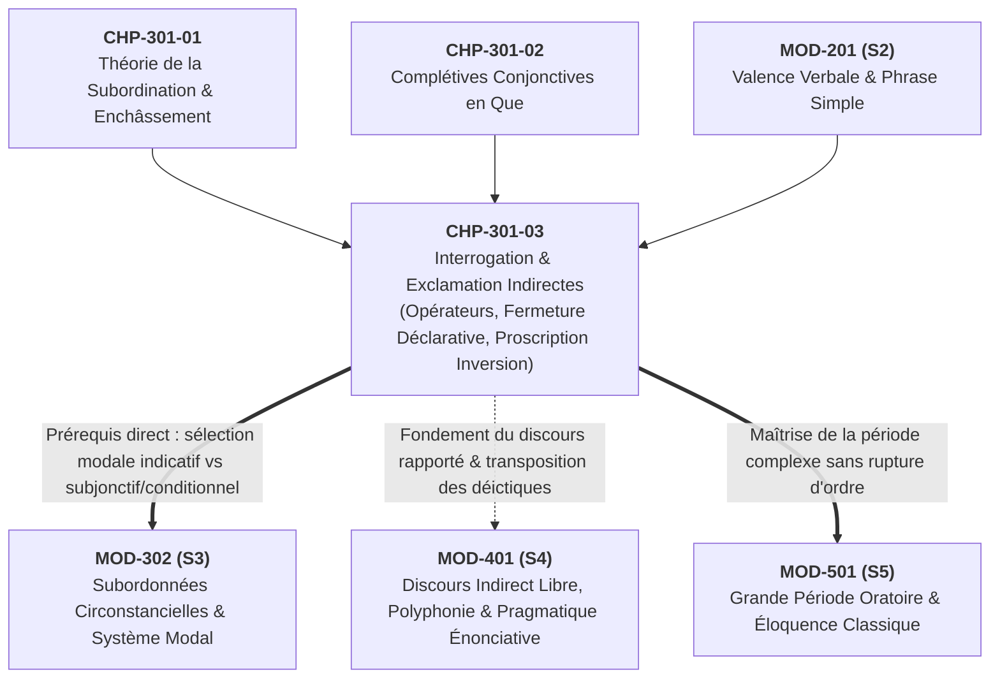

# Chapitre 3 — L'Interrogation et l'Exclamation Indirectes : Opérateurs, Fermeture Déclarative et Proscription de l'Inversion

> **Identifiant du chapitre** : `CHP-301-03`  
> **Module de rattachement** : [`MOD-301` — Architecture de la Subordination : Complétives Conjonctives, Interrogatives Indirectes, Infinitives et Relatives Complexes](file:///f:/Formation/world-class-french/03-curriculum/year-2/semester-3/mod-301-architecture-subordination-completives.md)  
> **Semestre** : Année 2 — Semestre 3 (S3)  
> **Volume horaire canonique** : 5 à 6 heures d'apprentissage autonome délibéré et d'ateliers d'application (Phase 1 Étude : 1 h 30 | Phase 2 Pratique : 1 h 30 | Phase 3 Correction : 1 h 00 | Phase 4 Évaluation : 1 h 00)  
> **Statut** : [STATUT : VALIDÉ]  
> **Compétences associées** : [`FR-SYNTAX-002`](file:///f:/Formation/world-class-french/02-competency-framework/competency-framework.md#fr-syntax-002-architecture-de-la-subordination-complexe) (Palier L3 Autonomie), [`FR-STYLE-001`](file:///f:/Formation/world-class-french/02-competency-framework/competency-framework.md#fr-style-001-maîtrise-des-figures-de-rhétorique-et-commentaire-stylistique) (Palier L3 Autonomie), [`FR-INT-002`](file:///f:/Formation/world-class-french/02-competency-framework/competency-framework.md#fr-int-002-analyser-formellement-la-syntaxe-dune-phrase-complexe) (Palier L3 Autonomie)  
> **Sources scientifiques de référence** : `SRC-GRAM-01` (Grevisse & Goosse, *Le Bon Usage*, 16e éd., 2016, § 1106-1111), `SRC-GRAM-02` (Riegel, Pellat, Rioul, *Grammaire méthodique du français*, PUF, 2016/2021, chap. 15), `SRC-NORM-03` (Ministère de l'Éducation nationale, *Terminologie grammaticale*, 2020, p. 46-47), `SRC-TYPO-01` (Imprimerie nationale, *Lexique des règles typographiques*, 2002/2014, p. 142-144)

---

## 1. Titre et Place dans le Cursus

### 1.1 Intitulé Officiel
**Chapitre 3 : L'Interrogation et l'Exclamation Indirectes : Opérateurs, Fermeture Déclarative et Proscription de l'Inversion** (`CHP-301-03`).

### 1.2 Insertion Architecturale dans le Cursus
Le présent chapitre constitue le pivot pragmatique et énonciatif du module [`MOD-301`](file:///f:/Formation/world-class-french/03-curriculum/year-2/semester-3/mod-301-architecture-subordination-completives.md). Alors que le Chapitre 2 a exploré les propositions complétives conjonctives pures introduites par le morphème asémantique *que* (chargées d'enchâsser une assertion pleine sous un verbe d'opinion, de déclaration ou de volonté), `CHP-301-03` examine le traitement syntaxique de **la lacune informationnelle et de l'affectivité rapportée**.

En français soutenu, rapporter un questionnement ou un mouvement d'admiration ne consiste pas à juxtaposer une question directe entre guillemets : cela exige d'intégrer formellement l'interrogation ou l'exclamation au sein de la matrice déclarative régissante. Cette opération d'enchâssement transforme profondément la structure de l'énoncé en imposant une **fermeture déclarative** rigoureuse, matérialisée par l'abandon de l'inversion clitique du sujet et par la suppression définitive du point d'interrogation final.



- **En amont** : Ce chapitre mobilise directement l'analyse fonctionnelle de la valence verbale acquise dans [`MOD-201`](file:///f:/Formation/world-class-french/03-curriculum/year-1/semester-2/mod-201-syntaxe-fonctionnelle-phrase-simple.md) (notamment la distinction entre verbes transitifs directs de demande et verbes d'ignorance) et s'adosse à la théorie de l'enchâssement complétif étudiée dans les deux premiers chapitres de `MOD-301`.
- **Au sein de `MOD-301`** : Il complète le panorama des propositions complétives en décrivant les complétives interrogatives et exclamatives, avant d'aborder les propositions infinitives à sujet propre (Chapitre 4) et les relatives complexes à pronoms composés (Chapitre 5).
- **En aval dans le cursus** :
  - **Vers [`MOD-302`](file:///f:/Formation/world-class-french/03-curriculum/year-2/semester-3/mod-302-circonstancielles-systeme-modal-concordance.md)** : La gestion modale rigoureuse du *si* interrogatif (qui refuse le conditionnel à valeur de futur) prépare la systématique des modes verbaux dans les circonstancielles de condition et d'hypothèse.
  - **Vers [`MOD-401`](file:///f:/Formation/world-class-french/03-curriculum/year-2/semester-3/syllabus.md)** : La maîtrise des interrogations indirectes gouverne la transposition méthodique du discours direct au discours indirect et pose les bases du discours indirect libre et de la polyphonie énonciative.
  - **Vers [`MOD-501`](file:///f:/Formation/world-class-french/03-curriculum/year-2/semester-3/syllabus.md)** : L'architecture des périodes judiciaires et délibératives repose sur l'alternance rythmée d'interrogations directes oratoires et d'interrogations indirectes intégrées.

---

## 2. Objectifs Mesurables

Au terme des 5 à 6 heures d'apprentissage autonome délibéré et d'ateliers d'application de ce chapitre, l'apprenant sera capable de :

1. **Identifier et délimiter formellement toute proposition subordonnée interrogative ou exclamative indirecte** au sein d'une période complexe, déterminer sa fonction syntaxique externe (complément d'objet direct ou complément prépositionnel du verbe recteur) et caractériser la sémantique de son terme régissant [Réf. `SRC-GRAM-02`, chap. 15] ([`FR-SYNTAX-002`](file:///f:/Formation/world-class-french/02-competency-framework/competency-framework.md#fr-syntax-002-architecture-de-la-subordination-complexe), Palier L3).
2. **Sélectionner avec une exactitude infaillible l'opérateur subordonnant approprié** selon la nature de la demande (interrogation totale en *si* vs interrogation partielle mobilisant pronoms, déterminants ou adverbes interrogatifs), en éliminant 100 % des périphrases relâchées (*qu'est-ce qui*, *qu'est-ce que*) et des pléonasmes conjonctifs (*où que*, *quand que*) [Réf. `SRC-GRAM-01`, § 1108] ([`FR-SYNTAX-002`](file:///f:/Formation/world-class-french/02-competency-framework/competency-framework.md#fr-syntax-002-architecture-de-la-subordination-complexe), Palier L3).
3. **Appliquer sans défaillance les deux interdits normatifs cardinaux** de l'interrogation indirecte : proscrire impérativement l'inversion clitique sujet-verbe (*Je me demande où il va* et JAMAIS *\*où va-t-il*) et bannir tout point d'interrogation final lorsque la proposition matrice est déclarative ou impérative (*Dites-moi quelle décision a été arrêtée.*) [Réf. `SRC-TYPO-01`, p. 142 ; `SRC-NORM-03`, p. 46] ([`FR-SYNTAX-002`](file:///f:/Formation/world-class-french/02-competency-framework/competency-framework.md#fr-syntax-002-architecture-de-la-subordination-complexe), Palier L3).
4. **Construire et analyser des périodes soutenues** intégrant des interrogatives indirectes infinitives (*ne savoir que faire*) et des inversions stylistiques nominales licites (*J'ignore où va le monde*), en explicitant les contraintes morphosyntaxiques régissant la position du sujet [Réf. `SRC-GRAM-01`, § 1109] ([`FR-STYLE-001`](file:///f:/Formation/world-class-french/02-competency-framework/competency-framework.md#fr-style-001-maîtrise-des-figures-de-rhétorique-et-commentaire-stylistique), Palier L3 ; [`FR-INT-002`](file:///f:/Formation/world-class-french/02-competency-framework/competency-framework.md#fr-int-002-analyser-formellement-la-syntaxe-dune-phrase-complexe), Palier L3).

---

## 3. Prérequis et Test de Préparation

### 3.1 Prérequis Cognitifs Exigibles
Avant d'aborder ce chapitre, l'apprenant doit avoir validé :
- La structure actancielle de la phrase simple et la distinction Sujet-Verbe-Complément ([`MOD-201`](file:///f:/Formation/world-class-french/03-curriculum/year-1/semester-2/mod-201-syntaxe-fonctionnelle-phrase-simple.md)).
- Le mécanisme formel de la subordination et la hiérarchie matrice rectrice vs proposition régie ([`CHP-301-01`](file:///f:/Formation/world-class-french/03-curriculum/year-2/semester-3/mod-301-architecture-subordination-completives.md)).
- La morphologie des temps de l'indicatif (futur simple vs conditionnel présent) et la concordance temporelle de base ([`MOD-103`](file:///f:/Formation/world-class-french/03-curriculum/year-1/semester-1/mod-103-systeme-verbal-indicatif.md)).
- La ponctuation de fin de phrase graphique (point simple, point d'interrogation, point d'exclamation) ([`MOD-102`](file:///f:/Formation/world-class-french/03-curriculum/year-1/semester-1/mod-102-classes-mots-accords-fondamentaux.md)).

---

### 3.2 Test de Préparation Immédiat (Auto-Diagnostic à 5 Questions)
Répondez aux cinq questions suivantes sur une feuille séparée avant de dérouler le corrigé :

1. **Question 1 (Transposition)** : Transformez l'interrogation directe *« Quand ce décret sera-t-il promulgué ? »* en proposition subordonnée régie par la matrice *« Le conseil des ministres ignore... »*.
2. **Question 2 (Ponctuation)** : La phrase suivante exige-t-elle un point simple ou un point d'interrogation : *« Dites-moi sans détours si vous maintenez votre candidature [___] »* ? Justifiez la réponse.
3. **Question 3 (Opérateur interrogatif)** : Corrigez l'énoncé relâché suivant en registre administratif soutenu : *« Le vérificateur des comptes ne comprend pas qu'est-ce qui a causé ce déficit budgétaire. »*
4. **Question 4 (Arbitrage modal après si)** : Dans la phrase *« Les diplomates ignorent si la trêve (sera / serait) respectée dès demain par les belligérants »*, quel temps verbal devez-vous employer si l'événement envisagé relève de la simple projection temporelle dans l'avenir ?
5. **Question 5 (Exclamation indirecte)** : Dans *« Le doyen admire combien ces étudiants travaillent avec ardeur »*, quelle est la nature et la fonction exacte de la proposition introduite par *combien* ?

---

#### Corrigé Détaillé de l'Auto-Diagnostic

<details>
<summary><strong>Consulter le corrigé raisonné des 5 questions de préparation (cliquer pour dérouler)</strong></summary>

1. **Réponse 1** :  
   *« Le conseil des ministres ignore **quand ce décret sera promulgué**.* »  
   *Justification* : L'inversion clitique du pronom sujet (*sera-t-il*) est formellement proscrite en subordonnée indirecte ; le sujet nominal *ce décret* reprend sa place canonique devant le verbe. La phrase s'achève par un point simple.
2. **Réponse 2** :  
   Il faut impérativement un **point simple** : *« Dites-moi sans détours si vous maintenez votre candidature**.** »*  
   *Justification* : La proposition matrice est à l'impératif (*Dites-moi*) ; l'acte d'énonciation global est une injonction, non une interrogation. La présence de la subordonnée interrogative indirecte ne modifie en rien la clôture déclarative ou impérative de la phrase graphique [Réf. `SRC-TYPO-01`, p. 142].
3. **Réponse 3** :  
   *« Le vérificateur des comptes ne comprend pas **ce qui** a causé ce déficit budgétaire. »*  
   *Justification* : La périphrase populaire *qu'est-ce qui* est un barbarisme en proposition subordonnée soutenue ; l'interrogatif inanimé sujet s'exprime obligatoirement par le pronom composé *ce qui* [Réf. `SRC-GRAM-01`, § 1108].
4. **Réponse 4** :  
   Il faut employer le **futur simple de l'indicatif** : *« ... ignorent si la trêve **sera** respectée... »*.  
   *Justification* : Après *si* interrogatif, le conditionnel temporel à valeur de futur est formellement exclu en français de référence ; seule une incertitude modale hypothétique distincte justifierait un conditionnel.
5. **Réponse 5** :  
   *combien ces étudiants travaillent avec ardeur* est une **proposition subordonnée complétive exclamative indirecte**, occupant la fonction de **complément d'objet direct (COD)** du verbe recteur *admire* [Réf. `SRC-NORM-03`, p. 47].

> **Barème d'auto-évaluation** :  
> - **5/5** : Maîtrise préalable excellente ; engagez sereinement l'étude théorique.  
> - **3 ou 4/5** : Fragilités sur l'ordre des mots ou la ponctuation ; vigilance accrue sur les sections 7.3 et 7.4.  
> - **Moins de 3/5** : Revoir d'urgence la délimitation de la phrase simple dans [`MOD-201`](file:///f:/Formation/world-class-french/03-curriculum/year-1/semester-2/mod-201-syntaxe-fonctionnelle-phrase-simple.md) avant de poursuivre.
</details>

---

## 4. Situation de Départ ou Problème Concret

### 4.1 Le Fléau du Calque de l'Interrogation Directe
Dans les mémoires universitaires, les rapports d'expertise, les copies de concours administratifs et les correspondances officielles, les fautes de construction liées à l'interrogation indirecte constituent un véritable fléau linguistique. Ces erreurs figurent parmi les plus sévèrement sanctionnées par les jurys, car elles témoignent d'une incapacité à maîtriser l'architecture de la phrase complexe et traduisent une contamination de l'écrit soutenu par l'oral spontané.

Examinons ces quatre énoncés fautifs relevés dans des écrits de fonctionnaires et d'étudiants :

> ❌ *« Le juge d'instruction cherche à savoir **où va-t-il** ? »*  
> ❌ *« Veuillez me préciser **quelle heure est-il**. »*  
> ❌ *« La commission ignore **qu'est-ce qui** s'est réellement produit lors du sinistre. »*  
> ❌ *« Je me demande **si viendrez-vous** à la réunion de concertation ? »*

### 4.2 Anatomie d'un Naufrage Syntaxique
Pourquoi ces énoncés offensent-ils si lourdement la syntaxe française ?
1. **Le télescopage des plans énonciatifs** : Dans le premier exemple, le rédacteur commence par une assertion (*Le juge d'instruction cherche à savoir*), puis, arrivé à la subordonnée, il retombe par mimétisme oral dans le moule de la question directe (*Où va-t-il ?*). Il inflige à la subordonnée une inversion clitique (*va-t-il*) et coiffe la phrase d'un point d'interrogation absurde, alors que la proposition principale n'interroge personne directement !
2. **L'illusion de la politesse impérative** : Dans le deuxième exemple, sous prétexte d'adresser une demande courtoise (*Veuillez me préciser*), le scripteur maintient l'inversion de l'interrogation directe (*est-il*) au lieu d'aligner l'ordre régulier (*quelle heure il est*).
3. **Le parasitisme de la périphrase populaire** : Dans le troisième exemple, la locution interrogative orale *qu'est-ce qui* est insérée telle quelle derrière le verbe *ignore*, créant un solécisme grossier là où le français académique exige le pronom neutre condensé *ce qui*.
4. **Le dédoublement illégitime** : Dans le quatrième exemple, le *si* introducteur est cumulé avec l'inversion du pronom sujet (*viendrez-vous*), aboutissant à une monstruosité morphosyntaxique bannie par tous les traités de grammaire.

Ce chapitre a pour mission d'éradiquer définitivement ces automatismes fautifs en fournissant une modélisation théorique inattaquable et un protocole de construction systématique.

---

## 5. Explication Intuitive : Le Colis Scellé et la Boîte Déclarative

Pour comprendre la mécanique de l'interrogation indirecte, recourons à l'analogie du **circuit ouvert vs colis scellé** :

```text
A. INTERROGATION DIRECTE (Circuit Ouvert & Tension Énonciative)
   ┌──────────────────────────────────────────────────────────────┐
   │  [Interlocuteur] ◄────── Où  va  Pierre  ? ◄───── [Énonciateur]│
   └──────────────────────────────────────────────────────────────┘
   • Circuit ouvert vers l'interlocuteur sommé de répondre.
   • Marqueurs de surface : Inversion du sujet (ou est-ce que), intonation montante, point d'interrogation final.

B. INTERROGATION INDIRECTE (Boîte Déclarative & Colis Scellé)
   ┌──────────────────────────────────────────────────────────────┐
   │  MATRICE ASSERVE :                BOÎTE COMPLÉTIVE SCELLÉE : │
   │  Le procureur ignore              [ où  Pierre  va ] .       │
   │  └─── Verbe recteur ───►          └── Ordre canonique S-V ──┘│
   └──────────────────────────────────────────────────────────────┘
   • Le verbe recteur ("ignore") absorbe toute la charge interrogative.
   • La question est empaquetée dans une boîte complétive fermée.
   • À l'intérieur : les mots rentrent dans le rang (Ordre Sujet-Verbe canonique).
   • À l'extérieur : le couvercle est scellé par un point simple de clôture assertive.
```

1. **L'interrogation directe est un projecteur braqué sur l'interlocuteur** : L'énonciateur lance un appel qui requiert une prise de parole immédiate. Pour signaler cette tension, la langue mobilise des artifices syntaxiques et typographiques spécifiques : l'inversion clitique du sujet (qui crée une rupture mélodique) et le point d'interrogation final.
2. **L'interrogation indirecte est un colis postal étanche** : Lorsque la question est rapportée sous la coupe d'un verbe régissant (*ignorer, demander, examiner, chercher*), ce verbe recteur **prend intégralement sur lui la charge interrogative**. L'énoncé tout entier devient une déclaration d'ignorance ou un constat de recherche. Dès lors, le circuit interrogatif direct est coupé :
   - À l'intérieur de la subordonnée, la question est neutralisée : l'ordre des mots redevient strictement déclaratif (**Sujet + Verbe + Compléments**).
   - À la frontière de la phrase, le point d'interrogation est expulsé au profit du **point simple ordinaire**, garant de la fermeture déclarative.

> [!IMPORTANT]
> **Règle du fusible énonciatif** : Le verbe de la proposition principale joue le rôle d'un fusible qui absorbe la force interrogative. Il est donc structuralement impossible qu'une subordonnée indirecte conserve les marques formelles de l'interrogation directe (inversion clitique et point d'interrogation).

---

## 6. Définitions Précises et Terminologie

Observons d'abord cet énoncé modèle issu de la prose juridique :
> *« Le magistrat instructeur examine **[comment le prévenu a orchestré sa défense]** et ignore **[si des complices sont intervenus]**. »*

1. **Proposition subordonnée interrogative indirecte** : Proposition subordonnée complétive qui transpose au style indirect un acte d'interrogation, sous la dépendance syntaxique étroite d'un verbe de parole, d'interrogation, de recherche ou d'ignorance appartenant à la proposition matrice [Réf. `SRC-NORM-03`, p. 46 ; `SRC-GRAM-02`, chap. 15].
2. **Fermeture déclarative** : Propriété fondamentale de l'enchâssement interrogatif indirect en vertu de laquelle l'énoncé global adopte la syntaxe et la ponctuation d'une phrase déclarative assertive, interdisant le maintien de l'inversion clitique du sujet et subordonnant la ponctuation finale à la nature de la matrice rectrice [Réf. `SRC-GRAM-01`, § 1108].
3. **Interrogation indirecte totale** : Type d'interrogation indirecte portant sur la vérité globale de la relation prédicative (la réponse attendue dans le discours direct étant *oui* ou *non*), introduite exclusivement par la conjonction de subordination **si** (ex. *J'ignore s'il viendra*) [Réf. `SRC-GRAM-02`, chap. 15].
4. **Interrogation indirecte partielle** : Type d'interrogation indirecte portant sur un constituant précis de la proposition (actant, circonstant, modalité), introduite par un opérateur interrogatif spécifique (pronom, déterminant ou adverbe) [Réf. `SRC-NORM-03`, p. 46].
5. **Opérateurs interrogatifs** : Ensemble des unités morphosyntaxiques spécialisées servant à introduire une interrogation partielle :
   - **Pronoms interrogatifs** : *qui* (animé), *ce qui / ce que / qu'* (inanimé), *lequel, laquelle, lesquels, lesquelles* ;
   - **Déterminants interrogatifs** : *quel, quelle, quels, quelles* ;
   - **Adverbes interrogatifs** : *pourquoi, comment, où, quand, combien*.
6. **Proposition subordonnée exclamative indirecte** : Proposition subordonnée complétive régie par un verbe d'admiration, de surprise ou d'affect (*admirer, s'étonner de, concevoir, ne pas savoir*), introduite par un mot exclamatif (*combien, comme, quel*) et rapportant au mode déclaratif un énoncé d'intensité sans point d'exclamation final [Réf. `SRC-GRAM-01`, § 1111 ; `SRC-NORM-03`, p. 47].

---

## 7. Règles ou Mécanismes Fondamentaux

### 7.1 Statut Syntaxique et Verbes Recteurs
L'interrogation indirecte n'est pas une phrase autonome : c'est une proposition subordonnée complétive occupant la fonction de **complément d'objet direct (COD)** ou plus rarement de **complément d'objet indirect (COI)** auprès d'un verbe recteur [Réf. `SRC-GRAM-02`, chap. 15].

Les verbes recteurs habilités à gouverner une interrogative indirecte appartiennent à quatre champs sémantiques stricts :
1. **Verbes d'interrogation et de demande** : *demander, interroger, s'enquérir de, questionner* (ex. *Il demande quand débutera la séance*).
2. **Verbes d'ignorance et de doute** : *ignorer, douter, être incertain, ne pas savoir* (ex. *Nous ignorons qui a signé ce document*).
3. **Verbes de recherche et d'examen** : *chercher, examiner, vérifier, contrôler, étudier, délibérer sur* (ex. *Le comité vérifie comment les fonds ont été alloués*).
4. **Verbes de savoir et de perception employés à la forme négative ou interrogative** : *savoir, voir, comprendre, deviner, concevoir* (ex. *Je ne sais où il réside* ; *Savez-vous quelle décision a été prise ?*).

> [!CAUTION]
> Un verbe d'assertion pure employé à la forme affirmative (*dire, affirmer, certifier, déclarer*) régit une complétive en *que*, jamais une interrogative indirecte (on écrit *Il dit qu'il viendra*, et non *\*Il dit s'il viendra*). L'interrogative n'apparaît que si l'assertion est niée ou mise en doute (*Il ne dit pas s'il viendra*).

---

### 7.2 L'Interrogation Indirecte Totale et le Rôle de « Si »

#### 7.2.1 La Conjonction Introductrice Exclusive
L'interrogation totale transposée au style indirect recourt exclusivement au morphème subordonnant **si** [Réf. `SRC-GRAM-01`, § 1107].
- **Règle de l'élision** : La conjonction *si* ne s'élide **que devant les pronoms masculins *il* et *ils*** (*s'il, s'ils*).
- **Interdiction formelle de l'élision** devant tout autre mot : *si elle, si elles, si on, si un décret* (écrire *\*s'elle* ou *\*s'on* est un solécisme).

#### 7.2.2 La Règle Modale d'Or : Proscription du Conditionnel Temporel
C'est l'un des écueils majeurs de la langue soignée. En français standard de référence :
- Lorsque la subordonnée en *si* interrogatif exprime une **action future par rapport au présent de la matrice**, le verbe se met obligatoirement au **futur simple de l'indicatif**, et **JAMAIS au conditionnel** [Réf. `SRC-GRAM-01`, § 1107 ; `SRC-GRAM-02`, chap. 15] :
  - $\checkmark$ *« J'ignore s'il **viendra** demain à la chancellerie. »* (Futur de l'indicatif = correct).
  - ❌ *« *J'ignore s'il **viendrait** demain à la chancellerie. »* (Conditionnel temporel fautif).
- **Nuance modale admise** : Le conditionnel n'est légitime après *si* interrogatif que s'il porte une véritable valeur modale d'**atténuation**, de **politesse** ou d'**éventualité hypothétique sous-entendue** :
  - $\checkmark$ *« Je me demande si cette solution **conviendrait** à vos associés [au cas où nous la leur proposerions]. »*

---

### 7.3 L'Interrogation Indirecte Partielle et l'Arsenal des Opérateurs

L'interrogation indirecte partielle porte sur un élément particulier de l'énoncé. Elle est introduite par des opérateurs spécialisés qui assurent la double fonction de mot subordonnant et de constituant interne de la proposition subordonnée [Réf. `SRC-NORM-03`, p. 46].

#### 7.3.1 Les Pronoms Interrogatifs
1. **Référent animé (humain)** :
   - Sujet : **qui** (*J'ignore qui a rédigé cette note*).
   - COD : **qui** (*Le juge demande qui vous avez rencontré*).
   - COI / Complément prépositionnel : **à qui, de qui, pour qui, avec qui** (*Nous examinons à qui confier le dossier*).
2. **Référent inanimé (non-humain)** — **Règle cardinale de composition** :
   En interrogation indirecte soutenue, les formes simples directes *que* et *quoi* (hors infinitif) ne peuvent pas fonctionner comme sujet ou COD autonome. Elles s'amalgament avec le démonstratif neutre support **ce** [Réf. `SRC-GRAM-01`, § 1108] :
   - Sujet inanimé : **ce qui** (*Il ne sait pas ce qui s'est produit*).
   - COD inanimé : **ce que** (élidé en **ce qu'**) (*La police cherche ce qu'il a dissimulé*).
   - COI inanimé en *de* : **ce dont** (*Il ignore ce dont il s'agit*).
   - COI inanimé en d'autres prépositions : **ce à quoi, ce sur quoi, ce en quoi** (*Nous débattrons de ce à quoi vous pensez*).
3. **Pronom de sélection / choix discret** :
   - **Lequel, laquelle, lesquels, lesquelles** (et formes amalgamées **auquel, duquel...**) : *« Dites-moi lequel de ces candidats a été retenu. »*

> [!WARNING]
> **Proscription absolue des périphrases populaires** : Les tournures orales *\*qu'est-ce qui*, *\*qu'est-ce que*, *\*qui est-ce qui*, *\*qui est-ce que* sont **rigoureusement bannies** de la subordonnée indirecte universitaire et académique. On écrit exclusivement : *J'ignore ce qui arrive* (et jamais *\*qu'est-ce qui arrive*).

#### 7.3.2 Les Déterminants Interrogatifs
Les adjectifs/déterminants interrogatifs s'accordent en genre et en nombre avec le nom qu'ils déterminent :
- **quel, quelle, quels, quelles** : *« Le greffier ignore **quel verdict** sera prononcé. »* ; *« La commission cherche **quelles mesures** s'imposent. »*

#### 7.3.3 Les Adverbes Interrogatifs
Ils portent sur les circonstances de l'action et sont invariables :
- Lieu : **où** (*J'ignore où réside le témoin*).
- Temps : **quand** (*Veuillez indiquer quand vous partirez*).
- Manière : **comment** (*Les experts démontrent comment l'incendie s'est propagé*).
- Cause : **pourquoi** (*Le ministre explique pourquoi cette loi est nécessaire*).
- Quantité / Mesure : **combien** (*Nous vérifions combien cet aménagement coûtera*).

---

### 7.4 Les Deux Interdits Normatifs Cardinaux

La grammaire prescriptive et l'usage académique imposent deux règles absolues dont la violation constitue une faute éliminatoire :

```text
┌─────────────────────────────────────────────────────────────────────────────┐
│                    LES DEUX INTERDITS NORMATIFS CARDINAUX                   │
├─────────────────────────────────────────────────────────────────────────────┤
│ INTERDIT 1 : PROCRIPTION DE L'INVERSION CLITIQUE SUJET-VERBE                │
│ • Règle : L'ordre des mots dans la subordonnée interrogative indirecte      │
│   doit impérativement être l'ordre canonique : SUJET + VERBE.               │
│ • Fautif  : *« Je me demande où va-t-il. »                                  │
│ • Correct : « Je me demande où il va. »                                     │
├─────────────────────────────────────────────────────────────────────────────┤
│ INTERDIT 2 : PROSCRIPTION DU POINT D'INTERROGATION SUR MATRICE NON INTERROGATIVE│
│ • Règle : La ponctuation finale de la phrase graphique est gouvernée        │
│   EXCLUSIVEMENT par la modalité de la proposition matrice rectrice.         │
│ • Fautif  : *« Il ignore ce qui s'est passé ? »  (Matrice déclarative)      │
│ • Correct : « Il ignore ce qui s'est passé. »   (Point simple obligatoire)  │
│ • Fautif  : *« Dites-moi où vous allez ? »       (Matrice impérative)       │
│ • Correct : « Dites-moi où vous allez. »        (Point simple obligatoire)  │
│ • Exception légitime : Matrice elle-même interrogative :                    │
│   « Savez-vous où il va ? »                     (Point d'interrogation dû   │
│                                                  à la matrice "Savez-vous") │
└─────────────────────────────────────────────────────────────────────────────┘
```

1. **L'inversion clitique du pronom sujet est formellement agrammaticale** :  
   Dans une subordonnée, le pronom personnel sujet ne peut sous aucun prétexte être postposé au verbe par un trait d'union. Les formes *\*où part-il*, *\*comment a-t-elle fait*, *\*quand viendront-ils* sont exclusives de l'interrogation directe.
2. **Le point d'interrogation final ne dépend jamais de la subordonnée** :  
   Une subordonnée ne possède pas de ponctuation terminale propre. C'est la matrice régissante qui dicte le signe final [Réf. `SRC-TYPO-01`, p. 142] :
   - Matrice déclarative $\to$ **Point simple** (*Le président explique pourquoi le décret a été signé.*).
   - Matrice impérative $\to$ **Point simple** (*Expliquez-moi comment vous comptez procéder.*).
   - Matrice interrogative directe $\to$ **Point d'interrogation** (*Pourriez-vous me dire qui a autorisé ce transfert ?*).

---

### 7.5 La Proposition Subordonnée Exclamative Indirecte
L'exclamation indirecte fonctionne sur un modèle syntaxique rigoureusement symétrique de l'interrogation indirecte, mais transpose un acte d'exclamation ou d'évaluation affective [Réf. `SRC-NORM-03`, p. 47 ; `SRC-GRAM-01`, § 1111].

1. **Verbes régissants** : Verbes exprimant l'admiration, la stupeur, l'indignation ou l'appréciation quantitative (*admirer, s'étonner de, ne pas revenir de, constater, savoir*).
2. **Opérateurs exclamatifs** :
   - **comme** (*J'admire comme elle s'exprime avec aisance*).
   - **combien** (*Le rapporteur souligne combien cette mesure est attendue*).
   - **quel, quelle, quels, quelles** (*Vous ne pouvez concevoir quelle fut notre surprise*).
3. **Ordre des mots et ponctuation** :  
   Tout comme l'interrogative, l'exclamative indirecte adopte l'**ordre des mots déclaratif** (*comme elle est savante* et non *\*comme est-elle savante*) et refuse catégoriquement le point d'exclamation lorsque la matrice est assertive :
   - $\checkmark$ *« Je constate avec émotion combien vous avez progressé. »* (Point simple final).

---

## 8. Raisonnement Détaillé (Le Pourquoi)

Pourquoi la langue française proscrit-elle avec une telle intransigeance l'inversion clitique et le point d'interrogation en interrogation indirecte ? La réponse réside dans la **théorie des actes de langage** (*Speech Acts*, Austin et Searle) et dans la **structure syntaxique de la complémentation** [Réf. `SRC-GRAM-02`, chap. 15].

### 8.1 L'Absorption de la Force Illocutoire par le Verbe Recteur
En linguistique pragmatique, un énoncé se caractérise par sa **force illocutoire** (l'acte de parole accompli : affirmer, ordonner, questionner) et par son **contenu propositionnel** (l'état de choses décrit).
- En **interrogation directe** (*« Où va Pierre ? »*), le locuteur accomplit directement l'acte d'interroger son vis-à-vis. L'inversion clitique et le contour intonatif montant (transcrit par `?`) sont les marques morphosyntaxiques spécialisées de cette force illocutoire d'interrogation.
- En **interrogation indirecte** (*« Le juge demande où va Pierre. »*), l'énonciateur n'interroge pas : il **affirme** que le juge formule une demande. L'acte illocutoire global est une **assertion**. La force interrogative a été lexicalisée et absorbée par le verbe matrice (*demande*).
- Par conséquent, la proposition subordonnée ne véhicule aucun acte illocutoire autonome : elle ne contient qu'une **variable sémantique non résolue** (le lieu *où*). L'affubler d'une inversion du sujet ou d'un point d'interrogation reviendrait à lui prêter une force illocutoire directe qu'elle ne possède pas, créant une contradiction logique entre la subordination syntaxique et l'acte de parole.

### 8.2 Le Rôle Hiérarchique de la Ponctuation Terminale
En typographie française codifiée par l'Imprimerie nationale, la ponctuation de fin de phrase (`.`, `?`, `!`) ne démarque pas les membres de phrase internes : elle marque la clôture de la **phrase graphique maximale** [Réf. `SRC-TYPO-01`, p. 142]. Cette clôture est entièrement dévolue à la proposition principale, qui gouverne l'acte de communication. Si la principale est une déclaration (*Le témoin ignore...*), la phrase graphique est déclarative et s'achève par un point, même si son complément d'objet est une proposition interrogative. Mettre un point d'interrogation à la fin d'une phrase dont la matrice est déclarative constitue une hérésie syntaxique.

---

## 9. Exemples Corrects Commentés

### 9.1 Décorticage de Transpositions Méthodiques (Direct $\to$ Indirect)

Examinons la transposition rigoureuse de quatre énoncés du discours direct au discours indirect, avec maintien du présent de la matrice :

```text
1. Interrogation totale directe :
   [Direct]   : « Les crédits sont-ils débloqués ? »
   [Indirect] : La directrice vérifie si les crédits sont débloqués.
   • Analyse  : Disparition de l'inversion clitique (-ils) ; insertion de la conjonction "si" ;
                ordre Sujet (les crédits) + Verbe (sont débloqués) ; point simple.

2. Interrogation partielle directe sur inanimé sujet :
   [Direct]   : « Qu'est-ce qui retarde les travaux du port ? »
   [Indirect] : Le ministre demande ce qui retarde les travaux du port.
   • Analyse  : Élimination de la périphrase orale "qu'est-ce qui" ; substitution du pronom
                neutre soutenu "ce qui" ; ponctuation finale déclarative.

3. Interrogation partielle directe avec inversion clitique :
   [Direct]   : « Pourquoi ces mesures ont-elles échoué ? »
   [Indirect] : Le rapport d'audit explique pourquoi ces mesures ont échoué.
   • Analyse  : Maintien de l'adverbe "pourquoi" ; suppression de la reprise pronominale
                inversée (-elles) ; le sujet nominal "ces mesures" précède le verbe.

4. Exclamation directe d'intensité :
   [Direct]   : « Combien cette plaidoirie est brillante ! »
   [Indirect] : L'assemblée constate combien cette plaidoirie est brillante.
   • Analyse  : Maintien de l'opérateur exclamatif "combien" ; ordre déclaratif SVO ;
                remplacement du point d'exclamation par le point simple.
```

---

### 9.2 Tableau Synoptique de Conversion des Opérateurs

| Type de Question Directe | Forme Directe (Oral / Écrit) | Forme Indirecte Soutenue (Obligatoire) | Exemple Modèle en Sous-Proposition |
| :--- | :--- | :--- | :--- |
| **Totale** | *Vient-il ? / Est-ce qu'il vient ?* | **si** (*s'il*) | *J'ignore s'il viendra.* |
| **Partielle : Animé Sujet** | *Qui vient ? / Qui est-ce qui vient ?* | **qui** | *Il demande qui viendra.* |
| **Partielle : Animé COD** | *Qui voyez-vous ? / Qui est-ce que...* | **qui** | *Je sais qui vous recevrez.* |
| **Partielle : Inanimé Sujet** | *Qu'est-ce qui arrive ?* | **ce qui** | *J'ignore ce qui arrive.* |
| **Partielle : Inanimé COD** | *Que faites-vous ? / Qu'est-ce que...* | **ce que** (*ce qu'*) | *Dites-moi ce que vous faites.* |
| **Partielle : Inanimé COI (de)** | *De quoi parlez-vous ?* | **ce dont** | *Il ne sait pas ce dont il s'agit.* |
| **Partielle : Inanimé COI (à)** | *À quoi pensez-vous ?* | **ce à quoi** | *J'ignore ce à quoi il songe.* |
| **Partielle : Adverbe Lieu** | *Où va-t-il ?* | **où** | *Je sais où il va.* |
| **Partielle : Adverbe Temps** | *Quand partira-t-il ?* | **quand** | *Dites-moi quand il partira.* |
| **Partielle : Adverbe Manière** | *Comment a-t-il réussi ?* | **comment** | *On ignore comment il a réussi.* |
| **Partielle : Adverbe Cause** | *Pourquoi pleure-t-il ?* | **pourquoi** | *Il explique pourquoi il pleure.* |
| **Partielle : Adverbe Quantité** | *Combien coûte ce livre ?* | **combien** | *Il demande combien ce livre coûte.* |
| **Partielle : Déterminant** | *Quelle loi s'applique ?* | **quel / quelle...** | *Le juriste précise quelle loi s'applique.* |
| **Exclamation** | *Comme il a changé !* | **comme / combien** | *Je mesure combien il a changé.* |

---

## 10. Contre-Exemples et Erreurs Fréquentes

Nous analysons ici six erreurs récurrentes observées dans la pratique rédactionnelle, assorties de leur réfutation linguistique et de leur rectification normée.

### Erreur n° 1 : Maintien fautif de l'inversion clitique sujet-verbe
- **Énoncé fautif** : ❌ *« Le gouverneur de la banque centrale ignore où **ira-t-il** chercher de nouvelles réserves de devises. »*
- **Diagnostic & Réfutation** : L'adjonction du pronom clitique postposé *-il* constitue une réminiscence fautive de l'interrogation directe. La subordonnée exige un ordre des mots strictement déclaratif.
- **Rectification normée** : $\checkmark$ *« Le gouverneur de la banque centrale ignore où **il ira** chercher de nouvelles réserves de devises. »*

### Erreur n° 2 : Insertion indue du point d'interrogation sur matrice déclarative ou impérative
- **Énoncé fautif** : ❌ *« Veuillez indiquer au greffe dans quelle circonscription vous résidez actuellement ? »*
- **Diagnostic & Réfutation** : La matrice est une injonction impérative de politesse (*Veuillez indiquer*). La force illocutoire globale de la phrase est un ordre atténué, non une interrogation. L'insertion du point d'interrogation final est une violation de la règle typographique officielle [Réf. `SRC-TYPO-01`, p. 142].
- **Rectification normée** : $\checkmark$ *« Veuillez indiquer au greffe dans quelle circonscription vous résidez actuellement**.** »*

### Erreur n° 3 : Emploi fautif des périphrases populaires « qu'est-ce qui » et « qu'est-ce que »
- **Énoncé fautif** : ❌ *« Le tribunal souhaite établir **qu'est-ce que** le prévenu transportait dans son véhicule lors de son interpellation. »*
- **Diagnostic & Réfutation** : La locution *qu'est-ce que* est une périphrase directe familière résultant du figement de *que est-ce que*. En proposition subordonnée soutenue, le complément inanimé s'exprime uniquement par le pronom support *ce* suivi du pronom relatif *que* [Réf. `SRC-GRAM-01`, § 1108].
- **Rectification normée** : $\checkmark$ *« Le tribunal souhaite établir **ce que** le prévenu transportait dans son véhicule lors de son interpellation. »*

### Erreur n° 4 : Confusion modale entre « si » interrogatif et « si » conditionnel / abus du conditionnel
- **Énoncé fautif** : ❌ *« Nous ignorons si les créanciers internationaux **accepteraient** le rééchelonnement de la dette l'an prochain. »* *(dans le sens pur d'une interrogation sur un fait futur).*
- **Diagnostic & Réfutation** : Par calque fautif sur le conditionnel journalistique ou par confusion avec le *si* hypothétique, le rédacteur emploie le conditionnel pour évoquer un simple fait futur. Si l'action future ne dépend pas d'une condition explicite, l'indicatif futur simple est obligatoire après *si* interrogatif [Réf. `SRC-GRAM-02`, chap. 15].
- **Rectification normée** : $\checkmark$ *« Nous ignorons si les créanciers internationaux **accepteront** le rééchelonnement de la dette l'an prochain. »*

### Erreur n° 5 : Insertion fautive de « que » redondant après un adverbe interrogatif (« où que », « quand que »)
- **Énoncé fautif** : ❌ *« L'ambassadeur demande **quand que** les pourparlers de paix s'ouvriront à Genève. »*
- **Diagnostic & Réfutation** : L'insertion de la conjonction *que* derrière un adverbe interrogatif (*où que, quand que, comment que*) relève du registre populaire très relâché ou de tournures dialectales. L'adverbe interrogatif suffit à lui seul pour subordonner la proposition ; l'adjonction de *que* est un pléonasme agrammatical.
- **Rectification normée** : $\checkmark$ *« L'ambassadeur demande **quand** les pourparlers de paix s'ouvriront à Genève. »*

### Erreur n° 6 : Mauvaise sélection de l'opérateur et confusion entre animé et inanimé (« qui » vs « ce qui », « que » vs « ce que »)
- **Énoncé fautif** : ❌ *« L'enquêteur cherche à savoir **qui** a brisé la vitre et **qu'est-il** advenu des documents confidentiels. »*
- **Diagnostic & Réfutation** : Pour le second membre, le rédacteur a utilisé la forme directe interrogative *qu'est-il advenu*. Le sujet inanimé exige le pronom neutre composé *ce qui*, suivi de l'ordre déclaratif sans reprise clitique.
- **Rectification normée** : $\checkmark$ *« L'enquêteur cherche à savoir **qui** a brisé la vitre et **ce qu'il est advenu** des documents confidentiels. »* *(avec le pronom impersonnel neutre il)* ou *« ... et **ce qui est advenu** des documents confidentiels. »*

---

## 11. Cas Particuliers et Limites

### 11.1 L'Inversion Stylistique du Sujet Nominal (Licite et Soutenue)
Si l'inversion clitique du pronom personnel (*où va-t-il*) est rigoureusement proscrite, l'inversion du **sujet nominal plein** (substantif ou syntagme nominal) est parfaitement admise et souvent recherchée pour son élégance en style académique [Réf. `SRC-GRAM-01`, § 1109] :

1. **Conditions strictes de recevabilité** :
   - La subordonnée doit être introduite par un adverbe interrogatif (*où, quand, comment, combien*) ou par un pronom/déterminant interrogatif (*quel, que*) ;
   - Le sujet doit être un **nom complet** (jamais un pronom clitique *il, elle, on, ils, elles*) ;
   - Le verbe ne doit pas posséder de complément d'objet direct propre, ce qui prévient toute ambiguïté sur la fonction actancielle du nom postposé.
2. **Exemples contrastifs** :
   - $\checkmark$ *« J'ignore **où va le monde** contemporain. »* (Sujet nominal *le monde contemporain* placé après le verbe *va* : inversion stylistique irréprochable).
   - $\checkmark$ *« Dites-moi **quand viendra votre avocat**. »* (Sujet nominal *votre avocat* inversé : très soutenu).
   - ❌ *« *J'ignore **où va-t-il**. »* (Pronom clitique inversé : solécisme absolu).
   - ❌ *« *J'ignore **où consulte le médecin son patient**. »* (Agrammatical : la présence du COD *son patient* bloque l'inversion nominale).

---

### 11.2 L'Interrogation Indirecte à l'Infinitif (Infinitive Interrogative)
Le français admet une construction elliptique très élégante où la subordonnée interrogative indirecte ne comporte pas de verbe conjugué, mais un **infinitif** [Réf. `SRC-GRAM-01`, § 1110] :

1. **Propriétés syntaxiques** :
   - Le sujet de l'infinitif est nécessairement **coréférentiel** au sujet ou à l'objet de la matrice rectrice (*Il ne sait que faire* = *Il ne sait ce qu'il doit faire*) ;
   - L'infinitif reçoit une interprétation modale implicite de **possibilité** (*pouvoir*) ou de **devoir** (*falloir, devoir*) ;
   - L'inanimé COD s'exprime alors par le pronom direct pur **que** (élidé en **qu'**), sans le support *ce* !
2. **Exemples modèles** :
   - *« L'accusé désemparé ne sait **que dire** devant ses juges. »* (et non *\*ce que dire*).
   - *« Les réfugiés cherchaient désespérément **où dormir**. »*
   - *« Nous ignorons entièrement **à qui nous adresser** pour obtenir cette dérogation. »*

---

### 11.3 L'Alternative Interrogative : « Si... ou si » vs « Si... ou non »
Lorsque deux hypothèses alternatives sont coordonnées au sein d'une interrogation totale indirecte :
- La norme académique recommande la répétition de la conjonction : *« Le conseil délibère pour savoir **si** les tarifs seront augmentés **ou si** les dépenses seront réduites. »* [Réf. `SRC-GRAM-01`, § 1107].
- La formule elliptique d'alternative binaire s'écrit canoniquement : *« J'ignore **s'il acceptera ou non**. »* (ou *« s'il acceptera ou non la mission »*).

---

## 12. Approfondissement Adapté au Niveau

### 12.1 La Syntaxe Générative du Mouvement Qu- (*Wh-Movement*)
Dans le cadre de la grammaire générative et transformationnelle (Chomsky, Rizzi), l'interrogation indirecte fournit une illustration éclatante de la structure de la **périphérie gauche de la phrase** (le syntagme complémenteur ou `CP`, pour *Complementizer Phrase*) [Réf. `SRC-GRAM-02`, chap. 15].

```text
ARBRE SYNTAXIQUE DU SYNTAPME COMPLÉMENTEUR (CP) EN INTERROGATION INDIRECTE

               CP
             /    \
         Spec, CP   C'
          [ où ]   /  \
                  C°    IP (ou TP)
                 [Ø]   /   \
                      NP    I'
                    [il]   /  \
                          I°    VP
                         [va]  /  \
                              V°    PP
                             [t_i]  [trace]
```

1. **La position Spec, CP (Spécificateur du Complémenteur)** :  
   Dans la structure profonde, l'opérateur interrogatif est engendré à l'intérieur du syntagme verbal `VP` (ici en position de complément locatif `PP`). Il subit ensuite un **mouvement Qu-** (*Wh-movement*) qui le propulse en tête de la proposition subordonnée, précisément dans la position **Spec, CP**.
2. **Le Filtre du Complémenteur Doublement Rempli (*Doubly-Filled Comp Filter*)** :  
   En français moderne standard, la position de tête $C^\circ$ et la position de spécificateur $\text{Spec, CP}$ ne peuvent pas être occupées simultanément par deux morphèmes phonologiquement réalisés. Dès lors que l'adverbe interrogatif *où* occupe $\text{Spec, CP}$, la tête $C^\circ$ doit rester vide (notée $[\varnothing]$). L'insertion populaire de la conjonction *que* dans $C^\circ$ (*« *où qu'il va »*) viole ce filtre structural fondamental.
3. **Le Blocage du Mouvement V-to-C en Subordonnée** :  
   Dans l'interrogation directe (*« Où va-t-il ? »*), le verbe conjugué monte de la tête flexionnelle $I^\circ$ vers la tête du complémenteur $C^\circ$ (*mouvement V-vers-C*), ce qui le place devant le pronom clitique sujet et produit l'inversion clitique. En revanche, dans la proposition subordonnée indirecte, la tête $C^\circ$ est sélectionnée par la matrice rectrice ; cette sélection bloque hermétiquement la montée du verbe vers $C^\circ$. Le verbe reste confiné dans $I^\circ$, rendant l'inversion clitique structuralement impossible.

---

## 13. Comparaisons Différentielles

### 13.1 Interrogation Directe vs Interrogation Indirecte

| Critère de Comparaison | Interrogation Directe | Interrogation Indirecte |
| :--- | :--- | :--- |
| **Statut syntaxique** | Phrase indépendante ou principale autonome. | Proposition subordonnée complétive (COD/COI). |
| **Force illocutoire** | Acte de questionnement direct adressé à l'interlocuteur. | Assertion d'une ignorance, d'une demande ou d'une recherche. |
| **Ordre du sujet clitique** | Inversion obligatoire ou formule *est-ce que*. | **Ordre canonique strict : Sujet + Verbe**. |
| **Inversion nominale** | Inversion complexe obligatoire (*Pierre vient-il ?*). | Inversion stylistique simple admise sans clitique. |
| **Pronom inanimé COD** | *Que faites-vous ? / Qu'est-ce que vous faites ?* | **ce que** (*Dites-moi ce que vous faites*). |
| **Interrogation totale** | Intonation montante ou *est-ce que*. | Conjonction de subordination **si**. |
| **Ponctuation terminale** | **Point d'interrogation obligatoire** (`?`). | **Point simple ordinaire** (`.`) (sauf matrice interrogative). |

---

### 13.2 « Si » Interrogatif vs « Si » Hypothétique / Conditionnel

| Paramètre | « Si » Interrogatif Indirect | « Si » Hypothétique / Conditionnel |
| :--- | :--- | :--- |
| **Nature de la proposition** | Proposition subordonnée **complétive** (COD). | Proposition subordonnée **circonstancielle**. |
| **Verbe régissant** | Verbe d'ignorance, de demande ou d'examen. | N'importe quel verbe (introduit une condition). |
| **Supprimabilité** | **Non supprimable** (constituant essentiel actanciel). | Supprimable et déplaçable en tête de phrase. |
| **Emploi du futur simple** | **Parfaitement régulier et obligatoire pour l'avenir** :<br/>*J'ignore s'il viendra demain.* | **Formellement proscrit** :<br/>❌ *\*S'il viendra, nous serons ravis.* $\to$ *S'il vient...* |
| **Emploi du conditionnel** | Proscrit pour le futur ; admis pour atténuation. | Proscrit dans la subordonnée en *si* de condition. |
| **Élision** | Devant *il* et *ils* uniquement (*s'il, s'ils*). | Devant *il* et *ils* uniquement (*s'il, s'ils*). |

---

### 13.3 Interrogation Partielle vs Exclamation Indirecte

| Propriété | Interrogation Indirecte Partielle | Subordonnée Exclamative Indirecte |
| :--- | :--- | :--- |
| **Contenu sémantique** | Lacune informationnelle à combler (inconnue). | Degré d'intensité élevé ou affectivité constatée. |
| **Verbes introducteurs** | *ignorer, demander, chercher, vérifier, savoir*. | *admirer, s'étonner de, concevoir, ne pas croire*. |
| **Mots introducteurs typiques** | *où, quand, comment, pourquoi, qui, ce que, quel*. | *combien, comme, quel (exclamatif)*. |
| **Ordre des mots** | Ordre canonique SVO (inversion nominale stylistique). | Ordre canonique SVO strict. |
| **Ponctuation finale** | Point simple de la matrice déclarative (`.`). | Point simple de la matrice déclarative (`.`). |
| **Test de commutation** | Remplaçable par un SN indéfini (*l'heure, le lieu*). | Remplaçable par un SN d'intensité (*la haute valeur*). |

---

## 14. Exercices Progressifs (Trois Niveaux)

### 14.1 Niveau 1 : Reconnaissance et Transposition Guidée (10 Phrases)
Transposez chacune des dix interrogations directes suivantes en proposition subordonnée interrogative indirecte, en la plaçant sous la dépendance de la matrice rectrice indiquée entre crochets. Respectez scrupuleusement l'ordre des mots et la ponctuation finale.

1. *« Quand les résultats de l'audit financier seront-ils publiés ? »* [Le conseil d'administration ignore...]
2. *« Qu'est-ce qui motive le refus obstiné du prévenu ? »* [Le procureur de la République cherche à comprendre...]
3. *« Pourquoi ces dispositions réglementaires n'ont-elles pas été appliquées avec rigueur ? »* [La commission ministérielle vérifiera...]
4. *« Que comptez-vous entreprendre pour redresser la situation financière de l'entreprise ? »* [Veuillez exposer aux actionnaires...]
5. *« Le gouvernement béninois ratifiera-t-il ce protocole d'accord régional ? »* [Les observateurs diplomatiques se demandent...]
6. *« Combien d'agents assermentés participeront à cette opération de contrôle douanier ? »* [L'inspecteur principal veut savoir...]
7. *« À qui cette lettre anonyme de dénonciation a-t-elle été remise ? »* [L'enquête judiciaire n'a pas encore établi...]
8. *« Où les fugitifs ont-ils trouvé refuge durant leur cavale ? »* [La gendarmerie nationale examine...]
9. *« De quoi ces experts indépendants débattent-ils depuis ce matin ? »* [Le public ignore complètement...]
10. *« Quelle issue honorable pourrions-nous trouver à ce différend commercial ? »* [Les deux parties délibèrent afin d'établir...]

---

### 14.2 Niveau 2 : Traque et Élimination des Inversions Fautives et Anomalies (8 Phrases)
Dans les huit phrases suivantes, détectez l'anomalie de construction (inversion clitique fautive, point d'interrogation indu, opérateur populaire, redondance) et réécrivez la phrase en style soutenu irréprochable.

1. *« Je me demande bien comment a-t-il pu franchir la frontière sans passeport ? »*
2. *« Indiquez-moi immédiatement qu'est-ce qui s'est passé dans la salle des délibérations. »*
3. *« Le magistrat ne sait pas si le témoin principal viendrait déposer à l'audience de demain matin. »*
4. *« La direction générale nous précisera quand que les nouveaux barèmes entreront en vigueur. »*
5. *« Dites-moi sans faux-fuyants quelle heure est-il à votre montre ? »*
6. *« L'archiviste ignore qui est-ce qui a dérobé les registres cadastraux du XIXe siècle. »*
7. *« La commission d'arbitrage cherche à savoir où les parties ont-elles signé cet acte notarié ? »*
8. *« Nous ignorons totalement qu'est-ce que ces nouvelles mesures fiscales apporteront au budget de l'État. »*

---

### 14.3 Niveau 3 : Analyse Syntaxique Complète d'un Texte d'Idées (50 Mots Exacts)
Soit le dialogue d'idées indirect suivant, composé de **très exactement 50 mots typographiques certifiés** :

> Le philosophe demande comment la vérité émerge des débats contradictoires. Son interlocuteur ignore si les citoyens accepteront cette rigueur logique. Tous deux examinent ce qui fonde la justice et pourquoi les lois doivent évoluer. Chacun cherche alors quelle noble voie garantit la paix civile sans sacrifier la dignité humaine fondamentale.

#### Consignes d'analyse syntaxique :
1. Délimitez chacune des propositions subordonnées interrogatives indirectes contenues dans cet extrait.
2. Identifiez pour chacune d'elles sa matrice rectrice, son verbe gouverneur, son mot subordonnant opérateur et sa fonction syntaxique externe.
3. Justifiez la ponctuation finale de chaque phrase graphique.

---

### Corrigés Détaillés et Justifiés des Exercices

<details>
<summary><strong>Consulter les corrigés complets des Niveaux 1, 2 et 3 (cliquer pour dérouler)</strong></summary>

#### Corrigé du Niveau 1 : Transposition Guidée
1. $\checkmark$ *« Le conseil d'administration ignore **quand les résultats de l'audit financier seront publiés**.* » (Disparition de l'inversion clitique *-ils* ; ordre sujet nominal + verbe ; point simple).
2. $\checkmark$ *« Le procureur de la République cherche à comprendre **ce qui motive le refus obstiné du prévenu**.* » (Substitution du pronom neutre *ce qui* à la périphrase *qu'est-ce qui* ; point simple).
3. $\checkmark$ *« La commission ministérielle vérifiera **pourquoi ces dispositions réglementaires n'ont pas été appliquées avec rigueur**.* » (Suppression de la reprise clitique *-elles* ; ordre SVO ; point simple).
4. $\checkmark$ *« Veuillez exposer aux actionnaires **ce que vous comptez entreprendre** pour redresser la situation financière de l'entreprise.* » (Pronom neutre COD *ce que* remplaçant *que* ; matrice impérative $\to$ point simple).
5. $\checkmark$ *« Les observateurs diplomatiques se demandent **si le gouvernement béninois ratifiera** ce protocole d'accord régional.* » (Interrogation totale en *si* ; ordre sujet nominal + verbe au futur simple).
6. $\checkmark$ *« L'inspecteur principal veut savoir **combien d'agents assermentés participeront** à cette opération de contrôle douanier.* » (Adverbe de quantité *combien* régissant le syntagme sujet *d'agents assermentés*).
7. $\checkmark$ *« L'enquête judiciaire n'a pas encore établi **à qui cette lettre anonyme de dénonciation a été remise**.* » (Pronom prépositionnel *à qui* ; sujet nominal placé avant le verbe ; point simple).
8. $\checkmark$ *« La gendarmerie nationale examine **où les fugitifs ont trouvé refuge** durant leur cavale.* » (Adverbe *où* ; sujet nominal *les fugitifs* antéposé au verbe ; point simple).
9. $\checkmark$ *« Le public ignore complètement **ce dont ces experts indépendants débattent** depuis ce matin.* » (Pronom composé indirect *ce dont* se substituant à *de quoi*).
10. $\checkmark$ *« Les deux parties délibèrent afin d'établir **quelle issue honorable elles pourraient trouver** à ce différend commercial.* » (Déterminant interrogatif *quelle* ; pronom sujet antéposé au verbe).

---

#### Corrigé du Niveau 2 : Traque et Éradication des Anomalies
1. $\checkmark$ *« Je me demande bien **comment il a pu franchir** la frontière sans passeport**.** »*  
   *Anomalies rectifiées* : Éradication de l'inversion clitique (*a-t-il pu* $\to$ *il a pu*) et suppression du point d'interrogation indu au profit d'un point simple.
2. $\checkmark$ *« Indiquez-moi immédiatement **ce qui s'est passé** dans la salle des délibérations. »*  
   *Anomalie rectifiée* : Remplacement de la périphrase relâchée *qu'est-ce qui* par le pronom neutre académique *ce qui*.
3. $\checkmark$ *« Le magistrat ne sait pas si le témoin principal **déposera** [ou **viendra déposer**] à l'audience de demain matin. »*  
   *Anomalie rectifiée* : Remplacement du conditionnel erroné *viendrait* par l'indicatif futur simple après *si* interrogatif portant sur l'avenir.
4. $\checkmark$ *« La direction générale nous précisera **quand les nouveaux barèmes entreront** en vigueur. »*  
   *Anomalie rectifiée* : Suppression du *que* parasite redondant après l'adverbe interrogatif *quand*.
5. $\checkmark$ *« Dites-moi sans faux-fuyants **quelle heure il est** à votre montre**.** »*  
   *Anomalies rectifiées* : Rétablissement de l'ordre régulier Sujet-Verbe (*il est* et non *est-il*) et remplacement du point d'interrogation indu par un point simple.
6. $\checkmark$ *« L'archiviste ignore **qui a dérobé** les registres cadastraux du XIXe siècle. »*  
   *Anomalie rectifiée* : Remplacement de la formule populaire redondante *qui est-ce qui* par le pronom interrogatif pur *qui*.
7. $\checkmark$ *« La commission d'arbitrage cherche à savoir **où les parties ont signé** cet acte notarié**.** »*  
   *Anomalies rectifiées* : Suppression de la reprise pronominale fautive *-elles* et suppression du point d'interrogation sur matrice déclarative.
8. $\checkmark$ *« Nous ignorons totalement **ce que ces nouvelles mesures fiscales apporteront** au budget de l'État. »*  
   *Anomalie rectifiée* : Remplacement de la formule populaire *qu'est-ce que* par le pronom neutre soutenu *ce que*.

---

#### Corrigé du Niveau 3 : Analyse Syntaxique Intégrale (Texte de 50 Mots)

**Balisage du décompte mot à mot certifié (50 mots typographiques)** :  
*Le* (1) *philosophe* (2) *demande* (3) *comment* (4) *la* (5) *vérité* (6) *émerge* (7) *des* (8) *débats* (9) *contradictoires.* (10) *Son* (11) *interlocuteur* (12) *ignore* (13) *si* (14) *les* (15) *citoyens* (16) *accepteront* (17) *cette* (18) *rigueur* (19) *logique.* (20) *Tous* (21) *deux* (22) *examinent* (23) *ce* (24) *qui* (25) *fonde* (26) *la* (27) *justice* (28) *et* (29) *pourquoi* (30) *les* (31) *lois* (32) *doivent* (33) *évoluer.* (34) *Chacun* (35) *cherche* (36) *alors* (37) *quelle* (38) *noble* (39) *voie* (40) *garantit* (41) *la* (42) *paix* (43) *civile* (44) *sans* (45) *sacrifier* (46) *la* (47) *dignité* (48) *humaine* (49) *fondamentale.* (50)

**Inventaire et dissection des propositions subordonnées** :
1. *[comment la vérité émerge des débats contradictoires]* :  
   - *Nature* : Proposition subordonnée complétive interrogative indirecte partielle.  
   - *Matrice rectrice* : *Le philosophe demande* (verbe gouverneur : *demande*).  
   - *Opérateur* : Adverbe interrogatif de manière *comment*.  
   - *Fonction externe* : Complément d'objet direct (COD) du verbe *demande*.  
   - *Ordre interne* : Sujet nominal (*la vérité*) + Verbe (*émerge*) + CC de provenance (*des débats contradictoires*). Ordre déclaratif strict.
2. *[si les citoyens accepteront cette rigueur logique]* :  
   - *Nature* : Proposition subordonnée complétive interrogative indirecte totale.  
   - *Matrice rectrice* : *Son interlocuteur ignore* (verbe gouverneur : *ignore*).  
   - *Opérateur* : Conjonction de subordination *si*.  
   - *Fonction externe* : Complément d'objet direct (COD) du verbe *ignore*.  
   - *Mode verbal* : Indicatif futur simple (*accepteront*), régulier après *si* interrogatif projeté dans l'avenir.
3. *[ce qui fonde la justice]* :  
   - *Nature* : Proposition subordonnée complétive interrogative indirecte partielle.  
   - *Matrice rectrice* : *Tous deux examinent* (verbe gouverneur : *examinent*).  
   - *Opérateur* : Pronom interrogatif inanimé sujet composé *ce qui*.  
   - *Fonction externe* : Première proposition coordonnée COD du verbe *examinent*.
4. *[pourquoi les lois doivent évoluer]* :  
   - *Nature* : Proposition subordonnée complétive interrogative indirecte partielle.  
   - *Matrice rectrice* : *Tous deux examinent* (coordonnée à la précédente par *et*).  
   - *Opérateur* : Adverbe interrogatif de cause *pourquoi*.  
   - *Fonction externe* : Seconde proposition coordonnée COD du verbe *examinent*.  
   - *Ordre interne* : Sujet nominal (*les lois*) + Verbe semi-auxiliaire (*doivent*) + Infinitif (*évoluer*).
5. *[quelle noble voie garantit la paix civile sans sacrifier la dignité humaine fondamentale]* :  
   - *Nature* : Proposition subordonnée complétive interrogative indirecte partielle.  
   - *Matrice rectrice* : *Chacun cherche alors* (verbe gouverneur : *cherche*).  
   - *Opérateur* : Déterminant interrogatif féminin singulier *quelle* actualisant le nom *voie*.  
   - *Fonction externe* : Complément d'objet direct (COD) du verbe *cherche*.

**Justification de la ponctuation finale** :  
Toutes les propositions matrices de ce texte sont des assertions déclaratives (*demande, ignore, examinent, cherche*). En vertu du principe de fermeture déclarative et des normes typographiques de l'Imprimerie nationale (`SRC-TYPO-01`), chaque phrase graphique se clôt obligatoirement par un **point simple**, à l'exclusion formelle de tout point d'interrogation.

</details>

---

## 15. Activité de Correction Raisonnée

### 15.1 Le Contexte Professionnel : Rapport Préliminaire d'Enquête Judiciaire
Un officier de police judiciaire stagiaire a rédigé le compte rendu d'audition suivant destiné au juge d'instruction. Ce texte comporte très exactement **huit fautes normatives** relatives à l'interrogation indirecte (signalées par un numéro entre crochets de **[1]** à **[8]**).

### 15.2 Le Texte Truffé de Fautes

> Lors de la première audition, l'officier de police judiciaire soussigné a demandé au suspect **[1] quelle direction a-t-il prise** après avoir quitté les lieux du cambriolage. Le prévenu a refusé de répondre et a déclaré d'un ton provocateur qu'il ignorait **[2] qu'est-ce qui** se trouvait dans les valises saisies par les douanes. Par ailleurs, les enquêteurs ont cherché à savoir **[3] à quelle heure est-il arrivé sur place ?** sans obtenir de précision utile. Le ministère public nous a expressément ordonné de vérifier **[4] si le système de surveillance vidéo fonctionnerait** sans discontinuité la nuit des faits. En outre, le complice présumé a refusé de nous indiquer **[5] où qu'il avait dissimulé** le produit du vol. Les inspecteurs examinent désormais minutieusement **[6] qui est-ce qui** a financé l'achat des véhicules de fuite et **[7] qu'est-ce que les relevés téléphoniques ont révélé** lors de la réquisition judiciaire. En conclusion, nous avons sommé le suspect de nous dire **[8] pourquoi avait-il menti lors de sa déposition initiale ?**

---

### 15.3 Apparat Critique et Grille d'Expertise Normative

| N° | Segment Fautif dans le Texte | Diagnostic & Nature Linguistique de la Faute | Réfutation Scientifique et Normative | Rectification Normée Conforme |
| :---: | :--- | :--- | :--- | :--- |
| **[1]** | *quelle direction a-t-il prise* | Inversion clitique fautive du pronom sujet (*a-t-il*). | L'interrogation indirecte subordonnée exige l'ordre déclaratif strict Sujet-Verbe. Le pronom clitique ne peut être postposé [Réf. `SRC-GRAM-01`, § 1108]. | *... **quelle direction il avait prise** [ou **il a prise**]...* |
| **[2]** | *qu'est-ce qui* | Emploi de la périphrase interrogative populaire. | La tournure relâchée *qu'est-ce qui* est proscrite en prose juridique ; le sujet inanimé exige le pronom neutre composé *ce qui* [Réf. `SRC-NORM-03`, p. 46]. | *... qu'il ignorait **ce qui** se trouvait dans les valises...* |
| **[3]** | *à quelle heure est-il arrivé sur place ?* | Cumul de l'inversion clitique et du point d'interrogation indu. | La matrice déclarative (*ont cherché à savoir*) impose un point simple final. L'ordre interne doit être rétabli sans inversion clitique [Réf. `SRC-TYPO-01`, p. 142]. | *... **à quelle heure il était arrivé sur place**, sans obtenir...* |
| **[4]** | *si le système [...] fonctionnerait* | Emploi indu du conditionnel temporel après *si* interrogatif. | Dans le cadre de la concordance au passé (*a ordonné*), la projection dans l'avenir s'exprime par le conditionnel présent à valeur de futur du passé, mais pour une action habituelle passée, l'imparfait s'impose : *fonctionnait*. Si l'on visait l'avenir, le futur simple prévaudrait [Réf. `SRC-GRAM-02`, chap. 15]. | *... si le système de surveillance vidéo **fonctionnait** [ou **allait fonctionner**]...* |
| **[5]** | *où qu'il avait dissimulé* | Insertion fautive de *que* redondant après l'adverbe *où*. | Violation du filtre du complémenteur doublement rempli. L'adverbe interrogatif *où* suffit à subordonner la proposition ; l'adjonction de *que* est un solécisme populaire [Réf. `SRC-GRAM-01`, § 1108]. | *... de nous indiquer **où il avait dissimulé**...* |
| **[6]** | *qui est-ce qui* | Périphrase populaire au lieu du pronom interrogatif pur. | En registre académique et judiciaire, le sujet animé s'introduit exclusivement par le pronom interrogatif simple *qui* [Réf. `SRC-NORM-03`, p. 46]. | *... examinent désormais minutieusement **qui** a financé...* |
| **[7]** | *qu'est-ce que les relevés téléphoniques ont révélé* | Périphrase relâchée au lieu du pronom neutre composé. | Le COD inanimé en subordonnée soutenue s'exprime par le pronom démonstratif support *ce* suivi de *que* (*ce que*), jamais par *qu'est-ce que* [Réf. `SRC-GRAM-01`, § 1108]. | *... et **ce que** les relevés téléphoniques ont révélé...* |
| **[8]** | *pourquoi avait-il menti lors de sa déposition initiale ?* | Inversion clitique et point d'interrogation sur matrice déclarative. | Le verbe recteur *avons sommé* est déclaratif (injonction rapportée). La phrase doit s'achever par un point simple, et le sujet doit précéder le verbe [Réf. `SRC-TYPO-01`, p. 142]. | *... de nous dire **pourquoi il avait menti lors de sa déposition initiale**.* |

---

## 16. Mise en Pratique dans une Production Réelle

### 16.1 Consigne de Rédaction Académique et Contraintes Formelles
Rédigez un compte rendu d'instruction administrative ou un procès-verbal d'audition d'un fonctionnaire public, mesurant **très exactement 60 mots typographiques certifiés** selon les règles de l'Imprimerie nationale (`SRC-TYPO-01`), en respectant les quatre contraintes linguistiques cumulatives suivantes :

1. **Contrainte 1** : Intégrer au moins **une proposition subordonnée interrogative totale en *si***.
2. **Contrainte 2** : Intégrer au moins **deux propositions subordonnées interrogatives partielles** mobilisant des catégories d'opérateurs distinctes (par exemple, un adverbe interrogatif et un pronom interrogatif composé).
3. **Contrainte 3** : Intégrer au moins **une proposition subordonnée exclamative indirecte** exprimant une appréciation ou un affect régulier.
4. **Contrainte 4** : Garantir une conformité absolue aux deux interdits cardinaux : **zéro inversion clitique du sujet** et **zéro point d'interrogation indu** (clôture déclarative stricte par des points simples).

---

### 16.2 Texte Modèle Conforme (60 Mots Typographiques Certifiés)

> Le commissaire demande au suspect où il se trouvait lors de l'agression. Le prévenu ignore ce que la police a découvert dans son bureau. L'enquêteur vérifie attentivement si les caméras ont enregistré son passage et admire combien cet alibi paraît soigneusement préparé. Enfin, l'officier cherche quelles complicités ont facilité cette fuite nocturne à travers la ville endormie.

---

### 16.3 Décompte Mot à Mot Certifié (Règles Officielles de l'Imprimerie Nationale `SRC-TYPO-01`)

| N° | Mot / Unité Typographique | Classe Grammaticale | Justification Typographique |
| :---: | :--- | :--- | :--- |
| **1** | Le | Déterminant article défini | Mot autonome |
| **2** | commissaire | Substantif masculin | Mot autonome |
| **3** | demande | Verbe transitif direct | Mot autonome |
| **4** | au | Article contracté (*à + le*) | Mot autonome |
| **5** | suspect | Substantif masculin | Mot autonome |
| **6** | où | Adverbe interrogatif de lieu | Opérateur interrogatif partiel |
| **7** | il | Pronom personnel sujet | Ordre Sujet-Verbe canonique |
| **8** | se | Pronom personnel réfléchi | Pronom conjoint |
| **9** | trouvait | Verbe à l'imparfait | Verbe subordonné |
| **10** | lors | Adverbe | Locution prépositionnelle |
| **11** | de | Préposition | Élément de locution |
| **12** | l' | Article défini élidé | Élidé devant voyelle = 1 mot (`SRC-TYPO-01`) |
| **13** | agression. | Substantif féminin + point | Clôture de la phrase 1 |
| **14** | Le | Déterminant article défini | Majuscule initiale |
| **15** | prévenu | Substantif masculin | Sujet principal |
| **16** | ignore | Verbe d'ignorance | Verbe recteur |
| **17** | ce | Pronom démonstratif support | Pronom neutre |
| **18** | que | Pronom relatif amalgamé | Opérateur interrogatif partiel COD |
| **19** | la | Déterminant article défini | Mot autonome |
| **20** | police | Substantif féminin | Sujet subordonné |
| **21** | a | Verbe auxiliaire | Auxiliaire passé composé |
| **22** | découvert | Participe passé | Forme verbale |
| **23** | dans | Préposition | Mot autonome |
| **24** | son | Déterminant possessif | Mot autonome |
| **25** | bureau. | Substantif masculin + point | Clôture de la phrase 2 |
| **26** | L' | Article défini élidé | Élidé devant voyelle = 1 mot (`SRC-TYPO-01`) |
| **27** | enquêteur | Substantif masculin | Sujet principal |
| **28** | vérifie | Verbe d'examen | Verbe recteur |
| **29** | attentivement | Adverbe de manière | Modifieur verbal |
| **30** | si | Conjonction de subordination | Opérateur interrogatif total |
| **31** | les | Déterminant article défini | Mot autonome |
| **32** | caméras | Substantif féminin pluriel | Sujet subordonné |
| **33** | ont | Verbe auxiliaire | Auxiliaire passé composé |
| **34** | enregistré | Participe passé | Forme verbale |
| **35** | son | Déterminant possessif | Mot autonome |
| **36** | passage | Substantif masculin | Complément d'objet direct |
| **37** | et | Conjonction de coordination | Coordonnant verbal |
| **38** | admire | Verbe d'appréciation | Verbe recteur exclamatif |
| **39** | combien | Adverbe d'intensité | Opérateur exclamatif indirect |
| **40** | cet | Déterminant démonstratif | Allomorphe devant voyelle |
| **41** | alibi | Substantif masculin | Sujet subordonné |
| **42** | paraît | Verbe d'état | Verbe subordonné |
| **43** | soigneusement | Adverbe de manière | Modifieur adjectival |
| **44** | préparé. | Participe passé adjectivé + point | Clôture de la phrase 3 |
| **45** | Enfin, | Adverbe de liaison + virgule | Connecteur discursif |
| **46** | l' | Article défini élidé | Élidé devant voyelle = 1 mot (`SRC-TYPO-01`) |
| **47** | officier | Substantif masculin | Sujet principal |
| **48** | cherche | Verbe de recherche | Verbe recteur |
| **49** | quelles | Déterminant interrogatif | Opérateur interrogatif partiel |
| **50** | complicités | Substantif féminin pluriel | Nom déterminé sujet |
| **51** | ont | Verbe auxiliaire | Auxiliaire passé composé |
| **52** | facilité | Participe passé | Forme verbale |
| **53** | cette | Déterminant démonstratif | Mot autonome |
| **54** | fuite | Substantif féminin | Complément d'objet direct |
| **55** | nocturne | Adjectif qualificatif | Épithète |
| **56** | à | Préposition | Mot autonome |
| **57** | travers | Substantif adverbial | Élément de locution prépositionnelle |
| **58** | la | Déterminant article défini | Mot autonome |
| **59** | ville | Substantif féminin | Complément de lieu |
| **60** | endormie. | Adjectif qualificatif + point | 60e mot certifié / Clôture finale |

---

### 16.4 Grille d'Auto-Évaluation Critériée (Notée sur 20 Points)

| Critère d'Évaluation | Paliers de Réussite et Barème | Score Attribué |
| :--- | :--- | :---: |
| **1. Calibrage métrique strict** | • **60 mots exacts** : 5 points.<br/>• 59 ou 61 mots : 2 points.<br/>• Écart $\ge 2$ mots : 0 point. | ... / 5 pts |
| **2. Intégration des contraintes structurales** | • 1 interrogative totale en *si* conforme : 2 pts.<br/>• 2 interrogatives partielles avec opérateurs distincts (*où*, *ce que*, *quelles*) : 3 pts.<br/>• 1 exclamative indirecte irréprochable (*combien*) : 2 pts. | ... / 7 pts |
| **3. Proscription de l'inversion clitique** | • **Zéro inversion clitique** : 4 points.<br/>• Présence d'une seule inversion clitique : 0 point immédiat. | ... / 4 pts |
| **4. Clôture déclarative et ponctuation** | • **Zéro point d'interrogation indu** (clôture déclarative par point simple) : 4 points.<br/>• Présence d'un point d'interrogation indu : 0 point immédiat. | ... / 4 pts |
| **TOTAL GÉNÉRAL** | **Seuil d'excellence académique : 18 / 20** | **... / 20 pts** |

---

## 17. Résumé Structuré

```text
═══════════════════════════════════════════════════════════════════════════════
                 LE GUIDE DE SURVIE DE L'INTERROGATION INDIRECTE
═══════════════════════════════════════════════════════════════════════════════

1. DÉFINITION & STATUT :
   • Proposition subordonnée COMPLÉTIVE (COD ou COI).
   • Régie par un verbe d'IGNORANCE, de DEMANDE, de RECHERCHE ou d'EXAMEN.
   • Fermeture déclarative : le verbe recteur absorbe la force interrogative.

2. L'INTERROGATION TOTALE (OUI / NON) :
   • Opérateur unique : SI (élision uniquement devant il/ils -> s'il, s'ils).
   • Règle modale : FUTUR SIMPLE DE L'INDICATIF pour l'avenir (J'ignore s'il viendra).
   • Interdiction du conditionnel temporel à valeur de futur.

3. L'INTERROGATION PARTIELLE (CONSTITUANT) :
   • Animé sujet/COD : QUI (J'ignore qui parle / qui vous invite).
   • Inanimé sujet : CE QUI (Il ne sait pas ce qui arrive — JAMAIS *qu'est-ce qui).
   • Inanimé COD : CE QUE (Dites-moi ce que vous pensez — JAMAIS *qu'est-ce que).
   • Circonstants : OÙ, QUAND, COMMENT, POURQUOI, COMBIEN (sans "que" parasite !).
   • Choix discret : LEQUEL, LAQUELLE, LESQUELS...
   • Déterminant : QUEL, QUELLE, QUELS, QUELLES...

4. L'EXCLAMATION INDIRECTE :
   • Verbes d'affect / admiration (admirer, s'étonner de, concevoir).
   • Opérateurs : COMBIEN, COMME, QUEL.
   • Ordre déclaratif strict et point simple final.

5. LES DEUX INTERDITS CARDINAUX ABSOLUS :
   ┌────────────────────────────────────────────────────────────────────────┐
   │ 1. JAMAIS D'INVERSION CLITIQUE :                                       │
   │    « Je sais où il va »       (ET JAMAIS *« où va-t-il »)              │
   │                                                                        │
   │ 2. JAMAIS DE POINT D'INTERROGATION SUR MATRICE DÉCLARATIVE/IMPÉRATIVE :│
   │    « Il ignore ce qui s'est passé. » (Point simple obligatoire)        │
   │    « Dis-moi quelle heure il est. »  (Point simple obligatoire)        │
   │    (Point d'interrogation réservé au cas où la MATRICE est interrogative)│
   └────────────────────────────────────────────────────────────────────────┘

6. CAS PARTICULIER SOUTENU :
   • Inversion stylistique du sujet NOMINAL permise avec où/quand/comment :
     « J'ignore où va le monde. » (Sujet nominal sans clitique = correct).
   • Interrogative infinitive elliptique :
     « Il ne sait que faire. » (avec "que" pur sans "ce").
═══════════════════════════════════════════════════════════════════════════════
```

---

## 18. Questions de Rappel Actif (Active Recall)

Testez votre rétention conceptuelle sans consulter le cours avant de dérouler les réponses :

1. **Question 1** : Pourquoi l'inversion clitique du pronom sujet (*« où va-t-il »*) est-elle structuralement interdite dans une proposition subordonnée interrogative indirecte ?
2. **Question 2** : À quelle condition formelle une phrase complexe comportant une proposition subordonnée interrogative indirecte peut-elle s'achever par un point d'interrogation ?
3. **Question 3** : Par quel opérateur doit-on obligatoirement traduire en français soutenu les formules directes familières *« Qu'est-ce qui se passe ? »* et *« Qu'est-ce que vous dites ? »* lorsqu'elles sont subordonnées à *« J'ignore... »* ?
4. **Question 4** : Quelle est la règle gouvernant l'emploi du conditionnel après la conjonction *si* introduisant une interrogation indirecte totale ?
5. **Question 5** : Dans quelle circonstance précise l'inversion du sujet est-elle admise et considérée comme très élégante dans une interrogative indirecte partielle ?
6. **Question 6** : Quelle est la différence syntaxique fondamentale entre la subordonnée interrogative indirecte régie par *savoir* et la subordonnée complétive pure régie par *dire* ?

---

#### Réponses Détaillées aux Questions de Rappel Actif

<details>
<summary><strong>Consulter les réponses complètes de rappel actif (cliquer pour dérouler)</strong></summary>

1. **Réponse 1** : L'inversion clitique est la marque morphosyntaxique de l'acte de parole interrogatif direct en position de tête de complémenteur ($C^\circ$). Or, dans l'interrogation indirecte, la proposition est subordonnée et sa force illocutoire est absorbée par le verbe recteur de la matrice. La montée du verbe vers $C^\circ$ est bloquée par la subordination, contraignant le verbe à demeurer après son sujet dans l'ordre déclaratif canonique Sujet-Verbe [Réf. `SRC-GRAM-02`, chap. 15].
2. **Réponse 2** : Une telle phrase ne peut s'achever par un point d'interrogation que si la **proposition matrice elle-même est à la forme interrogative directe** (ex. *« Savez-vous où il va ? »* ou *« Pourriez-vous me dire qui a téléphoné ? »*). Si la matrice est déclarative ou impérative, le point simple est obligatoire [Réf. `SRC-TYPO-01`, p. 142].
3. **Réponse 3** : Elles se transposent obligatoirement par le pronom support neutre *ce* associé au relatif : **ce qui** pour le sujet inanimé (*J'ignore **ce qui** se passe*) et **ce que** pour le complément d'objet direct inanimé (*J'ignore **ce que** vous dites*) [Réf. `SRC-GRAM-01`, § 1108].
4. **Réponse 4** : Le conditionnel temporel à valeur de futur est formellement proscrit après *si* interrogatif : l'indicatif futur simple est obligatoire pour exprimer l'avenir (*J'ignore s'il viendra*). Le conditionnel n'est toléré que s'il traduit une véritable modalité d'atténuation ou une éventualité hypothétique autonome indépendante de la conjonction (*Je me demande s'il accepterait cette charge*) [Réf. `SRC-GRAM-01`, § 1107].
5. **Réponse 5** : L'inversion est admise lorsqu'il s'agit d'un **sujet nominal plein** (substantif ou groupe nominal, jamais un pronom personnel clitique) placé après un verbe sans complément d'objet direct, introduit par un adverbe (*où, quand, comment, combien*) ou un déterminant (*quel*) : *« J'ignore où réside votre client »* [Réf. `SRC-GRAM-01`, § 1109].
6. **Réponse 6** : Le verbe *dire* affirmativement pose une assertion pleine et sélectionne une complétive conjonctive pure introduite par le morphème asémantique *que* (*Il dit qu'il part*). Le verbe *savoir* au négatif ou à l'interrogatif dénote une lacune informationnelle et sélectionne une complétive interrogative indirecte introduite par un opérateur de questionnement (*si*, *où*, *qui*, *ce que*).

</details>

---

## 19. Mini-Évaluation Sommative Notée sur 20 Points

- **Durée indicative** : 30 minutes (épreuve fermée, sans notes ni consultation de documents).
- **Seuil d'admissibilité au palier L3** : **14 / 20** (toute note inférieure à 14/20 impose une reprise intégrale des exercices d'application).
- **Règle du barème pénal officiel** : Toute présence d'une **inversion clitique du pronom sujet** (*« où va-t-il »*) entraîne le retrait automatique de **4 points** sur la note globale de l'épreuve. Toute insertion d'un **point d'interrogation indu** sur matrice déclarative entraîne le retrait de **2 points**.

---

### Sujet de l'Épreuve Sommative

#### Partie I : Sélection d'Opérateurs et Transposition Soutenue (6 points — 1,5 pt par item)
Transformez les interrogations directes suivantes en subordonnées indirectes soutenues en complétant la phrase amorcée :
1. *Direct* : « Qu'est-ce qui préoccupe autant les magistrats de la cour suprême ? »  
   $\to$ *Le garde des sceaux ignore ............................................................................................*
2. *Direct* : « Les inspecteurs des finances ont-ils décelé des malversations comptables ? »  
   $\to$ *La commission ministérielle vérifiera ..........................................................................*
3. *Direct* : « À quoi ces nouveaux investissements serviront-ils l'année prochaine ? »  
   $\to$ *Les députés souhaitent savoir ........................................................................................*
4. *Direct* : « Comment cet incident technique a-t-il pu paralyser le réseau électrique ? »  
   $\to$ *Le directeur général nous expliquera ............................................................................*

#### Partie II : Diagnostic Critique et Redressement de Solécismes (6 points — 1,5 pt par item)
Corrigez les énoncés suivants en éliminant toute anomalie syntaxique ou typographique :
1. *« Veuillez nous faire savoir au plus vite quand est-ce que votre délégation arrivera-t-elle à Cotonou ? »*
2. *« Le comité d'éthique se demande si l'intelligence artificielle remplacerait les juges dans un avenir proche. »*
3. *« Je voudrais bien savoir qu'est-ce que vous insinuez par de tels propos désobligeants ? »*
4. *« Les riverains ne comprennent pas pourquoi la municipalité a-t-elle autorisé ces constructions insalubres. »*

#### Partie III : Analyse Syntaxique et Production sous Contrainte (8 points)
1. **Analyse syntaxique formelle (4 points)** :  
   Soit la période : *« L'avocat général ignore quand l'instruction sera close et admire combien le greffier travaille avec minutie. »*  
   - a) Isolez entre crochets les propositions subordonnées en précisant la nature exacte de chacune (2 pts).  
   - b) Justifiez l'emploi de l'indicatif futur *sera close* et expliquez la ponctuation finale de l'énoncé (2 pts).
2. **Production oratoire normée (4 points)** :  
   Composez une seule phrase complexe de 20 à 25 mots articulant une proposition matrice déclarative, une interrogative indirecte totale en *si* et une interrogative indirecte partielle en *ce que*, sans aucune inversion ni point d'interrogation.

---

### Corrigé Détaillé et Barème de Notation

<details>
<summary><strong>Consulter le corrigé et la grille de notation de l'évaluation (cliquer pour dérouler)</strong></summary>

#### Partie I : Sélection d'Opérateurs et Transposition (6 points)
1. $\checkmark$ *« Le garde des sceaux ignore **ce qui préoccupe autant les magistrats de la cour suprême**.* » (1,5 pt : pronom *ce qui* = 0,75 pt ; absence d'inversion et point simple = 0,75 pt).
2. $\checkmark$ *« La commission ministérielle vérifiera **si les inspecteurs des finances ont décelé des malversations comptables**.* » (1,5 pt : opérateur *si* = 0,75 pt ; ordre Sujet nominal + Verbe = 0,75 pt).
3. $\checkmark$ *« Les députés souhaitent savoir **ce à quoi ces nouveaux investissements serviront l'année prochaine**.* » (1,5 pt : opérateur *ce à quoi* = 0,75 pt ; ordre Sujet + Verbe au futur simple = 0,75 pt).
4. $\checkmark$ *« Le directeur général nous expliquera **comment cet incident technique a pu paralyser le réseau électrique**.* » (1,5 pt : opérateur *comment* = 0,75 pt ; suppression de *-il* = 0,75 pt).

#### Partie II : Diagnostic et Redressement (6 points)
1. $\checkmark$ *« Veuillez nous faire savoir au plus vite **quand votre délégation arrivera à Cotonou**.* » (1,5 pt : suppression de *est-ce que*, suppression de *-elle*, point simple obligatoire).
2. $\checkmark$ *« Le comité d'éthique se demande **si l'intelligence artificielle remplacera** les juges dans un avenir proche.* » (1,5 pt : remplacement du conditionnel *remplacerait* par le futur simple *remplacera*).
3. $\checkmark$ *« Je voudrais bien savoir **ce que vous insinuez** par de tels propos désobligeants**.** »* (1,5 pt : substitution de *ce que* à *qu'est-ce que* et remplacement du `?` par un point simple).
4. $\checkmark$ *« Les riverains ne comprennent pas **pourquoi la municipalité a autorisé** ces constructions insalubres.* » (1,5 pt : suppression du pronom clitique inversé *-elle*).

#### Partie III : Analyse Syntaxique et Production (8 points)
1. **Analyse syntaxique (4 points)** :
   - a) Deux propositions subordonnées complétives coordonnées :  
     - *[quand l'instruction sera close]* : proposition subordonnée complétive interrogative indirecte partielle, COD de *ignore* (1 pt).  
     - *[combien le greffier travaille avec minutie]* : proposition subordonnée complétive exclamative indirecte, COD de *admire* (1 pt).
   - b) Justification modale et typographique :  
     - L'action étant projetée dans l'avenir, le futur simple de l'indicatif *sera close* est le temps régulier imposé par la rection temporelle directe (1 pt).  
     - La proposition principale étant déclarative affirmative (*L'avocat général ignore... et admire...*), la force illocutoire globale est une assertion, ce qui impose le point simple final et exclut tout point d'interrogation ou d'exclamation (1 pt).
2. **Production oratoire normée (4 points)** :  
   - *Exemple modèle de 22 mots certifiés* :  
     *« Le directeur financier ignore si les actionnaires valideront le budget et examine attentivement ce que les auditeurs recommandent dans leur rapport officiel. »*  
   - *Critères de notation* : Matrice déclarative présente (1 pt) ; interrogative totale en *si* conforme (1 pt) ; interrogative partielle en *ce que* conforme (1 pt) ; respect strict de la longueur (20-25 mots), zéro inversion et zéro point d'interrogation (1 pt).

</details>

---

## 20. Critères Observables de Maîtrise

L'apprenant valide le palier **L3 (Autonomie)** pour les compétences [`FR-SYNTAX-002`](file:///f:/Formation/world-class-french/02-competency-framework/competency-framework.md#fr-syntax-002-architecture-de-la-subordination-complexe) et [`FR-STYLE-001`](file:///f:/Formation/world-class-french/02-competency-framework/competency-framework.md#fr-style-001-maîtrise-des-figures-de-rhétorique-et-commentaire-stylistique) lorsque les quatre indicateurs comportementaux suivants sont objectivement satisfaits :

| Code Indicateur | Compétence Cible & Palier | Comportement Observable et Mesurable | Seuil de Réussite Exigé |
| :---: | :---: | :--- | :---: |
| **IND-01** | `FR-SYNTAX-002` (**L3**) | **Éradication totale de l'inversion clitique** : Dans toute production ou transposition d'interrogation indirecte, l'apprenant applique strictement l'ordre canonique Sujet + Verbe sans jamais insérer de pronom personnel postposé. | **100 % de conformité** (Zéro inversion clitique tolérée) |
| **IND-02** | `FR-SYNTAX-002` (**L3**) | **Maîtrise de la fermeture déclarative et ponctuation** : L'apprenant clôt par un point simple toute phrase graphique dont la matrice est déclarative ou impérative, et réserve le point d'interrogation aux seules matrices interrogatives directes. | **100 % d'arbitrages typographiques exacts** |
| **IND-03** | `FR-SYNTAX-002` (**L3**) | **Sélection rigoureuse des opérateurs soutenus** : L'apprenant substitue systématiquement *ce qui* et *ce que* aux périphrases *qu'est-ce qui/que*, manie les pronoms composés prépositionnels (*ce dont*, *ce à quoi*) et élimine tout *que* redondant. | $\ge 95\,\%$ d'exactitude sur corpus test |
| **IND-04** | `FR-STYLE-001` (**L3**) | **Maniement des structures avancées (Inversion nominale et Exclamation)** : L'apprenant produit et justifie l'inversion stylistique nominale après *où/quand/comment* et intègre des exclamatives indirectes sans rupture de registre. | $\ge 90\,\%$ d'analyses et de productions conformes |

---

## 21. Sources et Lectures Complémentaires

Conformément à la charte d'intégrité académique du cursus **World-Class French** ([`07-resources/source-registry.md`](file:///f:/Formation/world-class-french/07-resources/source-registry.md)), l'ensemble des règles, nomenclatures et analyses présentées dans ce chapitre s'appuie rigoureusement sur les quatre sources de référence suivantes :

1. **[`SRC-GRAM-01`] Grevisse, Maurice & Goosse, André (2016)**. *Le Bon Usage : Grammaire française* (16e éd.). Bruxelles : De Boeck Supérieur.
   - **§ 1106-1107** : Définition de l'interrogation indirecte, rôle de la conjonction *si*, règles d'élision (*s'il* vs *si elle*) et régulation de l'indicatif futur vs conditionnel.
   - **§ 1108** : Inventaire raisonné des mots interrogatifs subordonnants (pronoms, déterminants, adverbes), proscription des tournures populaires (*qu'est-ce qui*, *où que*) et interdiction formelle de l'inversion clitique du pronom sujet.
   - **§ 1109-1110** : Statut et conditions de l'inversion stylistique du sujet nominal dans les subordonnées en *où/quand/comment*, et étude des interrogatives indirectes infinitives (*ne savoir que faire*).
   - **§ 1111** : Morphosyntaxe de la proposition subordonnée exclamative indirecte (*combien, comme, quel*).
2. **[`SRC-GRAM-02`] Riegel, Martin, Pellat, Jean-Christophe & Rioul, René (2016/2021)**. *Grammaire méthodique du français*. Paris : Presses Universitaires de France (PUF), coll. « Quadrige ».
   - **Chapitre 15 (*Les propositions subordonnées interrogatives et exclamatives indirectes*)** : Statut actanciel des complétives interrogatives, typologie des verbes recteurs, théorie pragmatique de l'absorption de la force illocutoire, analyse générative du mouvement Qu- vers la position $\text{Spec, CP}$ et filtre du complémenteur.
3. **[`SRC-NORM-03`] Ministère de l'Éducation nationale (2020)**. *Terminologie grammaticale*. Paris : Réseau Canopé / Éduscol.
   - **Pages 46 à 47 (*Les propositions subordonnées interrogatives et exclamatives indirectes*)** : Nomenclature officielle de référence distinguant l'interrogation totale (en *si*) de l'interrogation partielle, classification des mots interrogatifs et statut des subordonnées exclamatives.
4. **[`SRC-TYPO-01`] Imprimerie nationale (2002/2014)**. *Lexique des règles typographiques en usage à l'Imprimerie nationale*. Paris : Imprimerie nationale.
   - **Article « Ponctuation — Point d'interrogation » (p. 142-144)** : Règle impérative d'interdiction du point d'interrogation en clôture d'une proposition interrogative indirecte régie par une matrice déclarative ou impérative.

---

## Annexe : Classification Pédagogique et Traçabilité du Contenu

Conformément aux normes didactiques du cursus ([`00-governance/chapter-writing-guidelines.md`](file:///f:/Formation/world-class-french/00-governance/chapter-writing-guidelines.md)), le tableau ci-dessous récapitule la ventilation pédagogique des notions traitées :

| Étiquette Didactique | Notions Grammaticales et Périmètre Couvert | Justification Didactique & Destination dans le Cursus |
| :---: | :--- | :--- |
| **CORE-NOW** | • Statut de complétive de l'interrogation indirecte (COD/COI).<br/>• Interrogation totale en *si* (élision restreinte à *il/ils*, futur de l'indicatif).<br/>• Interrogation partielle et arsenal d'opérateurs (*qui*, *ce qui*, *ce que*, *ce dont*, *quel*, *pourquoi*, *comment*, *où*, *quand*, *combien*).<br/>• Les deux interdits cardinaux : proscription absolue de l'inversion clitique sujet-verbe et proscription du point d'interrogation final sur matrice déclarative/impérative.<br/>• Éradication des formules relâchées (*qu'est-ce qui/que*, *où que*). | Cœur théorique et pratique immédiat de `CHP-301-03`, indispensable pour éliminer les fautes éliminatoires aux examens universitaires et concours d'accès aux carrières supérieures. |
| **INTRODUCTION-NOW** | • La proposition subordonnée exclamative indirecte en *combien, comme, quel*.<br/>• L'inversion stylistique du sujet nominal dans les subordonnées sans clitique (*où va le monde*).<br/>• L'interrogation indirecte à l'infinitif (*ne savoir que faire*). | Notions stylistiques introduites pour parfaire la lecture des textes classiques et soutenir la précision de la rédaction académique. |
| **DEFER** | • L'analyse exhaustive de la sélection modale (subjonctif vs indicatif) dans les circonstancielles d'hypothèse et de condition en *si*. | **Reporté à [`MOD-302`](file:///f:/Formation/world-class-french/03-curriculum/year-2/semester-3/mod-302-circonstancielles-systeme-modal-concordance.md)** (*Subordonnées circonstancielles, système modal et concordance des temps*). |
| **DEFER** | • La transposition intégrale des déictiques spatio-temporels et la polyphonie dans le discours indirect libre. | **Reporté à [`MOD-401`](file:///f:/Formation/world-class-french/03-curriculum/year-2/semester-3/syllabus.md)** (*Discours indirect libre, polyphonie énonciative et registres*). |
| **MOVE** | • L'exploitation des interrogations directes oratoires (questions rhétoriques) dans la composition de la grande période délibérative. | **Rattaché à [`MOD-501`](file:///f:/Formation/world-class-french/03-curriculum/year-2/semester-3/syllabus.md)** (*Macro-syntaxe et rhétorique de la grande période oratoire*). |
| **OPTIONAL-ADVANCED** | • Modélisation formelle du mouvement Qu- (*Wh-movement*), filtre $\text{Spec, CP}$ et absence de mouvement V-to-C en syntaxe générative comparée (français vs anglais/espagnol). | Approfondissement épistémologique réservé aux étudiants préparant l'Agrégation de grammaire ou de lettres modernes. |
| **REMOVE** | • L'emploi médiéval ou préclassique de *si* suivi du conditionnel ou de *que* après l'adverbe en moyen français (*« où qu'il allast »*). | Écarté en deuxième année pour éviter toute confusion normative prescriptive ; sera traité dans le module d'histoire de la langue ([`MOD-601`](file:///f:/Formation/world-class-french/03-curriculum/year-3/semester-6/syllabus.md)). |
