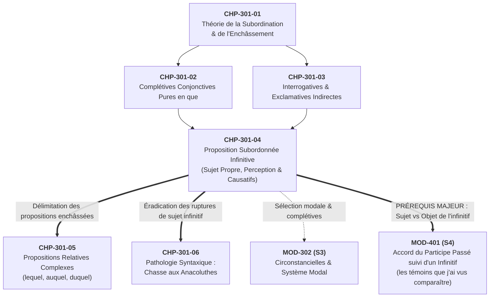
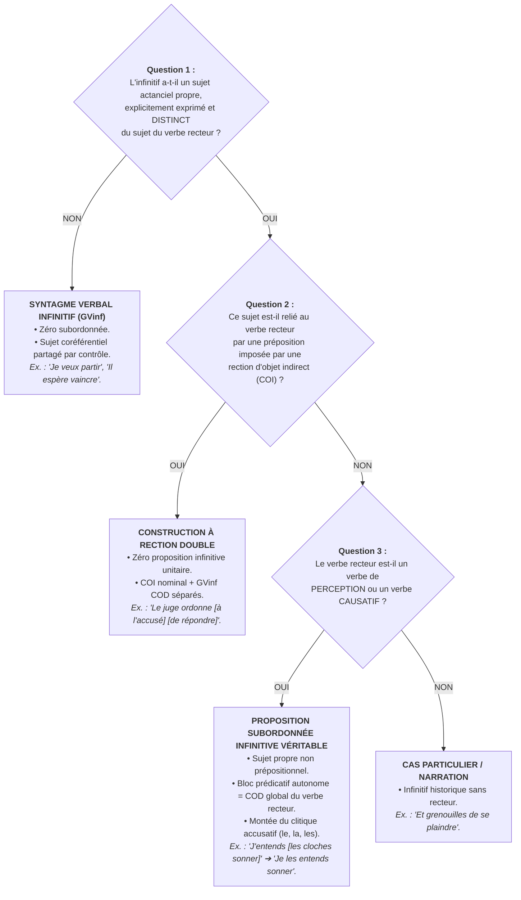

# Chapitre 4 — La Proposition Subordonnée Infinitive Véritable : Sujet Actanciel Propre, Verbes de Perception et Verbes Causatifs

> **Identifiant du chapitre** : `CHP-301-04`  
> **Module de rattachement** : [`MOD-301` — Architecture de la Subordination : Complétives Conjonctives, Interrogatives Indirectes, Infinitives et Relatives Complexes](file:///f:/Formation/world-class-french/03-curriculum/year-2/semester-3/mod-301-architecture-subordination-completives.md)  
> **Semestre** : Année 2 — Semestre 3 (S3)  
> **Volume horaire estimé** : 5 à 6 heures d'apprentissage autonome délibéré et d'ateliers d'application (Phase 1 Étude : 1 h 30 | Phase 2 Pratique : 1 h 30 | Phase 3 Correction : 1 h 00 | Phase 4 Évaluation : 1 h 00)  
> **Statut** : [STATUT : PROPOSÉ — EN ATTENTE DE VALIDATION]  
> **Compétences associées** : [`FR-SYNTAX-002`](file:///f:/Formation/world-class-french/02-competency-framework/competency-framework.md#fr-syntax-002-architecture-de-la-subordination-complexe) (L3 Autonomie), [`FR-INT-002`](file:///f:/Formation/world-class-french/02-competency-framework/competency-framework.md#fr-int-002-analyser-formellement-la-syntaxe-dune-phrase-complexe) (L3 Autonomie)  
> **Sources scientifiques de référence** : `SRC-GRAM-01` (Grevisse & Goosse, 2016, § 1105), `SRC-GRAM-02` (Riegel et al., 2016, chap. 14), `SRC-NORM-03` (Ministère de l'Éducation nationale, 2020, p. 45), `SRC-TYPO-01` (Imprimerie nationale, 2002, p. 142)

---

## 1. Titre et Place dans le Cursus

### 1.1 Intitulé Officiel
**Chapitre 4 : La Proposition Subordonnée Infinitive Véritable : Sujet Actanciel Propre, Verbes de Perception et Verbes Causatifs** (`CHP-301-04`).

### 1.2 Insertion Architecturale dans le Cursus
Au sein du module [`MOD-301`](file:///f:/Formation/world-class-french/03-curriculum/year-2/semester-3/mod-301-architecture-subordination-completives.md), l'étude de la subordination franchit avec ce quatrième chapitre un seuil structural singulier. Après l'analyse des propositions complétives conjonctives pures en *que* (`CHP-301-02`) et des interrogatives ou exclamatives indirectes (`CHP-301-03`) — qui reposent toutes sur un verbe recteur conjugué à un mode personnel et un morphème subordonnant explicite —, l'apprenant aborde ici la **subordination sans mot subordonnant** : la proposition subordonnée infinitive.



- **En amont** : Ce chapitre mobilise directement la théorie de l'enchâssement (`CHP-301-01`) et la notion de proposition complétive objet (`CHP-301-02`). Il requiert également la maîtrise éprouvée de la valence verbale et des frontières actancielles étudiées en [`MOD-201`](file:///f:/Formation/world-class-french/03-curriculum/year-1/semester-2/mod-201-syntaxe-fonctionnelle-phrase-simple.md).
- **Au sein de `MOD-301`** : Il sert de charnière critique avant l'étude des relatives complexes (`CHP-301-05`) et fournit l'assise théorique nécessaire pour éradiquer les anacoluthes de sujet infinitif dans `CHP-301-06` (*« En écoutant la radio, les idées me sont venues »*).
- **En aval direct vers [`MOD-401`](file:///f:/Formation/world-class-french/03-curriculum/year-2/semester-4/mod-401-pragmatique-accords-limites-rectifications-1990.md)** : La délimitation du sujet actanciel de l'infinitif constitue le prérequis absolu pour maîtriser la règle d'accord du participe passé suivi d'un infinitif (*« Les comédiens que j'ai vus jouer »* [accord car *que* fait l'action de jouer] vs *« La pièce que j'ai vu jouer »* [invariabilité car *que* subit l'action de jouer]). Sans la rigueur d'analyse acquise dans ce chapitre, les règles de `MOD-401` demeurent incomprises et appliquées au hasard.

---

## 2. Objectifs Mesurables

Au terme des 5 à 6 heures d'apprentissage autonome et d'ateliers d'application, l'apprenant est capable de :

1. **Distinguer formellement une proposition subordonnée infinitive véritable d'un simple syntagme verbal infinitif (GVinf)** complément d'objet direct ou indirect, en appliquant les deux tests linguistiques cumulatifs du sujet actanciel propre disjoint et de l'absence de préposition régie ([`FR-SYNTAX-002`](file:///f:/Formation/world-class-french/02-competency-framework/competency-framework.md#fr-syntax-002-architecture-de-la-subordination-complexe), palier L3).
2. **Identifier et délimiter les propositions subordonnées infinitives régies par les verbes de perception** (*entendre, voir, écouter, sentir, regarder, apercevoir*) et par les verbes causatifs ou factitifs (*faire, laisser, envoyer*), en démontrant que la proposition infinitive assume la fonction globale de complément d'objet direct du verbe recteur ([`FR-SYNTAX-002`](file:///f:/Formation/world-class-french/02-competency-framework/competency-framework.md#fr-syntax-002-architecture-de-la-subordination-complexe), palier L3).
3. **Analyser le comportement des pronoms clitiques dans la construction infinitive**, en expliquant le phénomène de montée du clitique sujet devant le verbe recteur (*« J'entends les cloches sonner »* $\rightarrow$ *« Je les entends sonner »*) et en justifiant l'impossibilité de la transformation passive personnelle canonique en français standard ([`FR-INT-002`](file:///f:/Formation/world-class-french/02-competency-framework/competency-framework.md#fr-int-002-analyser-formellement-la-syntaxe-dune-phrase-complexe), palier L3).
4. **Réaliser l'analyse actancielle intégrale d'un énoncé complexe à verbe de perception ou causatif**, en déterminant avec certitude si le complément antéposé est le sujet ou l'objet de l'infinitif, posant ainsi le socle opératoire infaillible pour l'accord du participe passé dans [`MOD-401`](file:///f:/Formation/world-class-french/03-curriculum/year-2/semester-4/mod-401-pragmatique-accords-limites-rectifications-1990.md) ([`FR-INT-002`](file:///f:/Formation/world-class-french/02-competency-framework/competency-framework.md#fr-int-002-analyser-formellement-la-syntaxe-dune-phrase-complexe), palier L3).

---

## 3. Prérequis et Test de Préparation

### 3.1 Prérequis Exigibles
- **Structure actancielle et valence verbale (`CHP-201-01`)** : Reconnaître le sujet, l'objet direct et l'objet indirect régis par un verbe.
- **Notion de proposition (`CHP-301-01`)** : Comprendre qu'une proposition est une unité syntaxique organisée autour d'un noyau prédicatif saturé par un sujet actanciel.
- **Pronominalisation clitique (`MOD-201`)** : Identifier les formes conjointes accusatives (*le, la, les*) et datives (*lui, leur*).

### 3.2 Test de Préparation (Auto-Diagnostic à 5 Questions)
Répondez aux cinq questions suivantes avant de consulter le corrigé repliable :

1. **Question 1 (Actant de l'infinitif)** : Dans la phrase *« Paul désire partir immédiatement »*, qui accomplit l'action désignée par *partir* ? Ce verbe à l'infinitif possède-t-il un sujet grammatical propre, exprimé et distinct de *Paul* ?
2. **Question 2 (Double événement)** : Dans la phrase *« Le garde forestier entend les branches mortes craquer »*, combien d'actions distinctes sont perceptibles ? Qui accomplit l'action d'*entendre* ? Qui accomplit l'action de *craquer* ?
3. **Question 3 (Rection prépositionnelle)** : Dans *« Le doyen ordonne aux étudiants de quitter l'amphithéâtre »*, quelle est la fonction syntaxique exacte du syntagme *aux étudiants* par rapport au verbe *ordonne* ? Le groupe *de quitter l'amphithéâtre* forme-t-il une proposition avec *aux étudiants* ?
4. **Question 4 (Pronominalisation clitique)** : Remplacez *la cantatrice* par un pronom personnel dans *« J'entends la cantatrice interpréter cet air »*. Où se place le pronom résultant ?
5. **Question 5 (Perception vs Déclaration)** : Comparez *« Je vois les cavaliers approcher »* et *« Je vois que les cavaliers approchent »*. L'objet de la perception directe est-il formulé de la même manière dans les deux énoncés ?

<details>
<summary><strong>Corrigé et barème de l'auto-diagnostic (cliquer pour dérouler)</strong></summary>

1. **Réponse 1** : C'est *Paul* qui accomplit l'action de *partir*. L'infinitif n'a **aucun sujet propre exprimé** ; son sujet est obligatoirement coréférentiel au sujet du verbe recteur *désire*. Il s'agit d'un simple syntagme verbal infinitif (GVinf) complément d'objet de *désire*, et non d'une proposition subordonnée infinitive.
2. **Réponse 2** : Il y a deux procès distincts : l'acte de perception (*entendre*), accompli par *Le garde forestier*, et l'événement sonore perçu (*craquer*), dont le sujet actanciel est *les branches mortes*. Il y a deux sujets grammaticaux distincts pour deux noyaux verbaux.
3. **Réponse 3** : *Aux étudiants* est **complément d'objet indirect (COI)** du verbe principal *ordonne* (*ordonner quelque chose à quelqu'un*). *De quitter l'amphithéâtre* est un syntagme verbal infinitif occupant la fonction de **COD** de *ordonne*. Ces deux constituants sont disjoints dans la rection du verbe recteur ; ils ne forment pas une proposition subordonnée unitaire.
4. **Réponse 4** : *« Je **l'**entends interpréter cet air. »* Le pronom accusatif *l'* se place devant le verbe recteur *entends* (phénomène de **montée du clitique**), bien qu'il représente sémantiquement le sujet de l'infinitif *interpréter*.
5. **Réponse 5** : Non. Dans *« Je vois les cavaliers approcher »*, la perception est directe, sensorielle et immédiate : le regard saisit directement l'événement dynamique [les cavaliers approcher]. Dans *« Je vois que les cavaliers approchent »*, le verbe *voir* prend une nuance cognitive ou intellectuelle (« je constate le fait que... »), et l'événement est enchâssé sous la forme d'une proposition complétive conjonctive en *que*.

> **Diagnostic** : Un résultat inférieur à 4/5 impose une lecture attentive des sections 4, 6 et 7.1 ci-dessous.
</details>

---

## 4. Situation de Départ ou Problème Concret

### 4.1 L'Illusion Scolaire du « Tout-Infinitif » Subordonné
Dans l'enseignement traditionnel et les manuels de vulgarisation, une confusion tenace persiste : l'étiquetage indistinct de tout infinitif complément comme une « proposition infinitive ». Observons ces trois phrases :

> (a) *« L'avocat refuse **de transiger** avant l'audience. »*  
> (b) *« Le magistrat ordonne **au greffier de consigner** les dépositions. »*  
> (c) *« Le président du tribunal entend **les témoins murmurer** dans la salle. »*

Pour un œil non averti, ces trois phrases renferment un verbe conjugué suivi d'un infinitif. Beaucoup d'étudiants concluent hâtivement que chacune comporte une « proposition infinitive ». C'est une erreur linguistique majeure :
- Dans la phrase (a), *de transiger* n'a aucun sujet propre. C'est le sujet principal *L'avocat* qui refuse et qui transigerait. Il n'y a qu'**une seule proposition**, au sein de laquelle *de transiger* est un simple groupe verbal infinitif (GVinf), complément d'objet direct de *refuse*.
- Dans la phrase (b), le verbe *ordonne* possède une valence double : il régit un COI (*au greffier*) et un COD (*de consigner les dépositions*). L'infinitif n'a pas de sujet propre autonome dans un lien prédicatif direct avec lui.
- **Seule la phrase (c) renferme une proposition subordonnée infinitive véritable** : *les témoins murmurer dans la salle*. L'infinitif *murmurer* possède son **sujet syntaxique propre et explicite** (*les témoins*), totalement distinct du sujet principal (*Le président du tribunal*). L'ensemble de cette séquence [sujet + infinitif] fonctionne comme un bloc prédicatif unique, COD global du verbe de perception *entend*.

### 4.2 L'Impact Destructeur sur l'Accord du Participe Passé (`MOD-401`)
Cette confusion formelle n'est pas une querelle d'étiquettes : elle constitue la cause directe des fautes d'accord les plus sévères de la langue écrite. Lorsque le verbe recteur est mis au passé composé avec un pronom antéposé, le scripteur qui ignore l'architecture actancielle de l'infinitive applique les règles au hasard :

> ❌ *« Les ouvriers que j'ai **fait** travailler... »* (correct, invariabilité absolue de *fait* suivi d'un infinitif).  
> ❌ *« Les mélodies que j'ai **entendues** chanter à l'opéra... »* (solécisme ! La mélodie ne chantait pas, elle était chantée : *mélodies* est le COD de *chanter*, le participe *entendu* est invariable).  
> ❌ *« Les cantatrices que j'ai **entendu** chanter sur scène... »* (faute inverse ! Les cantatrices accomplissaient l'action de chanter : *que* est le sujet de l'infinitif, le participe doit s'accorder : *entendues*).

Ce chapitre établit les critères scientifiques infaillibles permettant d'identifier la véritable proposition infinitive et d'analyser sans faille sa structure actancielle.

---

## 5. Explication Intuitive : La Double Scène de Théâtre

Pour comprendre la nature intime de la proposition subordonnée infinitive, représentons-nous une **double scène de théâtre** :

```text
CONSTRUCTION À CONTRÔLE (GVinf Simple)         PROPOSITION SUBORDONNÉE INFINITIVE VÉRITABLE
======================================         ============================================
[Scène Unique : "Je veux partir"]              [Théâtre à Deux Niveaux : "J'entends les cloches sonner"]

   ┌───────────────────────────────┐              ┌───────────────────────────────────────────┐
   │         SCÈNE UNIQUE          │              │             BALCON DU SPECTATEUR          │
   │                               │              │           (Proposition Principale)        │
   │ Acteur : "Je"                 │              │                                           │
   │ Action 1 : veut               │              │ Sujet Principal : "Je"                    │
   │ Action 2 : part               │              │ Verbe Recteur   : "entends" (Perception)  │
   │                               │              └─────────────────────┬─────────────────────┘
   │ (Un seul et même individu sur │                                    │ Perçoit globalement
   │  les planches : Sujet partagé)│                                    ▼ l'événement
   └───────────────────────────────┘              ┌───────────────────────────────────────────┐
                                                  │             SCÈNE AUTONOME                │
                                                  │    (Proposition Subordonnée Infinitive)   │
                                                  │                                           │
                                                  │ Acteur Propre : "les cloches" (Sujet)     │
                                                  │ Action Propre : "sonner"      (Prédicat)  │
                                                  │                                           │
                                                  │ (Une pièce indépendante se joue sous les  │
                                                  │  yeux ou les oreilles du spectateur)      │
                                                  └───────────────────────────────────────────┘
```

1. **Dans le syntagme verbal infinitif ordinaire (*« Je veux partir »*, *« Il espère réussir »*)**, il n'y a qu'une seule scène. L'acteur principal éprouve une volonté ou un espoir, et c'est lui-même qui exécute l'action projetée. L'infinitif est le prolongement direct du verbe recteur ; il n'y a aucun acteur nouveau.
2. **Dans la proposition subordonnée infinitive véritable (*« J'entends les cloches sonner »*)**, le sujet principal est installé au balcon : il n'agit pas sur scène, il perçoit ou déclenche un spectacle. Sur la scène indépendante, un acteur autonome (*les cloches*) entre en jeu et accomplit sa propre action (*sonner*). L'observateur au balcon ne perçoit pas les cloches immobiles : il perçoit **l'événement tout entier se déroulant sous ses yeux** [les cloches sonner].

> [!IMPORTANT]
> Une proposition exige un **nexus prédicatif complet** : une relation entre un sujet et un prédicat. Dès lors que l'infinitif dispose de son propre sujet actanciel sur scène, différent du sujet du verbe recteur, la linguistique moderne lui reconnaît le statut de **proposition subordonnée infinitive**.

---

## 6. Définitions Précises et Terminologie

Conformément à la nomenclature officielle (`SRC-NORM-03`, p. 45) et aux traités de référence (`SRC-GRAM-01`, § 1105 ; `SRC-GRAM-02`, chap. 14), les termes suivants sont définis avec une rigueur absolue :

### 6.1 Proposition Subordonnée Infinitive Véritable
Proposition subordonnée dont le verbe noyau est à l'infinitif et qui possède obligatoirement un **sujet syntaxique propre et explicite**, différent du sujet du verbe recteur, sans terme subordonnant introducteur (ni conjonction, ni pronom relatif).  
*Exemple d'ancrage* : *« Nous regardons **la fumée s'élever** au-dessus des toits. »* (*la fumée* est le sujet propre de *s'élever* ; l'ensemble *la fumée s'élever* est proposition infinitive COD de *regardons*).

### 6.2 Syntagme Verbal Infinitif / Groupe Infinitif (GVinf)
Groupe fonctionnel formé par un verbe à l'infinitif et ses éventuels compléments, mais **dépourvu de sujet syntaxique propre**. Son sujet sémantique implicite est obligatoirement identifié au sujet ou à l'objet du verbe régissant (construction à contrôle).  
*Exemple d'ancrage* : *« Le témoin refuse **de répondre aux questions**. »* (*de répondre aux questions* est un simple GVinf COD de *refuse* ; le sujet de *répondre* est coréférentiel à *Le témoin*).

### 6.3 Sujet Actanciel Propre
Groupe nominal ou pronom qui sature la valence du verbe à l'infinitif en assumant son rôle d'agent ou de siège, sans être le sujet du verbe principal et sans être introduit auprès du verbe principal par une préposition imposée par une rection d'objet indirect.

### 6.4 Verbe Recteur de Perception
Verbe exprimant une saisie sensorielle directe par l'un des cinq sens : la vue (*voir, regarder, apercevoir*), l'ouïe (*entendre, écouter*), ou le toucher/l'odorat (*sentir*). Ces verbes constituent la classe rectrice prototypique de la proposition infinitive.

### 6.5 Verbe Causatif / Factitif
Verbe exprimant qu'un agent incite, autorise ou contraint un tiers à réaliser un procès (*faire, laisser, envoyer*). Avec *faire*, la construction tend vers la formation d'un prédicat complexe unitaire ; avec *laisser*, l'autonomie de la proposition infinitive demeure nettement observable.

### 6.6 Rection Actancielle Double
Capacité de certains verbes de volonté ou d'ordre (*ordonner, demander, conseiller*) à régir simultanément deux compléments distincts : un destinataire au COI (*à quelqu'un*) et un contenu d'ordre au COD (*de faire quelque chose*). Cette construction s'oppose formellement à la proposition infinitive unitaire.

### 6.7 Montée du Clitique (*Clitic Climbing*)
Mécanisme syntaxique par lequel le pronom personnel représentant le sujet ou l'objet de l'infinitif quitte sa position naturelle auprès du verbe infinitif pour venir s'attacher sous forme conjointe (clitique) devant le verbe recteur (*« J'entends l'enfant pleurer »* $\rightarrow$ *« Je **l'**entends pleurer »*).

---

## 7. Règles ou Mécanismes Fondamentaux

### 7.1 Le Critère Linguistique Strict de la Proposition Infinitive
Pour qu'une suite verbale infinititive soit scientifiquement qualifiée de **proposition subordonnée infinitive**, la linguistique contemporaine (`SRC-GRAM-02`, chap. 14) et la grammaire normative (`SRC-GRAM-01`, § 1105 ; `SRC-NORM-03`, p. 45) exigent la réunion de **deux conditions cumulatives et impératives** :

```text
CRITÈRES CUMULATIFS D'IDENTIFICATION DE LA PROPOSITION INFINITIVE
┌────────────────────────────────────────────────────────────────────────┐
│ Condition 1 : Sujet Syntaxique Propre et Explicite                     │
│ L'infinitif doit posséder un actant sujet exprimé dans l'énoncé,       │
│ obligatoirement DIFFÉRENT du sujet de la proposition principale.       │
└──────────────────────────────────┬─────────────────────────────────────┘
                                   │ ET
┌──────────────────────────────────▼─────────────────────────────────────┐
│ Condition 2 : Absence de Préposition de Rection Indirecte              │
│ Ce sujet ne doit pas être relié au verbe principal comme un COI        │
│ prépositionnel autonome imposé par la valence de ce verbe.             │
└────────────────────────────────────────────────────────────────────────┘
```

Si l'une de ces deux conditions fait défaut, l'énoncé ne comporte pas de proposition subordonnée infinitive.

### 7.2 La Classe des Verbes Recteurs de Perception
Les verbes de perception constituent le domaine d'élection de la proposition infinitive. Le verbe recteur régit directement un événement dynamique perçu :

| Verbe recteur | Exemple canonique | Décomposition actancielle | Statut de la séquence |
| :--- | :--- | :--- | :--- |
| **Entendre** | *« Le veilleur entend le vent mugir dans les branches. »* | Sujet principal : *Le veilleur*<br/>Sujet de l'infinitif : *le vent*<br/>Infinitif : *mugir* | *[le vent mugir dans les branches]* = **Proposition subordonnée infinitive**, COD global de *entend*. |
| **Voir** | *« Elle voit les barques aborder au rivage. »* | Sujet principal : *Elle*<br/>Sujet de l'infinitif : *les barques*<br/>Infinitif : *aborder* | *[les barques aborder au rivage]* = **Proposition subordonnée infinitive**, COD global de *voit*. |
| **Écouter** | *« Le maître écoute l'élève réciter son poème. »* | Sujet principal : *Le maître*<br/>Sujet de l'infinitif : *l'élève*<br/>Infinitif : *réciter* | *[l'élève réciter son poème]* = **Proposition subordonnée infinitive**, COD global d'*écoute*. |
| **Regarder** | *« Nous regardions le soleil disparaître à l'horizon. »* | Sujet principal : *Nous*<br/>Sujet de l'infinitif : *le soleil*<br/>Infinitif : *disparaître* | *[le soleil disparaître à l'horizon]* = **Proposition subordonnée infinitive**, COD global de *regardions*. |
| **Sentir** | *« Le malade sent ses forces revenir peu à peu. »* | Sujet principal : *Le malade*<br/>Sujet de l'infinitif : *ses forces*<br/>Infinitif : *revenir* | *[ses forces revenir peu à peu]* = **Proposition subordonnée infinitive**, COD global de *sent*. |
| **Apercevoir** | *« Le sentinelle aperçoit une ombre glisser le long du mur. »* | Sujet principal : *La sentinelle*<br/>Sujet de l'infinitif : *une ombre*<br/>Infinitif : *glisser* | *[une ombre glisser...]* = **Proposition subordonnée infinitive**, COD global d'*aperçoit*. |

### 7.3 Les Verbes Causatifs et Factitifs (*faire, laisser, envoyer*)
Les verbes causatifs expriment la mise en mouvement d'une action par l'intermédiaire d'un tiers :

1. **Le verbe *laisser*** :
   - *« Le père laisse les enfants jouer dans le jardin. »*
   - *Les enfants* est le sujet propre de l'infinitif *jouer*. L'ensemble *[les enfants jouer dans le jardin]* est une proposition subordonnée infinitive COD de *laisse*.
2. **Le verbe *envoyer*** :
   - *« La mère envoie son fils chercher du pain. »*
   - *Son fils* fonctionne comme sujet de *chercher*, dans une construction infinitive COD d'*envoie*.
3. **Le verbe *faire* et le prédicat complexe** :
   - Lorsque *faire* est suivi d'un infinitif (*« Le maître fait travailler les élèves »*), la linguistique moderne note une tendance très forte à la **fusion verbale** : *faire* et l'infinitif se comportent comme un verbe unique à deux éléments (prédicat complexe).
   - Toutefois, sur le plan actanciel fondamental, *les élèves* demeure le sujet sémantique de *travailler*. Lorsque l'infinitif transitif reçoit son propre COD, le sujet de l'infinitif bascule obligatoirement au datif introduit par *à* : *« Le maître fait copier une page **aux élèves** »* $\rightarrow$ *« Le maître **leur** fait copier une page »*.

### 7.4 La Distinction Capitale : Proposition Infinitive vs Syntagme Verbal Infinitif
La frontière entre ces deux réalités syntaxiques repose sur deux cas d'exclusion formelle :

```text
DISTINCTION OPÉRATOIRE FONDAMENTALE
┌────────────────────────────────────────────────────────────────────────────────────────┐
│ CAS 1 : SUJET CORÉFÉRENTIEL (CONTRÔLE DU SUJET)                                        │
│ Énoncé : "Le soldat refuse de fuir le combat."                                         │
│ • Sujet de "refuse" : Le soldat                                                        │
│ • Sujet de "fuir"   : Le soldat (même entité référentielle)                            │
│ ➔ DIAGNOSTIC : ZÉRO PROPOSITION SUBORDONNÉE.                                           │
│    "de fuir le combat" est un Syntagme Verbal Infinitif (GVinf), COD de "refuse".      │
└────────────────────────────────────────────────────────────────────────────────────────┘
┌────────────────────────────────────────────────────────────────────────────────────────┐
│ CAS 2 : SUJET DISJOINT MAIS RECTION PRÉPOSITIONNELLE AU VERBE PRINCIPAL                │
│ Énoncé : "Le juge ordonne à l'accusé de répondre."                                     │
│ • "ordonne" a sa propre valence bivalente : ordonner [quelque chose] [à quelqu'un]     │
│ • "à l'accusé" est COI du verbe principal "ordonne"                                    │
│ • "de répondre" est GVinf COD du verbe principal "ordonne"                             │
│ ➔ DIAGNOSTIC : ZÉRO PROPOSITION INFINITIVE UNITAIRE.                                   │
│    Il s'agit de deux compléments distincts régis directement par le verbe recteur.    │
└────────────────────────────────────────────────────────────────────────────────────────┘
```

### 7.5 Le Comportement des Pronoms Clitiques et l'Interdit Passif
La proposition infinitive présente deux propriétés structurales décisives :

1. **La montée obligatoire du clitique sujet** :
   Lorsque le sujet nominal de l'infinitif est pronominalisé, le pronom personnel prend la marque de l'**accusatif** (*le, la, les*) et remonte obligatoirement devant le verbe recteur de perception :
   - *« J'entends [les cloches sonner]. »* $\rightarrow$ *« Je **les** entends sonner. »*
   - *« J'ai vu [Marie traverser la rue]. »* $\rightarrow$ *« Je **l'**ai vue traverser la rue. »*
   Dans ces phrases, le pronom clitique *les / l'* assume une double fonction : il est **sujet syntaxique de l'infinitif** et se comporte simultanément comme le **COD clitique du verbe principal**.
2. **L'impossibilité de la transformation passive canonique** :
   Contrairement à l'anglais qui admet la montée du sujet au passif (*« Mary was seen to cross the street »*), le français moderne proscrit formellement la passivation personnelle d'une proposition infinitive :
   - ❌ *\*« Marie a été vue traverser la rue par moi. »* (agnérammatical en français standard contemporain).
   - Le français recourt au tour impersonnel (*« Il a été vu des choses étranges »*) ou à la relative (*« On a vu Marie qui traversait la rue »*).

---

## 8. Raisonnement Détaillé : Pourquoi la Règle Existe

### 8.1 Le Fondement Théorique de la Prédication
Pourquoi la linguistique moderne refuse-t-elle le titre de « proposition » à un infinitif dépourvu de sujet propre (*« Je veux partir »*) ?

Une proposition se définit par la réunion d'un **sujet** (l'entité dont on parle) et d'un **prédicat** (ce qu'on en dit). Dans la phrase *« Je veux partir »*, l'élément verbal *partir* ne possède aucune autonomie prédicative : il constitue le complément direct du verbe de volonté *veux*. Il forme avec lui un groupe verbal unifié. Dire qu'il y a là une « proposition infinitive » reviendrait à prétendre que dans *« Je veux une pomme »*, *une pomme* est une proposition ! L'infinitif y fonctionne purement comme un équivalent nominal de rang syntagmatique.

En revanche, dans *« J'entends les cloches sonner »*, nous observons une véritable **scission prédicative** :
- Le verbe *entends* a son propre sujet : *Je*.
- L'infinitif *sonner* a son propre sujet : *les cloches*.

Il y a deux couples Sujet-Prédicat articulés : `[Je + entends]` gouverne `[les cloches + sonner]`. La séquence régie possède sa propre complétude prédicative interne : c'est la définition exacte d'une **proposition subordonnée**.

### 8.2 La Raison Diachronique : De l'Accusatif avec Infinitif Latin à la Complétive
En latin classique, la proposition infinitive (*proposition infinitive à l'accusatif*) était d'un usage universel : elle traduisait toutes les complétives après les verbes de déclaration et d'opinion (*« Dico te beatum esse »* = *Je dis toi être heureux*).

Lors de la transition du latin vers le roman et le français ancien, cette structure a été massivement concurrencée et supplantée par la proposition complétive conjonctive introduite par *que* (*« Je dis que tu es heureux »*) [Réf. `SRC-GRAM-02`, chap. 14].

Pourquoi la proposition infinitive n'a-t-elle survécu qu'après les **verbes de perception** (*voir, entendre*) et certains **causatifs** (*laisser, faire*) ?
Parce que la perception sensorielle directe saisit un **événement physique en train de s'accomplir sous nos yeux**, et non une vérité abstraite ou déclarative :
- *« J'entends que Pierre chante »* $\rightarrow$ Je prends connaissance du fait, on me l'apprend, ou je le déduis (valeur intellectuelle/cognitive).
- *« J'entends Pierre chanter »* $\rightarrow$ Mon tympan reçoit directement les ondes acoustiques de sa voix (perception sensorielle immédiate en temps réel).

L'infinitif, mode non personnel dépourvu de flexion temporelle autonome, exprime le procès dans son déroulement direct et brut, parfaitement adapté à la saisie sensorielle immédiate.

---

## 9. Exemples Corrects Commentés

Voici le décorticage analytique de trois extraits littéraires majeurs illustrant la diversité des corpus du cursus.

### 9.1 Corpus Patrimonial Classique : Jean Racine
> *« Mais tout d'un coup, du sein de l'onde émue,*  
> *Un effroyable cri sort vers l'air et le fend.*  
> *De la terre au même instant un cri répond,*  
> *Et j'entends [la mer mugir] sous les sombres ombrages. »*  
> — Jean Racine, *Phèdre* (1677), acte V, scène 6.

- **Verbe recteur** : *entends* (1re personne du singulier de l'indicatif présent ; sujet : *j'*). Verbe de perception auditive.
- **Proposition subordonnée infinitive** : *« [la mer mugir] »*.
- **Sujet actanciel propre** : *la mer* (groupe nominal féminin singulier). C'est la mer qui accomplit le procès de *mugir*.
- **Prédicat infinitif** : *mugir* (verbe intransitif).
- **Fonction globale** : Proposition subordonnée infinitive, complément d'objet direct (COD) du verbe *entends*.
- **Test de cliticisation** : *« Et je **la** vois / je **l'**entends mugir. »* (Le pronom *l'* monte devant *entends*).

### 9.2 Corpus Contemporain International : Albert Camus
> *« Par la fenêtre ouverte, j'entendais [le marchand de journaux crier] sur le trottoir et [le greffier froisser] des liasses de dossiers. »*  
> — Albert Camus, *L'Étranger* (1942).

- **Verbe recteur** : *entendais* (1re personne de l'imparfait ; sujet : *j'*). Verbe de perception auditive coordonnant deux complétives infinitives.
- **Première proposition infinitive** : *« [le marchand de journaux crier sur le trottoir] »*.
  - Sujet actanciel propre : *le marchand de journaux*.
  - Noyau verbal : *crier*.
  - Complément circonstanciel de lieu interne : *sur le trottoir*.
- **Deuxième proposition infinitive coordonnée** : *« [le greffier froisser des liasses de dossiers] »*.
  - Sujet actanciel propre : *le greffier*.
  - Noyau verbal : *froisser*.
  - Complément d'objet direct interne à l'infinitive : *des liasses de dossiers*.
- **Fonction externe** : Deux propositions subordonnées infinitives coordonnées par *et*, COD collectifs d'*entendais*.

### 9.3 Corpus Francophone Ouest-Africain : Olympe Bhêly-Quenum
> *« Debout près du grand fromager séculaire, Ahouna regardait [la poussière rougeâtre tourbillonner] sur la piste de Ouidah, tandis qu'il sentait [son cœur battre] avec une angoisse inexprimable. »*  
> — Olympe Bhêly-Quenum, *Un piège sans fin* (1960).

- **Première infinitive** : *« [la poussière rougeâtre tourbillonner sur la piste de Ouidah] »*.
  - Verbe recteur : *regardait* (perception visuelle ; sujet : *Ahouna*).
  - Sujet propre de l'infinitive : *la poussière rougeâtre* (distinct d'*Ahouna*).
  - Noyau : *tourbillonner*.
  - Fonction : Proposition subordonnée infinitive, COD de *regardait*.
- **Deuxième infinitive** : *« [son cœur battre avec une angoisse inexprimable] »*.
  - Verbe recteur : *sentait* (perception intéroceptive / somatique ; sujet : *il* [Ahouna]).
  - Sujet propre de l'infinitive : *son cœur*.
  - Noyau : *battre*.
  - Fonction : Proposition subordonnée infinitive, COD de *sentait*.

---

## 10. Contre-Exemples et Erreurs Fréquentes

Cette section recense et dissèque **six erreurs récurrentes** d'analyse syntaxique commises sur les infinitifs :

### Erreur n° 1 : Étiqueter tout infinitif comme subordonnée infinitive
- ❌ **Analyse erronée** : Dans *« Le voyageur désire prendre le train de nuit »*, qualifier *prendre le train de nuit* de « proposition subordonnée infinitive ».
- 🔍 **Réfutation scientifique** : L'infinitif *prendre* n'a pas de sujet propre disjoint : son agent implicite est obligatoirement le sujet principal *Le voyageur*. Il n'y a qu'un seul sujet pour deux verbes (contrôle du sujet).
- ✔️ **Analyse normée** : *Prendre le train de nuit* est un **Syntagme Verbal Infinitif (GVinf)**, occupant la fonction de complément d'objet direct (COD) du verbe *désire*. Il n'y a qu'**une seule proposition** dans cette phrase.

### Erreur n° 2 : Croire que « demander de faire » ou « ordonner de venir » est une infinitive
- ❌ **Analyse erronée** : Dans *« Le patron demande à l'artisan de terminer le chantier »*, considérer *à l'artisan de terminer le chantier* comme une « proposition infinitive ».
- 🔍 **Réfutation scientifique** : Le verbe *demander* a une valence double : il régit un COI autonome (*demander à quelqu'un*) et un COD de contenu (*demander de faire quelque chose*). Le syntagme *à l'artisan* est le complément indirect du verbe principal *demande*. L'infinitif est prépositionnel (*de terminer*). Les deux éléments ne constituent pas une proposition unitaire.
- ✔️ **Analyse normée** : *À l'artisan* est **COI** de *demande* ; *de terminer le chantier* est **GVinf COD** de *demande*. Zéro proposition infinitive.

### Erreur n° 3 : Confondre le sujet de l'infinitif avec un COD autonome du verbe principal
- ❌ **Analyse erronée** : Dans *« J'entends les enfants chanter »*, analyser *les enfants* comme COD d'*entends*, et *chanter* comme « complément de l'infinitif » ou attribut du COD.
- 🔍 **Réfutation scientifique** : Si l'on applique le test d'effacement, *« J'entends les enfants »* change totalement le sens de la phrase : on entend des cris ou des voix, mais on n'entend pas l'être humain physique en lui-même. L'objet perçu n'est pas l'entité nominale *les enfants*, mais **l'événement prédicatif tout entier** : [les enfants chanter].
- ✔️ **Analyse normée** : *Les enfants* est le **sujet syntaxique propre** de l'infinitif *chanter*, et la séquence globale *les enfants chanter* est la **proposition subordonnée infinitive**, COD d'*entends*.

### Erreur n° 4 : Mauvaise pronominalisation clitique et positionnement erroné du pronom
- ❌ **Analyse erronée** : Pronominaliser *« J'entends les oiseaux chanter »* sous la forme *\*« J'entends les chanter »*.
- 🔍 **Réfutation scientifique** : En français moderne, le pronom accusatif représentant le sujet de l'infinitif régi par un verbe de perception subit obligatoirement la **montée du clitique** devant le verbe recteur conjugué.
- ✔️ **Analyse normée** : *« Je **les** entends chanter. »* (Le clitique *les* précède le verbe recteur *entends*).

### Erreur n° 5 : Accorder à tort sur un faux COD dans les périphrases infinitives
- ❌ **Analyse erronée** : Écrire *\*« Les arbres que j'ai vus abattre par les bûcherons »* en pensant que *arbres* est le sujet de l'infinitif.
- 🔍 **Réfutation scientifique** : Les arbres n'accomplissent pas l'action d'*abattre* : ils la subissent ! Ce sont les bûcherons qui abattent les arbres. Le pronom relatif *que* (antécédent *arbres*) est en réalité le **COD de l'infinitif *abattre***. Le participe passé *vu* ne régit donc pas un COD antéposé faisant l'action : il reste rigoureusement **invariable**.
- ✔️ **Analyse normée** : *« Les arbres que j'ai **vu** abattre par les bûcherons. »* (Invariabilité de *vu* car le COD est l'objet de l'infinitif). En revanche : *« Les bûcherons que j'ai **vus** abattre les arbres. »* (Accord car les bûcherons sont le sujet de l'infinitive).

### Erreur n° 6 : Confondre la proposition infinitive avec la construction participiale au participe présent
- ❌ **Analyse erronée** : Traiter de façon identique *« J'ai vu Pierre traverser la rue »* et *« J'ai vu Pierre traversant la rue »*.
- 🔍 **Réfutation scientifique** : Dans *« J'ai vu Pierre traverser la rue »*, *Pierre traverser la rue* est une proposition infinitive unitaire COD de *vu*. Dans *« J'ai vu Pierre traversant la rue »*, *Pierre* est le COD direct du verbe *vu*, et *traversant la rue* est un syntagme participial en fonction d'épithète détachée ou d'attribut du COD se rapportant à *Pierre*.
- ✔️ **Analyse normée** : Distinguer le mode infinitif (noyau d'infinitive) du participe présent (expansion adjectivale/participiale rattachée à un nom).

---

## 11. Cas Particuliers et Limites

### 11.1 L'Infinitif Historique ou de Narration en Tête de Phrase
Dans le récit littéraire classique, on rencontre l'infinitif précédé de la préposition *de*, coordonné par *et* ou *ainsi* :
> *« Ainsi dit le Renard, **et flatteurs d'applaudir** ! »*  
> — Jean de La Fontaine, *Fables*.  
> *« **Et grenouilles de se plaindre**, et de faire un vacarme épouvantable. »*

- **Statut linguistique** : Cet infinitif possède un sujet explicite (*flatteurs*, *grenouilles*), mais il est **totalement dépourvu de verbe recteur**. Il n'est enchâssé sous aucune matrice.
- **Analyse** : Ce n'est pas une proposition subordonnée infinitive, mais une **proposition indépendante à infinitif de narration** (ou infinitif historique). Sa valeur est aspectuelle : elle exprime l'inchoativité brutale et la soudaineté d'une réaction collective consécutive à un événement précédent [Réf. `SRC-GRAM-01`, § 1105 ; `SRC-GRAM-02`, chap. 14].

### 11.2 L'Infinitif Régi par « Faire » sans Sujet Exprimé
Soit l'énoncé courant :
> *« Le gouverneur a fait bâtir un nouvel hôpital à Cotonou. »*

- **Structure actancielle** : Le verbe *bâtir* n'a pas de sujet agent exprimé dans l'énoncé (les maçons et ouvriers sont passés sous silence).
- **Statut du complément** : Le groupe nominal *un nouvel hôpital* n'est pas le sujet de *bâtir*, mais son **complément d'objet direct**.
- **Analyse syntaxique moderne** : La linguistique générative et descriptive considère que *faire bâtir* constitue ici un **prédicat verbal complexe unifié**. L'ensemble de la périphrase régit *un nouvel hôpital* comme son COD direct. On ne parlera donc pas de proposition subordonnée infinitive complète, mais d'une **construction factitive à agent indéterminé**.

---

## 12. Approfondissement Adapté au Niveau : Syntaxe Générative et Théorie des « Small Clauses »

Pour les étudiants préparant les concours d'enseignement supérieur (CAPES, Agrégation), la linguistique formelle éclaire la structure interne de l'infinitive par deux modèles théoriques majeurs :

### 12.1 La Théorie des Propositions Réduites (*Small Clauses*)
Dans le cadre générativiste (Chomsky, Kayne), la séquence régie par un verbe de perception est modélisée comme une **proposition minimale (Small Clause - SC)** dépourvue de projection temporelle finie ($\text{TP}$ ou $\text{IP}$ fléchi) :

$$\left[\text{VP}\; \text{entends} \; \left[\text{SC}\; \text{les cloches} \; \left[\text{VP}\; \text{sonner}\right]\right]\right]$$

Dans cette configuration :
1. Le groupe nominal *les cloches* reçoit son **rôle thématique** d'agent/siège du verbe à l'infinitif *sonner*.
2. Mais la proposition réduite n'ayant pas de temps fléchi pour lui attribuer le cas nominatif, le groupe nominal reçoit son **marquage de cas accusatif** de manière exceptionnelle par le verbe supérieur de perception (*Exceptional Case Marking* ou ECM). C'est pourquoi, dès qu'il est pronominalisé, il prend obligatoirement la forme accusative conjointe *les* (*« Je les entends sonner »*) et jamais le nominatif *\*ils*.

### 12.2 Constructions à Montée (*Raising*) vs Constructions à Contrôle (*Control*)
La syntaxe formelle oppose rigoureusement deux mécanismes :

1. **Le Contrôle** : Dans *« Pierre$_i$ veut [$\text{PRO}_i$ partir] »*, le sujet principal *Pierre* contrôle un sujet sous-entendu nul ($\text{PRO}$) qui porte le même indice référentiel ($i$). Il n'y a pas d'infinitive subordonnée autonome.
2. **La Montée / Marquage Exceptionnel** : Dans *« J'entends [Marie chanter] »*, *Marie* n'est pas sélectionnée sémantiquement par *entendre* (on n'entend pas la personne physique de Marie, mais l'événement sonore). *Marie* est sélectionnée thématiquement par *chanter* et gouvernée structuralement par *entendre*.

---

## 13. Comparaisons Différentielles

### 13.1 Tableau Synoptique : Proposition Infinitive vs Syntagme Verbal Infinitif (GVinf)

| Critère de distinction | Proposition Subordonnée Infinitive Véritable | Syntagme Verbal Infinitif Ordinaire (GVinf) |
| :--- | :--- | :--- |
| **Sujet de l'infinitif** | **Propre, explicite et disjoint** du sujet principal (*« J'entends [les vagues déferler] »*). | **Coréférentiel** au sujet ou à l'objet principal (*« Il désire [partir] »*, *« Il me demande [de venir] »*). |
| **Nombre de propositions** | **Deux propositions** : Matrice rectrice + Subordonnée infinitive. | **Une seule proposition** : Phrase simple à groupe verbal complexe. |
| **Classes de verbes recteurs** | Verbes de perception (*voir, entendre, sentir*) et certains causatifs (*laisser, envoyer*). | Verbes de volonté, de désir, d'opinion, d'effort, de déclaration (*vouloir, espérer, affirmer, tenter*). |
| **Pronominalisation du sujet** | Montée en pronom accusatif devant le verbe recteur (*« Je **les** entends déferler »*). | Impossible (le sujet n'est pas exprimé de manière autonome auprès de l'infinitif). |
| **Test d'effacement de l'infinitif** | Impossible sans dénaturer l'événement perçu (*« J'entends les vagues déferler »* $\neq$ *« J'entends les vagues »*). | Effacement impossible ou remplacement par un simple nom (*« Il veut partir »* $\rightarrow$ *« Il veut un départ »*). |

### 13.2 Tableau Différentiel : Verbe de Perception vs Verbe de Volonté

| Propriété | Verbe de Perception (*voir, entendre, apercevoir*) | Verbe de Volonté (*vouloir, souhaiter, exiger*) |
| :--- | :--- | :--- |
| **Construction avec sujet identique** | Rare ou réflexive (*« Il s'entend parler »*). | Canonique et obligatoire à l'infinitif (*« Il veut réussir »*, proscription de *\*Il veut qu'il réussisse*). |
| **Construction avec sujet différent** | **Proposition infinitive directe** (*« Il entend les oiseaux chanter »*). | **Complétive conjonctive au subjonctif** obligatoire (*« Il veut **que les oiseaux chantent** »* ; exclusion de *\*Il veut les oiseaux chanter*). |
| **Intermédiaire prépositionnel** | Jamais de préposition (*de, à*) devant l'infinitive. | Préposition fréquente devant le GVinf (*tenter de, aspirer à*). |

---

## 14. Exercices Progressifs

### 14.1 Niveau 1 : Discrimination Formelle (12 Phrases)
Indiquez pour chacune des 12 phrases ci-dessous si le segment en gras constitue une **Proposition Subordonnée Infinitive Véritable (PSI)** ou un simple **Syntagme Verbal Infinitif (GVinf)**. Justifiez brièvement votre choix par le critère du sujet actanciel.

1. *Le garde forestier entend **le tonnerre gronder au loin**.*
2. *L'avocat espère **obtenir la relaxe de son client**.*
3. *Nous regardions **les pirogues glisser sur la lagune de Ganvié**.*
4. *Le ministre refuse **de signer ce décret controversé**.*
5. *Le médecin écoute **le cœur du patient battre régulièrement**.*
6. *Le professeur demande aux étudiants **de ranger leurs affaires**.*
7. *La mère sent **la fièvre monter chez son enfant**.*
8. *Les députés souhaitent **ajourner la séance plénière**.*
9. *Elle laisse **ses pensées divaguer dans le silence de la nuit**.*
10. *Le directeur conseille à son adjoint **de faire preuve de patience**.*
11. *J'aperçois **des reflets dorés scintiller sur l'océan**.*
12. *Cet inspecteur prétend **connaître l'auteur du cambriolage**.*

<details>
<summary><strong>Corrigé détaillé du Niveau 1 (cliquer pour dérouler)</strong></summary>

1. **Proposition Subordonnée Infinitive (PSI)** : L'infinitif *gronder* a un sujet actanciel propre et explicite (*le tonnerre*), différent du sujet principal *Le garde forestier*. Le verbe recteur est un verbe de perception auditive (*entend*).
2. **Syntagme Verbal Infinitif (GVinf)** : Pas de sujet propre pour *obtenir*. L'agent est coréférentiel au sujet principal *L'avocat*. COD du verbe de désir *espère*.
3. **Proposition Subordonnée Infinitive (PSI)** : Sujet propre explicite (*les pirogues*), distinct de *Nous*. Verbe recteur de perception visuelle (*regardions*).
4. **Syntagme Verbal Infinitif (GVinf)** : Sujet de *signer* coréférentiel à *Le ministre*. Pas de sujet distinct.
5. **Proposition Subordonnée Infinitive (PSI)** : Sujet propre explicite (*le cœur du patient*), distinct du sujet principal *Le médecin*. Verbe de perception *écoute*.
6. **Syntagme Verbal Infinitif (GVinf)** : *Aux étudiants* est COI du verbe principal *demande*. *De ranger leurs affaires* est un GVinf COD de *demande*. Il n'y a pas de proposition infinitive unitaire.
7. **Proposition Subordonnée Infinitive (PSI)** : Sujet propre explicite (*la fièvre*), distinct de *La mère*. Verbe de perception somatique (*sent*).
8. **Syntagme Verbal Infinitif (GVinf)** : Sujet de *ajourner* coréférentiel à *Les députés*. Verbe de volonté *souhaitent*.
9. **Proposition Subordonnée Infinitive (PSI)** : Sujet propre explicite (*ses pensées*), distinct de *Elle*. Verbe causatif *laisse*.
10. **Syntagme Verbal Infinitif (GVinf)** : Structure à double rection (*à son adjoint* = COI de *conseille* ; *de faire preuve...* = GVinf COD de *conseille*).
11. **Proposition Subordonnée Infinitive (PSI)** : Sujet propre explicite (*des reflets dorés*), distinct de *J'*. Verbe de perception visuelle (*aperçois*).
12. **Syntagme Verbal Infinitif (GVinf)** : Sujet de *connaître* coréférentiel à *Cet inspecteur*. Verbe d'affirmation *prétend*.
</details>

---

### 14.2 Niveau 2 : Délimitation et Extraction Actancielle (6 Phrases Complexes)
Pour chacune des 6 phrases suivantes :
1. Isolez entre crochets la proposition subordonnée infinitive véritable.
2. Identifiez son sujet actanciel propre et son verbe à l'infinitif.
3. Transformez l'énoncé en remplaçant le sujet propre de l'infinitif par le pronom personnel clitique adéquat.

1. *À la tombée de la nuit, les voyageurs écoutaient les grillons chanter sous les feuillages.*
2. *Le commandant regarde les nouvelles recrues franchir l'obstacle avec aisance.*
3. *Dans la pénombre de l'atelier, le sculpteur sentait l'inspiration revenir par degrés.*
4. *Le vent impétueux faisait voler les poussières rouges au-dessus de la ville.*
5. *Nous avons entendu la foule en colère réclamer justice devant le palais du gouverneur.*
6. *La sentinelle vigilante aperçoit deux inconnus s'approcher furtivement de la grille d'enceinte.*

<details>
<summary><strong>Corrigé détaillé du Niveau 2 (cliquer pour dérouler)</strong></summary>

1. - **Proposition infinitive** : *« [les grillons chanter sous les feuillages] »*.
   - **Sujet propre** : *les grillons* | **Infinitif** : *chanter*.
   - **Pronominalisation clitique** : *« À la tombée de la nuit, les voyageurs **les** écoutaient chanter sous les feuillages. »*
2. - **Proposition infinitive** : *« [les nouvelles recrues franchir l'obstacle avec aisance] »*.
   - **Sujet propre** : *les nouvelles recrues* | **Infinitif** : *franchir*.
   - **Pronominalisation clitique** : *« Le commandant **les** regarde franchir l'obstacle avec aisance. »*
3. - **Proposition infinitive** : *« [l'inspiration revenir par degrés] »*.
   - **Sujet propre** : *l'inspiration* | **Infinitif** : *revenir*.
   - **Pronominalisation clitique** : *« Dans la pénombre de l'atelier, le sculpteur **la** sentait revenir par degrés. »*
4. - **Proposition infinitive / causatif** : *« [les poussières rouges voler au-dessus de la ville] »*.
   - **Sujet propre** : *les poussières rouges* | **Infinitif** : *voler*.
   - **Pronominalisation clitique** : *« Le vent impétueux **les** faisait voler au-dessus de la ville. »*
5. - **Proposition infinitive** : *« [la foule en colère réclamer justice devant le palais du gouverneur] »*.
   - **Sujet propre** : *la foule en colère* | **Infinitif** : *réclamer*.
   - **Pronominalisation clitique** : *« Nous **l'**avons entendue réclamer justice devant le palais du gouverneur. »* (Note : accord du participe *entendue* car le pronom clitique antéposé *l'* est le sujet de l'action de réclamer).
6. - **Proposition infinitive** : *« [deux inconnus s'approcher furtivement de la grille d'enceinte] »*.
   - **Sujet propre** : *deux inconnus* | **Infinitif** : *s'approcher*.
   - **Pronominalisation clitique** : *« La sentinelle vigilante **les** aperçoit s'approcher furtivement de la grille d'enceinte. »*
</details>

---

### 14.3 Niveau 3 : Analyse Syntaxique Complète d'un Passage Calibré de 50 Mots Exacts (Autonome)

#### Consigne
Le passage descriptif ci-dessous a été rigoureusement calibré à **50 mots exacts** (sans élision ni trait d'union).  
1. Identifiez et délimitez entre crochets toutes les propositions subordonnées infinitives véritables.
2. Identifiez les éventuels syntagmes verbaux infinitifs (GVinf) qui ne constituent pas des propositions subordonnées.
3. Dressez le tableau d'analyse fonctionnelle complet en précisant pour chaque infinitif : son verbe recteur, son statut, son sujet actanciel et sa fonction syntaxique.

#### Texte Support Brut (50 Mots Exacts)
> *Sur la rive sablonneuse le vieux garde forestier regarde les grands oiseaux blancs descendre lentement vers les eaux calmes. Soudain cet homme attentif entend des branches mortes craquer dans le taillis sombre. Il souhaite observer ce fauve nocturne mais il laisse la nuit profonde envahir progressivement tout ce paysage boisé.*

##### Vérification Typographique Mot par Mot (1 à 50)
1: *Sur* | 2: *la* | 3: *rive* | 4: *sablonneuse* | 5: *le* | 6: *vieux* | 7: *garde* | 8: *forestier* | 9: *regarde* | 10: *les* | 11: *grands* | 12: *oiseaux* | 13: *blancs* | 14: *descendre* | 15: *lentement* | 16: *vers* | 17: *les* | 18: *eaux* | 19: *calmes.* | 20: *Soudain* | 21: *cet* | 22: *homme* | 23: *attentif* | 24: *entend* | 25: *des* | 26: *branches* | 27: *mortes* | 28: *craquer* | 29: *dans* | 30: *le* | 31: *taillis* | 32: *sombre.* | 33: *Il* | 34: *souhaite* | 35: *observer* | 36: *ce* | 37: *fauve* | 38: *nocturne* | 39: *mais* | 40: *il* | 41: *laisse* | 42: *la* | 43: *nuit* | 44: *profonde* | 45: *envahir* | 46: *progressivement* | 47: *tout* | 48: *ce* | 49: *paysage* | 50: *boisé.*

<details>
<summary><strong>Corrigé exhaustif et tableau d'analyse du Niveau 3 (cliquer pour dérouler)</strong></summary>

#### 1. Texte avec Délimitation des Structures
> *Sur la rive sablonneuse le vieux garde forestier regarde **[les grands oiseaux blancs descendre lentement vers les eaux calmes]**. Soudain cet homme attentif entend **[des branches mortes craquer dans le taillis sombre]**. Il souhaite **(observer ce fauve nocturne)** mais il laisse **[la nuit profonde envahir progressivement tout ce paysage boisé]**.*

- Crochets `[ ]` : Propositions Subordonnées Infinitives véritables.
- Parenthèses `( )` : Simple Syntagme Verbal Infinitif (GVinf).

#### 2. Tableau d'Analyse Syntaxique des Quatre Infinitifs

| N° | Segment verbal infinitif | Verbe recteur & Catégorie | Statut linguistique exact | Sujet actanciel | Fonction syntaxique |
| :---: | :--- | :--- | :--- | :--- | :--- |
| **1** | *« [les grands oiseaux blancs descendre lentement vers les eaux calmes] »* | **regarde**<br/>(Verbe de perception visuelle) | **Proposition Subordonnée Infinitive Véritable** | *les grands oiseaux blancs* (Sujet propre disjoint de *garde*) | **Complément d'objet direct (COD)** global du verbe recteur *regarde*. |
| **2** | *« [des branches mortes craquer dans le taillis sombre] »* | **entend**<br/>(Verbe de perception auditive) | **Proposition Subordonnée Infinitive Véritable** | *des branches mortes* (Sujet propre disjoint de *cet homme attentif*) | **Complément d'objet direct (COD)** global du verbe recteur *entend*. |
| **3** | *« (observer ce fauve nocturne) »* | **souhaite**<br/>(Verbe de volonté / désir) | **Syntagme Verbal Infinitif (GVinf)**<br/>*(Zéro subordonnée)* | *Il* (Sujet coréférentiel partagé par contrôle du sujet) | **Complément d'objet direct (COD)** du verbe *souhaite*. |
| **4** | *« [la nuit profonde envahir progressivement tout ce paysage boisé] »* | **laisse**<br/>(Verbe causatif / factitif) | **Proposition Subordonnée Infinitive Véritable** | *la nuit profonde* (Sujet propre disjoint de *il*) | **Complément d'objet direct (COD)** global du verbe recteur *laisse*. |

</details>

---

## 15. Activité de Correction Raisonnée

### 15.1 Copie d'Étudiant à Auditer
Le devoir d'analyse grammaticale ci-dessous, rédigé par un étudiant de licence, renferme exactement **huit erreurs d'étiquetage fonctionnel et d'analyse actancielle** portant sur les infinitifs. Votre mission consiste à identifier chaque erreur, à formuler le diagnostic scientifique fondé sur les traités de référence (`SRC-GRAM-01`, `SRC-GRAM-02`), puis à proposer le redressement normé.

> *« Dans la phrase (1) "L'accusé refuse d'avouer son crime", le groupe "d'avouer son crime" est une proposition subordonnée infinitive car le verbe est à l'infinitif. Dans la phrase (2) "Le juge ordonne au greffier de lire l'acte", la séquence "au greffier de lire l'acte" forme une proposition infinitive unitaire dont le sujet est "au greffier". Dans la phrase (3) "J'entends les cloches sonner", le mot "cloches" est le COD direct du verbe "entends", tandis que "sonner" est un infinitif attribut du COD. Lorsque je pronominalise cette phrase (4), j'écris "J'entends les sonner" car le pronom COD doit se placer immédiatement devant l'infinitif qu'il gouverne. Dans la phrase (5) "Les témoins que j'ai vu comparaître", le participe passé "vu" est invariable parce qu'il est suivi d'un infinitif. Dans la phrase (6) "La chanson que j'ai entendue chanter hier", j'accorde "entendue" au féminin singulier avec "chanson" qui est placé avant. Enfin, dans (7) "Et les ministres de démissionner", nous avons une proposition subordonnée infinitive complétive, et dans (8) "Je veux partir", il y a deux propositions distinctes car il y a deux verbes. »*

---

### 15.2 Apparat Critique de Réfutation et de Redressement (8 Anomalies)

| N° | Segment fautif relevé | Diagnostic linguistique de la faute | Redressement scientifique normé |
| :---: | :--- | :--- | :--- |
| **1** | *« Dans (1) [...] "d'avouer son crime" est une proposition subordonnée infinitive car le verbe est à l'infinitif. »* | **Confusion GVinf vs Proposition** : Absence de sujet propre disjoint. L'agent d'*avouer* est coréférentiel au sujet principal *L'accusé*. Un infinitif seul ne forme pas une proposition. | **Syntagme Verbal Infinitif (GVinf)**, occupant la fonction de COD du verbe *refuse* [Réf. `SRC-GRAM-02`, chap. 14]. |
| **2** | *« Dans (2) [...] "au greffier de lire l'acte" forme une proposition infinitive unitaire dont le sujet est "au greffier". »* | **Méconnaissance de la valence bivalente** : *Au greffier* est le COI prépositionnel régi par le verbe recteur *ordonne* (*ordonner quelque chose à quelqu'un*). Il n'y a pas d'infinitive unitaire. | **Structure disjointe** : *Au greffier* est COI du verbe principal *ordonne* ; *de lire l'acte* est un GVinf COD de *ordonne* [Réf. `SRC-GRAM-01`, § 1105]. |
| **3** | *« Dans (3) [...] "cloches" est le COD direct du verbe "entends", tandis que "sonner" est un attribut du COD. »* | **Erreur de segmentation prédicative** : L'objet perçu n'est pas le nom seul, mais l'événement sonore global. *Les cloches* est le sujet propre de l'infinitif *sonner*. | **Proposition Subordonnée Infinitive unitaire** : *[les cloches sonner]* est le COD global du verbe *entends* ; *les cloches* est le sujet de *sonner* [Réf. `SRC-NORM-03`, p. 45]. |
| **4** | *« Dans (4) [...] j'écris "J'entends les sonner" car le pronom COD doit se placer devant l'infinitif. »* | **Violation de la montée du clitique** : Le pronom accusatif représentant le sujet d'une infinitive sous verbe de perception remonte obligatoirement devant le verbe recteur. | **« Je les entends sonner. »** : Le clitique *les* se place obligatoirement devant le verbe recteur *entends* [Réf. `SRC-GRAM-02`, chap. 14]. |
| **5** | *« Dans (5) "Les témoins que j'ai vu comparaître", le participe "vu" est invariable car suivi d'un infinitif. »* | **Faute d'accord par méconnaissance du rôle actanciel** : L'antécédent *témoins* est représenté par *que*, qui est le **sujet actanciel** de l'infinitif *comparaître* (*les témoins comparaissent*). L'accord est obligatoire ! | **« Les témoins que j'ai vus comparaître. »** : Accord de *vus* au masculin pluriel avec le pronom relatif COD antéposé, sujet de l'infinitif [Réf. `SRC-GRAM-01`, § 950]. |
| **6** | *« Dans (6) "La chanson que j'ai entendue chanter", j'accorde "entendue" avec "chanson" placé avant. »* | **Hypercorrection injustifiée (objet de l'infinitif)** : *La chanson* n'accomplit pas l'action de chanter (elle est chantée par quelqu'un). Le pronom *que* est COD de l'infinitif *chanter*, et non sujet. Le participe est invariable. | **« La chanson que j'ai entendu chanter hier. »** : Invariabilité stricte de *entendu* lorsque l'antécédent est le COD de l'infinitif [Réf. `SRC-GRAM-01`, § 950]. |
| **7** | *« Dans (7) "Et les ministres de démissionner", nous avons une proposition subordonnée infinitive complétive. »* | **Confusion d'enchâssement (Infinitif de narration)** : Absence totale de verbe recteur. Il ne s'agit pas d'une proposition subordonnée, mais d'une proposition indépendante. | **Proposition indépendante à infinitif de narration** (ou infinitif historique), à valeur aspectuelle inchoative [Réf. `SRC-GRAM-01`, § 1105]. |
| **8** | *« Dans (8) "Je veux partir", il y a deux propositions distinctes car il y a deux verbes. »* | **Confusion Verbe = Proposition** : Un verbe à l'infinitif sans sujet propre ne constitue pas une proposition autonome en syntaxe moderne. | **Phrase simple à proposition unique** : Le GVinf *partir* est le constituant COD du verbe conjugué *veux* [Réf. `SRC-GRAM-02`, chap. 14]. |

---

### 15.3 Synthèse Critique du Redressement
Le devoir corrigé enseigne une règle méthodologique fondamentale : **l'existence d'un infinitif ne prouve jamais à elle seule l'existence d'une proposition**. Seule l'identification d'un sujet actanciel propre, saturant la valence de l'infinitif dans un lien prédicatif indépendant de la matrice, confère à la séquence le rang de **proposition subordonnée infinitive véritable**.

---

## 16. Mise en Pratique dans une Production Réelle

### 16.1 Cahier des Charges de la Production
Rédigez un paragraphe descriptif de **60 mots exacts**, sans aucune élision ni aucun trait d'union, respectant scrupuleusement les contraintes suivantes :
1. Intégrer au moins **deux propositions subordonnées infinitives véritables** régies par des verbes de perception différents (*regarder, entendre*).
2. Intégrer au moins **une proposition subordonnée infinitive véritable** régie par un verbe causatif (*laisser*).
3. Intégrer au moins **un syntagme verbal infinitif (GVinf)** coréférentiel pour prouver la maîtrise du contraste syntaxique.
4. Dresser la table d'analyse syntaxique intégrale des structures verbales ainsi produites.

---

### 16.2 Production Modèle Étalonnée (60 Mots Exacts)

> *Depuis la haute colline rocheuse notre guide regarde les premiers rayons solaires illuminer les toits rouges du village natal. Nous entendons mille voix joyeuses monter doucement de la place centrale encore très encombrée. Ce sage vieillard refuse de descendre si vite car il laisse la brume matinale flotter paisiblement sur les vastes champs fertiles avant notre très longue marche solennelle.*

#### Décompte Typographique Certifié Mot par Mot (1 à 60)
1: *Depuis* | 2: *la* | 3: *haute* | 4: *colline* | 5: *rocheuse* | 6: *notre* | 7: *guide* | 8: *regarde* | 9: *les* | 10: *premiers* | 11: *rayons* | 12: *solaires* | 13: *illuminer* | 14: *les* | 15: *toits* | 16: *rouges* | 17: *du* | 18: *village* | 19: *natal.* | 20: *Nous* | 21: *entendons* | 22: *mille* | 23: *voix* | 24: *joyeuses* | 25: *monter* | 26: *doucement* | 27: *de* | 28: *la* | 29: *place* | 30: *centrale* | 31: *encore* | 32: *très* | 33: *encombrée.* | 34: *Ce* | 35: *sage* | 36: *vieillard* | 37: *refuse* | 38: *de* | 39: *descendre* | 40: *si* | 41: *vite* | 42: *car* | 43: *il* | 44: *laisse* | 45: *la* | 46: *brume* | 47: *matinale* | 48: *flotter* | 49: *paisiblement* | 50: *sur* | 51: *les* | 52: *vastes* | 53: *champs* | 54: *fertiles* | 55: *avant* | 56: *notre* | 57: *très* | 58: *longue* | 59: *marche* | 60: *solennelle.*

**Total arithmétique vérifié** : **60 mots exacts** (aucune élision graphique ni trait d'union susceptible d'altérer le calcul).

---

### 16.3 Table d'Analyse Syntaxique Complète de la Production

| N° | Segment verbal infinitif | Verbe recteur | Catégorie du verbe recteur | Sujet actanciel de l'infinitif | Statut linguistique exact | Fonction syntaxique du segment |
| :---: | :--- | :--- | :--- | :--- | :--- | :--- |
| **1** | *« [les premiers rayons solaires illuminer les toits rouges du village natal] »* | **regarde** | Verbe de perception visuelle | *les premiers rayons solaires* (disjoint de *notre guide*) | **Proposition Subordonnée Infinitive Véritable** | **Complément d'objet direct (COD)** global du verbe recteur *regarde*. |
| **2** | *« [mille voix joyeuses monter doucement de la place centrale encore très encombrée] »* | **entendons** | Verbe de perception auditive | *mille voix joyeuses* (disjoint de *Nous*) | **Proposition Subordonnée Infinitive Véritable** | **Complément d'objet direct (COD)** global du verbe recteur *entendons*. |
| **3** | *« (de descendre si vite) »* | **refuse** | Verbe de volonté / refus | *Ce sage vieillard* (coréférentiel par contrôle) | **Syntagme Verbal Infinitif (GVinf)** *(Zéro subordonnée)* | **Complément d'objet direct (COD)** du verbe recteur *refuse*. |
| **4** | *« [la brume matinale flotter paisiblement sur les vastes champs fertiles] »* | **laisse** | Verbe causatif / factitif | *la brume matinale* (disjoint de *il*) | **Proposition Subordonnée Infinitive Véritable** | **Complément d'objet direct (COD)** global du verbe recteur *laisse*. |

---

## 17. Résumé Structuré

### 17.1 L'Arbre de Décision Infaillible en Trois Questions
Pour déterminer avec une certitude absolue le statut d'une construction infinitive, appliquez successivement le filtre algorithmique suivant :



### 17.2 Synthèse des Propriétés Distinctives de la Proposition Infinitive
1. **Nature** : Proposition subordonnée complétive sans mot subordonnant.
2. **Fonction** : Complément d'objet direct (COD) global du verbe recteur.
3. **Verbes recteurs exclusifs** :
   - Perception : *entendre, voir, écouter, regarder, sentir, apercevoir*.
   - Causatifs : *laisser, faire, envoyer*.
4. **Pronominalisation** : Le sujet de l'infinitif devient clitique accusatif antéposé au verbe recteur (*« Je **les** vois courir »*).
5. **Conséquence sur l'accord (`MOD-401`)** : Le participe passé suivi d'un infinitif ne s'accorde que si le COD antéposé est le **sujet actanciel** de l'infinitif (*« Les oiseaux que j'ai **vus** voler »* vs *« Les chants que j'ai **entendu** entonner »*).

---

## 18. Questions de Rappel Actif (Active Recall)

Répondez mentalement ou par écrit aux six questions suivantes avant de dérouler les solutions :

1. **Question 1** : Quelles sont les deux conditions cumulatives rigoureuses exigées par la linguistique pour qu'une suite soit qualifiée de « proposition subordonnée infinitive véritable » ?
2. **Question 2** : Pourquoi la phrase *« Le magistrat demande au greffier de consigner les pièces »* ne contient-elle aucune proposition subordonnée infinitive ?
3. **Question 3** : Dans la phrase *« J'entends les enfants crier »*, quelle est la fonction syntaxique exacte du groupe nominal *les enfants* par rapport au verbe *crier*, et quelle est la fonction de la séquence globale *les enfants crier* ?
4. **Question 4** : Que se passe-t-il sur le plan morphosyntaxique lorsqu'on pronominalise le sujet d'une infinitive régie par un verbe de perception ? Nommez le phénomène syntaxique.
5. **Question 5** : Pourquoi la transformation passive *\*« Marie a été vue danser par Pierre »* est-elle rejetée en français standard, alors qu'elle est parfaitement naturelle en anglais (*Mary was seen to dance*) ?
6. **Question 6** : Dans la perspective de `MOD-401`, justifiez pourquoi le participe passé s'accorde dans *« Les comédiennes que j'ai vues répéter »* mais reste invariable dans *« La pièce que j'ai vu répéter »*.

<details>
<summary><strong>Réponses détaillées aux questions de rappel actif (cliquer pour dérouler)</strong></summary>

1. **Réponse 1** : Les deux conditions cumulatives sont :
   - **Condition 1** : L'infinitif doit posséder un **sujet syntaxique propre et explicite**, différent du sujet du verbe recteur.
   - **Condition 2** : Ce sujet actanciel ne doit pas être relié au verbe principal par une préposition imposée par une rection d'objet indirect (COI) [Réf. `SRC-GRAM-01`, § 1105 ; `SRC-GRAM-02`, chap. 14].
2. **Réponse 2** : Parce que le verbe principal *demande* régit deux compléments distincts selon sa propre valence bivalente (*demander quelque chose à quelqu'un*) : *au greffier* est le **COI** du verbe principal, et *de consigner les pièces* est un **syntagme verbal infinitif (GVinf)** occupant la fonction de COD. Il n'y a pas d'unité prédicative commune formant une proposition infinitive unitaire.
3. **Réponse 3** : *Les enfants* est le **sujet syntaxique propre** du verbe à l'infinitif *crier*. La séquence unitaire globale *les enfants crier* est la **proposition subordonnée infinitive**, occupant la fonction de **complément d'objet direct (COD)** du verbe de perception *entends* [Réf. `SRC-NORM-03`, p. 45].
4. **Réponse 4** : Le pronom prend obligatoirement la forme conjointe d'un pronom personnel **accusatif** (*le, la, les*) et remonte devant le verbe recteur conjugué : c'est la **montée du clitique** (*« Je **les** entends crier »*).
5. **Réponse 5** : En français moderne standard, la proposition infinitive forme un bloc complément inanalysable pour la diathèse passive personnelle. Le sujet de l'infinitive ne peut pas être extrait pour être promu sujet de la phrase passive principale. Le français recourt au tour impersonnel (*« Il a été vu... »*) ou à une subordonnée relative (*« On a vu Marie qui dansait »*).
6. **Réponse 6** :
   - Dans *« Les comédiennes que j'ai vues répéter »*, le pronom relatif *que* (antécédent *comédiennes*) est le **sujet de l'action exprimée par l'infinitif** (*les comédiennes répétaient*). Le COD antéposé fait l'action $\rightarrow$ **accord obligatoire**.
   - Dans *« La pièce que j'ai vu répéter »*, l'antécédent *pièce* ne fait pas l'action de répéter : elle est répétée par les comédiens. Le pronom relatif *que* est en réalité le **COD de l'infinitif *répéter***. Le COD du participe passé n'étant pas son sujet actanciel, le participe demeure **invariable** [Réf. `SRC-GRAM-01`, § 950].
</details>

---

## 19. Mini-Évaluation Sommative Notée sur 20 Points

- **Durée** : 30 minutes (sans documents ni appareils électroniques).
- **Seuil d'admissibilité** : **14 / 20** (toute note inférieure à 14/20 impose la reprise des exercices d'application du Niveau 2 avant l'accès à `CHP-301-05`).
- **Barème pénal officiel** : Toute qualification d'un GVinf coréférentiel en « proposition infinitive » entraîne le retrait de 1 point par occurrence.

---

### Sujet de l'Épreuve Sommative

#### Partie I : Discrimination et Repérage de l'Infinitive Véritable (6 points — 1,5 pt par item)
Précisez pour chacune des quatre phrases suivantes si elle contient une **Proposition Subordonnée Infinitive Véritable (PSI)** ou un simple **Syntagme Verbal Infinitif (GVinf)**. Justifiez votre diagnostic par l'analyse actancielle :
1. *« Les villageois regardent les eaux tumultueuses du fleuve submerger les berges. »*
2. *« Le directeur général ordonne à son comptable de vérifier tous les bordereaux. »*
3. *« L'accusé affirme ignorer la provenance des fonds suspects. »*
4. *« Nous sentons la brise marine rafraîchir l'atmosphère étouffante de la salle. »*

#### Partie II : Pronominalisation Clitique et Manipulation Actancielle (6 points — 1,5 pt par item)
Pronominalisez le sujet ou l'objet de l'infinitif selon la consigne indiquée et justifiez la place du pronom clitique :
1. *« J'entends les vagues s'écraser contre la digue. »* (Pronominalisez *les vagues*).
2. *« La mère regarde son fils dessiner un paysage. »* (Pronominalisez *son fils*).
3. *« Nous avons vu les maçons construire ce bâtiment. »* (Pronominalisez *les maçons* au passé composé).
4. *« Elle laisse les enfants cueillir des mangues. »* (Pronominalisez *les enfants*).

#### Partie III : Réfutation Critique et Analyse Arborescente (8 points)
1. **Réfutation théorique (4 points)** :  
   Un collègue affirme : *« Dans "Je veux manger", il y a obligatoirement une proposition subordonnée infinitive car "manger" exprime une action complète avec un verbe. »* Rédigez un paragraphe universitaire de 50 à 60 mots pour réfuter scientifiquement cette assertion à l'aide des concepts de prédication et de coréférentialité.
2. **Analyse de phrase complexe (4 points)** :  
   Soit la phrase : *« Tandis que la nuit tombait, le veilleur solitaire entendait les sentinelles échanger les mots de passe et refusait d'abandonner son poste. »*  
   - a) Délimitez et nommez la proposition infinitive (1,5 pt).  
   - b) Délimitez et nommez le simple syntagme verbal infinitif (1,5 pt).  
   - c) Justifiez la différence de statut linguistique entre les deux (1 pt).

<details>
<summary><strong>Corrigé détaillé et barème de la mini-évaluation (cliquer pour dérouler)</strong></summary>

#### Partie I : Discrimination et Repérage (6 points)
1. **Proposition Subordonnée Infinitive (PSI)** (1,5 pt) : *« [les eaux tumultueuses du fleuve submerger les berges] »*. L'infinitif a un sujet propre disjoint (*les eaux tumultueuses du fleuve*), distinct du sujet principal *Les villageois*. Verbe de perception visuelle *regardent*.
2. **Syntagme Verbal Infinitif (GVinf)** (1,5 pt) : *À son comptable* est COI du verbe principal *ordonne* ; *de vérifier tous les bordereaux* est GVinf COD de *ordonne*. Pas de proposition infinitive unitaire.
3. **Syntagme Verbal Infinitif (GVinf)** (1,5 pt) : Sujet de *ignorer* coréférentiel au sujet principal *L'accusé*. COD du verbe de déclaration *affirme*.
4. **Proposition Subordonnée Infinitive (PSI)** (1,5 pt) : *« [la brise marine rafraîchir l'atmosphère étouffante de la salle] »*. Sujet propre explicite (*la brise marine*), distinct de *Nous*. Verbe de perception *sentons*.

#### Partie II : Pronominalisation Clitique (6 points)
1. **« Je les entends s'écraser contre la digue. »** (1,5 pt) : Montée obligatoire du clitique accusatif *les* (sujet de l'infinitive) devant le verbe recteur *entends*.
2. **« La mère le regarde dessiner un paysage. »** (1,5 pt) : Montée du clitique *le* devant le verbe de perception *regarde*.
3. **« Nous les avons vus construire ce bâtiment. »** (1,5 pt) : Montée du clitique *les* devant l'auxiliaire *avons* + accord obligatoire du participe *vus* au masculin pluriel avec le pronom COD antéposé, sujet de l'action de construire.
4. **« Elle les laisse cueillir des mangues. »** (1,5 pt) : Montée du clitique *les* devant le verbe causatif *laisse*.

#### Partie III : Réfutation Critique et Analyse Arborescente (8 points)
1. **Réfutation théorique (4 points)** :  
   *« Cette affirmation repose sur une confusion entre verbe et proposition. En linguistique moderne, une proposition exige un nexus prédicatif complet, c'est-à-dire un sujet et un prédicat autonomes. Dans "Je veux manger", le sujet de l'infinitif est obligatoirement coréférentiel au sujet principal "Je" par contrôle. L'infinitif "manger" n'a aucune autonomie actancielle : il constitue un simple syntagme verbal infinitif (GVinf), complément d'objet direct du verbe "veux". »*
2. **Analyse de phrase complexe (4 points)** :  
   - a) **Proposition subordonnée infinitive** : *« [les sentinelles échanger les mots de passe] »*, COD du verbe de perception *entendait* (1,5 pt).  
   - b) **Syntagme verbal infinitif (GVinf)** : *« (d'abandonner son poste) »*, COD du verbe de refus *refusait* (1,5 pt).  
   - c) **Justification** : *Échanger* possède un sujet syntaxique propre et explicite (*les sentinelles*), distinct du sujet principal *le veilleur solitaire*, ce qui en fait une proposition subordonnée infinitive. En revanche, *abandonner* n'a pas de sujet propre : son agent implicite est le sujet principal *le veilleur solitaire* (coréférentialité), ce qui en fait un simple GVinf (1 pt).

</details>

---

## 20. Critères Observables de Maîtrise

L'évaluation de ce chapitre consolide le palier **L3 (Autonomie)** pour les compétences [`FR-SYNTAX-002`](file:///f:/Formation/world-class-french/02-competency-framework/competency-framework.md#fr-syntax-002-architecture-de-la-subordination-complexe) et [`FR-INT-002`](file:///f:/Formation/world-class-french/02-competency-framework/competency-framework.md#fr-int-002-analyser-formellement-la-syntaxe-dune-phrase-complexe), selon les quatre indicateurs objectifs suivants :

| Code Indicateur | Compétence cible & Palier | Comportement Observable Attendu | Seuil Quantitatif d'Excellence |
| :---: | :---: | :--- | :---: |
| **IND-01** | `FR-SYNTAX-002` (**L3**) | **Discrimination formelle Infinitive vs GVinf** : L'apprenant distingue sans hésitation une proposition subordonnée infinitive véritable d'un simple GVinf complément d'objet ou d'une rection bivalente. | $\ge 95\,\%$ d'identifications exactes sur un corpus témoin de 20 phrases. |
| **IND-02** | `FR-SYNTAX-002` (**L3**) | **Délimitation actancielle et extraction du sujet propre** : L'apprenant isole entre crochets la proposition infinitive et extrait son sujet grammatical sans l'amalgamer au verbe recteur. | $100\,\%$ d'extractions exactes sans omission ni extension abusive. |
| **IND-03** | `FR-INT-002` (**L3**) | **Maniement des pronoms clitiques et montée du clitique** : L'apprenant positionne infailliblement le pronom personnel représentant le sujet de l'infinitive devant le verbe recteur et applique les accords du participe passé induits. | **Zéro erreur de positionnement clitique** et $100\,\%$ d'accords corrects. |
| **IND-04** | `FR-INT-002` (**L3**) | **Audit critique et réfutation des solécismes infinitifs** : L'apprenant repère, qualifie et redresse les fautes d'analyse syntaxique dans un texte tiers avec apparat critique fondé sur les traités universitaires. | Note $\ge 16/20$ à l'épreuve de correction raisonnée. |

---

## 21. Sources et Lectures Complémentaires

Conformément au registre officiel des sources du cursus ([`07-resources/source-registry.md`](file:///f:/Formation/world-class-french/07-resources/source-registry.md)), l'ensemble des règles et analyses exposées dans ce chapitre s'appuie exclusivement sur les références scientifiques suivantes :

1. **[`SRC-GRAM-01`] Grevisse, Maurice & Goosse, André (2016)**. *Le Bon Usage : Grammaire française* (16e éd.). Bruxelles : De Boeck Supérieur.
   - **§ 1105 (*La proposition infinitive*)** : Critères d'existence de la proposition infinitive, classes des verbes recteurs (perception et causatifs), particularités de la montée du clitique et infinitif de narration.
   - **§ 950 (*Accord du participe passé suivi d'un infinitif*)** : Règle historique et syntaxique fondamentale distinguant le COD sujet de l'infinitif (accord) du COD objet de l'infinitif (invariabilité).
2. **[`SRC-GRAM-02`] Riegel, Martin, Pellat, Jean-Christophe & Rioul, René (2016/2021)**. *Grammaire méthodique du français*. Paris : Presses Universitaires de France (PUF), coll. « Quadrige ».
   - **Chapitre 14 (*Les propositions subordonnées non conjonctives*)** : Analyse distributionnelle et actancielle de la subordonnée infinitive, théorie des propositions réduites, distinction entre constructions à contrôle et constructions à montée exceptionnelles (ECM).
3. **[`SRC-NORM-03`] Ministère de l'Éducation nationale (2020)**. *Terminologie grammaticale*. Paris : Réseau Canopé / Éduscol.
   - **Page 45 (*Les propositions subordonnées infinitives*)** : Définition officielle de la proposition infinitive comme proposition sans terme subordonnant pourvue d'un sujet propre, dépendant d'un verbe de perception.
4. **[`SRC-TYPO-01`] Imprimerie nationale (2002/2014)**. *Lexique des règles typographiques en usage à l'Imprimerie nationale*. Paris : Imprimerie nationale.
   - **Règles générales de ponctuation et de décompte typographique** : Délimitation des constituants de phrase et typographie soignée des citations d'auteurs.

---

## Annexe : Classification Pédagogique et Traçabilité du Contenu

Conformément à la gouvernance pédagogique du cursus ([`00-governance/chapter-writing-guidelines.md`](file:///f:/Formation/world-class-french/00-governance/chapter-writing-guidelines.md)), le tableau ci-dessous explicite la répartition didactique des notions relatives aux constructions infinitives :

| Étiquette canonique | Notion / Contenu grammatical | Justification didactique & Destination précise |
| :---: | :--- | :--- |
| **CORE-NOW** | • Définition linguistique de la proposition subordonnée infinitive véritable.<br/>• Critère impératif des deux conditions cumulatives (sujet propre disjoint + absence de préposition régie).<br/>• Verbes recteurs de perception (*entendre, voir, sentir, regarder, écouter, apercevoir*) et causatifs (*laisser, faire*).<br/>• Distinction formelle entre Proposition Infinitive et Syntagme Verbal Infinitif (GVinf coréférentiel).<br/>• Montée du clitique accusatif sujet (*Je les entends chanter*). | Cœur théorique et pratique de `CHP-301-04`, indispensable pour franchir le palier L3 en macro-syntaxe et préparer les accords de `MOD-401`. |
| **INTRODUCTION-NOW** | • Notion de prédicat complexe unifié avec le verbe causatif *faire* (*faire bâtir une maison*).<br/>• Alternance accusatif / datif du sujet de l'infinitive selon la transitivité (*faire chanter Marie* vs *faire chanter une chanson à Marie*).<br/>• Distinction sémantique entre perception directe à l'infinitive et assertion cognitive en *que*. | Introduit pour éviter les erreurs d'analyse sur les textes classiques et contemporains complexes. |
| **DEFER** | • Règle d'accord exhaustive du participe passé suivi d'un infinitif (accords sur verbes de perception, invariabilité absolue de *fait* suivi d'un infinitif, cas de *laissé*). | **Reporté à [`MOD-401`](file:///f:/Formation/world-class-french/03-curriculum/year-2/semester-4/mod-401-pragmatique-accords-limites-rectifications-1990.md)** (*Pragmatique des accords délicats, limites et rectifications*). |
| **DEFER** | • Traitement des anacoluthes de construction provoquées par un infinitif orphelin en tête de phrase (*« En entrant dans la salle, le tableau a attiré mes regards »*). | **Reporté à [`CHP-301-06`](file:///f:/Formation/world-class-french/03-curriculum/year-2/semester-3/mod-301-architecture-subordination-completives.md)** (*Pathologie syntaxique : chasse aux anacoluthes*). |
| **MOVE** | • L'exploitation stylistique de l'infinitif de narration pour dynamiser le rythme du récit littéraire. | **Rattaché à [`MOD-502`](file:///f:/Formation/world-class-french/03-curriculum/year-3/semester-5/mod-502-traite-figures-rhetorique-poetique.md)** (*Traité des figures de rhétorique et poétique*). |
| **OPTIONAL-ADVANCED** | • Modélisation générative des propositions réduites (*Small Clauses*) et du marquage de cas exceptionnel (ECM) selon Chomsky et Kayne.<br/>• Étude diachronique de l'effacement de l'accusatif avec infinitif latin dans la transition romane. | Approfondissement épistémologique réservé aux candidats aux concours académiques de recrutement (CAPES, Agrégation). |
| **REMOVE** | • Les analyses de grammaire scolaire du XIXe siècle considérant abusivement l'infinitif comme un mode verbal personnel pourvu d'un "sujet sous-entendu". | Proscrit formellement comme scientifiquement obsolète et source de confusions majeures. |
