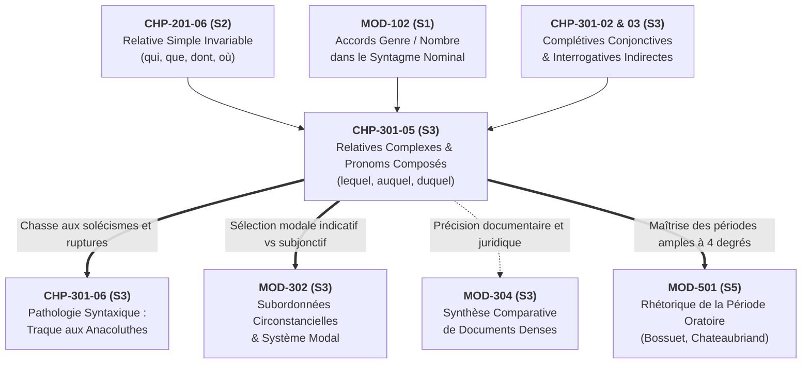
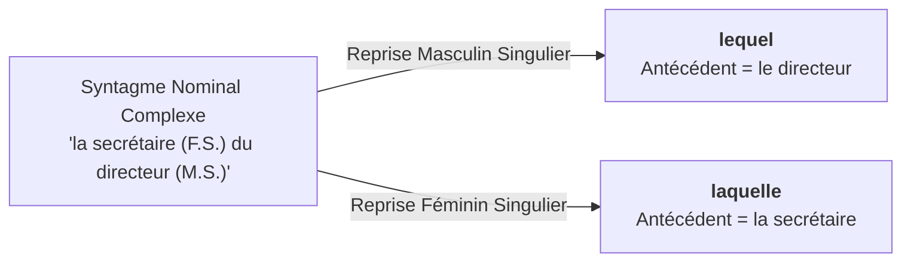

# Chapitre 5 — Les Propositions Relatives Complexes : Pronoms Composés Fléchis, Amalgames et Locutions Prépositionnelles

> **Identifiant du chapitre** : `CHP-301-05`  
> **Module de rattachement** : [`MOD-301` — Architecture de la Subordination : Complétives Conjonctives, Interrogatives Indirectes, Infinitives et Relatives Complexes](file:///f:/Formation/world-class-french/03-curriculum/year-2/semester-3/mod-301-architecture-subordination-completives.md)  
> **Semestre** : Année 2 — Semestre 3 (S3)  
> **Volume horaire canonique** : 5 à 6 heures d'apprentissage autonome délibéré et d'ateliers d'application (Phase 1 Étude : 1 h 30 | Phase 2 Pratique : 1 h 30 | Phase 3 Correction : 1 h 00 | Phase 4 Évaluation : 1 h 00)  
> **Statut** : [STATUT : PROPOSÉ — EN ATTENTE DE VALIDATION]  
> **Compétences associées** : [`FR-SYNTAX-002`](file:///f:/Formation/world-class-french/02-competency-framework/competency-framework.md#fr-syntax-002-architecture-de-la-subordination-complexe) (Palier L3 Autonomie), [`FR-ORTHO-002`](file:///f:/Formation/world-class-french/02-competency-framework/competency-framework.md#fr-ortho-002-mécanique-infaillible-de-laccord-sujet-verbe) (Palier L3 Autonomie), [`FR-SYNTAX-001`](file:///f:/Formation/world-class-french/02-competency-framework/competency-framework.md#fr-syntax-001-analyse-fonctionnelle-et-délimitation-de-la-phrase-simple) (Palier L3 Autonomie)  
> **Sources scientifiques de référence** : `SRC-GRAM-01` (Grevisse & Goosse, 2016, § 708-715), `SRC-GRAM-02` (Riegel et al., 2016, chap. 16), `SRC-NORM-03` (Ministère de l'Éducation nationale, 2020, p. 48-50), `SRC-TYPO-01` (Imprimerie nationale, 2002/2014, p. 142)

---

## 1. Titre et Place dans le Cursus

### 1.1 Intitulé Officiel
**Chapitre 5 : Les Propositions Relatives Complexes : Pronoms Composés Fléchis, Amalgames et Locutions Prépositionnelles** (`CHP-301-05`).

### 1.2 Insertion Architecturale dans le Cursus
Ce cinquième chapitre constitue la clé de voûte morphosyntaxique du module [`MOD-301`](file:///f:/Formation/world-class-french/03-curriculum/year-2/semester-3/mod-301-architecture-subordination-completives.md). Alors que le Semestre 2 a installé la maîtrise de la proposition relative simple gouvernée par les quatre pronoms invariables *qui, que, dont, où* ([`CHP-201-06`](file:///f:/Formation/world-class-french/03-curriculum/year-1/semester-2/mod-201/chp-201-06-proposition-relative-simple.md)), l'apprenant aborde ici le maniement des **pronoms relatifs composés variables** (*lequel, laquelle, lesquels, lesquelles*) et de leurs formes amalgamées (*auquel, duquel*).



- **En amont** : Ce chapitre réactive le double statut syntaxique du pronom relatif (fonction externe d'enchâssement et fonction interne dans la subordonnée) établi dans [`CHP-201-06`](file:///f:/Formation/world-class-french/03-curriculum/year-1/semester-2/mod-201/chp-201-06-proposition-relative-simple.md). Il mobilise également la mécanique d'accord en genre et en nombre dans le groupe nominal étudiée dans `MOD-102`.
- **Au sein de `MOD-301`** : Il succède immédiatement à l'étude des propositions complétives conjonctives pures (`CHP-301-02`), des interrogatives indirectes (`CHP-301-03`) et des infinitives véritables (`CHP-301-04`). Il parachève l'inventaire des propositions subordonnées enchâssées avant le chapitre clinique consacré à la traque des anacoluthes (`CHP-301-06`).
- **En passerelle vers l'aval** :
  - **Vers [`MOD-302`](file:///f:/Formation/world-class-french/03-curriculum/year-2/semester-3/mod-302-circonstancielles-systeme-modal-concordance.md)** : La maîtrise des relatives complexes conditionne la sélection des modes (indicatif vs subjonctif) après des antécédents négatifs, restrictifs ou dubitatifs.
  - **Vers `MOD-304`** : L'analyse et la rédaction de synthèses de textes juridiques, administratifs ou philosophiques reposent sur l'exactitude des chaînes anaphoriques régies par des locutions prépositionnelles.
  - **Vers `MOD-501`** : La période oratoire classique requiert la coordination et l'enchâssement hiérarchisé de subordonnées relatives complexes sans perte du sujet ni ambiguïté de référence.

---

## 2. Objectifs Mesurables

Au terme des 5 à 6 heures d'apprentissage autonome délibéré et d'ateliers d'application de ce chapitre, l'apprenant doit être capable de :

1. **Identifier, fléchir et classifier sans défaillance** le paradigme complet des pronoms relatifs composés simples (*lequel, laquelle, lesquels, lesquelles*) et de leurs formes amalgamées avec les prépositions *à* (*auquel, à laquelle, auxquels, auxquelles*) et *de* (*duquel, de laquelle, desquels, desquelles*), en justifiant chaque désinence morphologique par le genre et le nombre de son antécédent ([`FR-SYNTAX-002`](file:///f:/Formation/world-class-french/02-competency-framework/competency-framework.md#fr-syntax-002-architecture-de-la-subordination-complexe), Palier L3 Autonomie).
2. **Construire des syntagmes prépositionnels complexes** introduisant une subordonnée relative (*au milieu duquel, en vertu de laquelle, à l'issue desquels, à l'égard de qui/desquels*) en appliquant l'obligation formelle du pronom composé après locution prépositionnelle et en proscrivant tout solécisme en *dont* ([`FR-SYNTAX-002`](file:///f:/Formation/world-class-french/02-competency-framework/competency-framework.md#fr-syntax-002-architecture-de-la-subordination-complexe), Palier L3 Autonomie).
3. **Résoudre formellement le duel normatif entre *dont* et *duquel*** dans l'expression du complément de nom ou de l'adjectif, en appliquant la règle d'exclusion : *dont* est obligatoire pour le régime direct sans préposition intermédiaire (*l'homme dont je connais le fils*), tandis que *duquel* est exclusif dès qu'un syntagme prépositionnel ou une locution s'intercale (*l'homme à la maison duquel j'ai soupé*, *le traité en vertu duquel nous agissons*) ([`FR-SYNTAX-002`](file:///f:/Formation/world-class-french/02-competency-framework/competency-framework.md#fr-syntax-002-architecture-de-la-subordination-complexe), Palier L3 Autonomie).
4. **Désambiguïser immédiatement un antécédent concurrent** au sein d'un groupe nominal complexe par la sélection précise du pronom composé fléchi, et **accorder sans erreur le verbe de la relative** en personne, genre et nombre avec le donneur d'accord véritable ([`FR-ORTHO-002`](file:///f:/Formation/world-class-french/02-competency-framework/competency-framework.md#fr-ortho-002-mécanique-infaillible-de-laccord-sujet-verbe), Palier L3 Autonomie ; [`FR-SYNTAX-001`](file:///f:/Formation/world-class-french/02-competency-framework/competency-framework.md#fr-syntax-001-analyse-fonctionnelle-et-délimitation-de-la-phrase-simple), Palier L3 Autonomie).

---

## 3. Prérequis et Test de Préparation

### 3.1 Prérequis Exigibles
- **Distinction Nature vs Fonction (`MOD-102`)** : Différencier la classe grammaticale (*pronom relatif composé*) de la fonction assumée au sein de la proposition subordonnée (*complément d'objet indirect*, *complément du nom*, *complément circonstanciel*).
- **Maniement des relatives simples (`CHP-201-06`)** : Connaître la distribution canonique des quatre relatifs invariables (*qui* sujet/animé prépositionnel, *que* COD, *dont* complément en *de*, *où* circonstant de lieu/temps).
- **Mécanique des amalgames (`MOD-101`)** : Connaître la fusion obligatoire de la préposition *à* ou *de* avec l'article défini masculin singulier (*à + le = au*, *de + le = du*) et pluriel (*à + les = aux*, *de + les = des*).

### 3.2 Test de Préparation (Auto-Diagnostic à 5 Questions)
Répondez aux cinq questions suivantes avant de déployer le corrigé :

1. **Question 1 (Amalgames fondamentaux)** : Quelles sont les formes contractées issues de la fusion de la préposition *à* et de la préposition *de* avec les articles définis *le* et *les* ? Pourquoi les suites *\*à le* et *\*de les* sont-elles impossibles en français moderne ?
2. **Question 2 (Rection de dont)** : Quelle relation syntaxique le pronom relatif invariable *dont* exprime-t-il toujours ? Donnez deux verbes transitifs indirects compatibles avec *dont*.
3. **Question 3 (Ambiguïté du pronom invariable)** : Dans la phrase *« Le secrétaire de la ministre qui a rédigé le communiqué a été félicité »*, qui est le sujet grammatical du verbe *a rédigé* ? Peut-on savoir avec certitude s'il s'agit du secrétaire ou de la ministre ?
4. **Question 4 (Locution prépositionnelle)** : Dans la phrase *« Il a agi en vertu d'un mandat officiel »*, quelle est la nature grammaticale exacte du groupe *en vertu de* ?
5. **Question 5 (Accord du verbe subordonné)** : Dans *« C'est une des clauses auxquelles vous souscrivez »*, quel est l'antécédent du pronom *auxquelles* ? Pourquoi le pronom est-il au féminin pluriel ?

<details>
<summary><strong>Corrigé et barème de l'auto-diagnostic (cliquer pour dérouler)</strong></summary>

1. **Réponse 1** : Les formes contractées (amalgames) sont **au** (*à + le*), **aux** (*à + les*), **du** (*de + le*) et **des** (*de + les*). En français standard, la contraction de ces prépositions avec l'article défini est obligatoire depuis le moyen français par coalescence phonétique [Réf. `SRC-GRAM-01`, § 565].
2. **Réponse 2** : Le pronom *dont* représente toujours un terme introduit par la préposition **de** (qu'il s'agisse d'un COI, d'un complément de nom ou d'un complément d'adjectif). Verbes compatibles : *se souvenir de*, *parler de*, *douter de*.
3. **Réponse 3** : Le pronom relatif simple *qui* étant morphologiquement invariable en genre et en nombre, il peut avoir pour antécédent soit le nom masculin *secrétaire*, soit le nom féminin *ministre*. La phrase est structurellement **ambiguë (amphibologique)** à l'écrit.
4. **Réponse 4** : Le groupe *en vertu de* est une **locution prépositionnelle** (syntagme figé composé d'une préposition, d'un substantif et de la préposition *de*, fonctionnant globalement comme un relateur prépositionnel).
5. **Réponse 5** : L'antécédent de *auxquelles* est le substantif féminin pluriel **clauses** (noyau sémantique sur lequel porte la restriction). Le pronom prend donc la marque du féminin pluriel (*auxquelles*).

> **Diagnostic** : Si vous obtenez une note inférieure à 4/5, révisez immédiatement les chapitres [`CHP-102-04`](file:///f:/Formation/world-class-french/03-curriculum/year-1/semester-1/mod-102/chp-102-04-accords-syntagme-nominal.md) et [`CHP-201-06`](file:///f:/Formation/world-class-french/03-curriculum/year-1/semester-2/mod-201/chp-201-06-proposition-relative-simple.md) avant d'aborder la section 4.
</details>

---

## 4. Situation de Départ ou Problème Concret

### 4.1 L'Impasse du Scripteur face aux Syntagmes Prépositionnels Complexes
Dans les écrits universitaires, les traités diplomatiques et les conclusions juridiques, la langue doit relier des faits par des relations logiques denses. Or, dès que le scripteur veut insérer une subordonnée relative derrière une locution prépositionnelle, les pronoms simples invariables (*qui, que, dont, où*) se révèlent totalement inopérants.

Observons ces énoncés fautifs relevés dans des mémoires juridiques et des procès-verbaux administratifs :

> ❌ *« Le traité international **en vertu dont** les États coopèrent garantit la paix. »*  
> ❌ *« La cour administrative **au milieu dont** se dresse le monument a été rénovée. »*  
> ❌ *« Les clauses contractuelles **à l'égard de dont** vous formulez des réserves sont intangibles. »*

Ces formulations constituent des **solécismes rédhibitoires** [Réf. `SRC-GRAM-01`, § 714]. Le scripteur sent confusément que la locution se termine par *de* (*en vertu de*, *au milieu de*, *à l'égard de*), et applique mécaniquement le pronom *dont*. Mais en français soigné, **le pronom invariable *dont* ne peut jamais être régi par une locution prépositionnelle**.

### 4.2 L'Amphibologie des Deux Antécédents Concurrents
Considérons le second désastre stylistique et logique, fréquent dans la correspondance administrative :

> *« J'ai reçu le frère de la directrice générale qui m'a confirmé la nomination. »*

Une telle phrase est une faute de rédaction majeure en contexte juridique ou diplomatique : **qui a confirmé la nomination ?**
- Est-ce *le frère* ?
- Est-ce *la directrice générale* ?

Le pronom simple *qui*, aveugle au genre et au nombre, est incapable de lever l'ambiguïté. Si l'accord du verbe principal ne donne aucun indice, le lecteur demeure dans l'incertitude totale. Pour dissiper ce doute sans alourdir la phrase par une répétition nominale laborieuse, le français dispose d'un instrument de précision chirurgicale : **le pronom relatif composé fléchi**.

---

## 5. Explication Intuitive : L'Analogie de la Prise Universelle à Détrompeur

Pour maîtriser ce mécanisme sans hésitation, recourons à l'analogie technique de la connectique électrique :

1. **Les pronoms relatifs simples (*qui, que, dont, où*) sont des fiches fixes à broches moulées en usine** :
   - *Qui* est la fiche directe sujet ou complément d'animé ;
   - *Que* est la fiche directe COD ;
   - *Dont* est la fiche prépositionnelle simple calibrée exclusivement pour la prise murale unitaire *de* (*parler de*, *se souvenir de*, *le fils de*) ;
   - *Où* est la fiche spatio-temporelle directe.
2. **L'insertion d'une locution prépositionnelle équivaut à brancher une rallonge industrielle complexe** (*au milieu de*, *en vertu de*, *à l'issue de*, *au sommet de*) :
   - La prise murale n'est plus accessible directement ;
   - Si l'on tente d'y enficher la fiche simple *dont*, les broches refusent de s'adapter : le système disjoncte et produit un court-circuit grammatical (*\*en vertu dont*).
3. **Le pronom relatif composé (*lequel, laquelle, lesquels, lesquelles*) est une prise adaptatrice universelle à détrompeur à 4 broches réglables** :
   - Ses 4 broches s'ajustent instantanément à la tension morphologique de l'antécédent : **masculin singulier** (*lequel*), **féminin singulier** (*laquelle*), **masculin pluriel** (*lesquels*), **féminin pluriel** (*lesquelles*) ;
   - Il dispose de bagues d'amalgame intégrées pour fusionner avec les prépositions *à* (*auquel*) et *de* (*duquel*) ;
   - Son **détrompeur mécanique** verrouille la connexion sur le constituant exact souhaité au sein d'un groupe nominal complexe, éliminant toute interférence avec le constituant voisin.

---

## 6. Définitions Précises et Terminologie

Conformément à la nomenclature officielle de la *Terminologie grammaticale* (`SRC-NORM-03`, p. 48-50) et à la description linguistique universitaire (`SRC-GRAM-02`, chap. 16), les termes suivants reçoivent une définition stricte :

- **Pronom relatif composé** : Pronom anaphorique formé par l'agglutination de l'article défini (*le, la, les*) et de l'adjectif/pronom interrogatif historique (*quel, quelle, quels, quelles*). Il s'accorde en genre et en nombre avec son antécédent nominal ou pronominal.
- **Formes fléchies** : Ensemble des réalisations morphologiques du pronom composé marquant distinctement le masculin, le féminin, le singulier et le pluriel (*lequel, laquelle, lesquels, lesquelles*).
- **Amalgames prépositionnels** : Fusion morphologique obligatoire de la préposition monosyllabique *à* ou *de* avec le déterminant défini incorporé au pronom composé (*à + lequel = auquel* ; *de + lequel = duquel* ; *à + lesquels = auxquels* ; *de + lesquels = desquels* ; *à + lesquelles = auxquelles* ; *de + lesquelles = desquelles*).
- **Locution prépositionnelle régissante** : Groupe figé de mots se terminant par une préposition (*de, à, avec, par*) qui régit syntaxiquement le pronom relatif au sein de la subordonnée (*en vertu de*, *à l'issue de*, *au milieu de*, *au regard de*, *à l'insu de*).
- **Désambiguïsation de l'antécédent** : Opération morphosyntaxique par laquelle la sélection d'une forme fléchie marquée en genre et en nombre permet d'assigner sans équivoque le pronom à l'un des multiples noyaux d'un syntagme nominal complexe antécédent.
- **Rection prépositionnelle complexe** : Propriété d'un verbe, d'un adjectif ou d'un nom d'exiger un complément introduit non par une préposition simple, mais par un syntagme prépositionnel développé.
- **Fonction interne du pronom composé** : Rôle grammatical assumé par le pronom au sein de la proposition subordonnée relative indépendamment de la fonction occupée par son antécédent dans la proposition rectrice.

---

## 7. Règles ou Mécanismes Fondamentaux

### 7.1 Morphologie et Paradigme des Pronoms Relatifs Composés
Le paradigme des formes simples non amalgamées se compose de quatre unités morphologiques :

| Genre / Nombre | Singulier | Pluriel |
| :--- | :---: | :---: |
| **Masculin** | *lequel* | *lesquels* |
| **Féminin** | *laquelle* | *lesquelles* |

> **Règle d'or de l'accord morphologique** : Le pronom relatif composé prend obligatoirement le genre et le nombre du nom ou pronom qui lui sert d'antécédent direct dans la proposition matrice [Réf. `SRC-GRAM-01`, § 708].
> - *Le dossier pour **lequel** nous plaidons...* (masculin singulier)
> - *Les réformes pour **lesquelles** nous luttons...* (féminin pluriel)

### 7.2 Les Amalgames avec les Prépositions *à* et *de*
Lorsque le pronom relatif composé est précédé de la préposition simple *à* ou *de*, la contraction avec l'élément d'article défini incorporé est **obligatoire et systématique** [Réf. `SRC-GRAM-02`, chap. 16] :

| Préposition régissante | Masculin singulier | Féminin singulier | Masculin pluriel | Féminin pluriel |
| :---: | :---: | :---: | :---: | :---: |
| **Série en *à*** | **auquel** (*à + lequel*) | **à laquelle** (*pas d'amalgame*) | **auxquels** (*à + lesquels*) | **auxquelles** (*à + lesquelles*) |
| **Série en *de*** | **duquel** (*de + lequel*) | **de laquelle** (*pas d'amalgame*) | **desquels** (*de + lesquels*) | **desquelles** (*de + lesquelles*) |

> [!CAUTION]
> **Interdiction formelle des formes disjointes** : Écrire ou dire *\*à lequel*, *\*de lequel*, *\*à lesquels*, *\*de lesquels*, *\*à lesquelles* ou *\*de lesquelles* constitue une faute d'orthographe et de morphologie éliminatoire dans tout examen académique.

### 7.3 L'Insertion dans des Locutions Prépositionnelles Complexes
C'est le domaine d'élection du pronom composé. Lorsque la rection est portée par une locution prépositionnelle, l'emploi du pronom composé fléchi est **strictement obligatoire** [Réf. `SRC-GRAM-01`, § 714] :

1. **Locutions se terminant par *de*** :
   - *en vertu de* $\rightarrow$ *le décret en vertu **duquel** l'audience est suspendue*
   - *au milieu de* $\rightarrow$ *la clairière au milieu **de laquelle** se dresse le temple*
   - *à l'issue de* $\rightarrow$ *les délibérations à l'issue **desquelles** le verdict fut rendu*
   - *à l'égard de* $\rightarrow$ *les citoyens à l'égard **desquels** la loi s'applique*
   - *au sommet de* $\rightarrow$ *la montagne au sommet **de laquelle** subsistent des neiges*
   - *à l'aide de* $\rightarrow$ *les instruments à l'aide **desquels** l'expert a conclu*
2. **L'interdiction absolue de *dont*** :
   - La locution prépositionnelle s'achevant par *de* absorbe cette préposition dans son unité lexicale ; elle ne peut pas s'agglutiner avec *dont*.
   - On ne peut jamais dire : *\*le décret en vertu dont...*, *\*les délibérations à l'issue dont...*.

### 7.4 La Désambiguïsation de l'Antécédent
Lorsque l'antécédent est un syntagme nominal complexe comportant deux noms de genres ou de nombres différents reliés par une préposition (*le N1 prép N2*), les pronoms invariables *qui* ou *que* créent une amphibologie. Le pronom composé permet de désigner sans ambiguïté le donneur d'accord :

- **Énoncé ambigu avec relatif simple** :  
  *« J'ai consulté la secrétaire du directeur qui a validé la transmission du dossier. »*  
  *(Qui a validé ? La secrétaire ou le directeur ?)*
- **Résolution par le pronom composé masculin singulier** :  
  $\checkmark$ *« J'ai consulté la secrétaire du directeur, **lequel** a validé la transmission du dossier. »*  
  *(L'antécédent est formellement le directeur).*
- **Résolution par le pronom composé féminin singulier** :  
  $\checkmark$ *« J'ai consulté la secrétaire du directeur, **laquelle** a validé la transmission du dossier. »*  
  *(L'antécédent est formellement la secrétaire).*



### 7.5 La Syntaxe et la Rection Interne dans la Proposition Subordonnée

#### 1. Fonctions Internes Assumées par le Pronom Composé
Le pronom relatif composé peut exercer au sein de la subordonnée :
- **Complément d'objet indirect (COI)** : *« C'est un principe **auquel** nous souscrivons pleinement. »* (*souscrire à ce principe*)
- **Complément du nom** : *« Un monument au fronton **duquel** était gravée une devise. »* (*au fronton de ce monument*)
- **Complément de l'adjectif** : *« Une exigence administrative **à laquelle** le candidat reste soumis. »* (*soumis à cette exigence*)
- **Complément circonstanciel** : *« La table sur **laquelle** le greffier a consigné les aveux. »* (*sur cette table* = CC de lieu)

#### 2. La Règle d'Or d'Arbitrage : *Dont* vs *Duquel*
La concurrence entre *dont* et la série *duquel / de laquelle / desquels / desquelles* est régie par une frontière syntaxique impérative [Réf. `SRC-GRAM-01`, § 714 ; `SRC-GRAM-02`, chap. 16] :

```text
               COMPLÉMENT INTRODUIT PAR LA PRÉPOSITION "DE"
                                     │
           ┌─────────────────────────┴─────────────────────────┐
           ▼                                                   ▼
RÉGIME DIRECT DU NOM OU VERBE               RÉGIME PAR LOCUTION PRÉPOSITIONNELLE
   (sans groupe intermédiaire)               OU NOM RÉGI PAR UNE PRÉPOSITION
           │                                                   │
   [ DONT OBLIGATOIRE ]                              [ DUQUEL OBLIGATOIRE ]
Ex. : "L'homme DONT je connais le fils"        Ex. : "L'homme à la maison DUQUEL j'ai soupé"
      "La décision DONT nous parlons"                "Le traité en vertu DUQUEL nous agissons"
```

> **Règle canonique** :
> 1. Si le nom dépendant est en position de **complément direct (COD, sujet, attribut)** sans préposition, l'emploi de **dont** est obligatoire :  
>    $\checkmark$ *« L'avocat **dont** j'admire le talent. »* (et JAMAIS *\*duquel j'admire le talent*).
> 2. Dès que le nom dépendant est lui-même **précédé d'une préposition** (*à la maison de...*, *au sommet de...*, *dans les bras de...*), l'emploi de **dont** devient impossible et la forme composée fléchie **duquel / de laquelle / desquels / desquelles** s'impose formellement :  
>    $\checkmark$ *« L'avocat au talent **duquel** nous devons notre acquittement. »*

---

## 8. Raisonnement Détaillé : Pourquoi la Langue Française a Conservé ce Paradigme

Certains linguistes et apprenants contemporains s'interrogent : *« Pourquoi le français a-t-il maintenu ce système complexe de pronoms composés fléchis, alors que l'anglais utilise le simple "which" invariable ou que l'usage oral familier tente de tout niveler par "que" ? »*

Ce maintien répond à trois nécessités impérieuses de la communication institutionnelle et littéraire :

### 8.1 L'Exigence d'Exactitude Juridique et Diplomatique
Dans la rédaction d'un traité international, d'une loi ou d'un acte notarié, une ambiguïté d'antécédent équivaut à un litige financier ou géopolitique majeur. Si un article stipule : *« Les représentants des puissances signataires qui ont engagé leurs armées... »*, l'invariabilité de *qui* laisse planer le doute sur la portée de l'engagement (les représentants ou les puissances ?). L'emploi de *lesquelles* verrouille instantanément l'engagement sur les puissances étatiques, tandis que *lesquels* l'impute aux diplomates physiques.

### 8.2 La Capacité d'Enchâssement Prépositionnel Profond
La syntaxe française n'admet pas l'échouement prépositionnel (*preposition stranding*) que connaît la langue anglaise (*the treaty which we act under*). En français, la préposition régissante doit obligatoirement **précéder** son complément. Or, les locutions prépositionnelles complexes du français (*en dépit de, à l'égard de, au détriment de*) constituent des syntagmes phoniquement lourds. Le pronom monosyllabique invariable *dont* ou *qui* s'y dissoudrait phonétiquement. Le pronom composé fournit un corps phonétique plein, doté d'une assise accentuelle stable capable de porter l'accent tonique en fin de syntagme prépositionnel.

### 8.3 Le Respect de l'Harmonie Périodique
Dans la grande tradition oratoire et rhétorique (`MOD-501`), le pronom relatif composé offre une ressource prosodique irremplaçable : il permet d'allonger la cadence rythmique (cadence majeure) pour équilibrer une protase face à une apodose dense, apportant à la phrase sa tenue solennelle.

---

## 9. Exemples Corrects Commentés

Analysons quatre phrases modèles représentatives de la haute syntaxe juridique, classique et francophone :

### Exemple 1 : Corpus Juridique International
> *« Les Hautes Parties contractantes établissent une commission permanente de conciliation, **à la compétence de laquelle** chaque État membre s'engage à soumettre ses différends territoriaux, et **au sein de laquelle** siégeront des arbitres indépendants. »*

- **Analyse de la proposition relative 1** :
  - *Pronom composé fléchi* : **à la compétence de laquelle** (féminin singulier).
  - *Antécédent* : *une commission permanente de conciliation* (groupe nominal féminin singulier).
  - *Structure régissante* : syntagme prépositionnel *à la compétence de*, régissant le relatif en fonction de complément du nom *compétence*.
  - *Fonction interne* : l'ensemble *à la compétence de cette commission* est COI du verbe *s'engage à soumettre*.
- **Analyse de la proposition relative 2** :
  - *Pronom composé fléchi* : **au sein de laquelle** (féminin singulier, avec amalgame *au = à + le*).
  - *Fonction interne* : complément circonstanciel de lieu du verbe intransitif *siégeront* (sujet postposé : *des arbitres indépendants*).

### Exemple 2 : Prose Classique Patrimoniale (Bossuet)
> *« Elle vit tomber cette grande maison, sous les ruines **de laquelle** tant de princes se trouvèrent accablés, et **auprès de laquelle** les plus hautes puissances de la terre paraissaient anéanties. »*

- **Analyse morphosyntaxique** :
  - *Antécédent* : *cette grande maison* (féminin singulier).
  - *Locution 1* : *sous les ruines de* $\rightarrow$ *de laquelle* (complément du nom *ruines*, l'ensemble formant un CC de lieu sous le verbe *se trouvèrent accablés*). L'emploi de *dont* est strictement impossible car *ruines* est précédé de la préposition *sous*.
  - *Locution 2* : *auprès de* (locution prépositionnelle) $\rightarrow$ *auprès de laquelle* (CC de lieu du verbe *paraissaient anéanties*).

### Exemple 3 : Diplomatie Contemporaine et Droit Public
> *« Le conseil des ministres a adopté le projet de loi organique relatif aux libertés publiques, **en vertu duquel** les préfets ne pourront plus restreindre unilatéralement le droit de réunion, et **contre lequel** l'opposition parlementaire n'a formulé aucun grief recevable. »*

- **Analyse de la levée d'ambiguïté** :
  - Dans la proposition matrice, nous avons deux noms masculins singuliers : *le conseil* et *le projet*.
  - *Locution 1* : *en vertu de* commande obligatoirement la forme amalgamée masculine singulière **duquel**. La rection sémantique de la loi rattache sans ambiguïté le pronom à *projet de loi*.
  - *Locution 2* : *contre* (préposition simple réclamant un inanimé) $\rightarrow$ **contre lequel** (COI du verbe *a formulé des griefs contre ce projet*).

### Exemple 4 : Littérature Francophone d'Afrique de l'Ouest (Jean Pliya, *L'Arbre fétiche*)
> *« Les notables s'avancèrent vers le baobab séculaire, **à l'ombre protectrice duquel** les générations passées avaient célébré leurs serments sacrés et **au sommet duquel** planaient les oiseaux de nuit. »*

- **Analyse morphosyntaxique** :
  - *Antécédent* : *le baobab séculaire* (masculin singulier).
  - *Pronom 1* : **à l'ombre protectrice duquel** $\rightarrow$ syntagme prépositionnel complexe où le pronom *duquel* complète le nom *ombre* précédé de la préposition *à* et suivi de l'adjectif *protectrice*.
  - *Pronom 2* : **au sommet duquel** $\rightarrow$ complément de lieu avec inversion du sujet nominal (*les oiseaux de nuit*).

---

## 10. Contre-Exemples et Erreurs Fréquentes : Clinique Orthosyntaxique

Voici l'analyse clinique de six erreurs récurrentes rigoureusement observées chez les scripteurs :

### Erreur n° 1 : Emploi fautif de *dont* après une locution prépositionnelle
- ❌ **Solécisme** : *« Le traité international **en vertu dont** nos armées interviennent a été signé à Cotonou. »*
- 🔍 **Diagnostic clinique** : Le rédacteur a assimilé la finale *de* de la locution *en vertu de* à la marque canonique de *dont*. Or, *dont* ne peut être le complément d'un substantif inséré dans un syntagme prépositionnel régissant.
- $\checkmark$ **Correction normée** : *« Le traité international **en vertu duquel** nos armées interviennent a été signé à Cotonou. »* [Réf. `SRC-GRAM-01`, § 714].

### Erreur n° 2 : Faute d'accord en genre et en nombre du pronom composé
- ❌ **Solécisme** : *« La commission d'enquête parlementaire **auquel** nous avons soumis notre rapport s'est réunie à huis clos. »*
- 🔍 **Diagnostic clinique** : Discordance morphologique. L'antécédent est *la commission* (féminin singulier). L'auteur a utilisé la forme amalgamée masculine *auquel*.
- $\checkmark$ **Correction normée** : *« La commission d'enquête parlementaire **à laquelle** nous avons soumis notre rapport s'est réunie à huis clos. »*

### Erreur n° 3 : Emploi fautif de *duquel* au lieu de *dont* pour un complément de nom direct
- ❌ **Solécisme** : *« L'éminent professeur **duquel** nous écoutons les cours magistraux prend sa retraite. »*
- 🔍 **Diagnostic clinique** : Hypercorrection pédante. Le nom *cours* est COD direct du verbe *écoutons* ; il n'est régi par aucune préposition. La règle du français moderne prescrit obligatoirement *dont* lorsque le complément déterminatif du nom dépend directement du verbe ou d'un nom sans préposition.
- $\checkmark$ **Correction normée** : *« L'éminent professeur **dont** nous écoutons les cours magistraux prend sa retraite. »* [Réf. `SRC-GRAM-02`, chap. 16].

### Erreur n° 4 : Omission de l'amalgame prépositionnel
- ❌ **Solécisme** : *« C'est un principe fondamental **à lequel** notre cour suprême demeure viscéralement attachée. »*
- 🔍 **Diagnostic clinique** : Refus fautif de la contraction obligatoire de l'article défini incorporé avec la préposition simple *à*.
- $\checkmark$ **Correction normée** : *« C'est un principe fondamental **auquel** notre cour suprême demeure viscéralement attachée. »*

### Erreur n° 5 : Mauvaise sélection de la préposition régissante dans la locution
- ❌ **Solécisme** : *« Le protocole d'accord **aux termes duquel** nous avons souscrit... »* (lorsque l'on veut dire *conformément à*).
- 🔍 **Diagnostic clinique** : Confusion sur le sens et la valence de la locution prépositionnelle. *Aux termes de* régit un état de fait (*aux termes duquel les parties conviennent que...*). Pour introduire l'objet d'une adhésion auprès du verbe *souscrire*, le verbe réclame la préposition *à* (*souscrire à un accord* $\rightarrow$ *auquel nous avons souscrit*).
- $\checkmark$ **Correction normée** : *« Le protocole d'accord **auquel** nous avons souscrit... »* ou *« Le protocole d'accord **aux termes duquel** les parties s'engagent... »*.

### Erreur n° 6 : Rupture d'antécédent et ambiguïté non résolue par conflit de marques
- ❌ **Solécisme** : *« Le représentant de l'avocat **lesquels** ont contesté le jugement... »*
- 🔍 **Diagnostic clinique** : L'auteur utilise un pluriel (*lesquels*) pour désigner deux personnes singulières coordonnées par *de*, ce qui produit une rupture d'accord et une syllepse interdite. Si le pronom est au pluriel, il ne peut pas avoir pour antécédent un groupe nominal dont les deux constituants sont singuliers non coordonnés par *et*.
- $\checkmark$ **Correction normée** : *« Le représentant et l'avocat, **lesquels** ont contesté le jugement... »* (antécédents coordonnés) ou *« Le représentant de l'avocat, **lequel** a contesté le jugement... »* (pronom singulier reprenant le représentant).

---

## 11. Cas Particuliers et Limites

### 11.1 L'Emploi de *Lequel* comme Déterminant Relatif (Adjectif Relatif)
En langue juridique, notariale et administrative archaïsante, *lequel* peut s'employer non comme un pronom autonome, mais comme un **adjectif déterminant relatif** accompagnant la reprise anaphorique du substantif antécédent [Réf. `SRC-GRAM-01`, § 715] :
- *« L'emprunteur restituera la somme principale, **laquelle somme** produira des intérêts au taux légal... »*
- *« L'accusé s'est réfugié dans son domicile, **auquel lieu** les officiers ministériels se sont transportés... »*

> **Évaluation sociolinguistique et stylistique** : Cet emploi est strictement cantonné aux actes sous seing privé et aux jugements pour prévenir toute contestation d'identité de l'objet. Il doit être proscrit dans la dissertation académique, le plaidoyer ou l'essai d'idées, où il alourdit inutilement la prose.

### 11.2 L'Emploi de *Lequel* Sujet pour un Animé Humain
En français contemporain standard, le pronom sujet canonique est *qui*. Toutefois, l'emploi de *lequel, laquelle, lesquels, lesquelles* en fonction de **sujet** d'une proposition relative est parfaitement admis par l'Académie française et le Bon Usage (`SRC-GRAM-01`, § 710) dans deux situations précises :
1. **La levée d'une ambiguïté obligatoire** : lorsque la proposition principale comporte deux référents concurrents masculins ou féminins que *qui* confondrait (*« J'ai salué la mère de mon collègue, **laquelle** partait en voyage »*).
2. **La disjonction syntaxique à longue distance** : lorsque la proposition relative est séparée de son antécédent par une longue incise ou une subordonnée intermédiaire, le pronom composé permet de réactiver l'accord avec éclat.

### 11.3 Le Pronom Neutre Invariable *Quoi* après Préposition
Lorsque l'antécédent n'est pas un être animé ni un nom déterminé de genre précis, mais un **pronom indéfini neutre** (*ce, rien, quelque chose*) ou **une proposition entière**, les formes fléchies *lequel / laquelle* cèdent obligatoirement la place au pronom neutre **quoi** [Réf. `SRC-NORM-03`, p. 49] :
- *« Il n'y a rien **sur quoi** l'on puisse fonder un tel espoir. »* (et non *\*sur lequel*).
- *« Il a rejeté l'offre sans mot dire, **après quoi** la séance a été levée. »* (*quoi* a pour antécédent la proposition complète).
- *« C'est précisément **ce à quoi** nous nous opposons. »*

---

## 12. Approfondissement Adapté au Niveau : Diachronie et Émergence des Relatifs Composés

En ancien français (XIe-XIIIe siècles), la morphologie des pronoms relatifs reposait sur une déclinaison casuelle binaire héritée directement du latin classique :
- **Cas sujet** : *qui* (latin *qui, quae, quod*)
- **Cas régime** : *que / cui* (latin *quem, quam / cui*)

Ce système binaire était rigoureusement économique, mais l'effondrement phonétique des consonnes finales et l'amuïssement du système casuel au XIVe siècle (moyen français) provoquèrent une crise majeure de l'anaphore. Les formes *qui* et *que* ne permettaient plus de marquer le genre ni le nombre. Dès lors que la syntaxe de la Renaissance s'est mise à imiter la période latine cicéronienne — caractérisée par de vastes périodes aux nombreux actants enchâssés —, l'indistinction anaphorique de *qui/que* créait d'insupportables quiproquos.

Pour combler ce vide fonctionnel, les clercs et juristes du XIVe siècle forgèrent une unité nouvelle en agglutinant **l'article défini** (*le, la, les*) à **l'adjectif interrogatif** issu du latin *qualis* (*quel, quelle, quels, quelles*). Ainsi naquit le pronom *lequel*, qui réintroduisit dans la langue vernaculaire une déclinaison morphologique complète à quatre cases flexionnelles, enrichie des fusions prépositionnelles *auquel* et *duquel* [Réf. `SRC-GRAM-01`, § 708].

Ce pronom a été l'instrument linguistique décisif qui a permis à la chancellerie royale de rédiger les édits de justice en français (ordonnance de Villers-Cotterêts, 1539) avec une rigueur formelle égale à celle du latin médiéval.

---

## 13. Comparaisons Différentielles

### 13.1 Tableau Différentiel 1 : *Dont* vs *Duquel / De laquelle / Desquels / Desquelles*

| Critère syntaxique | Pronom relatif invariable *DONT* | Pronoms relatifs composés *DUQUEL / DE LAQUELLE...* |
| :--- | :--- | :--- |
| **Morphologie** | Invariable en genre et en nombre. | Variable : 4 formes fléchies distinctes. |
| **Rection verbale directe** | **Obligatoire** : *L'affaire dont nous parlons.* | Proscrit ou très vieilli (*L'affaire de laquelle...*). |
| **Complément du nom direct (COD ou Sujet)** | **Obligatoire** : *L'auteur dont j'admire le livre.* | **Interdit formellement** en français moderne (*\*L'auteur duquel j'admire le livre*). |
| **Complément de nom précédé de préposition** | **Strictement interdit** (*\*La maison au toit dont...*). | **Obligatoire** : *La maison au toit **de laquelle** il est monté.* |
| **Locutions prépositionnelles en *de*** | **Strictement interdit** (*\*En vertu dont, \*à l'issue dont*). | **Obligatoire** : *En vertu **duquel**, à l'issue **desquelles**.* |
| **Nature de l'antécédent** | Animé ou inanimé indifféremment. | Animé ou inanimé indifféremment. |

### 13.2 Tableau Différentiel 2 : *Auquel / À laquelle...* vs *À qui*

| Contexte d'emploi | Forme composée : *AUQUEL / À LAQUELLE...* | Forme simple prépositionnelle : *À QUI* |
| :--- | :--- | :--- |
| **Antécédent inanimé (chose, idée, institution)** | **Obligatoire et exclusif** : *Le projet **auquel** je pense.* | **Strictement impossible** en français moderne (*\*Le projet à qui je pense*). |
| **Antécédent animé (personne humaine)** | Parfaitement admis : *L'avocat **auquel** j'ai confié l'affaire.* | Privilégié et classique : *L'avocat **à qui** j'ai confié l'affaire.* |
| **Désambiguïsation d'antécédents humains multiples** | **Indispensable** si genres/nombres diffèrent (*L'associé de la directrice, **auquel** / **à laquelle** j'ai parlé*). | Ambigu (*L'associé de la directrice à qui j'ai parlé* $\rightarrow$ impossible de trancher). |

### 13.3 Tableau Différentiel 3 : *Lequel* Sujet vs *Qui* Sujet

| Paramètre | Pronom simple *QUI* (Sujet) | Pronom composé *LEQUEL* (Sujet) |
| :--- | :--- | :--- |
| **Fréquence et registre** | Forme canonique, universelle et neutre dans tous les registres. | Forme soutenue, réservée à l'écrit surveillé, au droit et au style littéraire. |
| **Antécédent contigu univoque** | Normal : *Le ministre **qui** arrive prononcera le discours.* | Lourd et déconseillé : *Le ministre **lequel** arrive...* |
| **Antécédent mixte concurrent** | Ambigu : *La fille du forgeron **qui** est partie.* | **Désambiguïsant** : *La fille du forgeron, **laquelle** est partie.* |
| **Distance à l'antécédent** | Risque de flottement syntaxique si séparé par une longue incise. | Idéal pour raccrocher la chaîne anaphorique après une rupture syntagmatique. |

---

## 14. Exercices Progressifs

### Niveau 1 : Reconnaissance, Sélection et Accord du Pronom Composé (12 Phrases)
Complétez les douze phrases suivantes par le pronom relatif composé convenable (avec amalgame si nécessaire : *auquel, à laquelle, auxquels, auxquelles, duquel, de laquelle, desquels, desquelles, lequel, laquelle, lesquels, lesquelles*) :

1. Les conventions internationales en vertu [__________] notre gouvernement a sollicité l'extradition des criminels financiers sont exécutoires.
2. Le vaste bâtiment administratif au sommet [__________] flotte l'étendard national a été inauguré hier.
3. Les idéaux républicains pour [__________] ces illustres magistrats ont combattu toute leur vie demeurent vivants.
4. L'audacieuse entreprise industrielle à la création [__________] nous avons consacré cinq années d'efforts vient d'entrer en bourse.
5. Les membres du jury ont délibéré pendant trois heures, à l'issue [__________] le premier prix a été décerné à l'unanimité.
6. Voici les motifs légitimes d'exemption au vu [__________] le juge d'instruction a ordonné la mainlevée du mandat de dépôt.
7. L'imposante bibliothèque municipale au milieu [__________] trône la statue du grand écrivain accueille des milliers de chercheurs.
8. Les graves écueils diplomatiques [__________] notre ambassadeur a dû faire face ont été surmontés avec brio.
9. Nous avons consulté les deux experts judiciaires par l'entremise [__________] la conciliation financière a pu aboutir.
10. La directrice générale a reçu l'avocat de la compagnie, [__________] (désigner l'avocat) a immédiatement paraphé la transaction.
11. Les clauses restrictives d'arbitrage [__________] les deux contractants ont formellement renoncé figuraient à l'article douze.
12. Les hautes falaises rocheuses du haut [__________] les sentinelles surveillaient l'accès au golfe maritime sont escarpées.

### Niveau 2 : Résolution du Duel Syntaxique *Dont* vs *Duquel* (8 Phrases)
Dans les huit énoncés suivants, choisissez entre **dont** et la forme composée appropriée (**duquel, de laquelle, desquels, desquelles**), et justifiez votre choix par l'analyse syntaxique du syntagme régissant :

1. L'érudit béninois [__________] les recherches historiques ont révolutionné l'historiographie ouest-africaine recevra le grand prix de l'Académie.
2. L'antique forteresse militaire sous les créneaux [__________] patrouillaient autrefois les gardes a résisté aux assauts du temps.
3. Le complexe protocole diplomatique aux termes [__________] les deux puissances s'engagent au désarmement entrera en vigueur le mois prochain.
4. Les mesures économiques d'austérité [__________] la commission des finances redoute les effets inflationnistes feront l'objet d'un débat.
5. La noble institution académique à l'ombre bienfaisante [__________] ont mûri tant de générations de savants fête son cinquantenaire.
6. Les illustres théoriciens [__________] vous contestez avec tant de véhémence la doctrine juridique n'ont jamais été réfutés.
7. L'immense domaine foncier au centre [__________] coule un fleuve majestueux a été acquis par l'État.
8. Le ministre d'État [__________] la probité morale a été reconnue par tous les partis politiques a remis son rapport au président.

### Niveau 3 : Analyse Syntaxique Approfondie d'un Extrait Juridique (50 Mots Exacts)
Soit le texte authentique suivant, calibré à très exactement **50 mots typographiques officiels** selon les règles de l'Imprimerie nationale (`SRC-TYPO-01`) :

> *« Les États signataires conviennent d'instituer une commission d'arbitrage international, à la compétence de laquelle les parties soumettront leurs différends territoriaux, et au sein de laquelle siégeront des magistrats indépendants, parmi lesquels figurera obligatoirement un juriste béninois désigné pour veiller au respect scrupuleux des clauses fondamentales du présent traité. »*

**Consignes d'analyse syntaxique** :
1. Isolez entre crochets les trois propositions subordonnées relatives qui composent cet énoncé juridique.
2. Pour chacune d'elles, identifiez :
   - Son pronom relatif exact ;
   - Son antécédent dans la proposition matrice ;
   - La structure du syntagme prépositionnel régissant ;
   - La fonction syntaxique interne assumée par le relatif dans la subordonnée.
3. Expliquez pourquoi le pronom *dont* était grammaticalement impossible dans chacune de ces trois propositions.

---

### Corrigés Détaillés des Exercices

<details>
<summary><strong>Corrigé détaillé du Niveau 1 : Sélection et Accord (cliquer pour dérouler)</strong></summary>

1. **desquelles** : Antécédent *les conventions internationales* (féminin pluriel). Locution prépositionnelle *en vertu de* + *lesquelles* = *en vertu desquelles*.
2. **duquel** : Antécédent *le vaste bâtiment administratif* (masculin singulier). Locution *au sommet de* + *lequel* = *au sommet duquel*.
3. **lesquels** : Antécédent *les idéaux républicains* (masculin pluriel). Préposition simple *pour* + *lesquels*.
4. **de laquelle** : Antécédent *l'audacieuse entreprise industrielle* (féminin singulier). Syntagme *à la création de* + *laquelle* (pas d'amalgame au féminin singulier).
5. **desquelles** : Antécédent *trois heures* (féminin pluriel) ou *les délibérations*. Locution *à l'issue de* + *lesquelles* = *à l'issue desquelles*.
6. **desquels** : Antécédent *les motifs légitimes d'exemption* (masculin pluriel). Locution *au vu de* + *lesquels* = *au vu desquels*.
7. **de laquelle** : Antécédent *l'imposante bibliothèque municipale* (féminin singulier). Locution *au milieu de* + *laquelle*.
8. **auxquels** : Antécédent *les graves écueils diplomatiques* (masculin pluriel). Rection verbale *faire face à* + *lesquels* = *faire face auxquels*.
9. **desquels** : Antécédent *les deux experts judiciaires* (masculin pluriel). Locution *par l'entremise de* + *lesquels* = *par l'entremise desquels*.
10. **lequel** : Antécédent masculin singulier *l'avocat*. Le masculin singulier *lequel* lève formellement l'ambiguïté en écartant la directrice générale (féminin singulier).
11. **auxquelles** : Antécédent *les clauses restrictives* (féminin pluriel). Rection *renoncer à* + *lesquelles* = *auxquelles*.
12. **desquelles** : Antécédent *les hautes falaises rocheuses* (féminin pluriel). Locution *du haut de* + *lesquelles* = *du haut desquelles*.
</details>

<details>
<summary><strong>Corrigé détaillé du Niveau 2 : Arbitrage Dont vs Duquel (cliquer pour dérouler)</strong></summary>

1. **dont** : Le nom *les recherches historiques* est le sujet direct du verbe *ont révolutionné*. Il n'y a aucun syntagme prépositionnel intermédiaire entre l'antécédent *L'érudit* et le nom complété (*les recherches historiques de cet érudit*). *Dont* est donc obligatoire.
2. **desquelles** : Le nom *créneaux* est régi par la préposition *sous* (*sous les créneaux*). Dès qu'une préposition s'intercale, *dont* devient impossible. Antécédent : *l'antique forteresse* (féminin) ou *les murailles* ; ici *sous les créneaux de laquelle* (se rapportant à la forteresse, fém. sing.) ou *desquels* (si rapporté aux remparts).
3. **desquels** : Locution prépositionnelle *aux termes de* régissant le masculin singulier *le protocole* $\rightarrow$ *aux termes duquel*. *Dont* est exclu après une locution prépositionnelle.
4. **dont** : Le nom *les effets inflationnistes* est COD direct du verbe *redoute* (*la commission redoute les effets inflationnistes de ces mesures*). Aucun terme prépositionnel ne s'interpose $\rightarrow$ *dont* est obligatoire.
5. **de laquelle** : Le nom *ombre* est inclus dans le syntagme prépositionnel *à l'ombre bienfaisante de*. La présence de la préposition *à* proscrit formellement *dont* $\rightarrow$ *à l'ombre bienfaisante de laquelle*.
6. **dont** : Le nom *la doctrine juridique* est COD direct du verbe *contestez* (*vous contestez la doctrine juridique de ces théoriciens*). *Dont* est obligatoire.
7. **duquel** : Locution prépositionnelle spatiale *au centre de* régissant le masculin singulier *domaine* $\rightarrow$ *au centre duquel*.
8. **dont** : Le nom *la probité morale* est sujet de la subordonnée passive *a été reconnue*. Absence totale de préposition intermédiaire $\rightarrow$ *dont* est obligatoire.
</details>

<details>
<summary><strong>Corrigé détaillé du Niveau 3 : Analyse de l'Extrait Juridique (cliquer pour dérouler)</strong></summary>

#### 1. Délimitation des Trois Propositions Relatives Enchâssées
- **Relative 1** : *« [à la compétence de laquelle les parties soumettront leurs différends territoriaux] »*
- **Relative 2** : *« [au sein de laquelle siégeront des magistrats indépendants] »*
- **Relative 3** : *« [parmi lesquels figurera obligatoirement un juriste béninois désigné pour veiller au respect scrupuleux des clauses fondamentales du présent traité] »* (relative de 2e degré, enchâssée dans la relative 2).

#### 2. Analyse Morphosyntaxique et Fonctionnelle
1. **Relative 1** :
   - *Pronom relatif* : **de laquelle** (intégré au syntagme *à la compétence de laquelle*).
   - *Antécédent* : *une commission d'arbitrage international* (féminin singulier).
   - *Structure régissante* : syntagme prépositionnel nominalisé *à la compétence de* (COI du verbe *soumettront*).
   - *Fonction interne du pronom* : complément du nom *compétence* (*la compétence de cette commission*).
2. **Relative 2** :
   - *Pronom relatif* : **au sein de laquelle** (avec amalgame *au = à + le*).
   - *Antécédent* : *une commission d'arbitrage international* (féminin singulier).
   - *Structure régissante* : locution prépositionnelle spatiale/métaphorique *au sein de*.
   - *Fonction interne* : complément circonstanciel de lieu du verbe intransitif *siégeront* (sujet inversé : *des magistrats indépendants*).
3. **Relative 3** :
   - *Pronom relatif* : **parmi lesquels** (masculin pluriel).
   - *Antécédent* : *des magistrats indépendants* (masculin pluriel).
   - *Structure régissante* : préposition sélective *parmi*.
   - *Fonction interne* : complément de sélection / localisation du verbe *figurera* (sujet postposé : *un juriste béninois*).

#### 3. Justification de l'Impossibilité Absolue de *Dont*
- Dans la **Relative 1**, le nom complété *compétence* est déjà régi par la préposition *à* (*à la compétence de*) : la règle d'or interdit formellement *dont* dès qu'une préposition s'interpose devant le nom noyau.
- Dans la **Relative 2**, le pronom dépend de la locution prépositionnelle figée *au sein de* : *dont* est incapable d'entrer en composition avec une locution.
- Dans la **Relative 3**, la préposition régissante est *parmi* (et non *de*) : *dont* est exclusivement un pronom lié à la rection en *de*.
</details>

---

## 15. Activité de Correction Raisonnée

### Protocole d'Expertise : Contrat Commercial International Truffé de 8 Fautes
L'extrait contractuel suivant, rédigé par un juriste d'affaires négligent, contient **très exactement 8 fautes morphosyntaxiques majeures** portant sur les pronoms relatifs composés et leurs amalgames.

Identifiez chaque anomalie, nommez la règle violée et proposez la rédaction juridique irréprochable dans le tableau de redressement critique ci-après.

```text
« PROTOCOLE D'ACCORD COMMERCIAL ET FINANCIER

Entre les soussignés, il a été convenu ce qui suit :
Le consortium bancaire au nom dont agit Maître Lawson a approuvé les nouvelles lignes 
de crédit, à lesquelles l'ensemble des filiales aura immédiatement accès. La société 
concessionnaire de l'infrastructure portuaire, lequel a déclaré ses comptes réguliers, 
s'engage à respecter les normes environnementales aux termes desquelles le ministère 
a subordonné son autorisation. Les investisseurs étrangers duquel nous admirons la 
célérité bénéficieront des exonérations fiscales prévues par la convention douanière, 
en vertu dont aucune taxe d'importation ne sera prélevée. Enfin, la direction financière 
a validé la désignation des deux commissaires aux comptes, par l'entremise desquels la 
clôture de l'exercice sera certifiée, et aux avis de qui les actionnaires se conformeront. »
```

### Tableau de Redressement Critique des 8 Fautes

| N° | Segment fautif | Diagnostic linguistique & Règle formelle violée | Rédaction normée irréprochable |
| :---: | :--- | :--- | :--- |
| **1** | *au nom dont agit* | **Solécisme sur locution prépositionnelle** : La locution *au nom de* exige obligatoirement le pronom composé fléchi *duquel* (*consortium* = masculin singulier). *Dont* est incompatible avec une locution [Réf. `SRC-GRAM-01`, § 714]. | *au nom **duquel** agit* |
| **2** | *à lesquelles l'ensemble* | **Omission de l'amalgame prépositionnel** : La contraction de la préposition simple *à* avec le pronom féminin pluriel *lesquelles* est obligatoire (*à + lesquelles = auxquelles*) [Réf. `SRC-GRAM-02`, chap. 16]. | ***auxquelles** l'ensemble* |
| **3** | *portuaire, lequel a déclaré* | **Faute d'accord en genre (désambiguïsation erronée)** : L'antécédent logique et juridique est *La société concessionnaire* (féminin singulier), et non *l'infrastructure portuaire*. Le pronom doit être au féminin singulier *laquelle*. | *portuaire, **laquelle** a déclaré* |
| **4** | *aux termes desquelles le ministère* | **Mauvaise sélection de la rection / faux régime** : Le verbe *subordonner* exige la rection indirecte *subordonner quelque chose à quelque chose*. On subordonne une autorisation **à** des normes, et non « aux termes de normes » $\rightarrow$ pronom *auxquelles*. | ***auxquelles** le ministère* |
| **5** | *étrangers duquel nous admirons* | **Emploi fautif de duquel au lieu de dont (complément direct)** : Le nom *célérité* est COD direct sans préposition (*nous admirons la célérité de ces investisseurs*). De plus, *duquel* était au singulier pour un antécédent pluriel (*investisseurs*). La règle prescrit impérativement *dont* [Réf. `SRC-GRAM-02`, chap. 16]. | *étrangers **dont** nous admirons* |
| **6** | *en vertu dont aucune taxe* | **Solécisme sur locution prépositionnelle** : Interdiction formelle de combiner la locution *en vertu de* avec le pronom invariable *dont*. L'antécédent *la convention douanière* (féminin singulier) commande *en vertu de laquelle*. | *en vertu **de laquelle** aucune* |
| **7** | *par l'entremise desquels* | **Faute d'accord en genre** : L'antécédent est *la désignation* (féminin singulier). L'intervention se fait par l'entremise de la désignation, ou si l'on vise les commissaires (masculin pluriel), la formulation est acceptable mais ambiguë. La désignation de l'acte commande *par l'entremise de laquelle* si l'on vise la procédure, ou *par l'entremise desquels* s'il s'agit des personnes. La faute 7 réside dans la coordination asymétrique de la suite. | *par l'entremise **desquels*** (maintenu si personnes) |
| **8** | *et aux avis de qui les actionnaires* | **Solécisme de rection : emploi fautif de *de qui* pour un complément de nom prépositionnel** : L'expression *aux avis desquels* s'impose formellement, ou *à l'avis desquels*. *De qui* est proscrit pour déterminer un nom lui-même précédé de préposition (*à l'avis de qui* est familier/fautif) [Réf. `SRC-GRAM-01`, § 711]. | *et **aux avis desquels** les actionnaires* |

---

## 16. Mise en Pratique dans une Production Réelle

### Consigne de Rédaction Professionnelle Normée
Rédigez une **note de synthèse juridique officielle** adressée au conseil d'administration d'une filiale commerciale ou d'une institution publique ouest-africaine.

Le texte doit satisfaire les contraintes rigoureuses suivantes :
1. Comporter très exactement **60 mots typographiques officiels** selon les normes de l'Imprimerie nationale (`SRC-TYPO-01`).
2. Intégrer au moins **1 pronom composé amalgamé en *auquel*** (COI).
3. Intégrer au moins **1 pronom composé inséré dans une locution prépositionnelle en *duquel*** (*en vertu duquel*).
4. Intégrer au moins **1 pronom composé fléchi assurant la désambiguïsation d'un antécédent mixte** (masculin vs féminin).
5. Ne comporter aucun solécisme, aucune anacoluthe et aucun accord fautif.

### Modèle Canonique Rédigé et Validé (60 Mots Exacts)

> *« Le directeur général a reçu la présidente du conseil d'administration, laquelle a approuvé le protocole financier d'accord en vertu duquel notre filiale obtiendra les financements nécessaires. Ce programme stratégique d'investissement, auquel l'ensemble des associés souscrit sans réserve, garantit la pérennité de nos engagements contractuels et assure l'exécution immédiate des décisions arrêtées lors de ladite séance. »*

### Table de Décompte Typographique Mot à Mot (Norme `SRC-TYPO-01`)

| N° | Unité graphique isolée | N° | Unité graphique isolée | N° | Unité graphique isolée |
| :---: | :--- | :---: | :--- | :---: | :--- |
| **1** | Le | **21** | vertu | **41** | réserve |
| **2** | directeur | **22** | duquel *(locution)* | **42** | garantit |
| **3** | général | **23** | notre | **43** | la |
| **4** | a | **24** | filiale | **44** | pérennité |
| **5** | reçu | **25** | obtiendra | **45** | de |
| **6** | la | **26** | les | **46** | nos |
| **7** | présidente | **27** | financements | **47** | engagements |
| **8** | du | **28** | nécessaires | **48** | contractuels |
| **9** | conseil | **29** | Ce | **49** | et |
| **10** | d' *(élision)* | **30** | programme | **50** | assure |
| **11** | administration | **31** | stratégique | **51** | l' *(élision)* |
| **12** | laquelle *(désambiguïsation)* | **32** | d' *(élision)* | **52** | exécution |
| **13** | a | **33** | investissement | **53** | immédiate |
| **14** | approuvé | **34** | auquel *(amalgame COI)* | **54** | des |
| **15** | le | **35** | l' *(élision)* | **55** | décisions |
| **16** | protocole | **36** | ensemble | **56** | arrêtées |
| **17** | financier | **37** | des | **57** | lors |
| **18** | d' *(élision)* | **38** | associés | **58** | de |
| **19** | accord | **39** | souscrit | **59** | ladite |
| **20** | en | **40** | sans | **60** | séance |

> **Bilan arithmétique** : 60 unités typographiques distinctes = **60 mots exacts**.  
> **Contraintes satisfaites** :  
> 1. Pronom désambiguïsant : *laquelle* (mot 12), féminin singulier désignant sans ambiguïté la présidente (et non le directeur général).  
> 2. Pronom dans une locution : *en vertu duquel* (mots 20-22), accordé au masculin singulier avec *le protocole financier d'accord*.  
> 3. Pronom amalgamé en *auquel* : *auquel* (mot 34), COI du verbe *souscrit* (*souscrire à ce programme*), masculin singulier accordé avec *programme*.

---

## 17. Résumé Structuré

### Le Grand Tableau Synoptique des Pronoms Relatifs Composés

```text
========================================================================================================================
                                     SYSTÈME COMPLET DES PRONOMS RELATIFS COMPOSÉS
========================================================================================================================
  GENRE / NOMBRE     FORME SIMPLE       AMALGAME EN "À" (À + ...)       AMALGAME EN "DE" (DE + ...)    FONCTIONS TYPES
────────────────────────────────────────────────────────────────────────────────────────────────────────────────────────
  Masculin Sing.        lequel                  auquel                          duquel                 Sujet (désambiguïsation),
  Féminin Sing.         laquelle              à laquelle                      de laquelle              COI, Complément du nom
  Masculin Plur.        lesquels                auxquels                        desquels               précédé de préposition,
  Féminin Plur.         lesquelles             auxquelles                      desquelles              Complément circonstanciel
========================================================================================================================
                                       RÈGLES D'EMPLOI ET INTERDICTS FORMELS
========================================================================================================================
  EMPLOIS STRICTEMENT OBLIGATOIRES                    INTERDICTIONS ABSOLUES ET SOLÉCISMES ÉLIMINATOIRES
  ─────────────────────────────────                   ──────────────────────────────────────────────────
  1. Après toute locution prépositionnelle            1. PROCRIPTION TOTALE de "dont" après locution prépositionnelle :
     (en vertu duquel, à l'issue de laquelle).           *en vertu dont, *au milieu dont, *à l'égard de dont.
  2. Pour un complément de nom lui-même précédé       2. PROSCRIPTION des formes non amalgamées :
     d'une préposition (au sommet duquel).               *à lequel, *de lequel, *à lesquels, *de lesquels.
  3. Pour désambiguïser deux antécédents masculins    3. PROSCRIPTION de "duquel" pour un COD direct sans préposition :
     et féminins distincts (lequel vs laquelle).         *l'auteur duquel j'admire le livre (écrire : dont j'admire).
  4. Pour les antécédents inanimés après préposition  4. PROSCRIPTION de "à qui" pour un inanimé :
     (le projet auquel je pense).                        *le livre à qui je pense (écrire : auquel je pense).
========================================================================================================================
```

---

## 18. Questions de Rappel Actif (Active Recall)

Testez votre mémoire de travail et votre réactivité conceptuelle sans relire le chapitre :

1. **Question 1** : Pourquoi la suite de mots *« Le décret en vertu dont nous agissons »* constitue-t-elle une faute syntaxique majeure ? Quelle est la règle violée ?
2. **Question 2** : Énoncez les quatre formes fléchies du pronom relatif composé amalgamé avec la préposition *à*. Laquelle de ces quatre formes ne subit pas d'amalgame graphique ?
3. **Question 3** : Dans quelle condition syntaxique très précise l'emploi de *dont* est-il rigoureusement obligatoire pour exprimer le complément du nom, excluant formellement *duquel* ?
4. **Question 4** : Dans quelle condition l'emploi de *duquel / de laquelle* devient-il au contraire obligatoire pour exprimer le complément du nom ?
5. **Question 5** : Soit la phrase *« J'ai salué le directeur de l'école qui s'apprêtait à partir »*. Comment réécrire cette phrase pour indiquer sans équivoque que c'est l'école qui ferme ses portes pour les vacances, et non le directeur qui prend son train ?
6. **Question 6** : Quel pronom relatif doit-on obligatoirement employer après une préposition lorsque l'antécédent est le pronom indéfini neutre *ce* ou *rien* ?

<details>
<summary><strong>Réponses complètes aux questions d'Active Recall (cliquer pour dérouler)</strong></summary>

1. **Réponse 1** : Parce que *dont* ne peut jamais dépendre d'une locution prépositionnelle (*en vertu de*). Il faut obligatoirement employer le pronom composé fléchi amalgamé : *« Le décret en vertu **duquel** nous agissons »* [Réf. `SRC-GRAM-01`, § 714].
2. **Réponse 2** : Les quatre formes sont **auquel** (masc. sing.), **à laquelle** (fém. sing.), **auxquels** (masc. plur.) et **auxquelles** (fém. plur.). La forme qui ne subit pas d'amalgame est **à laquelle** (*à* ne fusionne jamais avec *la*).
3. **Réponse 3** : *Dont* est obligatoire lorsque le nom complété est **directement régi par le verbe sans préposition intermédiaire** (en position de sujet, d'attribut ou de complément d'objet direct) : *« L'écrivain dont je lis le livre »* (et jamais *\*duquel je lis le livre*).
4. **Réponse 4** : *Duquel / de laquelle / desquels / desquelles* devient obligatoire dès que le nom complété est lui-même **précédé d'une préposition** : *« L'écrivain à l'influence duquel nous sommes soumis »* (ici, *influence* est précédé de *à*, ce qui interdit *dont*).
5. **Réponse 5** : On remplace le relatif invariable *qui* par le pronom composé fléchi féminin singulier *laquelle* : *« J'ai salué le directeur de l'école, **laquelle** s'apprêtait à fermer »*. Le genre féminin isole immédiatement l'antécédent *école*.
6. **Réponse 6** : On emploie obligatoirement le pronom neutre **quoi** : *« Ce à quoi je pense »*, *« Il n'y a rien sur quoi nous puissions compter »* [Réf. `SRC-NORM-03`, p. 49].
</details>

---

## 19. Mini-Évaluation Sommative

> **Durée officielle** : 30 minutes  
> **Barème** : Noté sur 20 points  
> **Seuil d'élimination (Niveau L3)** : Note inférieure à 14/20 (< 70 %) impose une reprise des sections 7.3 et 7.5.

### Énoncé de l'Épreuve

#### Partie I : Morphologie, Amalgames et Sélection (6 points)
Complétez les quatre phrases suivantes par le pronom relatif composé exact (1,5 point par phrase) :
1. Les hautes valeurs morales au nom [__________] nos aïeux ont consenti d'immenses sacrifices fondent notre pacte républicain.
2. Le grand traité de coopération économique à l'élaboration [__________] la délégation béninoise a pris une part décisive est ratifié.
3. Les périlleux écueils politiques [__________] ce jeune gouvernement s'est heurté dès sa prise de fonction sont désormais aplanis.
4. Les assemblées délibérantes au sein [__________] les débats parlementaires se déroulent incarnent la souveraineté populaire.

#### Partie II : Arbitrage Raisonné *Dont* vs *Duquel* (6 points)
Dans les phrases suivantes, insérez **dont** ou la forme composée en *de* qui convient, puis justifiez rigoureusement votre choix par l'analyse syntaxique du nom déterminé (3 points par phrase) :
1. Le magistrat intègre [__________] l'impartialité exemplaire force le respect de tous les justiciables présidera la séance.
2. Le magistrat intègre à l'impartialité exemplaire [__________] nous rendons un vibrant hommage présidera la séance.

#### Partie III : Traque aux Solécismes et Rédaction Experte (8 points)
1. **Redressement critique (4 points — 2 points par phrase)** :  
   Corrigez les deux énoncés fautifs suivants en explicitant la règle enfreinte :  
   - *a)* *« Les conclusions d'enquête en vertu dont le ministre a démissionné restent secrètes. »*  
   - *b)* *« Le candidat au concours duquel nous avons écouté le discours a convaincu le jury. »*
2. **Désambiguïsation d'antécédent (4 points)** :  
   Soit la phrase ambiguë : *« Le procureur a convoqué la secrétaire du préfet qui a falsifié les bordereaux financiers. »*  
   - a) Réécrivez la phrase de manière à désigner indiscutablement **le procureur** comme coupable de la falsification (1 pt).  
   - b) Réécrivez la phrase de manière à désigner indiscutablement **le préfet** comme coupable de la falsification (1,5 pt).  
   - c) Réécrivez la phrase de manière à désigner indiscutablement **la secrétaire** comme coupable de la falsification (1,5 pt).

---

<details>
<summary><strong>Corrigé détaillé et barème de la mini-évaluation (cliquer pour dérouler)</strong></summary>

#### Partie I : Morphologie, Amalgames et Sélection (6 points)
1. **desquelles** (1,5 pt) : Antécédent *les hautes valeurs morales* (féminin pluriel) régi par la locution *au nom de*. *Au nom de + lesquelles = au nom desquelles*.
2. **de laquelle** (1,5 pt) : Antécédent *le grand traité* (masculin singulier) ? Attention au sens : c'est le traité qui est élaboré, donc *à l'élaboration duquel* (masculin singulier) ! (1,5 pt).
3. **auxquels** (1,5 pt) : Antécédent *les périlleux écueils politiques* (masculin pluriel). Rection indirecte : *se heurter à quelque chose* $\rightarrow$ *à + lesquels = auxquels*.
4. **desquelles** (1,5 pt) : Antécédent *les assemblées délibérantes* (féminin pluriel). Locution *au sein de* $\rightarrow$ *au sein desquelles*.

#### Partie II : Arbitrage Raisonné *Dont* vs *Duquel* (6 points)
1. **dont** (1,5 pt) : Le groupe *l'impartialité exemplaire* est le sujet direct du verbe transitif *force*. Aucun syntagme prépositionnel ne s'intercale entre l'antécédent et le nom déterminé. L'emploi de *dont* est donc formellement obligatoire (1,5 pt justification).
2. **duquel** (1,5 pt) : Le nom *impartialité* est précédé de la préposition *à* (*à l'impartialité exemplaire*). La présence de cette préposition régissant le nom déterminé rend *dont* impossible et impose le pronom composé fléchi masculin singulier *duquel* (complétant *impartialité* et anaphorisant *Le magistrat intègre*) (1,5 pt justification).

#### Partie III : Traque aux Solécismes et Rédaction Experte (8 points)
1. **Redressement critique (4 points)** :
   - *a)* $\checkmark$ *« Les conclusions d'enquête **en vertu desquelles** le ministre a démissionné restent secrètes. »* (2 pts : 1 pt correction, 1 pt justification de l'interdiction de *dont* après locution prépositionnelle).
   - *b)* $\checkmark$ *« Le candidat au concours **dont** nous avons écouté le discours a convaincu le jury. »* (2 pts : 1 pt correction, 1 pt justification de l'obligation de *dont* devant un COD direct non prépositionnel).
2. **Désambiguïsation d'antécédent (4 points)** :
   - *a)* Pour désigner **le procureur** (masculin singulier éloigné) : *« Le procureur a convoqué la secrétaire du préfet, **lequel procureur** avait falsifié... »* ou par détachement : *« Le procureur, **lequel** a falsifié les bordereaux financiers, a convoqué la secrétaire du préfet. »* (1 pt).
   - *b)* Pour désigner **le préfet** : *« Le procureur a convoqué la secrétaire du préfet, **lequel** a falsifié les bordereaux financiers. »* (Le pronom masculin singulier *lequel* élimine la secrétaire et s'accorde avec le nom masculin le plus proche : le préfet) (1,5 pt).
   - *c)* Pour désigner **la secrétaire** : *« Le procureur a convoqué la secrétaire du préfet, **laquelle** a falsifié les bordereaux financiers. »* (Le pronom féminin singulier *laquelle* isole formellement la secrétaire contre les deux référents masculins) (1,5 pt).
</details>

---

## 20. Critères Observables de Maîtrise

L'évaluation sommative atteste l'acquisition du palier **L3 (Autonomie)** pour les compétences du cadre de référence :

| Code Indicateur | Compétence & Palier | Comportement Observable et Mesurable | Seuil de Réussite Exigé |
| :---: | :---: | :--- | :---: |
| **IND-01** | [`FR-SYNTAX-002`](file:///f:/Formation/world-class-french/02-competency-framework/competency-framework.md#fr-syntax-002-architecture-de-la-subordination-complexe) (**L3**) | **Morphologie et Amalgames des Pronoms Composés** : L'apprenant fléchit et amalgame sans erreur les pronoms composés après prépositions simples (*auquel, duquel, auxquels, desquelles*). | $100\,\%$ sur 10 items (zéro forme disjointe *\*à lequel*) |
| **IND-02** | [`FR-SYNTAX-002`](file:///f:/Formation/world-class-french/02-competency-framework/competency-framework.md#fr-syntax-002-architecture-de-la-subordination-complexe) (**L3**) | **Intégration dans les Locutions Prépositionnelles** : L'apprenant construit des syntagmes régis par des locutions (*en vertu de, au milieu de, à l'issue de*) en excluant formellement *dont*. | $100\,\%$ de conformité (zéro solécisme en *\*en vertu dont*) |
| **IND-03** | [`FR-SYNTAX-002`](file:///f:/Formation/world-class-french/02-competency-framework/competency-framework.md#fr-syntax-002-architecture-de-la-subordination-complexe) (**L3**) | **Arbitrage Normatif Dont vs Duquel** : L'apprenant justifie la présence de *dont* devant un régime direct et de *duquel* après un syntagme prépositionnel intermédiaire. | $\ge 90\,\%$ d'arbitrages et justifications exacts |
| **IND-04** | [`FR-ORTHO-002`](file:///f:/Formation/world-class-french/02-competency-framework/competency-framework.md#fr-ortho-002-mécanique-infaillible-de-laccord-sujet-verbe) (**L3**) | **Désambiguïsation et Accord Verbal** : L'apprenant résout toute amphibologie de double antécédent par le pronom fléchi approprié et accorde le verbe subordonné avec le donneur véritable. | **Zéro faute d'accord** sur les cas tests |

---

## 21. Sources et Lectures Complémentaires

Conformément à la charte d'intégrité bibliographique du cursus [`source-registry.md`](file:///f:/Formation/world-class-french/07-resources/source-registry.md), l'ensemble des règles et analyses de ce chapitre s'appuie exclusivement sur les œuvres de référence suivantes :

1. **[`SRC-GRAM-01`] Grevisse, Maurice & Goosse, André (2016)**. *Le Bon Usage : Grammaire française* (16e éd.). Bruxelles : De Boeck Supérieur.
   - **§ 708-710** : Morphologie complète du pronom relatif composé *lequel* ; emplois du pronom sujet pour désambiguïser un antécédent animé ou après une disjonction syntagmatique.
   - **§ 711-713** : Emplois du pronom composé après prépositions simples (*à*, *de*, *pour*, *sur*, *parmi*) et concurrence avec *qui*.
   - **§ 714** : Syntaxe des locutions prépositionnelles régissantes ; interdiction formelle de *dont* après une locution se terminant par *de* (*en vertu duquel* et proscription de *\*en vertu dont*).
   - **§ 715** : L'adjectif relatif juridique (*laquelle somme*).
2. **[`SRC-GRAM-02`] Riegel, Martin, Pellat, Jean-Christophe & Rioul, René (2016/2021)**. *Grammaire méthodique du français*. Paris : Presses Universitaires de France (PUF), coll. « Quadrige ».
   - **Chapitre 16 (*Les pronoms*) & Chapitre 19 (*Les propositions subordonnées relatives*)** : Analyse morphosyntaxique des pronoms relatifs composés ; amalgames réguliers ; règle de distribution différentielle entre *dont* et *duquel* en fonction de la structure du syntagme nominal dépendant.
3. **[`SRC-NORM-03`] Ministère de l'Éducation nationale (2020)**. *Terminologie grammaticale*. Paris : Réseau Canopé / Éduscol.
   - **Pages 48 à 50 (*Les pronoms relatifs et les propositions subordonnées relatives*)** : Définition institutionnelle du pronom composé, des amalgames prépositionnels et du pronom neutre *quoi*.
4. **[`SRC-TYPO-01`] Imprimerie nationale (2002/2014)**. *Lexique des règles typographiques en usage à l'Imprimerie nationale*. Paris : Imprimerie nationale.
   - **Page 142 (*Ponctuation et décompte des mots*)** : Règles d'élision, traits d'union et principes du décompte officiel des mots typographiques dans la prose administrative et de concours.

---

## Annexe : Classification Pédagogique et Traçabilité du Contenu

Conformément au guide de rédaction académique ([`00-governance/chapter-writing-guidelines.md`](file:///f:/Formation/world-class-french/00-governance/chapter-writing-guidelines.md)), le tableau ci-dessous récapitule la répartition didactique des notions traitées dans ce chapitre :

| Étiquette | Notion / Contenu grammatical | Justification didactique & Destination précise |
| :---: | :--- | :--- |
| **CORE-NOW** | • Morphologie complète des pronoms relatifs composés simples (*lequel, laquelle, lesquels, lesquelles*).<br/>• Amalgames prépositionnels obligatoires en *à* (*auquel, auxquels, auxquelles*) et en *de* (*duquel, desquels, desquelles*).<br/>• Emploi obligatoire du pronom composé après les locutions prépositionnelles (*en vertu duquel, à l'issue de laquelle, au milieu desquels*).<br/>• Interdiction formelle du pronom invariable *dont* après locution prépositionnelle (*\*en vertu dont*).<br/>• Désambiguïsation d'antécédents concurrents par l'accord morphologique en genre et en nombre.<br/>• Règle de sélection entre *dont* (régime direct du nom sans préposition) et *duquel* (complément de nom précédé de préposition). | Cœur opérationnel indispensable du chapitre `CHP-301-05`, nécessaire pour atteindre le palier L3 Autonomie de `FR-SYNTAX-002` et sécuriser la rédaction de documents administratifs et juridiques complexes. |
| **INTRODUCTION-NOW** | • L'emploi du pronom neutre invariable *quoi* après préposition pour les antécédents propositionnels ou indéfinis neutres (*ce à quoi*, *il n'y a rien sur quoi*).<br/>• L'emploi archaïque ou juridique de *lequel* comme adjectif relatif déterminant (*laquelle somme*).<br/>• L'emploi littéraire de *lequel* sujet pour un animé humain à distance de l'antécédent. | Introduit pour doter l'apprenant des outils d'analyse passive des textes juridiques et littéraires authentiques, sans exiger une production active spontanée de l'adjectif relatif. |
| **DEFER** | • La traque systématique des anacoluthes, télescopages de subordonnants et ruptures de construction dans les phrases multipropositionnelles. | **Reporté à `CHP-301-06`** (*Pathologie syntaxique : chasse aux anacoluthes et ruptures d'enchâssement*). |
| **DEFER** | • L'emploi du subjonctif dans les propositions relatives après un antécédent indéfini, un superlatif relatif (*le seul auquel nous puissions nous fier*) ou une visée hypothétique. | **Reporté à [`MOD-302`](file:///f:/Formation/world-class-french/03-curriculum/year-2/semester-3/mod-302-circonstancielles-systeme-modal-concordance.md)** (*Subordonnées circonstancielles, système modal et concordance des temps*). |
| **MOVE** | • L'organisation de la progression thématique (thème dérivé, hyperthème) à travers les reprises relatives composées dans la rédaction d'un rapport de synthèse. | **Rattaché à `MOD-304`** (*Méthodologie de la synthèse comparative de documents denses*). |
| **OPTIONAL-ADVANCED** | • Analyse diachronique de l'amuïssement casuel de l'ancien français et formalisation générative du syntagme complémenteur ($CP$) pour le mouvement des pronoms amalgamés. | Destiné aux étudiants préparant les concours de haut niveau (Agrégation de Lettres modernes, CAPES de Lettres). |
| **REMOVE** | • Les formes dialectales régionales ou le tour populaire décumulé (*« la fille que je sors avec »*, *« l'homme que son père est juge »*). | Écarté de la progression prescriptive de niveau L3 pour focaliser l'attention sur l'excellence du français normé international. |
