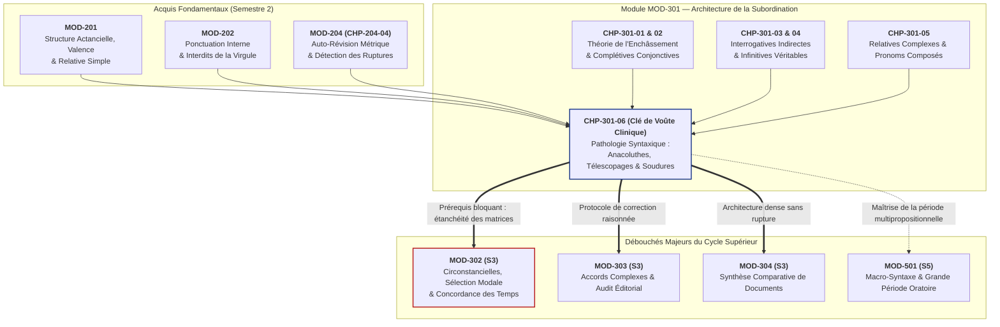

# Chapitre 6 — Pathologie Syntaxique de la Phrase Complexe : Traque des Anacoluthes, Télescopages et Ruptures d'Enchâssement

> **Identifiant du chapitre** : `CHP-301-06`  
> **Module de rattachement** : [`MOD-301` — Architecture de la Subordination : Complétives Conjonctives, Interrogatives Indirectes, Infinitives et Relatives Complexes](file:///f:/Formation/world-class-french/03-curriculum/year-2/semester-3/mod-301-architecture-subordination-completives.md)  
> **Semestre** : Année 2 — Semestre 3 (S3)  
> **Volume horaire canonique** : 5 à 6 heures d'apprentissage autonome délibéré et d'ateliers d'application (Phase 1 Étude : 1 h 30 | Phase 2 Pratique : 1 h 30 | Phase 3 Correction : 1 h 00 | Phase 4 Évaluation : 1 h 00)  
> **Statut** : [STATUT : PROPOSÉ — EN ATTENTE DE VALIDATION]  
> **Compétences associées** : [`FR-SYNTAX-002`](file:///f:/Formation/world-class-french/02-competency-framework/competency-framework.md#fr-syntax-002-architecture-de-la-subordination-complexe) (L3 Autonomie), [`FR-INT-003`](file:///f:/Formation/world-class-french/02-competency-framework/competency-framework.md#fr-int-003-réviser-et-corriger-un-texte-tiers-en-justifiant-les-interventions) (L3 Autonomie), [`FR-STYLE-001`](file:///f:/Formation/world-class-french/02-competency-framework/competency-framework.md#fr-style-001-maîtrise-des-figures-de-rhétorique-et-commentaire-stylistique) (L3 Autonomie)  
> **Sources scientifiques de référence** : `SRC-GRAM-01` (Maurice Grevisse, André Goosse, *Le Bon Usage*, 16e éd., § 440 & § 1063), `SRC-GRAM-02` (Martin Riegel, Jean-Christophe Pellat, René Rioul, *Grammaire méthodique du français*, chap. 14 & 16), `SRC-NORM-03` (Ministère de l'Éducation nationale, *Terminologie grammaticale*, 2020), `SRC-TYPO-01` (Imprimerie nationale, *Lexique des règles typographiques en usage à l'Imprimerie nationale*)

---

## 1. Titre et Place dans le Cursus

### 1.1 Intitulé Officiel
**Chapitre 6 : Pathologie Syntaxique de la Phrase Complexe : Traque des Anacoluthes, Télescopages et Ruptures d'Enchâssement** (`CHP-301-06`).

### 1.2 Insertion Architecturale dans le Cursus
Le présent chapitre représente le **couronnement terminal du module [`MOD-301`](file:///f:/Formation/world-class-french/03-curriculum/year-2/semester-3/mod-301-architecture-subordination-completives.md)** et la clé de voûte de l'architecture de la subordination complexe. 

Après avoir étudié la théorie formelle de l'enchâssement (`CHP-301-01`), disséqué les propositions complétives en *que* (`CHP-301-02`), maîtrisé les interrogatives indirectes (`CHP-301-03`), analysé les conditions d'autonomie actancielle de la subordonnée infinitive (`CHP-301-04`) et déployé les relatives complexes à pronoms composés (`CHP-301-05`), l'apprenant doit être confronté au **versant clinique de la syntaxe**.

La maîtrise de la phrase complexe ne consiste pas seulement à savoir empiler des propositions subordonnées dans des conditions idéales ; elle réside dans la capacité chirurgicale à repérer, diagnostiquer et redresser les **fractures structurales** qui menacent constamment les énoncés longs : les anacoluthes de construction, les sujets gérondifs ou participiaux orphelins, les télescopages de subordonnants concurrents et les coordinations asymétriques.



- **En amont** : Ce chapitre intègre les notions de valence verbale de [`MOD-201`](file:///f:/Formation/world-class-french/03-curriculum/year-1/semester-2/mod-201-syntaxe-fonctionnelle-phrase-simple.md), les règles de démarcation par la ponctuation de [`MOD-202`](file:///f:/Formation/world-class-french/03-curriculum/year-1/semester-2/mod-202-participe-passe-avoir-ponctuation-interne.md), et approfondit sur le plan de la macro-syntaxe complexe le crible révisionnel initié en [`CHP-204-04`](file:///f:/Formation/world-class-french/03-curriculum/year-1/semester-2/mod-204/chp-204-04-protocole-auto-revision-traque-anacoluthes.md).
- **Au sein de [`MOD-301`](file:///f:/Formation/world-class-french/03-curriculum/year-2/semester-3/mod-301-architecture-subordination-completives.md)** : Il fait la synthèse clinique des cinq chapitres précédents en confrontant l'étudiant aux erreurs d'enchâssement les plus pernicieuses.
- **En aval vers le reste du cursus** :
  - **Vers [`MOD-302`](file:///f:/Formation/world-class-french/03-curriculum/year-2/semester-3/mod-302-circonstancielles-systeme-modal-concordance.md) (Prérequis bloquant)** : L'analyse des subordonnées circonstancielles et l'arbitrage du mode (indicatif vs subjonctif) requièrent d'identifier sans faute la matrice rectrice et d'éviter les ruptures de repérage énonciatif.
  - **Vers [`MOD-303`](file:///f:/Formation/world-class-french/03-curriculum/year-2/semester-3/mod-303-accords-verbes-pronominaux.md) et [`MOD-304`](file:///f:/Formation/world-class-french/03-curriculum/year-2/semester-3/mod-304-synthese-comparative-documents.md)** : La synthèse de dossiers documentaires denses exige une prose fluide capable d'articuler trois ou quatre propositions sans jamais produire d'asymétrie ni de télescopage.
  - **Vers [`MOD-501`](file:///f:/Formation/world-class-french/03-curriculum/year-3/semester-5/mod-501-macro-syntaxe-periode-oratoire-cadences.md)** : Le déploiement de la grande période oratoire classique (Bossuet, Chateaubriand) repose sur la tension soutenue de l'arche syntaxique entre la protase et l'apodose.

---

## 2. Objectifs Mesurables

Au terme des 5 à 6 heures d'apprentissage autonome délibéré et d'ateliers d'application, l'apprenant sera capable de :

1. **Détecter, classifier et réparer avec une précision chirurgicale toute anacoluthe de construction** (participe présent ou gérondif détaché sans coréférence actancielle, infinitif orphelin, abandon du sujet de la matrice en cours de période) dans un corpus d'écrits universitaires ou administratifs denses [Réf. `SRC-GRAM-01`, § 440 ; `SRC-GRAM-02`, chap. 16]. ([`FR-SYNTAX-002`](file:///f:/Formation/world-class-french/02-competency-framework/competency-framework.md#fr-syntax-002-architecture-de-la-subordination-complexe) — Palier L3 Autonomie).
2. **Éradiquer les télescopages de subordonnants et les redondances pronominales fautives** (amalgame agrammatical de relatives et de complétives du type *« l'homme que je sais qu'il viendra »*) en rétablissant l'arbre d'enchâssement conforme soit par l'attribut du COD, soit par une complétive conjonctive pure [Réf. `SRC-GRAM-01`, § 690-715 ; `SRC-NORM-03`]. ([`FR-SYNTAX-002`](file:///f:/Formation/world-class-french/02-competency-framework/competency-framework.md#fr-syntax-002-architecture-de-la-subordination-complexe), [`FR-INT-003`](file:///f:/Formation/world-class-french/02-competency-framework/competency-framework.md#fr-int-003-réviser-et-corriger-un-texte-tiers-en-justifiant-les-interventions) — Palier L3 Autonomie).
3. **Appliquer les protocoles de symétrie fonctionnelle dans la coordination complexe**, en éliminant rigoureusement les attelages asymétriques (coordination d'un syntagme nominal et d'une complétive) et en imposant la répétition obligatoire de la conjonction *que* sous la forme *et que* lors de la coordination de deux complétives [Réf. `SRC-GRAM-01`, § 1063 ; `SRC-TYPO-01`]. ([`FR-SYNTAX-002`](file:///f:/Formation/world-class-french/02-competency-framework/competency-framework.md#fr-syntax-002-architecture-de-la-subordination-complexe) — Palier L3 Autonomie).
4. **Distinguer scientifiquement l'anacoluthe stylistique littéraire d'auteur du solécisme défectueux académique**, en explicitant la visée expressive chez Pascal ou Racine et en formulant les raisons pour lesquelles cette rupture est sanctionnée comme une faute rédhibitoire dans la prose universitaire contemporaine [Réf. `SRC-RHET-02` ; `SRC-GRAM-02`, chap. 16]. ([`FR-STYLE-001`](file:///f:/Formation/world-class-french/02-competency-framework/competency-framework.md#fr-style-001-maîtrise-des-figures-de-rhétorique-et-commentaire-stylistique), [`FR-INT-003`](file:///f:/Formation/world-class-french/02-competency-framework/competency-framework.md#fr-int-003-réviser-et-corriger-un-texte-tiers-en-justifiant-les-interventions) — Palier L3 Autonomie).

---

## 3. Prérequis et Test de Préparation

### 3.1 Prérequis Cognitifs Exigibles
- **Distinction Matrice Rectrice vs Proposition Régie (`CHP-301-01`)** : Savoir identifier le verbe principal gouverneur d'une phrase complexe et délimiter les propositions subordonnées de degrés 1 et 2.
- **Statut de la Conjonction Pure en « que » (`CHP-301-02`)** : Comprendre que la conjonction *que* est un pur morphème de liaison subordonnante, sans fonction actancielle interne propre, contrairement aux pronoms relatifs.
- **Règles d'Attribution Actancielle et de Valence (`CHP-201-01`)** : Reconnaître le sujet logique (agent, siège) et le sujet grammatical explicite d'un verbe.
- **Principe d'Équivalence Fonctionnelle de la Coordination (`MOD-102`)** : Savoir que deux constituants reliés par une conjonction de coordination (*et, ou, mais*) doivent assumer une fonction identique et appartenir à des catégories syntaxiquement appariables.

### 3.2 Test de Préparation (Auto-Diagnostic à 5 Questions)
Répondez aux cinq questions suivantes avant de dérouler le corrigé pour valider votre aptitude à aborder la clinique syntaxique :

1. **Question 1 (Actance du gérondif)** : Dans la phrase : *« En arrivant à la capitale, la circulation dense a surpris les nouveaux délégués »*, quel est le sujet grammatical de la proposition principale ? Ce sujet est-il compatible avec le gérondif initial ?
2. **Question 2 (Coordination de constituants hétérogènes)** : Pourquoi la phrase suivante est-elle jugée fautive par un jury académique : *« Le conseil des ministres annonce une baisse des impôts et que des investissements seront engagés »* ?
3. **Question 3 (Télescopage de subordonnants)** : Identifiez l'anomalie structurelle dans cet énoncé : *« C'est un dossier prioritaire que le président estime qu'il doit être traité sans délai »*.
4. **Question 4 (Soudure de deux complétives)** : Rétablissez la liaison conforme dans la phrase : *« L'ambassadeur certifie que la paix est rétablie et les frontières rouvriront demain »*.
5. **Question 5 (Infinitif sans support actanciel)** : Expliquez pourquoi l'énoncé *« Pour obtenir ce certificat de nationalité, des pièces justificatives doivent être déposées »* constitue une rupture d'ancrage logique.

---

#### Corrigé Détaillé de l'Auto-Diagnostic

<details>
<summary><b>Consulter le corrigé raisonné des 5 questions de préparation (cliquer pour dérouler)</b></summary>

1. **Réponse 1** : Le sujet grammatical de la principale est *la circulation dense*. Or, ce n'est pas la circulation qui arrive à la capitale, mais les nouveaux délégués ! Le gérondif *En arrivant...* est privé de sujet logique : c'est une anacoluthe de sujet [Réf. `SRC-GRAM-01`, § 440].  
   *Correction* : *« En arrivant à la capitale, les nouveaux délégués ont été surpris par la circulation dense. »*
2. **Réponse 2** : Le coordonnant *et* relie un **syntagme nominal** (*une baisse des impôts*) et une **proposition subordonnée complétive** (*que des investissements seront engagés*). Bien que tous deux soient compléments d'objet direct du verbe *annonce*, l'hétérogénéité de leurs statuts catégoriels heurte le parallélisme requis en français soutenu [Réf. `SRC-GRAM-02`, chap. 16].  
   *Correction* : *« Le conseil des ministres annonce une baisse des impôts et l'engagement de nouveaux investissements »* ou *« ... annonce que les impôts baisseront et que des investissements seront engagés »*.
3. **Réponse 3** : C'est un **télescopage agrammatical** entre une relative en *que* et une complétive en *que* avec reprise pronominale pléonastique (*qu'il*). Le pronom relatif *que* se retrouve sans fonction syntaxique dans la subordonnée [Réf. `SRC-GRAM-01`, § 710].  
   *Correction* : *« C'est un dossier prioritaire dont le président estime qu'il doit être traité sans délai »* ou *« C'est un dossier prioritaire que le président estime urgent »*.
4. **Réponse 4** : Lors de la coordination de deux complétives, la conjonction *que* doit être **obligatoirement répétée** après *et* [Réf. `SRC-GRAM-01`, § 1063]. L'ellipse de la conjonction (*et les frontières*) est une négligence sanctionnée.  
   *Correction* : *« L'ambassadeur certifie que la paix est rétablie **et que** les frontières rouvriront demain. »*
5. **Réponse 5** : Le groupe prépositionnel infinitif *Pour obtenir ce certificat* exige un agent animé (l'usager, le citoyen). Or, le sujet du verbe principal est le passif inanimé *des pièces justificatives*. Ce ne sont pas les pièces qui obtiennent le certificat !  
   *Correction* : *« Pour obtenir ce certificat de nationalité, l'usager doit déposer des pièces justificatives. »*

</details>

---

## 4. Situation de Départ ou Problème Concret

### 4.1 Le Naufrage de la Phrase Complexe
Dans les épreuves d'écriture longue des concours universitaires (dissertation, synthèse de documents, note administrative), l'ambition intellectuelle de l'apprenant le pousse à formuler des pensées denses et nuancées. 

Toutefois, dès que la phrase dépasse 30 ou 40 mots et empile plus de deux niveaux d'enchâssement, un phénomène de **naufrage syntaxique** se produit chez le rédacteur non entraîné :
- Il commence sa phrase sur une lancée syntaxique (par exemple un complément circonstanciel participial ou un gérondif) ;
- En cours de rédaction, sollicité par la recherche du lexique ou la complexité de l'argument, il perd de vue le schéma actanciel ouvert au départ ;
- Il achève sa phrase sous une construction totalement différente, laissant le début suspendu dans le vide.

Observons ces énoncés réels extraits de mémoires de recherche et de copies de concours administratifs :

> ❌ *« En consultant attentivement les conclusions du rapport d'audit, plusieurs irrégularités financières ont sauté aux yeux de la commission d'enquête. »*  
> ❌ *« Le gouverneur exige la reddition immédiate des rebelles et qu'ils déposent les armes sans condition préalable. »*  
> ❌ *« C'est un savant éminent que nous savons tous qu'il recevra le prix Nobel cette année. »*  
> ❌ *« Bien que les pourparlers aient repris hier à Cotonou et semblant ouvrir la voie à un cessez-le-feu durable, aucun accord n'a été paraphé. »*

### 4.2 L'Impact sur le Lecteur Évaluateur
Pourquoi ces phrases provoquent-elles l'agacement immédiat d'un jury académique ou d'un directeur d'administration ?
1. **Rupture de la lisibilité cognitive** : Le cerveau humain traite la phrase selon un modèle prédictif. Dès qu'un gérondif est énoncé (*« En consultant... »*), le système cognitif réserve une case mentale pour le sujet qui consulte. Si la phrase lui sert *« plusieurs irrégularités »*, le traitement s'enraye : l'esprit doit faire marche arrière pour reconstituer le sens.
2. **Perte d'autorité intellectuelle** : Une phrase dont la charpente s'effondre discrédite la rigueur du raisonnement qui la sous-tend. En milieu académique, la clarté formelle est indissociable de la validité de la pensée.

---

## 5. Explication Intuitive

### 5.1 L'Analogie du Pont Suspendu Brisé au Milieu du Fleuve
Pour saisir l'essence mécanique de la pathologie syntaxique, imaginons la construction d'un **pont suspendu** au-dessus d'un large fleuve :

```text
    RIVE DÉPART                                                           RIVE ARRIVÉE
  [Pylône Initial]                                                      [Pylône Final]
   "En consultant                                                       "la commission
     le rapport..."                                                       a découvert..."
          │                                                                     │
          ▼                                                                     ▼
       ─────── Arche 1 (Gérondif) ───────┐               ┌────── Arche 2 (Principale) ──────
                                         │  RUPTURE      │
                                         ▼   FRACTURE    ▼
                                       ═════════════════════
                                         FOND DU FLEUVE
                                   "plusieurs irrégularités
                                       sont apparues..."
                                   (Sujet inerte incompatible)
```

1. **La phrase bien construite** : Le premier arc s'élance depuis la rive de départ (le gérondif ou la subordonnée circonstancielle) et vient s'ancrer solidement dans le pilier central (le sujet grammatical de la proposition principale). Les câbles porteurs soutiennent l'ensemble sans fléchir.
2. **L'anacoluthe** : Le bâtisseur commence à lancer son tablier à partir de la rive gauche (*« En consultant le rapport... »*), mais au lieu de l'amarrer au pilier correspondant (*« l'expert a relevé... »*), il ancre le second tronçon sur un îlot de sable totalement distinct (*« des irrégularités sont apparues... »*). Le pont est brisé au milieu du fleuve : les véhicules de la pensée basculent dans le vide.

### 5.2 L'Analogie du Squelette à Membre Fantôme
L'autre modèle analogique est celui du système ostéo-articulaire :
- Le verbe principal est la **colonne vertébrale** de la phrase ;
- Le sujet grammatical en est la **tête** ;
- Les propositions subordonnées, participes et gérondifs en sont les **membres articulés**.

Dans l'anacoluthe du sujet fantôme, le rédacteur a en tête l'acteur vivant (*l'auditeur*, *l'étudiant*), mais omet de lui donner des os et des muscles dans la syntaxe. Il attache un bras (le gérondif) à une cage thoracique qui n'existe pas. La phrase devient un organisme déformé, un squelette dont les membres pendent sans articulation.

---

## 6. Définitions Précises et Terminologie

```text
TAXONOMIE CLINIQUE DES PATHOLOGIES DE LA PHRASE COMPLEXE
├── 1. Pathologie syntaxique : Défaillance structurelle violant la rection ou la coréférence
├── 2. Anacoluthe de construction : Rupture de cohésion laissant un constituant sans ancrage
│    ├── Anacoluthe du sujet gérondif / participial (Sujet fantôme)
│    ├── Anacoluthe de l'infinitif détaché
│    └── Rupture de période (Abandon du topique initial sans verbe recteur)
├── 3. Solécisme : Faute grossière contre la syntaxe (vs barbarisme lexical)
├── 4. Rupture d'enchâssement : Emboîtement inachevé privant une régie de sa matrice
├── 5. Télescopage de subordonnants : Concurrence non résolue de connecteurs (relative + complétive)
├── 6. Coordination asymétrique : Jonction fautive de catégories fonctionnellement disparates
└── 7. Protocole de soudure : Rétablissement du parallélisme et de la coréférence actancielle
```

1. **Pathologie syntaxique** : Toute anomalie structurelle au sein d'une phrase qui viole les règles de rection, d'accord, de coréférence ou de coordination, rendant l'énoncé agrammatical ou bancal en français normé [Réf. `SRC-GRAM-02`, chap. 16].
2. **Anacoluthe de construction** (du grec *anakolouthos*, « sans suite, qui ne suit pas logiquement ») : Rupture de la cohésion syntaxique telle que la seconde partie d'une phrase ne correspond pas au schéma structural ou actanciel ouvert par la première partie [Réf. `SRC-GRAM-01`, § 440 ; `SRC-NORM-03`, p. 44].
3. **Solécisme vs Figure de style** :
   - Le **solécisme** est une faute involontaire contre la syntaxe commise par ignorance ou maladresse, unanimement sanctionnée dans la prose fonctionnelle et académique.
   - L'**anacoluthe de style** est une rupture délibérée opérée par un grand écrivain (Pascal, Racine) pour traduire un choc émotionnel, une rupture de souffle ou une emphase rhétorique [Réf. `SRC-RHET-02`].
4. **Rupture d'enchâssement (Embedding Breakdown)** : Incident de construction où une proposition subordonnée est amorcée sans que sa matrice rectrice ne vienne jamais fermer le schéma prédicatif, laissant la subordonnée suspendue sans verbe gouverneur.
5. **Télescopage de subordonnants** : Superposition fautive de deux termes introducteurs concurrents (notamment un pronom relatif et une conjonction de subordination complétive) sur une même case fonctionnelle, aboutissant à un cumul agrammatical ou à un décumul pronominal erroné (*« l'homme que je sais qu'il est venu »*) [Réf. `SRC-GRAM-01`, § 710].
6. **Coordination asymétrique (ou attelage syntaxique)** : Jonction par un coordonnant (*et, ou*) de deux constituants qui ne possèdent ni le même statut catégoriel ni la même distribution fonctionnelle (ex. coordonner un syntagme nominal direct et une complétive conjonctive) [Réf. `SRC-GRAM-02`, chap. 16].
7. **Sujet fantôme (ou orphelin)** : Propriété d'un participe présent, d'un gérondif ou d'un adjectif détaché dont le sujet sémantique implicite est absent de la proposition principale ou n'en constitue pas le sujet grammatical explicite.
8. **Protocole de soudure syntaxique** : Ensemble d'opérations chirurgicales de réécriture visant à réaligner l'actance, rétablir la répétition des conjonctions coordonnées et harmoniser les catégories syntaxiques appariées.

---

## 7. Règles ou Mécanismes Fondamentaux

### 7.1 L'Anacoluthe en Syntaxe Académique : Définition Linguistique et Distinction Normative

#### Définition Linguistique Rigoureuse
En linguistique structurale et générative, une phrase est une arborescence fermée gouvernée par des principes de rection et de liage. Lorsqu'un syntagme est détaché en tête de phrase (topicalisation), il ouvre une **attente de coréférence** ou un **rôle thématique** qui doit obligatoirement trouver son dénouement dans le noyau prédicatif principal. 

L'anacoluthe se produit lorsque le scripteur rompt ce fil : le noyau prédicatif principal sélectionne des actants incompatibles avec le constituant d'amorce [Réf. `SRC-GRAM-02`, chap. 16].

#### L'Anacoluthe Stylistique d'Auteur vs Le Solécisme Éliminatoire
Il est capital de distinguer l'usage littéraire classique de la prose académique contemporaine :
- **L'anacoluthe d'auteur** est une licence poétique ou dramaturgique :
  - Blaise Pascal (*Pensées*) :  
    > *« Le nez de Cléopâtre, s'il eût été plus court, toute la face de la terre aurait changé. »*  
    (Le syntagme nominal *Le nez de Cléopâtre* est posé en tête comme thème absolu, sans fonction grammaticale dans la principale *toute la face de la terre aurait changé*).
  - Jean Racine (*Athalie*, acte II, scène 7) :  
    > *« Ciel, plus j'examine, et plus je le regarde, / C'est lui d'Ézéchias l'auguste vêtement... »*  
    (Rupture de la construction comparative pour traduire la stupeur religieuse).
- **Le solécisme éliminatoire** : Dans une copie de concours universitaire, un rapport administratif ou une thèse de doctorat, une telle rupture n'est jamais perçue comme une trouvaille poétique, mais comme un **défaut d'architecture cognitive**. Le contrat de communication rationnelle impose que chaque syntagme soit impeccablement lié à la matrice [Réf. `SRC-GRAM-01`, § 440].

---

### 7.2 L'Anacoluthe du Sujet Participial et Gérondif (Le « Sujet Fantôme »)

#### Règle Absolue de Coréférence
Un participe présent, un gérondif (*en* + participe présent) ou un adjectif qualificatif détaché en tête de proposition ou placé en incise **doit avoir pour sujet logique le sujet grammatical explicite de la proposition principale dont il dépend** [Réf. `SRC-GRAM-01`, § 440 ; `SRC-GRAM-02`, chap. 14].

$$\text{Sujet Logique du Gérondif / Participe} \equiv \text{Sujet Grammatical de la Proposition Principale}$$

#### Clinique de la Faute
Observons les deux pathologies les plus fréquentes :

1. **Cas du gérondif orphelin** :
   - *Énoncé fautif* : ❌ *« En arrivant à la gare, le train était déjà parti. »*  
   - *Diagnostic clinique* : Le verbe principal est *était parti*, dont le sujet grammatical est *le train*. Or, le train n'arrive pas à la gare en marchant : c'est le voyageur qui arrive ! Le gérondif *En arrivant* est rattaché à tort au train.
   - *Rétablissement conforme* :  
     $\checkmark$ *« En arrivant à la gare, **le voyageur a constaté** que le train était déjà parti. »* (Réalignement du sujet).  
     $\checkmark$ *« **Lorsque le voyageur est arrivé** à la gare, le train était déjà parti. »* (Transformation en subordonnée temporelle).
2. **Cas du participe présent orphelin** :
   - *Énoncé fautif* : ❌ *« Étant malade, la réunion a été reportée par le directeur. »*  
   - *Diagnostic clinique* : Le sujet de la principale est *la réunion*. Une réunion ne tombe pas malade ! Le participe *Étant malade* flotte sans support actanciel.
   - *Rétablissement conforme* :  
     $\checkmark$ *« Étant malade, **le directeur a reporté** la réunion. »*  
     $\checkmark$ *« **Comme le directeur était malade**, la réunion a été reportée. »*

---

### 7.3 Les Ruptures de Construction Infinitives

Lorsqu'un groupe infinitif introduit par une préposition (*pour, afin de, avant de, après, sans, à force de*) est placé en tête de phrase, il sous-entend lui aussi un sujet implicite (noté `PRO` en linguistique formelle). 

Ce sujet implicite doit être **strictement coréférentiel au sujet de la matrice** [Réf. `SRC-GRAM-02`, chap. 14] :

- *Énoncé fautif* : ❌ *« Pour réussir ce concours prestigieux, des sacrifices constants sont exigés par les professeurs. »*  
  - *Diagnostic* : Le sujet grammatical de la principale est *des sacrifices constants*. Ce ne sont pas les sacrifices qui passent ou réussissent le concours, mais les candidats !
  - *Rétablissement conforme* :  
    $\checkmark$ *« Pour réussir ce concours prestigieux, **les candidats doivent consentir** des sacrifices constants. »*  
    $\checkmark$ *« **Si l'on veut réussir** ce concours prestigieux, des sacrifices constants sont exigés. »*

- *Énoncé fautif* : ❌ *« Après avoir signé le contrat de bail, la remise des clés s'est déroulée dans le calme. »*  
  - *Diagnostic* : Ce n'est pas la remise des clés qui a signé le contrat.
  - *Rétablissement conforme* :  
    $\checkmark$ *« Après avoir signé le contrat de bail, **les locataires ont reçu** les clés dans le calme. »*

---

### 7.4 Le Télescopage de Subordonnants et la Redondance Pronominale Fautive

Le télescopage le plus dévastateur en syntaxe complexe survient lorsqu'un scripteur tente d'enchâsser une proposition complétive régie par un verbe d'opinion ou de déclaration (*penser, savoir, croire, estimer*) à l'intérieur d'une proposition subordonnée relative [Réf. `SRC-GRAM-01`, § 710].

#### Anatomie de la Faute : « C'est un auteur que je sais qu'il viendra »
Observons le mécanisme de cet énoncé toxique :
- Le scripteur veut exprimer deux choses : (1) *Je sais que cet auteur viendra* (complétive) ; (2) *C'est cet auteur* (relative).
- Il juxtapose le pronom relatif *que* et la complétive *qu'il viendra*.
- *Problème insoluble* : Quelle est la fonction du pronom relatif *que* ? 
  - Il ne peut pas être COD de *sais*, car le verbe *sais* a déjà pour COD toute la proposition complétive *qu'il viendra*.
  - Il ne peut pas être sujet de *viendra*, car ce rôle est déjà occupé par le pronom personnel *il* !
- Le pronom relatif *que* est un constituant erratique, sans fonction, doublé d'une redondance pronominale fautive (*qu'il*).

#### Les Deux Voies de Rétablissement Normé
Pour réparer un télescopage relatif/complétif, deux solutions élégantes s'offrent au rédacteur :

1. **Solution 1 : La transformation en incise parentétique (ou semi-relative en *qui*)** :  
   On fait du verbe d'opinion une incise et le pronom relatif devient le vrai sujet du verbe subordonné :  
   $\checkmark$ *« C'est un auteur **qui, je le sais, viendra** à la conférence. »*
2. **Solution 2 : La rection indirecte par le pronom « dont »** :  
   Le verbe de jugement régit la complétive et prend pour complément le pronom *dont* (= *au sujet duquel*) :  
   $\checkmark$ *« C'est un auteur **dont je sais qu'il viendra** à la conférence. »*  
   *(Dans cette tournure admise par Grevisse § 710, dont est complément d'objet indirect ou d'attribution du verbe recteur).*
3. **Solution 3 : La restructuration en complétive pure directe** :  
   $\checkmark$ *« **Je sais que cet auteur viendra** à la conférence. »*

---

### 7.5 Les Coordinations Asymétriques et Hétérogènes

#### La Règle d'Or de la Coordination
La conjonction de coordination ne peut unir que des constituants de **même fonction syntaxique et de statut catégoriel équivalent** [Réf. `SRC-GRAM-02`, chap. 16 ; `SRC-NORM-03`].

$$\text{Constituant A} \quad [\text{Fonction } X, \text{ Forme } \alpha] \quad \mathbf{ET} \quad \text{Constituant B} \quad [\text{Fonction } X, \text{ Forme } \alpha]$$

#### Proscription de l'Attelage « Syntagme Nominal + Proposition Complétive »
Il est strictement interdit de coordonner par *et* ou *ou* un groupe nominal et une proposition subordonnée complétive :

- *Énoncé fautif* : ❌ *« Le directeur général exige **votre présence immédiate** [SN] et **que vous remettiez le rapport** [Proposition subordonnée]. »*  
  - *Diagnostic* : Même si les deux membres sont compléments d'objet direct du verbe *exige*, leur nature hétérogène (syntagme nominal fermé vs proposition finie ouverte) produit une asymétrie intolérable en français soigné.
  - *Rétablissement conforme par deux syntagmes nominaux* :  
    $\checkmark$ *« Le directeur général exige **votre présence immédiate** et **la remise de votre rapport**. »*
  - *Rétablissement conforme par deux propositions subordonnées complétives* :  
    $\checkmark$ *« Le directeur général exige **que vous soyez présent immédiatement** et **que vous remettiez votre rapport**. »*

---

### 7.6 La Soudure Syntaxique lors de la Coordination de Deux Complétives

#### Répétition Impérative de « que »
En français académique, lorsque deux propositions subordonnées complétives sont coordonnées par *et* ou *ou*, la conjonction de subordination *que* **doit être obligatoirement répétée devant la seconde subordonnée** [Réf. `SRC-GRAM-01`, § 1063] :

- *Énoncé fautif* : ❌ *« Le ministre affirme **qu'**il a compris la colère des étudiants **et appliquera** immédiatement les réformes promises. »*  
  - *Diagnostic* : L'ellipse de *que* et du pronom sujet après *et* brise l'enchâssement. Le verbe *appliquera* semble flotter ou se coordonner maladroitement au verbe recteur *affirme*.
  - *Rétablissement obligatoire* :  
    $\checkmark$ *« Le ministre affirme **qu'il** a compris la colère des étudiants **et qu'il appliquera** immédiatement les réformes promises. »*

> [!IMPORTANT]
> **Règle de soudure canonique** : On ne coordonne jamais deux propositions régies par une ellipse tronquée. La formule de liaison obligatoire est :
> $$\text{Matrice } [\dots] \text{ que } [\text{Prop. 1}] \quad \mathbf{et \ que} \quad [\text{Prop. 2}]$$

---

## 8. Raisonnement Détaillé (Le Pourquoi)

### 8.1 La Psycholinguistique du Traitement Prédictif
Pourquoi l'oreille et l'esprit décrochent-ils instantanément face à une anacoluthe ? 

La recherche contemporaine en sciences cognitives et psycholinguistique démontre que la lecture et l'écoute ne consistent pas à accumuler passivement des mots les uns après les autres. Le cerveau traite le langage de façon **hautement prédictive** (*Top-Down Processing*) :

1. **Ouverture d'un tiroir syntaxique** : Dès qu'apparaît un gérondif en tête de phrase (*« En rédigeant... »*), le processeur syntaxique cérébral ouvre immédiatement une case dans la mémoire de travail :  
   `[Attente : Sujet Humain / Acteur de l'action de rédiger]`.
2. **Attente de résolution** : Le cerveau projette que le premier groupe nominal suivant la virgule viendra combler cette case vide pour clôturer l'unité d'information.
3. **Le choc d'agrammaticalité cognitive** : Si le groupe nominal qui suit est *« la nuit s'est achevée »* ou *« le mémoire a été imprimé »*, le processeur linguistique subit une contradiction brutale :
   - D'un côté, la syntaxe impose que *le mémoire* soit le sujet du gérondif ;
   - De l'autre, la sémantique signale que *le mémoire* ne peut pas rédiger.
4. **Blocage du flux de lecture** : Ce conflit force le lecteur à stopper sa progression, à relire la phrase et à reconstituer artificiellement l'intention de l'auteur. L'anacoluthe brise la fluidité cognitive du discours.

```text
TRAITEMENT PRÉDICTIF DE LA PHRASE EN MÉMOIRE DE TRAVAIL

Flux temporel ───►  [ "En rédigeant son mémoire," ]  ───► [ Virgule démarcative ] ───► [ Attente Sujet = Étudiant ]
                                                                                                 │
                           ┌─────────────────────────────────────────────────────────────────────┘
                           ▼
                    RÉCEPTION DU SUJET :
                    
   Cas A (Syntaxe Conforme) :                           Cas B (Anacoluthe Fautive) :
   [ "l'étudiant a mobilisé ses sources." ]             [ "trois mois intenses se sont écoulés." ]
   ──► Résolution actancielle immédiate.                ──► CONFLIT SÉMANTIQUE & BLOCAGE COGNITIF.
   ──► Clôture du tiroir syntaxique.                    ──► Rupture de prédiction, relecture forcée.
```

---

## 9. Exemples Corrects Commentés

### Exemple 1 : Réparation d'une Anacoluthe de Gérondif
- **Version pathologique** :  
  *« En parcourant les rapports financiers trimestriels, des déficits colossaux sont apparus au vérificateur général. »*
- **Analyse du désastre** :  
  Le sujet grammatical de la principale est *des déficits colossaux*. Les déficits ne parcourent pas les rapports. L'anacoluthe isole le gérondif *En parcourant*.
- **Double protocole de réécriture** :
  - *Option A (Par réalignement du pivot actanciel)* :  
    $\checkmark$ *« En parcourant les rapports financiers trimestriels, **le vérificateur général a découvert** des déficits colossaux. »*  
    *(Schéma : Sujet du gérondif = Sujet de la principale = le vérificateur général).*
  - *Option B (Par autonomisation de la circonstancielle temporelle)* :  
    $\checkmark$ *« **Lorsque le vérificateur général a parcouru** les rapports financiers trimestriels, des déficits colossaux lui sont apparus. »*

---

### Exemple 2 : Redressement d'une Coordination Asymétrique
- **Version pathologique** :  
  *« Le recteur de l'académie rappelle **la stricte interdiction du plagiat** [SN] et **que toute fraude sera sévèrement punie** [Complétive]. »*
- **Analyse du désastre** :  
  Coordination bancale d'un syntagme nominal noyau et d'une proposition finie sous le coordonnant *et*.
- **Double protocole de réécriture** :
  - *Option A (Soudure par double syntagme nominal)* :  
    $\checkmark$ *« Le recteur de l'académie rappelle **la stricte interdiction du plagiat** et **la sanction impitoyable de toute fraude**. »*
  - *Option B (Soudure par double complétive en « que » et « et que »)* :  
    $\checkmark$ *« Le recteur de l'académie rappelle **que le plagiat est strictement interdit** et **que toute fraude sera sévèrement punie**. »*

---

### Exemple 3 : Débrouillage d'un Télescopage Relatif / Complétif
- **Version pathologique** :  
  *« Voici la réforme institutionnelle **que** la commission soutient **qu'elle** permettra de stabiliser le pays. »*
- **Analyse du désastre** :  
  Télescopage du relatif *que* et de la complétive *qu'elle permettra*. Le pronom *elle* fait doublon avec l'antécédent *la réforme*, tandis que le relatif *que* n'a aucune fonction dans l'énoncé.
- **Protocole de réécriture** :
  - *Option A (Transformation en incise parentétique)* :  
    $\checkmark$ *« Voici la réforme institutionnelle **qui, la commission en est convaincue, permettra** de stabiliser le pays. »*
  - *Option B (Rection indirecte par « dont »)* :  
    $\checkmark$ *« Voici la réforme institutionnelle **dont** la commission soutient **qu'elle** permettra de stabiliser le pays. »*

---

### Exemple 4 : Soudure de Complétives Coordonnées
- **Version pathologique** :  
  *« Le décret stipule que les fonctionnaires devront déclarer leurs avoirs et recevront une prime d'installation. »*
- **Analyse du désastre** :  
  L'ellipse fautive de la conjonction *que* et du pronom sujet après *et* laisse planer une hésitation : qui régit *recevront* ? Le décret stipule-t-il la réception de la prime, ou est-ce une affirmation extérieure coordonnée au verbe *stipule* ?
- **Protocole de réécriture conforme** :  
  $\checkmark$ *« Le décret stipule **que** les fonctionnaires devront déclarer leurs avoirs **et qu'ils** recevront une prime d'installation. »*

---

## 10. Contre-Exemples et Erreurs Fréquentes

Cette section dissèque six erreurs majeures fréquemment relevées dans les copies de concours et les écrits universitaires.

### Erreur n° 1 : Le participe présent orphelin de support référentiel
- **Énoncé déviant** : ❌ *« Craignant une dévaluation brutale de la monnaie, des mesures d'urgence ont été arrêtées par la banque centrale. »*
- **Mécanisme de l'erreur** : Le sujet grammatical de la phrase est *des mesures d'urgence*. Or, des mesures ne peuvent éprouver de la crainte.
- **Réfutation scientifique** : Le participe présent détaché en position thématique fonctionne comme un prédicat second. La grammaire française lui refuse le statut de prédicat autonome : son actant principal doit être formellement identifié au sujet de la matrice [Réf. `SRC-GRAM-01`, § 440].
- **Correction rigoureuse** :  
  $\checkmark$ *« Craignant une dévaluation brutale de la monnaie, **la banque centrale a arrêté** des mesures d'urgence. »*

### Erreur n° 2 : Le gérondif sans sujet grammatical coréférentiel
- **Énoncé déviant** : ❌ *« En relisant attentivement votre manuscrit, quelques coquilles typographiques m'ont semblé regrettables. »*
- **Mécanisme de l'erreur** : Ce ne sont pas les « coquilles » qui relisent le manuscrit, mais le correcteur ou l'éditeur.
- **Réfutation scientifique** : Le gérondif (*en* + participe présent) exprime la concomitance ou la manière d'une action menée par le même agent que celui du verbe principal. Écrire que les coquilles relisent le texte constitue un non-sens sémantique et un solécisme syntaxique [Réf. `SRC-GRAM-02`, chap. 14].
- **Correction rigoureuse** :  
  $\checkmark$ *« En relisant attentivement votre manuscrit, **j'ai relevé** quelques coquilles typographiques regrettables. »*

### Erreur n° 3 : La coordination asymétrique d'un syntagme nominal et d'une subordonnée complétive
- **Énoncé déviant** : ❌ *« La direction rappelle l'obligation du port du badge et que nul ne sera admis sans autorisation préalable. »*
- **Mécanisme de l'erreur** : Jonction directe d'un syntagme nominal (*l'obligation du port du badge*) et d'une subordonnée en *que*.
- **Réfutation scientifique** : La coordination exige l'isomorphisme structural. Un constituant nominal ne peut être couplé par *et* à un constituant propositionnel sans créer une rupture de parallélisme [Réf. `SRC-GRAM-02`, chap. 16].
- **Correction rigoureuse** :  
  $\checkmark$ *« La direction rappelle **que le port du badge est obligatoire** et **que nul ne sera admis** sans autorisation préalable. »*

### Erreur n° 4 : Le télescopage d'un pronom relatif et d'une complétive avec reprise pronominale fautive
- **Énoncé déviant** : ❌ *« C'est une décision controversée que le gouvernement affirme qu'elle s'avère indispensable. »*
- **Mécanisme de l'erreur** : Empilement du relatif *que* et de la complétive *qu'elle s'avère indispensable*. Le pronom *elle* absorbe le rôle de sujet, laissant *que* privé de toute fonction.
- **Réfutation scientifique** : Tout pronom relatif doit remplir une fonction syntaxique interne indiscutable au sein de la subordonnée qu'il introduit (`MOD-201`, `CHP-201-06`). Ici, *que* ne peut être ni sujet, ni COD, ni circonstant [Réf. `SRC-GRAM-01`, § 710].
- **Correction rigoureuse** :  
  $\checkmark$ *« C'est une décision controversée **dont** le gouvernement affirme **qu'elle** s'avère indispensable. »* (ou *« C'est une décision controversée **qui, selon le gouvernement,** s'avère indispensable »*).

### Erreur n° 5 : L'ellipse fautive de la conjonction « que » après la coordination « et »
- **Énoncé déviant** : ❌ *« Le président a promis qu'une enquête transparente serait diligentée et les responsables seraient sanctionnés. »*
- **Mécanisme de l'erreur** : Omission de la conjonction *que* devant la deuxième subordonnée.
- **Réfutation scientifique** : La conjonction de subordination n'a pas de portée rétrospective automatique par-delà une conjonction de coordination unissant des verbes à des temps ou des personnes distincts. L'absence de reprise par *et que* dissout le lien de dépendance de la seconde proposition [Réf. `SRC-GRAM-01`, § 1063].
- **Correction rigoureuse** :  
  $\checkmark$ *« Le président a promis qu'une enquête transparente serait diligentée **et que** les responsables seraient sanctionnés. »*

### Erreur n° 6 : La proposition principale orpheline de verbe par rupture d'enchâssement
- **Énoncé déviant** : ❌ *« Quant aux diplomates occidentaux, bien que la trêve ait été acceptée par les deux belligérants et qu'un observateur impartial veille au respect des frontières. »*
- **Mécanisme de l'erreur** : La phrase s'achève sur un point sans qu'aucun verbe principal recteur ne soit jamais apparu.
- **Réfutation scientifique** : La phrase graphique française exige au minimum une proposition indépendante ou principale dotée d'un prédicat pour soutenir les propositions subordonnées enchâssées. Une suite de subordonnées sans proposition rectrice est agrammaticale [Réf. `SRC-NORM-03`].
- **Correction rigoureuse** :  
  $\checkmark$ *« Quant aux diplomates occidentaux, bien que la trêve ait été acceptée par les deux belligérants et qu'un observateur impartial veille au respect des frontières, **ils demeurent extrêmement circonspects**. »*

---

## 11. Cas Particuliers et Limites

### 11.1 L'Anacoluthe Expressive Admise en Littérature Poétique et Dramatique
L'anacoluthe n'est pas toujours une tare ; dans l'art littéraire, elle devient une arme expressive souveraine. Elle permet de peindre le désordre d'un esprit en proie à une vive passion, ou de capter l'immédiateté d'un tableau sensoriel :
- **Chez Saint-Amant** (*Le Poète crotté*) :  
  > *« Assis sur un fagot, une pipe à la bouche, / Tristement accoudé contre une cheminée, / Les yeux fixes vers terre, et l'âme abandonnée... »*  
  (Les participes passés et adjectifs *Assis*, *accoudé* restent suspendus sans qu'aucun sujet grammatical ne vienne achever la proposition dans l'immédiat : l'anacoluthe traduit l'anéantissement mélancolique du poète).
- **Chez Baudelaire** (*Les Fleurs du Mal*) :  
  Les dislocations de la phrase poétique sont fréquentes pour faire surgir une image avant son explicitation grammaticale.

> [!CAUTION]
> **Règle d'or de la prose académique** : Ce qui est sublime chez Saint-Amant, Pascal ou Racine est **strictement prohibé** dans une épreuve de concours, une dissertation ou une note administrative. Le scripteur universitaire doit maîtriser une syntaxe irréprochable et ne jamais abandonner la cohésion de sa phrase.

### 11.2 Les Tournures Impersonnelles Admises avec Gérondif
Il existe en français classique et moderne quelques tournures lexicalisées où le gérondif est toléré avec un verbe impersonnel (*il faut, il arrive, il convient*) sans que cela ne constitue une anacoluthe fautive, à condition que le sujet logique du gérondif soit le **sujet générique indéterminé** (*on, n'importe qui*) [Réf. `SRC-GRAM-01`, § 440] :
- *« **En attendant**, il faut poursuivre le travail. »* (Locution adverbiale figée).
- *« **En mangeant**, il convient de garder le silence. »* (= *Lorsque l'on mange, il convient...*).
- *« **En voyageant la nuit**, il arrive souvent que l'on perde ses repères. »*

Toutefois, dès que le contexte cesse d'être une maxime générale, la stricte règle de coréférence redevient absolue.

---

## 12. Approfondissement Adapté au Niveau : La Théorie du Liage et le Contrôle de PRO

En syntaxe générative et formelle (Chomsky, *Lectures on Government and Binding*, 1981), les propositions non finies (les propositions infinitives et les propositions participiales/gérondives) possèdent une position sujet syntaxiquement réelle mais phonétiquement silencieuse, symbolisée par **`PRO`** [Réf. `SRC-GRAM-02`, chap. 14] :

$$\left[ \text{En arrivant à la gare} \right] \quad \Longrightarrow \quad \left[ \text{En } \mathbf{PRO} \text{ arrivant à la gare} \right]$$

### Le Mécanisme du Contrôle Syntaxique
`PRO` ne peut pas recevoir de cas morphologique direct ; il doit être **contrôlé** par un groupe nominal situé dans la proposition rectrice supérieure (la matrice) :
1. **Contrôle par le Sujet** : Dans *« Jean espère [ PRO partir ] »*, le sujet *Jean* c-commande et contrôle `PRO`.
2. **Contrôle par l'Objet** : Dans *« Le juge ordonne à l'accusé [ PRO de répondre ] »*, c'est le COI *à l'accusé* qui contrôle `PRO`.

### La Formalisation Linguistique de l'Anacoluthe
L'anacoluthe du gérondif ou du participe s'explique scientifiquement comme un **échec de contrôle de `PRO`** :
- Soit la phrase fautive : *« [ En PRO consultant les archives ], de nouvelles preuves sont apparues. »*
- Le seul groupe nominal en position de c-commander `PRO` dans la matrice est *de nouvelles preuves* ;
- Or, les traits sémantiques de *preuves* ([ - animé ]) entrent en collision violente avec les exigences de sélection du verbe *consulter* ([ + animé, + cognitif ]) ;
- La dérivation syntaxique s'effondre : l'énoncé est rejeté par la grammaire comme agrammatical (*Crash derivationnel*).

---

## 13. Comparaisons Différentielles

### 13.1 Anacoluthe Fautive vs Ellipse Légitime vs Zeugme Stylistique

| Paramètre d'Analyse | Anacoluthe Fautive (Solécisme) | Ellipse Légitime (Élégance) | Zeugme Syntaxique / Sémantique |
| :--- | :--- | :--- | :--- |
| **Mécanisme structural** | Rupture du fil syntaxique laissant un constituant sans ancrage actanciel. | Effacement économique d'un mot facilement restitué par le contexte immédiat. | Coordination de deux éléments incompatibles (l'un concret, l'autre abstrait). |
| **Exemple typique** | ❌ *« En marchant dans la rue, la pluie a surpris Paul. »* | $\checkmark$ *« Paul étudie le droit, et son frère [étudie] l'économie. »* | $\checkmark$ *« Il prit son chapeau et la porte. »* (Figure d'esprit). |
| **Statut normatif** | **Sanctionné impitoyablement aux examens**. | **Pleinement admis et valorisé**. | **Figure littéraire ou d'esprit**. |
| **Effet produit** | Confusion, obscurité, impression d'amateurisme. | Concision, nervosité, élégance classique. | Surprise, humour ou poésie. |

### 13.2 Coordination Symétrique Conforme vs Coordination Asymétrique Fautive

| Type de Jonction | Structure des Membres Coordonnés | Statut Normatif | Exemple Illustratif |
| :--- | :--- | :--- | :--- |
| **Coordination Symétrique (SN + SN)** | Nom/GN $\quad \mathbf{et} \quad$ Nom/GN | $\checkmark$ **Conforme** | *« Il demande la révision du procès et la libération du détenu. »* |
| **Coordination Symétrique (Prop. + Prop.)** | Complétive $\quad \mathbf{et \ que} \quad$ Complétive | $\checkmark$ **Conforme** | *« Il demande que le procès soit révisé et que le détenu soit libéré. »* |
| **Coordination Asymétrique (SN + Prop.)** | Nom/GN $\quad \mathbf{et \ que} \quad$ Complétive | ❌ **Fautif (Attelage)** | ❌ *« Il demande la révision du procès et que le détenu soit libéré. »* |
| **Coordination Tronquée (Prop. + Ellipse)** | Complétive $\quad \mathbf{et} \quad$ Verbe sans *que* | ❌ **Fautif (Ellipse)** | ❌ *« Il affirme qu'il a compris et appliquera la consigne. »* |

### 13.3 Participe Lié vs Participe Détaché Coréférentiel vs Participe Orphelin

| Catégorie | Position et Ponctuation | Règle de Coréférence | Exemple et Validité |
| :--- | :--- | :--- | :--- |
| **Participe présent lié** | Postposé au nom sans virgule (épithète verbale). | Se rapporte directement au nom qu'il modifie. | $\checkmark$ *« Les étudiants **craignant un échec** travaillent dur. »* |
| **Participe présent détaché** | Antéposé en tête de phrase avec virgule démarcative. | **Doit avoir pour sujet logique le sujet grammatical de la principale**. | $\checkmark$ *« **Craignant un échec**, les étudiants travaillent dur. »* |
| **Participe présent orphelin** | Antéposé en tête de phrase avec virgule démarcative. | Le sujet de la principale est incompatible avec le participe. | ❌ *« **Craignant un échec**, les révisions ont été intensifiées. »* |

---

## 14. Exercices Progressifs (3 Niveaux)

### 14.1 Niveau 1 : Identification et Diagnostic d'Anacoluthes sur 10 Phrases
*Consigne : Pour chacune des dix phrases suivantes, indiquez si elle est syntaxiquement conforme ou fautive. Si elle est fautive, qualifiez la pathologie (anacoluthe de gérondif, de participe, d'infinitif, coordination asymétrique, omission de « que ») et proposez une réécriture irréprochable.*

1. *« En étudiant attentivement les manuscrits anciens, des révélations inattendues sont venues bouleverser les historiens. »*
2. *« Convaincu de l'innocence de son client, l'avocat a plaidé l'acquittement avec une éloquence remarquable. »*
3. *« Pour espérer décrocher une bourse doctorale, un dossier scientifique solide doit être transmis à la commission. »*
4. *« Le procureur soutient que le témoin a menti sous serment et doit être poursuivi pour parjure. »*
5. *« En descendant de l'avion à l'aéroport de Cotonou, une bouffée d'air chaud et humide a enveloppé les voyageurs. »*
6. *« Ayant terminé ses études universitaires avec mention, la soutenance de thèse a couronné le parcours de cette brillante chercheuse. »*
7. *« Le comité d'organisation annonce l'annulation du festival et que les billets achetés seront intégralement remboursés. »*
8. *« Sachant pertinemment la vérité, il préféra garder le silence pour protéger ses proches. »*
9. *« Tout en reconnaissant ses erreurs passées, sa sincérité me semble tout à fait contestable. »*
10. *« Après avoir délibéré pendant plus de six heures, le verdict de culpabilité a été prononcé par la cour d'assises. »*

---

#### Corrigé Détaillé du Niveau 1

<details>
<summary><b>Consulter le corrigé raisonné des 10 phrases du Niveau 1 (cliquer pour dérouler)</b></summary>

1. ❌ **Fautif (Anacoluthe de gérondif)** : Le sujet de la principale est *des révélations inattendues*. Ce ne sont pas les révélations qui étudient les manuscrits.  
   $\checkmark$ *Correction* : *« En étudiant attentivement les manuscrits anciens, **les historiens ont découvert** des révélations inattendues bouleversantes. »*
2. $\checkmark$ **Conforme** : Le participe *Convaincu...* a pour sujet logique *l'avocat*, qui est exactement le sujet grammatical du verbe principal *a plaidé*.
3. ❌ **Fautif (Anacoluthe d'infinitif)** : Le sujet de la principale est *un dossier scientifique solide*. Le dossier n'espère pas décrocher une bourse.  
   $\checkmark$ *Correction* : *« Pour espérer décrocher une bourse doctorale, **le candidat doit transmettre** un dossier scientifique solide à la commission. »*
4. ❌ **Fautif (Omission fautive de « et qu'il »)** : Coordonner deux propositions complétives exige la répétition de la conjonction et la reprise du sujet.  
   $\checkmark$ *Correction* : *« Le procureur soutient que le témoin a menti sous serment **et qu'il doit** être poursuivi pour parjure. »*
5. ❌ **Fautif (Anacoluthe de gérondif)** : Le sujet de la principale est *une bouffée d'air chaud*. L'air ne descend pas de l'avion.  
   $\checkmark$ *Correction* : *« En descendant de l'avion à l'aéroport de Cotonou, **les voyageurs ont été enveloppés** par une bouffée d'air chaud et humide. »*
6. ❌ **Fautif (Anacoluthe de participe)** : Ce n'est pas *la soutenance de thèse* qui a terminé ses études avec mention, mais la chercheuse.  
   $\checkmark$ *Correction* : *« Ayant terminé ses études universitaires avec mention, **cette brillante chercheuse a couronné** son parcours par sa soutenance de thèse. »*
7. ❌ **Fautif (Coordination asymétrique SN + Complétive)** : Jonction hétérogène de *l'annulation* (SN) et *que les billets seront remboursés* (complétive).  
   $\checkmark$ *Correction* : *« Le comité d'organisation annonce **l'annulation** du festival et **le remboursement intégral** des billets achetés »* ou *« ... annonce **que le festival est annulé** et **que les billets seront remboursés**. »*
8. $\checkmark$ **Conforme** : Le participe présent *Sachant...* a pour sujet logique *il*, sujet grammatical du verbe principal *préféra*.
9. ❌ **Fautif (Anacoluthe de gérondif)** : Ce n'est pas *sa sincérité* qui reconnaît les erreurs passées, mais l'individu en cause.  
   $\checkmark$ *Correction* : *« Tout en reconnaissant ses erreurs passées, **cet homme ne me semble pas** totalement sincère »* ou *« Bien qu'il reconnaisse ses erreurs passées, sa sincérité me semble tout à fait contestable. »*
10. ❌ **Fautif (Anacoluthe d'infinitif passé)** : Le sujet de la principale est *le verdict de culpabilité*. Le verdict ne délibère pas.  
    $\checkmark$ *Correction* : *« Après avoir délibéré pendant plus de six heures, **la cour d'assises a prononcé** un verdict de culpabilité. »*

</details>

---

### 14.2 Niveau 2 : Réécriture et Soudure Syntaxique de Phrases Télescopées
*Consigne : Chacune des 6 phrases complexes suivantes comporte un télescopage de subordonnants ou une rupture d'enchâssement sévère. Réécrivez chaque phrase selon deux angles académiques irréprochables (par exemple en incise élégante, par rection en « dont », ou par double complétive symétrique).*

1. *« C'est un projet de développement que nous pensons qu'il transformera durablement l'économie de la région. »*
2. *« L'avocat exige la comparution des témoins et que les pièces scellées soient présentées à l'audience. »*
3. *« C'est une affaire judiciaire que je sais que le juge rendra son délibéré vendredi prochain. »*
4. *« Bien que le traité ait été ratifié par le Parlement et stipulant des garanties douanières fermes, les tarifs ont augmenté. »*
5. *« Le candidat affirme qu'il détient les compétences requises et saura redresser les comptes de l'entreprise. »*
6. *« C'est un décret présidentiel que les analystes prédisent qu'il soulèvera une vague de contestations populaires. »*

---

#### Corrigé Détaillé du Niveau 2

<details>
<summary><b>Consulter le corrigé raisonné des 6 phrases du Niveau 2 (cliquer pour dérouler)</b></summary>

1. **Phrase 1 (Télescopage relatif/complétif « que nous pensons qu'il »)** :  
   - *Option A (Incise parentétique)* : $\checkmark$ *« C'est un projet de développement **qui, nous en sommes convaincus, transformera** durablement l'économie de la région. »*  
   - *Option B (Complétive rectrice directe)* : $\checkmark$ *« Nous pensons que ce projet de développement transformera durablement l'économie de la région. »*  
   - *Option C (Rection indirecte par dont)* : $\checkmark$ *« C'est un projet de développement **dont nous pensons qu'il transformera** durablement l'économie de la région. »*
2. **Phrase 2 (Coordination asymétrique SN + Complétive)** :  
   - *Option A (Double syntagme nominal)* : $\checkmark$ *« L'avocat exige **la comparution des témoins** et **la présentation des pièces scellées** à l'audience. »*  
   - *Option B (Double proposition complétive soudée)* : $\checkmark$ *« L'avocat exige **que les témoins comparaissent** et **que les pièces scellées soient présentées** à l'audience. »*
3. **Phrase 3 (Télescopage relatif/complétif « que je sais que le juge »)** :  
   - *Option A (Rection par « dont »)* : $\checkmark$ *« C'est une affaire judiciaire **dont je sais que le juge rendra** le délibéré vendredi prochain. »*  
   - *Option B (Phrase déclarative simple)* : $\checkmark$ *« Je sais que le juge rendra le délibéré de cette affaire judiciaire vendredi prochain. »*
4. **Phrase 4 (Coordination d'une subordonnée conjonctive et d'un participe présent)** :  
   - *Option A (Double subordonnée circonstancielle)* : $\checkmark$ *« Bien que le traité ait été ratifié par le Parlement **et qu'il stipule** des garanties douanières fermes, les tarifs ont augmenté. »*  
   - *Option B (Deux participes en incise)* : $\checkmark$ *« Quoique ratifié par le Parlement et stipulant des garanties fermes, le traité n'a pas empêché l'augmentation des tarifs. »*
5. **Phrase 5 (Ellipse fautive de « et qu'il »)** :  
   - *Option A (Soudure par répétition de et qu'il)* : $\checkmark$ *« Le candidat affirme **qu'il détient** les compétences requises **et qu'il saura** redresser les comptes de l'entreprise. »*  
   - *Option B (Coordination verbale d'infinitifs)* : $\checkmark$ *« Le candidat affirme détenir les compétences requises et savoir redresser les comptes de l'entreprise. »*
6. **Phrase 6 (Télescopage « que les analystes prédisent qu'il »)** :  
   - *Option A (Pronom relatif sujet « qui » et verbe en incise)* : $\checkmark$ *« C'est un décret présidentiel **qui, prédisent les analystes, soulèvera** une vague de contestations populaires. »*  
   - *Option B (Complétive gouvernée)* : $\checkmark$ *« Les analystes prédisent que ce décret présidentiel soulèvera une vague de contestations populaires. »*

</details>

---

### 14.3 Niveau 3 : Révision et Assainissement Intégral d'un Extrait Pathologique de 50 Mots Exacts

#### Texte Pathologique Initial (50 mots typographiques exacts selon `SRC-TYPO-01`)
> *« En examinant attentivement les conclusions du rapport d'expertise, plusieurs failles juridiques sont apparues au procureur, qui affirme que l'accusé a détourné des fonds publics et doit réparer le préjudice causé, et espérant que le tribunal ordonnera la confiscation immédiate des biens immobiliers mal acquis pour indemniser l'État. »*

#### Décompte Typographique Rigoureux du Texte Initial (50 Mots)
*En* (1) *examinant* (2) *attentivement* (3) *les* (4) *conclusions* (5) *du* (6) *rapport* (7) *d'* (8) *expertise,* (9) *plusieurs* (10) *failles* (11) *juridiques* (12) *sont* (13) *apparues* (14) *au* (15) *procureur,* (16) *qui* (17) *affirme* (18) *que* (19) *l'* (20) *accusé* (21) *a* (22) *détourné* (23) *des* (24) *fonds* (25) *publics* (26) *et* (27) *doit* (28) *réparer* (29) *le* (30) *préjudice* (31) *causé,* (32) *et* (33) *espérant* (34) *que* (35) *le* (36) *tribunal* (37) *ordonnera* (38) *la* (39) *confiscation* (40) *immédiate* (41) *des* (42) *biens* (43) *immobiliers* (44) *mal* (45) *acquis* (46) *pour* (47) *indemniser* (48) *l'* (49) *État.* (50).

#### Diagnostic Clinique des Trois Pathologies Détectées
1. **Pathologie 1 (Anacoluthe de gérondif en tête)** : *« En examinant... plusieurs failles sont apparues au procureur »*. Ce sont les failles qui sont en position de sujet grammatical, alors que c'est le procureur qui examine le rapport d'expertise.
2. **Pathologie 2 (Ellipse fautive de la conjonction dans la complétive)** : *« affirme que l'accusé a détourné... et doit réparer »*. L'absence de reprise par *et qu'il doit réparer* détruit la régularité du schéma d'enchâssement.
3. **Pathologie 3 (Coordination asymétrique d'un verbe conjugué et d'un participe)** : *« qui affirme [...] et espérant que »*. On ne peut coordonner par *et* un verbe à l'indicatif présent (*affirme*) et une forme participiale (*espérant*).

---

#### Corrigé et Version Assainie du Niveau 3

<details>
<summary><b>Consulter la version assainie et justifiée du texte de 50 mots (cliquer pour dérouler)</b></summary>

#### Version Corrigée Conforme (Style Académique de Haute Tenue)
> *« En examinant attentivement les conclusions du rapport d'expertise, le procureur a relevé plusieurs failles juridiques ; il affirme que l'accusé a détourné des fonds publics et qu'il doit réparer le préjudice causé, tout en espérant que le tribunal ordonnera la confiscation immédiate des biens immobiliers mal acquis pour indemniser l'État. »*

#### Justification Chirurgicale des Interventions
1. **Soudure actancielle du gérondif** : Remplacement de *« plusieurs failles sont apparues au procureur »* par *« le procureur a relevé plusieurs failles juridiques »*. Le sujet de la principale (*le procureur*) devient le sujet logique légitime du gérondif *En examinant*.
2. **Restauration de la complétive coordonnée** : Insertion obligatoire de *« et qu'il doit réparer »*, rétablissant le parallélisme des complétives régies par *affirme*.
3. **Résolution de la fausse coordination participiale** : Remplacement de *« et espérant »* par la proposition subordonnée gérondive *« tout en espérant »*, articulée au sujet principal *il* sans heurt syntaxique.

</details>

---

## 15. Activité de Correction Raisonnée

### Contexte Professionnel
Vous êtes secrétaire général de rédaction d'une revue universitaire de droit et sciences politiques. Un étudiant brillant vous soumet une tribune d'opinion sur la crise des universités ouest-africaines. Le texte ci-dessous comporte **8 pathologies syntaxiques sévères** signalées par des numéros entre crochets `[1]` à `[8]`.

### Texte Témoin à Redresser
> *« **[1]** En analysant la crise actuelle des universités publiques, plusieurs solutions concrètes ont été suggérées par les étudiants en colère. En effet, **[2]** l'assemblée générale réclame la transparence absolue des budgets et qu'un comité de surveillance tripartite soit mis en place sans délai. **[3]** C'est une revendication légitime que nous savons tous qu'elle est appuyée par la majorité du corps professoral. D'ailleurs, **[4]** ayant épuisé tous les recours gracieux auprès du rectorat, une grève générale illimitée a été votée à l'unanimité des délégués syndicaux. Lors de sa dernière allocution télévisée, **[5]** le ministre de tutelle a affirmé que le dialogue social était sa priorité absolue et le gouvernement financerait les infrastructures promises. Pourtant, **[6]** pour surmonter durablement cette paralysie institutionnelle, des compromis douloureux doivent être acceptés par les deux parties. Nous avons sous les yeux **[7]** le projet de protocole d'accord dont les syndicats que nous avons consultés refusent de signer le préambule. Enfin, **[8]** quant aux représentants des associations étudiantes, après avoir rencontré la médiation républicaine et bien que des garanties budgétaires aient été accordées, aucun accord de reprise des cours n'a pu être paraphé. »*

---

### Apparat Critique et Tableau Clinique de Redressement

| N° | Segment Fautif Relevé | Diagnostic Clinique & Règle Enfreinte | Proposition de Réécriture Académique | Réf. Source |
| :---: | :--- | :--- | :--- | :--- |
| **[1]** | *« En analysant la crise [...], plusieurs solutions ont été suggérées par les étudiants »* | **Anacoluthe de gérondif** : Le sujet de la principale (*plusieurs solutions*) ne peut pas analyser la crise. Rupture actancielle flagrante. | $\checkmark$ *« En analysant la crise [...], **les étudiants en colère ont suggéré** plusieurs solutions concrètes. »* | `SRC-GRAM-01`, § 440 |
| **[2]** | *« réclame la transparence [...] et qu'un comité soit mis en place »* | **Coordination asymétrique (Attelage)** : Coordination par *et* d'un syntagme nominal (*la transparence*) et d'une complétive (*qu'un comité...*). | $\checkmark$ *« ... réclame **la transparence absolue** des budgets et **la mise en place immédiate** d'un comité [...] »* (ou *« réclame **que** les budgets soient transparents **et qu'**un comité... »*). | `SRC-GRAM-02`, chap. 16 |
| **[3]** | *« une revendication légitime que nous savons tous qu'elle est appuyée »* | **Télescopage relatif / complétif** : Double emploi fautif de *que* et redondance pléonastique du pronom sujet *elle*. | $\checkmark$ *« ... une revendication légitime **qui, nous le savons tous, est appuyée** par la majorité [...] »* (ou *« dont nous savons tous qu'elle est appuyée »*). | `SRC-GRAM-01`, § 710 |
| **[4]** | *« ayant épuisé tous les recours [...], une grève générale a été votée »* | **Anacoluthe de participe présent** : Le sujet syntaxique de la phrase est *une grève générale*. Une grève n'épuise pas les recours. | $\checkmark$ *« ... ayant épuisé tous les recours [...], **les délégués syndicaux ont voté** une grève générale à l'unanimité. »* | `SRC-GRAM-01`, § 440 |
| **[5]** | *« a affirmé que le dialogue était sa priorité et le gouvernement financerait »* | **Ellipse fautive de la conjonction « que »** : Omission de *que* et du subordonnant après la conjonction de coordination *et*. | $\checkmark$ *« ... a affirmé **que** le dialogue était sa priorité **et que** le gouvernement financerait [...] »* | `SRC-GRAM-01`, § 1063 |
| **[6]** | *« pour surmonter cette paralysie, des compromis doivent être acceptés »* | **Anacoluthe de proposition infinitive** : Le sujet de la principale est *des compromis*. Ce ne sont pas les compromis qui surmontent la paralysie. | $\checkmark$ *« ... pour surmonter cette paralysie, **les deux parties doivent accepter** des compromis douloureux. »* | `SRC-GRAM-02`, chap. 14 |
| **[7]** | *« le protocole d'accord dont les syndicats que nous avons consultés refusent de signer le préambule »* | **Télescopage de relatives concurrentes** : *dont* est employé comme complément de *le préambule*, mais la relative intermédiaire *que nous avons consultés* brise l'attachement syntaxique. | $\checkmark$ *« ... le protocole d'accord **dont les syndicats consultés refusent de signer le préambule** »* (ou *« le protocole d'accord dont le préambule est rejeté par les syndicats que nous avons rencontrés »*). | `SRC-GRAM-01`, § 710 |
| **[8]** | *« quant aux représentants [...], après avoir rencontré [...] et bien que [...], aucun accord n'a pu être paraphé »* | **Rupture de période (Topique orphelin)** : Le syntagme initial *quant aux représentants* est abandonné sans fonction ni verbe dans la principale négative. | $\checkmark$ *« Quant aux représentants [...], après avoir rencontré la médiation républicaine et bien que des garanties aient été accordées, **ils ont refusé de parapher** tout accord de reprise des cours. »* | `SRC-GRAM-02`, chap. 16 |

---

## 16. Mise en Pratique Réelle

### Consigne de Rédaction Académique Sous Contrainte Formelle
Vous devez composer un **réquisitoire judiciaire soutenu de 60 mots exacts** (décomptés strictement selon la norme des concours et de l'Imprimerie nationale `SRC-TYPO-01`).

#### Cahier des Charges Syntaxique Impératif :
1. Débuter impérativement par une proposition gérondive dont le sujet logique est **parfaitement soudé au sujet grammatical explicite de la proposition principale** ;
2. Intégrer deux propositions subordonnées complétives coordonnées avec **répétition obligatoire du subordonnant « et que »** ;
3. Insérer une proposition subordonnée relative complexe introduite par une locution prépositionnelle suivie d'un pronom relatif composé (*au cours de laquelle*, *en vertu de laquelle*, etc.) ;
4. Proscrire formellement toute anacoluthe, tout télescopage et toute asymétrie de coordination.

---

### Texte Modèle Produit (60 Mots Typographiques Exacts)

> *« En requérant l'application exemplaire de la loi pénale, le ministère public démontre que le prévenu a délibérément violé ses obligations professionnelles et qu'il a dissimulé des pièces comptables décisives lors de l'instruction préparatoire, au cours de laquelle les experts judiciaires ont démasqué une fraude systématique portant un préjudice irréparable aux finances publiques de la nation tout entière. »*

---

### Décompte Typographique Mot à Mot selon `SRC-TYPO-01`

| N° | Mot | Catégorie syntaxique | Justification métrique (`SRC-TYPO-01`) |
| :---: | :--- | :--- | :--- |
| **1** | En | Préposition | Introducteur du gérondif initial |
| **2** | requérant | Participe présent | Base verbale du gérondif |
| **3** | l' | Article défini élidé | 1 mot typographique autonome |
| **4** | application | Substantif fém. | COD de *requérant* |
| **5** | exemplaire | Adjectif qualificatif | Épithète |
| **6** | de | Préposition | Complément du nom |
| **7** | la | Article défini | Déterminant |
| **8** | loi | Substantif fém. | Nom |
| **9** | pénale, | Adjectif qualificatif | Épithète (suivie de virgule démarcative) |
| **10** | le | Article défini masc. | Déterminant du sujet principal |
| **11** | ministère | Substantif masc. | Noyau du sujet grammatical de la principale |
| **12** | public | Adjectif qualificatif | Épithète (parfaite coréférence avec le gérondif !) |
| **13** | démontre | Verbe transitif | Verbe principal gouverneur (recteur) |
| **14** | que | Conjonction pure | Introducteur de la 1re complétive |
| **15** | le | Article défini masc. | Déterminant |
| **16** | prévenu | Substantif masc. | Sujet de la complétive 1 |
| **17** | a | Auxiliaire avoir | Passé composé |
| **18** | délibérément | Adverbe de manière | Modifieur verbal |
| **19** | violé | Participe passé | Prédicat de la complétive 1 |
| **20** | ses | Déterminant possessif | Pluriel |
| **21** | obligations | Substantif fém. pl. | COD de *violé* |
| **22** | professionnelles | Adjectif qualificatif | Épithète |
| **23** | et | Conjonction coord. | Coordonnant de liaison |
| **24** | qu' | Conjonction pure élidée | **Répétition obligatoire du subordonnant !** |
| **25** | il | Pronom personnel | Sujet de la complétive 2 (coréférentiel à *le prévenu*) |
| **26** | a | Auxiliaire avoir | Passé composé |
| **27** | dissimulé | Participe passé | Prédicat de la complétive 2 |
| **28** | des | Article indéfini pl. | Déterminant |
| **29** | pièces | Substantif fém. pl. | COD de *dissimulé* |
| **30** | comptables | Adjectif qualificatif | Épithète |
| **31** | décisives | Adjectif qualificatif | Épithète |
| **32** | lors | Adverbe locutif | Partie de la locution prépositionnelle |
| **33** | de | Préposition | Partie de la locution prépositionnelle |
| **34** | l' | Article défini élidé | 1 mot typographique |
| **35** | instruction | Substantif fém. | Antécédent de la relative complexe |
| **36** | préparatoire, | Adjectif qualificatif | Épithète |
| **37** | au | Article contracté (*à + le*) | Introducteur du syntagme prépositionnel complexe |
| **38** | cours | Substantif masc. | Élément de la locution |
| **39** | de | Préposition | Liaison |
| **40** | laquelle | Pronom relatif composé | Fém. sing. accordé à *l'instruction préparatoire* |
| **41** | les | Article défini pl. | Déterminant |
| **42** | experts | Substantif masc. pl. | Sujet de la relative complexe |
| **43** | judiciaires | Adjectif qualificatif | Épithète |
| **44** | ont | Auxiliaire avoir | Passé composé |
| **45** | démasqué | Participe passé | Verbe de la relative |
| **46** | une | Article indéfini fém. | Déterminant |
| **47** | fraude | Substantif fém. | COD de *démasqué* |
| **48** | systématique | Adjectif qualificatif | Épithète |
| **49** | portant | Participe présent | Modifieur verbal de *fraude* |
| **50** | un | Article indéfini masc. | Déterminant |
| **51** | préjudice | Substantif masc. | COD de *portant* |
| **52** | irréparable | Adjectif qualificatif | Épithète |
| **53** | aux | Article contracté (*à + les*) | Préposition + article amalgamé |
| **54** | finances | Substantif fém. pl. | COI de *portant* |
| **55** | publiques | Adjectif qualificatif | Épithète |
| **56** | de | Préposition | Complément du nom |
| **57** | la | Article défini fém. | Déterminant |
| **58** | nation | Substantif fém. | Nom |
| **59** | tout | Adverbe d'intensité | Modifieur de *entière* (invariable devant voyelle) |
| **60** | entière. | Adjectif qualificatif | Épithète fermant la période |

**Total arithmétique validé** : **Exactement 60 mots typographiques**.

---

### Grille d'Auto-Audit de la Production

- [x] **Pivot actanciel du gérondif** : Le ministère public est l'agent de *requérant* et le sujet de *démontre*.
- [x] **Symétrie des complétives** : Présence de *que le prévenu...* suivi de *et qu'il a dissimulé...*.
- [x] **Pronom relatif composé** : *au cours de laquelle* s'accorde en genre et nombre avec *instruction*.
- [x] **Zéro anacoluthe** : Chaque proposition possède son sujet explicite et sa rection propre.
- [x] **Calibrage métrique** : Exactement 60 mots typographiques selon `SRC-TYPO-01`.

---

## 17. Résumé Structuré : Le Protocole Chirurgical de Révision Syntaxique

Pour prémunir définitivement vos écrits contre les fractures syntaxiques, soumettez chaque phrase complexe aux **quatre filtres de contrôle** ci-dessous :

```text
PROTOCOLE CHIRURGICAL ANTI-ANACOLUTHE EN 4 FILTRES

FILTRE 1 : AUDIT DU SUJET DÉTACHÉ (Gérondifs, Participes, Infinitifs)
├── Question : Quel est le sujet logique du verbe en tête de phrase ?
└── Règle : Il doit être rigoureusement identique au SUJET GRAMMATICAL de la principale.
    └── Sinon : Reformuler la principale ou transformer en subordonnée conjonctive.

FILTRE 2 : SYMÉTRIE DE LA COORDINATION (Conjonctions "et", "ou")
├── Question : Les deux éléments reliés ont-ils la même nature et la même fonction ?
└── Interdit : Ne jamais coordonner un syntagme nominal et une subordonnée en "que".
    └── Obligation : Répéter obligatoirement "que" sous la forme "et que" entre deux complétives.

FILTRE 3 : DÉMÊLAGE DES SOUS-PROPOSITIONS (Relatives et Complétives)
├── Question : Y a-t-il empilement de "que... que..." ?
└── Interdit : Proscrire "l'homme que je sais qu'il viendra".
    └── Rétablissement : Passer par une incise ("qui, je le sais, viendra") ou par "dont".

FILTRE 4 : INTÉGRITÉ DE LA PROPOSITION RECTRICE
├── Question : Si j'enlève toutes les subordonnées, reste-t-il une phrase complète ?
└── Règle : Une proposition subordonnée ne peut jamais se clore sur un point sans verbe recteur.
```

---

## 18. Questions de Rappel Actif (Active Recall)

Répondez sans aide aux six questions fondamentales suivantes pour consolider votre ancrage mnésique :

1. **Question 1** : Énoncez la règle absolue de coréférence qui gouverne l'emploi des participes présents et des gérondifs détachés en tête de proposition.
2. **Question 2** : Pourquoi l'énoncé *« C'est un dossier que je crois qu'il aboutira »* est-il jugé fautif en grammaire académique ? Quelles sont les deux manières normées de le corriger ?
3. **Question 3** : Qu'appelle-t-on une « coordination asymétrique » (ou attelage) et pourquoi est-il strictement prohibé d'unir un syntagme nominal et une proposition complétive par *et* ?
4. **Question 4** : Quelle est l'obligation formelle lors de la coordination de deux propositions subordonnées complétives en *que* ?
5. **Question 5** : Comment la théorie linguistique générative du contrôle (Chomsky) modélise-t-elle l'anacoluthe du gérondif ? Quel symbole utilise-t-elle pour désigner le sujet implicite ?
6. **Question 6** : Dans quel cadre précis l'anacoluthe est-elle considérée comme une figure d'élégance littéraire, et pourquoi ce statut est-il refusé aux écrits académiques contemporains ?

---

#### Réponses Détaillées aux Questions de Rappel Actif

<details>
<summary><b>Consulter les réponses complètes aux 6 questions de rappel actif (cliquer pour dérouler)</b></summary>

1. **Réponse 1** : Tout participe présent ou gérondif détaché en tête de phrase doit avoir pour sujet logique le **sujet grammatical explicite de la proposition principale**. Si le sujet grammatical de la principale ne peut pas accomplir l'action du participe ou du gérondif, l'énoncé constitue une anacoluthe de construction fautive [Réf. `SRC-GRAM-01`, § 440].
2. **Réponse 2** : Il est fautif car il cumule un pronom relatif *que* et une complétive *qu'il aboutira*, ce qui prive le relatif de fonction interne et produit une redondance pronominale (*il*). On le corrige soit par une incise parentétique : *« C'est un dossier **qui, je le crois, aboutira** »*, soit par la rection indirecte en *dont* : *« C'est un dossier **dont je crois qu'il aboutira** »*, soit par une complétive simple : *« Je crois que ce dossier aboutira »* [Réf. `SRC-GRAM-01`, § 710].
3. **Réponse 3** : Une coordination asymétrique est la liaison par *et* ou *ou* de deux constituants appartenant à des catégories grammaticales hétérogènes. Coordonner un syntagme nominal et une complétive est prohibé parce que la langue soutenue exige le respect du parallélisme syntaxique (soit deux syntagmes nominaux, soit deux subordonnées complétives) [Réf. `SRC-GRAM-02`, chap. 16].
4. **Réponse 4** : La conjonction de subordination *que* doit être **obligatoirement répétée** devant la seconde subordonnée complétive sous la forme **et que** (ex. *« Il affirme qu'il a payé **et qu'il** a reçu une quittance »*) [Réf. `SRC-GRAM-01`, § 1063].
5. **Réponse 5** : La théorie générative modélise le sujet non exprimé du gérondif sous la forme de l'élément nul **`PRO`**. L'anacoluthe est formalisée comme un **échec de contrôle** : `PRO` ne trouve pas dans la matrice supérieure de groupe nominal doté des traits sémantiques compatibles pour le c-commander légitimement [Réf. `SRC-GRAM-02`, chap. 14].
6. **Réponse 6** : L'anacoluthe est admise comme figure littéraire lorsqu'un auteur classique (Pascal, Racine) l'emploie sciemment pour rendre le choc d'une passion, le désordre d'une pensée ou une emphase oratoire saisissante. Elle est en revanche bannie de la prose académique et universitaire, car celle-ci repose sur un contrat de communication scientifique exigeant une rigueur logique et une transparence syntaxique absolues [Réf. `SRC-RHET-02`].

</details>

---

## 19. Mini-Évaluation Sommative Notée sur 20 Points

- **Durée indicative** : 30 minutes (sans aucun document).
- **Seuil de validation de niveau L3** : **14 / 20** (toute note inférieure à 14/20 impose une reprise complète de l'atelier clinique).
- **Barème pénal officiel** : **-4 points par anacoluthe ou rupture de construction majeure non identifiée ou commise dans les réécritures**.

---

### Sujet de l'Épreuve Sommative

#### Partie I : Diagnostic Clinique et Identification d'Anomalies (6 points — 1,5 pt par item)
Indiquez pour chacune des quatre phrases suivantes si elle est syntaxiquement conforme ou fautive. Si elle est fautive, nommez précisément la pathologie et identifiez le point de fracture :
1. *« En consultant les registres de la commune, des discordances manifestes ont frappé les auditeurs. »*
2. *« Ayant achevé la rédaction de son réquisitoire, le procureur a sollicité la parole auprès du président de séance. »*
3. *« Le comité d'éthique exige la transparence des expérimentations et que les cobayes soient protégés. »*
4. *« C'est une hypothèse scientifique que les chercheurs affirment qu'elle révolutionnera la médecine moderne. »*

#### Partie II : Restructuration Chirurgicale et Soudure Syntaxique (6 points — 2 pts par item)
Réécrivez les trois phrases suivantes en éliminant toute pathologie syntaxique (proposez la version la plus élégante et la plus rigoureuse) :
1. *« Pour obtenir une audience auprès du ministre, des démarches protocolaires rigoureuses sont imposées aux pétitionnaires. »*
2. *« Le doyen confirme que les examens se dérouleront aux dates prévues et les étudiants recevront leurs convocations lundi. »*
3. *« C'est un collaborateur loyal que je sais qu'il ne trahira jamais la confiance de ses supérieurs. »*

#### Partie III : Audit Éditorial et Révision de Période Complexe (8 points)
Voici un extrait soumis à votre révision critique :
> *« En comparant les résultats électoraux des cinq dernières consultations, des mutations sociologiques profondes sont apparues à notre équipe de recherche, qui soutient que l'électorat rural s'est radicalisé et réclame un changement radical de politique économique, et espérant que les pouvoirs publics prendront la mesure de cette fracture territoriale. »*

1. **Identification et qualification des fautes (4 points)** :  
   Relevez et caractérisez scientifiquement les trois erreurs syntaxiques majeures qui défigurent cet extrait (1,5 pt pour la première, 1,5 pt pour la deuxième, 1 pt pour la troisième).
2. **Réécriture intégrale assainie (4 points)** :  
   Proposez une version corrigée impeccable en une seule période complexe continue, fluide et exempte de toute rupture d'enchâssement.

---

#### Corrigé Détaillé et Barème de la Mini-Évaluation Sommative

<details>
<summary><b>Consulter le corrigé intégral et le barème chiffré (cliquer pour dérouler)</b></summary>

#### Partie I : Diagnostic Clinique (6 points)
1. **Fautif (1,5 pt)** : **Anacoluthe de gérondif**. Le sujet grammatical de la principale est *des discordances manifestes*. Les discordances ne consultent pas les registres.
2. **Conforme (1,5 pt)** : Le sujet logique du participe passé *Ayant achevé* est *le procureur*, qui est le sujet grammatical de la principale *a sollicité*.
3. **Fautif (1,5 pt)** : **Coordination asymétrique (Attelage)**. Jonction hétérogène du syntagme nominal *la transparence* et de la proposition complétive *que les cobayes soient protégés*.
4. **Fautif (1,5 pt)** : **Télescopage relatif / complétif**. Amalgame agrammatical de *que* et *qu'elle* privant le relatif de toute fonction syntaxique.

#### Partie II : Restructuration Chirurgicale (6 points)
1. **Réécriture (2 pts)** :  
   $\checkmark$ *« Pour obtenir une audience auprès du ministre, **les pétitionnaires doivent accomplir** des démarches protocolaires rigoureuses. »* (Rétablissement du sujet logique de l'infinitif).
2. **Réécriture (2 pts)** :  
   $\checkmark$ *« Le doyen confirme **que** les examens se dérouleront aux dates prévues **et que** les étudiants recevront leurs convocations lundi. »* (Répétition obligatoire de *et que*).
3. **Réécriture (2 pts)** :  
   $\checkmark$ *« C'est un collaborateur loyal **qui, je le sais, ne trahira jamais** la confiance de ses supérieurs »* (ou *« ... dont je sais qu'il ne trahira jamais... »*).

#### Partie III : Audit Éditorial (8 points)
1. **Identification des 3 fautes (4 points)** :
   - *Faute 1 (1,5 pt)* : **Anacoluthe du gérondif en tête** (*En comparant... des mutations sont apparues* : ce ne sont pas les mutations qui comparent, mais l'équipe de recherche).
   - *Faute 2 (1,5 pt)* : **Ellipse fautive du subordonnant dans la complétive coordonnée** (*soutient que l'électorat rural s'est radicalisé et [omission de qu'il] réclame*).
   - *Faute 3 (1 pt)* : **Coordination asymétrique d'un verbe conjugué et d'un participe présent** (*qui soutient [...] et espérant que*).
2. **Réécriture intégrale assainie (4 points)** :  
   $\checkmark$ *« En comparant les résultats électoraux des cinq dernières consultations, **notre équipe de recherche a mis en évidence** des mutations sociologiques profondes ; elle soutient **que** l'électorat rural s'est radicalisé **et qu'il réclame** un changement radical de politique économique, **tout en espérant que** les pouvoirs publics prendront la mesure de cette fracture territoriale. »*

</details>

---

## 20. Critères Observables de Maîtrise

L'évaluation de ce chapitre de clôture du module `MOD-301` atteste l'acquisition du palier **L3 (Autonomie)** pour les trois compétences cibles, selon les quatre indicateurs quantitatifs suivants :

| Code Indicateur | Compétence Mobilisée | Comportement Observable Évalué | Seuil Quantitatif d'Excellence L3 |
| :---: | :---: | :--- | :---: |
| **IND-01** | [`FR-SYNTAX-002`](file:///f:/Formation/world-class-french/02-competency-framework/competency-framework.md#fr-syntax-002-architecture-de-la-subordination-complexe) | **Détection et classification des anacoluthes** : Identification immédiate des ruptures d'actance sur gérondifs, participes et infinitifs détachés dans un corpus de phrases denses. | $\ge 90\,\%$ de détections et qualifications exactes (zéro faux négatif sur anacoluthe majeure) |
| **IND-02** | [`FR-SYNTAX-002`](file:///f:/Formation/world-class-french/02-competency-framework/competency-framework.md#fr-syntax-002-architecture-de-la-subordination-complexe) & [`FR-INT-003`](file:///f:/Formation/world-class-french/02-competency-framework/competency-framework.md#fr-int-003-réviser-et-corriger-un-texte-tiers-en-justifiant-les-interventions) | **Résolution chirurgicale des télescopages** : Élimination complète des cumuls relatifs/complétifs (*que je sais qu'il*) par transformation en incise parentétique ou rection indirecte en *dont*. | $100\,\%$ de réécritures conformes aux normes universitaires |
| **IND-03** | [`FR-SYNTAX-002`](file:///f:/Formation/world-class-french/02-competency-framework/competency-framework.md#fr-syntax-002-architecture-de-la-subordination-complexe) | **Symétrie de coordination et soudure par « et que »** : Application systématique de la répétition du subordonnant *et que* et éradication de tout attelage de syntagme nominal et de proposition. | **Zéro omission tolérée** ($100\,\%$ de conformité sur copies d'examen) |
| **IND-04** | [`FR-STYLE-001`](file:///f:/Formation/world-class-french/02-competency-framework/competency-framework.md#fr-style-001-maîtrise-des-figures-de-rhétorique-et-commentaire-stylistique) & [`FR-INT-003`](file:///f:/Formation/world-class-french/02-competency-framework/competency-framework.md#fr-int-003-réviser-et-corriger-un-texte-tiers-en-justifiant-les-interventions) | **Justification critique et commentaire métalinguistique** : Capacité à motiver chaque correction par l'énoncé précis de la règle savante violée (sans recourir à l'intuition floue de l'oreille). | Note $\ge 16/20$ à l'épreuve de révision éditoriale annotée |

---

## 21. Sources et Lectures Complémentaires

Conformément à la règle d'intégrité scientifique du cursus **World-Class French** ([`07-resources/source-registry.md`](file:///f:/Formation/world-class-french/07-resources/source-registry.md)), les règles et analyses de ce chapitre reposent exclusivement sur les autorités suivantes :

1. **[`SRC-GRAM-01`] Maurice Grevisse & André Goosse (2016)**. *Le Bon Usage : Grammaire française* (16e éd.). Bruxelles : De Boeck Supérieur.
   - **§ 440** : *L'anacoluthe* — Traitement clinique exhaustif des ruptures de construction, des participes et gérondifs sans support actanciel, et inventaire des anacoluthes littéraires historiques.
   - **§ 710** : *La coordination et le télescopage des pronoms relatifs* — Analyse des empilements défectueux de relatives et de complétives (*l'homme que je sais qu'il viendra*).
   - **§ 1063** : *La répétition des conjonctions de subordination* — Règle impérative de reprise de la conjonction *que* sous la forme *et que* lors de la coordination de deux complétives.
2. **[`SRC-GRAM-02`] Martin Riegel, Jean-Christophe Pellat & René Rioul (2016/2021)**. *Grammaire méthodique du français*. Paris : Presses Universitaires de France (PUF), coll. « Quadrige ».
   - **Chapitre 14 (*La subordination*)** : Les modes de liaison de la phrase complexe, la hiérarchie rectrice/régie et les conditions de contrôle actanciel des formes non finies (infinitif et participe).
   - **Chapitre 16 (*La coordination*)** : Les contraintes d'isomorphisme et d'équivalence fonctionnelle dans la coordination de syntagmes et de propositions ; analyse des attelages fautifs.
3. **[`SRC-NORM-03`] Ministère de l'Éducation nationale (2020)**. *Terminologie grammaticale*. Paris : Réseau Canopé / Éduscol.
   - **Pages 44 à 52 (*La phrase complexe et ses constituants*)** : Nomenclature officielle des propositions subordonnées, définitions de la matrice rectrice, du verbe recteur et des contraintes d'enchâssement.
4. **[`SRC-TYPO-01`] Imprimerie nationale (2002/2014)**. *Lexique des règles typographiques en usage à l'Imprimerie nationale*. Paris : Imprimerie nationale.
   - **Article « Ponctuation » (p. 142)** : Règles de délimitation par la virgule des propositions en incise et des compléments thématiques détachés en tête de période.

---

## Annexe : Classification Pédagogique et Traçabilité du Contenu

| Étiquette | Notion / Phénomène Syntaxique | Justification Didactique & Destination dans le Cursus |
| :---: | :--- | :--- |
| **CORE-NOW** | • Définition linguistique de l'anacoluthe de construction.<br/>• Règle absolue de coréférence du gérondif et du participe présent détachés.<br/>• Éradication du télescopage relatif/complétif (*l'homme que je sais qu'il viendra*).<br/>• Proscription de la coordination asymétrique SN + complétive.<br/>• Répétition obligatoire de *que* sous la forme *et que*.<br/>• Protocole de révision chirurgicale en 4 filtres. | Cœur opérationnel indispensable du chapitre `CHP-301-06` pour clore le module `MOD-301` et consolider le palier L3 Autonomie en syntaxe complexe. |
| **INTRODUCTION-NOW** | • Distinction formelle entre anacoluthe d'auteur (littéraire) et solécisme académique (sanctionné).<br/>• Tournures impersonnelles tolérées avec gérondif générique (*En attendant, il faut agir*).<br/>• Rection indirecte admise par *dont* devant complétive (*une affaire dont je sais qu'elle aboutira*). | Introduit pour lever les confusions fréquentes et fournir les repères de style indispensables aux concours. |
| **DEFER** | • La sélection modale du subjonctif dans les propositions complétives et circonstancielles, et la concordance des temps complexe. | **Reporté à [`MOD-302`](file:///f:/Formation/world-class-french/03-curriculum/year-2/semester-3/mod-302-circonstancielles-systeme-modal-concordance.md)** (*Circonstancielles, système modal et concordance des temps*). |
| **DEFER** | • L'audit des accords complexes des verbes pronominaux et des participes passés sous contrainte de temps. | **Reporté à [`MOD-303`](file:///f:/Formation/world-class-french/03-curriculum/year-2/semester-3/mod-303-accords-verbes-pronominaux.md)** (*Accords des verbes pronominaux et audit éditorial*). |
| **MOVE** | • L'exploitation de l'anacoluthe et de la dislocation dans la construction de la cadence majeure et de la grande période oratoire. | **Rattaché à [`MOD-501`](file:///f:/Formation/world-class-french/03-curriculum/year-3/semester-5/mod-501-macro-syntaxe-periode-oratoire-cadences.md)** (*Macro-syntaxe, grande période oratoire et cadences*). |
| **OPTIONAL-ADVANCED** | • Modélisation générative du contrôle de `PRO` et conditions de gouvernement dans la théorie du liage (Chomsky, 1981). | Approfondissement théorique destiné aux étudiants préparant les concours d'enseignement supérieur (Agrégation de Lettres modernes / Grammaire). |
| **REMOVE** | • L'inventaire des tours archaïques du moyen français où le gérondif pouvait s'employer librement sans coréférence actancielle. | Écarté en Semestre 3 pour ne pas affaiblir la norme prescriptive contemporaine (sera abordé en histoire de la langue dans [`MOD-601`](file:///f:/Formation/world-class-french/03-curriculum/year-3/semester-6/mod-601-diachronie-histoire-langue-francaise.md)). |
