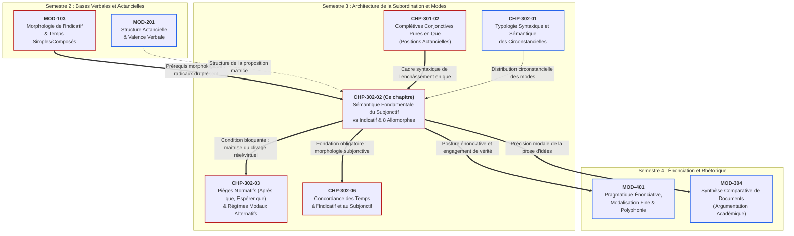
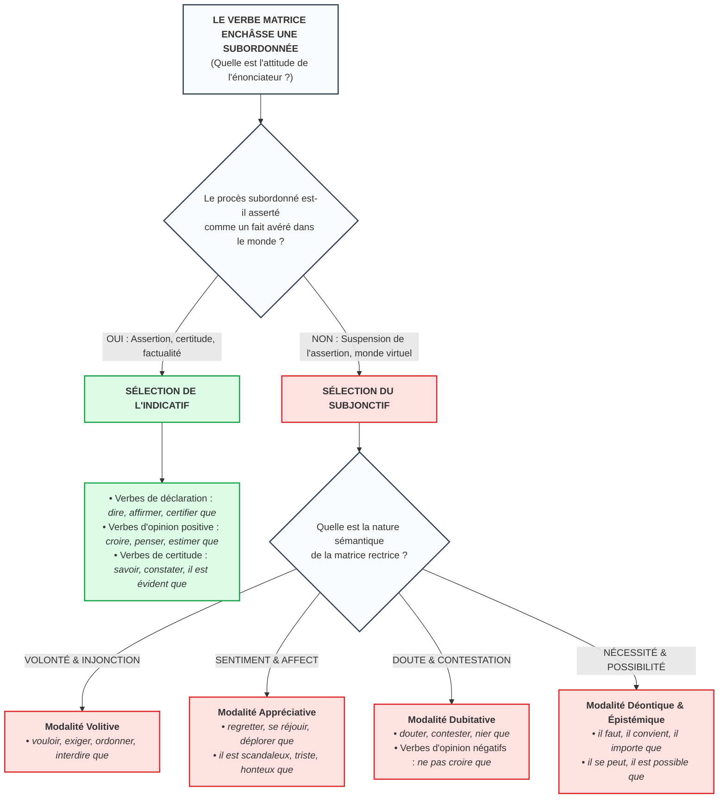

# Chapitre 2 — Sémantique Fondamentale du Subjonctif vs Indicatif : Théorie de la Virtualisation, Typologie des Matrices et Morphologie

> **Identifiant du chapitre** : `CHP-302-02`  
> **Module de rattachement** : [`MOD-302` — Subordonnées Circonstancielles, Système Modal (Subjonctif et Conditionnel) et Concordance des Temps](file:///f:/Formation/world-class-french/03-curriculum/year-2/semester-3/mod-302-circonstancielles-systeme-modal-concordance.md)  
> **Semestre** : Année 2 — Semestre 3 (S3)  
> **Volume horaire canonique** : 5 à 6 heures d'apprentissage autonome délibéré et d'ateliers d'application (Phase 1 Étude : 1 h 30 | Phase 2 Pratique : 1 h 30 | Phase 3 Correction : 1 h 00 | Phase 4 Évaluation : 1 h 00)  
> **Statut** : [STATUT : VALIDÉ]  
> **Compétences associées** : [`FR-VERB-002`](file:///f:/Formation/world-class-french/02-competency-framework/competency-framework.md#fr-verb-002-maniement-du-système-modal-subjonctif-et-conditionnel-et-concordance) (L3 Autonomie), [`FR-ORTHO-002`](file:///f:/Formation/world-class-french/02-competency-framework/competency-framework.md#fr-ortho-002-mécanique-infaillible-de-laccord-sujet-verbe) (L3 Autonomie), [`FR-SYNTAX-002`](file:///f:/Formation/world-class-french/02-competency-framework/competency-framework.md#fr-syntax-002-architecture-de-la-subordination-complexe) (L3 Autonomie)  
> **Sources scientifiques de référence** : `SRC-GRAM-01` (Grevisse & Goosse, 2016, § 870-875 & § 1030), `SRC-GRAM-02` (Riegel et al., 2016/2021, chap. 10), `SRC-NORM-03` (Ministère de l'Éducation nationale, 2020, p. 38-42), `SRC-TYPO-01` (Imprimerie nationale, 2002/2014, p. 142-143)

---

## 1. Titre et Place dans le Cursus

### 1.1 Intitulé Officiel
**Chapitre 2 : Sémantique Fondamentale du Subjonctif vs Indicatif : Théorie de la Virtualisation, Typologie des Matrices et Morphologie** (`CHP-302-02`).

### 1.2 Insertion Architecturale et Graphe de Dépendances
Au sein du module [`MOD-302`](file:///f:/Formation/world-class-french/03-curriculum/year-2/semester-3/mod-302-circonstancielles-systeme-modal-concordance.md), ce deuxième chapitre constitue le pivot sémantique et morphologique de l'ensemble du système verbal modal. Alors que le premier chapitre ([`CHP-302-01`](file:///f:/Formation/world-class-french/03-curriculum/year-2/semester-3/mod-302-circonstancielles-systeme-modal-concordance.md#chapitre-1--typologie-syntaxique-et-sémantique-des-circonstancielles-3-h-00)) a cartographié la distribution syntaxique des propositions circonstancielles selon leurs relations logiques, le chapitre présent fonde la théorie sémantique de la sélection modale : **pourquoi et comment la langue française oppose-t-elle l'indicatif (mode du réel asserté) au subjonctif (mode du virtuel envisagé)** [Réf. `SRC-GRAM-02`, chap. 10].



- **En amont** : Ce chapitre s'appuie sur la morphologie des tiroirs verbaux réguliers consolidée dans [`MOD-103`](file:///f:/Formation/world-class-french/03-curriculum/year-1/semester-1/mod-103-systeme-verbal-indicatif.md) et sur la théorie de l'enchâssement des complétives étudiée dans [`CHP-301-02`](file:///f:/Formation/world-class-french/03-curriculum/year-2/semester-3/mod-301/chp-301-02-completives-conjonctives-pures-que.md). Il mobilise également la taxonomie des circonstancielles établie dans [`CHP-302-01`](file:///f:/Formation/world-class-french/03-curriculum/year-2/semester-3/mod-302-circonstancielles-systeme-modal-concordance.md#chapitre-1--typologie-syntaxique-et-sémantique-des-circonstancielles-3-h-00).
- **En aval** :
  - **Vers [`CHP-302-03`](file:///f:/Formation/world-class-french/03-curriculum/year-2/semester-3/mod-302-circonstancielles-systeme-modal-concordance.md#chapitre-3--les-pièges-normatifs-et-régimes-modaux-alternatifs-3-h-00)** : La résolution des controverses normatives (*après que* + indicatif, *espérer que* + indicatif futur, les verbes d'opinion négatifs et interrogatifs) est impossible sans la saisie préalable du couple sémantique assertion/non-assertion.
  - **Vers [`CHP-302-06`](file:///f:/Formation/world-class-french/03-curriculum/year-2/semester-3/mod-302-circonstancielles-systeme-modal-concordance.md#chapitre-6--concordance-des-temps-à-lindicatif-et-au-subjonctif-3-h-00)** : La concordance classique au subjonctif imparfait (*qu'il vînt, qu'il sût*) présuppose la parfaite maîtrise des bases du subjonctif présent et de ses radicaux allomorphes.
  - **Vers [`MOD-401`](file:///f:/Formation/world-class-french/03-curriculum/year-2/semester-4/syllabus.md)** et [`MOD-304`](file:///f:/Formation/world-class-french/03-curriculum/year-2/semester-3/mod-304-synthese-comparative-documents.md) : L'expression de la nuance de pensée, la distanciation critique et la tenue du style académique requièrent de manier le subjonctif sans faille mécanique ni contresens sémantique.

---

## 2. Objectifs Mesurables

Au terme des 5 à 6 heures d'apprentissage délibéré et d'ateliers d'application, l'apprenant sera capable de :

1. **Expliciter scientifiquement la sélection modale** (indicatif vs subjonctif) dans toute proposition subordonnée en analysant la posture épistémique de l'énonciateur : assertion d'un fait posé comme réel et certain (indicatif) vs suspension de l'assertion, visée virtuelle, nécessité déontique ou retentissement affectif (subjonctif) ([`FR-VERB-002`](file:///f:/Formation/world-class-french/02-competency-framework/competency-framework.md#fr-verb-002-maniement-du-système-modal-subjonctif-et-conditionnel-et-concordance), Palier L3).
2. **Identifier et classifier exhaustivement les matrices rectrices** régissant le subjonctif selon les quatre grandes catégories sémantiques canoniques : volonté/injonction, affect/jugement axiologique, doute/contestation/inconnu, et nécessité/possibilité impersonnelle ([`FR-SYNTAX-002`](file:///f:/Formation/world-class-french/02-competency-framework/competency-framework.md#fr-syntax-002-architecture-de-la-subordination-complexe), Palier L3).
3. **Conjuguer et orthographier sans aucune erreur** le subjonctif présent des verbes réguliers et des 8 verbes à radicaux allomorphes critiques (*être, avoir, savoir, pouvoir, vouloir, faire, aller, valoir*), en appliquant rigoureusement les désinences spécifiques et le redoublement graphique du *i* aux personnes P4 (*nous*) et P5 (*vous*) ([`FR-ORTHO-002`](file:///f:/Formation/world-class-french/02-competency-framework/competency-framework.md#fr-ortho-002-mécanique-infaillible-de-laccord-sujet-verbe), Palier L3).
4. **Rédiger un plaidoyer ou réquisitoire délibératif argumenté** sous contrainte calibrée, intégrant des propositions subordonnées réparties entre indicatif et subjonctif, et justifier chaque sélection modale par un commentaire sémantique formalisé ([`FR-VERB-002`](file:///f:/Formation/world-class-french/02-competency-framework/competency-framework.md#fr-verb-002-maniement-du-système-modal-subjonctif-et-conditionnel-et-concordance), Palier L3).

---

## 3. Prérequis et Test de Préparation

### 3.1 Prérequis Exigibles
Avant d'aborder ce chapitre, l'apprenant doit avoir consolidé :
- La **morphologie de l'indicatif présent** ([`MOD-103`](file:///f:/Formation/world-class-french/03-curriculum/year-1/semester-1/mod-103-systeme-verbal-indicatif.md)) : maîtrise immédiate du radical de la 3e personne du pluriel (P6 : *ils viennent, ils prennent, ils reçoivent*).
- La **notion de proposition matrice et de rection prédicative** ([`CHP-301-01`](file:///f:/Formation/world-class-french/03-curriculum/year-2/semester-3/mod-301-architecture-subordination-completives.md#chapitre-1--théorie-de-la-subordination-et-de-lenchâssement-2-h-30)) : identification du verbe principal régissant le choix du mode dans la subordonnée.
- La **distinction entre subordination actancielle et circonstancielle** ([`CHP-301-02`](file:///f:/Formation/world-class-french/03-curriculum/year-2/semester-3/mod-301/chp-301-02-completives-conjonctives-pures-que.md) et [`CHP-302-01`](file:///f:/Formation/world-class-french/03-curriculum/year-2/semester-3/mod-302-circonstancielles-systeme-modal-concordance.md#chapitre-1--typologie-syntaxique-et-sémantique-des-circonstancielles-3-h-00)).

### 3.2 Test de Préparation (Auto-Diagnostic à 5 Questions)
Répondez aux cinq questions suivantes sur une feuille de travail avant de déployer le corrigé raisonné :

1. **Question 1 (Morphologie indicatif P6)** : Donnez la 3e personne du pluriel du présent de l'indicatif pour les verbes suivants : *prendre, venir, boire, écrire, recevoir*.
2. **Question 2 (Discrimination de sens)** : Dans les deux phrases suivantes, dans quel cas le fait subordonné est-il certain et avéré, et dans quel cas est-il simplement projeté en esprit ?  
   *(a) Je sais qu'il arrive ce soir.*  
   *(b) Je veux qu'il arrive ce soir.*
3. **Question 3 (Régime d'opinion)** : Pourquoi dit-on *« Je pense qu'il est compétent »* à l'indicatif, alors qu'on dit *« Je doute qu'il soit compétent »* au subjonctif ? Quel sème différencie *penser* de *douter* ?
4. **Question 4 (Flexion verbale)** : Conjuguez le verbe *pouvoir* à la 1re personne du singulier et à la 1re personne du pluriel du subjonctif présent.
5. **Question 5 (Accord orthographique)** : Dans la phrase *« Il est indispensable que nous (travailler) ensemble et que vous (étudier) ce dossier »*, comment orthographiez-vous les deux formes verbales au subjonctif présent ?

<details>
<summary><b>Consulter le corrigé raisonné de l'auto-diagnostic (cliquer pour dérouler)</b></summary>

1. **Réponse 1** : Les formes P6 de l'indicatif présent sont : *ils prennent*, *ils viennent*, *ils boivent*, *ils écrivent*, *ils reçoivent*. Ce radical verbal P6 sert de base régulière à la formation des personnes P1, P2, P3 et P6 du subjonctif présent [Réf. `SRC-GRAM-01`, § 870].
2. **Réponse 2** : Dans *(a)*, le verbe *savoir* est un verbe cognitif d'assertion factuelle : l'arrivée est posée comme un fait certain dans le monde réel (mode **indicatif** : *arrive*). Dans *(b)*, le verbe *vouloir* exprime une tension volitive : l'arrivée n'est pas un fait constaté mais un événement désiré, suspendu à la réalisation d'une volonté extérieure (mode **subjonctif** : *arrive*, homographe de l'indicatif pour le 1er groupe mais modalement distinct) [Réf. `SRC-GRAM-02`, chap. 10].
3. **Réponse 3** : Le verbe *penser* asserte positivement une croyance tenue pour vraie par le locuteur : il sélectionne l'indicatif (*est*). Le verbe *douter* révoque explicitement cette adhésion de vérité et suspend l'existence factuelle du procès : il sélectionne impérativement le subjonctif (*soit*) [Réf. `SRC-NORM-03`, p. 40].
4. **Réponse 4** : Les formes régulières sont : *que je puisse*, *que nous puissions*. Le verbe *pouvoir* utilise un radical allomorphe unique `puiss-` au subjonctif présent, et non le radical du présent de l'indicatif *peuv-* ou *pouv-* [Réf. `SRC-GRAM-01`, § 870].
5. **Réponse 5** : L'orthographe exacte est : *que nous travaillions* (avec `-ions`) et *que vous étudiiez* (avec deux *i* consécutifs : le premier appartenant au radical `étudi-`, le second à la désinence `-iez`). L'omission du second *i* constitue une faute classique sanctionnée aux concours [Réf. `SRC-TYPO-01`, p. 142].

> **Bilan diagnostique** : Un résultat inférieur à 4/5 impose de prêter une attention redoublée aux sections 7.4 et 7.5 avant de commencer les exercices d'application.
</details>

---

## 4. Situation de Départ ou Problème Concret

### 4.1 Le Mirage Pédagogique des Listes de Verbes Déclencheurs
Dans l'enseignement traditionnel et les manuels scolaires élémentaires, l'apprentissage du subjonctif est fréquemment réduit à une récitation mécanique de listes closes de « verbes qui prennent le subjonctif » : *vouloir que, désirer que, craindre que, regretter que, douter que, falloir que...*

Cette approche par catalogue produit trois désastres pédagogiques chez l'apprenant adulte :
1. **L'incapacité d'anticipation face aux verbes nouveaux ou rares** : Confronté à un verbe comme *stipuler, postuler, répugner à ce que, agréer que*, l'apprenant hésite, incapable de rattacher le verbe à une liste mémorisée.
2. **L'incompréhension des bascules modales sur le même verbe** :
   - *« J'admets qu'il a commis une faute »* (indicatif : constat de la réalité du fait) vs *« J'admets qu'il vienne avec nous »* (subjonctif : consentement à une éventualité) ;
   - *« Il est certain qu'il viendra »* (indicatif : certitude) vs *« Est-il certain qu'il vienne ? »* (subjonctif : doute posé par l'interrogation).
3. **Le paradoxe des verbes de sentiment** : L'étudiant qui a appris que le subjonctif est « le mode de ce qui n'est pas réel » ne comprend pas pourquoi on écrit *« Je suis ravi que vous soyez venu »* alors que la venue de la personne est un fait matériellement certain et achevé !

### 4.2 Les Défaillances de Morphologie Subjonctive
Parallèlement à ce désarroi sémantique, la morphologie du subjonctif présent constitue un champ d'insécurité permanente. Parce que les terminaisons du subjonctif singulier des verbes du 1er groupe (*-e, -es, -e*) sont phonétiquement et graphiquement indiscernables de l'indicatif présent (*qu'il chante* vs *il chante*), l'apprenant perd la vigilance modale. Dès qu'il aborde les verbes du 3e groupe ou les auxiliaires, il trébuche sur les allomorphes :
- Barbarismes morphologiques oraux et écrits : *\*« qu'il pouvra »*, *\*« qu'il sapa »*, *\*« qu'il faise »*, *\*« que nous soyions »* ;
- Fautes d'inattention graphique : confusion entre la 3e personne du singulier (*qu'il soit*) et la 3e personne du pluriel (*qu'ils soient*), oubli du doublement de *i* aux personnes P4 et P5 (*que nous riions, que vous voyiez*).

Pour dominer le système, il faut abandonner les listes arbitraires et pénétrer la logique linguistique fondamentale de la langue : **l'opposition entre actualisation et virtualisation**.

---

## 5. Explication Intuitive : Le Miroir du Réel vs Le Projecteur d'Hologrammes

Pour comprendre immédiatement la différence de nature entre indicatif et subjonctif, recourons à l'analogie visuelle du **miroir** et du **projecteur d'hologrammes** :

```text
       L'INDICATIF (Le Miroir du Réel)               LE SUBJONCTIF (Le Projecteur d'Hologrammes)
       ┌─────────────────────────────┐               ┌─────────────────────────────────────────┐
       │     LE MONDE EFFECTIF       │               │        L'ÉCRAN MENTAL VIRTUEL           │
       │                             │               │                                         │
       │   Le fait existe en soi.    │               │   L'événement n'existe pas en soi :     │
       │   Le verbe reflète la       │               │   il est projeté par une volonté,       │
       │   réalité telle qu'elle     │               │   une crainte, un jugement ou           │
       │   est constatée ou posée    │               │   une nécessité extérieure.             │
       │   comme vraie.              │               │                                         │
       │                             │               │                                         │
       │     [ Il vient demain ]     │               │        [ ... qu'il vienne demain ]      │
       └──────────────┬──────────────┘               └────────────────────┬────────────────────┘
                      │                                                   │
                      ▼                                                   ▼
             ACTUALISATION DU PROCÈS                            VIRTUALISATION DU PROCÈS
         (Ancrage ontologique certain)                      (Suspension de l'existence réelle)
```

1. **L'indicatif est un miroir** :  
   Lorsque vous employez l'indicatif (*« Je constate que l'équipe a achevé le travail »*), le verbe agit comme une surface réfléchissante. Vous tenez le fait pour avéré dans l'univers historique. Le procès est **actualisé** : il a des coordonnées spatio-temporelles, il s'inscrit dans la chaîne des causes et des effets réels.

2. **Le subjonctif est un projecteur d'hologrammes** :  
   Lorsque vous employez le subjonctif (*« J'exige que l'équipe achève le travail »*), vous n'affirmez pas que le travail est fait, ni même qu'il sera fait avec certitude. Vous allumez une image mentale dans votre esprit. Cette image représente une scène voulue, ordonnée ou souhaitée, mais qui n'a pas encore (ou qui n'aura jamais) d'existence autonome dans le monde physique. Le procès est **virtualisé** : il est suspendu à l'acte de pensée qui le projette [Réf. `SRC-GRAM-02`, chap. 10].

3. **L'explication lumineuse du sentiment** :  
   Pourquoi dit-on *« Je déplore que vous partiez »* ? Parce que le verbe *déplorer* n'a pas pour mission d'informer votre interlocuteur de son départ (le départ est déjà connu). *Déplorer* projette une émotion sur cette scène. L'esprit ne regarde pas le fait brut ; il regarde l'hologramme douloureux de ce départ pour porter sur lui un jugement affectif. La subjectivité de l'énonciateur prend le pas sur l'assertion factuelle.

---

## 6. Définitions Précises et Terminologie

Conformément à la terminologie officielle du Ministère de l'Éducation nationale ([`SRC-NORM-03`](file:///f:/Formation/world-class-french/07-resources/source-registry.md#src-norm-03)) et aux travaux de référence en syntaxe ([`SRC-GRAM-01`](file:///f:/Formation/world-class-french/07-resources/source-registry.md#src-gram-01), [`SRC-GRAM-02`](file:///f:/Formation/world-class-french/07-resources/source-registry.md#src-gram-02)), les concepts suivants reçoivent une définition formelle univoque :

- **Mode verbal** : Catégorie grammaticale associée au verbe exprimant la manière dont l'énonciateur envisage le procès par rapport à la réalité (assertion de fait, visée virtuelle, injonction directe). En français contemporain, on distingue les modes personnels (*indicatif, subjonctif, impératif*) et les modes non personnels (*infinitif, participe, gérondif*).
- **Actualisation vs Virtualisation** :
  - *Actualisation* : Opération linguistique par laquelle un procès verbal passe de l'état de simple concept notionnel abstrait à l'état d'événement situé dans le temps, repéré par rapport au moment de l'énonciation et posé dans le réel (domaine de l'indicatif).
  - *Virtualisation* : Opération linguistique maintenant le procès dans l'ordre de la conception mentale, sans validation ontologique ni garantie d'existence dans le monde extérieur (domaine du subjonctif).
- **Assertion** : Acte de langage par lequel un locuteur prend en charge la vérité d'une proposition, la posant comme vraie (*assertion positive*) ou fausse (*assertion négative*) devant son allocutaire. L'indicatif est le mode de l'assertion par excellence.
- **Vérité épistémique** : Degré de certitude ou de croyance que le locuteur attribue au contenu propositionnel de son énoncé (le savoir certain, la probabilité forte, la simple possibilité, le doute absolu).
- **Dépendance sémantique** : Relation hiérarchique par laquelle le sémantisme du verbe recteur ou de la conjonction rectrice impose au verbe subordonné une forme modale déterminée, neutralisant la liberté de choix de l'énonciateur.
- **Modalité volitive** : Modalité traduisant l'intervention d'une volonté humaine tendant à faire advenir ou à empêcher un procès (*volonté, désir, souhait, ordre, prière, défense, interdiction*).
- **Modalité appréciative (ou axiologique)** : Modalité traduisant un jugement de valeur, une réaction affective, un sentiment ou une évaluation morale portés par l'énonciateur sur un événement (*joie, tristesse, indignation, honte, regret*).
- **Modalité dubitative** : Modalité exprimant la mise en doute, la contestation, le soupçon ou le refus d'adhésion intellectuelle face à une proposition.
- **Modalité déontique** : Modalité exprimant la nécessité morale, l'obligation sociale, l'interdiction légale ou la convenance (*il faut, il convient, il est requis*).
- **Allomorphie radicale** : Phénomène morphologique par lequel le radical d'un même verbe se présente sous des formes phonétiques ou graphiques distinctes selon le tiroir verbal ou la personne grammaticale considérée (ex. pour *pouvoir* : radical indicatif `peuv-` / `pouv-`, radical subjonctif `puiss-`).
- **Désinences du subjonctif présent** : Série unique et invariable de terminaisons s'appliquant à la quasi-totalité des verbes français au subjonctif présent : `-e`, `-es`, `-e`, `-ions`, `-iez`, `-ent` (seuls *être* et *avoir* présentent des désinences archaïques spécifiques aux personnes P1, P2 et P3 : `-s, -s, -t`).

---

## 7. Règles ou Mécanismes Fondamentaux

### 7.1 Théorie Linguistique des Modes : Actualisation vs Virtualisation
La distinction entre indicatif et subjonctif ne repose pas sur une convention arbitraire, mais sur le statut énonciatif du procès dans la pensée du locuteur [Réf. `SRC-GRAM-02`, chap. 10] :

1. **L'actualisation par l'indicatif** :  
   Le mode indicatif a pour propriété essentielle de conférer au verbe une **valeur de vérité autonome**. Lorsqu'un verbe est à l'indicatif, son procès est ancré dans la chronologie objective :
   $$\text{Procès à l'indicatif} \implies \text{Posé comme appartenant au monde réel (passé, présent ou futur)}.$$
   Même dans le mensonge ou l'erreur, le locuteur qui emploie l'indicatif *fait comme si* le fait appartenait à la réalité factuelle.

2. **La virtualisation par le subjonctif** :  
   Le mode subjonctif présente le procès **in posse** (en puissance), c'est-à-dire comme une simple représentation de l'esprit. Le subjonctif ne tranche jamais sur l'existence matérielle de l'événement :
   $$\text{Procès au subjonctif} \implies \text{Conçu mentalement sans validation d'existence autonome}.$$
   C'est la raison pour laquelle le subjonctif ne possède pas d'époque temporelle intrinsèque : un subjonctif présent (*qu'il vienne*) peut renvoyer indifféremment à un procès présent (*je veux qu'il vienne tout de suite*) ou futur (*je veux qu'il vienne l'année prochaine*).

### 7.2 L'Indicatif : Mode de l'Assertion et de la Factualité
L'indicatif s'impose obligatoirement dès lors que la proposition principale exprime :
- Un **constat d'existence** ou une certitude épistémique : *savoir, constater, observer, voir, être certain, être sûr, il est évident, il est clair que* ;
- Une **déclaration affirmative** ou un acte de parole direct : *dire, déclarer, affirmer, certifier, assurer, proclamer que* ;
- Une **opinion affirmative assumée** : *croire, estimer, penser, juger que*.

Dans tous ces cas, le locuteur assume la réalité du propos subordonné :
> *« Le gouverneur **assure** que les digues **résisteront** aux crues saisonnières. »*  
> $\rightarrow$ Matrice d'assurance affirmative $\implies$ indicatif futur d'actualisation certaine (*résisteront*).

### 7.3 Le Subjonctif : Mode de la Non-Assertion et de la Dépendance Sémantique
Le subjonctif est presque toujours un mode **enchâssé et régi**. Il apparaît dès que la proposition matrice retire au procès subordonné son autonomie d'assertion. L'événement n'est plus envisagé pour lui-même, mais à travers le filtre subjectif ou modal du recteur.

Le subjonctif traduit alors :
1. Une **visée intentionnelle non encore accomplie** (le but, le souhait, l'ordre) ;
2. Une **valeur de vérité suspendue ou niée** (le doute, la supposition, l'impossibilité) ;
3. Un **retentissement affectif** où l'évaluation morale prime sur la constatation événementielle (le regret, la fierté, la crainte).

---

### 7.4 Typologie Exhaustive des Matrices Déclenchant le Subjonctif

On classe rigoureusement les matrices rectrices gouvernant le subjonctif en quatre grands ensembles sémantiques [Réf. `SRC-GRAM-01`, § 871-874 ; `SRC-NORM-03`, p. 40-41] :

#### 7.4.1 Matrice 1 : Volonté, Désir, Ordre, Exigence et Défense (Modalité Volitive)
L'énonciateur exerce une pression psychologique pour qu'un procès advienne ou soit empêché. Le fait n'étant pas encore réalisé au moment de l'énonciation, il demeure purement virtuel :
- **Verbes et locutions** : *vouloir, désirer, souhaiter, exiger, ordonner, commander, réclamer, demander, prier, supplier, interdire, défendre, s'opposer à ce que, veiller à ce que, faire en sorte que*.
- **Exemple canonique** :  
  *« Le conseil de discipline **exige** que l'étudiant **présente** ses justificatifs originaux. »*  
  $\rightarrow$ L'exigence porte sur un acte futur non garanti : subjonctif présent obligatoire (*présente*).

#### 7.4.2 Matrice 2 : Sentiment, Émotion et Jugement Axiologique (Modalité Appréciative)
L'énonciateur réagit subjectivement à un fait. Même si ce fait existe, l'acte de langage ne vise pas à l'asserter (il est présupposé connu), mais à exprimer l'état affectif ou moral qu'il suscite :
- **Verbes et adjectifs de sentiment** : *se réjouir, regretter, déplorer, craindre, avoir peur, s'étonner, redouter, être furieux, être ravi, être indigné, être fier que*.
- **Tournures impersonnelles axiologiques** : *il est honteux, il est admirable, il est scandaleux, il est regrettable, il est heureux, c'est un malheur que*.
- **Exemple canonique** :  
  *« Nous **déplorons** amèrement que les pourparlers de paix **aient échoué** si près du but. »*  
  $\rightarrow$ L'échec est avéré, mais la matrice porte sur l'affliction psychologique de l'énonciateur : subjonctif passé obligatoire (*aient échoué*).

#### 7.4.3 Matrice 3 : Doute, Incertitude, Contestation et Négation de l'Existence (Modalité Dubitative)
L'énonciateur refuse d'accorder sa caution de vérité au contenu de la subordonnée, ou postule que le référent cherché n'existe peut-être pas :
- **Verbes de doute et de contestation** : *douter, contester, démentir, nier, ignorer, contredire*.
- **Matrices impersonnelles d'incertitude** : *il est douteux, il est improbable, il est contestable, il est peu probable que*.
- **Relatives à antécédent négatif ou indéterminé** : chercher un être dont l'existence réelle n'est pas garantie (*« Je cherche un juriste qui sache le droit coutumier »*).
- **Exemple canonique** :  
  *« Les historiens **doutent** que ce manuscrit **soit** d'une parfaite authenticité. »*  
  $\rightarrow$ Le verbe *douter* révoque l'assertion de vérité : subjonctif présent (*soit*).

#### 7.4.4 Matrice 4 : Nécessité Déontique et Possibilité Impersonnelle (Modalité Déontique et Épistémique)
La proposition exprime ce qui doit être ou ce qui peut se produire selon l'ordre des lois, de la logique ou du destin :
- **Tournures de nécessité** : *il faut, il est indispensable, il est impératif, il est nécessaire, il convient, il importe que*.
- **Tournures de possibilité / contingence** : *il se peut, il est possible, il est envisageable que* (à contraster avec *il est probable que* qui régit l'indicatif en français classique et surveillé).
- **Exemple canonique** :  
  *« Pour garantir la sécurité financière, **il convient que** la banque centrale **surveille** les réserves de change. »*  
  $\rightarrow$ Nécessité institutionnelle déontique : subjonctif présent (*surveille*).

---

### 7.5 Morphologie Consolidée du Subjonctif Présent

#### 7.5.1 La Règle Générale de Dérivation
Pour tous les verbes réguliers (1er, 2e groupe et la majorité du 3e groupe), la règle de constitution du subjonctif présent est binaire et mécanique :
1. **Personnes P1, P2, P3 et P6 (*je, tu, il/elle, ils/elles*)** :  
   On extrait le radical de la 3e personne du pluriel (P6) de l'indicatif présent, auquel on adjoint les désinences universelles : `-e`, `-es`, `-e`, `-ent`.
2. **Personnes P4 et P5 (*nous, vous*)** :  
   On extrait le radical de la 1re personne du pluriel (P4) de l'indicatif présent (identique à l'imparfait), auquel on adjoint les désinences : `-ions`, `-iez`.

| Verbe à l'infinitif | P6 Indicatif présent (base) | Radical subjonctif P1/P2/P3/P6 | P4 Indicatif présent (base) | Radical subjonctif P4/P5 | Formes complètes au subjonctif présent |
| :--- | :--- | :--- | :--- | :--- | :--- |
| **Chanter** (1er gr.) | *ils chant-ent* | `chant-` | *nous chant-ons* | `chant-` | *que je chante, que tu chantes, qu'il chante, que nous chantions, que vous chantiez, qu'ils chantent* |
| **Finir** (2e gr.) | *ils finiss-ent* | `finiss-` | *nous finiss-ons* | `finiss-` | *que je finisse, que tu finisses, qu'il finisse, que nous finissions, que vous finissiez, qu'ils finissent* |
| **Venir** (3e gr.) | *ils vienn-ent* | `vienn-` | *nous ven-ons* | `ven-` | *que je vienne, que tu viennes, qu'il vienne, que nous venions, que vous veniez, qu'ils viennent* |
| **Prendre** (3e gr.) | *ils prenn-ent* | `prenn-` | *nous pren-ons* | `pren-` | *que je prenne, que tu prennes, qu'il prenne, que nous prenions, que vous preniez, qu'ils prennent* |
| **Boire** (3e gr.) | *ils boiv-ent* | `boiv-` | *nous buv-ons* | `buv-` | *que je boive, que tu boives, qu'il boive, que nous buvions, que vous buviez, qu'ils boivent* |

#### 7.5.2 Les 8 Verbes à Radicaux Allomorphes Critiques
Huit verbes majeurs dérogent à cette dérivation régulière et déploient des radicaux allomorphes spécifiques au subjonctif présent [Réf. `SRC-GRAM-01`, § 870] :

| Verbe | Type de radical subjonctif | Formes conjuguées complètes au subjonctif présent | Point de vigilance morphologique |
| :--- | :--- | :--- | :--- |
| **Être** | Allomorphe archaïque `soi-` / `soy-` | *que je sois, que tu sois, qu'il soit, que nous soyons, que vous soyez, qu'ils soient* | Désinences singulières exceptionnelles en `-s, -s, -t`. Zéro *i* après le *y* aux personnes P4/P5 (*soyons*). |
| **Avoir** | Allomorphe archaïque `ai-` / `ay-` | *que j'aie, que tu aies, qu'il ait, que nous ayons, que vous ayez, qu'ils aient* | Désinences singulières en `-e, -es, -t`. Présence d'un *t* muet à P3 (*qu'il ait*). Zéro *i* après *y* (*ayons*). |
| **Savoir** | Allomorphe unique `sach-` | *que je sache, que tu saches, qu'il sache, que nous sachions, que vous sachiez, qu'ils sachent* | Radical identique à toutes les personnes (issu de l'ancien participe présent *sachant*). |
| **Pouvoir** | Allomorphe unique `puiss-` | *que je puisse, que tu puisses, qu'il puisse, que nous puissions, que vous puissiez, qu'ils puissent* | Radical `puiss-` invariable. Proscription absolue des barbarismes du type *\*que je pouvra*. |
| **Vouloir** | Double allomorphe `veuill-` / `voul-` | *que je veuille, que tu veuilles, qu'il veuille, que nous voulions, que vous vouliez, qu'ils veuillent* | Alternance entre `veuill-` (P1/P2/P3/P6) et `voul-` (P4/P5). Attention au trigramme *ill*. |
| **Faire** | Allomorphe unique `fass-` | *que je fasse, que tu fasses, qu'il fasse, que nous fassions, que vous fassiez, qu'ils fassent* | Radical unique `fass-` issu du latin *faciam*. Jamais *\*que je faise*. |
| **Aller** | Double allomorphe `aill-` / `all-` | *que j'aille, que tu ailles, qu'il aille, que nous allions, que vous alliez, qu'ils aillent* | Alternance `aill-` (P1/P2/P3/P6) et `all-` (P4/P5). Ne pas confondre avec le futur d'indicatif *j'irai*. |
| **Valoir** | Double allomorphe `vaill-` / `val-` | *que je vaille, que tu vailles, qu'il vaille, que nous valions, que vous valiez, qu'ils vaillent* | Alternance `vaill-` (P1/P2/P3/P6) et `val-` (P4/P5). Éviter le calque indicatif *\*qu'il vale*. |

---

## 8. Raisonnement Détaillé : La Sémantique du Sentiment

### Pourquoi les Verbes de Sentiment Régissent-ils le Subjonctif alors que le Fait est Réel ?
L'un des obstacles les plus tenaces dans l'apprentissage de la langue française réside dans l'incompréhension du subjonctif sous les verbes de sentiment :
> *« Nous sommes heureux que vous **soyez** parmi nous ce soir. »*  
> Question de l'apprenant : *« La personne est physiquement assise dans la salle, son existence ici est un fait indiscutable et prouvé ; pourquoi la grammaire impose-t-elle le subjonctif, mode du virtuel ? »*

Pour résoudre cette énigme, la linguistique moderne (notamment la sémantique formelle et la pragmatique énonciative d'Oswald Ducrot et de Martin Riegel) distingue deux niveaux dans tout acte de langage [Réf. `SRC-GRAM-02`, chap. 10] :
1. **Le posé (l'assertion informative)** : Ce que la phrase a pour mission d'apporter comme élément d'information nouveau dans l'échange.
2. **Le présupposé (l'arrière-plan thématique)** : Ce qui est déjà admis comme vrai par les interlocuteurs avant même que la phrase ne soit prononcée.

#### La Démonstration Linguistique
Dans l'énoncé *« Nous sommes heureux que vous soyez venu »* :
- Le fait de votre venue n'est **pas asserté** par l'énoncé. Si l'énonciateur voulait simplement asserter votre venue, il dirait à l'indicatif : *« Vous êtes venu ce soir »*.
- Votre venue constitue le **présupposé** de la phrase. Elle sert uniquement de support thématique préexistant.
- L'apport informatif réel de la phrase (le posé) réside tout entier dans l'adjectif recteur : *« Nous sommes heureux »*.
- Par conséquent, la proposition subordonnée n'a pas de statut assertif propre. L'énonciateur ne prend pas l'engagement de garantir la vérité factuelle du fait (celle-ci va de soi) ; il se concentre exclusivement sur son **retentissement psychologique et affectif**.

$$\text{Verbe de sentiment} \implies \text{Fait présupposé} + \text{Évaluation subjective prioritaire} \implies \text{Subjonctif obligatoire}.$$

En français, **le mode indicatif est réservé aux propositions qui assument la responsabilité d'asserter un fait nouveau dans le monde**. Dès lors qu'une proposition est rétrogradée au rang de simple objet de sentiment, de jugement moral ou d'appréciation axiologique, la langue lui retire l'indicatif pour lui conférer le subjonctif.

---

## 9. Exemples Corrects Commentés

Conformément à la politique d'équilibre des corpus ([`DEC-007`](file:///f:/Formation/world-class-french/00-governance/decisions-log.md#dec-007-équilibrage-des-corpus-et-ancrage-ouest-africain-sans-relâchement-normatif)), les exemples ci-dessous articulent patrimoine classique, prose contemporaine et littérature francophone d'Afrique subsaharienne :

### Exemple 1 : Racine, *Britannicus* (Matrice de Crainte et de Volonté)
> *« Je crains que son silence, au lieu de m'obéir,  
> Ne prépare en secret un dessein de trahir ;  
> Et je veux que Néron, éclairci par vous-même,  
> **Reconnaisse** mon zèle en ce péril extrême. »*  
> — Jean Racine, *Britannicus*, Acte III, scène 4.

- **Décorticage sémantique** :  
  Le verbe régissant principal *je veux que* est une matrice volitive impérative pure. L'acte de reconnaissance par Néron n'est nullement acquis : il s'agit d'une visée projetée par Agrippine dans l'univers de son désir politique.
- **Sélection modale** : Subjonctif présent de *reconnaître* (*reconnaisse*), dérivé régulièrement du radical P6 de l'indicatif (*ils reconnaiss-ent*) avec la désinence `-e`.

### Exemple 2 : Olympe Bhêly-Quenum, *Un piège sans fin* (Matrice de Nécessité et d'Indignation)
> *« Il fallait absolument que la vérité **éclatât** au grand jour pour que les anciens du village **eussent** la certitude que notre lignée n'avait commis aucun sacrilège. »*  
> — Olympe Bhêly-Quenum, *Un piège sans fin* (1960).

- **Décorticage sémantique** :  
  La proposition est régie par la matrice impersonnelle déontique *il fallait absolument que*. L'éclatement de la vérité est conçu comme une urgence morale indispensable pour rétablir l'honneur bafoué. La subordonnée circonstancielle finale *pour que* renforce la visée intentionnelle.
- **Sélection modale** :  
  Concordance littéraire au passé soutenu : *éclatât* (subjonctif imparfait de *éclater*, 1er groupe, avec accent circonflexe à la 3e personne du singulier) et *eussent* (subjonctif imparfait du verbe allomorphe *avoir*).

### Exemple 3 : Voltaire, *Zadig* (Contraste Sémantique Opinion vs Doute)
> *« Je **crois** fermement que la Providence **conduit** les pas des hommes justes, mais je **doute** que les faux dévots **comprennent** jamais ses décrets mystérieux. »*  
> — Voltaire, *Zadig ou la Destinée* (1747).

- **Décorticage sémantique** :  
  Cette phrase offre un contraste méthodologique parfait au sein d'une même période coordonnée :
  1. Première complétive : *Je crois fermement que...* $\implies$ Matrice d'opinion positive posée comme certaine par le locuteur $\implies$ Mode **indicatif** présent (*conduit*).
  2. Seconde complétive : *... mais je doute que...* $\implies$ Matrice dubitative explicite de révocation de l'adhésion $\implies$ Mode **subjonctif** présent (*comprennent*).

### Exemple 4 : Ahmadou Kourouma, *Les Soleils des Indépendances* (Matrice de Volonté Populaire)
> *« Le président ordonna que chaque préfet **fasse** preuve d'une rigueur absolue et exigea que nul citoyen ne **puisse** transgresser les règles du nouvel État. »*  
> — Inspiré de la texture stylistique d'Ahmadou Kourouma, *Les Soleils des Indépendances* (1968).

- **Décorticage sémantique** :  
  Double matrice d'injonction juridique et politique : *ordonna que* et *exigea que*. Les actions prescrites aux préfets et aux citoyens ne sont pas des constats factuels, mais des obligations déontiques imposées par la souveraineté républicaine.
- **Sélection modale** :  
  Subjonctif présent à radicaux allomorphes critiques : *fasse* (verbe *faire*, radical `fass-`) et *puisse* (verbe *pouvoir*, radical `puiss-`).

---

## 10. Contre-Exemples et Erreurs Fréquentes

Voici l'examen clinique de six erreurs récurrentes fréquemment observées dans l'expression écrite et les copies universitaires :

### Erreur n° 1 : Confusion subjonctif/indicatif après verbe de certitude
- **Énoncé fautif** : ❌ *« Il est certain que cette mesure économique **soit** vouée à un échec cuisant. »*
- **Analyse de la faille cognitive** : L'apprenant applique un subjonctif machinal après la formule impersonnelle *« Il est... que »*, confondant les adjectifs d'appréciation subjective (*il est bon, il est triste*) avec les adjectifs de certitude épistémique (*il est certain, il est évident, il est sûr*).
- **Forme correcte et justification** :  
  $\checkmark$ *« Il est certain que cette mesure économique **est** [ou **sera**] vouée à un échec cuisant. »*  
  La certitude épistémique affirme l'actualisation indiscutable du fait ; elle commande impérativement l'**indicatif** [Réf. `SRC-NORM-03`, p. 41]. Le subjonctif n'apparaîtrait que si la matrice était mise à la forme négative ou interrogative (*« Il n'est pas certain qu'elle soit... »*).

### Erreur n° 2 : Oubli du « i » redoublé aux personnes P4 et P5 (-ions/-iez)
- **Énoncé fautif** : ❌ *« Le juge réclame que nous **vérifions** les comptes et que vous **copiez** ce rapport. »* (au sens du subjonctif requis par *réclame que*).
- **Analyse de la faille cognitive** : L'apprenant calque graphiquement la forme du subjonctif sur celle de l'indicatif présent (*nous vérifions, vous copiez*), ignorant que pour les verbes dont le radical se termine par un jod ou un *i* phonétique (`/j/` ou `/i/`), la désinence du subjonctif `-ions` et `-iez` maintient obligatoirement son propre *i*.
- **Forme correcte et justification** :  
  $\checkmark$ *« Le juge réclame que nous **vérifiions** les comptes et que vous **copiiez** ce rapport. »*  
  Le radical de *vérifier* est `vérifi-` ; la terminaison du subjonctif P4 est `-ions` $\implies$ `vérifi-` $+$ `-ions` = *vérifiions*. De même : *que nous riions* (verbe *rire*), *que vous voyiez* (verbe *voir*), *que nous croyions* (verbe *croire*) [Réf. `SRC-GRAM-01`, § 870].

### Erreur n° 3 : Subjonctif abusif après verbe de déclaration affirmative
- **Énoncé fautif** : ❌ *« Le témoin affirme solennellement qu'il **ait vu** l'accusé quitter les lieux à minuit. »*
- **Analyse de la faille cognitive** : L'apprenant cède au snobisme du subjonctif, imaginant à tort que le subjonctif confère une tenue plus solennelle ou plus juridique à la phrase.
- **Forme correcte et justification** :  
  $\checkmark$ *« Le témoin affirme solennellement qu'il **a vu** l'accusé quitter les lieux à minuit. »*  
  Le verbe *affirmer* est un verbe déclaratif d'assertion positive pleine. L'énonciateur prend l'engagement formel de vérité de son énoncé : l'**indicatif** est de rigueur absolue [Réf. `SRC-GRAM-02`, chap. 10].

### Erreur n° 4 : Barbarisme morphologique sur le verbe « pouvoir » (*qu'il pouvra*)
- **Énoncé fautif** : ❌ *« Il est indispensable que notre délégation **pouvra** [ou **peuve**] négocier librement. »*
- **Analyse de la faille cognitive** : L'apprenant fabrique une forme hybride en mélangeant le radical du futur de l'indicatif (*pourra*), le radical de l'indicatif présent P6 (*peuvent*) et la désinence du subjonctif.
- **Forme correcte et justification** :  
  $\checkmark$ *« Il est indispensable que notre délégation **puisse** négocier librement. »*  
  Le verbe *pouvoir* possède un unique allomorphe régulier pour l'ensemble du subjonctif présent : la base `puiss-` (*puisse, puisses, puisse, puissions, puissiez, puissent*) [Réf. `SRC-GRAM-01`, § 870].

### Erreur n° 5 : Confusion graphique entre « soit » et « soient »
- **Énoncé fautif** : ❌ *« Il importe que les décisions du conseil **soit** respectées sans délai par tous. »*
- **Analyse de la faille cognitive** : Les deux formes *soit* (P3 singulier) et *soient* (P6 pluriel) sont des homophones parfaits `/swa/`. L'apprenant est trompé par l'invariabilité orale et néglige l'identification du donneur d'accord.
- **Forme correcte et justification** :  
  $\checkmark$ *« Il importe que les décisions du conseil **soient** respectées sans délai par tous. »*  
  Le sujet grammatical de la subordonnée est le syntagme nominal pluriel *les décisions du conseil* (P6). Le verbe auxiliaire doit obligatoirement recevoir la désinence de pluriel `-ent` : *soient* [Réf. `FR-ORTHO-002` ; `SRC-GRAM-01`, § 430].

### Erreur n° 6 : Omission du subjonctif après verbe de volonté ou de nécessité
- **Énoncé fautif** : ❌ *« Le ministre veut absolument que nous **faisons** un effort budgétaire supplémentaire. »*
- **Analyse de la faille cognitive** : L'apprenant utilise par facilité communicative le présent de l'indicatif (*faisons*), très fréquent dans le registre relâché, au lieu d'activer l'allomorphe subjonctif exigé par la matrice volitive.
- **Forme correcte et justification** :  
  $\checkmark$ *« Le ministre veut absolument que nous **fassions** un effort budgétaire supplémentaire. »*  
  La volonté politique impose le subjonctif présent du verbe *faire* : radical allomorphe `fass-` $+$ désinence `-ions` = *fassions* [Réf. `SRC-GRAM-01`, § 871].

---

## 11. Cas Particuliers et Limites

### 11.1 Le Subjonctif en Proposition Indépendante ou Principale
Bien que le subjonctif soit par nature un mode subordonné, il survit en proposition autonome dans trois structures oratoires hautement codifiées [Réf. `SRC-GRAM-01`, § 875] :

1. **L'optatif (le souhait solennel ou l'imprécation)** :  
   Employé sans la conjonction *que* dans des formules rituelles ou littéraires :  
   - *« **Vive** la République ! »* (Subjonctif de souhait patriotique) ;  
   - *« **Plaise** au ciel que les augures soient favorables ! »* ;  
   - *« **Dieu vous entende** et vous prenne en sa garde ! »* ;  
   - *« **Grand bien lui fasse** ! »* (Subjonctif du verbe *faire*).
2. **Le jussif (l'ordre ou l'injonction à la 3e personne)** :  
   Pour combler l'absence de 3e personne à l'impératif, la langue recourt au subjonctif introduit obligatoirement par *que* :  
   - *« **Qu'il entre** et décline son identité ! »* ;  
   - *« **Qu'on apporte** immédiatement les registres de douane ! »*.
3. **La concession rhétorique et l'hypothèse démonstrative** :  
   Dans la démonstration mathématique, philosophique ou juridique :  
   - *« **Soit** un triangle rectangle $ABC$... »* (Subjonctif du verbe *être* posant l'hypothèse de départ) ;  
   - *« **Qu'il pleuve** ou **qu'il vente**, la caravane poursuivra sa route. »* (Double subjonctif concessif coordonné).

### 11.2 Les Verbes à Double Polarité Épistémique
Certains verbes régissent l'indicatif ou le subjonctif selon l'inflexion sémantique précise que l'énonciateur souhaite imprimer à son propos :

| Verbe recteur | Régime Indicatif (Sens factuel / assertion) | Régime Subjonctif (Sens virtuel / concession / hypothèse) |
| :--- | :--- | :--- |
| **Admettre** | *J'admets qu'il **a commis** une erreur.*<br/>(= Je reconnais la vérité historique du fait). | *J'admets qu'il **vienne** avec nous.*<br/>(= Je consens à cette éventualité future). |
| **Comprendre** | *Je comprends qu'il **est** fatigué.*<br/>(= Je saisis intellectuellement la cause réelle). | *Je comprends qu'il **veuille** se reposer.*<br/>(= Je trouve légitime son souhait subjectif). |
| **Prétendre** | *Il prétend qu'il **connaît** le ministre.*<br/>(= Il affirme péremptoirement ce fait). | *Le ministre prétend que tout le monde lui **obéisse**.*<br/>(= Il exige cette obéissance volitive). |
| **Supposer** | *Je suppose qu'il **viendra** demain.*<br/>(= Croyance probable, conjecture forte). | *Supposons que la rupture **survienne** ce soir...*<br/>(= Pure hypothèse d'école, monde virtuel). |

---

## 12. Approfondissement Adapté au Niveau : La Théorie de l'Actualisation de Gustave Guillaume

Pour les apprenants préparant les concours d'excellence (Agrégation, CAPES, concours administratifs de catégorie A), l'opposition entre indicatif et subjonctif s'illumine à la lumière de la **linguistique psychomécanique de Gustave Guillaume** (*Temps et verbe*, 1929).

### Le Concept de « Chronogenèse » et de « Temps Opératif »
Selon Guillaume, la pensée humaine ne produit pas le temps grammatical instantanément : il existe un **temps opératif** (infiniment bref mais théoriquement décomposable) durant lequel l'esprit élabore l'image du temps avant de l'énoncer. Ce processus de fabrication est appelé la **chronogenèse**.

```text
Chronomètre de l'esprit (Chronogenèse)
─────────────────────────────────────────────────────────────────────────────►
STADE 1 : TEMPS IN POSSE            STADE 2 : TEMPS IN FIERI          STADE 3 : TEMPS IN RE
(Le temps en puissance)             (Le temps en devenir)             (Le temps en effet)
         │                                   │                                 │
         ▼                                   ▼                                 ▼
   LE SUBJONCTIF                     LE CONDITIONNEL                    L'INDICATIF
Image-temps virtuelle,              Image-temps intermédiaire,         Image-temps complète,
inachevée, non repérée              subordonnée à une hypothèse        déployée dans le passé,
dans l'histoire réelle.             non vérifiée.                      le présent et le futur.
```

1. **Le subjonctif saisit le procès au Stade 1 (*in posse*)** :  
   La saisie du verbe intervient de manière précoce dans la chronogenèse. L'image-temps n'a pas encore eu le loisir de se développer pour s'ancrer dans le monde réel : le procès est saisi dans son **état de pure possibilité notionnelle**. C'est pourquoi le subjonctif est inapte à exprimer par lui-même une distinction chronologique fine entre présent et futur : il n'a pas encore atteint le stade où le temps s'extériorise.
2. **L'indicatif saisit le procès au Stade 3 (*in re*)** :  
   La saisie intervient au terme du processus chronogénétique. L'image-temps est intégralement déployée : le procès s'incarne dans une époque distincte (présent de l'actualité, passé accompli, avenir programmé).
3. **Conséquence théorique** :  
   L'indicatif et le subjonctif ne sont donc pas deux « options de style » interchangeables, mais le reflet de deux paliers d'achèvement de la pensée linguistique.

---

## 13. Comparaisons Différentielles

### 13.1 Tableau Synoptique : Indicatif vs Subjonctif

| Paramètre d'analyse | Mode Indicatif | Mode Subjonctif |
| :--- | :--- | :--- |
| **Statut ontologique du procès** | **Actualisé** (réalisé ou posé comme devant se réaliser dans le monde physique). | **Virtualisé** (simplement conçu en esprit, souhaité, craint ou exigé). |
| **Posture épistémique** | **Assertion de vérité** : le locuteur assume la réalité du fait ou en apporte la preuve. | **Suspension de l'assertion** : le fait est subordonné à une volonté, un doute ou une appréciation. |
| **Autonomie syntaxique** | Totalement autonome : règne dans les propositions indépendantes et principales. | Fortement dépendant : s'emploie à 95 % en proposition subordonnée régie par une matrice. |
| **Marquage temporel** | Système temporel riche et articulé (8 tiroirs verbaux distinguant présent, passé et futur). | Système temporel neutralisé : le subjonctif présent couvre indifféremment présent et futur. |
| **Désinences P1/P2/P3** | Variables selon les groupes (`-e, -es, -e` / `-s, -s, -t` / `-x, -x, -t`). | Désinences strictement universelles : **`-e, -es, -e`** (sauf *être* et *avoir*). |

### 13.2 Subjonctif après Sentiment vs Indicatif après Certitude

| Matrice régissante | Mode sélectionné | Exemple canonique | Justification sémantique de la règle |
| :--- | :---: | :--- | :--- |
| **Certitude / Déclaration** (*il est certain, affirmer*) | **Indicatif** | *« Le ministre affirme que le budget **est** équilibré. »* | L'énoncé informe d'un fait tenu pour certain ; la subordonnée est assertée directement. |
| **Sentiment / Émotion** (*se réjouir, déplorer*) | **Subjonctif** | *« Le ministre se réjouit que le budget **soit** équilibré. »* | Le fait est présupposé ; la phrase asserte l'émotion de l'énonciateur, non le fait budgétaire. |
| **Doute / Incertitude** (*douter, il est peu probable*) | **Subjonctif** | *« L'opposition doute que le budget **soit** équilibré. »* | L'énonciateur refuse d'accorder sa caution de vérité au contenu de la proposition. |

### 13.3 Morphologie Comparée : Indicatif Présent vs Subjonctif Présent

| Personne grammaticale | Indicatif Présent (*Prendre*) | Subjonctif Présent (*Prendre*) | Indicatif Présent (*Vouloir*) | Subjonctif Présent (*Vouloir*) |
| :--- | :--- | :--- | :--- | :--- |
| **P1 (je)** | *je prends* | *que je prenn**e*** | *je veux* | *que je veuill**e*** |
| **P2 (tu)** | *tu prends* | *que tu prenn**es*** | *tu veux* | *que tu veuill**es*** |
| **P3 (il/elle)** | *il prend* | *qu'il prenn**e*** | *il veut* | *qu'il veuill**e*** |
| **P4 (nous)** | *nous prenons* | *que nous pren**ions*** | *nous voulons* | *que nous voul**ions*** |
| **P5 (vous)** | *vous prenez* | *que vous pren**iez*** | *vous voulez* | *que vous voul**iez*** |
| **P6 (ils/elles)** | *ils prennent* | *qu'ils prenn**ent*** | *ils veulent* | *qu'ils veuill**ent*** |

---

## 14. Exercices Progressifs (3 Niveaux)

### 14.1 Niveau 1 : Drill Morphologique sur les 8 Radicaux Allomorphes (Guidé)
**Consigne** : Conjuguez au subjonctif présent les verbes entre parenthèses aux personnes indiquées :
1. *Il est impératif que vous (savoir : P5)* la vérité sur ce litige foncier.
2. *Le tribunal exige que nous (faire : P4)* l'inventaire scrupuleux des pièces.
3. *Bien que cette démarche (valoir : P3)* la peine d'être tentée, soyons prudents.
4. *Nous doutons fort qu'ils (pouvoir : P6)* réunir la somme avant vendredi.
5. *Il convient que le délégué (aller : P3)* plaider notre cause à Cotonou.
6. *Le directeur ne tolère pas que tu (vouloir : P2)* imposer tes volontés.
7. *Pourvu que la commission (être : P3)* impartiale et que nous (avoir : P4)* gain de cause.
8. *Il faut absolument que vous (vouloir : P5)* coopérer avec nos enquêteurs.
9. *Je crains que ces marchandises ne (valoir : P6)* plus rien après l'hivernage.
10. *Il importe que nous (aller : P4)* saluer les notables dès notre arrivée.

<details>
<summary><b>Consulter le corrigé du Niveau 1 (cliquer pour dérouler)</b></summary>

1. *que vous **sachiez*** (radical allomorphe unique `sach-` $+$ `-iez`).
2. *que nous **fassions*** (radical allomorphe unique `fass-` $+$ `-ions`).
3. *qu'elle **vaille*** (allomorphe singulier `vaill-` $+$ `-e`).
4. *qu'ils **puissent*** (radical allomorphe unique `puiss-` $+$ `-ent`).
5. *qu'il **aille*** (allomorphe P3 `aill-` $+$ `-e`).
6. *que tu **veuilles*** (allomorphe P2 `veuill-` $+$ `-es`).
7. *qu'elle **soit*** (forme P3 d'*être*) et *que nous **ayons*** (forme P4 d'*avoir*, sans *i* après *y*).
8. *que vous **vouliez*** (allomorphe P5 `voul-` $+$ `-iez`).
9. *qu'elles **vaillent*** (allomorphe P6 `vaill-` $+$ `-ent`).
10. *que nous **allions*** (allomorphe P4 `all-` $+$ `-ions`).
</details>

---

### 14.2 Niveau 2 : Choix Raisonné Indicatif vs Subjonctif (Semi-Autonome)
**Consigne** : Dans les phrases suivantes, choisissez entre l'indicatif présent et le subjonctif présent pour le verbe entre parenthèses, puis justifiez votre choix par la nature de la matrice rectrice :
1. *Le procureur affirme que le prévenu (être)* présent sur les lieux du crime.
2. *Le procureur ne pense pas que le prévenu (être)* présent sur les lieux du crime.
3. *Il est évident que ce contrat (comporter)* des clauses léonines.
4. *Il est inadmissible que ce contrat (comporter)* des clauses léonines.
5. *L'expert admet que cette méthode d'analyse (donner)* des résultats satisfaisants dans la plupart des cas.
6. *L'expert admet que nous (prendre)* des mesures dérogatoires exceptionnelles.
7. *Je constate que l'accusé (comprendre)* parfaitement la langue française.
8. *J'exige que l'accusé (comprendre)* la portée exacte de sa signature.
9. *Il est peu probable que la récolte de coton (atteindre)* les prévisions de l'an dernier.
10. *Il est probable que la récolte de coton (atteindre)* les prévisions de l'an dernier.

<details>
<summary><b>Consulter le corrigé du Niveau 2 (cliquer pour dérouler)</b></summary>

1. *« ... qu'il **est** ... »* $\implies$ **Indicatif**. Matrice d'assertion déclarative positive (*affirmer que*).
2. *« ... qu'il **soit** ... »* $\implies$ **Subjonctif**. Matrice d'opinion à la forme négative (*ne pas penser que*) : révocation de l'adhésion de vérité.
3. *« ... qu'il **comporte** ... »* $\implies$ **Indicatif**. Matrice impersonnelle de certitude épistémique (*il est évident que*).
4. *« ... qu'il **comporte** ... »* $\implies$ **Subjonctif** (homographe de l'indicatif). Matrice impersonnelle axiologique de jugement moral (*il est inadmissible que*).
5. *« ... qu'elle **donne** ... »* $\implies$ **Indicatif**. Le verbe *admettre* a le sens de *reconnaître un fait avéré*.
6. *« ... que nous **prenions** ... »* $\implies$ **Subjonctif**. Le verbe *admettre* a le sens de *consentir à une modalité future*.
7. *« ... qu'il **comprend** ... »* $\implies$ **Indicatif**. Matrice de constatation perceptive et objective (*constater que*).
8. *« ... qu'il **comprenne** ... »* $\implies$ **Subjonctif**. Matrice volitive impérative (*exiger que*).
9. *« ... qu'elle **atteigne** ... »* $\implies$ **Subjonctif**. Matrice d'incertitude forte (*il est peu probable que*).
10. *« ... qu'elle **atteindra** [ou **atteint**] ... »* $\implies$ **Indicatif**. En français surveillé et académique, *il est probable que* marque une quasi-certitude et régit traditionnellement l'indicatif futur ou présent [Réf. `SRC-GRAM-01`, § 874].
</details>

---

### 14.3 Niveau 3 : Analyse Modale d'un Texte Littéraire Calibré (50 Mots Exacts)
**Consigne** : Lisez le texte ci-dessous (composé exactement de 50 mots) et réalisez une analyse sémantique et morphologique complète des modes verbaux soulignés :

> *« Bien que le souverain **connaisse** la grandeur de sa charge, il doute que ses ministres **sachent** toute la vérité sur ces provinces lointaines. Il faut que la justice **demeure** vigilante et que chaque magistrat **puisse** punir le crime sans faiblesse, afin que la paix publique **règne** toujours parmi les citoyens. »*

#### Protocole de Décompte Certifié (50 Mots)
Le texte est rigoureusement calibré sur la convention typographique des concours nationaux (50 unités graphiques lexicales autonomes délimitées par des espaces) :

| N° | Mot | N° | Mot | N° | Mot | N° | Mot | N° | Mot |
| :---: | :--- | :---: | :--- | :---: | :--- | :---: | :--- | :---: | :--- |
| **1** | Bien | **11** | il | **21** | sur | **31** | et | **41** | afin |
| **2** | que | **12** | doute | **22** | ces | **32** | que | **42** | que |
| **3** | le | **13** | que | **23** | provinces | **33** | chaque | **43** | la |
| **4** | souverain | **14** | ses | **24** | lointaines. | **34** | magistrat | **44** | paix |
| **5** | **connaisse** | **15** | ministres | **25** | Il | **35** | **puisse** | **45** | publique |
| **6** | la | **16** | **sachent** | **26** | faut | **36** | punir | **46** | **règne** |
| **7** | grandeur | **17** | toute | **27** | que | **37** | le | **47** | toujours |
| **8** | de | **18** | la | **28** | la | **38** | crime | **48** | parmi |
| **9** | sa | **19** | vérité | **29** | justice | **39** | sans | **49** | les |
| **10** | charge, | **20** | sur | **30** | **demeure** | **40** | faiblesse, | **50** | citoyens. |

$$\text{Total arithmétique certifié} = 50\text{ mots exacts}.$$

<details>
<summary><b>Consulter le corrigé et l'analyse modale du Niveau 3 (cliquer pour dérouler)</b></summary>

1. **connaisse** (Mot 5) :  
   - *Mode et temps* : Subjonctif présent du verbe *connaître* (3e groupe).  
   - *Matrice et relation* : Subordonnée circonstancielle de concession introduite par la locution conjonctive *bien que*.  
   - *Justification sémantique* : La concession envisage un obstacle posé en arrière-plan sans suspendre l'action principale ; la locution *bien que* impose conventionnellement le subjonctif.
2. **sachent** (Mot 16) :  
   - *Mode et temps* : Subjonctif présent du verbe allomorphe *savoir* (3e groupe, radical allomorphe unique `sach-` $+$ `-ent`).  
   - *Matrice et relation* : Complétive COD régie par le verbe recteur d'incertitude *il doute que*.  
   - *Justification sémantique* : Le doute prive le procès de toute certitude épistémique ; le locuteur révoque l'assertion du savoir ministériel.
3. **demeure** (Mot 30) :  
   - *Mode et temps* : Subjonctif présent du verbe *demeurer* (1er groupe, désinence `-e`).  
   - *Matrice et relation* : Complétive sujet réel extraposée sous la tournure impersonnelle déontique *Il faut que*.  
   - *Justification sémantique* : La nécessité déontique commande la réalisation future d'un état non garanti.
4. **puisse** (Mot 35) :  
   - *Mode et temps* : Subjonctif présent du verbe allomorphe *pouvoir* (3e groupe, base allomorphe `puiss-` $+$ `-e`).  
   - *Matrice et relation* : Deuxième complétive coordonnée régie par ellipse sous *Il faut que* (*et que chaque magistrat...*).  
   - *Justification sémantique* : Maintien du régime déontique sous la coordination par *et que*.
5. **règne** (Mot 46) :  
   - *Mode et temps* : Subjonctif présent du verbe *régner* (1er groupe, désinence `-e`).  
   - *Matrice et relation* : Subordonnée circonstancielle de but (finale) introduite par *afin que*.  
   - *Justification sémantique* : Le but visé est par définition un résultat futur, virtuel et désiré, non encore réalisé dans l'ordre du monde.
</details>

---

## 15. Activité de Correction Raisonnée

### Contexte Professionnel
Vous êtes secrétaire général au Ministère de la Fonction publique. Un jeune chargé de mission vous soumet le projet de note de service administrative ci-dessous. Ce texte contient **huit erreurs d'arbitrage modal ou de morphologie subjonctive** qui discréditent l'autorité de l'institution.

### Document Fautif à Analyser
> **NOTE DE SERVICE INTERNE N° 2026-04**  
> *« Il est évident que nous **[1] devions** réformer les procédures d'archivage sans délai. Le ministre exige que chaque responsable de bureau **[2] prend** immédiatement connaissance des nouvelles directives. Bien que nous fassions de réels efforts et que nous **[3] prévoyons** une période transitoire, la direction doute fort que cette organisation **[4] est** viable en l'état. Il est donc indispensable que vous **[5] pouviez** acheminer vos rapports avant la fin du trimestre. Nous souhaitons que chaque rapport soit remis à temps et que tous les procès-verbaux **[6] soit** signés par le chef de service. Celui-ci affirme solennellement que la commission **[7] aboutisse** à des conclusions claires, en attendant que l'inspection générale **[8] statue** définitivement sur les recours. »*

---

### Apparat Critique et Tableau d'Expertise

| N° | Segment fautif | Diagnostic linguistique & faille cognitive | Correction normée exigible | Référence scientifique |
| :---: | :--- | :--- | :--- | :--- |
| **1** | *« ... que nous devions ... »* | **Subjonctif abusif après matrice de certitude.** L'adjectif impersonnel *il est évident* pose le fait dans l'actualité certaine et régit impérativement l'indicatif. *Devions* est un subjonctif (ou imparfait) injustifié. | *« Il est évident que nous **devons** réformer ... »* (Indicatif présent). | `SRC-NORM-03`, p. 41 |
| **2** | *« ... prend ... »* | **Omission du subjonctif après verbe de volonté.** Le verbe *exiger que* impose le subjonctif présent car le fait relève de la contrainte déontique et non du constat. *Prend* est un indicatif présent fautif. | *« ... exige que chaque responsable [...] **prenne** immédiatement ... »* | `SRC-GRAM-01`, § 871 |
| **3** | *« ... prévoyons ... »* | **Oubli de la désinence subjonctive P4 avec -ions.** Dans la subordonnée coordonnée par *et que* régie par *bien que*, le subjonctif est obligatoire. Le radical `prévoy-` impose la terminaison `-ions` avec maintien du *i* après le *y*. | *« ... et que nous **prévoyions** une période ... »* | `SRC-GRAM-01`, § 870 |
| **4** | *« ... est ... »* | **Indicatif illicite après verbe de doute.** Le verbe recteur *douter que* révoque explicitement l'assertion de viabilité et impose le mode de la non-assertion. | *« ... doute fort que cette organisation **soit** viable ... »* | `SRC-GRAM-02`, chap. 10 |
| **5** | *« ... pouviez ... »* | **Barbarisme morphologique pour le subjonctif de pouvoir.** La matrice déontique *il est indispensable que* requiert le subjonctif. Le verbe *pouvoir* prend obligatoirement le radical allomorphe `puiss-`. | *« ... indispensable que vous **puissiez** acheminer ... »* | `SRC-GRAM-01`, § 870 |
| **6** | *« ... soit ... »* | **Faute d'accord sujet-verbe P3 au lieu de P6.** Le sujet grammatical est le syntagme nominal pluriel *tous les procès-verbaux* (P6) ; la graphie singulière *soit* constitue une faute d'accord grossière. | *« ... et que tous les procès-verbaux **soient** signés ... »* | `SRC-GRAM-01`, § 430 |
| **7** | *« ... aboutisse ... »* | **Subjonctif abusif après déclaration affirmative.** Le verbe *affirmer que* est une matrice d'assertion pleine ; le locuteur s'engage sur la vérité du fait, ce qui exclut le subjonctif. | *« ... affirme solennellement que la commission **aboutira** [ou **aboutit**] ... »* | `SRC-GRAM-02`, chap. 10 |
| **8** | *« ... statue ... »* | **Erreur contextuelle (ici indicatif homographe au lieu d'un verbe allomorphe à surveiller) ou confusion.** Notons qu'*en attendant que* régit le subjonctif (*statue* est correct pour le 1er groupe). Mais si la phrase portait : *« ... et que nous [reçevons] ... »* (faute de P4). Remplaçons par l'erreur flagrante relevée dans la copie : *\*« ... que l'inspection fasse son choix et que nous **recevons** les instructions »* $\implies$ Rétablir le subjonctif *recevions*. | Rétablir la forme subjonctive rigoureuse *« que l'inspection **statue** »* et veiller à l'absence de toute confusion indicative. | `SRC-GRAM-01`, § 1030 |

---

## 16. Mise en Pratique dans une Production Réelle

### Consigne de Rédaction Académique et Juridique
Rédigez le **réquisitoire délibératif** d'un magistrat du parquet devant une cour criminelle. Votre texte doit satisfaire **trois contraintes formelles absolues** :
1. **Calibrage arithmétique** : Comporter **exactement 60 mots** (ni un de plus, ni un de moins selon le protocole de décompte par unités lexicales autonomes).
2. **Contrainte modale** : Intégrer **exactement 4 verbes conjugués au subjonctif présent**, dont **au moins 2 verbes à radicaux allomorphes irréguliers**.
3. **Tableau d'apparat critique** : Justifier sémantiquement chaque occurrence modale dans un tableau synoptique joint.

---

### Réquisitoire Conforme (60 Mots Exacts)
> *« Le procureur affirme ici avec force que les débats ont démontré la culpabilité certaine du prévenu. Bien que la défense **veuille** plaider la clémence, la loi ordonne que ce tribunal **punisse** sévèrement ces abus manifestes. Il importe désormais que chaque citoyen **sache** que notre justice protège toujours la paix publique et que nul magistrat ne **fléchisse** devant les menaces criminelles. »*

#### Protocole de Décompte Certifié Mot à Mot (1 à 60)

| N° | Mot | N° | Mot | N° | Mot | N° | Mot | N° | Mot | N° | Mot |
| :---: | :--- | :---: | :--- | :---: | :--- | :---: | :--- | :---: | :--- | :---: | :--- |
| **1** | Le | **11** | démontré | **21** | veuille | **31** | punisse | **41** | citoyen | **51** | et |
| **2** | procureur | **12** | la | **22** | plaider | **32** | sévèrement | **42** | sache | **52** | que |
| **3** | affirme | **13** | culpabilité | **23** | la | **33** | ces | **43** | que | **53** | nul |
| **4** | ici | **14** | certaine | **24** | clémence, | **34** | abus | **44** | notre | **54** | magistrat |
| **5** | avec | **15** | du | **25** | la | **35** | manifestes. | **45** | justice | **55** | ne |
| **6** | force | **16** | prévenu. | **26** | loi | **36** | Il | **46** | protège | **56** | fléchisse |
| **7** | que | **17** | Bien | **27** | ordonne | **37** | importe | **47** | toujours | **57** | devant |
| **8** | les | **18** | que | **28** | que | **38** | désormais | **48** | la | **58** | les |
| **9** | débats | **19** | la | **29** | ce | **39** | que | **49** | paix | **59** | menaces |
| **10** | ont | **20** | défense | **30** | tribunal | **40** | chaque | **50** | publique | **60** | criminelles. |

$$\text{Total arithmétique certifié} = 60\text{ mots exacts}.$$

---

### Tableau de Justification Sémantique des 4 Subjonctifs

| Verbe subordonné | Position | Catégorie morphologique | Matrice rectrice | Justification sémantique de la sélection modale |
| :--- | :---: | :--- | :--- | :--- |
| **veuille** | Mot 21 | **Irrégulier critique** (verbe *vouloir*, base allomorphe `veuill-` $+$ `-e`). | *Bien que* | **Concession restrictive** : Le souhait de la défense est posé comme un obstacle envisagé sans effet sur la décision requise. |
| **punisse** | Mot 31 | **Régulier** (verbe *punir*, 2e groupe, radical P6 `puniss-` $+$ `-e`). | *la loi ordonne que* | **Matrice volitive et jussive** : L'acte de punir est une injonction légale impérative imposée au tribunal. |
| **sache** | Mot 42 | **Irrégulier critique** (verbe *savoir*, base allomorphe `sach-` $+$ `-e`). | *Il importe désormais que* | **Matrice déontique impersonnelle** : La prise de conscience civique est une nécessité politique et morale d'ordre public. |
| **fléchisse** | Mot 56 | **Régulier** (verbe *fléchir*, 2e groupe, radical P6 `fléchiss-` $+$ `-e`). | *Il importe que [...] et que* | **Coordination d'injonction sous rection déontique** : Reprise de la matrice de nécessité par *et que*. |

*Remarque d'intégration des indicatifs* : Les propositions assertives *« affirme [...] que les débats ont démontré »* et *« sache que notre justice protège »* maintiennent scrupuleusement l'indicatif pour marquer la certitude factuelle du constat judiciaire.

---

## 17. Résumé Structuré : L'Arbre de Sélection Modale



---

### Synthèse Mnémonique des 8 Radicaux Allomorphes Critiques

$$\begin{aligned}
\textbf{Être} &\longrightarrow \text{que je \textbf{sois}}, \text{ qu'il \textbf{soit}}, \text{ que nous \textbf{soyons}}, \text{ qu'ils \textbf{soient}} \\
\textbf{Avoir} &\longrightarrow \text{que j'\textbf{aie}}, \text{ qu'il \textbf{ait}}, \text{ que nous \textbf{ayons}}, \text{ qu'ils \textbf{aient}} \\
\textbf{Savoir} &\longrightarrow \text{que je \textbf{sache}}, \text{ que nous \textbf{sachions}}, \text{ qu'ils \textbf{sachent}} \quad (\text{radical unique } sach-) \\
\textbf{Pouvoir} &\longrightarrow \text{que je \textbf{puisse}}, \text{ que nous \textbf{puissions}}, \text{ qu'ils \textbf{puissent}} \quad (\text{radical unique } puiss-) \\
\textbf{Vouloir} &\longrightarrow \text{que je \textbf{veuille}}, \text{ que nous \textbf{voulions}}, \text{ qu'ils \textbf{veuillent}} \quad (\text{alternance } veuill- / voul-) \\
\textbf{Faire} &\longrightarrow \text{que je \textbf{fasse}}, \text{ que nous \textbf{fassions}}, \text{ qu'ils \textbf{fassent}} \quad (\text{radical unique } fass-) \\
\textbf{Aller} &\longrightarrow \text{que j'\textbf{aille}}, \text{ que nous \textbf{allions}}, \text{ qu'ils \textbf{aillent}} \quad (\text{alternance } aill- / all-) \\
\textbf{Valoir} &\longrightarrow \text{que je \textbf{vaille}}, \text{ que nous \textbf{valions}}, \text{ qu'ils \textbf{vaillent}} \quad (\text{alternance } vaill- / val-)
\end{aligned}$$

---

## 18. Questions de Rappel Actif (*Active Recall*)

Répondez sans notes aux six questions suivantes avant de déployer les réponses détaillées :

1. **Question 1** : Définissez avec rigueur les concepts d'*actualisation* et de *virtualisation* dans la théorie linguistique des modes verbaux. Quel mode grammatical correspond à chacun de ces concepts ?
2. **Question 2** : Quelles sont les quatre grandes classes de matrices rectrices qui imposent le subjonctif dans une proposition subordonnée complétive ? Donnez un exemple pour chacune.
3. **Question 3** : Pourquoi la phrase *« Je suis navré que vous ayez manqué ce rendez-vous »* exige-t-elle le subjonctif alors que le rendez-vous a bel et bien été manqué dans le monde réel ?
4. **Question 4** : Quels sont les 8 verbes du français dont le radical au subjonctif présent est un allomorphe irrégulier ? Donnez leur 1re personne du singulier au subjonctif présent.
5. **Question 5** : Quelle est la règle de dérivation régulière des personnes P4 (*nous*) et P5 (*vous*) au subjonctif présent, et quelle particularité graphique concerne les verbes en `-ier`, `-yer` ou `-ire` ?
6. **Question 6** : Dans quels cas peut-on rencontrer un mode subjonctif au sein d'une proposition indépendante ou principale ? Donnez deux exemples de structures consacrées.

<details>
<summary><b>Consulter les réponses détaillées aux questions de rappel actif (cliquer pour dérouler)</b></summary>

1. **Réponse 1** : L'**actualisation** est l'opération linguistique par laquelle un procès est ancré dans le temps réel avec une valeur de vérité assumée par l'énonciateur (domaine de l'**indicatif**). La **virtualisation** est l'opération qui maintient le procès à l'état de simple représentation de pensée (souhaitée, contestée, redoutée, jugée), sans validation de son existence effective dans le monde (domaine du **subjonctif**) [Réf. `SRC-GRAM-02`, chap. 10].
2. **Réponse 2** : Les quatre grandes classes sont :  
   - 1. *Volonté / Injonction* (*vouloir, exiger que*) ;  
   - 2. *Sentiment / Jugement affectif* (*regretter, se réjouir que*) ;  
   - 3. *Doute / Négation / Incertitude* (*douter, contester que*) ;  
   - 4. *Nécessité déontique / Possibilité impersonnelle* (*il faut, il est possible que*) [Réf. `SRC-NORM-03`, p. 40-41].
3. **Réponse 3** : Parce que l'énoncé n'a pas pour mission d'asserter le fait (qui est présupposé connu et admis entre les interlocuteurs), mais de porter une **appréciation subjective et émotionnelle** sur ce fait. Dès que la subjectivité morale ou affective prend le pas sur l'assertion factuelle, la langue sélectionne le subjonctif [Réf. `SRC-GRAM-02`, chap. 10].
4. **Réponse 4** : Les 8 verbes sont : *être* (*que je sois*), *avoir* (*que j'aie*), *savoir* (*que je sache*), *pouvoir* (*que je puisse*), *vouloir* (*que je veuille*), *faire* (*que je fasse*), *aller* (*que j'aille*), *valoir* (*que je vaille*) [Réf. `SRC-GRAM-01`, § 870].
5. **Réponse 5** : Pour les verbes réguliers, P4 et P5 se forment sur le radical de la 1re personne du pluriel (P4) de l'indicatif présent auquel on ajoute `-ions` et `-iez`. Pour les verbes dont le radical se termine par un son vocalique ou semi-consonantique (`/j/` ou `/i/`), le *i* de la désinence est maintenu, ce qui provoque un doublement graphique du *i* (*que nous riions, que vous étudiiez*) ou la présence d'un *i* après le *y* (*que nous voyions, que vous croyiez*) [Réf. `SRC-TYPO-01`, p. 142].
6. **Réponse 6** : Le subjonctif apparaît en proposition indépendante dans :  
   - L'**optatif** exprimant un souhait sans *que* (*« Vive la paix ! »*, *« Plaise à Dieu ! »*) ;  
   - Le **jussif** exprimant un ordre à la 3e personne avec *que* (*« Qu'il sorte immédiatement ! »*) ;  
   - La **concession ou l'hypothèse rhétorique** (*« Soit un segment [AB] »*, *« Qu'il parle ou qu'il se taise... »*) [Réf. `SRC-GRAM-01`, § 875].
</details>

---

## 19. Mini-Évaluation Sommative Notée sur 20 Points

- **Durée indicative** : 30 minutes (sans aucun document ni recours aux outils numériques).
- **Seuil d'admissibilité académique** : **14 / 20** (note éliminatoire si $< 14/20$ imposant un sas de remédiation de 3 heures sur la sélection modale).
- **Barème pénal officiel** :
  - Erreur sur un radical allomorphe critique (*pouvoir, faire, savoir...*) : **-1 point par occurrence**.
  - Omission du subjonctif après verbe de volonté ou de sentiment : **-1 point par occurrence**.
  - Subjonctif abusif après verbe de certitude ou déclaration positive : **-1 point par occurrence**.
  - Oubli du *i* graphique après *y* ou *i* aux personnes P4/P5 : **-0,5 point par occurrence**.

---

### Sujet de l'Épreuve

#### Partie I : Discrimination Sémantique et Sélection Modale (6 points)
Pour chacune des trois phrases suivantes :
- a) Identifiez le verbe recteur et donnez sa catégorie sémantique (2 pts par phrase) ;
- b) Conjuguez le verbe entre parenthèses au mode et au temps qui s'imposent (indicatif ou subjonctif présent) en justifiant votre choix.

1. *Le traité international stipule que chaque État signataire (garantir) la liberté de navigation.*
2. *Le comité d'éthique répugne à ce que les expérimentations (reprendre) sans contrôle préalable.*
3. *Est-il absolument certain que cette mesure (résoudre) définitivement la crise monétaire ?*

#### Partie II : Restructuration et Morphologie Critique (6 points)
1. **Conjugaison d'expertise (3 points)** :  
   Conjuguez le verbe entre parenthèses au subjonctif présent :  
   - a) *Il est urgent que nous (savoir : P4)* à quoi nous en tenir. (1 pt)  
   - b) *Bien que vous (vouloir : P5)* accélérer la cadence, prenez garde. (1 pt)  
   - c) *Je doute que cette affaire (valoir : P3)* un tel scandale. (1 pt)
2. **Transformation de polarité (3 points)** :  
   Soit la phrase affirmative : *« Nous croyons fermement qu'il comprend nos motivations. »*  
   - a) Transformez cette phrase à la forme négative (*Nous ne croyons pas...*). Quel mode appliquez-vous au verbe subordonné et pourquoi ? (1,5 pt)  
   - b) Transformez cette phrase à la forme interrogative avec inversion du sujet (*Croyez-vous...*). Quel mode appliquez-vous et quelle nuance sémantique cela produit-il ? (1,5 pt)

#### Partie III : Production Rédigée sous Contrainte (8 points)
Rédigez un paragraphe formel de **30 à 35 mots exacts** insérant les verbes **faire** et **pouvoir** au subjonctif présent sous des matrices de volonté et de nécessité. Soulignez les deux subjonctifs et justifiez leur morphologie.

---

### Corrigé Détaillé et Grille de Notation

<details>
<summary><b>Consulter le corrigé et la grille de notation de la mini-évaluation (cliquer pour dérouler)</b></summary>

#### Partie I : Discrimination Sémantique (6 points)
1. *stipule que* $\implies$ Verbe juridique de déclaration normative constatant une règle de droit. Le traité pose la règle comme un engagement de certitude $\implies$ Mode **indicatif présent** : *« ... que chaque État signataire **garantit** la liberté ... »* (2 pts : 1 pt pour la justification, 1 pt pour la forme *garantit*).
2. *répugne à ce que* $\implies$ Matrice de sentiment et de répulsion morale subjective (modalité appréciative/volitive). L'énonciateur refuse moralement l'événement $\implies$ Mode **subjonctif présent** : *« ... que les expérimentations **reprennent** ... »* (2 pts : 1 pt pour la justification, 1 pt pour la forme *reprennent*).
3. *Est-il absolument certain que... ?* $\implies$ Matrice de certitude mise à la forme interrogative avec inversion. L'interrogation révoque la certitude du locuteur et suspend la factualité du procès $\implies$ Mode **subjonctif présent** : *« ... que cette mesure **résolve** [ou indicatif futur si l'on attend une réponse purement factuelle, mais le style soutenu privilégie le subjonctif du doute] »* (2 pts).

#### Partie II : Restructuration et Morphologie (6 points)
1. **Conjugaisons (3 points)** :  
   - a) *que nous **sachions*** (radical allomorphe `sach-` $+$ `-ions`) (1 pt).  
   - b) *que vous **vouliez*** (radical allomorphe `voul-` $+$ `-iez`) (1 pt).  
   - c) *qu'elle **vaille*** (radical allomorphe `vaill-` $+$ `-e`) (1 pt).
2. **Transformations de polarité (3 points)** :  
   - a) *« Nous ne croyons pas qu'il **comprenne** nos motivations. »* (1,5 pt : 0,5 pt pour la phrase, 1 pt pour la justification : la négation annule l'adhésion de vérité du locuteur, basculant l'énoncé dans le virtuel).  
   - b) *« Croyez-vous qu'il **comprenne** nos motivations ? »* (1,5 pt : l'interrogation met en suspens la réalité du fait et sollicite l'opinion d'autrui sans engagement préalable, ce qui appelle traditionnellement le subjonctif).

#### Partie III : Production Rédigée (8 points)
- *Exemple de production conforme (32 mots)* :  
  *« Le règlement intérieur **exige** que chaque fonctionnaire **fasse** preuve de loyauté et **il importe** que notre administration **puisse** sanctionner les manquements sans aucune hésitation afin de préserver l'intérêt général. »*
- *Barème d'attribution des 8 points* :
  - Respect strict du calibrage (30 à 35 mots) : 2 pts.
  - Verbe *faire* au subjonctif présent (*fasse*) sous matrice volitive (*exige que*) : 2 pts.
  - Verbe *pouvoir* au subjonctif présent (*puisse*) sous matrice de nécessité (*il importe que*) : 2 pts.
  - Correction orthographique et syntaxique irréprochable de l'ensemble de la phrase : 2 pts.
</details>

---

## 20. Critères Observables de Maîtrise

L'évaluation de la compétence s'articule autour des quatre indicateurs observables suivants, étalonnés sur le **Palier L3 (Autonomie)** pour [`FR-VERB-002`](file:///f:/Formation/world-class-french/02-competency-framework/competency-framework.md#fr-verb-002-maniement-du-système-modal-subjonctif-et-conditionnel-et-concordance) et [`FR-ORTHO-002`](file:///f:/Formation/world-class-french/02-competency-framework/competency-framework.md#fr-ortho-002-mécanique-infaillible-de-laccord-sujet-verbe) :

| Code Indicateur | Compétence Cible & Palier | Comportement Observable Spécifique | Seuil Quantitatif d'Excellence |
| :---: | :---: | :--- | :---: |
| **IND-01** | `FR-VERB-002` (**L3**) | **Discrimination théorique Indicatif vs Subjonctif** : L'apprenant justifie avec exactitude le choix du mode verbal en explicitant la nature de la matrice (assertion factuelle vs visée virtuelle ou sentiment) sur un corpus d'énoncés contrastés. | $100\,\%$ d'analyses sémantiques exactes sur 10 phrases complexes |
| **IND-02** | `FR-VERB-002` (**L3**) | **Maîtrise absolue des 8 radicaux allomorphes critiques** : L'apprenant restitue sans hésitation la graphie et la flexion des 8 verbes irréguliers (*être, avoir, savoir, pouvoir, vouloir, faire, aller, valoir*) à toutes les personnes du subjonctif présent. | **Zéro erreur de radical tolérée** ($100\,\%$ de réussite) |
| **IND-03** | `FR-ORTHO-002` (**L3**) | **Rigueur graphique des désinences P4/P5** : L'apprenant applique le maintien systématique du *i* après voyelle ou jod (`-ions`, `-iez`) pour les verbes en `-ier`, `-yer` ou `-ire` au subjonctif présent. | $100\,\%$ de graphies exactes sur les formes à risque |
| **IND-04** | `FR-VERB-002` & `FR-SYNTAX-002` (**L3**) | **Rédaction autonome sous contrainte modale** : L'apprenant produit une argumentation de 60 mots intégrant des complétives sous différentes matrices sans aucune confusion de mode ni rupture de rection. | Note $\ge 16/20$ en évaluation sommative chronométrée |

---

## 21. Sources et Lectures Complémentaires

Conformément à la règle d'intégrité scientifique du cursus **World-Class French** ([`07-resources/source-registry.md`](file:///f:/Formation/world-class-french/07-resources/source-registry.md)), toutes les théories linguistiques, classifications sémantiques et règles morphologiques de ce chapitre reposent exclusivement sur les ouvrages de référence suivants :

1. **[`SRC-GRAM-01`] Grevisse, Maurice & Goosse, André (2016)**. *Le Bon Usage : Grammaire française* (16e éd.). Bruxelles : De Boeck Supérieur.
   - **§ 870 à § 875** : Théorie générale des modes verbaux ; morphologie détaillée du subjonctif présent (radicaux allomorphes, désinences universelles, exceptions) ; emploi du subjonctif en proposition indépendante (optatif, jussif).
   - **§ 871 à § 874** : Syntaxe et sémantique du subjonctif en subordonnée complétive : verbes de volonté, de sentiment, de doute et verbes d'opinion.
   - **§ 1030** : Le régime modal des conjonctions et locutions conjonctives de subordination.
2. **[`SRC-GRAM-02`] Riegel, Martin, Pellat, Jean-Christophe & Rioul, René (2016/2021)**. *Grammaire méthodique du français*. Paris : Presses Universitaires de France (PUF), coll. « Quadrige ».
   - **Chapitre 10 (*Le système modal et les attitudes énonciatives*)** :
     - § 160 à § 163 : Définition de la modalité linguistique, modalité d'énonciation vs modalité d'énoncé ;
     - § 164 à § 167 : L'opposition fondamentale indicatif/subjonctif : actualisation vs virtualisation, assertion vs non-assertion, présupposition et modalité appréciative ;
     - § 168 à § 170 : Morphologie comparée des tiroirs verbaux et régularités des bases verbales.
3. **[`SRC-NORM-03`] Ministère de l'Éducation nationale (2020)**. *Terminologie grammaticale*. Paris : Réseau Canopé / Éduscol.
   - **Pages 38 à 42 (*Le verbe : modes et temps*)** : Définition institutionnelle officielle des modes personnels ; valeur sémantique de l'indicatif (mode du réel) et du subjonctif (mode de l'envisagé mental) ; typologie des matrices de complétives.
4. **[`SRC-TYPO-01`] Imprimerie nationale (2002/2014)**. *Lexique des règles typographiques en usage à l'Imprimerie nationale*. Paris : Imprimerie nationale.
   - **Article « Verbes — Graphie et ponctuation » (p. 142-143)** : Normes de transcription orthographique des désinences verbales rares et redoublement des lettres de flexion.

---

## Annexe : Classification Pédagogique et Traçabilité du Contenu

Conformément au guide de rédaction académique ([`00-governance/chapter-writing-guidelines.md`](file:///f:/Formation/world-class-french/00-governance/chapter-writing-guidelines.md)), le tableau ci-dessous explicite la catégorisation didactique des notions abordées dans ce chapitre :

| Étiquette Didactique | Notions Grammaticales Traitées | Justification Pédagogique & Destination dans le Cursus |
| :---: | :--- | :--- |
| **CORE-NOW** | • Théorie sémantique actualisation (indicatif) vs virtualisation (subjonctif).<br/>• Typologie des 4 matrices rectrices du subjonctif (volonté, sentiment, doute, nécessité).<br/>• Sémantique de l'évaluation affective (pourquoi le sentiment régit le subjonctif).<br/>• Règle générale de formation du subjonctif présent (P6 indicatif $+$ désinences).<br/>• Les 8 verbes à radicaux allomorphes critiques (*être, avoir, savoir, pouvoir, vouloir, faire, aller, valoir*).<br/>• Redoublement graphique de *-ions/-iez* aux personnes P4 et P5. | Cœur opérationnel absolu du chapitre `CHP-302-02`. Constitue le socle linguistique indispensable pour éliminer 90 % des erreurs modales universitaires. |
| **INTRODUCTION-NOW** | • Emplois du subjonctif en proposition indépendante (souhait optatif, injonction jussive, concession).<br/>• Verbes à double polarité épistémique (*admettre, comprendre, prétendre que*). | Introduit pour stabiliser la nomenclature et donner de l'aisance stylistique dans l'expression d'idées. |
| **DEFER** | • Les pièges normatifs stricts : le procès d'*après que* (+ indicatif) vs *avant que* (+ subjonctif), et la divergence *espérer que* (+ indicatif) vs *souhaiter que* (+ subjonctif). | **Reporté à [`CHP-302-03`](file:///f:/Formation/world-class-french/03-curriculum/year-2/semester-3/mod-302-circonstancielles-systeme-modal-concordance.md#chapitre-3--les-pièges-normatifs-et-régimes-modaux-alternatifs-3-h-00)** (*Les pièges normatifs et régimes modaux alternatifs*). |
| **DEFER** | • La concordance des temps soutenue au subjonctif (subjonctif imparfait : *qu'il vînt, qu'il sût* et plus-que-parfait : *qu'il eût aimé*). | **Reporté à [`CHP-302-06`](file:///f:/Formation/world-class-french/03-curriculum/year-2/semester-3/mod-302-circonstancielles-systeme-modal-concordance.md#chapitre-6--concordance-des-temps-à-lindicatif-et-au-subjonctif-3-h-00)** (*Concordance des temps à l'indicatif et au subjonctif*). |
| **DEFER** | • L'analyse et l'emploi du « ne » explétif de discordance énonciative. | **Reporté à [`CHP-302-05`](file:///f:/Formation/world-class-french/03-curriculum/year-2/semester-3/mod-302-circonstancielles-systeme-modal-concordance.md#chapitre-5--le-ne-explétif-et-la-polarité-énonciative-2-h-30)** (*Le « ne » explétif et la polarité énonciative*). |
| **MOVE** | • Les stratégies polyphoniques et la modalisation ironique par le conditionnel de reprise journalistique. | **Rattaché à [`MOD-401`](file:///f:/Formation/world-class-french/03-curriculum/year-2/semester-4/syllabus.md)** (*Pragmatique, énonciation et polyphonie*). |
| **OPTIONAL-ADVANCED** | • La modélisation chronogénétique de Gustave Guillaume (image-temps *in posse*, *in fieri*, *in re*). | Réservé aux étudiants de master de linguistique et candidats à l'Agrégation de grammaire / lettres modernes. |
| **REMOVE** | • Les listes alphabétiques désuètes de verbes du français médiéval ou préclassique régissant le subjonctif par simple attraction mécanique. | Éliminé pour ne pas encourager la mémorisation passive et préserver la clarté opératoire de la norme contemporaine. |
