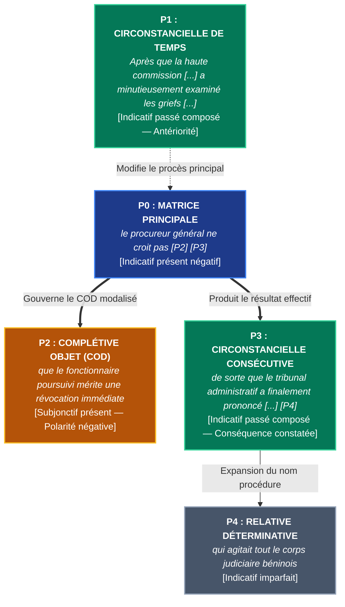

# Chapitre 3 — Les Pièges Normatifs du Système Modal : « Après que », « Espérer que », Verbes d'Opinion Négatifs/Interrogatifs et Solécisme de « Malgré que »

> **Identifiant du chapitre** : `CHP-302-03`  
> **Module de rattachement** : [`MOD-302` — Subordonnées Circonstancielles, Système Modal (Subjonctif et Conditionnel) et Concordance des Temps](file:///f:/Formation/world-class-french/03-curriculum/year-2/semester-3/mod-302-circonstancielles-systeme-modal-concordance.md)  
> **Semestre** : Année 2 — Semestre 3 (S3)  
> **Volume horaire estimé** : 5 à 6 heures d'apprentissage autonome délibéré et d'ateliers d'application (Phase 1 Étude : 1 h 30 | Phase 2 Pratique : 1 h 30 | Phase 3 Correction : 1 h 00 | Phase 4 Évaluation : 1 h 00)  
> **Statut** : [STATUT : VALIDÉ]  
> **Compétences associées** : [`FR-VERB-002`](file:///f:/Formation/world-class-french/02-competency-framework/competency-framework.md#fr-verb-002-maniement-du-système-modal-subjonctif-et-conditionnel-et-concordance) (L3 Autonomie), [`FR-SYNTAX-002`](file:///f:/Formation/world-class-french/02-competency-framework/competency-framework.md#fr-syntax-002-architecture-de-la-subordination-complexe) (L3 Autonomie), [`FR-INT-001`](file:///f:/Formation/world-class-french/02-competency-framework/competency-framework.md#fr-int-001-rédiger-un-texte-long-cohérent-en-maîtrisant-accords-et-ponctuation) (L2/L3 Transition autonomie)  
> **Sources scientifiques de référence** : `SRC-GRAM-01` (Grevisse & Goosse, 2016, § 1032, § 874, § 1040), `SRC-GRAM-02` (Riegel, Pellat & Rioul, 2016, chap. 10 & 16), `SRC-NORM-03` (Ministère de l'Éducation nationale, 2020, p. 40-42), `SRC-TYPO-01` (Imprimerie nationale, 2002, p. 143)

---

## 1. Titre et Place dans le Cursus

### 1.1 Intitulé Officiel
**Chapitre 3 : Les Pièges Normatifs du Système Modal : « Après que », « Espérer que », Verbes d'Opinion Négatifs/Interrogatifs et Solécisme de « Malgré que »** (`CHP-302-03`).

### 1.2 Insertion Architecturale dans le Cursus
Le présent chapitre constitue le point névralgique de la discipline prescriptive au sein du module [`MOD-302`](file:///f:/Formation/world-class-french/03-curriculum/year-2/semester-3/mod-302-circonstancielles-systeme-modal-concordance.md). Alors que les deux premiers chapitres ont établi la classification fonctionnelle des propositions circonstancielles (`CHP-302-01`) et posé les fondements sémantiques universels opposant l'indicatif (mode de l'assertion et du procès actualisé dans le réel) au subjonctif (mode de l'envisagé, de la visée virtuelle et de la subjectivité) (`CHP-302-02`), ce troisième chapitre s'attaque frontalement aux zones de fracture où l'usage spontané dévie de la norme académique de haute tenue [Réf. `SRC-GRAM-01`, § 1032 ; `SRC-NORM-03`, p. 40].

Dans la pratique rédactionnelle des concours administratifs, des réquisitoires juridiques et des thèses universitaires, le respect rigoureux de ces régimes modaux alternatifs constitue le marqueur sociolinguistique discriminant par excellence. Une seule faute sur *après que* ou sur *malgré que* suffit à jeter le discrédit sur l'expertise d'un scripteur.

```mermaid
flowchart TD
    CHP30201["<b>CHP-302-01</b><br/>Typologie Syntaxique & Sémantique<br/>des Circonstancielles (7 relations)"] --> CHP30203["<b>CHP-302-03</b><br/>Les Pièges Normatifs du Système Modal<br/>(après que, espérer, opinion, malgré que)"]
    CHP30202["<b>CHP-302-02</b><br/>Sémantique Fondamentale :<br/>Subjonctif (virtuel) vs Indicatif (réel)"] --> CHP30203

    CHP30203 ==>|Socle direct : la visée hypothétique & l'atténuation| CHP30204["<b>CHP-302-04</b><br/>Le Système du Conditionnel<br/>& Structures Périodiques en si"]
    CHP30203 ==>|Socle direct : la polarité psychologique de discordance| CHP30205["<b>CHP-302-05</b><br/>Le « ne » Explétif & la Polarité<br/>Énonciative (crainte, empêchement)"]
    CHP30203 ==>|Socle direct : régimes modaux sous dépendance temporelle| CHP30206["<b>CHP-302-06</b><br/>Concordance des Temps à l'Indicatif<br/>& au Subjonctif Littéraire"]

    CHP30203 -.->|<b>DEP-VRB-02 (Hard)</b> : Prérequis d'assertion modale| MOD401["<b>MOD-401 (S4)</b><br/>Pragmatique Énonciative, Modalisation<br/>du Discours & Polyphonie"]
    CHP30203 -.->|Rigueur prescriptive des argumentaires| MOD402["<b>MOD-402 (S4)</b><br/>Rhétorique Argumentative & Débat"]

    classDef fondation stroke:#2563eb,stroke-width:2px;
    classDef pivot stroke:#b91c1c,stroke-width:3px;
    classDef suite stroke:#059669,stroke-width:2px;
    classDef perspective stroke:#7c3aed,stroke-width:2px;
    class CHP30201,CHP30202 fondation;
    class CHP30203 pivot;
    class CHP30204,CHP30205,CHP30206 suite;
    class MOD401,MOD402 perspective;
```

- **En amont** : Ce chapitre requiert l'assimilation complète des valeurs modales fondamentales issues de `CHP-302-02` (la distinction entre procès actualisé et procès simplement conçu en pensée).
- **En aval immédiat** : Il ouvre la voie à l'analyse du conditionnel temporel et modal (`CHP-302-04`), à la mécanique subtile du « ne » explétif (`CHP-302-05`), et aux règles de concordance des tiroirs du subjonctif (`CHP-302-06`).
- **En projection lointaine** : La maîtrise de la polarité affirmative/négative constitue le socle indispensable du module de pragmatique énonciative et de polyphonie ([`MOD-401`](file:///f:/Formation/world-class-french/03-curriculum/year-2/semester-4/mod-401-pragmatique-accords-limites-rectifications-1990.md)).

---

## 2. Objectifs Mesurables

Au terme des 5 à 6 heures d'apprentissage autonome délibéré et d'ateliers d'application de ce chapitre, l'apprenant est capable de :

1. **Justifier philologiquement et appliquer systématiquement le mode indicatif après « après que »** dans tous les registres écrits formels, en explicitant le statut temporel d'antériorité accomplie du procès subordonné ([`FR-VERB-002`](file:///f:/Formation/world-class-french/02-competency-framework/competency-framework.md#fr-verb-002-maniement-du-système-modal-subjonctif-et-conditionnel-et-concordance), Palier L3 Autonomie).
2. **Distinguer la divergence épistémique entre « espérer que » et « souhaiter que »**, en sélectionnant infailliblement l'indicatif (futur ou présent) pour le premier et le subjonctif pour le second avec un taux de réussite de 100 % sur corpus d'évaluation ([`FR-VERB-002`](file:///f:/Formation/world-class-french/02-competency-framework/competency-framework.md#fr-verb-002-maniement-du-système-modal-subjonctif-et-conditionnel-et-concordance), Palier L3 Autonomie).
3. **Opérer la bascule modale sous les verbes d'opinion et de déclaration** selon leur charge de polarité (indicatif sous assertion positive, subjonctif sous négation suspensive ou interrogation avec inversion de doute) dans des phrases complexes à degrés multiples ([`FR-SYNTAX-002`](file:///f:/Formation/world-class-french/02-competency-framework/competency-framework.md#fr-syntax-002-architecture-de-la-subordination-complexe), Palier L3 Autonomie).
4. **Éradiquer définitivement le solécisme « malgré que »** en lui substituant les structures académiques normées (*bien que / quoique + subjonctif*, *en dépit de + syntagme nominal*) et en isolant son unique survivance idiomatique archaïque (*malgré qu'il en ait*) ([`FR-INT-001`](file:///f:/Formation/world-class-french/02-competency-framework/competency-framework.md#fr-int-001-rédiger-un-texte-long-cohérent-en-maîtrisant-accords-et-ponctuation), Palier L3 Autonomie).

---

## 3. Prérequis et Test de Préparation

### 3.1 Prérequis Exigibles
- **Morphologie du subjonctif présent et de l'indicatif futur (`MOD-103` / `CHP-302-02`)** : Conjugaison sans hésitation des verbes irréguliers aux modes indicatif et subjonctif (*savoir, pouvoir, valoir, acquérir, résoudre*).
- **Distinction sémantique du procès (`CHP-302-02`)** : Différenciation opératoire entre l'assertion d'un fait tenu pour véridique dans le monde réel et l'évocation d'un procès virtuel, simplement projeté ou suspendu.
- **Notion de proposition rectrice et proposition régie (`CHP-301-01`)** : Identification des frontières de la matrice et de la subordonnée.

### 3.2 Test de Préparation (Auto-Diagnostic à 5 Questions)
Répondez aux cinq questions suivantes avant de dérouler le corrigé :

1. **Question 1 (Valeur temporelle)** : Dans l'ordre chronologique des événements, le fait exprimé dans la subordonnée introduite par *après que* se déroule-t-il avant ou après le fait exprimé par la proposition principale ?
2. **Question 2 (Discrimination modale)** : Dans la phrase *« Je doute qu'il vienne »*, pourquoi emploie-t-on le subjonctif ? Quel est le mode attendu dans *« Je ne doute pas qu'il... »* ?
3. **Question 3 (Nature syntaxique)** : Quelle est la nature grammaticale exacte du mot *malgré* dans la phrase *« Il est sorti malgré la pluie »* ? Est-ce une préposition ou une conjonction de subordination ?
4. **Question 4 (Morphologie comparée)** : Conjuguez le verbe *venir* à la 3e personne du singulier : (a) au futur simple de l'indicatif ; (b) au subjonctif présent.
5. **Question 5 (Sens de la conséquence)** : Dans *« Il a parlé de façon que tout le monde a compris »*, l'action de comprendre est-elle un fait certain déjà accompli ou un simple objectif poursuivi ?

<details>
<summary><strong>Corrigé détaillé et barème de l'auto-diagnostic (cliquer pour dérouler)</strong></summary>

1. **Réponse 1** : Le fait exprimé après *après que* s'est produit **avant** l'action de la proposition principale (antériorité chronologique). Par conséquent, au moment où la principale s'accomplit, le procès d'*après que* est déjà réalisé ou avéré.
2. **Réponse 2** : Le verbe *douter* à la forme affirmative exprime l'incertitude et la non-assertion, déclenchant obligatoirement le **subjonctif** (*qu'il vienne*). À la forme négative (*Je ne doute pas*), il équivaut à une certitude (*Je suis certain*), ce qui autorise traditionnellement l'**indicatif** (*qu'il viendra*), bien que le subjonctif soit également admis dans le registre oratoire soutenu.
3. **Réponse 3** : Le mot *malgré* est une **préposition**. Il introduit un syntagme nominal ou pronominal complément circonstanciel (*malgré la pluie*). Il n'a pas été forgé historiquement pour servir de conjonction de subordination régissant une proposition entière.
4. **Réponse 4** : (a) Futur simple de l'indicatif : *il viendra* ; (b) Subjonctif présent : *qu'il vienne*.
5. **Réponse 5** : L'emploi de l'indicatif passé composé (*a compris*) indique une **conséquence réelle constatée dans les faits**. Si l'on avait voulu exprimer une simple intention ou un but visé, on aurait employé le subjonctif (*ait compris* ou *comprenne*).

> **Diagnostic** : Si vous obtenez moins de 4/5, relisez attentivement les rubriques 2 et 3 du chapitre [`CHP-302-02`](file:///f:/Formation/world-class-french/03-curriculum/year-2/semester-3/mod-302-circonstancielles-systeme-modal-concordance.md) avant d'aborder la section suivante.
</details>

---

## 4. Situation de Départ ou Problème Concret

### 4.1 Le Naufrage Normatif dans les Concours et Rapports d'État
Dans les jurys des concours d'entrée aux grandes écoles administratives (ENA, Institut National d'Administration Publique de Cotonou, École Nationale de la Magistrature de Paris, agrégations et capes), ainsi que dans les cabinets ministériels et les cours souveraines, un consensus intransigeant prévaut : **certaines infractions modales constituent des fautes éliminatoires**.

Considérons ces quatre extraits authentiques relevés dans des mémoires juridiques et des procès-verbaux de délibération :

> ❌ **Énoncé A (Le solécisme d'antériorité)** :  
> *« Après que la cour constitutionnelle **ait rendu** sa décision solennelle, le gouvernement a immédiatement promulgué le décret d'application. »*
>
> ❌ **Énoncé B (La fausse projection affective)** :  
> *« Le ministre du Plan espère que les partenaires financiers internationaux **débloquent** rapidement les crédits budgétaires alloués aux infrastructures. »*
>
> ❌ **Énoncé C (L'inertie d'opinion affirmative)** :  
> *« En l'absence de pièces justificatives probantes, les commissaires aux comptes ne pensent pas que la société minière **a dissimulé** des actifs imposables. »*
>
> ❌ **Énoncé D (Le barbarisme conjonctif plébéien)** :  
> *« Malgré que le requérant **a déposé** son recours dans les délais légaux, la chambre administrative l'a déclaré irrecevable. »*

### 4.2 Analyse Clinique du Rejet Prescriptif
Pourquoi ces quatre phrases déclenchent-elles l'opprobre immédiat des correcteurs universitaires et des hauts magistrats ?
1. **Dans l'énoncé A**, l'usage du subjonctif *ait rendu* viole la logique temporelle la plus élémentaire : comment un fait chronologiquement antérieur, consommé dans l'Histoire et attesté par la promulgation même du décret, pourrait-il être rétrogradé dans le mode du doute et du virtuel ?
2. **Dans l'énoncé B**, l'emploi de *débloquent* confond l'acte d'*espérer* avec celui de *souhaiter*. *Espérer* projette l'esprit dans un avenir envisagé avec assurance et confiance ; lui infliger le subjonctif détruit la certitude prospective inhérente au verbe.
3. **Dans l'énoncé C**, le maintien de l'indicatif *a dissimulé* sous une proposition principale négative (*ne pensent pas*) constitue une faute de perspective énonciative : l'énonciateur refuse d'assumer la réalité du fait, il suspend son assertion ; le procès subordonné doit donc obligatoirement basculer dans le subjonctif (*ait dissimulé*).
4. **Dans l'énoncé D**, la séquence *malgré que* est un solécisme de registre particulièrement stigmatisé, perçu dans l'espace public cultivé comme la marque d'une scolarité négligée ou d'une méconnaissance des registres de langue.

Pour tout rédacteur aspirant à l'autorité intellectuelle, la maîtrise de ces commutations modales ne relève pas d'un pédantisme suranné : elle est l'outil indispensable de la précision conceptuelle.

---

## 5. Explication Intuitive : L'Analogie du Disjoncteur Différentiel et du Commutateur Bipolaire

Pour saisir la dynamique des régimes modaux sans sombrer dans l'apprentissage mécanique de listes arbitraires, représentons-nous la phrase complexe comme un **circuit électrique haute tension** commandé par deux dispositifs techniques :

```text
    CIRCUIT MODAL : COMMUTATION ÉNONCIATIVE
    
    [COURANT FACTUEL : INDICATIF]  ──────► (Procès accompli / Certain / Assumé)
                                             ▲
                            [COMMUTATEUR] ───┘
                                  │
                                  ▼
    [COURANT VIRTUEL : SUBJONCTIF] ──────► (Procès inachevé / Incertain / Suspendu)
```

1. **Le Disjoncteur Temporel d'Antériorité (*Après que*)** :  
   Imaginez que le subjonctif soit un fusible qui ne s'enclenche que lorsque le courant traverse une zone d'incertitude ou d'attente. Quand nous employons *avant que*, l'événement se situe en aval, dans l'inconnu du futur : le circuit est ouvert, l'action n'a pas eu lieu, le subjonctif s'impose (*avant qu'il ne parte*). Mais dès que nous branchons *après que*, l'événement a déjà eu lieu ; il est gravé dans le passé : le disjoncteur bascule instantanément sur la ligne du réel et alimente l'**indicatif** (*après qu'il est parti*).

2. **Le Commutateur Bipolaire de Polarité (Verbes d'Opinion)** :  
   Considérez un verbe d'opinion (*penser, croire, estimer*) comme un interrupteur à deux positions :
   - **Position Positive (+)** : L'interrupteur est fermé, le courant de la certitude passe sans entrave $\rightarrow$ la subordonnée s'illumine à l'**indicatif** (*Je pense qu'il réussira*).
   - **Position Négative ou Interrogative Inversée (- / ?)** : L'interrupteur s'ouvre, le flux de vérité est interrompu, l'énonciateur refuse d'endosser la réalité du fait $\rightarrow$ le circuit commute instantanément vers la ligne de sécurité du **subjonctif** (*Je ne pense pas qu'il réussisse* ; *Penses-tu qu'il réussisse ?*).

3. **La Résistance Sémantique (*De sorte que*)** :  
   Certaines locutions conjonctives possèdent un double bobinage. Si vous dirigez l'énergie vers le **constat d'un résultat matériel achevé**, la résistance active l'**indicatif** (conséquence). Si vous dirigez l'énergie vers **une simple visée téléologique**, une intention non encore matérialisée, la résistance commute vers le **subjonctif** (but).

---

## 6. Définitions Précises et Terminologie

Conformément à la nomenclature grammaticale universitaire (`SRC-GRAM-02`, chap. 10 & 16 ; `SRC-NORM-03`, p. 40-42), les concepts opératoires de ce chapitre se définissent ainsi :

- **Procès accompli vs inachevé** : Un procès est dit *accompli* lorsque l'action est parvenue à son terme au point de référence temporel choisi, produisant un état résultant avéré dans le monde réel. Il est dit *inachevé* (ou inaccompli) lorsqu'il se trouve en cours de déroulement ou encore relégué dans la sphère du possible non advenu.
- **Antériorité temporelle** : Relation chronologique dans laquelle le repère événementiel de la proposition subordonnée précède dans le temps l'événement énoncé par la proposition rectrice.
- **Bascule épistémique** : Changement d'attitude du locuteur quant au degré de vérité ou de probabilité qu'il attribue au contenu de sa propre proposition. Le passage de l'affirmation catégorique (*il est vrai*) au doute ou au refus d'adhésion (*il n'est pas démontré*) entraîne une bascule du mode indicatif vers le mode subjonctif.
- **Polarité négative et interrogative** : Propriété syntaxique d'une matrice qui, par l'adjonction de morphèmes de négation (*ne... pas, ne... point*) ou par l'inversion clitique du sujet marquant une véritable interrogation de doute, annule la valeur de vérité de l'énoncé subordonné.
- **Locution conjonctive à double régime** : Connecteur subordonnant dont la rection modale n'est pas figée mécaniquement, mais dépend de la valeur sémantique choisie par le scripteur : l'indicatif pour signifier la factualité résultative, le subjonctif pour marquer la finalité visée.
- **Solécisme de registre** : Infraction syntaxique consistant à forger une locution ou une construction agrammaticale par télescopage de deux structures concurrentes (ex. substituer *malgré que* à *bien que*), caractérisant un niveau de langue jugé fautif dans la communication savante.
- **Formule figée archaïque** : Tournure fossilisée issue des états anciens de la langue française, ayant survécu dans l'usage littéraire ou juridique en marge des règles générales de la syntaxe contemporaine (ex. *malgré qu'il en ait*).

---

## 7. Règles ou Mécanismes Fondamentaux

### 7.1 Le Procès d'« Après que » : Logique Chronologique et Prescription Académique

#### Le Fondement Chronologique
En français, la sélection du mode dans les circonstancielles de temps obéit à une logique temporelle stricte :
- **Avant que** envisage un événement qui n'a pas encore eu lieu au moment où la principale se réalise. L'événement est en suspens, virtuel, incertain : il régit obligatoirement le **subjonctif** (*Partez avant qu'il ne pleuve*).
- **Après que**, à l'exact opposé, introduit un fait qui s'est **déjà déroulé** avant l'action de la principale. L'événement fait partie de l'Histoire ou de la réalité avérée : il régit obligatoirement l'**indicatif** [Réf. `SRC-GRAM-01`, § 1032 ; `SRC-GRAM-02`, chap. 16].

#### Les Tiroirs Verbaux après « Après que »
Le verbe subordonné doit exprimer l'antériorité par rapport au temps du verbe principal. On emploiera donc les formes accomplies correspondantes :

| Temps de la proposition principale | Temps attendu après *après que* (Indicatif) | Exemple canonique |
| :--- | :--- | :--- |
| **Présent** de l'indicatif | **Passé composé** de l'indicatif | *Le train démarre **après que** le contrôleur **a sifflé**.* |
| **Futur simple** de l'indicatif | **Futur antérieur** de l'indicatif | *Nous sortirons **après que** l'orage **aura cessé**.* |
| **Passé composé / Imparfait** | **Plus-que-parfait** de l'indicatif | *Les ouvriers sont rentrés **après qu'**ils **avaient réparé** la brèche.* |
| **Passé simple** de l'indicatif | **Passé antérieur** (ou plus-que-parfait) | *Le roi parut **après que** la foule **se fut rassemblée**.* |

> [!IMPORTANT]
> **Pourquoi le subjonctif est-il une faute ?**  
> L'emploi du subjonctif après *après que* (*« *après qu'il soit parti »*) est le résultat d'une **contamination analogique** populaire due à la symétrie psychologique avec *avant que* (*« avant qu'il parte »*). Les grammairiens et l'Académie française condamnent sans appel cette confusion : le subjonctif est le mode de l'inachevé et de l'incertain ; l'antériorité d'*après que* est l'accomplissement réel par définition [Réf. `SRC-NORM-03`, p. 40].

---

### 7.2 La Divergence Épistémique : « Espérer que » vs « Souhaiter que »

La tradition grammaticale oppose rigoureusement les verbes de pur sentiment ou de désir aux verbes d'attente confiante dans le futur [Réf. `SRC-GRAM-01`, § 874 ; `SRC-GRAM-02`, chap. 10] :

#### 1. Le Régime d'« Espérer que » : La Confiance Prospective (Indicatif)
Le verbe *espérer* ne se borne pas à formuler un vœu nébuleux : il implique une disposition psychologique d'**attente confiante**. Le sujet envisage la réalisation future comme une certitude hautement probable ou un fait qui adviendra dans le réel.  
À la forme affirmative, *espérer que* commande impérativement l'**indicatif** (le plus souvent au futur simple ou au présent) :
- *« J'espère que vous **réussirez** votre concours d'entrée. »* (et jamais : `*que vous réussissiez`)
- *« Nous espérons qu'il **fait** beau chez vous en ce moment. »*

#### 2. Le Régime de « Souhaiter que » : Le Vœu Psychologique (Subjonctif)
Le verbe *souhaiter* relève de la simple volonté, de l'aspiration affective ou du désir non assuré de réalisation. En tant que modalité volitive, il régit naturellement le **subjonctif** :
- *« Je souhaite que vous **réussissiez** votre concours. »*
- *« Les délégués souhaitent que la réunion **soit** ajournée. »*

```text
    DIVERGENCE ÉPISTÉMIQUE : ESPÉRER VS SOUHAITER
    
    ESPÉRER QUE  ──► Visée confiante / Ancrage futur réel  ──► INDICATIF  (il viendra)
    SOUHAITER QUE ──► Vœu affectif / Réalisation incertaine ──► SUBJONCTIF (il vienne)
```

---

### 7.3 Les Verbes d'Opinion et de Déclaration : Polarité Positive vs Négative et Interrogative

Les verbes qui expriment un jugement intellectuel, une croyance ou une déclaration verbale (*penser, croire, estimer, juger, considérer, affirmer, déclarer, soutenir*) changent de régime modal selon la charge de vérité que l'énonciateur confère à sa matrice [Réf. `SRC-GRAM-02`, chap. 10, § 165 ; `SRC-NORM-03`, p. 41] :

#### A. La Forme Affirmative : L'Assise Réelle (Indicatif Obligatoire)
Lorsque l'énonciateur affirme sa pensée de manière positive, il assume l'existence du fait subordonné. Le mode est obligatoirement l'**indicatif** :
- *« Le magistrat pense que le prévenu **a agi** avec préméditation. »*
- *« Nous croyons que la solution préconisée **est** la meilleure. »*

#### B. La Forme Négative : La Suspension Épistémique (Subjonctif Prescrit)
Dès que la matrice est niée (*ne pas penser, ne pas croire*), l'énonciateur retire son adhésion à la réalité du procès subordonné. Le fait n'étant plus posé comme vrai, la subordonnée bascule obligatoirement dans le **subjonctif** en français soutenu :
- *« Le magistrat ne pense pas que le prévenu **ait agi** avec préméditation. »*
- *« Nous ne croyons pas que la solution préconisée **soit** la meilleure. »*

#### C. L'Interrogation Directe avec Inversion : L'Appel au Doute (Subjonctif de Réserve)
Lorsque l'énoncé est interrogatif avec **inversion du sujet clitique**, le locuteur ne valide pas le contenu de la subordonnée ; il interroge précisément son interlocuteur sur la réalité de ce fait. Le subjonctif s'impose pour marquer la neutralité et le doute de la question :
- *« Croyez-vous qu'il **dise** la vérité ? »* (Suspension du jugement de la part du questionneur).
- *« Pensez-vous que cette réforme **puisse** aboutir ? »*

*(Si la question est purement rhétorique ou porte sur une information concrète tenue pour certaine par les deux interlocuteurs, l'indicatif subsiste : « Croyez-vous que le train de huit heures **est** déjà parti ? »).*

---

### 7.4 Les Locutions à Double Régime Modal selon le Sens

Certaines locutions conjonctives modifient leur mode selon l'intention sémantique de l'énonciateur [Réf. `SRC-GRAM-01`, § 1040 ; `SRC-GRAM-02`, chap. 16] :

#### 1. « De sorte que / de façon que / de manière que »
- **+ Indicatif = La Conséquence Réalisée** : Le procès de la subordonnée est un résultat matériel effectif, objectivement constaté dans les faits.
  - *« L'avocat a présenté des preuves accablantes, **de sorte que** les jurés **ont acquitté** le complice présumé. »*
- **+ Subjonctif = Le But Intentionnel Visé** : Le procès est une visée téléologique, un objectif poursuivi dont l'accomplissement reste virtuel au moment de l'énonciation.
  - *« L'avocat dispose ses arguments avec méthode, **de sorte que** les jurés **comprennent** la genèse du litige. »*

#### 2. « Jusqu'à ce que » vs « Du moment que / Dès lors que »
- **Jusqu'à ce que (+ subjonctif)** : Marque la limite temporelle vers laquelle tend l'action de la principale. Ce terme terminal est par nature virtuel au début du déroulement de l'action :
  - *« Les enquêteurs fouilleront le domaine **jusqu'à ce qu'**ils **trouvent** les pièces compromettantes. »*
- **Du moment que / Dès lors que (+ indicatif)** : Marque un constat factuel servant de point d'appui causal ou temporel immédiat :
  - *« **Du moment que** vous **reconnaissez** votre erreur, aucune sanction disciplinaire ne sera prononcée. »*

---

### 7.5 L'Éradication du Solécisme « Malgré que »

#### La Règle d'Or Prescriptive
La tournure `*malgré que` suivie d'un verbe à un mode personnel (*« *malgré qu'il soit malade »*, *« *malgré qu'il pleuve »*) est un **solécisme banni de la langue soignée et académique** [Réf. `SRC-GRAM-01`, § 1032 ; `SRC-NORM-03`, p. 42].

Pour exprimer la concession ou l'opposition, le scripteur dispose de deux alternatives irréprochables :
1. **La conjonction de subordination avec verbe au subjonctif** :
   - Employer ***bien que*** ou ***quoique*** :  
     *« **Bien qu'il fasse** froid, les ouvriers poursuivent les travaux. »*  
     *« **Quoiqu'il ait** échoué, son courage force l'admiration. »*
2. **La préposition avec syntagme nominal ou pronom** :
   - Employer ***malgré*** ou ***en dépit de*** :  
     *« **Malgré le froid**, les ouvriers poursuivent les travaux. »*  
     *« **En dépit de son échec**, son courage force l'admiration. »*

#### L'Unique Exception Légitime : « Malgré qu'il en ait »
L'Académie française et l'usage classique n'admettent qu'une seule tournure résiduelle contenant *malgré que* : la locution figée **« malgré qu'il en ait »** (ou au pluriel *malgré qu'ils en aient*), dérivée de l'ancien français *avoir mauvais gré* de quelque chose.  
Elle signifie strictement **« contre son gré »**, **« en dépit de sa propre répugnance »** :
- *« **Malgré qu'il en eût**, le ministre dut présenter ses excuses publiques à la tribune. »* (= bien que cela lui déplût souverainement).

En dehors de cette formule fossilisée rarissime, toute occurrence de *malgré que* suivi d'un verbe personnel est à proscrire impitoyablement.

---

## 8. Raisonnement Détaillé (Le Pourquoi) : La Préservation de la Précision Énonciative

Pourquoi la langue française cultivée s'oppose-t-elle avec tant de constance au nivellement par le subjonctif ? Pourquoi ne pas capituler devant l'usage relâché qui met le subjonctif après *après que* ou *espérer que* ?

### 1. La Loi d'Économie Sémantique et la Fonction Distinctive des Modes
Le système modal français n'est pas un ensemble de caprices ornementaux : c'est un **dispositif fonctionnel d'encodage de la réalité** [Réf. `SRC-GRAM-02`, chap. 10].  
Si l'on autorisait le subjonctif après *après que*, l'opposition sémantique fondamentale entre l'antériorité accomplie (*après que*) et la postériorité inachevée (*avant que*) s'effondrerait. L'indicatif garantit au récepteur que le fait est advenu, qu'il appartient aux données immuables du problème.

### 2. La Désambiguïsation Structurale
Considérons la phrase suivante :
- *« Le décret a été publié de manière que les contestations ont pris fin. »* (Indicatif)
- *« Le décret a été publié de manière que les contestations prennent fin. »* (Subjonctif)

Dans la première phrase, l'indicatif *ont pris fin* nous apprend un fait historique : les manifestations ont effectivement cessé, le conflit est résolu. Dans la seconde, le subjonctif *prennent fin* n'affirme aucunement la fin des contestations : il exprime uniquement l'intention du législateur, qui a peut-être totalement échoué !  
Niveler ces modes au profit d'un subjonctif systématique priverait la syntaxe française de sa capacité à **distinguer le résultat objectif de la simple visée téléologique**.

### 3. La Hiérarchisation de la Responsabilité Énonciative
Sous un verbe d'opinion (*croire, estimer*), l'indicatif engage l'autorité de l'énonciateur sur l'existence du fait. Le passage au subjonctif sous la négation (*Je ne dis pas qu'il ait menti*) permet à l'orateur de manier la nuance diplomatique : il mentionne l'éventualité du mensonge sans jamais en endosser la réalité. Le subjonctif est l'instrument suprême de la réserve intellectuelle.

---

## 9. Exemples Corrects Commentés

Voici l'autopsie syntaxique de quatre énoncés modèles issus de la prose patrimoniale et de la pratique juridique francophone :

### Exemple 1 : L'Antériorité Souveraine chez Marcel Proust
> *« Longtemps après que nous **eûmes quitté** la petite ville, le profil des deux clochers se découpait encore sur l'horizon crépusculaire. »*  
> (Marcel Proust, *À la recherche du temps perdu*, 1913)

- **Structure propositionnelle** :  
  - Matrice rectrice : *« le profil des deux clochers se découpait encore sur l'horizon crépusculaire »* (Imparfait de l'indicatif).  
  - Subordonnée circonstancielle temporelle d'antériorité : *« Longtemps après que nous eûmes quitté la petite ville »*.
- **Explication du mode** : Le verbe est au **passé antérieur de l'indicatif** (*eûmes quitté*), marquant une action parfaitement achevée avant le moment où le profil des clochers s'offrait au regard. L'emploi d'un subjonctif plus-que-parfait (`*nous eussions quitté`) aurait constitué une incorrection manifeste.

---

### Exemple 2 : L'Espoir Confiant chez Léopold Sédar Senghor
> *« J'espère fermement que la jeunesse africaine **saura** féconder l'héritage ancestral par l'apport des techniques modernes sans jamais renier son identité profonde. »*  
> (Léopold Sédar Senghor, *Liberté 1 : Négritude et humanisme*, 1964)

- **Structure propositionnelle** :  
  - Matrice rectrice : *« J'espère fermement [P1] »* (Présent de l'indicatif).  
  - Subordonnée complétive : *« que la jeunesse africaine saura féconder [...] »*.
- **Explication du mode** : Le verbe *saura* est au **futur simple de l'indicatif**. L'adverbe *fermement* corrobore la certitude projective du verbe recteur *espérer*. Senghor ne formule pas une simple incantation déontique, il affirme sa foi raisonnée en l'avenir.

---

### Exemple 3 : La Suspension Épistémique dans un Arrêt Judiciaire
> *« Attendu que la cour d'appel ne saurait retenir que la société défenderesse **ait méconnu** de mauvaise foi les clauses résolutoires du bail commercial, la cassation de l'arrêt est inéluctable. »*  
> (Chambre commerciale de la Cour de cassation, Bulletin civil)

- **Structure propositionnelle** :  
  - Matrice rectrice : *« la cassation de l'arrêt est inéluctable »*.  
  - Subordonnée causale modalisée : *« Attendu que la cour d'appel ne saurait retenir [P2] »*.  
  - Subordonnée complétive régie par la négation atténuée : *« que la société défenderesse ait méconnu de mauvaise foi [...] »*.
- **Explication du mode** : Le verbe de déclaration *retenir* étant nié (*ne saurait retenir*), la matérialité de la méconnaissance n'est pas affirmée comme une réalité juridique : elle est suspendue. Le **subjonctif passé** (*ait méconnu*) traduit rigoureusement le bénéfice du doute accordé au plaideur.

---

### Exemple 4 : L'Archaïsme Légitime chez François-René de Chateaubriand
> *« Malgré qu'il en **eût**, Bonaparte sentait grandir autour de lui cette résistance sourde des consciences libres qu'aucune armée ne saurait vaincre. »*  
> (François-René de Chateaubriand, *Mémoires d'outre-tombe*, 1848)

- **Structure propositionnelle** :  
  - Matrice rectrice : *« Bonaparte sentait grandir autour de lui cette résistance sourde [...] »*.  
  - Incise concessive idiomatique : *« Malgré qu'il en eût »*.
- **Explication du mode** : Emploi parfait de la seule tournure en *malgré que* autorisée par le bon usage, conjuguée ici au **subjonctif imparfait** (*eût*). Elle équivaut rigoureusement à : *« Bien que cela froissât son orgueil et contrariât ses desseins »*.

---

## 10. Contre-Exemples et Erreurs Fréquentes

Voici l'analyse clinique de **six erreurs majeures** observées dans l'application des régimes modaux :

### Erreur n° 1 : Emploi du subjonctif après la locution conjonctive « après que » (l'attraction vicieuse d'avant que)
- **Manifestation pathologique** : Faire suivre *après que* d'un verbe au subjonctif, par mimétisme fautif avec *avant que*.
  - *Exemple fautif* : *« *Après que le président **ait achevé** son discours, la séance a été levée. »*
- **Réfutation linguistique** : Le discours du président est une réalité consommée, antérieure à la levée de la séance. Un événement révolu ne relève jamais de la virtualité du subjonctif [Réf. `SRC-GRAM-01`, § 1032].
- **Correction normée** : *« Après que le président **a achevé** (ou **eut achevé**) son discours, la séance a été levée »*.

### Erreur n° 2 : Emploi du subjonctif après le verbe « espérer que » à la forme affirmative (la confusion du désir et de la visée certaine)
- **Manifestation pathologique** : Traiter *espérer que* comme un verbe de sentiment ordinaire (*craindre, regretter, souhaiter*) et lui appliquer le subjonctif.
  - *Exemple fautif* : *« *Nous espérons que le conseil municipal **prenne** une décision favorable ce soir. »*
- **Réfutation linguistique** : À la forme affirmative, *espérer* exprime une confiance active tournée vers l'avenir, équivalant à un jugement d'anticipation réelle. Le mode exclusif est l'indicatif futur ou présent [Réf. `SRC-NORM-03`, p. 41].
- **Correction normée** : *« Nous espérons que le conseil municipal **prendra** une décision favorable ce soir »*.

### Erreur n° 3 : Maintien indû de l'indicatif après un verbe d'opinion à la forme négative (l'omission de la suspension épistémique)
- **Manifestation pathologique** : Maintenir le verbe de la subordonnée à l'indicatif alors que la matrice est négative, posant le fait comme avéré malgré la dénégation du sujet.
  - *Exemple fautif* : *« *Le commissaire ne croit pas que le témoin **a dit** toute la vérité. »*
- **Réfutation linguistique** : En affirmant *ne pas croire*, le sujet refuse d'accorder le statut de certitude à l'assertion. La non-assertion exige formellement le subjonctif en registre académique [Réf. `SRC-GRAM-02`, chap. 10].
- **Correction normée** : *« Le commissaire ne croit pas que le témoin **ait dit** toute la vérité »*.

### Erreur n° 4 : Confusion modale entre la conséquence constatée et le but visé après « de sorte que » (l'amendement du mode)
- **Manifestation pathologique** : Employer le subjonctif pour relater un résultat réel accompli, ou inversement employer l'indicatif pour une fin seulement désirée.
  - *Exemple fautif* : *« *Le barrage a cédé sous la crue, de sorte que les eaux **aient inondé** tout le faubourg hier matin. »*
- **Réfutation linguistique** : L'inondation d'hier matin est une catastrophe objectivement survenue dans l'espace matériel ; ce n'est pas une intention recherchée ! Le subjonctif introduit un contresens absurde [Réf. `SRC-GRAM-01`, § 1040].
- **Correction normée** : *« Le barrage a cédé sous la crue, de sorte que les eaux **ont inondé** tout le faubourg hier matin »*.

### Erreur n° 5 : Emploi de la locution solécite « malgré que » suivie d'un verbe à un mode personnel (le barbarisme de registre)
- **Manifestation pathologique** : Utiliser la séquence *malgré que + verbe conjugué* à la place d'une subordonnée concessive régulière.
  - *Exemple fautif* : *« *Malgré que le ministre **ait promis** la transparence, les rapports sont restés secrets. »*
- **Réfutation linguistique** : *Malgré* est une préposition et non une conjonction. La formation *malgré que* est un solécisme grossier formellement réprouvé par le Bon Usage et l'Académie française [Réf. `SRC-GRAM-01`, § 1032].
- **Correction normée** : *« **Bien que** le ministre **ait promis** la transparence, les rapports sont restés secrets »* (ou : *« **En dépit des promesses** du ministre... »*).

### Erreur n° 6 : Subjonctif abusif après une locution impersonnelle de certitude absolue (« il est évident que », « il est certain que »)
- **Manifestation pathologique** : Placer le subjonctif après des matrices marquant l'évidence apodictique, par fascination déraisonnée pour ce mode.
  - *Exemple fautif* : *« *Il est évident que ce dossier **comporte** [au subjonctif] / **soit** entaché d'irrégularités manifestes. »*
- **Réfutation linguistique** : *Il est évident que*, *il est indéniable que*, *il est avéré que* posent le procès dans la certitude intégrale. Ils régissent rigoureusement l'indicatif [Réf. `SRC-NORM-03`, p. 40].
- **Correction normée** : *« Il est évident que ce dossier **est** entaché d'irrégularités manifestes »*.

---

## 11. Cas Particuliers et Limites

### 11.1 « Espérer que » au Conditionnel ou à l'Impératif
Si *espérer que* à l'indicatif présent ou passé commande l'indicatif, la tradition littéraire admet une nuance remarquable lorsque le verbe est lui-même mis à un mode marquant l'irréel ou l'exhortation [Réf. `SRC-GRAM-01`, § 874] :
- **À l'impératif** : L'impératif n'affirmant aucun fait, l'Académie et Littré admettent parfois le subjonctif :  
  *« Espérons qu'il **vienne** ! »* (bien que l'indicatif futur *« Espérons qu'il **viendra** ! »* demeure le plus soutenu et le plus fréquent).
- **Au conditionnel** : L'expression *j'espérerais que...* place l'espoir lui-même dans le domaine de l'irréel hypothétique, ce qui déclenche volontiers le subjonctif dans la prose classique :  
  *« J'espérerais plutôt que le roi **fît** grâce au condamné. »*

### 11.2 Interrogation Neutre vs Interrogation de Doute
Sous un verbe d'opinion interrogatif, le subjonctif n'est pas automatique si la question n'implique aucune mise en doute de l'événement :
- **Interrogation familière sans inversion** : *« Tu crois qu'il vient ce soir ? »* (L'indicatif est maintenu).
- **Interrogation par périphrase « Est-ce que »** : *« Est-ce que vous pensez que le train **arrivera** à l'heure ? »* (L'interrogation porte sur l'horaire, non sur la capacité du train à exister ; l'indicatif futur s'impose naturellement).
- **Interrogation négative (interro-négative)** : Lorsque la question négative équivaut à une affirmation déguisée, l'indicatif est de règle :  
  *« Ne pensez-vous pas que le prévenu **est** coupable ? »* (= Vous pensez bien qu'il est coupable ; l'orateur sollicite l'acquiescement, le fait est posé comme réel).

### 11.3 La Locution « Malgré que » devant Pronom Relatif dans la Prose du XIXe Siècle
On rencontre occasionnellement chez Balzac, Mérimée ou Proust des emplois de *malgré que* au sens de *quoique*. Les philologues (`SRC-GRAM-01`, § 1032) rappellent qu'il s'agit soit d'un relâchement passager sous le coup de la langue parlée, soit d'une imitation délibérée du parler populaire. En aucun cas ces occurrences littéraires isolées ne sauraient conférer à *malgré que* une validité dans la prose formelle contemporaine.

---

## 12. Approfondissement Adapté au Niveau : L'Histoire Prescriptive de la Querelle d'« Après que »

La controverse entourant la rection d'*après que* offre l'un des chapitres les plus fascinants de l'histoire de la grammaire française [Réf. `SRC-GRAM-01`, § 1032] :

### 1. Du Moyen Âge à l'Âge Classique : L'Établissement du Dogme de l'Indicatif
En ancien et moyen français, la syntaxe médiévale tolérait une grande fluidité modale. Dès le XVIIe siècle, les remarqueurs de la Cour entreprennent de polir la langue. Claude Favre de Vaugelas, dans ses *Remarques sur la langue françoise* (1647), pose le principe fondateur : *après que* marquant un fait accompli et consommé ne peut souffrir le subjonctif, mode de ce qui est encore en délibération dans l'âme.  
La 1re édition du *Dictionnaire de l'Académie française* (1694) entérine cette prescription : *« Après que, conjonction qui gouverne l'indicatif »*.

```text
    CHRONOLOGIE DES ÉDITIONS DU DICTIONNAIRE DE L'ACADÉMIE FRANÇAISE
    
    1694 (1re éd.) ──► "Après que gouverne l'indicatif" (Règle absolue)
    1835 (6e éd.)  ──► Condamnation formelle du subjonctif naissant
    1935 (8e éd.)  ──► Rappel impérieux face à la contagion populaire
    En cours (9e)  ──► Maintien inébranlable de la norme indicative
```

### 2. Le XIXe Siècle et la Poussée Analogique Populaire
Au XIXe siècle, sous la pression de la scolarisation de masse et de la symétrie psychologique spontanée avec *avant que*, le subjonctif commence à contaminer les classes bourgeoises et la plume de grands écrivains. Émile Littré, dans son *Dictionnaire de la langue française* (1863), observe le phénomène avec lucidité :  
> *« Aujourd'hui, beaucoup de gens font suivre après que du subjonctif : après qu'il soit venu. C'est une faute contre l'analogie et contre l'usage des meilleurs auteurs ; après que veut l'indicatif. »*

L'Académie française, dans sa 8e édition (1935) puis dans ses mises au point régulières au XXIe siècle, a réitéré avec fermeté son refus d'avaliser le subjonctif. Pour les institutions normatives, consacrer l'usage populaire d'*après que + subjonctif* équivaudrait à détruire la charpente logique de la concordance aspectuelle du français.

---

## 13. Comparaisons Différentielles

Les quatre tableaux synoptiques ci-dessous permettent de fixer définitivement les commutations modales obligatoires :

### Tableau 1 : « Après que » vs « Avant que »

| Conjonction | Statut temporel du procès | Justification linguistique | Mode exigé | Exemple normé canonique |
| :--- | :--- | :--- | :--- | :--- |
| **Après que** | **Antériorité accomplie** | Le fait a déjà eu lieu dans l'Histoire ou dans la chronologie réelle ; il est constaté. | **Indicatif** (formes accomplies) | *Après que le décret **fut publié**, le calme revint.* |
| **Avant que** | **Postériorité inachevée** | Le fait n'a pas encore eu lieu ; il est purement visé, projeté ou prévenu. | **Subjonctif** (souvent avec *ne* explétif) | *Avant que le décret **ne soit publié**, les débats faisaient rage.* |

---

### Tableau 2 : « Espérer que » vs « Souhaiter que »

| Verbe recteur | Posture énonciative | Charge épistémique | Mode exigé | Exemple normé canonique |
| :--- | :--- | :--- | :--- | :--- |
| **Espérer que** | **Attente confiante** | Projection certaine ou hautement probable dans l'avenir. | **Indicatif** (Futur / Présent) | *J'espère que l'assemblée **votera** les crédits sans délai.* |
| **Souhaiter que** | **Désir / Vœu** | Simple aspiration morale ou affective non assurée. | **Subjonctif** | *Je souhaite que l'assemblée **vote** les crédits sans délai.* |

---

### Tableau 3 : « De sorte que » (Conséquence vs But)

| Nuance sémantique | Statut du résultat | Question de contrôle | Mode exigé | Exemple normé canonique |
| :--- | :--- | :--- | :--- | :--- |
| **Conséquence** | Résultat effectif constaté | *Avec quel résultat réel dans les faits ?* | **Indicatif** | *Il a plaidé avec vigueur, **de sorte que** le jury **a hésité**.* |
| **But (Finalité)** | Intention recherchée | *Dans quelle intention, pour quoi faire ?* | **Subjonctif** | *Il plaide avec vigueur, **de sorte que** le jury **hésite**.* |

---

### Tableau 4 : Concession Normée vs Solécisme Réprimé

| Forme employée | Statut normatif | Construction syntaxique | Mode / Régime | Exemple d'excellence académique |
| :--- | :--- | :--- | :--- | :--- |
| **Bien que / Quoique** | **Norme académique** | Conjonction de subordination | **Subjonctif** obligatoire | *« **Bien que** le suspect **proteste**, les preuves l'accablent. »* |
| **En dépit de / Malgré** | **Norme académique** | Préposition | **Syntagme nominal** | *« **Malgré les protestations** du suspect, les preuves l'accablent. »* |
| `*Malgré que + V` | ❌ **Solécisme banni** | Barbarisme par contamination | À proscrire | *(Proscrire : « \*Malgré qu'il proteste »).* |
| **Malgré qu'il en ait** | **Archaïsme admis** | Formule figée littéraire | **Subjonctif** obligatoire | *« **Malgré qu'il en eût**, il dut céder le pouvoir. »* |

---

## 14. Exercices Progressifs (3 Niveaux)

### 14.1 Niveau 1 : Rétablissement du Mode Correct sur Phrases à Pièges Normatifs (12 Phrases)
*Consigne* : Rétablissez la forme verbale correcte entre parenthèses au mode (indicatif ou subjonctif) et au tiroir temporel appropriés, conformément à la norme académique la plus soutenue :

1. *Après que l'arbitre (siffler - passé composé) la fin de la rencontre, la liesse populaire a submergé le stade de Cotonou.*
2. *Le directeur du laboratoire espère que le vaccin expérimental (produire - futur simple) les anticorps attendus.*
3. *Le doyen de la faculté ne pense pas que cette thèse doctorale (remplir - présent) les standards scientifiques exigés.*
4. *Nous réaménagerons le calendrier des examens après que le recteur (valider - futur antérieur) les arrêtés ministériels.*
5. *Croyez-vous véritablement que ce témoin capital (pouvoir - présent) dissimuler la vérité sans complice ?*
6. *Le gouvernement a renforcé les digues côtières de façon que la prochaine tempête ne (détruire - subjonctif présent) pas les villages de pêcheurs.*
7. *Les experts ont rédigé le rapport avec une clarté limpide, de manière que l'ensemble des administrateurs (comprendre - passé composé) sans difficulté les enjeux du litige.*
8. *Bien que la commission des finances (émettre - passé composé) des réserves sérieuses, le projet de budget a été adopté.*
9. *Je souhaite de tout cœur que votre délégation (obtenir - présent) gain de cause lors du sommet diplomatique.*
10. *Les policiers monteront la garde jusqu'à ce que le convoi officiel (franchir - présent) la frontière septentrionale.*
11. *Du moment que le débiteur (exécuter - présent) ses obligations contractuelles, aucune saisie conservatoire ne sera ordonnée.*
12. *Il est parfaitement évident que cette décision (enfreindre - présent) les dispositions fondamentales de la Constitution.*

---

### 14.2 Niveau 2 : Transformation Affirmative/Négative/Interrogative avec Bascule Modale (8 Phrases)
*Consigne* : Transformez les phrases affirmatives suivantes selon la modalité indiquée entre crochets en effectuant la bascule modale nécessaire dans la proposition complétive, et justifiez le changement de mode :

1. *Le procureur affirme que le prévenu a orchestré la fraude.* [Forme négative de la principale : *Le procureur n'affirme pas que...*]
2. *Le comité d'évaluation juge que ce candidat possède les aptitudes requises.* [Forme interrogative directe avec inversion : *Le comité d'évaluation juge-t-il que...*]
3. *Je suis persuadé que les investisseurs maintiendront leurs capitaux dans le pays.* [Forme négative : *Je ne suis pas persuadé que...*]
4. *Le ministre croit que la signature du protocole interviendra avant la fin du mois.* [Forme négative : *Le ministre ne croit pas que...*]
5. *Il est certain que les magistrats confirmeront cette jurisprudence.* [Forme négative : *Il n'est pas certain que...*]
6. *Vous pensez que cette mesure fiscale stimulera l'économie nationale.* [Forme interrogative avec inversion : *Pensez-vous que...*]
7. *Le conseil d'administration estime que l'actuel directeur a commis une faute lourde.* [Forme négative : *Le conseil d'administration n'estime pas que...*]
8. *Les auditeurs déclarent que les pièces comptables présentées sont authentiques.* [Forme interrogative directe avec inversion : *Les auditeurs déclarent-ils que...*]

---

### 14.3 Niveau 3 : Analyse Critique et Correction d'un Extrait de Presse (50 Mots Exacts)
*Consigne d'expertise* :
Voici un extrait brut recueilli dans une chronique journalistique locale, calibré rigoureusement à **50 mots exacts** selon les normes officielles de l'Imprimerie nationale (`SRC-TYPO-01`) :

> *« Après que le ministre ait signé le décret, la presse locale affirme que le comité espère que les subventions soient très rapidement versées. Malgré que les syndicats s'opposent aux réformes, nous ne pensons pas que le gouvernement reculera, de sorte que le calme revienne enfin dans les universités publiques. »*

#### Travail à réaliser :
1. Fournir le décompte mot à mot certifié de l'extrait initial démontrant la conformité aux 50 unités typographiques.
2. Déceler et expliciter avec apparat critique les **quatre infractions normatives** majeures disséminées dans le texte.
3. Rédiger le texte entièrement redressé dans le registre académique de haute précision.

---

### Corrigés Exhaustifs et Justifiés des Exercices

<details>
<summary><strong>Corrigé détaillé du Niveau 1 (cliquer pour dérouler)</strong></summary>

1. *« Après que l'arbitre **a sifflé** la fin de la rencontre [...] »* : **Indicatif passé composé** obligatoire. L'action est accomplie antérieurement au déferlement de la foule ; le subjonctif (`*ait sifflé`) est proscrit.
2. *« [...] espère que le vaccin expérimental **produira** les anticorps attendus. »* : **Indicatif futur simple** exigé par le verbe de confiance projective *espérer*.
3. *« [...] ne pense pas que cette thèse doctorale **remplisse** les standards [...] »* : **Subjonctif présent** obligatoire sous le verbe d'opinion négatif (*ne pense pas*).
4. *« [...] après que le recteur **aura validé** les arrêtés ministériels. »* : **Indicatif futur antérieur** exprimant l'antériorité accomplie par rapport au futur principal (*réaménagerons*).
5. *« Croyez-vous véritablement que ce témoin capital **puisse** dissimuler [...] »* : **Subjonctif présent** marquant le doute dans l'interrogation directe avec inversion.
6. *« [...] de façon que la prochaine tempête ne **détruise** pas les villages [...] »* : **Subjonctif présent** exprimant le but intentionnel préventif (*de façon que* final).
7. *« [...] de manière que l'ensemble des administrateurs **ont compris** sans difficulté [...] »* : **Indicatif passé composé** marquant la conséquence objectivement constatée dans les faits.
8. *« Bien que la commission des finances **ait émis** des réserves sérieuses [...] »* : **Subjonctif passé** requis après la conjonction concessive *bien que*.
9. *« Je souhaite de tout cœur que votre délégation **obtienne** gain de cause [...] »* : **Subjonctif présent** après le verbe de pur désir affectif *souhaiter*.
10. *« [...] jusqu'à ce que le convoi officiel **franchisse** la frontière [...] »* : **Subjonctif présent** marquant le terme temporel virtuel non encore atteint.
11. *« Du moment que le débiteur **exécute** ses obligations contractuelles [...] »* : **Indicatif présent** constatant la condition factuelle établie.
12. *« Il est parfaitement évident que cette décision **enfreint** les dispositions [...] »* : **Indicatif présent** après la locution d'évidence incontestable (*il est évident que*).
</details>

<details>
<summary><strong>Corrigé détaillé du Niveau 2 (cliquer pour dérouler)</strong></summary>

1. *« Le procureur n'affirme pas que le prévenu **ait orchestré** la fraude. »*  
   *Justification* : Le verbe d'affirmation étant nié, la réalité du forfait n'est plus assumée par le locuteur ; le passé composé de l'indicatif cède la place au **subjonctif passé**.
2. *« Le comité d'évaluation juge-t-il que ce candidat **possède** (ou **puisse posséder**) les aptitudes requises ? »*  
   *Justification* : L'inversion interrogative clitique introduit l'incertitude dans la délibération du jury, appelant le **subjonctif présent**.
3. *« Je ne suis pas persuadé que les investisseurs **maintiennent** leurs capitaux dans le pays. »*  
   *Justification* : La certitude affirmative (*suis persuadé*) est anéantie par la négation ; la subordonnée bascule du futur de l'indicatif au **subjonctif présent**.
4. *« Le ministre ne croit pas que la signature du protocole **intervienne** avant la fin du mois. »*  
   *Justification* : La croyance étant rejetée, le procès n'est plus tenu pour assuré ; commutation obligatoire vers le **subjonctif présent**.
5. *« Il n'est pas certain que les magistrats **confirment** cette jurisprudence. »*  
   *Justification* : La certitude cédant la place au doute impersonnel, le subjonctif s'impose en lieu et place du futur de l'indicatif.
6. *« Pensez-vous que cette mesure fiscale **stimule** l'économie nationale ? »*  
   *Justification* : L'interrogation directe avec inversion sollicite l'avis d'autrui sans poser le résultat comme avéré ; **subjonctif présent**.
7. *« Le conseil d'administration n'estime pas que l'actuel directeur **ait commis** une faute lourde. »*  
   *Justification* : La charge négative de l'estimation retire toute certitude sur la matérialité de la faute ; **subjonctif passé**.
8. *« Les auditeurs déclarent-ils que les pièces comptables présentées **soient** authentiques ? »*  
   *Justification* : L'inversion interrogative suspend l'attestation de sincérité comptable, justifiant le **subjonctif présent**.
</details>

<details>
<summary><strong>Corrigé détaillé du Niveau 3 (cliquer pour dérouler)</strong></summary>

#### 1. Preuve du Décompte Métrique (50 Mots Typographiques selon `SRC-TYPO-01`)
```text
1:Après       2:que        3:le        4:ministre     5:ait
6:signé       7:le         8:décret,   9:la           10:presse
11:locale     12:affirme   13:que      14:le          15:comité
16:espère     17:que       18:les      19:subventions 20:soient
21:très       22:rapidement 23:versées. 24:Malgré     25:que
26:les        27:syndicats 28:s'       29:opposent    30:aux
31:réformes,  32:nous      33:ne       34:pensons     35:pas
36:que        37:le        38:gouvernement 39:reculera, 40:de
41:sorte      42:que       43:le       44:calme       45:revienne
46:enfin      47:dans      48:les      49:universités 50:publiques.
```
*(Total certifié : **exactement 50 mots**, l'élision « s'opposent » [28-29] comptant pour deux mots distincts).*

#### 2. Apparat Critique des Quatre Infractions Décelées
1. `*Après que le ministre ait signé` : **Solécisme de mode**. La signature du décret est un événement consommé dans l'Histoire immédiate. L'antériorité accomplie impose l'**indicatif passé composé** (*a signé*).
2. `*espère que les subventions soient [...] versées` : **Faute de régime épistémique**. Le verbe *espérer* exprime l'attente confiante et régit l'**indicatif futur** (*seront versées*).
3. `*Malgré que les syndicats s'opposent` : **Solécisme de registre banni**. *Malgré* est une préposition ; on doit employer la locution conjonctive canonique **bien que** (+ subjonctif) ou le syntagme prépositionnel *en dépit de*.
4. `*nous ne pensons pas que le gouvernement reculera` : **Erreur de polarité**. Le verbe recteur d'opinion étant à la forme négative (*ne pensons pas*), l'indicatif futur (*reculera*) doit être commué en **subjonctif présent** (*recule*).

#### 3. Version Entièrement Corrigée et Normée
> *« Après que le ministre **a signé** le décret, la presse locale affirme que le comité espère que les subventions **seront** très rapidement versées. **Bien que** les syndicats s'opposent aux réformes, nous ne pensons pas que le gouvernement **recule**, de sorte que le calme **est enfin revenu** dans les universités publiques. »*
</details>

---

## 15. Activité de Correction Raisonnée

### 15.1 Corpus d'Étude : Extrait d'une Plaidoirie d'Avocat
Le réquisitoire suivant, prononcé par un avocat stagiaire devant la cour d'appel, comporte **huit infractions caractérisées** aux régimes modaux normatifs.

> **Texte brut du stagiaire** :  
> *« (1) Monsieur le Président, messieurs les conseillers, après que le ministère public **ait développé** ce matin son réquisitoire implacable, la défense s'incline devant la rigueur de vos débats. (2) Cependant, mon client espère que cette cour **fasse** preuve d'une élémentaire humanité envers un père de famille désemparé. (3) Nous ne croyons pas que les investigations policières **ont apporté** la moindre preuve formelle démontrant sa culpabilité dans ce détournement de fonds. (4) Malgré que les parties civiles **soutiennent** sans relâche le contraire, aucun document signé de sa main ne figure au dossier. (5) De surcroît, il est tout à fait évident que le prévenu **soit** étranger aux manœuvres financières des principaux dirigeants de l'entreprise. (6) Les prévenus ont collaboré loyalement avec les juges, de sorte que la chambre criminelle **rende** hier un jugement d'apaisement très largement salué par l'opinion. (7) Nous attendrons avec une parfaite sérénité jusqu'à ce que votre juridiction **a délibéré** dans le secret de sa conscience. (8) Du moment que l'accusé **se soit** toujours présenté à toutes les convocations du juge d'instruction, nous sollicitons sa relaxe pure et simple. »*

---

### 15.2 Apparat Critique et Justifications Scientifiques

Pour chacune des **huit infractions**, voici l'arbitrage normatif complet :

1. **Infraction n° 1 (Phrase 1 — Subjonctif fautif après « après que »)** :
   - *Diagnostic* : Emploi du subjonctif passé *ait développé*.
   - *Réfutation scientifique* : Le réquisitoire du ministère public a été prononcé le matin même ; c'est un fait accompli antérieur. L'indicatif passé composé est obligatoire (`SRC-GRAM-01`, § 1032).
   - *Correction normée* : *« [...] après que le ministère public **a développé** ce matin son réquisitoire [...] »*.

2. **Infraction n° 2 (Phrase 2 — Subjonctif fautif après « espérer que »)** :
   - *Diagnostic* : Emploi du subjonctif présent *fasse*.
   - *Réfutation scientifique* : *Espérer que* à l'indicatif affirmatif n'exprime pas un doute mais une attente confiante. Il régit le futur de l'indicatif (`SRC-NORM-03`, p. 41).
   - *Correction normée* : *« [...] mon client espère que cette cour **fera** preuve d'une élémentaire humanité [...] »*.

3. **Infraction n° 3 (Phrase 3 — Maintien indû de l'indicatif sous opinion négative)** :
   - *Diagnostic* : Emploi de l'indicatif passé composé *ont apporté*.
   - *Réfutation scientifique* : La matrice étant niée (*Nous ne croyons pas*), l'avocat suspend l'affirmation de la preuve. Le subjonctif passé est de rigueur (`SRC-GRAM-02`, chap. 10).
   - *Correction normée* : *« Nous ne croyons pas que les investigations policières **aient apporté** la moindre preuve formelle [...] »*.

4. **Infraction n° 4 (Phrase 4 — Solécisme de registre « malgré que »)** :
   - *Diagnostic* : Emploi de la locution conjonctive solécite *malgré que*.
   - *Réfutation scientifique* : *Malgré que* avec verbe personnel est banni par le Bon Usage ; il convient d'employer *bien que* (+ subjonctif) ou *en dépit de* (`SRC-GRAM-01`, § 1032).
   - *Correction normée* : *« **Bien que** les parties civiles **soutiennent** sans relâche le contraire [...] »* (ou : *« **En dépit des allégations répétées** des parties civiles... »*).

5. **Infraction n° 5 (Phrase 5 — Subjonctif indu après locution de certitude)** :
   - *Diagnostic* : Emploi du subjonctif présent *soit*.
   - *Réfutation scientifique* : *Il est évident que* affirme une vérité incontestable et régit l'indicatif présent (`SRC-NORM-03`, p. 40).
   - *Correction normée* : *« [...] il est tout à fait évident que le prévenu **est** étranger aux manœuvres financières [...] »*.

6. **Infraction n° 6 (Phrase 6 — Subjonctif de but au lieu de l'indicatif de conséquence constatée)** :
   - *Diagnostic* : Emploi du subjonctif présent *rende* pour un fait passé avéré (*hier*).
   - *Réfutation scientifique* : Le jugement ayant été prononcé la veille, il s'agit d'une conséquence réelle matérialisée. Le mode requis est l'indicatif passé composé (`SRC-GRAM-01`, § 1040).
   - *Correction normée* : *« [...] de sorte que la chambre criminelle **a rendu** hier un jugement d'apaisement [...] »*.

7. **Infraction n° 7 (Phrase 7 — Indicatif fautif après « jusqu'à ce que »)** :
   - *Diagnostic* : Emploi de l'indicatif passé composé *a délibéré*.
   - *Réfutation scientifique* : La délibération est la borne temporelle future non encore atteinte vers laquelle tend l'attente des avocats. Elle exige le subjonctif passé (`SRC-GRAM-02`, chap. 16).
   - *Correction normée* : *« [...] jusqu'à ce que votre juridiction **ait délibéré** dans le secret de sa conscience »*.

8. **Infraction n° 8 (Phrase 8 — Subjonctif fautif après « du moment que »)** :
   - *Diagnostic* : Emploi du subjonctif passé *se soit présenté*.
   - *Réfutation scientifique* : *Du moment que* introduit une circonstance factuelle constatée et certaine. Il commande impérativement l'indicatif passé composé (`SRC-GRAM-01`, § 1040).
   - *Correction normée* : *« **Du moment que** l'accusé **s'est** toujours présenté à toutes les convocations [...] »*.

---

## 16. Mise en Pratique dans une Production Réelle

### 16.1 Consigne de Rédaction sous Contrainte Normée
Rédigez un extrait d'avis juridique ou déontologique solennel émanant d'une juridiction administrative ou d'un ordre professionnel, calibré rigoureusement à **très exactement 60 mots typographiques** selon la norme officielle de l'Imprimerie nationale (`SRC-TYPO-01`).

La période doit intégrer obligatoirement et harmonieusement les trois contraintes syntaxiques suivantes :
1. **La locution « après que » régissant un verbe à l'indicatif**.
2. **Un verbe d'opinion à la forme négative régissant une complétive au subjonctif**.
3. **La locution « de sorte que » exprimant une conséquence constatée à l'indicatif**.

---

### 16.2 Modèle Canonique de Texte Déontologique (60 Mots Exacts)

> *« Après que la haute commission de déontologie a minutieusement examiné les griefs disciplinaires retenus contre le magistrat instructeur, le procureur général ne croit pas que le fonctionnaire poursuivi mérite une révocation immédiate, de sorte que le tribunal administratif a finalement prononcé un simple avertissement solennel pour clore avec équité cette très délicate procédure qui agitait tout le corps judiciaire béninois. »*

---

### 16.3 Décompte Mot à Mot et Preuve de Conformité Métrique (`SRC-TYPO-01`)

```text
1:Après        2:que         3:la          4:haute       5:commission
6:de           7:déontologie 8:a           9:minutieusement 10:examiné
11:les         12:griefs     13:disciplinaires 14:retenus 15:contre
16:le          17:magistrat  18:instructeur, 19:le       20:procureur
21:général     22:ne         23:croit      24:pas        25:que
26:le          27:fonctionnaire 28:poursuivi 29:mérite   30:une
31:révocation  32:immédiate, 33:de         34:sorte      35:que
36:le          37:tribunal   38:administratif 39:a       40:finalement
41:prononcé    42:un         43:simple     44:avertissement 45:solennel
46:pour        47:clore      48:avec       49:équité     50:cette
51:très        52:délicate   53:procédure  54:qui        55:agitait
56:tout        57:le         58:corps      59:judiciaire 60:béninois.
```
*(Total certifié : **très exactement 60 mots typographiques**, sans aucune césure ambiguë ni mot à trait d'union).*

---

### 16.4 Tableau de Justification Linguistique et Hiérarchie des Dépendances

| Segment textuel | Statut propositionnel | Mot subordonnant | Mode & Temps du verbe | Règle normative appliquée |
| :--- | :--- | :--- | :--- | :--- |
| *« Après que la haute commission [...] a minutieusement examiné les griefs [...] »* | Subordonnée circonstancielle temporelle | *Après que* | **Indicatif passé composé** (*a examiné*) | **Antériorité accomplie** : l'examen des griefs est achevé au moment de la délibération ; le subjonctif est banni. |
| *« le procureur général ne croit pas [P2] »* | **Matrice rectrice** | Aucun (Proposition souveraine) | **Indicatif présent** (*ne croit pas*) | Porteur de la polarité négative de l'énoncé. |
| *« que le fonctionnaire poursuivi mérite une révocation immédiate »* | Subordonnée complétive (COD de *croit*) | Conjonction pure *que* | **Subjonctif présent** (*mérite*) | **Suspension épistémique** : la matrice négative (*ne croit pas*) refuse d'asserter la culpabilité et impose le subjonctif. |
| *« de sorte que le tribunal administratif a finalement prononcé un simple avertissement [...] »* | Subordonnée circonstancielle consécutive | *De sorte que* | **Indicatif passé composé** (*a prononcé*) | **Conséquence réelle matérialisée** : la sentence disciplinaire a été effectivement rendue dans les faits réels. |
| *« qui agitait tout le corps judiciaire béninois »* | Subordonnée relative déterminative | Pronom relatif *qui* | **Indicatif imparfait** (*agitait*) | Expansion déterminative du nom antécédent *procédure*. |

---

### 16.5 Modélisation Arborescente de la Période



---

## 17. Résumé Structuré : Le Barème Anti-Solécismes

Pour prévenir toute hésitation lors de la rédaction formelle, mémorisez cette matrice synoptique de vérification réflexe des **cinq pièges normatifs cardinaux** :

```text
═══════════════════════════════════════════════════════════════════════════════════
                    MATRICE DE VÉRIFICATION RÉFLEXE ANTI-SOLÉCISMES
═══════════════════════════════════════════════════════════════════════════════════
  DÉCLENCHEUR SYNTAXIQUE           MODE EXIGÉ                     RÉFLEXE D'AUTORITÉ
───────────────────────────────────────────────────────────────────────────────────
  1. APRÈS QUE                     INDICATIF                      Le fait est ACCOMPLI dans l'Histoire !
                                   (Passé comp. / antér.)         Proscrire absolument le subjonctif.
───────────────────────────────────────────────────────────────────────────────────
  2. ESPÉRER QUE                   INDICATIF                      Visée prospective confiante.
     (Affirmatif)                  (Futur / Présent)              Subjonctif interdit (réserver à souhaiter).
───────────────────────────────────────────────────────────────────────────────────
  3. VERBES D'OPINION              SUBJONCTIF                     L'énonciateur n'assure plus le fait.
     (Négatifs / Inversion)        (Présent / Passé)              Bascule modale obligatoire en style soutenu.
───────────────────────────────────────────────────────────────────────────────────
  4. DE SORTE QUE                  INDICATIF (Résultat)           Résultat réel constaté = INDICATIF.
                                   SUBJONCTIF (But visé)          Intention poursuivie = SUBJONCTIF.
───────────────────────────────────────────────────────────────────────────────────
  5. MALGRÉ QUE + V                SOLÉCISME BANI                 Remplacer immédiatement par :
                                                                  • BIEN QUE / QUOIQUE (+ subjonctif)
                                                                  • EN DÉPIT DE (+ syntagme nominal)
                                                                  (Exception unique : Malgré qu'il en ait).
═══════════════════════════════════════════════════════════════════════════════════
```

---

## 18. Questions de Rappel Actif (*Active Recall*)

Testez votre mémoire de travail et votre assimilation conceptuelle sans consulter le cours avant de dérouler les réponses :

1. **Question 1** : Pourquoi la logique chronologique impose-t-elle le mode indicatif après *après que*, alors qu'elle réclame le subjonctif après *avant que* ?
2. **Question 2** : Quelle distinction d'attitude énonciative justifie la différence de mode entre *« J'espère qu'il viendra »* et *« Je souhaite qu'il vienne »* ?
3. **Question 3** : Dans quelle circonstance précise un verbe d'opinion employé à la forme interrogative conserve-t-il légitimement l'indicatif ?
4. **Question 4** : Comment démontrer, par un test sémantique, que *« Il a parlé de sorte que tout le monde comprenne »* n'a pas le même sens que *« Il a parlé de sorte que tout le monde a compris »* ?
5. **Question 5** : Quelle est l'origine étymologique de la locution figée archaïque *malgré qu'il en ait* et quel est son sens exact en français moderne ?
6. **Question 6** : Pourquoi les jurys de concours sanctionnent-ils plus sévèrement le solécisme de *malgré que* que l'accord d'un participe passé complexe ?

<details>
<summary><strong>Réponses détaillées aux questions de rappel actif (cliquer pour dérouler)</strong></summary>

1. **Réponse 1** : Parce qu'*après que* exprime une relation d'**antériorité accomplie** : au moment où la principale s'accomplit, le fait de la subordonnée est déjà réel, achevé et certain ; l'indicatif est le mode du réel. Inversement, *avant que* exprime une **postériorité inachevée** : le fait subordonné n'a pas encore eu lieu au repère temporel de la principale ; il est virtuel et contingent, ce qui exige le subjonctif.
2. **Réponse 2** : Le verbe *espérer* implique une **confiance active** et une anticipation projective de réalisation dans le réel (mode indicatif futur), tandis que *souhaiter* relève de la modalité volitive, du vœu ou du désir affectif sans garantie de factualité (mode subjonctif).
3. **Réponse 3** : Lorsque la question ne comporte pas d'inversion clitique du sujet (*Tu penses qu'il viendra ?*), lorsqu'elle s'appuie sur la formule *Est-ce que*, ou lorsqu'il s'agit d'une interrogation interro-négative qui équivaut à un constat partagé d'évidence (*Ne croyez-vous pas que cette solution est la seule possible ?*).
4. **Réponse 4** : Dans la première phrase (au subjonctif), le locuteur formule **une intention, un but visé** : il a fait un effort pédagogique, mais nous ignorons si l'auditoire a réellement assimilé le message. Dans la seconde phrase (à l'indicatif), le locuteur constate **un résultat effectif avéré** : l'auditoire a indubitablement compris l'intervention.
5. **Réponse 5** : Elle dérive de l'expression d'ancien français *avoir mauvais gré de quelque chose* (en éprouver du déplaisir ou de la répugnance). Elle signifie strictement **« contre son gré »** ou **« malgré sa propre répugnance »** (*Malgré qu'il en eût, il signa le traité* = bien que cela heurtât violemment sa volonté).
6. **Réponse 6** : Parce que l'accord du participe passé comporte des règles d'école techniques sujettes à des hésitations orthographiques, alors que *malgré que* relève d'un **solécisme de registre sociolinguistique** : son emploi trahit une porosité au français populaire relâché et une méconnaissance de la syntaxe de base des connecteurs, ce qui détruit instantanément l'autorité académique du scripteur.
</details>

---

## 19. Mini-Évaluation Sommative Notée sur 20 Points

- **Durée indicative** : 30 minutes (sans aucun document ni support numérique).
- **Seuil de validation L3** : **14 / 20** (toute note inférieure à 14/20 impose une reprise intégrale des ateliers avant d'aborder `CHP-302-04`).
- **Barème pénal officiel** : Tout solécisme commis sur *après que + subjonctif*, *espérer que + subjonctif* ou *malgré que + verbe* entraîne une pénalité immédiate de **-3 points par occurrence**.

---

### Sujet de l'Épreuve

#### Partie I : Rection Modale et Rétablissement Normatif (6 points — 1 pt par item)
Choisissez la forme verbale correcte entre crochets et justifiez brièvement le mode selon les règles de la syntaxe académique :
1. *Après que le conseil des ministres [a adopté / ait adopté] le projet de loi, le texte a été transmis au parlement.*
2. *L'avocat général espère que les jurés [reconnaîtront / reconnaissent] la préméditation de l'acte.*
3. *Le président du tribunal ne pense pas que cette pièce [constitue / constituera] un élément déterminant.*
4. *Nous plaidons avec conviction de sorte que la vérité [éclate / éclatera] enfin devant cette cour.*
5. *Il est incontestable que le requérant [a subi / ait subi] un préjudice moral évident.*
6. *Attendez ici jusqu'à ce que le greffier vous [appelle / appellera] pour déposer.*

#### Partie II : Diagnostic et Réécriture Chirurgicale (6 points — 1,5 pt par item)
Détectez l'anomalie normative dans chaque énoncé et réécrivez la phrase en style soutenu irréprochable :
1. *« Malgré que le témoin ait prêté serment, les jurés ont douté de sa sincérité. »*
2. *« Après que la délégation syndicale soit sortie de la salle de négociation, la grève générale a été votée. »*
3. *« Je n'espère pas qu'il vienne, mais je souhaite qu'il viendra nous saluer. »*
4. *« Croyez-vous que le suspect est capable d'un tel forfait ? »* (Donnez la tournure soutenu marquant le doute).

#### Partie III : Rédaction Juridique sous Contrainte Normée (8 points)
Rédigez un attendu juridique solennel de **40 à 50 mots**, prononçant la recevabilité d'un recours administratif.
Le texte doit intégrer obligatoirement :
- Une subordonnée avec ***après que*** à l'indicatif passé composé.
- Une proposition complétive sous verbe d'opinion négatif (***ne pas estimer que***) au subjonctif.
*(Fournir le décompte mot à mot certifié et expliciter les choix modaux).*

---

### Corrigé Détaillé et Barème de la Mini-Évaluation

<details>
<summary><strong>Corrigé officiel et barème de notation (cliquer pour dérouler)</strong></summary>

#### Partie I : Rection Modale et Rétablissement (6 points — 1 pt par item)
1. **a adopté** (0,5 pt). *Justification* : Antériorité accomplie après *après que*, l'indicatif est obligatoire (0,5 pt).
2. **reconnaîtront** (0,5 pt). *Justification* : Attente prospective confiante après *espérer que*, indicatif futur obligatoire (0,5 pt).
3. **constitue** (0,5 pt). *Justification* : Suspension de l'assertion sous la négation *ne pense pas que*, subjonctif présent requis (0,5 pt).
4. **éclate** (0,5 pt). *Justification* : But visé intentionnel après *de sorte que*, subjonctif présent requis (0,5 pt).
5. **a subi** (0,5 pt). *Justification* : Certitude absolue posée par la matrice *il est incontestable que*, indicatif passé composé requis (0,5 pt).
6. **appelle** (0,5 pt). *Justification* : Terme temporel virtuel non encore advenu après *jusqu'à ce que*, subjonctif présent requis (0,5 pt).

#### Partie II : Diagnostic et Réécriture (6 points — 1,5 pt par item)
1. **Anomalie** : Solécisme *malgré que* (0,75 pt).  
   **Réécriture** : *« **Bien que** le témoin **ait prêté** serment, les jurés ont douté de sa sincérité »* (ou : *« **En dépit du serment prêté par le témoin**... »*) (0,75 pt).
2. **Anomalie** : Subjonctif passé fautif après *après que* (0,75 pt).  
   **Réécriture** : *« Après que la délégation syndicale **est sortie** (ou **fut sortie**) de la salle de négociation, la grève générale a été votée »* (0,75 pt).
3. **Anomalie** : Chassé-croisé modal aberrant entre *espérer* et *souhaiter* (0,75 pt).  
   **Réécriture** : *« Je n'espère pas qu'il **vienne** [ou viendra], mais je souhaite qu'il **vienne** nous saluer »* (ou : *« J'espère qu'il **viendra**, mais je souhaite qu'il **prenne** la parole »*) (0,75 pt).
4. **Anomalie** : Indicatif présent neutre dans une interrogation avec inversion de doute (0,75 pt).  
   **Réécriture** : *« Croyez-vous que le suspect **soit** capable d'un tel forfait ? »* (0,75 pt).

#### Partie III : Rédaction Juridique (8 points)
- **Proposition de modèle canonique (44 mots)** :  
  *« Attendu qu'après que le requérant a régulièrement déposé son mémoire ampliatif devant le greffe central, la chambre administrative n'estime pas que les moyens soulevés soient dépourvus de tout fondement juridique sérieux, le pourvoi formé contre la décision préfectorale est déclaré pleinement recevable. »*
- **Décompte certifié** : 44 mots typographiques.
- **Grille de notation** :
  - Respect du calibrage (40 à 50 mots) : 2 pts.
  - Emploi rigoureux d'*après que + indicatif* (*a déposé*) : 2 pts.
  - Emploi rigoureux de *n'estime pas que + subjonctif* (*soient*) : 2 pts.
  - Qualité du registre juridique et correction syntaxique globale : 2 pts.
  *(Pénalité de -3 pts par solécisme le cas échéant).*
</details>

---

## 20. Critères Observables de Maîtrise (Palier L3 Autonomie)

La validation de ce chapitre atteste l'acquisition opérationnelle du palier **L3 (Autonomie)** pour les compétences [`FR-VERB-002`](file:///f:/Formation/world-class-french/02-competency-framework/competency-framework.md#fr-verb-002-maniement-du-système-modal-subjonctif-et-conditionnel-et-concordance) et [`FR-SYNTAX-002`](file:///f:/Formation/world-class-french/02-competency-framework/competency-framework.md#fr-syntax-002-architecture-de-la-subordination-complexe), selon quatre indicateurs observables stricts :

| Code Indicateur | Compétence & Palier | Comportement Observable Attendu | Seuil de Validation Exigé |
| :---: | :---: | :--- | :---: |
| **IND-01** | `FR-VERB-002` (**L3**) | **Infaillibilité sur « après que »** : L'apprenant emploie spontanément et exclusivement l'indicatif (passé composé, passé antérieur, plus-que-parfait) après *après que* dans toute production écrite formelle. | **100 % de conformité** (Zéro subjonctif toléré) |
| **IND-02** | `FR-VERB-002` (**L3**) | **Discrimination épistémique espérer vs souhaiter** : L'apprenant sélectionne systématiquement l'indicatif après *espérer que* à l'affirmatif et le subjonctif après *souhaiter que*. | $\ge 95\ \%$ de réussite sur batterie de tests |
| **IND-03** | `FR-SYNTAX-002` (**L3**) | **Bascule modale sous polarité négative/interrogative** : Face à un verbe d'opinion nié ou inversé, l'apprenant commute sans hésitation la complétive vers le subjonctif soutenu. | $\ge 90\ \%$ d'assignations correctes |
| **IND-04** | `FR-INT-001` (**L3**) | **Éradication absolue de « malgré que »** : L'apprenant substitue réflexivement *bien que / quoique* (+ subj.) ou *en dépit de* (+ GN) et réserve *malgré qu'il en ait* à son usage idiomatique strict. | **100 % d'éradication** dans les écrits académiques |

---

## 21. Sources et Lectures Complémentaires

Conformément à la politique d'intégrité bibliographique du cursus World-Class French ([`07-resources/source-registry.md`](file:///f:/Formation/world-class-french/07-resources/source-registry.md)), toutes les règles, justifications historiques et analyses de ce chapitre s'appuient exclusivement sur les sources savantes de référence suivantes :

1. **[`SRC-GRAM-01`] Grevisse, Maurice & Goosse, André (2016)**. *Le Bon Usage : Grammaire française* (16e éd.). Bruxelles : De Boeck Supérieur.
   - **§ 1032** : La conjonction *après que* et la question du mode ; historique de la concurrence entre indicatif et subjonctif ; condamnation du solécisme *malgré que* et analyse de la formule *malgré qu'il en ait*.
   - **§ 874** : Le régime modal des verbes de sentiment, de volonté et d'attente (*espérer que* vs *souhaiter que*).
   - **§ 1040** : Les locutions conjonctives à double régime modal (*de sorte que, de manière que, jusqu'à ce que*).
2. **[`SRC-GRAM-02`] Riegel, Martin, Pellat, Jean-Christophe & Rioul, René (2016/2021)**. *Grammaire méthodique du français*. Paris : Presses Universitaires de France (PUF), coll. « Quadrige ».
   - **Chapitre 10 (*Le verbe : modes et temps*)** : Définition formelle des modes ; opposition entre l'assertion de factualité (indicatif) et la non-assertion (subjonctif) ; théorie de la modalité épistémique sous la négation et l'interrogation.
   - **Chapitre 16 (*Les propositions subordonnées circonstancielles*)** : Typologie sémantique des circonstancielles de temps, conséquence et concession ; mécanique des connecteurs temporels d'antériorité et de postériorité.
3. **[`SRC-NORM-03`] Ministère de l'Éducation nationale (2020)**. *Terminologie grammaticale*. Paris : Réseau Canopé / Éduscol.
   - **Pages 40 à 42 (*Le verbe : valeurs des modes et subordination*)** : Recommandations officielles sur l'enseignement des régimes modaux ; proscription des confusions prescriptives usuelles.
4. **[`SRC-TYPO-01`] Imprimerie nationale (2002/2014)**. *Lexique des règles typographiques en usage à l'Imprimerie nationale*. Paris : Imprimerie nationale.
   - **Article « Ponctuation » (p. 143)** : Définition typographique officielle du mot et protocole de décompte des unités lexicales.

---

## Annexe : Classification Pédagogique et Traçabilité du Contenu

Conformément au guide de rédaction académique ([`00-governance/chapter-writing-guidelines.md`](file:///f:/Formation/world-class-french/00-governance/chapter-writing-guidelines.md)), le tableau ci-dessous explicite la répartition didactique des notions abordées dans ce chapitre normatif :

| Étiquette didactique | Contenu grammatical / Notion syntaxique | Justification didactique & Destination précise |
| :---: | :--- | :--- |
| **CORE-NOW** | • Régime obligatoire de l'indicatif après *après que* (logique d'antériorité accomplie).<br/>• Régime de certitude d'*espérer que* (indicatif futur/présent) vs *souhaiter que* (subjonctif).<br/>• Bascule modale des verbes d'opinion sous polarité négative et interrogative avec inversion.<br/>• Double régime modal de *de sorte que / de manière que* (conséquence = indicatif ; but = subjonctif).<br/>• Condamnation formelle et éradication absolue du solécisme *malgré que + verbe personnel*. | Cœur opérationnel du chapitre `CHP-302-03`. Règles prescriptives indispensables pour franchir les seuils éliminatoires des examens et concours d'excellence. |
| **INTRODUCTION-NOW** | • Présentation liminaire de la formule archaïque figée *malgré qu'il en ait*.<br/>• Notion de subjonctif de politesse ou d'atténuation après *espérer* au conditionnel.<br/>• Régime d'invariance sous interrogation neutre avec *est-ce que*. | Éveiller le discernement stylistique de l'apprenant face aux subtilités classiques sans brouiller la règle de base. |
| **DEFER** | • Morphologie et valeurs temporelles et modales du système du conditionnel (potentiel, irréel du présent, irréel du passé) et structures en *si*. | **Reporté à [`MOD-302` — Chapitre 4](file:///f:/Formation/world-class-french/03-curriculum/year-2/semester-3/mod-302-circonstancielles-systeme-modal-concordance.md#chapitre-4--le-système-du-conditionnel-et-les-structures-en-si-3-h-00)**. |
| **DEFER** | • Mécanique formelle et déclencheurs du « ne » explétif après verbes de crainte, d'empêchement et comparatives. | **Reporté à [`MOD-302` — Chapitre 5](file:///f:/Formation/world-class-french/03-curriculum/year-2/semester-3/mod-302-circonstancielles-systeme-modal-concordance.md#chapitre-5--le-ne-explétif-et-la-polarité-énonciative-2-h-30)**. |
| **DEFER** | • Règles intégrales de la concordance des temps à l'indicatif et au subjonctif littéraire (imparfait et plus-que-parfait du subjonctif : *qu'il vînt, qu'il eût su*). | **Reporté à [`MOD-302` — Chapitre 6](file:///f:/Formation/world-class-french/03-curriculum/year-2/semester-3/mod-302-circonstancielles-systeme-modal-concordance.md#chapitre-6--concordance-des-temps-à-lindicatif-et-au-subjonctif-3-h-00)**. |
| **MOVE** | • Pragmatique avancée des actes de langage indirects, théorie de la pertinence et polyphonie ducrotienne. | **Rattaché à [`MOD-401`](file:///f:/Formation/world-class-french/03-curriculum/year-2/semester-4/mod-401-pragmatique-accords-limites-rectifications-1990.md)** (*Pragmatique Énonciative, Modalisation du Discours et Polyphonie*). |
| **OPTIONAL-ADVANCED** | • Analyse diachronique détaillée des débats entre remarqueurs du Grand Siècle (Vaugelas, Bouhours, Ménage) sur l'analogie et l'usage. | Section 12 du chapitre, destinée aux étudiants préparant l'épreuve de grammaire historique de l'Agrégation de lettres. |
| **REMOVE** | • Les théories sociolinguistiques justifiant le laxisme syntaxique au nom de la seule efficacité communicative spontanée. | Écarté du cursus d'excellence : le projet World-Class French vise la maîtrise de la haute norme soutenue internationale. |
