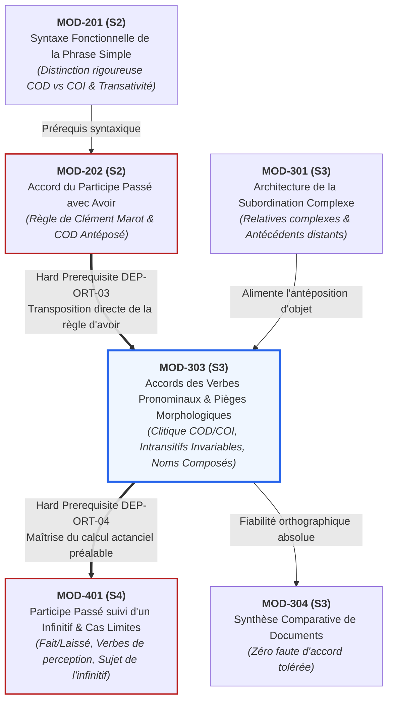

# Fiche Pédagogique Opérationnelle — Module MOD-303

> **Identifiant** : `MOD-303`  
> **Titre** : *Orthographe Grammaticale Approfondie : Accords des Verbes Pronominaux et Pièges Morphologiques*  
> **Semestre** : Année 2 — Semestre 3 (S3)  
> **Domaines mobilisés** : DOM-02 (Orthographe grammaticale), DOM-04 (Conjugaison et syntaxe du verbe), DOM-12 (Correction, révision et contrôle qualité)  
> **Volume horaire estimé** : 17 heures (Étude théorique : 4 h 30 | Pratique délibérée : 6 h 30 | Correction raisonnée : 3 h 30 | Révision active : 2 h 30)  
> **Statut** : [STATUT : PROPOSÉ — EN ATTENTE DE VALIDATION]  
> **Alignement** : [`academic-structure.md`](file:///f:/Formation/world-class-french/01-architecture/academic-structure.md), [`dependency-graph.md` (DEP-ORT-03)](file:///f:/Formation/world-class-french/01-architecture/dependency-graph.md#22-axe-orthographe-grammaticale--accords-du-canonique-aux-cas-limites), [`competency-framework.md` (FR-ORTHO-004)](file:///f:/Formation/world-class-french/02-competency-framework/competency-framework.md#fr-ortho-004-résolution-des-accords-des-verbes-pronominaux), [`syllabus.md` (S3)](file:///f:/Formation/world-class-french/03-curriculum/year-2/semester-3/syllabus.md#module-mod-303--orthographe-grammaticale-approfondie--accords-des-verbes-pronominaux), [`source-registry.md`](file:///f:/Formation/world-class-french/07-resources/source-registry.md)

---

## 1. Présentation et Intérêt du Module

Le module `MOD-303` représente la frontière analytique décisive entre la compétence rédactionnelle empirique et la maîtrise experte du français écrit. Dans l'écosystème normatif de la langue française, l'accord du participe passé des verbes pronominaux et la flexion des noms composés constituent deux des zones de friction orthographique les plus denses, où les hésitations, les fautes par hypercorrection et les automatisations trompeuses pénalisent lourdement les copies d'examen et les écrits professionnels.

Si l'usage oral neutralise fréquemment ces distinctions phonétiques (*ils se sont succédé* vs *\*ils se sont succédés* s'entendent à l'identique), l'écrit universitaire, administratif et littéraire exige une exactitude sans concession. L'accord des verbes pronominaux ne repose pas sur une collection arbitraire d'exceptions : il est le produit d'une dynamique morphosyntaxique rigoureuse où l'auxiliaire *être* de surface masque, pour les verbes accidentellement pronominaux, la valeur logique et actancielle de l'auxiliaire *avoir* [Réf. SRC-GRAM-01, § 950-955 ; SRC-GRAM-02, chap. 17]. Maîtriser ce module, c'est désamorcer le réflexe conditionné d'accord systématique avec le sujet pour lui substituer un calcul arborescent exact fondé sur le statut du clitique *se* (COD vs COI), la transitivité du verbe de base et la position relative des objets dans la phrase.

Conjointement, le traitement morphologique des noms composés d'usage courant confronte l'apprenant à l'interaction entre nature des composants (nom, adjectif, verbe, adverbe, préposition) et sémantique relationnelle, tout en intégrant les principes de régularisation portés par les rectifications orthographiques de 1990 [Réf. SRC-NORM-02 ; SRC-GRAM-05, § 82]. Ce module apporte une grille d'arbitrage définitive, éradiquant l'insécurité linguistique face à ces écueils.

---

## 2. Place dans le Cursus

- **Position séquentielle** : Semaines 8 à 10 du Semestre 3 (S3), formant le point d'orgue morphosyntaxique de la deuxième année du cursus.
- **Rôle architectural** : Goulet d'étranglement normatif du Cycle 2. Il verrouille l'autonomie orthographique (`FR-ORTHO-004`) avant l'abord des cas limites du participe suivi d'un infinitif en Semestre 4.
- **Relations amont/aval** :
  - *En amont* :
    - `MOD-102` (identification infaillible des classes grammaticales, distinction fondamentale nature vs fonction) ;
    - `MOD-201` (syntaxe fonctionnelle de la phrase simple, identification formelle du COD et du COI par tests de substitution clitique et commutation passive) ;
    - `MOD-202` (lien bloquant direct *Hard Prerequisite*, [`dependency-graph.md`, DEP-ORT-03](file:///f:/Formation/world-class-french/01-architecture/dependency-graph.md#22-axe-orthographe-grammaticale--accords-du-canonique-aux-cas-limites) : maîtrise complète de la règle de l'antéposition du COD avec l'auxiliaire *avoir*, pivot indispensable au calcul actanciel des verbes accidentellement pronominaux).
  - *En aval* :
    - Lien de dépendance bloquante directe (*Hard Prerequisite*, [`dependency-graph.md`, DEP-ORT-04](file:///f:/Formation/world-class-french/01-architecture/dependency-graph.md#22-axe-orthographe-grammaticale--accords-du-canonique-aux-cas-limites)) vers `MOD-401` (Semestre 4 : cas limites d'accord du participe passé suivi d'un infinitif, verbes *faire / laisser* et verbes de perception) ;
    - Soutien indispensable pour les épreuves écrites de synthèse comparative de documents (`MOD-304`), de dissertation académique (`MOD-403`) et de révision éditoriale professionnelle (`MOD-504`).

---

## 3. Prérequis et Diagnostic

### 3.1 Prérequis Stricts
1. **Transitivité verbale consolidée** : Discrimination immédiate entre transitif direct (*construire qqch.*), transitif indirect (*succéder à qqn.*) et intransitif pur (*dormir, marcher*) (`MOD-201`, `FR-SYNTAX-001`).
2. **Mécanisme d'accord avec avoir automatisé** : Application infaillible de la règle de Marot sur COD antéposé vs postposé (`MOD-202`, `FR-ORTHO-003`).
3. **Reconnaissance morphosyntaxique des pronoms** : Analyse des traits de personne, de genre et de nombre des pronoms personnels conjoints réfléchis (*me, te, se, nous, vous, se*) et clitiques d'objet (*le, la, les, lui, leur*).

### 3.2 Protocole Diagnostique d'Entrée (Semaine 8, 30 minutes)
Le diagnostic obligatoire évalue deux dimensions :
- **Volet A — Détection actancielle sous la voix pronominale (10 formes verbales)** : L'apprenant doit identifier si le verbe existe sans le pronom à l'actif, et si son complément direct est matériellement exprimé ou incarné par le pronom.
- **Volet B — Épreuve de tri des participes pronominaux (10 phrases brutes)** : L'apprenant classe 10 énoncés pronominaux au passé composé en trois catégories : *Accord obligatoire avec le sujet*, *Accord avec le COD antéposé*, *Invariabilité obligatoire*.
- **Seuil d'alerte** : Tout score inférieur à 16/20 déclenche un sas d'urgence de 2 heures centré sur le réentraînement à la valence des verbes transitifs indirects et au repérage du COD de `MOD-202`.

---

## 4. Objectifs Pédagogiques Mesurables

Au terme des 17 heures du module `MOD-303`, l'apprenant doit être capable de :
1. **Classifier** sans erreur n'importe quel verbe pronominal en contexte selon la typologie quadripartite : essentiellement pronominal, pronominal passif, réfléchi ou réciproque [Réf. SRC-GRAM-01, § 950-955 ; SRC-GRAM-02, chap. 17].
2. **Assigner** au pronom personnel conjoint réfléchi (*se, s'*) sa fonction syntaxique exacte (COD, COI ou simple marqueur morphologique de voix dénué de fonction syntaxique autonome).
3. **Résoudre** avec une fiabilité de 100 % l'accord ou l'invariabilité du participe passé des verbes accidentellement pronominaux selon la présence et la position du COD (pronom réfléchi COD vs COD nominal postposé).
4. **Identifier** instantanément les verbes de la liste fermée des intransitifs par nature (*se plaire, se complaire, se déplaire, se rire, se nuire, se convenir, se ressembler, se succéder, se suffire, se survivre*) et appliquer leur invariabilité absolue [Réf. SRC-GRAM-01, § 955].
5. **Appliquer** les règles d'accord au pluriel des noms composés d'usage courant selon la grammaire traditionnelle et expliciter les régularisations normatives admises par les rectifications de 1990 [Réf. SRC-NORM-02 ; SRC-GRAM-05, § 82].
6. **Rédiger** une justification métalinguistique exhaustive pour toute décision d'accord litigieuse en concours ou en révision éditoriale.

---

## 5. Compétences Visées et Niveaux de Maîtrise Attendus

| Identifiant | Intitulé de la Compétence | Palier d'Entrée | Palier Visé MOD-303 | Preuve Observable Spécifique |
| :--- | :--- | :---: | :---: | :--- |
| [`FR-ORTHO-004`](file:///f:/Formation/world-class-french/02-competency-framework/competency-framework.md#fr-ortho-004-résolution-des-accords-des-verbes-pronominaux) | **Résolution des accords des verbes pronominaux** | L1 / L2 | **L3 (Autonomie)** | Arbitrage sans faute de 20 phrases pièges controversées avec arbre de décision explicite et note 20/20. |
| [`FR-ORTHO-001`](file:///f:/Formation/world-class-french/02-competency-framework/competency-framework.md#fr-ortho-001-orthographe-lexicale-et-morphologie-dérivationnelle) | **Pluriel des noms composés et morphologie lexicale** | L2 | **L3 (Autonomie)** | 100 % de formes correctes sur une batterie de 20 noms composés complexes (noms avec verbe, adverbe, garde-). |
| [`FR-SYNTAX-001`](file:///f:/Formation/world-class-french/02-competency-framework/competency-framework.md#fr-syntax-001-analyse-fonctionnelle-et-délimitation-de-la-phrase-simple) | **Analyse de la valence verbale et du statut actanciel** | L2 | **L3 (Autonomie)** | Démonstration formelle de la transitivité indirecte sémantique vs syntaxique d'un verbe en contexte. |

### Définition Observable du Palier L3 (Autonomie) pour `FR-ORTHO-004` :
L'apprenant n'accorde jamais « à l'instinct » ou en fonction de l'oreille. Face à une forme verbale pronominale passée, il exécute automatiquement l'algorithme d'arbitrage en quatre étapes :
1. *Contrôle d'essentialité ou de passivité* : Le verbe est-il essentiellement pronominal ou à sens passif ? $\rightarrow$ Si oui : accord avec le sujet.
2. *Contrôle de valence* : Si le verbe est accidentellement pronominal, est-il transitif direct ou intransitif/transitif indirect ? $\rightarrow$ S'il appartient à la liste fermée (*se plaire, se succéder, etc.*) : invariabilité immédiate.
3. *Analyse du pronom réfléchi* : Si le verbe admet un COD, le pronom conjoint assume-t-il cette fonction ? $\rightarrow$ Si *se* est COD : accord avec *se* (renvoyant au sujet).
4. *Contrôle du COD distinct* : Y a-t-il un COD nominal distinct ? Est-il placé après (invariabilité) ou avant (accord avec ce COD) ?

---

## 6. Plan Détaillé des Chapitres

```text
ARCHITECTURE PÉDAGOGIQUE DU MODULE MOD-303 (17 HEURES)
├── CHAPITRE 1 : FONDEMENT LINGUISTIQUE DU SYSTÈME PRONOMINAL
│   ├── 1.1 Le morphème « se » : clitique syntaxique, diathèse et voix moyenne
│   ├── 1.2 Le leurre de l'auxiliaire « être » : morphologie de surface vs sémantique d'« avoir »
│   └── 1.3 Typologie fonctionnelle exhaustive des verbes pronominaux
├── CHAPITRE 2 : VERBES ESSENTIELLEMENT PRONOMINAUX ET SENS PASSIF
│   ├── 2.1 Les verbes intrinsèquement pronominaux (s'enfuir, se souvenir, s'abstenir, s'écrier)
│   ├── 2.2 Les verbes à autonomie sémantique radicale (s'apercevoir de, s'aviser de, s'attaquer à)
│   ├── 2.3 Les pronominaux à sens passif (le livre s'est vendu, les règles se sont propagées)
│   └── 2.4 L'exception étymologique et morphologique unique : « s'arroger »
├── CHAPITRE 3 : VERBES ACCIDENTELLEMENT PRONOMINAUX (RÉFLÉCHIS ET RÉCIPROQUES)
│   ├── 3.1 Définition des sens réfléchi et réciproque : co-référence du sujet et de l'objet
│   ├── 3.2 Analyse fonctionnelle du clitique conjoint : pronom COD vs pronom COI
│   ├── 3.3 Présence d'un COD distinct postposé (elle s'est lavé les mains)
│   └── 3.4 Antéposition du COD distinct par pronom ou relatif (les mains qu'elle s'est lavées)
├── CHAPITRE 4 : LA LISTE FERMÉE DES PARTICIPES INTRANSITIFS INVARIABLY INVARIABLES
│   ├── 4.1 Pourquoi ces verbes sont-ils structurellement invariables ? La rection prépositionnelle
│   ├── 4.2 Les 10 verbes cardinaux : se plaire, se complaire, se déplaire, se rire, se nuire,
│   │   se convenir, se ressembler, se succéder, se suffire, se survivre
│   └── 4.3 Démystification de l'erreur la plus répandue en concours : « ils se sont succédés »
├── CHAPITRE 5 : PLURIEL DES NOMS COMPOSÉS ET PIÈGES MORPHOLOGIQUES
│   ├── 5.1 Règle générale traditionnelle : nature des éléments constitutifs et sémantique
│   ├── 5.2 Les combinaisons régulières : Nom + Nom, Adjectif + Nom, Nom + Adjectif
│   ├── 5.3 Les combinaisons mixtes : Verbe + Nom, Adverbe/Préposition + Nom, Phrases figées
│   ├── 5.4 Le cas critique des composés en « garde- » (nom de personne vs verbe d'action)
│   └── 5.5 Les rectifications de 1990 : règles de soudure et pluriel régularisé des Verbe + Nom
└── CHAPITRE 6 : SYNTHÈSE ALGORITHMIQUE ET PROTOCOLE D'ARBITRAGE
    ├── 6.1 L'arbre de décision unifié en 4 questions fermées
    └── 6.2 Méthodologie de la fiche d'arbitrage universitaire et professionnelle
```

---

## 7. Concepts Fondamentaux et Notions Avancées

### 7.1 Concepts Fondamentaux
- **Statut linguistique du clitique conjoint *se*** :
  Le pronom *se* (ou ses formes *me, te, nous, vous*) n'est pas un mot plein indépendant, mais un clitique morphologiquement rattaché au verbe. Selon la diathèse verbale, il assume deux statuts linguistiques radicalement différents [Réf. SRC-GRAM-02, chap. 17] :
  1. *Un pur marqueur morphosyntaxique* : Pour les verbes essentiellement pronominaux (*s'évanouir*) ou passifs (*la porte s'est refermée*), *se* ne représente aucun actant séparable ; il n'est ni COD ni COI. Le participe fait alors corps avec son sujet et s'accorde avec lui en genre et en nombre, exactement comme un verbe conjugué avec le véritable auxiliaire *être*.
  2. *Un actant anaphorique plein* : Pour les verbes accidentellement pronominaux (*se blesser, se parler*), *se* sature une case argumentale du verbe : il est le représentant réflexif du sujet dans la fonction de COD (*Elle a blessé qui ? se = elle-même*) ou de COI (*Elle a parlé à qui ? se = à elle-même*).
- **Leurre de l'auxiliaire *être*** :
  Dans l'histoire du français, la généralisation de l'auxiliaire *être* pour toutes les formes pronominales est une convention formelle de surface issue du Moyen Âge. En syntaxe profonde, les formes accidentellement pronominaux relèvent de la structure transitive transitive de l'auxiliaire *avoir* : *Elles se sont lavées* équivaut conceptuellement à *Elles ont lavé elles-mêmes* [Réf. SRC-GRAM-01, § 950]. Par conséquent, **le participe ne s'accorde jamais avec le sujet sous prétexte qu'il y a l'auxiliaire être** : il ne s'accorde qu'avec le COD s'il précède.

### 7.2 Notions Avancées
- **Transitivité indirecte sémantique vs syntaxique (La liste fermée des 10 verbes)** :
  La source d'erreur la plus destructrice en français écrit réside dans la confusion entre l'action réciproque ressentie psychologiquement (sémantique) et le régime de la préposition (syntaxe). 
  Des verbes comme *succéder, plaire, convenir, nuire, ressembler* réclament obligatoirement un complément d'objet indirect introduit par *à* :
  - *succéder À quelqu'un* $\rightarrow$ *ils ont succédé À qui ?* $\rightarrow$ *l'un à l'autre* (*se* = COI).
  - *nuire À quelqu'un* $\rightarrow$ *elles ont nui À qui ?* $\rightarrow$ *l'une à l'autre* (*se* = COI).
  Ces verbes ne disposant d'aucune possibilité de rection directe (on ne peut pas « \*succéder quelqu'un » ni « \*nuire quelqu'un »), le clitique *se* est **structurellement condamné à être COI**. Comme ces verbes ne tolèrent aucun COD, la règle de Clément Marot s'applique de façon implacable : en l'absence absolue de COD antéposé, **le participe passé demeure invariablement invariable** [Réf. SRC-GRAM-01, § 955].
  *Liste fermée des 10 verbes cardinaux à invariabilité absolue* :
  1. *se plaire* (plaire à) $\rightarrow$ *Elles se sont plu.*
  2. *se complaire* (se complaire à/dans) $\rightarrow$ *Ils se sont complu.*
  3. *se déplaire* (déplaire à) $\rightarrow$ *Elles se sont déplu.*
  4. *se rire* (se rire de) $\rightarrow$ *Ils se sont ri des menaces.*
  5. *se nuire* (nuire à) $\rightarrow$ *Ils se sont nui mutuellement.*
  6. *se convenir* (convenir à) $\rightarrow$ *Ces conditions se sont convenu.*
  7. *se ressembler* (ressembler à) $\rightarrow$ *Les deux sœurs se sont ressemblé.*
  8. *se succéder* (succéder à) $\rightarrow$ *Les rois se sont succédé.*
  9. *se suffire* (suffire à) $\rightarrow$ *Ces explications se sont suffi.*
  10. *se survivre* (survivre à) $\rightarrow$ *Les institutions se sont survécu.*
- **L'anomalie morphosyntaxique de *s'arroger*** :
  Parmi tous les verbes qui ne s'emploient qu'à la forme pronominale, *s'arroger* (du latin *arrogare*, s'attribuer par prétention) constitue l'unique exception doctrinale [Réf. SRC-GRAM-01, § 955 b]. Alors que les autres verbes essentiellement pronominaux s'accordent avec le sujet (*elles se sont souvenues*), les grammairiens et l'Académie française analysent dans *s'arroger* le pronom *se* comme un COI (« s'attribuer à soi-même »). Dès lors, il suit la règle des verbes accidentellement pronominaux :
  - *Ils se sont arrogé des droits exorbitants.* (COD *droits* postposé $\rightarrow$ participe invariable).
  - *Les droits exorbitants qu'ils se sont arrogés.* (COD *que* antéposé $\rightarrow$ accord avec *droits*).
- **Algorithme d'arbitrage binaire unifié** :

```text
                  [VERBE CONJUGUÉ SOUS LA FORME PRONOMINALE]
                                      │
                   Le verbe est-il essentiellement pronominal
                     ou employé dans un sens purement passif ?
                                 /          \
                             OUI              NON (Accidentellement pronominal :
                              │                    réfléchi ou réciproque)
                 ACCORD SYSTÉMATIQUE                       │
                   AVEC LE SUJET              Le verbe fait-il partie de la liste fermée
                (Exception : s'arroger)       des 10 intransitifs (succéder, plaire...) ?
                                                          /              \
                                                      OUI                  NON
                                                       │                    │
                                                  INVARIABLE       Existe-t-il un COD ?
                                                  ABSOLU                  /     \
                                                                       NON        OUI
                                                                        │          │
                                                                   INVARIABLE   Où est le COD ?
                                                                                /             \
                                                                        POSTPOSÉ               ANTÉPOSÉ
                                                                           │                      │
                                                                       INVARIABLE          ACCORD EN GENRE
                                                                    (ex: lavé les mains)    ET EN NOMBRE
                                                                                           (ex: se / que)
```

---

## 8. Erreurs et Confusions Fréquentes

| Énoncé fautif | Faille cognitive / Source de confusion | Analyse linguistique et forme normée | Source |
| :--- | :--- | :--- | :--- |
| *\*« Ils se sont succédés à la présidence. »* | **Biais d'analogie avec l'auxiliaire être et le sens réciproque.** L'apprenant associe le pluriel du sujet et l'idée de pluralité temporelle à un accord d'adjectif. | *Succéder* réclame un COI (*succéder à qqn*). Le pronom *se* est COI. Absence absolue de COD $\rightarrow$ invariabilité : *« Ils se sont **succédé** à la présidence. »* | [SRC-GRAM-01, § 955] |
| *\*« Elle s'est lavée les mains avant le repas. »* | **Omission du calcul de position du COD distinct.** L'apprenant accorde avec le sujet *elle* en constatant que le verbe *laver* est transitif direct. | Le COD n'est pas *se*, mais *les mains*, placé **après** le verbe. Le clitique *se* est COI (*à elle-même*). COD postposé $\rightarrow$ invariabilité : *« Elle s'est **lavé** les mains. »* | [SRC-GRAM-02, chap. 17] |
| *\*« Elles se sont parlées longuement hier. »* | **Confusion entre objet direct et indirect dans la réciprocité.** L'apprenant croit que « se parler » s'accorde car l'action est partagée. | On dit *parler à quelqu'un*. Le pronom *se* est COI. Verbe sans COD $\rightarrow$ invariabilité rigoureuse : *« Elles se sont **parlé** longuement hier. »* | [SRC-GRAM-01, § 955] |
| *\*« Ces deux nations se sont déclarées la guerre. »* | **Confusion entre l'attribut d'objet ou le bénéficiaire et le COD.** | Déclarer quoi ? *la guerre* (COD postposé). À qui ? *se* (l'une à l'autre, COI). Le participe est invariable : *« Ces deux nations se sont **déclaré** la guerre. »* | [SRC-GRAM-02, chap. 17] |
| *\*« Ils se sont arrogués tous les privilèges. »* | **Assimilation aveugle aux verbes essentiellement pronominaux.** L'apprenant sait que *s'arroger* n'existe pas sans le pronom et accorde par défaut avec le sujet. | *S'arroger* suit la règle de la rection d'objet : *se* y est COI et *tous les privilèges* est COD postposé $\rightarrow$ invariable : *« Ils se sont **arrogé** tous les privilèges. »* | [SRC-GRAM-01, § 955 b] |
| *\*« Des gardes-mangers »* (en graphie traditionnelle) | **Méconnaissance de la catégorie verbale de garde-.** L'apprenant traite *garde* comme un nom de personne. | Dans *garde-manger*, *garde* est le verbe *garder* (qui garde le manger). Le verbe ne s'accorde jamais : *« Des **garde-manger** »* (traditionnel) ou *« Des **garde-mangers** »* (1990). | [SRC-GRAM-05, § 82] |
| *\*« Des timbres-postes »* (en graphie traditionnelle) | **Omission du rapport de complémentation prépositionnelle implicite.** L'apprenant applique l'accord Nom + Nom sans analyser la dépendance. | Il s'agit de *timbres pour la poste* (ellipse de préposition). Le second nom reste au singulier : *« Des **timbres-poste** »*. | [SRC-GRAM-01, § 525] |

---

## 9. Exemples Progressifs

### 9.1 Niveau Simple (Configurations Canoniques)
- *Essentiellement pronominal* : *Les manifestantes se sont enfui**es** dès l'arrivée des forces de l'ordre.* (*s'enfuir* n'existe qu'à la forme pronominale $\rightarrow$ accord systématique avec le sujet *les manifestantes*).
- *Sens passif* : *Cette pièce de théâtre s'est joué**e** plus de trois cents fois.* (*la pièce a été jouée* $\rightarrow$ accord avec le sujet *cette pièce*).
- *Réfléchi canonique avec pronom COD* : *Elle s'est blessé**e** lors de son entraînement matinal.* (*Elle a blessé qui ? se = elle-même* $\rightarrow$ *se* est COD antéposé, accord féminin singulier).
- *Nom composé régulier (Nom + Adjectif)* : *Ils ont acheté des coffres-fort**s** et des plates-band**es**.* (Les deux éléments variables s'accordent).

### 9.2 Niveau Intermédiaire (Disjonctions Actancielles et Concurrence d'Objets)
- *Pronom réfléchi COI sans COD* : *Ils se sont nui**s** ? Non : ils se sont nui.* (*nuire à quelqu'un* $\rightarrow$ *se* est COI, aucune marque d'accord).
- *COD nominal postposé vs antéposé* :
  - *Elle s'est lavé les mains.* (COD *les mains* postposé $\rightarrow$ invariable).
  - *Les mains qu'elle s'est lavé**es** étaient maculées d'encre.* (COD *que* antéposé renvoyant à *les mains* $\rightarrow$ accord féminin pluriel).
- *Nom composé avec verbe (Verbe + Nom)* :
  - Traditionnel : *Des essuie-mains* (il essuie les mains $\rightarrow$ nom au pluriel) ; *des gratte-ciel* (il gratte le ciel $\rightarrow$ nom invariable singulier).
  - Rectifié 1990 : *Des essuie-mains* ; *des gratte-ciels* (pluriel régulier avec -s au second élément au pluriel) [Réf. `SRC-NORM-02`].
- *Le piège de garde-* :
  - *Des gardes-chasse* (nom de personne : gardes qui chassent $\rightarrow$ accord des deux noms).
  - *Des garde-fous* (*garde* est verbe : qui garde les fous d'une chute $\rightarrow$ verbe invariable).

### 9.3 Niveau Complexe (Enchâssements Relatifs, Polysémie et Formes Rares)
- *Antéposition complexe avec double pronom et subordonnée* :
  - *Les prérogatives exorbitantes que la direction s'est arrogé**es** sans consultation syndicale.* (*que* = COD antéposé de *s'est arrogées* $\rightarrow$ accord féminin pluriel avec *prérogatives*).
- *Verbes de réciprocité asymétrique* :
  - *Ces deux avocats se sont disputé les faveurs du tribunal.* (*disputer quoi ? les faveurs* = COD postposé ; *à qui ? se* = COI $\rightarrow$ invariable *disputé*).
  - *Les faveurs que ces deux avocats se sont disputé**es** étaient considérables.* (COD *que* antéposé $\rightarrow$ accord féminin pluriel *disputées*).
- *La cascade des intransitifs enchaînés* :
  - *Elles se sont plu, se sont souri, puis se sont succédé sans jamais s'être nui.* (Quatre participes strictement invariables : *plaire à*, *sourire à*, *succéder à*, *nuire à*).
- *Noms composés à ellipse prépositionnelle et locutions invariables* :
  - *Des stations-service* (stations pour le service $\rightarrow$ *service* au singulier).
  - *Des demi-heures* (*demi* invariable devant le trait d'union).
  - *Des va-et-vient, des on-dit, des pince-sans-rire* (expressions figées $\rightarrow$ invariabilité intégrale).

---

## 10. Activités d'Observation et de Découverte

### Atelier 1 : « Le test du scalpel actif : Démasquer le clitique » (1 heure)
- **Dispositif** : Un tableau de 12 phrases contenant des verbes au passé composé pronominal.
- **Tâche** : Pour chaque phrase, l'apprenant doit obligatoirement reconstruire l'énoncé équivalent à la voix active avec l'auxiliaire *avoir* en explicitant la question syntaxique :
  - *« Marie s'est coupée »* $\rightarrow$ *Marie a coupé qui ? [Marie elle-même = se]* $\rightarrow$ COD antéposé $\rightarrow$ accord.
  - *« Marie s'est coupé le doigt »* $\rightarrow$ *Marie a coupé quoi ? [le doigt]* $\rightarrow$ COD postposé $\rightarrow$ invariable.
  - *« Marie et Paul se sont téléphoné »* $\rightarrow$ *Marie a téléphoné à qui ? [à Paul]* $\rightarrow$ COI $\rightarrow$ invariable.
- **Objectif didactique** : Démontrer matériellement que la prétendue exception des pronominaux n'est rien d'autre que l'application pure et simple du module `MOD-202`.

### Atelier 2 : « L'autopsie des dix intransitifs de concours » (1 heure)
- **Dispositif** : Étude d'un corpus de 10 citations issues de délibérations juridiques et d'annales de concours d'agrégation et d'école de la magistrature.
- **Tâche** : Isoler les 10 verbes cardinaux (*succéder, plaire, déplaire, complaire, nuire, rire, convenir, ressembler, suffire, survivre*). Pour chacun, l'apprenant tente de former une phrase active avec un COD direct. Constatant l'impossibilité linguistique absolue (\*« il a plu sa collègue », \*« il a succédé son père »), l'apprenant grave la formule mnémotechnique de l'invariabilité structurelle.

### Atelier 3 : « Le laboratoire du tiret : Noms composés et statut de garde- » (45 min)
- **Dispositif** : Fiches d'analyse morphologique contrastée de 15 noms composés contenant le segment *garde-* et des verbes lexicalisés (*abat-jour, portefeuille, gratte-ciel*).
- **Tâche** :
  1. Identifier la catégorie grammaticale de *garde* par le test de l'agentivité : *Le garde est-il une personne qui monte la garde ?* (Oui $\rightarrow$ nom ; Non $\rightarrow$ verbe).
  2. Confronter la norme traditionnelle du *Bon Usage* [Réf. `SRC-GRAM-01`] et la tolérance des rectifications de 1990 [Réf. `SRC-NORM-02`].

---

## 11. Exercices Progressifs

### 11.1 Niveau 1 : Typologie et Résolution Directe (2 heures)
- **Exercice 1.1 (Tri typologique)** : Dans 15 énoncés, classifier les verbes pronominaux en 4 colonnes : *Essentiellement pronominal*, *Sens passif*, *Réfléchi*, *Réciproque*.
- **Exercice 1.2 (Accord canonique réfléchi vs essentiel)** : Accorder les participes passés entre parenthèses dans 20 phrases où le pronom est exclusivement soit essentiel (*s'enfuir, s'évanouir*), soit COD réfléchi direct (*se laver, se féliciter, se blesser*).
- **Exercice 1.3 (Noms composés élémentaires)** : Mettre au pluriel 15 noms composés réguliers constitués de Nom + Nom ou Adjectif + Nom (*coffre-fort, oiseau-mouche, plate-bande, rond-point*).

### 11.2 Niveau 2 : Concurrence d'Objets et Intransitifs Invariables (2 h 30)
- **Exercice 2.1 (Le laboratoire du COD postposé)** : Dans 15 phrases présentant des verbes accidentellement pronominaux suivis d'un syntagme nominal, déterminer si le nom est COD ou circonstanciel, et justifier l'accord ou l'invariabilité (*Elle s'est (lavé/lavée) les cheveux* vs *Les cheveux qu'elle s'est (lavé/lavés)*).
- **Exercice 2.2 (Batterie des 10 intransitifs)** : Résoudre l'accord du participe passé dans 15 phrases construites avec *se plaire, se complaire, se nuire, se succéder, se ressembler, se convenir*.
- **Exercice 2.3 (Pluriel de Verbe + Nom et composés en garde-)** : Mettre au pluriel 15 noms composés piégés en graphie traditionnelle et selon les rectifications de 1990 (*garde-manger, garde-chasse, garde-fou, gratte-ciel, tire-bouchon, abat-jour*).

### 11.3 Niveau 3 : Arbitrage de Haute Précision et Textes d'Élite (2 heures)
- **Exercice 3.1 (Cas limites et anomalies actancielles)** : Justifier l'orthographe exacte des participes dans 15 phrases d'auteurs comportant des antépositions de compléments d'objet sur *s'arroger*, des doubles pronoms et des coordinations de verbes pronominaux à régimes divergents.
- **Exercice 3.2 (Révision de texte universitaire)** : Dans un texte académique de 250 mots truffé de 12 fautes délibérées d'accord de verbes pronominaux et de pluriel de noms composés, identifier les erreurs, biffer les formes fautives, écrire la graphie normée et rédiger l'attestation grammaticale de chaque correction.

---

## 12. Ateliers de Correction et de Révision

### Protocole d'Autocorrection Systématique en Trois Cribles Morphosyntaxiques
Pour éliminer les accords fautifs lors de toute production d'examen ou d'édition, l'apprenant applique le crible d'arbitrage suivant :

```text
PROTOCOLE D'AUTOCORRECTION DES FORMES PRONOMINALES
├── CRIBLE 1 : CRIBLE DE L'ESSENTIALITÉ ET DE LA PASSIVITÉ
│   ├── Le verbe existe-t-il à la voix active sans se ? (ex: s'enfuir -> *enfuir n'existe pas)
│   │   ├── NON -> Verbe essentiellement pronominal -> ACCORD AVEC LE SUJET.
│   │   │   └── VÉRIFICATION D'EXCEPTION : Est-ce « s'arroger » ?
│   │   │       └── Si s'arroger -> Ne pas accorder avec le sujet ! Passer au Crible 3.
│   │   └── OUI -> L'action est-elle subie par un sujet passif inanimé ? (ex: le livre s'est vendu)
│   │       └── OUI -> Pronominal passif -> ACCORD AVEC LE SUJET.
│   │       └── NON -> Le verbe est accidentellement pronominal -> Passer au Crible 2.
├── CRIBLE 2 : CRIBLE DE LA TRANSITIVITÉ DE BASE (LE FILTRE DES INTRANSITIFS)
│   ├── Le verbe fait-il partie de la liste fermée des 10 intransitifs par nature ?
│   │   (se plaire, complaire, déplaire, rire, nuire, convenir, ressembler, succéder, suffire, survivre)
│   │   ├── OUI -> STOP IMMÉDIAT : PARTICIPE STRICTEMENT INVARIABLE.
│   │   │   └── Neutralisation de tout réflexe d'accord phonétique ou sujet !
│   │   └── NON -> Le verbe admet un complément direct -> Passer au Crible 3.
└── CRIBLE 3 : CRIBLE DU COD DE CLÉMENT MAROT
    ├── Poser la question actancielle active : [Sujet] + a [participe] + QUI / QUOI ?
    │   ├── Y a-t-il un COD nominal placé APRÈS le verbe ? (ex: lavé les mains)
    │   │   └── OUI -> INVARIABLE.
    │   ├── Y a-t-il un COD nominal ou pronominal placé AVANT le verbe ? (ex: les mains qu'elle s'est lavées)
    │   │   └── OUI -> ACCORD AVEC CE COD ANTÉPOSÉ.
    │   └── C'est le pronom « se » lui-même qui répond à la question « QUI/QUOI ? » (ex: elles se sont rencontrées)
    │       └── OUI -> ACCORD DU PARTICIPE AVEC « SE » (donc avec le sujet référent).
```

---

## 13. Production Intégratrice

### Nature de la Production
**Fiche d'arbitrage morphosyntaxique exhaustive d'un corpus de 20 phrases controversées de verbes pronominaux et pièges morphologiques.**

### Consigne Opérationnelle
L'apprenant reçoit un corpus de 20 phrases comportant des verbes pronominaux non accordés et des noms composés au singulier. Pour chaque phrase, il doit :
1. Rétablir l'orthographe rigoureusement normée du participe passé et du nom composé.
2. Déployer l'arbre de décision complet justifiant sa décision.
3. Rédiger la justification en 4 champs :
   - *Nature du verbe pronominal (essentiel, passif, réfléchi, réciproque)* ;
   - *Statut syntaxique exact du pronom conjoint ou du complément nominal (COD antéposé, postposé, COI)* ;
   - *Règle grammaticale appliquée avec référence bibliographique canonique* ;
   - *Pour les noms composés : analyse de la nature de chaque composant et règle de pluralisation appliquée*.

### Corpus Officiel des 20 Phrases Controversées d'Arbitrage :
1. *Ces deux souverains éclairés se sont (succédé) sur le trône sans qu'aucun conflit n'éclate.*
2. *Elles se sont (lavé) les mains avec une minutie chirurgicale.*
3. *Les mains ensanglantées que les chirurgiennes se sont (lavé) après l'opération.*
4. *Les clauses léonines et les prérogatives indues que le directoire s'est (arrogé).*
5. *Ces deux délégations diplomatiques se sont (rencontré) à Genève et se sont longuement (parlé).*
6. *Ils se sont (rendu) compte de leur bévue bien trop tard.*
7. *Les vérités universelles se sont (propagé) à travers tout le continent.*
8. *Elles se sont (souri), puis elles se sont (plu) dès le premier regard.*
9. *Les deux accusées se sont (reproché) mutuellement les pires défaillances.*
10. *Les reproches amers qu'elles se sont (fait) ont détruit leur amitié.*
11. *Ces deux espèces animales se sont (ressemblé) pendant des millénaires avant de diverger.*
12. *Elle s'est (imaginé) que nous céderions à ses exigences extravagantes.*
13. *Elles se sont (abstenu) de tout commentaire désobligeant lors de la délibération.*
14. *Les blessures profondes qu'ils se sont (infligé) mettront des années à cicatriser.*
15. *Ils se sont (arrogé) le droit d'inspecter tous nos registres comptables.*
16. *Les deux filiales se sont (nuire) en menant une guerre des prix dévastatrice.*
17. *Des (coffre-fort) blindés ont été installés dans les (arrière-boutique).*
18. *Les (garde-chasse) ont surpris des braconniers qui franchissaient les (garde-fou).*
19. *Nous avons acheté plusieurs (essuie-mains) et deux nouveaux (lave-vaisselle).*
20. *Ces jeunes femmes se sont (douté) de la supercherie et s'en sont (ouvert) à leurs supérieurs.*

---

## 14. Évaluation et Barème

L'évaluation sommative du module `MOD-303` est notée sur **20 points**. Elle applique le barème pénal officiel du cursus ([`assessment-rubrics.md`](file:///f:/Formation/world-class-french/02-competency-framework/assessment-rubrics.md)), conçu pour sanctionner sans indulgence toute régression orthographique sur les accords verbaux fondamentaux :

| Épreuve sommatrice | Contenu et modalités | Barème et pénalités | Seuil éliminatoire |
| :--- | :--- | :--- | :---: |
| **Partie 1 : Dictée de précision morphologique (10 points)** | Dictée universitaire de 150 mots comportant 8 participes passés de verbes pronominaux à haut risque d'erreur et 4 noms composés au pluriel. | • **-4,0 pts par accord de verbe pronominal fautif** (accord fautif d'un intransitif comme *succédé\*, plu\*, nui\** ou accord lors d'un COD postposé).<br/>• **-1,0 pt par faute sur le pluriel d'un nom composé**.<br/>• **-1,0 pt par faute lexicale ou d'accentuation**. | $< 7/10$ |
| **Partie 2 : Justification d'arbitrage sur table (6 points)** | Analyse rédigée de 6 participes pronominaux extraits d'un texte littéraire ou juridique (décomposition actancielle, position du COD, règle de référence). | • **1 pt par analyse complète et exacte** (-0,5 pt si la terminaison est correcte mais la justification syntaxique tronquée ou confuse). | $< 4/6$ |
| **Partie 3 : Épreuve de flexions composées (4 points)** | Pluralisation et justification morphologique de 8 noms composés choisis parmi les formes pièges (*garde-, demi-, verbe + nom*). | • **0,5 pt par forme correcte et justifiée**. | $< 3/4$ |

### Règle d'Attribution et Seuil Éliminatoire :
- **Note minimale de validation du module** : **14/20 (70 %)**.
- **Seuil d'exclusion immédiate** : Deux accords erronés sur des verbes pronominaux dans la Partie 1 retirent d'emblée 8 points ($10 - 8 = 2/10$), ce qui rend mathématiquement la note finale $\le 12/20$. Le candidat est alors ajourné et orienté vers le sas de remédiation orthographique de S3 (3 semaines d'entraînement délibéré avant épreuve de rattrapage).

---

## 15. Critères de Maîtrise

Le module `MOD-303` est formellement certifié au palier **L3 (Autonomie)** lorsque l'apprenant démontre de manière observable les compétences suivantes :
- Résolution avec **100 % d'exactitude** de l'accord ou de l'invariabilité des participes passés des 10 verbes intransitifs de la liste fermée (*se plaire, se complaire, se déplaire, se rire, se nuire, se convenir, se ressembler, se succéder, se suffire, se survivre*) ;
- Maintien rigoureux de l'invariabilité du participe lors de la présence d'un COD nominal postposé (*elle s'est lavé les mains*) ;
- Accord sans faille du participe lorsque le COD précède le verbe, que ce COD soit le pronom réfléchi lui-même (*elles se sont rencontrées*) ou un syntagme nominal antéposé par relativation (*les droits qu'ils se sont arrogés*) ;
- Absence totale de confusion entre les verbes essentiellement pronominaux (*s'enfuir* $\rightarrow$ accord sujet) et les verbes à pronom COI (*se succéder* $\rightarrow$ invariable) ;
- Pluralisation exacte des noms composés d'usage courant avec maîtrise de la distinction entre *garde* nom et *garde* verbe, et restitution des tolérances officielles de 1990.

---

## 16. Révisions Espacées Recommandées

Pour contrecarrer la courbe de l'oubli d'Ebbinghaus et immuniser durablement l'apprenant contre les rechutes d'accord spontané, le calendrier de rappel actif suivant est prescrit :
- **J+3 après validation du module** : Test flash de rappel (10 minutes) : 5 phrases chronométrées axées exclusivement sur les pièges *se succéder*, *se parler* et *se laver les mains*.
- **J+7** : Test de discrimination actancielle (15 minutes) : 10 phrases confrontant *s'arroger*, *se rendre compte* et des antépositions de COD complexes.
- **J+21** : Laboratoire mixte verbes pronominaux et noms composés (20 minutes) : 15 items d'arbitrage.
- **J+45 (Semaine 13 de S3)** : Réactivation majeure intégrée dans la révision cumulative pré-Porte 3.
- **Semestre 4 (S4)** : Réinvestissement structural permanent lors du travail sur le participe passé suivi d'un infinitif (`MOD-401`).

---

## 17. Sources de Référence Vérifiées

Toutes les analyses morphosyntaxiques, règles de valence et décisions normatives de ce document sont fondées sur les autorités reconnues du registre des sources :

1. **Grevisse, Maurice & Goosse, André (2016)**. *Le Bon Usage* (16e éd.). Bruxelles : De Boeck Supérieur.  
   $\rightarrow$ Ouvrage de référence cardinal pour l'accord du participe passé des verbes pronominaux (§ 950-955), l'analyse du pronom réfléchi en COD vs COI (§ 950), le statut des verbes essentiellement pronominaux (§ 951), la liste des verbes intransitifs par nature (§ 955), l'exception singulière de *s'arroger* (§ 955 b) et le pluriel des noms composés (§ 521-529) [Réf. `SRC-GRAM-01`].
2. **Riegel, Martin, Pellat, Jean-Christophe & Rioul, René (2016/2021)**. *Grammaire méthodique du français*. Paris : PUF, coll. « Quadrige ».  
   $\rightarrow$ Référence universitaire pour la morphosyntaxe du verbe et la diathèse pronominale (chap. 17), l'analyse de la voix moyenne et des clitiques conjoints (chap. 7 et 12), ainsi que la structure morphologique des mots composés (chap. 12) [Réf. `SRC-GRAM-02`].
3. **Grevisse, Maurice (2009)**. *Le Petit Grevisse : Grammaire française* (32e éd.). Bruxelles : De Boeck Supérieur.  
   $\rightarrow$ Règles synthétiques et exercices directifs d'accord des verbes pronominaux et pluriel des noms composés (§ 82 et § 274) [Réf. `SRC-GRAM-05`].
4. **Conseil supérieur de la langue française (1990)**. *Les rectifications de l'orthographe (Journal officiel de la République française)*. Paris.  
   $\rightarrow$ Recommandations officielles régularisant le pluriel des noms composés de type Verbe + Nom et les soudures lexicales [Réf. `SRC-NORM-02`].
5. **Ministère de l'Éducation nationale (2020)**. *Terminologie grammaticale*. Paris : Réseau Canopé.  
   $\rightarrow$ Nomenclature officielle définissant les verbes pronominaux (sens réfléchi, réciproque, passif), les compléments de verbe et la rection prépositionnelle [Réf. `SRC-NORM-03`].

---

## 18. Liens avec les Modules Précédents et Suivants


