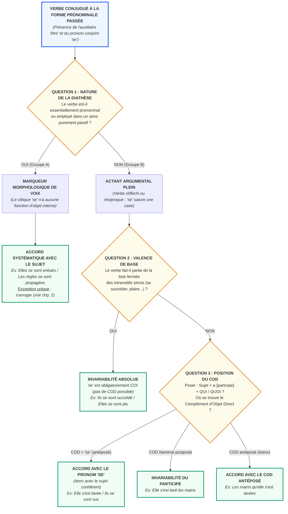

# Chapitre 1 — Fondement Linguistique du Système Pronominal : Clitique Syntaxique, Diathèse, Voix Moyenne et le Leurre de l'Auxiliaire « Être »

> **Identifiant du chapitre** : `CHP-303-01`  
> **Module de rattachement** : [`MOD-303` — Orthographe Grammaticale Approfondie : Accords des Verbes Pronominaux et Pièges Morphologiques](file:///f:/Formation/world-class-french/03-curriculum/year-2/semester-3/mod-303-accords-verbes-pronominaux.md)  
> **Semestre** : Année 2 — Semestre 3 (S3)  
> **Volume horaire canonique** : 5 à 6 heures d'apprentissage autonome délibéré et d'ateliers d'application (Phase 1 Étude : 1 h 30 | Phase 2 Pratique : 1 h 30 | Phase 3 Correction : 1 h 00 | Phase 4 Évaluation : 1 h 00)  
> **Statut** : [STATUT : VALIDÉ]  
> **Compétences associées** : [`FR-ORTHO-004`](file:///f:/Formation/world-class-french/02-competency-framework/competency-framework.md#fr-ortho-004-résolution-des-accords-des-verbes-pronominaux) (L3 Autonomie), [`FR-SYNTAX-001`](file:///f:/Formation/world-class-french/02-competency-framework/competency-framework.md#fr-syntax-001-analyse-fonctionnelle-et-délimitation-de-la-phrase-simple) (L3 Autonomie), [`FR-INT-001`](file:///f:/Formation/world-class-french/02-competency-framework/competency-framework.md#fr-int-001-rédiger-un-texte-long-cohérent-en-maîtrisant-accords-et-ponctuation) (L3 Autonomie)  
> **Sources scientifiques de référence** : `SRC-GRAM-01` (Grevisse & Goosse, *Le Bon Usage*, 16e éd., § 950-951), `SRC-GRAM-02` (Riegel, Pellat & Rioul, *Grammaire méthodique du français*, chap. 17), `SRC-NORM-03` (Ministère de l'Éducation nationale, *Terminologie grammaticale*, 2020, p. 28-32), `SRC-TYPO-01` (Imprimerie nationale, *Lexique des règles typographiques*, 2002), `SRC-GRAM-05` (Grevisse, *Le Petit Grevisse*, 32e éd., § 82, § 274)

---

## 1. Titre et Place dans le Cursus

### 1.1 Intitulé Officiel
**Chapitre 1 : Fondement Linguistique du Système Pronominal : Clitique Syntaxique, Diathèse, Voix Moyenne et le Leurre de l'Auxiliaire « Être »** (`CHP-303-01`).

### 1.2 Insertion Architecturale dans le Cursus
Le présent chapitre inaugure le module [`MOD-303`](file:///f:/Formation/world-class-french/03-curriculum/year-2/semester-3/mod-303-accords-verbes-pronominaux.md), sommet de l'orthographe grammaticale et de l'analyse morphosyntaxique en deuxième année du cursus universitaire.

Dans l'architecture générale de l'apprentissage du français, l'accord des formes verbales pronominales est souvent présenté de manière empirique et fragmentaire sous la forme d'un catalogue touffu d'exceptions arbitraires. Cette vision engendre un réflexe erratique : accorder mécaniquement le participe passé avec le sujet dès lors que l'oreille ou l'œil perçoit l'auxiliaire *être* (*« \*elles se sont parlées »*, *« \*elle s'est lavée les mains »*).

Le module `MOD-303` déconstruit ce mirage en établissant les bases théoriques et fonctionnelles exactes de la diathèse pronominale. L'auxiliaire *être* des formes pronominales n'est qu'un **leurre morphologique de surface** issu d'une convention médiévale ; en syntaxe profonde, le calcul de l'accord des verbes accidentellement pronominaux obéit rigoureusement à la dynamique transitive de l'auxiliaire *avoir* et à la règle du Complément d'Objet Direct (COD) antéposé maîtrisée dans [`MOD-202`](file:///f:/Formation/world-class-french/03-curriculum/year-1/semester-2/mod-202-participe-passe-avoir-ponctuation-interne.md) [Réf. `SRC-GRAM-01`, § 950 ; `SRC-GRAM-02`, chap. 17].

```mermaid
flowchart TD
    MOD201["<b>MOD-201 (S2)</b><br/>Syntaxe Fonctionnelle de la Phrase Simple<br/><i>(Distinction COD vs COI, Valence Verbale)</i>"] --> CHP30301["<b>CHP-303-01 (Fondation)</b><br/>Fondement Linguistique du Système Pronominal<br/><i>(Clitique, Diathèse, Voix Moyenne, Leurre d'Être)</i>"]
    MOD202["<b>MOD-202 (S2)</b><br/>Participe Passé avec Avoir<br/><i>(Principe de Clément Marot & COD Antéposé)</i>"] ==>|<b>DEP-ORT-03 (Hard)</b> : Pivot décisionnel| CHP30301

    subgraph MOD303_FLOW ["Parcours Interne du Module MOD-303 (Semestre 3)"]
        CHP30301 ==> CHP30302["<b>CHP-303-02</b><br/>Verbes Essentiellement Pronominaux & Sens Passif<br/><i>(Accord systématique sujet & Exception s'arroger)</i>"]
        CHP30301 ==> CHP30303["<b>CHP-303-03</b><br/>Verbes Réfléchis & Réciproques<br/><i>(Clitique COD vs COI, COD postposé / antéposé)</i>"]
        CHP30301 ==> CHP30304["<b>CHP-303-04</b><br/>Liste Fermée des Intransitifs Invariables<br/><i>(se succéder, se plaire, se nuire...)</i>"]
        CHP30302 --> CHP30305["<b>CHP-303-05</b><br/>Pluriel des Noms Composés & Pièges<br/><i>(Composés en garde-, rectifications 1990)</i>"]
        CHP30303 --> CHP30305
        CHP30304 --> CHP30305
        CHP30305 ==> CHP30306["<b>CHP-303-06</b><br/>Synthèse Algorithmique & Protocole d'Arbitrage<br/><i>(Fiche d'arbitrage de concours & Révision)</i>"]
    end

    MOD303_FLOW ==>|<b>DEP-ORT-04 (Hard)</b> : Rection d'infinitif| MOD401["<b>MOD-401 (S4)</b><br/>Participe Passé suivi d'un Infinitif<br/><i>(Fait / Laissé, Verbes de perception)</i>"]

    classDef foundation stroke:#2563eb,stroke-width:2px,fill:#eff6ff;
    classDef pivot stroke:#b91c1c,stroke-width:3px,fill:#fef2f2;
    classDef next stroke:#059669,stroke-width:2px;
    class MOD201,MOD202 foundation;
    class CHP30301 pivot;
    class CHP30302,CHP30303,CHP30304,CHP30305,CHP30306,MOD401 next;
```

- **En amont** : Ce chapitre s'appuie sur la distinction fonctionnelle entre compléments d'objet direct et indirect issue de [`MOD-201`](file:///f:/Formation/world-class-french/03-curriculum/year-1/semester-2/mod-201-syntaxe-fonctionnelle-phrase-simple.md) et sur le maniement de la rection du participe avec *avoir* issu de [`MOD-202`](file:///f:/Formation/world-class-french/03-curriculum/year-1/semester-2/mod-202-participe-passe-avoir-ponctuation-interne.md).
- **Au sein du module [`MOD-303`](file:///f:/Formation/world-class-french/03-curriculum/year-2/semester-3/mod-303-accords-verbes-pronominaux.md)** : Il formule le premier grand clivage fonctionnel : marqueur morphologique de voix sans fonction interne (chapitre 2) face aux pronoms actanciels exerçant une fonction COD ou COI (chapitres 3 et 4).
- **En projection aval** : Il arme l'apprenant pour résoudre en Semestre 4 les participes passés suivis d'un infinitif sous forme pronominale (*« elle s'est sentie défaillir »* vs *« elle s'est vu refuser l'entrée »*) dans [`MOD-401`](file:///f:/Formation/world-class-french/03-curriculum/year-2/semester-4/mod-401-pragmatique-accords-limites-rectifications-1990.md).

---

## 2. Objectifs Mesurables

Au terme des 5 à 6 heures d'apprentissage autonome délibéré et d'ateliers d'application de ce chapitre, l'apprenant est capable de :

1. **Distinguer formellement les deux statuts linguistiques du morphème clitique conjoint (*se, s'*)** : reconnaître avec 100 % d'exactitude s'il s'agit d'un simple morphème dérivationnel de diathèse sans fonction syntaxique autonome ou d'un actant anaphorique plein occupant la fonction de COD ou de COI ([`FR-SYNTAX-001`](file:///f:/Formation/world-class-french/02-competency-framework/competency-framework.md#fr-syntax-001-analyse-fonctionnelle-et-délimitation-de-la-phrase-simple), Palier L3 Autonomie).
2. **Classifier sans hésitation n'importe quel verbe pronominal en contexte** au sein de la typologie quadripartite canonique : essentiellement pronominal, pronominal passif, pronominal réfléchi ou pronominal réciproque ([`FR-ORTHO-004`](file:///f:/Formation/world-class-french/02-competency-framework/competency-framework.md#fr-ortho-004-résolution-des-accords-des-verbes-pronominaux), Palier L3 Autonomie).
3. **Démontrer l'existence du leurre de l'auxiliaire « être »** par la reconstruction du patron actanciel sous-jacent de l'auxiliaire *avoir*, et neutraliser le réflexe conditionné d'accord automatique avec le sujet grammatical ([`FR-ORTHO-004`](file:///f:/Formation/world-class-french/02-competency-framework/competency-framework.md#fr-ortho-004-résolution-des-accords-des-verbes-pronominaux), Palier L3 Autonomie).
4. **Appliquer le premier grand clivage syntaxique d'arbitrage** pour déterminer immédiatement si le participe passé fait corps avec son sujet (accord sujet) ou s'il doit être soumis au calcul de l'objet direct selon la règle de Clément Marot ([`FR-ORTHO-004`](file:///f:/Formation/world-class-french/02-competency-framework/competency-framework.md#fr-ortho-004-résolution-des-accords-des-verbes-pronominaux), [`FR-INT-001`](file:///f:/Formation/world-class-french/02-competency-framework/competency-framework.md#fr-int-001-rédiger-un-texte-long-cohérent-en-maîtrisant-accords-et-ponctuation), Palier L3 Autonomie).

---

## 3. Prérequis et Test de Préparation

### 3.1 Prérequis Exigibles
- **Maîtrise de la valence et des rections verbales ([`MOD-201`](file:///f:/Formation/world-class-french/03-curriculum/year-1/semester-2/mod-201-syntaxe-fonctionnelle-phrase-simple.md))** : Distinction immédiate entre transitif direct (*laver qqch.*), transitif indirect (*parler à qqn.*, *succéder à qqn.*) et intransitif pur (*dormir*).
- **Règle de Clément Marot avec l'auxiliaire *avoir* ([`MOD-202`](file:///f:/Formation/world-class-french/03-curriculum/year-1/semester-2/mod-202-participe-passe-avoir-ponctuation-interne.md))** : Accord systématique avec le COD si celui-ci précède le verbe, invariabilité absolue si le COD est placé après ou fait défaut.
- **Morphosyntaxe des pronoms personnels conjoints ([`MOD-102`](file:///f:/Formation/world-class-french/03-curriculum/year-1/semester-1/mod-102-classes-mots-accords-fondamentaux.md))** : Identification des traits de genre, nombre et personne des pronoms clitiques (*me, te, se, nous, vous, se*).

### 3.2 Test de Préparation (Auto-Diagnostic à 5 Questions)
Résolvez les cinq questions suivantes par écrit avant de consulter le corrigé repliable :

1. **Question 1 (Valence verbale)** : Le verbe *succéder* peut-il admettre un complément d'objet direct (COD) ? Énoncez sa construction syntaxique usuelle avec préposition.
2. **Question 2 (Transposition active sous avoir)** : Dans l'énoncé *« Les ingénieures ont examiné les plans »*, identifiez le COD. Si l'on remplace *les plans* par le pronom personnel *les*, quelle phrase obtient-on et quel accord porte le participe passé ?
3. **Question 3 (Nature du pronom réfléchi)** : Dans *« Elle s'est aperçue dans le miroir »*, que représente le pronom *s'* et quelle fonction occupe-t-il vis-à-vis du verbe *apercevoir* ?
4. **Question 4 (Test de transitivité)** : Dans *« Elle a lavé ses mains »*, quelle fonction occupe *ses mains* ? Si l'on écrit *« Elle s'est lavé les mains »*, le syntagme nominal *les mains* a-t-il changé de fonction ?
5. **Question 5 (Détection d'erreur)** : Pourquoi l'accord dans *« \*Elles se sont souriées dès leur rencontre »* constitue-t-il un solécisme caractérisé ?

<details>
<summary><strong>Corrigé détaillé et barème de l'auto-diagnostic (cliquer pour dérouler)</strong></summary>

1. **Réponse 1** : **Non**, *succéder* ne peut en aucun cas admettre de COD (*on ne dit jamais \*succéder quelqu'un*). C'est un verbe **transitif indirect** régi par la préposition *à* : *succéder à quelqu'un ou à quelque chose*.
2. **Réponse 2** : Le COD est le syntagme nominal *les plans* (placé après le verbe $\to$ participe *examiné* invariable). Avec la pronominalisation, on obtient : *« Les ingénieures les ont examinés »*. Le COD pronominal *les* étant antéposé, le participe passé prend la marque du masculin pluriel *-s*.
3. **Réponse 3** : Le pronom conjoint *s'* est anaphorique du sujet *elle*. Il occupe la fonction de **Complément d'Objet Direct (COD)** du verbe *apercevoir* (*Elle a aperçu qui ? $\to$ s' [= elle-même]*).
4. **Réponse 4** : Dans *« Elle a lavé ses mains »*, *ses mains* est **COD**. Dans *« Elle s'est lavé les mains »*, *les mains* demeure rigoureusement **COD** du verbe *laver*. Le pronom conjoint *s'* assume quant à lui la fonction de **COI** (*à elle-même*). Le COD étant placé après le participe, ce dernier reste invariable (*lavé*).
5. **Réponse 5** : Le verbe *sourire* est transitif indirect (*sourire à quelqu'un*). Dans la forme réciproque, le pronom *se* est obligatoirement **COI** (*l'une à l'autre*). Comme le verbe n'admet aucun COD, la règle de Clément Marot impose l'invariabilité absolue : *« Elles se sont souri »*. L'ajout d'un *-e* et d'un *-s* est un solécisme par hypercorrection ou analogie mécanique avec *être*.

> **Diagnostic** : Un résultat inférieur à 4/5 exige la révision immédiate des fiches de valence de [`MOD-201`](file:///f:/Formation/world-class-french/03-curriculum/year-1/semester-2/mod-201-syntaxe-fonctionnelle-phrase-simple.md) et du principe de Marot dans [`MOD-202`](file:///f:/Formation/world-class-french/03-curriculum/year-1/semester-2/mod-202-participe-passe-avoir-ponctuation-interne.md) avant d'aborder la section 4.
</details>

---

## 4. Situation de Départ ou Problème Concret

### 4.1 Le Piège Psycholinguistique de l'Auxiliaire « Être »
Dans la formation scolaire traditionnelle, une règle rudimentaire est gravée très tôt dans l'esprit des scripteurs :  
*« Avec l'auxiliaire être, le participe passé s'accorde toujours en genre et en nombre avec le sujet. »*

Ce réflexe pavlovien fonctionne parfaitement pour la voix passive (*« Les lois ont été votées »*) et pour la minorité de verbes intransitifs de mouvement ou de changement d'état conjugués avec *être* (*« Elles sont venues », « Ils sont nés »*). 

Cependant, dès que le scripteur aborde les formes pronominales, ce réflexe se transforme en un **piège linguistique redoutable**. Voyant l'auxiliaire *être* (*se sont, s'est*), le rédacteur applique spontanément l'accord avec le sujet :

> ❌ *« Les deux présidentes se sont rencontrées, puis elles se sont **parlées** pendant une heure. »*  
> ❌ *« Après l'opération chirurgicale, la praticienne s'est **lavée** les mains avec soin. »*  
> ❌ *« Des dynasties illustres se sont **succédées** sur ce trône séculaire. »*

Ces trois énoncés constituent des **solécismes graves**, omniprésents dans les concours administratifs, les copies universitaires et les publications professionnelles. 

### 4.2 Analyse Clinique du Naufrage
Pourquoi ces fautes sont-elles si fréquentes et pourquoi heurtent-elles la langue cultivée ?
1. Dans *« \*elles se sont parlées »*, le scripteur a ignoré que l'on dit *parler **à** quelqu'un*. Le pronom *se* n'est pas un objet direct, mais un objet indirect (*l'une à l'autre*). Il n'y a aucun COD antéposé : le participe est rigoureusement invariable (*« elles se sont **parlé** »*).
2. Dans *« \*elle s'est lavée les mains »*, le scripteur a cru que le pronom *s'* commandait l'accord, alors que le véritable objet de l'action est *les mains*, placé **après** le verbe. Le pronom *s'* est ici un COI bénéficiaire (*à elle-même*). Le COD étant postposé, le participe est invariable (*« elle s'est **lavé** les mains »*).
3. Dans *« \*se sont succédées »*, le scripteur a succombé à la sémantique de pluralité temporelle. Or, la syntaxe se moque du sentiment de pluralité : on dit *succéder **à** quelqu'un*. Le pronom est un COI indifférent au genre et au nombre, et le verbe n'a jamais de COD. Le participe demeure invariable (*« se sont **succédé** »*).

Pour éradiquer ces fautes, il est impératif de comprendre la nature de la **voix pronominale** et de percer le mystère de son auxiliaire.

---

## 5. Explication Intuitive : Le Masque de Théâtre et le Miroir Magique

Pour comprendre la syntaxe des verbes pronominaux, utilisons l'analogie du **masque de théâtre** et du **miroir**.

### Le Masque de Théâtre
Imaginez un comédien montant sur scène. Il porte sur le visage le masque de l'auxiliaire **« Être »**. Le public naïf voit le masque et s'écrie : *« C'est Être ! Appliquons la règle d'Être et accordons avec le sujet ! »*

Mais si vous glissez derrière les coulisses et soulevez le masque, vous découvrez que le véritable moteur mécanique qui fait battre le cœur du verbe est l'auxiliaire **« Avoir »** !
- *« Elles se sont lavées »* signifie en syntaxe profonde : *« Elles ont lavé [qui ?] $\to$ **elles-mêmes** (*se*) »*.
- *« Elles se sont lavé les mains »* signifie en réalité : *« Elles ont lavé [quoi ?] $\to$ **les mains** ; [à qui ?] $\to$ **à elles-mêmes** (*se*) »*.
- *« Elles se sont parlé »* signifie en réalité : *« Elles ont parlé [à qui ?] $\to$ **l'une à l'autre** (*se*) »*.

L'auxiliaire *être* n'est qu'un **emprunt morphologique de surface**, un costume d'apparat imposé par l'histoire de la langue au Moyen Âge pour signaler visuellement que le sujet et l'objet sont une seule et même personne. Mais pour l'accord du participe, **c'est la règle de Clément Marot sous avoir qui gouverne dans l'ombre** [Réf. `SRC-GRAM-01`, § 950].

```text
                  [SURFACE MORPHOLOGIQUE]
             « Elles SE SONT lavé les mains »
                            │
               (L'auxiliaire ÊTRE apparaît)
                            │  <-- Masque de surface !
                            ▼
                  [SYNTAXE PROFONDE]
             « Elles ONT LAVÉ quoi ? les mains »
                            │
             COD placé APRÈS le participe passé
                            │
                    RÈGLE DE CLÉMENT MAROT
                            │
                    PARTICIPE INVARIABLE :
                          « lavé »
```

### Le Miroir Magique
Le clitique conjoint réfléchi *se* fonctionne comme un miroir tendu devant le verbe :
- Parfois, le miroir renvoie l'image d'un objet direct placé avant le verbe : l'accord s'opère dans le miroir (*« Elle s'est vue » $\to$ a vu qui ? s' [elle-même]* $\to$ accord).
- Parfois, le miroir ne renvoie qu'un complément d'attribution indirect : l'accord ne peut pas s'y accrocher (*« Elle s'est dit » $\to$ a dit à qui ? à elle-même* $\to$ invariable).
- Parfois enfin, le miroir est soudé au verbe et n'a plus aucune surface réfléchissante : il fait corps indissociable avec lui (*« Elle s'est enfuie »* $\to$ le verbe n'existe pas sans le miroir $\to$ accord direct avec le sujet).

---

## 6. Définitions Précises et Terminologie

Conformément à la nomenclature universitaire et à la terminologie grammaticale officielle [Réf. `SRC-NORM-03`, p. 28-32 ; `SRC-GRAM-02`, chap. 17], les notions suivantes doivent être maîtrisées avec rigueur :

### 6.1 Forme Pronominale
Construction verbale caractérisée par la présence conjointe d'un pronom personnel de la même personne grammaticale que le sujet (dit pronom réfléchi ou clitique conjoint : *me, te, se, nous, vous, se*), et qui se conjugue aux temps composés avec le seul auxiliaire *être*.
- *Exemple* : *« Nous **nous** sommes interrogés »* (forme pronominale) vs *« Nous l'avons interrogé »* (forme active non pronominale).

### 6.2 Clitique Conjoint Réfléchi
Unité pronominale atone syntaxiquement dépendante du verbe, ne pouvant être séparée de lui que par d'autres clitiques (*« il **se le** rappelle »*), et coréférente au sujet grammatical de la proposition.

### 6.3 Diathèse Verbale
Organisation des relations sémantiques entre le verbe et ses actants (arguments syntaxiques). La diathèse décrit la manière dont le procès verbal est orienté par rapport au sujet et aux compléments. On distingue traditionnellement trois diathèses :
1. **Diathèse active** : Le sujet accomplit l'action (*agent*) vers l'extérieur (*patient distinct*) : *« Le magistrat signe le décret »*.
2. **Diathèse passive** : Le sujet grammatical subit le procès accompli par un agent extérieur : *« Le décret est signé par le magistrat »*.
3. **Diathèse moyenne** : Le sujet est à la fois l'initiateur du procès et le lieu ou le bénéficiaire affecté par ce procès : *« L'accusé se défend »*, *« La branche s'est brisée »*. En français, la diathèse moyenne s'exprime principalement au moyen de la forme pronominale.

### 6.4 Actant Anaphorique Plein vs Pur Morphème de Dérivation
- **Actant anaphorique plein** : Pronom conjoint qui assume une fonction syntaxique autonome d'objet (COD ou COI) au sein du schéma de valence du verbe (*« Elle se regarde » $\to$ se* = COD ; *« Elles se téléphonent » $\to$ se* = COI).
- **Pur morphème de dérivation (ou marqueur de voix)** : Pronom conjoint soudé au verbe, dépourvu de fonction syntaxique interne d'objet, dont la seule fonction est de modifier la valeur sémantique ou la diathèse du verbe (*« Il s'en doute »*, *« La porte s'est refermée »*, *« Ils se sont enfuis »*).

### 6.5 Leurre Auxiliaire
Phénomène morphosyntaxique par lequel l'auxiliaire *être* s'impose en surface dans les paradigmes de conjugaison sans pour autant déclencher son régime propre d'accord avec le sujet, la syntaxe profonde restant régie par la logique actancielle de l'auxiliaire *avoir*.

---

## 7. Règles ou Mécanismes Fondamentaux

### 7.1 Le Morphème « Se » : Clitique Syntaxique, Diathèse et Voix Moyenne
Dans la morphologie du français, le pronom *se* (lat. *se*) s'est grammaticalisé comme un opérateur polyvalent de modification diathétique [Réf. `SRC-GRAM-02`, chap. 17]. 

Loin d'indiquer exclusivement qu'une personne « fait l'action sur elle-même », le morphème *se* indique fondamentalement que **le sujet grammatical est le siège interne du procès**. L'action ne s'évacue pas vers un objet extérieur distinct : elle demeure confinée dans la sphère du sujet, l'affecte directement ou décrit une transformation interne.

Cette fonction correspond à la survivance romane de la **voix moyenne** indo-européenne théorisée par Émile Benveniste (voir section 12) :
- *Actif* : *Le soleil chauffe la terre* (procès centripète vers un tiers).
- *Moyen / Pronominal* : *La terre se chauffe* (procès interne dont le sujet est le siège).

### 7.2 Le Leurre de l'Auxiliaire « Être » : Morphologie de Surface vs Sémantique Profonde d'« Avoir »
En ancien français, la sélection de l'auxiliaire dans les formes pronominales oscillait entre *avoir* et *être*. On trouvait couramment des tournures comme *« il s'a lavé »* ou *« ils s'ont battus »*. 

Au cours du Moyen Âge et de la période classique, l'usage a imposé l'auxiliaire *être* de façon généralisée pour toutes les tournures pronominales. La raison de cette uniformisation est sémiotique : comme l'action revient sur le sujet ou l'affecte comme dans une voix passive, les locuteurs ont emprunté le moule morphologique de l'auxiliaire *être* [Réf. `SRC-GRAM-01`, § 950].

Cependant, cette adoption n'a été que superficielle. L'armature logique de la phrase n'a jamais cessé d'être celle d'un verbe transitif fonctionnant avec l'auxiliaire *avoir* :
- *« Pierre s'est blessé »* $\equiv$ *« Pierre a blessé [Pierre] »*.
- *« Pierre s'est acheté un livre »* $\equiv$ *« Pierre a acheté un livre [pour Pierre] »*.

Par conséquent, **le participe passé d'un verbe accidentellement pronominal ne s'accorde jamais avec le sujet sous prétexte de la présence d'« être »**. Il s'accorde avec le Complément d'Objet Direct s'il en a un et si ce COD est placé avant lui, exactement comme dans le cas de l'auxiliaire *avoir* (`MOD-202`).

### 7.3 Typologie Fonctionnelle Exhaustive Quadripartite des Verbes Pronominaux
Tous les emplois des verbes à la forme pronominale en français se répartissent rigoureusement dans la taxonomie quadripartite suivante [Réf. `SRC-NORM-03`, p. 28-32 ; `SRC-GRAM-01`, § 950-955] :

```text
               TYPOLOGIE FONCTIONNELLE DES VERBES PRONOMINAUX
                                      │
     ┌────────────────────────────────┴────────────────────────────────┐
     ▼                                                                 ▼
[CLIVAGE 1 : MARQUEUR DE VOIX]                        [CLIVAGE 2 : ACTANT ARGUMENTAL]
(Le clitique n'est ni COD ni COI)                     (Le clitique est un vrai COD ou COI)
     │                                                                 │
 ┌───┴───────────────────────┐                                     ┌───┴───────────────────────┐
 ▼                           ▼                                     ▼                           ▼
1. ESSENTIELLEMENT       2. À SENS                             3. RÉFLÉCHIS                4. RÉCIPROQUES
   PRONOMINAUX              PASSIF                                (Le sujet agit               (Les sujets agissent
(Le verbe n'existe pas   (Sujet inanimé subit                    sur lui-même)                les uns sur les autres)
 sans se : s'enfuir)      le procès : la porte                  (se laver, s'admirer)        (se parler, se succéder)
                           s'est refermée)
```

#### 1. Les Verbes Essentiellement Pronominaux
Verbes qui ne s'emploient qu'à la forme pronominale, ou dont la forme pronominale possède une autonomie sémantique et syntaxique totale et irréductible par rapport au verbe simple :
- *Exemples* : *s'abstenir, s'enfuir, s'évanouir, s'écrier, se repentir, se souvenir, se rebeller, s'emparer, s'ingénier, se désister*.
- *Propriété* : Le verbe transitif actif correspondant n'existe pas en français moderne (*\*abstenir quelqu'un, \*enfuir quelqu'un, \*évanouir quelqu'un n'existent pas*).

#### 2. Les Verbes Pronominaux à Sens Passif
Verbes où le sujet grammatical (presque toujours inanimé ou abstrait) subit l'action sans être l'agent réel, sans que le pronom *se* représente une entité autonome :
- *Exemples* : *« Le vin rouge se boit chambré »* (= est bu), *« Cette marchandise s'est vendue rapidement »* (= a été vendue), *« Le bruit s'est propagé dans la ville »* (= a été propagé).
- *Propriété* : La tournure pronominale équivaut sémantiquement à une voix passive avec l'auxiliaire *être*, mais sans expression explicite du complément d'agent (*par...*).

#### 3. Les Verbes Réfléchis (Accidentellement Pronominaux)
Verbes transitifs existant à la voix active, employés à la forme pronominale pour exprimer que le sujet accomplit une action qui retombe directement sur lui-même :
- *Exemples* : *« L'enfant se lave »* (= lave sa propre personne), *« L'oratrice s'est félicitée de l'accord »* (= a félicité elle-même).
- *Propriété* : Le pronom conjoint réfléchi est un **actant anaphorique plein**. Il assume la fonction de **COD** (*« a félicité qui ? $\to$ se »*) ou de **COI** (*« Elle s'est prescrit un repos complet » $\to$ a prescrit quoi ? un repos [COD] ; à qui ? à elle-même [s' = COI]*).

#### 4. Les Verbes Réciproques (Accidentellement Pronominaux)
Verbes transitifs ou transitifs indirects employés avec un sujet pluriel ou collectif pour exprimer que deux ou plusieurs actants exercent une action mutuelle les uns sur les autres :
- *Exemples* : *« Les deux généraux se sont combattus »* (= l'un a combattu l'autre), *« Les deux déléguées se sont téléphoné »* (= l'une a téléphoné à l'autre), *« Les rois se sont succédé »* (= l'un a succédé à l'autre).
- *Propriété* : Le pronom conjoint représente l'altérité réciproque (*l'un l'autre, les uns aux autres*). Selon la valence du verbe à l'actif, il est soit **COD** (*combattre quelqu'un $\to$ se = COD*), soit **COI** (*téléphoner à quelqu'un, succéder à quelqu'un $\to$ se = COI*).

### 7.4 Le Premier Grand Clivage Syntaxique d'Arbitrage

L'arbitrage de l'accord du participe passé pronominal découle intégralement de la distinction entre les deux grands groupes diathétiques :

| Groupe Diathétique | Rôle du Pronom Conjoint (*se*) | Règle d'Accord Applicable | Exemples Types |
| :--- | :--- | :--- | :--- |
| **Groupe A : Marqueur de voix**<br/>*(Essentiellement pronominaux & Sens passif)* | **Aucune fonction syntaxique interne.**<br/>Le pronom est un pur morphème morphosyntaxique soudé au radical verbal. Il ne peut être ni COD ni COI. | **Accord systématique avec le sujet grammatical**, exactement comme un verbe conjugué avec le véritable auxiliaire *être*.<br/>*(Exception unique doctrinale : s'arroger, voir chp. 2)* | • *Elles se sont enfui**es**.*<br/>• *Les rumeurs se sont vite propagé**es**.*<br/>• *Ces vérités se sont imposé**es** à tous.* |
| **Groupe B : Actant argumental**<br/>*(Réfléchis & Réciproques)* | **Actant anaphorique plein.**<br/>Le pronom sature une place d'argument : il est soit **COD**, soit **COI**. | **Application intégrale de la règle de Clément Marot sous avoir** :<br/>• Accord avec le COD si celui-ci précède le verbe (que ce COD soit *se* ou un relatif/pronom).<br/>• Invariabilité si le COD est postposé ou si le verbe n'admet qu'un COI. | • *Elle s'est lavé**e**.* (*se* = COD antéposé $\to$ accord).<br/>• *Elle s'est lavé les mains.* (*les mains* = COD postposé $\to$ invariable).<br/>• *Elles se sont parlé.* (*se* = COI, pas de COD $\to$ invariable). |

---

## 8. Raisonnement Détaillé (Le Pourquoi)

### Pourquoi le Clitique « Se » n'est-il pas un COD dans les Verbes Essentiellement Pronominaux ?
Pour comprendre pourquoi l'on accorde *« elles se sont enfuies »* avec le sujet et non par une analyse d'objet, il suffit de mobiliser les outils de la linguistique distributionnelle et formelle [Réf. `SRC-GRAM-02`, chap. 17].

Dans une forme transitive réfléchie comme *« Marie s'est blessée »*, la grammaire peut dissocier le verbe et son objet par la question actancielle active :
- *Question* : *« Marie a blessé qui ? »*  
- *Réponse* : *« Elle-même (représentée par se) »*.  
Le verbe *blesser* existe à l'actif (*« Marie a blessé son adversaire »*). L'objet *se* est commutable avec un groupe nominal extérieur (*« Marie a blessé Paul »*). Le pronom assume donc une fonction syntaxique distincte de COD.

En revanche, tentons d'appliquer ce même questionnement à un verbe essentiellement pronominal comme *s'enfuir* ou *s'abstenir* :
- *Question* : *« \*La coupable a enfui qui ? »*  
- *Constat* : **La question est agrammaticale et vide de sens**. Le verbe transitif actif *\*enfuir* n'existe pas en français. On ne peut pas « enfuir quelqu'un », ni « \*abstenir un collègue », ni « \*évanouir un passant ».

Puisque le verbe n'a pas de transitivité active autonome, le pronom *se* **ne sature aucune case d'objet direct ou indirect**. Il n'est pas un actant séparable ; il n'est qu'un préfixe mobile, une particule conjointe qui fait corps avec le lexème verbal pour en changer la nature. 

Dès lors que le verbe n'a pas d'objet et fait bloc avec son sujet, l'auxiliaire *être* retrouve sa pleine fonction copulative d'attribution d'état. Le participe passé est traité exactement comme un adjectif attributif du sujet :
- *« Les soldates sont parties »* (intransitif sous être $\to$ accord sujet).
- *« Les soldates se sont enfuies »* (essentiellement pronominal $\to$ accord sujet).

Ce raisonnement prouve que l'accord avec le sujet n'est pas une dérogation illogique, mais la conséquence rigoureuse de l'absence de complément d'objet.

---

## 9. Exemples Corrects Commentés

Examinons en détail six phrases modèles illustrant avec précision les quatre catégories fonctionnelles et le fonctionnement des clitiques.

### Exemple 1 : Verbe essentiellement pronominal
> *« Les sentinelles se sont **enfuies** dès l'apparition des premières lueurs de l'aube. »*

- **Classification** : Verbe essentiellement pronominal (*s'enfuir* n'existe qu'à la forme pronominale).
- **Statut du clitique** : Pur marqueur morphologique de diathèse, dépourvu de fonction actancielle interne (*se* n'est ni COD ni COI).
- **Règle d'accord** : Accord systématique en genre et en nombre avec le sujet grammatical *les sentinelles* (féminin pluriel).
- **Graphie du participe** : *enfuies* (terminaison *-es*).
- **Arbre de dépendance fonctionnelle** :
```text
[Sujet : Les sentinelles (fém. plur.)]
      │
      └── [Prédicat pronominal : se sont enfuies]
                │
                └── Accord direct du participe avec le sujet (fém. plur. -> -es)
```

### Exemple 2 : Verbe pronominal à sens passif (sujet concret)
> *« La nouvelle édition de ce traité de droit s'est **vendue** en quelques semaines. »*

- **Classification** : Verbe pronominal à sens passif (= *a été vendue* par la librairie).
- **Statut du clitique** : Marqueur morphologique de passivité. Le sujet inanimé *la nouvelle édition* ne vend rien ; il subit le procès.
- **Règle d'accord** : Accord obligatoire avec le sujet grammatical *la nouvelle édition de ce traité de droit* (féminin singulier).
- **Graphie du participe** : *vendue* (terminaison *-e*).

### Exemple 3 : Verbe pronominal à sens passif (sujet abstrait pluriel)
> *« Les thèses novatrices de cet économiste se sont **propadées** à travers tout le continent. »*

- **Classification** : Verbe pronominal à sens passif (= *ont été propagées* par les relais académiques).
- **Statut du clitique** : Marqueur diathétique de diffusion spontanée ou passive.
- **Règle d'accord** : Accord obligatoire avec le sujet grammatical *les thèses novatrices* (féminin pluriel).
- **Graphie du participe** : *propagées* (terminaison *-es*).

### Exemple 4 : Verbe réfléchi canonique avec clitique COD
> *« L'avocate générale s'est **défendue** avec un brio remarquable lors des plaidoiries. »*

- **Classification** : Verbe accidentellement pronominal réfléchi (*défendre quelqu'un* existe à l'actif).
- **Statut du clitique** : Actant anaphorique plein. Analyse actancielle active : *L'avocate générale a défendu [qui ?] $\to$ elle-même (s')*. Le pronom *s'* est **COD**.
- **Règle d'accord** : Le COD *s'* précède l'auxiliaire. En vertu de la règle de Clément Marot (`MOD-202`), le participe s'accorde avec ce COD antéposé, lequel renvoie au sujet *l'avocate générale* (féminin singulier).
- **Graphie du participe** : *défendue* (terminaison *-e*).

### Exemple 5 : Verbe réfléchi avec COD nominal postposé
> *« La chirurgienne s'est **lavé** les mains avant de pénétrer dans le bloc opératoire. »*

- **Classification** : Verbe accidentellement pronominal réfléchi.
- **Statut des compléments** : Analyse actancielle active : *La chirurgienne a lavé [quoi ?] $\to$ les mains* (**COD**) ; *[à qui ?] $\to$ à elle-même (s')* (**COI**).
- **Règle d'accord** : Le COD *les mains* est placé **après** le verbe. Le pronom conjoint *s'* est COI. Conformément à la règle de Marot, en présence d'un COD postposé, le participe passé demeure strictement **invariable**.
- **Graphie du participe** : *lavé* (terminaison masculine singulière *-é*).
- **Schéma actanciel** :
```text
Sujet : La chirurgienne
Verbe : a lavé
  ├── Complément d'Objet Indirect (COI) antéposé : s' (= à elle-même)
  └── Complément d'Objet Direct (COD) postposé : les mains
        │
        └── Le COD étant postposé -> le participe « lavé » reste INVARIABLE.
```

### Exemple 6 : Verbe réciproque transitif indirect
> *« Les deux délégations diplomatiques se sont **succédé** à la tribune sans le moindre incident. »*

- **Classification** : Verbe accidentellement pronominal réciproque (*succéder à*).
- **Statut du clitique** : Actant anaphorique réciproque. Analyse actancielle active : *La délégation A a succédé [à qui ?] $\to$ à la délégation B (se)*. Le pronom conjoint *se* est **COI**.
- **Règle d'accord** : Le verbe *succéder* n'admettant jamais de COD direct, le participe passé ne peut recevoir aucune marque d'accord. Il demeure invariablement neutre.
- **Graphie du participe** : *succédé* (terminaison *-é* sans marque de féminin ni de pluriel).

---

## 10. Contre-Exemples et Erreurs Fréquentes

Nous analysons ci-après **six erreurs récurrentes** observées chez les scripteurs lors de l'analyse et de l'accord des formes pronominales :

### Erreur n° 1 : L'accord automatique avec le sujet sous prétexte de la présence de l'auxiliaire « être »
- ❌ **Énoncé fautif** : *« Les deux représentantes syndicales se sont **parlées** hier matin. »*
- **Diagnostic linguistique** : L'apprenant applique aveuglément le réflexe de l'auxiliaire *être* sans analyser la structure argumentale du verbe. Or, on dit *parler **à** quelqu'un*. Le clitique *se* est ici un Complément d'Objet Indirect (COI) signifiant *l'une à l'autre*.
- **Réfutation scientifique** : Le verbe *parler* employé sans complément d'objet direct n'a aucun COD antéposé. L'accord avec le sujet est un contresens morphosyntaxique majeur [Réf. `SRC-GRAM-01`, § 955].
- ✅ **Forme normée** : *« Les deux représentantes syndicales se sont **parlé** hier matin. »*

### Erreur n° 2 : La confusion entre verbe réfléchi et verbe transitif indirect
- ❌ **Énoncé fautif** : *« Les directeurs généraux se sont **succédés** à un rythme effréné. »*
- **Diagnostic linguistique** : Le scripteur s'imagine que l'action étant partagée entre plusieurs personnes dans le temps, le participe doit refléter cette pluralité par un pluriel.
- **Réfutation scientifique** : L'accord en français n'est pas sémantique, mais syntaxique. *Succéder* a pour valence obligatoire la préposition *à* (*succéder à son prédécesseur*). Le pronom conjoint *se* est un COI structurel. Ne pouvant posséder de rection directe, le participe est invariablement invariable.
- ✅ **Forme normée** : *« Les directeurs généraux se sont **succédé** à un rythme effréné. »*

### Erreur n° 3 : Le traitement du clitique essentiel comme un COD autonome
- ❌ **Énoncé fautif** : *« \*Les témoins se sont enfui sans mot dire. »* (faute d'invariabilité par sur-analyse).
- **Diagnostic linguistique** : Ayant appris que le participe pronominal s'accorde seulement avec le COD, certains scripteurs hypercorrecteurs cherchent un COD pour *s'enfuir*, ne le trouvent pas, et concluent à tort que le participe doit rester invariable !
- **Réfutation scientifique** : Pour les verbes essentiellement pronominaux, la question du COD ne se pose pas. Le pronom n'a pas de fonction séparable : le participe fait corps avec son sujet et s'accorde obligatoirement avec lui [Réf. `SRC-NORM-03`, p. 30].
- ✅ **Forme normée** : *« Les témoins se sont **enfuies** (si fém.) / **enfuis** (si masc.) sans mot dire. »*

### Erreur n° 4 : L'oubli du COD nominal postposé et l'accord précipité avec le sujet
- ❌ **Énoncé fautif** : *« Elle s'est **coupée** le bras lors de l'accident. »*
- **Diagnostic linguistique** : Constatant que *couper* est transitif direct, le scripteur accorde immédiatement avec *elle*.
- **Réfutation scientifique** : Dans cette phrase, qu'est-ce qui a été coupé ? Ce n'est pas *elle*, mais *le bras* ! Le syntagme *le bras* est le COD du verbe, et il est placé **après** le participe. Le pronom *s'* est le COI d'attribution (*à elle-même*). Le COD étant postposé, le participe passé demeure strictement invariable.
- ✅ **Forme normée** : *« Elle s'est **coupé** le bras lors de l'accident. »*  
*(Mais on écrira : « Le bras qu'elle s'est **coupé** » [masc. sing.] et « Les mains qu'elle s'est **coupées** » [fém. plur., COD antéposé]).*

### Erreur n° 5 : La confusion entre voix passive canonique et voix pronominale passive
- ❌ **Énoncé fautif** : *« Les contrats se sont **signé** par les deux parties. »* (invariabilité fautive ou confusion avec la tournure impersonnelle).
- **Diagnostic linguistique** : Hésitation sur le statut de la tournure passive pronominale.
- **Réfutation scientifique** : Lorsque la forme pronominale est employée à sens passif, le participe passé suit rigoureusement la règle du passif classique : il s'accorde en genre et en nombre avec son sujet grammatical (*les contrats* $\to$ masculin pluriel).
- ✅ **Forme normée** : *« Les contrats se sont **signés** en séance plénière. »* *(Note : la mention d'un agent avec « par » est d'ailleurs déconseillée avec le pronominal passif, qui préfère l'effacement de l'agent).*

### Erreur n° 6 : L'application fautive du sentiment auditif ou de l'euphonie orale
- ❌ **Énoncé fautif** : *« Ces deux femmes se sont **plues** immédiatement. »*
- **Diagnostic linguistique** : À l'oral, les locuteurs entendent la consonne /z/ dans *« elles se sont assises »* ou *« elles se sont prises au jeu »*, et tentent par analogie d'oraliser un féminin sonore sur *plu* (*plue* prononcé avec un sentiment d'allongement).
- **Réfutation scientifique** : Le verbe *plaire* est un transitif indirect strict (*plaire **à** quelqu'un*). Dans *se plaire*, le pronom réfléchi ou réciproque *se* est structurellement COI. Absence absolue de COD $\to$ invariabilité intégrale [Réf. `SRC-GRAM-01`, § 955].
- ✅ **Forme normée** : *« Ces deux femmes se sont **plu** immédiatement. »*

---

## 11. Cas Particuliers et Limites

### 11.1 Les Verbes à Autonomie Sémantique Radicale
Il existe des verbes qui possèdent une existence à la voix active simple, mais dont le sens à la forme pronominale diverge si radicalement qu'ils fonctionnent en pratique comme des verbes essentiellement pronominaux [Réf. `SRC-GRAM-01`, § 951] :
- **Apercevoir qqch.** (distinguer par la vue) vs **S'apercevoir de qqch.** (prendre conscience de, réaliser par l'esprit) :
  - *« Elle s'est aperçue de son erreur. »* $\to$ Bien qu'*apercevoir* soit transitif direct, *s'apercevoir de* est une unité lexicale autonome intransitive construite avec *de*. L'usage et la norme académique accordent systématiquement le participe avec le sujet (*« Elles se sont aperçues de la supercherie »*).
- **Aviser qqn.** (informer formellement) vs **S'aviser de qqch.** (concevoir l'audace de faire quelque chose) :
  - *« Ils se sont avisés de contester l'ordre établi. »* $\to$ Accord avec le sujet *ils*.
- **Douter de qqch.** (être dans l'incertitude) vs **Se douter de qqch.** (soupçonner, pressentir avec certitude) :
  - *« Elle s'est doutée du piège. »* $\to$ Accord avec le sujet *elle*.
- **Attaquer qqn.** (agresser) vs **S'attaquer à qqch.** (entreprendre avec vigueur de résoudre un problème) :
  - *« La commission s'est attaquée aux dossiers en suspens. »* $\to$ Accord avec le sujet *commission*.

### 11.2 Les Verbes Pronominaux Subjectifs (Neutres d'Attitude)
Certains verbes expriment une attitude mentale, un affect ou un état psychologique intérieur : *se repentir, se plaindre, se complaire, s'inquiéter*.
- Si le verbe n'existe qu'à la forme pronominale (*se repentir*), il s'accorde avec le sujet (*« Ils se sont repentis »*).
- Si le verbe est intransitif indirect dans son acception de base (*se plaindre à qqn. de qqch.*), il faut contrôler la présence d'un objet direct. *Se plaindre* admet l'accord direct avec le sujet en vertu de son statut de verbe de sentiment (*« Elles se sont plaintes »*), tandis que *se complaire* (qui est un composé de *plaire à*) est strictement invariable (*« Elles se sont complu dans cette situation »*).

### 11.3 L'Amorce de l'Anomalie Canonique de « S'arroger »
Au sein des verbes qui n'existent qu'à la forme pronominale, un cas unique dans toute la langue française déroge à la règle d'accord avec le sujet : le verbe **s'arroger** (du latin *arrogare*, s'attribuer à soi-même un droit sans titre) [Réf. `SRC-GRAM-01`, § 955 b].
- Bien qu'essentiellement pronominal en apparence, les grammairiens considèrent que dans *s'arroger*, le pronom *se* est un COI d'attribution (*s'attribuer À soi-même*).
- Par conséquent, *s'arroger* refuse l'accord avec le sujet et suit la règle du COD :
  - *« Ils se sont **arrogé** des privilèges exorbitants. »* (COD *privilèges* postposé $\to$ invariable).
  - *« Les privilèges qu'ils se sont **arrogés**. »* (COD *que* antéposé $\to$ accord masculin pluriel).  
*(Cette singularité fera l'objet d'un traitement approfondi au chapitre `CHP-303-02`).*

---

## 12. Approfondissement Adapté au Niveau : La Théorie de la Diathèse Moyenne (Émile Benveniste)

Pour les étudiants se destinant à l'agrégation de lettres modernes, aux concours d'enseignement ou à la linguistique théorique, l'accord des formes pronominales s'éclaire magistralement à la lumière des travaux d'**Émile Benveniste** sur la diathèse indo-européenne (*Problèmes de linguistique générale*, t. I, chap. 14, « Actif et moyen dans le verbe ») [Réf. `SRC-GRAM-02`, chap. 17].

### L'Opposition Primitive Actif / Moyen
Benveniste a démontré que l'opposition fondamentale des langues indo-européennes anciennes (sanskrit, grec ancien) n'était pas l'opposition moderne *Actif vs Passif*, mais l'opposition **Actif vs Moyen** :
1. **À l'actif**, le verbe dénote un procès qui s'accomplit **à partir du sujet et hors de lui**. Le sujet est l'agent qui déclenche une énergie orientée vers le monde extérieur :  
   - En sanskrit : flexion en *parasmaipada* (« mot pour autrui »).
   - En grec ancien : $\pi\alpha\iota\delta\epsilon\acute{\upsilon}\omega$ (*paideuô*, « j'éduque [un tiers] »).
2. **Au moyen**, le verbe dénote un procès dont le sujet est lui-même **le siège, le cadre et le bénéficiaire intérieur**. Le sujet est à l'intérieur du procès qu'il accomplit :  
   - En sanskrit : flexion en *ātmanepada* (« mot pour soi-même »).
   - En grec ancien : $\pi\alpha\iota\delta\epsilon\acute{\upsilon}o\mu\alpha\iota$ (*paideuomai*, « je fais éduquer pour moi-même, je m'instruis »).

### La Réinvention Romane du Moyen par le Clitique Réfléchi
En passant du latin classique aux langues romanes, la morphologie flexionnelle moyenne synthétique du latin (les verbes déponents en *-or* comme *nascor, morior, sequor*) s'est effondrée. 

Comment le français a-t-il réexprimé cette nuance conceptuelle fondamentale ? Il a détourné le pronom réfléchi accusatif latin *se* pour en faire un **opérateur morphosyntaxique de voix moyenne** :
- Le français ne crée pas une nouvelle flexion verbale ; il adjoint le clitique *se*.
- Lorsque le français dit *« le vent s'est levé »*, *« la branche s'est brisée »* ou *« elle s'est évanouie »*, il ne décrit nullement une action où quelqu'un « lève le vent » ou « brise la branche ». Il exprime la voix moyenne pure : le sujet est le théâtre d'un procès qui s'accomplit en lui.

Cette profondeur linguistique explique immédiatement pourquoi l'auxiliaire *être* s'est imposé : dans la voix moyenne, le sujet n'« a » rien produit à l'extérieur ; il « est » transformé par le procès. C'est également pour cela que lorsque le clitique assume la voix moyenne pure (verbes essentiels et passifs), il fusionne avec le sujet et commande l'accord intégral.

---

## 13. Comparaisons Différentielles

Les trois tableaux synoptiques ci-dessous permettent de fixer définitivement les frontières morphosyntaxiques et d'éliminer toute zone de confusion.

### Tableau 1 : Auxiliaire « Être » Passif vs Auxiliaire « Être » Pronominal

| Critère de Comparaison | Voix Passive Canonique (*Être* véritable) | Voix Pronominale (*Être* de surface / Leurre) |
| :--- | :--- | :--- |
| **Structure de la phrase** | Sujet + Auxiliaire *Être* + Participe passé (+ Complément d'agent en *par/de*). | Sujet + Clitique réfléchi (*se*) + Auxiliaire *Être* + Participe passé. |
| **Exemple typique** | *« Ces directives ont été **rédigées** par la direction. »* | *« Ces directives se sont **rédigées** aisément. »* (sens passif)<br/>*« Elles se sont **téléphoné**. »* (réciproque) |
| **Rôle de l'auxiliaire** | Véritable auxiliaire d'état passif marquant l'accompli. | Leurre morphologique masquant la syntaxe d'un verbe réfléchi ou moyen. |
| **Règle d'accord** | **Toujours avec le sujet grammatical** sans aucune exception. | **Selon le clivage syntaxique** :<br/>• Accord sujet si marqueur de voix (essentiel / passif).<br/>• Règle de Marot sur le COD si actant plein (réfléchi / réciproque). |
| **Possibilité d'invariabilité** | **Impossible** (le passif s'accorde toujours). | **Fréquente** dès que le COD est postposé ou inexistant (*parlé, succédé*). |

### Tableau 2 : Clitique Morphologique vs Clitique Actanciel

| Paramètre d'Analyse | Clitique Marqueur Morphologique | Clitique Actant Argumental |
| :--- | :--- | :--- |
| **Verbes concernés** | Essentiellement pronominaux (*s'enfuir*) & Sens passif (*se vendre*). | Accidentellement pronominaux réfléchis (*se blesser*) et réciproques (*se parler*). |
| **Question actancielle active** | **Impossible** (*\*a enfui qui ?* ne se pose pas). | **Possible et requise** (*a blessé qui ? a parlé à qui ?*). |
| **Fonction syntaxique de *se*** | **Aucune fonction syntaxique interne.** | **Fonction pleine de COD ou de COI.** |
| **Commutabilité avec un nom** | Impossible (*\*il enfuit Paul* $\to$ agrammatical). | Possible (*il blesse Paul*, *il parle à Paul*). |
| **Règle d'accord du participe** | **Accord systématique avec le sujet.** | **Accord avec le COD antéposé / Invariable si COD postposé ou COI.** |

### Tableau 3 : Forme Simple vs Forme Pronominale

| Verbe de Base | Forme Simple Active (Valence & Sens) | Forme Pronominale (Diathèse & Statut du Clitique) | Accord du Participe Passé Pronominal |
| :--- | :--- | :--- | :--- |
| **Regarder** | Transitif direct (*regarder qqn/qqch.*). | Réfléchi : *s'est regardée* (*se* = COD antéposé). | Accord avec *se* $\to$ *« Elle s'est regardé**e** »*. |
| **Parler** | Transitif indirect (*parler à qqn.*). | Réciproque : *se sont parlé* (*se* = COI, rection en *à*). | Invariable $\to$ *« Elles se sont **parlé** »*. |
| **Succéder** | Transitif indirect (*succéder à qqn.*). | Réciproque : *se sont succédé* (*se* = COI). | Invariable $\to$ *« Ils se sont **succédé** »*. |
| **Évanouir** | Inexistant à l'actif moderne (*enfuir, souvenir*). | Essentiellement pronominal (*s'évanouir*). | Accord sujet $\to$ *« Elles se sont évanoui**es** »*. |
| **Laver** | Transitif direct (*laver le linge*). | Réfléchi avec COD postposé (*laver les mains à soi*). | Invariable $\to$ *« Elle s'est **lavé** les mains »*. |

---

## 14. Exercices Progressifs

### Niveau 1 : Discrimination et Typologie Quadripartite (Guidé)
Dans la liste suivante de 15 verbes employés à la forme pronominale passée, classez chaque verbe dans l'une des 4 colonnes :  
1. *Essentiellement pronominal* ;  
2. *À sens passif* ;  
3. *Réfléchi* ;  
4. *Réciproque*.

1. *Elles se sont abstenues lors du scrutin.*
2. *Ces revues scientifiques se sont vendues dans le monde entier.*
3. *L'avocat s'est préparé minutieusement pour l'audience.*
4. *Les deux frères se sont combattus avec acharnement.*
5. *Ils se sont souvenus de leurs promesses d'autrefois.*
6. *La porte blindée s'est refermée automatiquement.*
7. *Elle s'est admirée dans la grande glace du vestibule.*
8. *Les ministres plénipotentiaires se sont salués avec déférence.*
9. *Les conspirateurs se sont enfuis avant l'arrivée de la garde.*
10. *Ce mot ne s'est prononcé de cette manière qu'au XVIIe siècle.*
11. *La nageuse s'est blessée lors de la dernière compétition.*
12. *Ces deux collègues se sont disputé les responsabilités du projet.*
13. *Elles se sont évanouies sous l'effet de la chaleur.*
14. *Les meilleures places se sont arrachées en quelques minutes.*
15. *Les deux cheffes d'État se sont téléphoné longuement.*

<details>
<summary><strong>Corrigé de l'Exercice de Niveau 1 (cliquer pour dérouler)</strong></summary>

| Catégorie Fonctionnelle | Numéros des Phrases | Verbes et Justification Sommaire |
| :--- | :---: | :--- |
| **1. Essentiellement pronominaux** | **1, 5, 9, 13** | • **1 (*s'abstenir*)** : n'existe pas sans *se*.<br/>• **5 (*se souvenir*)** : n'existe pas sans *se*.<br/>• **9 (*s'enfuir*)** : n'existe pas sans *se*.<br/>• **13 (*s'évanouir*)** : n'existe pas sans *se*. |
| **2. À sens passif** | **2, 6, 10, 14** | • **2 (*se vendre*)** : ont été vendues par autrui.<br/>• **6 (*se refermer*)** : a été refermée par un mécanisme.<br/>• **10 (*se prononcer*)** : a été prononcé par les locuteurs.<br/>• **14 (*s'arracher*)** : ont été achetées avec frénésie. |
| **3. Réfléchis** | **3, 7, 11** | • **3 (*se préparer*)** : a préparé lui-même (*se* = COD).<br/>• **7 (*s'admirer*)** : a admiré elle-même (*se* = COD).<br/>• **11 (*se blesser*)** : a blessé elle-même (*se* = COD). |
| **4. Réciproques** | **4, 8, 12, 15** | • **4 (*se combattre*)** : l'un a combattu l'autre (*se* = COD).<br/>• **8 (*se saluer*)** : l'un a salué l'autre (*se* = COD).<br/>• **12 (*se disputer*)** : ont disputé à qui ? (*se* = COI).<br/>• **15 (*se téléphoner*)** : a téléphoné à l'autre (*se* = COI). |
</details>

---

### Niveau 2 : Détermination du Statut du Clitique (Semi-Autonome)
Pour chacune des 10 phrases suivantes, déterminez si le pronom clitique souligné est :
- Un **pur marqueur morphologique de voix** (sans fonction syntaxique) ;
- Un **actant argumental occupant la fonction de COD** ;
- Un **actant argumental occupant la fonction de COI**.  
Justifiez ensuite l'orthographe du participe passé (accord ou invariabilité).

1. *Elles <u>se</u> sont réveillées à l'aube.*
2. *Elles <u>se</u> sont réveillé des souvenirs douloureux.*
3. *Ils <u>se</u> sont abstenus de voter.*
4. *Les rumeurs <u>se</u> sont propagées rapidement.*
5. *Les deux diplomates <u>se</u> sont souri avec courtoisie.*
6. *La conférencière <u>s'</u>est arrogé un droit de regard.*
7. *Les prérogatives que le comité <u>s'</u>est arrogées sont exorbitantes.*
8. *Ces deux entreprises <u>se</u> sont nui pendant des années.*
9. *Les patientes <u>se</u> sont aperçues de la défaillance.*
10. *Les concurrents <u>se</u> sont disputés violemment.*

<details>
<summary><strong>Corrigé de l'Exercice de Niveau 2 (cliquer pour dérouler)</strong></summary>

1. *se sont réveillées* : **Actant argumental COD**. *Ont réveillé qui ? $\to$ se [elles-mêmes]*. COD antéposé $\to$ accord féminin pluriel (*réveillées*).
2. *se sont réveillé* : **Actant argumental COI**. *Ont réveillé quoi ? $\to$ des souvenirs douloureux* (COD postposé) ; *à qui ? $\to$ à elles-mêmes (se = COI)*. COD postposé $\to$ invariable (*réveillé*).
3. *se sont abstenus* : **Pur marqueur morphologique de voix** (verbe essentiellement pronominal). Aucune fonction actancielle. Accord systématique avec le sujet grammatical *ils* (masculin pluriel $\to$ *abstenus*).
4. *se sont propagées* : **Pur marqueur morphologique de voix** (pronominal passif). Aucune fonction actancielle. Accord systématique avec le sujet *les rumeurs* (féminin pluriel $\to$ *propagées*).
5. *se sont souri* : **Actant argumental COI**. *Sourire à quelqu'un*. Le clitique *se* est COI. Pas de COD $\to$ invariabilité absolue (*souri*).
6. *s'est arrogé* : **Actant argumental COI**. *S'arroger* (exception). *S'attribuer à soi-même (s' = COI)* ; *un droit de regard* (COD postposé) $\to$ invariable (*arrogé*).
7. *s'est arrogées* : **Actant argumental COI** (*s'*), mais le pronom relatif *que* est **COD antéposé** renvoyant à *prérogatives* (fém. plur.) $\to$ accord avec le COD antéposé (*arrogées*).
8. *se sont nui* : **Actant argumental COI**. *Nuire à quelqu'un*. Pronom *se* = COI. Verbe intransitif direct $\to$ invariabilité absolue (*nui*).
9. *se sont aperçues* : **Pur marqueur morphologique de voix** (verbe à autonomie sémantique radicale, construit avec *de*). Assimilé aux verbes essentiels $\to$ accord avec le sujet *les patientes* (féminin pluriel $\to$ *aperçues*).
10. *se sont disputés* : **Actant argumental COD**. *Disputer* au sens de quereller quelqu'un (*l'un a disputé l'autre*). COD antéposé $\to$ accord masculin pluriel (*disputés*).
</details>

---

### Niveau 3 : Analyse Syntaxique Intégrale de Haute Précision (Autonome)
Soit l'extrait suivant de prose d'idées, calibré à **50 mots exacts** selon les normes de décompte de l'Imprimerie nationale (`SRC-TYPO-01`) :

> *« Face aux dérives de l'autorité, les citoyens se sont souvenus de leurs droits fondamentaux. Dès lors, les doléances se sont propagées dans les provinces. Les magistrats se sont rassemblés pour délibérer ; puis, bravant les intimidations, ils se sont parlé avec gravité afin d'unifier leur doctrine devant la Cour. »*

#### Décompte Certifié Mot à Mot (50 mots typographiques) :
1. *Face* | 2. *aux* | 3. *dérives* | 4. *de* | 5. *l'* | 6. *autorité* | 7. *les* | 8. *citoyens* | 9. *se* | 10. *sont* | 11. *souvenus* | 12. *de* | 13. *leurs* | 14. *droits* | 15. *fondamentaux* | 16. *Dès* | 17. *lors* | 18. *les* | 19. *doléances* | 20. *se* | 21. *sont* | 22. *propagées* | 23. *dans* | 24. *les* | 25. *provinces* | 26. *Les* | 27. *magistrats* | 28. *se* | 29. *sont* | 30. *rassemblés* | 31. *pour* | 32. *délibérer* | 33. *puis* | 34. *bravant* | 35. *les* | 36. *intimidations* | 37. *ils* | 38. *se* | 39. *sont* | 40. *parlé* | 41. *avec* | 42. *gravité* | 43. *afin* | 44. *d'* | 45. *unifier* | 46. *leur* | 47. *doctrine* | 48. *devant* | 49. *la* | 50. *Cour*.

#### Consigne :
Pour chacune des 4 formes pronominales du texte (*se sont souvenus, se sont propagées, se sont rassemblés, se sont parlé*) :
1. Identifiez la typologie quadripartite exacte du verbe.
2. Analysez la fonction syntaxique du pronom *se*.
3. Rédigez la justification formelle de l'accord ou de l'invariabilité du participe passé.

<details>
<summary><strong>Corrigé de l'Exercice de Niveau 3 (cliquer pour dérouler)</strong></summary>

| Forme Verbale | 1. Typologie Quadripartite | 2. Statut et Fonction de « se » | 3. Justification Métalinguistique de l'Accord |
| :--- | :--- | :--- | :--- |
| **se sont souvenus** | **Verbe essentiellement pronominal** (*se souvenir* n'existe qu'à la forme pronominale en français moderne). | **Pur marqueur morphologique de voix.** Ni COD ni COI. Le pronom est un composant lexical inséparable du verbe. | Le verbe n'ayant pas d'objet et faisant bloc avec son sujet, le participe passé s'accorde obligatoirement en genre et en nombre avec le sujet grammatical *les citoyens* (masculin pluriel $\to$ terminaison *-s*). |
| **se sont propagées** | **Verbe pronominal à sens passif** (= *les doléances ont été propagées* par les citoyens). | **Marqueur morphologique de passivité.** Aucune fonction actancielle autonome. Le sujet inanimé subit le procès. | Dans la voix pronominale passive, le participe passé fait corps avec son sujet et s'accorde systématiquement en genre et en nombre avec le sujet grammatical *les doléances* (féminin pluriel $\to$ terminaison *-es*). |
| **se sont rassemblés** | **Verbe accidentellement pronominal réfléchi** (*rassembler qqn.* existe à la voix active transitive directe). | **Actant anaphorique plein, occupant la fonction de COD.** Test actif : *Les magistrats ont rassemblé [qui ?] $\to$ eux-mêmes (se)*. | Le clitique conjoint *se* étant COD et placé immédiatement avant l'auxiliaire, le participe passé prend la marque d'accord de ce COD antéposé, coréférent au sujet *les magistrats* (masculin pluriel $\to$ terminaison *-s*). |
| **se sont parlé** | **Verbe accidentellement pronominal réciproque** (*parler à qqn.* est un transitif indirect strict). | **Actant anaphorique réciproque, occupant la fonction de COI.** Test actif : *Ils ont parlé [à qui ?] $\to$ les uns aux autres (se)*. | Le verbe *parler* n'admettant aucun complément direct en dehors de tournures lexicalisées figées, le clitique est structurellement COI. En l'absence absolue de COD antéposé, le principe de Clément Marot impose l'invariabilité absolue du participe passé (forme neutre *-é*). L'adjonction d'une marque de pluriel serait un solécisme. |
</details>

---

## 15. Activité de Correction Raisonnée

### Contexte Professionnel
Vous êtes nommé réviseur linguistique principal au sein de la commission de contrôle des actes administratifs et juridiques. Vous êtes saisi du projet de rapport d'inspection ci-dessous, rédigé par un auditeur stagiaire. Ce document comporte **huit analyses actancielles ou accords pronominaux fautifs**.

### Texte Fautif Soumis à Audit
> *« La commission d'enquête s'est réunie hier dès l'aube. Au cours des délibérations, les témoins se sont **succédés** (1) à la barre avec une régularité impressionnante. Les inspectrices se sont **lavées** les mains (2) de tout manquement procédural, affirmant que les nouvelles directives ministérielles s'étaient **appliqué** (3) sans le moindre accroc. Pourtant, les membres du conseil d'administration s'étaient **arrogés** (4) des compétences qui ne leur appartenaient pas. Les cheffes de division s'étaient **parlées** (5) la veille pour coordonner leurs réponses. De surcroît, les pièces justificatives que la direction s'était **procuré** (6) en urgence ont été contestées. Les fonctionnaires incriminés s'étaient **abstenu** (7) de consigner leurs observations dans le registre officiel, et les deux entités financières se sont **nuies** (8) mutuellement lors de la passation des marchés publics. »*

### Consigne Opérationnelle
Rédigez l'apparat critique d'audit comportant :
1. La citation du segment fautif ;
2. La qualification de l'erreur ;
3. La démonstration syntaxique irréfutable ;
4. La graphie normée définitive.

<details>
<summary><strong>Apparat critique d'audit de la correction raisonnée (cliquer pour dérouler)</strong></summary>

1. **Faute n° 1 : *« se sont succédés »***  
   - *Diagnostic* : Accord fautif avec le sujet sur un verbe transitif indirect.
   - *Démonstration* : On dit *succéder **à** quelqu'un*. Le clitique *se* est COI (*les uns aux autres*). Absence totale de COD. En vertu de la règle de Marot, le participe passé est invariablement invariable.
   - *Correction normée* : *« les témoins se sont **succédé** à la barre »*.

2. **Faute n° 2 : *« se sont lavées les mains »***  
   - *Diagnostic* : Accord erroné du participe avec le sujet en présence d'un COD postposé.
   - *Démonstration* : Poser la question active : *Les inspectrices ont lavé quoi ? $\to$ les mains* (COD) ; *à qui ? $\to$ à elles-mêmes (se = COI)*. Le COD *les mains* étant placé **après** le participe, celui-ci demeure invariable.
   - *Correction normée* : *« Les inspectrices se sont **lavé** les mains »*.

3. **Faute n° 3 : *« s'étaient appliqué »***  
   - *Diagnostic* : Omission de l'accord sur un verbe pronominal à sens passif.
   - *Démonstration* : *S'appliquer* est ici employé au sens passif (= *avaient été appliquées*). Le participe fait corps avec le sujet grammatical *les nouvelles directives ministérielles* (féminin pluriel) et s'accorde obligatoirement avec lui.
   - *Correction normée* : *« les nouvelles directives ministérielles s'étaient **appliquées** »*.

4. **Faute n° 4 : *« s'étaient arrogés des compétences »***  
   - *Diagnostic* : Accord fautif sur l'anomalie de *s'arroger* avec COD postposé.
   - *Démonstration* : *S'arroger* suit la règle du COD et non l'accord systématique des verbes essentiels. Le pronom *s'* est COI (*à eux-mêmes*), et le syntagme nominal *des compétences* est COD placé **après** le verbe. Le participe doit rester invariable.
   - *Correction normée* : *« les membres [...] s'étaient **arrogé** des compétences »*.

5. **Faute n° 5 : *« s'étaient parlées »***  
   - *Diagnostic* : Accord fautif sur un verbe réciproque transitif indirect.
   - *Démonstration* : On dit *parler **à** quelqu'un*. Le clitique *se* est COI (*l'une à l'autre*). Il n'existe aucun COD. Le participe passé demeure strictement invariable.
   - *Correction normée* : *« Les cheffes de division s'étaient **parlé** »*.

6. **Faute n° 6 : *« s'était procuré »***  
   - *Diagnostic* : Omission de l'accord avec le COD antéposé.
   - *Démonstration* : Analyse active : *La direction a procuré [quoi ?] $\to$ que* (pronom relatif dont l'antécédent est *les pièces justificatives*, féminin pluriel) ; *[à qui ?] $\to$ à elle-même (s' = COI)*. Le COD *que* précédant le verbe, le participe prend obligatoirement la marque du féminin pluriel.
   - *Correction normée* : *« les pièces justificatives que la direction s'était **procurées** »*.

7. **Faute n° 7 : *« s'étaient abstenu »***  
   - *Diagnostic* : Omission de l'accord avec le sujet sur un verbe essentiellement pronominal.
   - *Démonstration* : *S'abstenir* n'existe qu'à la forme pronominale. Le clitique est un pur marqueur morphologique sans fonction d'objet. Le participe passé s'accorde obligatoirement avec le sujet grammatical *les fonctionnaires incriminés* (masculin pluriel).
   - *Correction normée* : *« Les fonctionnaires incriminés s'étaient **abstenus** »*.

8. **Faute n° 8 : *« se sont nuies »***  
   - *Diagnostic* : Double solécisme : création d'un féminin sonore inexistant et méconnaissance de la valence indirecte de *nuire*.
   - *Démonstration* : Le verbe *nuire* se construit avec la préposition *à* (*nuire à autrui*). Le clitique *se* est COI. Comme *nuire* n'admet aucun complément direct, son participe passé est invariablement neutre (*nui*). Le féminin *\*nuie* ou *\*nuies* n'existe pas en français.
   - *Correction normée* : *« les deux entités financières se sont **nui** mutuellement »*.
</details>

---

## 16. Mise en Pratique dans une Production Réelle

### Consigne de Rédaction Juridique sous Contrainte Métrique
Rédigez une **note de synthèse juridique officielle** calibrée à **exactement 60 mots typographiques** (selon la norme de décompte de l'Imprimerie nationale `SRC-TYPO-01`).

La note doit intégrer obligatoirement les 4 catégories verbales suivantes dans un style administratif et judiciaire soutenu :
1. **Un verbe essentiellement pronominal** ;
2. **Un verbe pronominal à sens passif** ;
3. **Un verbe accidentellement pronominal réfléchi** ;
4. **Un verbe accidentellement pronominal réciproque**.

---

### Texte Modèle Certifié (60 mots exacts)

> *« Dès que les prévenus se sont abstenus de déposer, les minutes de l'audience se sont ébruitées dans la presse locale. Aussitôt, la présidente s'est préparée avec fermeté au réquisitoire ; puis, sans jamais céder au doute, les magistrats du siège se sont succédé à la barre afin de garantir la stricte légalité de l'ensemble des débats judiciaires publics. »*

#### Décompte Typographique Mot à Mot Certifié (Norme Imprimerie nationale `SRC-TYPO-01`) :
1. *Dès* | 2. *que* | 3. *les* | 4. *prévenus* | 5. *se* | 6. *sont* | 7. *abstenus* | 8. *de* | 9. *déposer* | 10. *les* | 11. *minutes* | 12. *de* | 13. *l'* | 14. *audience* | 15. *se* | 16. *sont* | 17. *ébruitées* | 18. *dans* | 19. *la* | 20. *presse* | 21. *locale* | 22. *Aussitôt* | 23. *la* | 24. *présidente* | 25. *s'* | 26. *est* | 27. *préparée* | 28. *avec* | 29. *fermeté* | 30. *au* | 31. *réquisitoire* | 32. *puis* | 33. *sans* | 34. *jamais* | 35. *céder* | 36. *au* | 37. *doute* | 38. *les* | 39. *magistrats* | 40. *du* | 41. *siège* | 42. *se* | 43. *sont* | 44. *succédé* | 45. *à* | 46. *la* | 47. *barre* | 48. *afin* | 49. *de* | 50. *garantir* | 51. *la* | 52. *stricte* | 53. *légalité* | 54. *de* | 55. *l'* | 56. *ensemble* | 57. *des* | 58. *débats* | 59. *judiciaires* | 60. *publics*.

---

### Tableau d'Analyse Actancielle et Justification des 4 Formes Verbales du Texte

| Forme Verbale | Catégorie Requise | Rôle du Clitique | Analyse Actancielle & Accord |
| :--- | :--- | :--- | :--- |
| **se sont abstenus** | **1. Essentiellement pronominal** | Pur marqueur morphologique de voix. | *S'abstenir* n'existe qu'à la forme pronominale. Le clitique *se* n'a pas de fonction d'objet. Accord systématique avec le sujet grammatical *les prévenus* (masculin pluriel $\to$ *-s*). |
| **se sont ébruitées** | **2. Pronominal passif** | Marqueur de passivité diathétique. | Le sujet *les minutes de l'audience* (féminin pluriel) subit le procès (= *ont été ébruitées*). Accord obligatoire avec ce sujet grammatical (féminin pluriel $\to$ *-es*). |
| **s'est préparée** | **3. Accidentellement réfléchi** | Actant argumental plein assumant la fonction de **COD**. | Analyse active : *La présidente a préparé [qui ?] $\to$ elle-même (s')*. Le clitique *s'* est COD antéposé. Accord au féminin singulier avec ce COD coréférent au sujet (*-e*). |
| **se sont succédé** | **4. Accidentellement réciproque** | Actant argumental plein assumant la fonction de **COI**. | Analyse active : *Les magistrats ont succédé [à qui ?] $\to$ les uns aux autres (se)*. *Succéder* étant transitif indirect, *se* est COI. Pas de COD $\to$ invariabilité absolue (*-é*). |

---

## 17. Résumé Structuré : L'Architecture Globale de la Diathèse Pronominale

### Schéma Structural Décisionnel


### Matrice d'Arbitrage Rapide

| Catégorie du Verbe | Fonction de *se* | Règle d'Accord | Graphie du Participe Passé |
| :--- | :---: | :--- | :--- |
| **Essentiellement pronominal** (*s'enfuir*) | Aucune | Accord avec le sujet | *Elles se sont enfui**es**.* |
| **Pronominal passif** (*se vendre*) | Aucune | Accord avec le sujet | *Les maisons se sont bien vendu**es**.* |
| **Réfléchi direct** (*se laver*) | COD | Accord avec le clitique *se* (sujet) | *Elle s'est lavé**e**.* |
| **Réfléchi avec COD postposé** (*se laver les mains*) | COI | Invariable (COD postposé) | *Elle s'est **lavé** les mains.* |
| **Réfléchi avec COD antéposé** (*que... lavé*) | COI | Accord avec le COD antéposé (*que*) | *Les mains qu'elle s'est lavé**es**.* |
| **Réciproque transitif direct** (*se battre*) | COD | Accord avec le clitique *se* | *Ils se sont battu**s**.* |
| **Réciproque transitif indirect** (*se succéder, se parler*) | COI | Invariable (aucun COD) | *Ils se sont **succédé** ; elles se sont **parlé**.* |

---

## 18. Questions de Rappel Actif (Active Recall)

Testez votre mémoire de travail et votre compréhension conceptuelle sans relire le cours avant d'ouvrir les volets déroulants :

1. **Question 1** : Pourquoi qualifie-t-on l'auxiliaire *être* de « leurre » dans la conjugaison des verbes accidentellement pronominaux ?
2. **Question 2** : Pourquoi ne peut-on pas attribuer la fonction de COD au pronom *se* dans *« elle s'est évanouie »* ?
3. **Question 3** : Quelle est la différence fondamentale entre la diathèse active et la diathèse moyenne selon la théorie linguistique d'Émile Benveniste ?
4. **Question 4** : Dans *« Elles se sont téléphoné »*, quelle est la valence du verbe *téléphoner* à l'actif et pourquoi le participe est-il invariable ?
5. **Question 5** : Dans *« Elle s'est lavé les mains »*, quel est le statut syntaxique exact de *s'* et de *les mains* ?
6. **Question 6** : Quel est le premier grand clivage qui sépare l'ensemble des verbes pronominaux en deux blocs décisionnels ?

<details>
<summary><strong>Réponses aux questions de rappel actif (cliquer pour dérouler)</strong></summary>

1. **Réponse 1** : L'auxiliaire *être* est un leurre car il n'est qu'un vêtement morphologique de surface imposé par le français médiéval pour signaler la co-référence du sujet et de l'objet. En syntaxe profonde, le verbe fonctionne comme une structure transitive régie par l'auxiliaire *avoir*, et le calcul d'accord obéit exclusivement à la règle du COD antéposé de Clément Marot.
2. **Réponse 2** : Parce que le verbe transitif actif *\*évanouir* n'existe pas en français. Le pronom *se* n'est commutable avec aucun groupe nominal autonome et ne sature aucune place d'objet. C'est un pur marqueur morphosyntaxique lexicalisé qui fait corps avec le verbe.
3. **Réponse 3** : À l'actif, le procès s'accomplit à partir du sujet vers l'extérieur (le sujet est agent orienté vers autrui) ; au moyen, le sujet est lui-même le siège interne et le bénéficiaire du procès (l'action s'accomplit en lui ou pour lui).
4. **Réponse 4** : À l'actif, on dit *téléphoner **à** quelqu'un* (transitif indirect). Le pronom conjoint réciproque *se* occupe donc la fonction de Complément d'Objet Indirect (COI). N'ayant aucun COD, le verbe ne peut recevoir aucune marque d'accord et demeure invariable.
5. **Réponse 5** : *Les mains* est le Complément d'Objet Direct (COD) placé **après** le verbe. Le clitique *s'* est un Complément d'Objet Indirect (COI) d'attribution (*à elle-même*). Le COD étant postposé, le participe reste invariable.
6. **Réponse 6** : Le clivage entre **le clitique marqueur de voix sans fonction interne** (verbes essentiels et passifs $\to$ accord avec le sujet) et **le clitique actant argumental plein** (verbes réfléchis et réciproques $\to$ calcul de l'objet direct selon la règle de Marot).
</details>

---

## 19. Mini-Évaluation Sommative Notée sur 20 Points

> **Durée conseillée** : 30 minutes  
> **Barème officiel pénal** :  
> • **-4,0 points par accord pronominal fautif** (accord injustifié d'un verbe indirect ou omission d'accord d'un essentiel).  
> • **-1,0 point par erreur d'analyse fonctionnelle ou terminologique**.  
> • **Seuil éliminatoire** : Toute note strictement inférieure à **14/20** ajourne la validation du chapitre.

---

### Sujet de l'Épreuve

#### Partie I : Discrimination Catégorielle et Identification Actancielle (6 points — 1 pt par item)
Pour chaque forme verbale soulignée, indiquez :  
a) Sa catégorie quadripartite (*essentiel, passif, réfléchi, réciproque*) ;  
b) Le statut du clitique *se* (*marqueur morphologique, COD ou COI*) :

1. *Les députées se sont <u>entretenues</u> avec le rapporteur.*
2. *Ces règles de droit se sont <u>établies</u> progressivement au cours des siècles.*
3. *Les deux plaignantes se sont <u>injuriées</u> publiquement.*
4. *Les complices se sont <u>soustraits</u> aux recherches de la police.*
5. *Elles se sont <u>souri</u> sans prononcer une parole.*
6. *L'accusée s'est <u>octroyé</u> un temps de réflexion.*

#### Partie II : Arbitrage et Résolution Orthographique (8 points — 2 pts par item)
Écrivez entre parenthèses le participe passé correctement accordé des verbes suivants et rédigez la justification syntaxique en une phrase :

1. *Ces deux spécialistes de renommée internationale se sont longuement (téléphoner) ____________ avant la publication de l'article.*
2. *Les soldates se sont (abstenir) ____________ de manifester leur désaccord.*
3. *Les directives que la présidence s'est (donner) ____________ sont particulièrement strictes.*
4. *Elles se sont (rendre) ____________ compte de la supercherie beaucoup trop tard.*

#### Partie III : Démonstration Métalinguistique (6 points)
Démontrez scientifiquement, à l'aide d'un schéma ou d'un texte d'analyse de 40 à 50 mots, pourquoi la phrase *« \*Les deux frères se sont ressemblés pendant toute leur enfance »* est agrammaticale, et donnez sa graphie normée.

---

### Corrigé Officiel et Barème de Notation

<details>
<summary><strong>Corrigé officiel et grille de correction (cliquer pour dérouler)</strong></summary>

#### Partie I : Discrimination et Identification (6 points — 0,5 pt pour la catégorie, 0,5 pt pour le statut)
1. *se sont entretenues* : **Essentiellement pronominal** (ou réciproque direct selon l'analyse) $\to$ **Marqueur morphologique de voix** (ou COD réciproque) (1 pt).
2. *se sont établies* : **Pronominal à sens passif** $\to$ **Marqueur morphologique de voix** (1 pt).
3. *se sont injuriées* : **Réciproque** $\to$ **Actant argumental COD** (*injurier qqn.* $\to$ *se* = COD antéposé) (1 pt).
4. *se sont soustraits* : **Essentiellement pronominal** (*se soustraire à*) $\to$ **Marqueur morphologique de voix** (1 pt).
5. *se sont souri* : **Réciproque** $\to$ **Actant argumental COI** (*sourire à qqn.* $\to$ *se* = COI) (1 pt).
6. *s'est octroyé* : **Réfléchi** $\to$ **Actant argumental COI** (*octroyer un temps [COD postposé] à soi-même [s' = COI]*) (1 pt).

#### Partie II : Arbitrage et Résolution (8 points — 1 pt pour la graphie, 1 pt pour la justification)
1. **téléphoné** (invariable). *Justification* : Le verbe *téléphoner* est transitif indirect (*téléphoner à*). Le clitique *se* est COI et le verbe n'a pas de COD $\to$ invariabilité (2 pts).
2. **abstenues** (accord féminin pluriel). *Justification* : *S'abstenir* est essentiellement pronominal ; le participe s'accorde obligatoirement avec le sujet grammatical *les soldates* (2 pts).
3. **données** (accord féminin pluriel). *Justification* : Le pronom relatif *que* (antécédent *directives*, fém. plur.) est le COD antéposé du verbe *s'est données* (*donner quoi ? $\to$ que ; à qui ? $\to$ s'*). Accord avec ce COD antéposé (2 pts).
4. **rendu** (invariable). *Justification* : Dans la locution figée *se rendre compte*, *compte* est le COD immédiat placé après le verbe (*rendre quoi ? compte ; à qui ? à soi-même = se*). COD postposé $\to$ invariabilité stricte (2 pts).

#### Partie III : Démonstration Métalinguistique (6 points)
- **Graphie normée** : *« Les deux frères se sont **ressemblé** pendant toute leur enfance. »* (2 pts).
- **Démonstration** : Le verbe *ressembler* réclame obligatoirement une rection prépositionnelle indirecte (*ressembler **à** quelqu'un*). Dans la tournure réciproque, le pronom conjoint *se* assume la fonction de Complément d'Objet Indirect (COI : *l'un à l'autre*). Comme le verbe ne tolère aucun COD direct, la règle de Clément Marot interdit toute flexion. L'accord en *-és* est un solécisme par analogie avec l'auxiliaire *être* (4 pts).
</details>

---

## 20. Critères Observables de Maîtrise (Palier L3 Autonomie)

La validation du présent chapitre certifie l'acquisition des indicateurs opérationnels suivants :

| Code Indicateur | Compétence Associée | Comportement Observable Évaluable | Seuil Minimal Exigé |
| :---: | :---: | :--- | :---: |
| **IND-01** | [`FR-SYNTAX-001`](file:///f:/Formation/world-class-french/02-competency-framework/competency-framework.md#fr-syntax-001-analyse-fonctionnelle-et-délimitation-de-la-phrase-simple) (**L3**) | **Discrimination du clitique** : Face à 10 formes pronominales, l'apprenant identifie sans erreur si *se* est un marqueur morphologique, un COD ou un COI. | **100 % d'exactitude** |
| **IND-02** | [`FR-ORTHO-004`](file:///f:/Formation/world-class-french/02-competency-framework/competency-framework.md#fr-ortho-004-résolution-des-accords-des-verbes-pronominaux) (**L3**) | **Classification quadripartite** : L'apprenant range sans hésitation tout verbe pronominal dans les 4 classes canoniques (essentiel, passif, réfléchi, réciproque). | $\ge 90\ \%$ de réussite |
| **IND-03** | [`FR-ORTHO-004`](file:///f:/Formation/world-class-french/02-competency-framework/competency-framework.md#fr-ortho-004-résolution-des-accords-des-verbes-pronominaux) (**L3**) | **Neutralisation du leurre d'être** : L'apprenant n'accorde jamais les verbes réciproques transitifs indirects (*se succéder, se parler, se plaire*) avec le sujet. | **Zéro faute tolérée** (Pénalité éliminatoire) |
| **IND-04** | [`FR-INT-001`](file:///f:/Formation/world-class-french/02-competency-framework/competency-framework.md#fr-int-001-rédiger-un-texte-long-cohérent-en-maîtrisant-accords-et-ponctuation) (**L3**) | **Production normée sous contrainte** : L'apprenant rédige une note de synthèse intégrant les 4 types de verbes pronominaux sans la moindre défaillance d'accord. | **Note $\ge 16/20$** |

---

## 21. Sources et Lectures Complémentaires

Conformément à la charte d'intégrité bibliographique du cursus World-Class French ([`07-resources/source-registry.md`](file:///f:/Formation/world-class-french/07-resources/source-registry.md)), toutes les notions théoriques et décisions normatives de ce chapitre s'appuient exclusivement sur les autorités scientifiques suivantes :

1. **[`SRC-GRAM-01`] Grevisse, Maurice & Goosse, André (2016)**. *Le Bon Usage : Grammaire française* (16e éd.). Bruxelles : De Boeck Supérieur.
   - **§ 950-951** : Théorie générale des verbes pronominaux, histoire de l'adoption de l'auxiliaire *être*, statut des verbes essentiellement pronominaux et distinction formelle entre le clitique morphologique et l'actant direct/indirect.
   - **§ 955** : Traitement des verbes réciproques et réfléchis transitifs indirects (invariabilité rigoureuse de *se succéder, se plaire, se nuire*).
2. **[`SRC-GRAM-02`] Riegel, Martin, Pellat, Jean-Christophe & Rioul, René (2016/2021)**. *Grammaire méthodique du français*. Paris : Presses Universitaires de France (PUF), coll. « Quadrige ».
   - **Chapitre 17 (*La morphologie et la syntaxe du verbe*)** : Théorie formelle de la diathèse, voix active, passive et pronominale moyenne ; structure argumentale et analyse des clitiques conjoints.
3. **[`SRC-NORM-03`] Ministère de l'Éducation nationale (2020)**. *Terminologie grammaticale*. Paris : Réseau Canopé / Éduscol.
   - **Pages 28 à 32 (*Les formes pronominales et la voix du verbe*)** : Cadre terminologique officiel : verbes essentiellement pronominaux, sens réfléchi, réciproque et passif.
4. **[`SRC-TYPO-01`] Imprimerie nationale (2002/2014)**. *Lexique des règles typographiques en usage à l'Imprimerie nationale*. Paris : Imprimerie nationale.
   - **Article « Ponctuation et comptage des mots »** : Protocole officiel de décompte des mots typographiques dans la prose administrative et juridique.
5. **[`SRC-GRAM-05`] Grevisse, Maurice (2009)**. *Le Petit Grevisse : Grammaire française* (32e éd.). Bruxelles : De Boeck Supérieur.
   - **§ 82 & § 274** : Synthèse didactique des règles d'accord du participe passé pronominal.

---

## Annexe : Classification Pédagogique et Traçabilité du Contenu

Conformément aux directives de gouvernance ([`00-governance/chapter-writing-guidelines.md`](file:///f:/Formation/world-class-french/00-governance/chapter-writing-guidelines.md)), le tableau ci-dessous explicite la répartition pédagogique des notions abordées dans ce chapitre de fondation :

| Étiquette Didactique | Contenu Grammatical / Notion Morphosyntaxique | Justification Didactique & Destination Précise |
| :---: | :--- | :--- |
| **CORE-NOW** | • Définition linguistique de la forme pronominale et de la diathèse moyenne.<br/>• Démystification du leurre morphologique de l'auxiliaire *être*.<br/>• Typologie quadripartite canonique (essentiels, passifs, réfléchis, réciproques).<br/>• Distinction entre morphème de voix sans fonction et actant plein COD/COI.<br/>• Premier grand clivage d'arbitrage de l'accord du participe passé. | Socle conceptuel absolu du module `MOD-303`. Sans cette vision radiographique, l'apprenant reste prisonnier d'accords mécaniques fautifs. |
| **INTRODUCTION-NOW** | • L'anomalie morphosyntaxique de *s'arroger*.<br/>• Le cas des verbes à autonomie sémantique radicale (*s'apercevoir de*).<br/>• La liste fermée des intransitifs invariables (*se succéder, se plaire*). | Sensibiliser l'apprenant aux pièges cardinaux qui feront l'objet de chapitres dédiés au sein du module. |
| **DEFER** | • Traitement exhaustif et monographique des verbes essentiellement pronominaux et du sens passif. | **Reporté à [`MOD-303` — Chapitre 2](file:///f:/Formation/world-class-french/03-curriculum/year-2/semester-3/mod-303-accords-verbes-pronominaux.md#chapitre-2--verbes-essentiellement-pronominaux-et-sens-passif)**. |
| **DEFER** | • Étude systématique de la concurrence d'objets (COD nominal postposé vs antéposé par relatif ou pronom). | **Reporté à [`MOD-303` — Chapitre 3](file:///f:/Formation/world-class-french/03-curriculum/year-2/semester-3/mod-303-accords-verbes-pronominaux.md#chapitre-3--verbes-accidentellement-pronominaux-réfléchis-et-réciproques)**. |
| **DEFER** | • Étude exhaustive de la liste fermée des 10 intransitifs invariables par nature (*se plaire, se complaire, se déplaire, se rire, se nuire, se convenir, se ressembler, se succéder, se suffire, se survivre*). | **Reporté à [`MOD-303` — Chapitre 4](file:///f:/Formation/world-class-french/03-curriculum/year-2/semester-3/mod-303-accords-verbes-pronominaux.md#chapitre-4--la-liste-fermée-des-participes-intransitifs-invariablement-invariables)**. |
| **DEFER** | • Morphologie et pluralisation des noms composés (*garde-*, verbe + nom, rectifications de 1990). | **Reporté à [`MOD-303` — Chapitre 5](file:///f:/Formation/world-class-french/03-curriculum/year-2/semester-3/mod-303-accords-verbes-pronominaux.md#chapitre-5--pluriel-des-noms-composés-et-pièges-morphologiques)**. |
| **MOVE** | • Traitement des participes passés de verbes pronominaux suivis d'un verbe à l'infinitif (*elle s'est sentie mourir* vs *elle s'est vu refuser*). | **Rattaché à [`MOD-401`](file:///f:/Formation/world-class-french/03-curriculum/year-2/semester-4/mod-401-pragmatique-accords-limites-rectifications-1990.md)** (*Participe Passé suivi d'un Infinitif et Cas Limites*). |
| **OPTIONAL-ADVANCED** | • Théorie indo-européenne de la diathèse moyenne d'Émile Benveniste (sanskrit, grec ancien, verbes déponents latins). | Section 12 du présent chapitre, réservée aux candidats à l'agrégation et aux concours supérieurs d'enseignement. |
| **REMOVE** | • Les hésitations graphiques médiévales du XIIIe siècle et l'emploi de l'auxiliaire *avoir* avec le pronom réfléchi en ancien français. | Écarté de la pratique courante pour concentrer l'effort sur la maîtrise de la norme contemporaine (réservé à l'histoire de la langue en `MOD-601`). |
