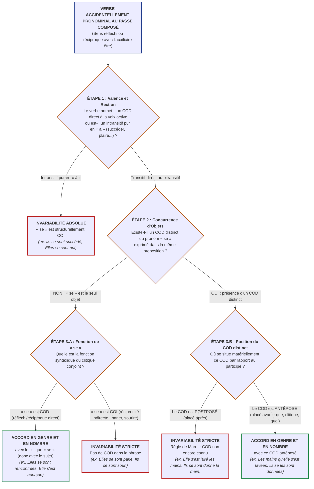

# Chapitre 3 — Verbes Accidentellement Pronominaux : Réfléchis, Réciproques, Analyse du Clitique COD vs COI et Concurrence d'Objets

> **Identifiant du chapitre** : `CHP-303-03`  
> **Module de rattachement** : [`MOD-303` — Orthographe Grammaticale Approfondie : Accords des Verbes Pronominaux et Pièges Morphologiques](file:///f:/Formation/world-class-french/03-curriculum/year-2/semester-3/mod-303-accords-verbes-pronominaux.md)  
> **Semestre** : Année 2 — Semestre 3 (S3)  
> **Volume horaire estimé** : 5 à 6 heures d'apprentissage autonome délibéré et d'ateliers d'application (Phase 1 Étude : 1 h 30 | Phase 2 Pratique : 1 h 30 | Phase 3 Correction : 1 h 00 | Phase 4 Évaluation : 1 h 00)  
> **Statut** : [STATUT : VALIDÉ]  
> **Compétences associées** : [`FR-ORTHO-004`](file:///f:/Formation/world-class-french/02-competency-framework/competency-framework.md#fr-ortho-004-résolution-des-accords-des-verbes-pronominaux) (L3 Autonomie), [`FR-SYNTAX-001`](file:///f:/Formation/world-class-french/02-competency-framework/competency-framework.md#fr-syntax-001-analyse-fonctionnelle-et-délimitation-de-la-phrase-simple) (L3 Autonomie), [`FR-INT-001`](file:///f:/Formation/world-class-french/02-competency-framework/competency-framework.md#fr-int-001-rédiger-un-texte-long-cohérent-en-maîtrisant-accords-et-ponctuation) (L2/L3 Transition autonomie)  
> **Sources scientifiques de référence** : `SRC-GRAM-01` (Grevisse & Goosse, 2016, § 950-955), `SRC-GRAM-02` (Riegel, Pellat & Rioul, 2016/2021, chap. 17), `SRC-NORM-03` (Ministère de l'Éducation nationale, 2020, p. 30-32), `SRC-TYPO-01` (Imprimerie nationale, 2002/2014, p. 142-144), `SRC-GRAM-05` (Grevisse, 2009, § 80-82)

---

## 1. Titre et Place dans le Cursus

### 1.1 Intitulé Officiel
**Chapitre 3 : Verbes Accidentellement Pronominaux : Réfléchis, Réciproques, Analyse du Clitique COD vs COI et Concurrence d'Objets** (`CHP-303-03`).

### 1.2 Insertion Architecturale dans le Cursus
Le présent chapitre constitue le cœur névralgique du module [`MOD-303`](file:///f:/Formation/world-class-french/03-curriculum/year-2/semester-3/mod-303-accords-verbes-pronominaux.md). Si le Chapitre 1 a posé les fondements linguistiques de la voix pronominale (diathèse et statut du clitique) et le Chapitre 2 a traité les verbes essentiellement pronominaux et passifs (où l'accord se fait mécaniquement avec le sujet grammatical), `CHP-303-03` aborde la catégorie où s'effondrent la majorité des scripteurs : **les verbes accidentellement pronominaux à sens réfléchi et réciproque** [Réf. `SRC-GRAM-01`, § 952-954 ; `SRC-GRAM-02`, chap. 17].

Dans cette classe de verbes, l'auxiliaire de surface *être* fonctionne comme un leurre morphologique absolu. En syntaxe profonde, le verbe conserve sa valence transitive et son comportement de verbe conjugué avec l'auxiliaire *avoir*. Dès lors, l'accord du participe passé n'est plus régi par le sujet, mais par le principe séculaire de Clément Marot : **le participe s'accorde uniquement avec son complément d'objet direct (COD), à l'unique condition que celui-ci soit antéposé** [Réf. `SRC-GRAM-01`, § 950].

Ce chapitre démonte méticuleusement l'illusion optique de l'auxiliaire *être*, installe la méthode d'analyse fonctionnelle du clitique conjoint (*se* COD vs *se* COI) et formalise la résolution de la concurrence d'objets (présence d'un COD nominal distinct placé après ou avant le participe).

```mermaid
flowchart TD
    MOD201["<b>MOD-201 (S2)</b><br/>Syntaxe Fonctionnelle & Valence Verbale<br/>(Identification formelle COD vs COI)"] --> CHP30303["<b>CHP-303-03</b><br/>Verbes Accidentellement Pronominaux :<br/>Réfléchis, Réciproques & Concurrence d'Objets"]
    MOD202["<b>MOD-202 (S2)</b><br/>Règle de Marot avec Avoir :<br/>Antéposition vs Postposition du COD"] --> CHP30303
    CHP30301["<b>CHP-303-01</b><br/>Fondement Linguistique du Pronominal :<br/>Clitique « se », Diathèse & Voix Moyenne"] --> CHP30303
    CHP30302["<b>CHP-303-02</b><br/>Verbes Essentiellement Pronominaux<br/>& Sens Passif (Accord avec le Sujet)"] --> CHP30303

    CHP30303 ==>|Invariabilité absolue par rection indirecte| CHP30304["<b>CHP-303-04</b><br/>La Liste Fermée des Participes<br/>Intransitifs Invariables (se succéder, se plaire...)"]
    CHP30303 ==>|Morphologie lexicale du pluriel| CHP30305["<b>CHP-303-05</b><br/>Pluriel des Noms Composés<br/>& Rectifications de 1990"]
    CHP30303 ==>|Arbre de décision unifié en 4 étapes| CHP30306["<b>CHP-303-06</b><br/>Synthèse Algorithmique & Protocole<br/>d'Arbitrage Universitaire"]

    CHP30303 -.->|<b>DEP-ORT-04 (Hard)</b> : Participe suivi d'un infinitif| MOD401["<b>MOD-401 (S4)</b><br/>Pragmatique Énonciative, Accords Limites<br/>(faire, laisser, perception) & 1990"]
    CHP30303 -.->|Révision éditoriale de haute précision| MOD504["<b>MOD-504 (S5)</b><br/>Révision Éditoriale & Typographie Savante"]

    classDef fondation stroke:#2563eb,stroke-width:2px;
    classDef pivot stroke:#b91c1c,stroke-width:3px;
    classDef suite stroke:#059669,stroke-width:2px;
    classDef perspective stroke:#7c3aed,stroke-width:2px;
    class MOD201,MOD202,CHP30301,CHP30302 fondation;
    class CHP30303 pivot;
    class CHP30304,CHP30305,CHP30306 suite;
    class MOD401,MOD504 perspective;
```

- **En amont** : Ce chapitre réinvestit directement l'identification fonctionnelle du COD et du COI de [`MOD-201`](file:///f:/Formation/world-class-french/03-curriculum/year-1/semester-2/mod-201-syntaxe-fonctionnelle-phrase-simple.md) et la maîtrise de la règle de Marot de [`MOD-202`](file:///f:/Formation/world-class-french/03-curriculum/year-1/semester-2/mod-202-participe-passe-avoir-ponctuation-interne.md). Il s'appuie sur la distinction posée dans `CHP-303-01` et `CHP-303-02` entre marqueur morphologique de voix et actant conjoint anaphorique.
- **En aval immédiat** : Il prépare l'analyse de la liste fermée des verbes intransitifs par nature (`CHP-303-04`), où le clitique *se* ne peut jamais être COD (*se plaire, se succéder, se nuire*), et alimente la synthèse algorithmique générale (`CHP-303-06`).
- **En projection lointaine** : Il constitue le prérequis obligatoire (*Hard Prerequisite*, [`dependency-graph.md`, DEP-ORT-04](file:///f:/Formation/world-class-french/01-architecture/dependency-graph.md#22-axe-orthographe-grammaticale--accords-du-canonique-aux-cas-limites)) pour aborder en Semestre 4 l'accord des participes passés pronominaux suivis d'un infinitif (*Elle s'est sentie défaillir* vs *Elle s'est fait surprendre*, [`MOD-401`](file:///f:/Formation/world-class-french/03-curriculum/year-2/semester-4/mod-401-pragmatique-accords-limites-rectifications-1990.md)).

---

## 2. Objectifs Mesurables

Au terme des 5 à 6 heures d'apprentissage autonome délibéré et d'ateliers d'application de ce chapitre, l'apprenant est capable de :

1. **Identifier et classifier avec une exactitude de 100 %** la valeur sémantique d'un verbe accidentellement pronominal en contexte (réfléchi direct, réfléchi indirect, réciproque direct, réciproque indirect) en prouvant la co-référence du sujet et du clitique conjoint ([`FR-SYNTAX-001`](file:///f:/Formation/world-class-french/02-competency-framework/competency-framework.md#fr-syntax-001-analyse-fonctionnelle-et-délimitation-de-la-phrase-simple), Palier L3 Autonomie).
2. **Assigner formellement au clitique conjoint (*me, te, se, nous, vous*)** sa fonction syntaxique exacte (COD vs COI) en exécutant le test de substitution active par l'auxiliaire *avoir* sans commettre d'erreur d'interprétation sur la valence du verbe de base ([`FR-SYNTAX-001`](file:///f:/Formation/world-class-french/02-competency-framework/competency-framework.md#fr-syntax-001-analyse-fonctionnelle-et-délimitation-de-la-phrase-simple), Palier L3 Autonomie).
3. **Résoudre sans faille l'accord ou l'invariabilité du participe passé** en présence d'une concurrence d'objets, en discriminant la position relative du syntagme nominal COD (invariabilité absolue si le COD est postposé ; accord morphologique strict en genre et en nombre si le COD est antéposé) ([`FR-ORTHO-004`](file:///f:/Formation/world-class-french/02-competency-framework/competency-framework.md#fr-ortho-004-résolution-des-accords-des-verbes-pronominaux), Palier L3 Autonomie).
4. **Rédiger une justification métalinguistique exhaustive** démontrant l'application de la règle de Marot sous le masque de l'auxiliaire de surface *être* pour tout énoncé litigieux rencontré dans les concours administratifs, universitaires ou lors d'une révision éditoriale professionnelle ([`FR-INT-001`](file:///f:/Formation/world-class-french/02-competency-framework/competency-framework.md#fr-int-001-rédiger-un-texte-long-cohérent-en-maîtrisant-accords-et-ponctuation), Palier L3 Autonomie).

---

## 3. Prérequis et Test de Préparation

### 3.1 Prérequis Exigibles
- **Validation certifiée des modules `MOD-201` et `MOD-202`** avec une note supérieure ou égale à 14/20.
- **Transitivité et valence verbale (`MOD-201`)** : Distinction opératoire entre transitivité directe (*laver qqch.*), transitivité indirecte (*téléphoner à qqn*) et intransitivité pure.
- **Règle de Clément Marot (`MOD-202`)** : Maîtrise infaillible de l'accord du participe passé avec l'auxiliaire *avoir* (accord avec le COD antéposé, invariabilité si le COD est postposé ou absent).
- **Distinction typologique des pronominaux (`CHP-303-01` et `CHP-303-02`)** : Savoir reconnaître qu'un verbe essentiellement pronominal (*s'enfuir, se souvenir*) ou à sens passif (*le livre s'est vendu*) s'accorde systématiquement avec son sujet, contrairement aux verbes accidentellement pronominaux.

### 3.2 Test de Préparation (Auto-Diagnostic à 5 Questions)
Répondez aux cinq questions suivantes sans consulter de documentation extérieure avant de dérouler le corrigé :

1. **Question 1 (Transitivité active fondamentale)** : Précisez pour chacun des verbes suivants s'il est transitif direct (*+ COD*), transitif indirect (*+ COI en à*) ou à double construction : *laver*, *téléphoner*, *rencontrer*, *sourire*, *offrir*.
2. **Question 2 (Application de la règle de Marot avec avoir)** : Soit la paire de phrases :  
   a) *« Elle a lavé la vaisselle. »*  
   b) *« La vaisselle qu'elle a lavée était fragile. »*  
   Pourquoi le participe passé *lavé* est-il invariable en (a) et accordé au féminin singulier en (b) ?
3. **Question 3 (Discrimination réfléchi vs réciproque)** : Analysez la relation sémantique entre le sujet et le procès dans ces deux phrases :  
   a) *« L'athlète s'est observée attentivement dans la glace. »*  
   b) *« Les deux rivales se sont observées avec défiance durant tout le combat. »*
4. **Question 4 (Identification de la concurrence d'objets)** : Dans la phrase *« Les directeurs se sont envoyé un courrier recommandé »*, quelle est la fonction syntaxique exacte du pronom clitique *se* et quelle est celle du syntagme nominal *un courrier recommandé* ?
5. **Question 5 (Détection immédiate d'anomalie normative)** : Pourquoi la graphie *\*« Elles se sont téléphonées hier soir »*, couramment observée dans la presse, constitue-t-elle une faute grammaticale formelle en français standard ?

<details>
<summary><strong>Corrigé détaillé et barème de l'auto-diagnostic (cliquer pour dérouler)</strong></summary>

1. **Réponse 1** :
   - *Laver* : transitif direct (*laver quelque chose / quelqu'un*).
   - *Téléphoner* : transitif indirect (*téléphoner **à** quelqu'un*).
   - *Rencontrer* : transitif direct (*rencontrer quelqu'un*).
   - *Sourire* : transitif indirect (*sourire **à** quelqu'un*).
   - *Offrir* : verbe dit « bitransitif » ou à double objet (*offrir quelque chose [COD] **à** quelqu'un [COI/COS]*).
2. **Réponse 2** :
   - En (a), le COD (*la vaisselle*) est placé **après** le verbe (postposé) ; selon la règle de Marot, le participe reste invariable.
   - En (b), le COD est le pronom relatif *qu'*, antécédent *la vaisselle* (féminin singulier), placé **avant** le verbe (antéposé) ; le participe s'accorde en genre et en nombre avec ce COD antéposé.
3. **Réponse 3** :
   - En (a), l'action est **réfléchie** : le sujet unique (*l'athlète*) agit directement sur lui-même.
   - En (b), l'action est **réciproque** : les deux actants (*les deux rivales*) agissent mutuellement l'une sur l'autre.
4. **Réponse 4** :
   - *Un courrier recommandé* est le **complément d'objet direct (COD)** du verbe *envoyer* (répond à la question : *ils ont envoyé quoi ?*).
   - Le clitique *se* est le **complément d'objet indirect (COI)** ou d'attribution (répond à la question : *ils ont envoyé un courrier à qui ? à eux-mêmes / l'un à l'autre*).
5. **Réponse 5** : Le verbe *téléphoner* ne se construit jamais avec un COD (*on ne téléphone pas quelqu'un*, mais *à quelqu'un*). Le clitique conjoint *se* ne peut donc être que **COI**. En l'absence absolue de tout COD dans la proposition, le participe passé ne peut recevoir aucune marque d'accord et doit rester strictement invariable : *« Elles se sont **téléphoné** »*.

> **Diagnostic** : Si vous obtenez moins de 4/5, révisez immédiatement les principes de transitivité dans [`MOD-201`](file:///f:/Formation/world-class-french/03-curriculum/year-1/semester-2/mod-201-syntaxe-fonctionnelle-phrase-simple.md) et la règle de Marot dans [`MOD-202`](file:///f:/Formation/world-class-french/03-curriculum/year-1/semester-2/mod-202-participe-passe-avoir-ponctuation-interne.md) avant d'aborder la section 4.
</details>

---

## 4. Situation de Départ ou Problème Concret

### 4.1 Le Naufrage Universel des Participes Accidentellement Pronominaux
Dans l'ensemble de la morphologie du français, aucune règle n'engendre autant de fautes d'hypercorrection, d'hésitations anxieuses et d'erreurs systématiques que l'accord des verbes accidentellement pronominaux [Réf. `SRC-GRAM-01`, § 952 ; `SRC-GRAM-02`, chap. 17]. 

Que ce soit dans les copies de concours administratifs, les procès-verbaux de police, les mémoires de justice ou les colonnes des quotidiens nationaux, les scripteurs succombent presque invariablement à un automatisme pavlovien : **la vue de l'auxiliaire « être » déclenche l'accord réflexe avec le sujet**.

Examinons trois énoncés fautifs authentiques :

> ❌ **Énoncé A (L'hypercorrection sur COD postposé)** :  
> *« Après leur service aux urgences, les infirmières se sont lavées les mains avec minutie. »*  
> *(Le scripteur voit le sujet féminin pluriel « les infirmières » suivi de l'auxiliaire « sont » : il ajoute sans hésiter « -ées », ignorant que les mains constituent un COD placé après le verbe, imposant l'invariabilité « lavé »).*

> ❌ **Énoncé B (La méconnaissance de la réciprocité indirecte)** :  
> *« Les deux directrices se sont téléphonées longuement avant de signer le protocole d'accord. »*  
> *(L'accord « téléphonées » est un solécisme grossier : le verbe téléphoner n'admettant aucun complément direct, « se » est COI et le participe doit rester nu : « téléphoné »).*

> ❌ **Énoncé C (L'amnésie de l'antéposition en concurrence d'objets)** :  
> *« Les lourdes responsabilités qu'elles se sont attribué lors de la restructuration financière ont épuisé leurs forces. »*  
> *(Ici, le scripteur, intimidé par la présence de « se », laisse le participe invariable, omettant que le pronom relatif « qu' », antéposé au verbe, est le véritable COD féminin pluriel exigeant l'accord : « attribuées »).*

### 4.2 Analyse Clinique du Dysfonctionnement
Ce naufrage orthographique repose sur une triple défaillance cognitive et didactique :
1. **L'aveuglement par la morphologie de surface** : Le scripteur est conditionné par l'école primaire à accorder « avec le sujet quand il y a l'auxiliaire être ». Or, dans les verbes pronominaux accidentels, l'auxiliaire *être* n'est qu'un substitut graphique historique de l'auxiliaire *avoir*.
2. **L'incapacité à interroger la valence du verbe à la voix active** : L'apprenant ne pratique pas le « démasquage actif » (*Elle a lavé quoi ? à qui ?*), indispensable pour neutraliser le piège du pronom réfléchi.
3. **La confusion spatiale entre l'antéposition et la postposition** : Ne pas identifier la ligne de démarcation que forme le participe passé empêche de savoir si l'objet est déjà connu et accordable, ou s'il est encore à venir dans la chaîne syntaxique.

---

## 5. Explication Intuitive : L'Analogie du Panier d'Achat et du Destinataire

Pour maîtriser sans faille le calcul morphosyntaxique des verbes accidentellement pronominaux, abandonnons toute intuition auditive et recourons à une modélisation visuelle et mécanique rigoureuse : **la métaphore du tapis de caisse et du panier d'achat**.

### 5.1 La Scène de la Caisse Enregistreuse
Imaginons une caisse automatique de magasin :
- **Le sujet de la phrase** est le client qui se présente devant la caisse.
- **Le participe passé** est le lecteur optique (le scanner) qui valide l'opération.
- **La règle d'or de la caisse** : Le scanner n'imprime sur le ticket une marque spéciale de genre et de nombre (*-e, -s, -es*) que pour **l'article effectivement déposé dans le panier d'achat (le COD)**, et **uniquement si cet article a déjà été scanné avant que le lecteur ne se déclenche** (antéposition). Si l'article passe après le lecteur ou s'il n'y a pas d'article dans le panier, le scanner reste sur son réglage neutre d'usine (*-é, -i, -u*).

```text
┌─────────────────────────────────────────────────────────────────────────────────────────────┐
│ MODÈLE DU TAPIS DE CAISSE (RÈGLE DE MAROT APPLIQUÉE AUX PRONOMINAUX)                         │
│                                                                                             │
│  [ZONE AMONT : DÉJÀ SCANNÉ]  ──>  [SCANNER OPTIQUE]  ──>  [ZONE AVAL : PAS ENCORE SCANNÉ]    │
│                                                                                             │
│  Cas 1 (Réfléchi direct) :                                                                  │
│  "Elles se [panier]                sont rencontrées"      (Rien après : accord avec se !)   │
│                                                                                             │
│  Cas 2 (Concurrence postposée) :                                                            │
│  "Elle s' [destinataire COI]       est lavé                les mains [panier postposé]"     │
│                                                            (Article après : INVARIABLE !)   │
│                                                                                             │
│  Cas 3 (Concurrence antéposée) :                                                            │
│  "Les mains [panier] qu'elle s'    est lavées"            (Article avant : ACCORD avec que) │
└─────────────────────────────────────────────────────────────────────────────────────────────┘
```

### 5.2 Les Trois Configurations Mécaniques du Panier

#### Configuration 1 : Le client se met lui-même dans le panier (*Se* = COD)
Dans la phrase *« Elles se sont rencontrées »* :
- Le verbe de base est *rencontrer quelqu'un* (transitif direct).
- Qui a été rencontré ? Le client a mis sa propre personne dans le panier : *se* représente les sujets elles-mêmes.
- Le pronom *se* est placé **avant** le verbe. Il est le COD antéposé.
- Le scanner enregistre le produit féminin pluriel avant d'imprimer : **accord obligatoire** $\rightarrow$ *rencontrées*.

#### Configuration 2 : Le client offre un objet distinct à lui-même (*Se* = COI, COD postposé)
Dans la phrase *« Elle s'est lavé les mains »* :
- Le sujet *elle* ne met pas sa propre personne tout entière dans la bassine pour être frottée.
- Quel est l'objet matériel lavé (déposé dans le panier) ? Ce sont *les mains*.
- Que représente le pronom conjoint *s'* ? Il n'est que le destinataire ou bénéficiaire de l'action (*à elle-même* $\rightarrow$ COI).
- Au moment précis où le lecteur optique prononce le participe *lavé*, où se trouvent les mains ? Elles sont encore derrière, sur le tapis roulant (postposées).
- Le scanner ne peut pas deviner à l'avance ce qui va arriver : **le participe reste neutre et invariable** $\rightarrow$ *lavé*.

#### Configuration 3 : L'étiquette de l'objet est scannée dès l'entrée (*COD antéposé*)
Dans la phrase *« Les mains qu'elle s'est lavées »* :
- L'objet lavé est toujours *les mains*. Mais grâce au pronom relatif *qu'*, l'objet a franchi le lecteur optique **avant** le verbe.
- Le scanner connaît l'objet : féminin pluriel (*les mains*).
- Le pronom *s'* reste le destinataire COI, mais le COD est désormais antéposé : **accord obligatoire avec ce COD** $\rightarrow$ *lavées*.

#### Configuration 4 : Il n'y a jamais d'article dans le panier (*Verbes à rection indirecte*)
Dans la phrase *« Elles se sont souri »* ou *« Ils se sont téléphoné »* :
- Dans la langue française, on ne peut physiquement ni conceptuellement « sourire quelqu'un » ni « téléphoner quelqu'un » : on sourit **à** quelqu'un, on téléphone **à** quelqu'un.
- Le pronom *se* est structurellement condamné à être un destinataire indirect (COI).
- Il n'y a aucun panier d'achat direct possible. Le scanner ne recevra jamais aucun COD : **invariabilité perpétuelle** $\rightarrow$ *souri*, *téléphoné*.

---

## 6. Définitions Précises et Terminologie

Pour manipuler ces concepts avec rigueur universitaire, fixons la terminologie descriptive officielle [Réf. `SRC-NORM-03`, p. 30-32 ; `SRC-GRAM-02`, chap. 17] :

- **Verbe accidentellement pronominal** : Verbe transitif ou intransitif qui possède une existence autonome à la voix active sans pronom (*laver, couper, regarder, parler, donner, nuire*), et qui n'adopte la forme pronominale que de manière occasionnelle lorsque le sujet et le complément partagent la même réalité référentielle [Réf. `SRC-NORM-03`, p. 30].
- **Sens réfléchi direct** : Diathèse dans laquelle l'agent accomplit l'action sur sa propre personne considérée comme le patient immédiat de l'action. Le pronom conjoint clitique assume la fonction de **complément d'objet direct (COD)** (*« Elle se regarde dans le miroir »* $\rightarrow$ regarde qui ? *se* = elle-même).
- **Sens réfléchi indirect** : Diathèse dans laquelle l'agent accomplit l'action sur une entité distincte au profit ou au détriment de lui-même. Le pronom conjoint clitique assume la fonction de **complément d'objet indirect (COI)** (*« Elle s'achète une voiture »* $\rightarrow$ achète quoi ? *une voiture* [COD] ; à qui ? *s'* = à elle-même [COI]).
- **Sens réciproque direct** : Diathèse impliquant obligatoirement un sujet pluriel ou collectif dans laquelle les actants exercent mutuellement et simultanément l'action les uns sur les autres en tant que patients directs. Le pronom clitique assume la fonction de **COD** (*« Les deux diplomates se sont salués »* $\rightarrow$ saluer qui ? *se* = l'un l'autre).
- **Sens réciproque indirect** : Diathèse impliquant un sujet pluriel dans laquelle les actants agissent mutuellement l'un envers l'autre par l'intermédiaire d'un procès régi par une préposition (*à*). Le pronom clitique assume la fonction de **COI** (*« Les deux frères se sont parlé »* $\rightarrow$ parler à qui ? *se* = l'un à l'autre).
- **Actant conjoint clitique** : Pronom personnel atone (*me, te, se, nous, vous*) morphologiquement solidaire du bloc verbal, dépourvu d'autonomie accentuelle, et saturant une position argumentale (COD ou COI) dans la structure de valence du verbe [Réf. `SRC-GRAM-02`, § 195].
- **Concurrence d'objets** : Configuration syntaxique dans laquelle coexistent au sein du même syntagme verbal un clitique conjoint (assumant la fonction de COI) et un syntagme nominal plein (assumant la fonction de COD).
- **Position relative (Antéposé vs Postposé)** : Ordre de succession linéaire des constituants dans la phrase :
  - *Postposé* : placé après le participe passé (*Elle s'est lavé [verbe] les mains [COD postposé]*).
  - *Antéposé* : placé avant le participe passé (*Les mains [COD antéposé] qu'elle s'est lavées [verbe]*).

---

## 7. Règles ou Mécanismes Fondamentaux

L'accord des verbes accidentellement pronominaux s'articule autour de quatre paliers logiques stricts :

### 7.1 La Co-Référence du Sujet et de l'Objet (Réfléchi vs Réciproque)
Dans les formes pronominales accidentelles, le clitique *se* (ou *me, te, nous, vous*) renvoie obligatoirement au sujet grammatical. Cette co-référence peut prendre deux valeurs sémantiques [Réf. `SRC-GRAM-01`, § 952] :
1. **Valeur réfléchie** : Unicité de l'être. L'action émane du sujet et revient se terminer sur le sujet lui-même (*« Paul s'est blessé »* = Paul a blessé Paul).
2. **Valeur réciproque** : Pluralité d'êtres en interaction symétrique. L'action croisée de A va vers B, et l'action de B va vers A (*« Paul et Marie se sont entraidés »* = Paul a aidé Marie et Marie a aidé Paul).

Dans les deux cas, le traitement morphosyntaxique de l'accord est strictement identique : **il dépend exclusivement de la fonction syntaxique assumée par le pronom conjoint**.

---

### 7.2 L'Analyse Fonctionnelle Obligatoire du Clitique Conjoint

Pour tout verbe accidentellement pronominal, il est impératif d'assigner au clitique conjoint sa fonction syntaxique exacte :

#### Cas 1 : Le clitique « se » est COD
Si le verbe de base est transitif direct et qu'aucun autre complément d'objet direct n'est exprimé dans la proposition, le clitique *se* absorbe le rôle de COD. Comme tout clitique conjoint, il est placé **avant** le verbe : il constitue un COD antéposé.
- **Règle** : Le participe passé s'accorde en genre et en nombre avec le clitique *se*, c'est-à-dire avec le sujet dont il est l'image anaphorique.
- *Exemples* :
  - *« Elles se sont rencontrées à Cotonou. »* (Rencontrer qui ? *se* = elles-mêmes $\rightarrow$ COD féminin pluriel antéposé $\rightarrow$ accord *-ées*).
  - *« Elle s'est aperçue dans le miroir. »* (Apercevoir qui ? *s'* = elle-même $\rightarrow$ COD féminin singulier antéposé $\rightarrow$ accord *-ue*).

#### Cas 2 : Le clitique « se » est COI (sans COD distinct)
Si le verbe de base est transitif indirect avec la préposition *à* (*parler à, téléphoner à, sourire à, succéder à, nuire à*), le clitique *se* sature la position de COI.
- **Règle** : Le clitique n'étant pas COD, et la proposition ne contenant aucun COD antéposé, **le participe passé demeure strictement INVARIABLE**.
- *Exemples* :
  - *« Elles se sont parlé durant des heures. »* (Parler à qui ? *se* = l'une à l'autre $\rightarrow$ COI $\rightarrow$ participe invariable *-é*).
  - *« Les deux associées se sont souri avec complicité. »* (Sourire à qui ? *se* = l'une à l'autre $\rightarrow$ COI $\rightarrow$ participe invariable *-i*).

---

### 7.3 La Concurrence d'Objets : Présence d'un COD Nominal Distinct

Lorsque le verbe s'accompagne d'un complément d'objet direct distinct exprimé sous forme de nom ou de groupe nominal, le clitique conjoint *se* est automatiquement relégué à la fonction de **complément d'objet indirect (COI)** d'attribution ou de bénéficiaire (*à lui-même, à elle-même, l'un à l'autre*).

La règle de Clément Marot s'applique alors dans toute sa rigueur distributive :

#### Cas A : Le COD est POSTPOSÉ (placé après le verbe)
- **Règle fondamentale** : Lorsque le COD est placé après le participe passé, celui-ci **ne reçoit aucune marque d'accord et reste strictement invariable**.
- *Exemples commentés* :
  - *« Elle s'est **lavé** [verbe] **les mains** [COD postposé]. »*  
    *(Laver quoi ? les mains [COD placé après] ; à qui ? s' [COI] $\rightarrow$ invariable).*
  - *« Ils se sont **donné** [verbe] **la main** [COD postposé] en signe de paix. »*  
    *(Donner quoi ? la main [COD placé après] ; à qui ? se [COI] $\rightarrow$ invariable).*
  - *« Les deux formations politiques se sont **disputé** [verbe] **la victoire** [COD postposé]. »*  
    *(Disputer quoi ? la victoire [COD placé après] ; à qui ? se [COI] $\rightarrow$ invariable).*
  - *« Elles se sont **acheté** [verbe] **des robes somptueuses** [COD postposé]. »*  
    *(Acheter quoi ? des robes somptueuses [COD placé après] $\rightarrow$ invariable).*

#### Cas B : Le COD est ANTÉPOSÉ (placé avant le verbe)
- **Règle fondamentale** : Lorsque le syntagme nominal COD est placé avant le verbe (sous forme de pronom relatif *que*, de pronom personnel clitique *le, la, les*, ou par extraction interrogative/exclamative), **le participe passé s'accorde obligatoirement en genre et en nombre avec ce COD antéposé**.
- *Exemples commentés* :
  - *« **Les mains** [antécédent fém. plur.] **qu'** [COD antéposé] elle s'est **lavées** étaient engourdies par le froid. »*  
    *(Laver quoi ? qu' mis pour les mains, féminin pluriel antéposé $\rightarrow$ accord *-ées*).*
  - *« **La victoire** [antécédent fém. sing.] **qu'** [COD antéposé] elles se sont **disputée** fut éclatante. »*  
    *(Disputer quoi ? qu' mis pour la victoire, féminin singulier antéposé $\rightarrow$ accord *-ée*).*
  - *« Ces prérogatives, ils se **les** [COD clitique antéposé fém. plur.] sont **attribuées** illégalement. »*  
    *(Attribuer quoi ? les mis pour prérogatives, féminin pluriel antéposé $\rightarrow$ accord *-ées*).*
  - *« **Quelles magnifiques robes** [COD interrogatif antéposé] se sont-elles **achetées** pour le gala ? »*  
    *(Acheter quoi ? quelles magnifiques robes, féminin pluriel antéposé $\rightarrow$ accord *-ées*).*

---

### 7.4 Le Test de Démasquage Actif par l'Auxiliaire « Avoir »
Face à n'importe quelle phrase contenant un verbe accidentellement pronominal au passé composé, appliquez le protocole de transposition active en trois mouvements :

```text
PROTOCOLE DU SCALPEL ACTIF (TEST DE SUBSTITUTION EN 3 MOUVEMENTS)
1. Remplacer mentalement l'auxiliaire "être" par l'auxiliaire "avoir".
2. Poser la question directe : "Le sujet a [participe] QUOI ?" ou "QUI ?"
   ├── S'il n'y a pas de réponse directe possible (rection en à) ──> PARTICIPE INVARIABLE
   └── Si la réponse est trouvée : c'est le COD !
3. Vérifier la position matérielle de ce COD :
   ├── Le COD est placé APRÈS le participe ──────────────────────> PARTICIPE INVARIABLE
   └── Le COD est placé AVANT le participe ───────────────────────> ACCORD AVEC CE COD
```

*Illustration sur deux cas critiques* :
- Phrase A : *« Marie s'est coupé le doigt. »*  
  $\rightarrow$ Transposition : *Marie a coupé QUOI ?* $\rightarrow$ Réponse : *le doigt* (COD).  
  $\rightarrow$ Position : *le doigt* est placé **après** le participe *coupé*.  
  $\rightarrow$ Conclusion : Participe invariable $\rightarrow$ *« Marie s'est **coupé** le doigt. »*
- Phrase B : *« Marie et Sophie se sont téléphoné. »*  
  $\rightarrow$ Transposition : *Marie a téléphoné QUOI ?* $\rightarrow$ Impossible. *À QUI ?* $\rightarrow$ *À Sophie* (COI).  
  $\rightarrow$ Conclusion : Zéro COD dans la phrase $\rightarrow$ Participe invariable $\rightarrow$ *« Elles se sont **téléphoné**. »*

---

## 8. Raisonnement Détaillé (Le Pourquoi)

Pourquoi la langue française refuse-t-elle formellement d'accorder le participe passé dans *« Elle s'est lavé les mains »*, alors qu'elle exige l'accord dans *« Elle s'est lavée »* et *« Les mains qu'elle s'est lavées »* ?

### 8.1 L'Illusion Diachronique de l'Auxiliaire « Être »
En latin classique et tardif, les verbes passifs et déponents utilisaient des formes périphrastiques avec le verbe *esse* (*captus est*). Lors de la genèse de l'ancien français (du IXe au XIIe siècle), l'usage a progressivement imposé l'auxiliaire *être* pour l'ensemble des formes pronominales, créant une uniformité morphologique de surface [Réf. `SRC-GRAM-01`, § 950]. 

Pourtant, cette morphologie externe masque une scission sémantique et syntaxique fondamentale :
- Dans *« Elle est morte »* ou *« Elle s'est évanouie »*, le sujet subit le procès de manière absolue : l'auxiliaire *être* exprime un état ou un changement d'état du sujet.
- Dans *« Elle s'est lavé les mains »*, le sujet n'est pas dans un état passif : il accomplit une action transitive externe. Le véritable agent est *elle*, le procès est *laver*, et l'entité qui subit matériellement l'action n'est pas le sujet *elle*, mais l'objet distinct *les mains*.

### 8.2 Le Principe de la Chronologie Psychologique (Clément Marot, 1538)
Lorsque Clément Marot formule en 1538 sa célèbre épigramme régularisant l'accord du participe passé :
> *« Enfans oyez une leçon / De nostre langue la façon : / [...] / Le participe recevra / Le genre et nombre de son maistre, / [...] / Mais s'il le suyt, il ne l'aura pas [...] »*

il pose une loi de pure chronologie cognitive :
1. **Quand le COD précède le verbe** : Le locuteur ou le scripteur a déjà proféré ou écrit l'objet. L'objet est présent à son esprit avec son genre et son nombre (*les mains* = féminin pluriel). Lorsqu'il prononce ou calligraphie ensuite le participe, celui-ci peut légitimement s'imprégner des marques de cet objet déjà connu (*lavées*).
2. **Quand le COD suit le verbe** : Au moment où le scripteur produit le participe passé, l'objet n'a pas encore été formulé. La syntaxe française interdit au verbe d'anticiper la détermination morphologique d'un syntagme subséquent. Le participe reste alors dans sa forme neutre par défaut (non marquée), c'est-à-dire le masculin singulier (*lavé*).

### 8.3 L'Absurdité Syntaxique de la Double Assassignation Accusative
Prétendre écrire *\*« Elle s'est lavée les mains »* constituerait une aberration linguistique totale. Dans le cadre de la grammaire générative et de la théorie de la rection [Réf. `SRC-GRAM-02`, chap. 17], le verbe *laver* ne dispose que d'une seule position d'argument interne direct (un seul cas accusatif).

Si l'on accorde *lavée* avec le pronom réfléchi *s'* (féminin singulier), on affirme que *s'* est le COD du verbe (c'est-à-dire qu'*elle* a lavé son corps tout entier). Dès lors, quel serait le statut syntaxique du groupe *les mains* ? Il se retrouverait orphelin, en rupture de construction (anacoluthe fonctionnelle), incapable d'être rattaché au verbe. 

À l'inverse, l'analyse normée rétablit la cohérence parfaite du système :
- *les mains* = le véritable et unique COD du verbe *laver*.
- *s'* = le COI (datif d'attribution/possession inaliénable : *à elle-même*).
- Comme ce COD est postposé, le participe reste neutre : *« Elle s'est **lavé** [quoi ?] les mains »*.

---

## 9. Exemples Corrects Commentés

Examinons quatre séries de phrases modèles opposées de façon différentielle avec décomptes et analyses structurales :

### 9.1 Série 1 : Réfléchi Direct vs Réfléchi Indirect

#### Exemple 1.A : Réfléchi Direct (Accord avec le clitique COD)
> *« L'avocate s'est préparée avec une concentration absolue avant l'ouverture du procès. »*
- **Analyse de valence** : *Préparer quelqu'un* $\rightarrow$ transitif direct.
- **Démasquage actif** : L'avocate a préparé qui ? $\rightarrow$ *s'* (elle-même).
- **Statut fonctionnel** : Le clitique *s'* est **COD**, antéposé au participe passé.
- **Résolution morphologique** : Accord en genre et en nombre avec le COD antéposé *s'* (renvoyant à *l'avocate*, féminin singulier) $\rightarrow$ désinence **-ée** (*préparée*).

#### Exemple 1.B : Réfléchi Indirect (Invariabilité par présence d'un COD postposé)
> *« L'avocate s'est préparé une tasse de café brûlant avant l'ouverture du procès. »*
- **Analyse de valence** : *Préparer quelque chose à quelqu'un* $\rightarrow$ bitransitif.
- **Démasquage actif** : L'avocate a préparé quoi ? $\rightarrow$ *une tasse de café* (COD) ; à qui ? $\rightarrow$ à elle-même (*s'* = COI).
- **Statut fonctionnel** : Le COD *une tasse de café* est placé **après** le verbe (postposition).
- **Résolution morphologique** : Le COD étant postposé, le participe passé demeure strictement invariable $\rightarrow$ désinence neutre **-é** (*préparé*).

---

### 9.2 Série 2 : Réciproque Direct vs Réciproque Indirect

#### Exemple 2.A : Réciproque Direct (Accord avec le clitique COD)
> *« Dès leur arrivée au sommet de l'Union africaine, les deux ministres se sont chaleureusement saluées. »*
- **Analyse de valence** : *Saluer quelqu'un* $\rightarrow$ transitif direct.
- **Démasquage actif** : Les ministres ont salué qui ? $\rightarrow$ *se* (l'une l'autre, action réciproque).
- **Statut fonctionnel** : Le clitique *se* est **COD**, antéposé au verbe.
- **Résolution morphologique** : Accord en genre et en nombre avec *se* (renvoyant à *les deux ministres*, féminin pluriel) $\rightarrow$ désinence **-ées** (*saluées*).

#### Exemple 2.B : Réciproque Indirect (Invariabilité par rection prépositionnelle)
> *« Durant les négociations de paix, les deux délégations se sont constamment opposé des fins de non-recevoir. »*
- **Analyse de valence** : *Opposer quelque chose [COD] à quelqu'un [COI]*.
- **Démasquage actif** : Les délégations ont opposé quoi ? $\rightarrow$ *des fins de non-recevoir* (COD postposé) ; à qui ? $\rightarrow$ *se* (l'une à l'autre, COI).
- **Statut fonctionnel** : Le COD est placé **après** le verbe ; le pronom réciproque est **COI**.
- **Résolution morphologique** : Le participe demeure strictement invariable $\rightarrow$ désinence neutre **-é** (*opposé*).

---

### 9.3 Série 3 : Le Duel Parfait Postposé vs Antéposé

#### Exemple 3.A : COD Postposé (Invariabilité)
> *« Les deux soignantes se sont partagé les gardes de nuit du week-end pascal. »*
- **Analyse actancielle** : *Partager quoi ?* $\rightarrow$ *les gardes de nuit* (COD postposé). *À qui ?* $\rightarrow$ *se* (l'une à l'autre, COI).
- **Règle** : COD après le verbe $\rightarrow$ participe invariable : *partagé*.

#### Exemple 3.B : COD Antéposé (Accord en genre et en nombre)
> *« Les gardes de nuit que les deux soignantes se sont partagées ont été particulièrement éprouvantes. »*
- **Analyse actancielle** : *Partager quoi ?* $\rightarrow$ *que* (pronom relatif antéposé), dont l'antécédent est *les gardes de nuit* (féminin pluriel).
- **Règle** : COD placé avant le verbe $\rightarrow$ accord féminin pluriel : *partagées*.

---

### 9.4 Série 4 : Clitique COD Conjoint Antéposé (*Se les sont...*)

#### Exemple 4 : Double pronominalisation clitique
> *« Ces médailles honorifiques, les deux chercheuses se les sont disputées avec acharnement, mais le jury a fini par les leur attribuer conjointement. »*
- **Décomposition clitique** : La proposition contient deux pronoms conjoints : *se* (COI d'attribution) et *les* (COD anaphorique renvoyant à *ces médailles*, féminin pluriel).
- **Ordre linéaire** : Le pronom *les* précède immédiatement l'auxiliaire et le participe.
- **Résolution** : Le COD *les* étant antéposé, le participe s'accorde au féminin pluriel $\rightarrow$ *disputées*.

---

## 10. Contre-Exemples et Erreurs Fréquentes

Nous analysons ci-dessous de façon clinique six erreurs récurrentes majeures observées dans les copies d'examen et les écrits professionnels :

### Erreur n° 1 : L'accord fautif avec le sujet malgré la présence d'un COD nominal postposé
- ❌ **Graphie fautive** : *\*« En préparant le banquet officiel, la cuisinière s'est coupée le doigt avec un couperet. »*
- **Diagnostic linguistique** : L'apprenant commet l'erreur d'accorder le participe *coupé* au féminin singulier avec le sujet *la cuisinière*, trompé par l'auxiliaire *est*. Or, le verbe *couper* a pour complément d'objet direct le syntagme nominal *le doigt*, situé immédiatement après le participe. Le clitique *s'* n'est pas COD, mais COI (*elle a coupé le doigt à elle-même*). Le COD étant postposé, le participe passé doit rester dans sa forme neutre invariée [Réf. `SRC-GRAM-01`, § 954].
- 🟢 **Forme normée établie** : *« En préparant le banquet officiel, la cuisinière s'est **coupé** le doigt avec un couperet. »*

---

### Erreur n° 2 : L'accord abusif sur un verbe à réciprocité indirecte
- ❌ **Graphie fautive** : *\*« Les directrices générales des deux banques partenaires se sont téléphonées pour harmoniser leurs taux directeurs. »*
- **Diagnostic linguistique** : L'apprenant associe l'idée de pluralité réciproque à un accord en genre et en nombre. Mais en syntaxe française, le verbe *téléphoner* est strictement transitif indirect (*téléphoner à quelqu'un*). Il n'admet aucun COD. Le pronom conjoint réciproque *se* est nécessairement un **COI** (*elles ont téléphoné l'une à l'autre*). En l'absence totale de COD dans la proposition, le participe passé ne peut en aucun cas s'accorder [Réf. `SRC-GRAM-02`, chap. 17].
- 🟢 **Forme normée établie** : *« Les directrices générales des deux banques partenaires se sont **téléphoné** pour harmoniser leurs taux directeurs. »*

---

### Erreur n° 3 : L'omission d'accord sur le COD antéposé
- ❌ **Graphie fautive** : *\*« Les lettres d'avertissement que la direction et les syndicats se sont envoyé n'ont fait qu'envenimer le conflit social. »*
- **Diagnostic linguistique** : Par excès de prudence ou confusion avec les cas d'invariabilité, le scripteur laisse le participe *envoyé* invariable. Il omet que le pronom relatif *que* (élidé en *qu'*), qui introduit la proposition relative, est le complément d'objet direct du verbe *envoyer* (*ils se sont envoyé quoi ? $\rightarrow$ que = les lettres d'avertissement*). Le COD étant antéposé au participe, l'accord en genre et en nombre avec le féminin pluriel *lettres* est strictement obligatoire [Réf. `SRC-GRAM-01`, § 954].
- 🟢 **Forme normée établie** : *« Les lettres d'avertissement que la direction et les syndicats se sont **envoyées** n'ont fait qu'envenimer le conflit social. »*

---

### Erreur n° 4 : La confusion entre COD et COI sur le verbe « se demander »
- ❌ **Graphie fautive** : *\*« En découvrant les résultats du scrutin, la présidente s'est demandée si le quorum avait été atteint. »*
- **Diagnostic linguistique** : L'apprenant applique l'accord avec le sujet *la présidente*, pensant que *se* est le COD de *demander*. C'est une erreur d'analyse fonctionnelle : on ne « demande pas quelqu'un », on *demande quelque chose [COD] à quelqu'un [COI]*. Dans cette phrase, le COD est la proposition subordonnée interrogative indirecte postposée *« si le quorum avait été atteint »*. Le clitique *s'* est le COI (*elle a demandé à elle-même*). Le COD étant placé après le verbe, le participe passé doit rester invariable [Réf. `SRC-GRAM-05`, § 81].
- 🟢 **Forme normée établie** : *« En découvrant les résultats du scrutin, la présidente s'est **demandé** si le quorum avait été atteint. »*

---

### Erreur n° 5 : L'accord erroné sur la locution figée « se rendre compte »
- ❌ **Graphie fautive** : *\*« Les administratrices se sont rendues compte de l'ampleur du déficit budgétaire dès le premier audit. »*
- **Diagnostic linguistique** : Dans la locution verbale figée *se rendre compte*, le mot *compte* conserve historiquement et structuralement son statut de substantif complément d'objet direct placé immédiatement après le verbe (*rendre quoi ? $\rightarrow$ compte* [COD postposé] ; *à qui ? $\rightarrow$ se* [COI]). Le COD *compte* étant postposé, le participe passé *rendu* ne s'accorde jamais et demeure invariable. La graphie *\*rendues compte* est un solécisme sanctionné dans les concours [Réf. `SRC-GRAM-01`, § 954 b].
- 🟢 **Forme normée établie** : *« Les administratrices se sont **rendu** compte de l'ampleur du déficit budgétaire dès le premier audit. »*

---

### Erreur n° 6 : La fausse analyse de « se faire » suivi d'un infinitif ou d'un nom
- ❌ **Graphie fautive** : *\*« Durant la réunion de crise, les deux ministres se sont faites des reproches amers. »*
- **Diagnostic linguistique** : Le scripteur accorde *faites* au féminin pluriel en assimilant *se faire* à un verbe essentiellement pronominal. Or, dans *se faire des reproches*, *faire* est un verbe accidentellement pronominal transitif direct : le COD est le syntagme *des reproches* (masculin pluriel), placé après le verbe. Le clitique *se* est COI (*l'une à l'autre*). Le participe doit donc être invariable : *fait*. (De surcroît, lorsque *se faire* est suivi d'un infinitif, comme dans *« Elles se sont fait surprendre »*, le participe *fait* est rigoureusement et universellement invariable [Réf. `SRC-NORM-02`]).
- 🟢 **Forme normée établie** : *« Durant la réunion de crise, les deux ministres se sont **fait** des reproches amers. »*

---

## 11. Cas Particuliers et Limites

### 11.1 L'Invariabilité Absolue de « Se rendre compte »
La locution *se rendre compte* suscite de nombreuses hésitations dans l'usage contemporain. Certains usagers, percevant l'expression comme un bloc sémantique unitaire équivalent à *s'apercevoir*, sont tentés d'accorder le participe (*\*elles se sont rendues compte*).
- **Doctrine académique de référence** : L'Académie française et Maurice Grevisse réaffirment fermement l'invariabilité de *rendu* [Réf. `SRC-GRAM-01`, § 954 b]. Le nom *compte* sature la position de COD postposé (*rendre compte de quelque chose*).
- Même lorsque la complétive est antéposée (*« Le compte qu'ils se sont rendu »*), l'expression ne tolère l'accord que dans des tournures rarissimes où *compte* est expressément extrait : *« C'est un compte exact qu'ils se sont rendu »*. En emploi courant avec préposition (*se rendre compte de*), écrivez invariablement :
  - *« Elles se sont **rendu** compte de leur retard. »*

### 11.2 Les Verbes de Communication et de Parole (*Se dire, se promettre, s'écrire, se répéter*)
Ces verbes admettent plusieurs constructions syntaxiques qui conditionnent des accords contrastés :
1. **Suivis d'une complétive ou d'un infinitif (COD postposé)** $\rightarrow$ **Invariables** :
   - *« Elles se sont **dit** [verbe] **qu'il fallait agir sans délai** [COD propositionnel postposé]. »*
   - *« Ils se sont **promis** [verbe] **de garder le secret** [COD infinitif postposé]. »*
2. **Suivis d'un nom COD placé après** $\rightarrow$ **Invariables** :
   - *« Les deux amis se sont **écrit** [verbe] **des lettres admirables** [COD postposé]. »*
   - *« Elles se sont **répété** [verbe] **cette consigne** [COD postposé]. »*
3. **Avec antéposition du nom COD** $\rightarrow$ **Accord obligatoire** :
   - *« **Les lettres admirables** [fém. plur.] **qu'** [COD antéposé] ils se sont **écrites** témoignent de leur fidélité. »*
   - *« **Cette consigne** [fém. sing.] **qu'** [COD antéposé] elles se sont **répétée** a évité le désastre. »*
4. **Emploi réfléchi direct sans autre complément (*se dire*)** $\rightarrow$ **Accord** :
   - *« Elle s'est **dite** satisfaite des propositions du médiateur. »*  
     *(Ici, « se dire » a le sens d'« affirmer être », verbe transitif avec attribut du COD : elle a dit qui ? $\rightarrow$ s' [elle-même] = COD antéposé $\rightarrow$ accord féminin singulier).*

### 11.3 Les Verbes à Évolution Sémantique : Le Cas de « S'échapper » et « S'attaquer »
Attention à ne pas confondre un verbe accidentellement pronominal et un verbe à sens lexical autonome :
- *Échapper à quelqu'un* est transitif indirect à la voix active (*La solution m'échappe*). Mais sous la forme pronominale *s'échapper*, le verbe devient intransitif et intrinsèquement pronominal (*Les prisonnières se sont échappées* $\rightarrow$ accord avec le sujet, comme vu en `CHP-303-02`).
- De même, *s'attaquer à quelqu'un* est classé parmi les verbes autonomes s'accordant avec le sujet : *« Elles se sont attaquées à un problème complexe »*.

---

## 12. Approfondissement Adapté au Niveau : La Syntaxe Générative de l'Assignation Casuelle

*(Cette section s'adresse aux étudiants préparant les concours de haut niveau — Agrégation de Lettres modernes, CAPES, Magistrature — désireux de comprendre la mécanique formelle sous-jacente).*

### 12.1 La Théorie du Liage (Chomsky, Principe A)
Dans la grammaire générative (cadre des Principes et Paramètres), le clitique réfléchi *se* est défini comme une **anaphore** au sens technique : un élément nominal sans référence autonome, qui doit être obligatoirement lié (co-indexé) par un antécédent c-commandant dans son domaine local de gouvernement ($TP$ ou phrase minimale) [Réf. `SRC-GRAM-02`, chap. 17].

Dans la structure syntaxique :
$$\text{[}_{TP}\ \text{Marie}_{i}\ \text{[}_{T'}\ \text{T}\ \text{[}_{VP}\ \text{s'}_{i}\ \text{est}\ \text{[}_{V'}\ \text{lavé}\ \text{les mains}\text{]]]]}$$
L'indice $i$ marque la coréférence obligatoire entre le sujet *Marie* et le clitique *s'*.

### 12.2 Assignation du Cas Accusatif vs Datif et Projection Fonctionnelle AgrOP
Dans le modèle de vérification de traits de Chomsky et Kayne :
1. Le verbe transitif actif assigne deux types de cas abstraits :
   - Le **Cas Accusatif** (structurel), assigné au complément d'objet direct.
   - Le **Cas Datif** (inhérent ou lexical), assigné au complément d'objet indirect introduit par la préposition abstraite nulle $\emptyset_{a}$.
2. **La projection d'accord d'objet ($AgrOP$ — Agreement Object Phrase)** :  
   Dans la dérivation en syntaxe visible, le participe passé ne porte de marques d'accord en genre et en nombre ($\Phi$-features) que si un syntagme porteur du Cas Accusatif monte dans la position de spécificateur de la projection $AgrOP$ ($Spec,AgrOP$) pour vérifier ses traits avant la fusion avec l'auxiliaire.
   - Si le clitique *se* est **Accusatif (COD)** (*Elles se sont vues*), le clitique monte par la position $Spec,AgrOP$ : les traits féminin et pluriel sont vérifiés $\rightarrow$ déclenchement de l'accord morphologique (*vues*).
   - Si le clitique *se* est **Datif (COI)** (*Elles se sont parlé*), le syntagme datif ne peut pas vérifier les traits d'accord dans $AgrOP$ (incompatibilité de cas) $\rightarrow$ absence totale de montée $\rightarrow$ participe neutre invariable (*parlé*).
   - En cas de **concurrence d'objets** (*Elle s'est lavé les mains*), le syntagme nominal *les mains* (Accusatif) reste in situ dans le syntagme verbal $VP$ à la fin de la chaîne linéaire : n'ayant pas monté par $Spec,AgrOP$ avant l'évaluation du participe, aucun trait d'accord n'est transféré au participe. Ce n'est que si un opérateur relatif extrait *les mains* vers la périphérie gauche ($CP$) que la trace ou copie intermédiaire dans $Spec,AgrOP$ déclenche l'accord (*Les mains qu'elle s'est lavées*).

---

## 13. Comparaisons Différentielles

### 13.1 Tableau Synoptique 1 : Clitique « Se » COD vs Clitique « Se » COI

| Critère d'Analyse | Clitique « Se » = COD | Clitique « Se » = COI |
| :--- | :--- | :--- |
| **Rection du verbe de base** | Transitif direct pur (*rencontrer, laver, féliciter, voir*). | Transitif indirect en *à* (*téléphoner à, sourire à, nuire à, parler à*). |
| **Question de démasquage** | Le sujet a [verbe] **QUI ?** ou **QUOI ?** | Le sujet a [verbe] **À QUI ?** |
| **Règle d'accord du participe** | **Accord en genre et en nombre** avec le clitique *se* (renvoyant au sujet). | **Invariabilité absolue** du participe passé (sauf présence d'un COD distinct antéposé). |
| **Exemple modèle** | *« Elles se sont **rencontrées** au colloque. »* | *« Elles se sont **souri** avec bienveillance. »* |
| **Preuve formelle** | *Rencontrer qui ? $\rightarrow$ se = elles-mêmes (COD).* | *Sourire à qui ? $\rightarrow$ se = l'une à l'autre (COI).* |

---

### 13.2 Tableau Synoptique 2 : COD Postposé vs COD Antéposé (Concurrence d'Objets)

| Paramètre Syntaxique | Configuration A : COD Postposé | Configuration B : COD Antéposé |
| :--- | :--- | :--- |
| **Ordre linéaire dans la phrase** | Sujet + Auxiliaire + **Participe** + **COD nominal** | **COD (relatif / clitique)** + Sujet + Auxiliaire + **Participe** |
| **Statut du clitique « se »** | Relégué à la fonction de **COI** (bénéficiaire). | Relégué à la fonction de **COI** (bénéficiaire). |
| **Règle d'accord applicable** | **INVARIABILITÉ STRICTE** du participe passé. | **ACCORD EN GENRE ET EN NOMBRE** avec le COD antéposé. |
| **Exemple canonique** | *« Elle s'est **lavé** [verbe] **les mains** [COD]. »* | *« **Les mains** **qu'** [COD] elle s'est **lavées** [verbe]. »* |
| **Piège d'hypercorrection** | Écrire *\*elle s'est lavée les mains* (accord fautif sujet). | Écrire *\*les mains qu'elle s'est lavé* (omission d'accord). |

---

### 13.3 Tableau Synoptique 3 : Sens Réfléchi vs Sens Réciproque

| Propriété | Sens Réfléchi | Sens Réciproque |
| :--- | :--- | :--- |
| **Nombre de participants** | Sujet singulier ou pluriel agissant sur sa propre entité. | Sujet obligatoirement pluriel ou collectif (au moins 2 entités). |
| **Vecteur de l'action** | Circulaire : du sujet vers lui-même. | Croisé : de A vers B et de B vers A. |
| **Test de paraphrase explicative** | Ajout de *soi-même*, *lui-même*, *elle-même*. | Ajout de *mutuellement*, *l'un l'autre*, *les uns les autres*. |
| **Impact sur la règle d'accord** | Aucun : dépend uniquement de la fonction (COD/COI). | Aucun : dépend uniquement de la fonction (COD/COI). |
| **Exemple paires** | *« Elle s'est **regardée** dans la glace (elle-même). »* | *« Elles se sont **regardées** dans les yeux (l'une l'autre). »* |

---

### 13.4 Tableau Synoptique 4 : Verbe Accidentellement Pronominal (*Laver*) vs Verbe Essentiellement Pronominal (*S'enfuir*)

| Critère Linguistique | Accidentellement Pronominal (*Laver*) | Essentiellement Pronominal (*S'enfuir*) |
| :--- | :--- | :--- |
| **Existence sans pronom** | Oui (*Elle lave la voiture*). | Non (*\*Elle enfuit la voiture* est impossible). |
| **Statut du pronom « se »** | Actant plein autonome (COD ou COI). | Simple morphème dénué de fonction autonome. |
| **Règle directrice d'accord** | Accord avec le **COD s'il précède** (règle de Marot). | Accord systématique avec le **sujet grammatical**. |
| **Traitement de l'auxiliaire être** | Auxiliaire de surface (équivalent profond d'*avoir*). | Véritable auxiliaire d'état intransitif. |
| **Exemple comparatif** | *« Elles se sont **lavé** les mains »* (invariable). | *« Elles se sont **enfuies** dans la forêt »* (accord sujet). |

---

## 14. Exercices Progressifs

### Niveau 1 : Discrimination et Identification du Statut Fonctionnel de « Se » (15 Phrases)
*Consigne* : Pour chacune des 15 phrases suivantes, déterminez si le clitique conjoint *se* (ou *s'*) est **COD** ou **COI**, et écrivez la terminaison exacte du participe passé entre parenthèses :
1. *Ces deux diplomates se sont (rencontrer : rencontré / rencontrés / rencontrées ?) au sommet de Lomé.*
2. *Les deux délégations se sont (parler : parlé / parlées ?) durant toute la nuit.*
3. *Elles se sont (offrir : offert / offerts / offertes ?) un somptueux voyage aux chutes de la Pendjari.*
4. *Les candidates se sont (apercevoir : aperçu / aperçue / aperçues ?) dans la grande glace du vestibule.*
5. *Elles se sont (sourire : souri / souris / souries ?) dès le début de l'épreuve orale.*
6. *Les deux associés se sont (téléphoner : téléphoné / téléphonés ?) pour confirmer la transaction.*
7. *Elle s'est (blesser : blessé / blessée ?) lors de la séance d'athlétisme.*
8. *Elle s'est (blesser : blessé / blessée ?) la cheville droite lors du saut en longueur.*
9. *Les deux conférencières se sont (succéder : succédé / succédées ?) à la tribune.*
10. *Elles se sont (écrire : écrit / écrites ?) de longues missives durant leur séjour à Ouidah.*
11. *Ces deux nations rivales se sont (déclarer : déclaré / déclarée / déclarées ?) une guerre impitoyable.*
12. *Les militantes se sont (regrouper : regroupé / regroupées ?) sur l'esplanade du parlement.*
13. *Elles se sont (nuire : nui / nuis / nuies ?) par jalousie professionnelle.*
14. *Les directeurs se sont (attribuer : attribué / attribués ?) des primes illégitimes.*
15. *Elle s'est (imaginer : imaginé / imaginée ?) que tout était déjà résolu.*

---

### Niveau 2 : Résolution du Duel Postposé vs Antéposé (10 Paires de Phrases)
*Consigne* : Accordez correctement le participe passé entre crochets dans chacune des paires d'énoncés opposés :

- **Paire 1** :  
  a) *Elles se sont [partager] les responsabilités éditoriales.*  
  b) *Les responsabilités éditoriales qu'elles se sont [partager] exigent une vigilance constante.*
- **Paire 2** :  
  a) *Les jurés se sont [accorder] un temps de délibération supplémentaire.*  
  b) *Le temps de délibération que les jurés se sont [accorder] a permis d'apaiser les débats.*
- **Paire 3** :  
  a) *Les candidates se sont [imposer] une discipline ascétique durant leur préparation.*  
  b) *La discipline ascétique que les candidates se sont [imposer] a porté ses fruits.*
- **Paire 4** :  
  a) *Les deux sœurs se sont [reprocher] leurs choix de carrière respectifs.*  
  b) *Les erreurs passées qu'elles se sont [reprocher] appartiennent désormais à l'histoire.*
- **Paire 5** :  
  a) *Les négociateurs se sont [échanger] des documents hautement confidentiels.*  
  b) *Les documents confidentiels que les négociateurs se sont [échanger] ont été transmis au ministre.*
- **Paire 6** :  
  a) *Elles se sont [formuler] de vives critiques lors de l'assemblée générale.*  
  b) *Les vives critiques qu'elles se sont [formuler] ont profondément marqué les esprits.*
- **Paire 7** :  
  a) *Les deux avocates se sont [disputer] la défense de l'accusé principal.*  
  b) *La défense de l'accusé que les deux avocates se sont [disputer] était particulièrement périlleuse.*
- **Paire 8** :  
  a) *Ils se sont [donner] mutuellement leur parole d'honneur.*  
  b) *La parole d'honneur qu'ils se sont [donner] a scellé leur alliance.*
- **Paire 9** :  
  a) *Elle s'est [acheter] deux nouvelles toges pour les audiences solennelles.*  
  b) *Les deux toges qu'elle s'est [acheter] ont été confectionnées sur mesure à Porto-Novo.*
- **Paire 10** :  
  a) *Les représentantes syndicales se sont [arroger] des compétences extraordinaires.*  
  b) *Les compétences extraordinaires que les représentantes syndicales se sont [arroger] ont été contestées.*

---

### Niveau 3 : Analyse Actancielle et Accord d'un Texte d'Analyse Psychologique (50 Mots Exacts)
*Consigne d'écriture et de résolution* :
Dans le texte suivant, calibré à **exactement 50 mots typographiques** selon les normes de l'Imprimerie nationale (`SRC-TYPO-01`, p. 143), choisissez la forme correcte pour chacun des quatre participes passés placés entre crochets et justifiez votre choix par l'analyse actancielle :

> *« Dans le silence feutré de ce cabinet médical, ces deux patientes se sont [confier : confié / confiée / confiées] leurs profondes angoisses sans détour. Après de longues hésitations, elles se sont [observer : observé / observée / observées] avec lucidité, puis elles se sont [pardonner : pardonné / pardonnée / pardonnées] leurs fautes passées. Les certitudes qu'elles se sont [forger : forgé / forgée / forgées] dissipent désormais toutes leurs craintes intimes. »*

---

### Corrigés Détaillés et Justifications des Exercices

<details>
<summary><strong>Corrigé détaillé du Niveau 1 (cliquer pour dérouler)</strong></summary>

1. *se sont **rencontrés** [ou **rencontrées** selon le genre]* : *Rencontrer quelqu'un* $\rightarrow$ *se* est **COD** antéposé $\rightarrow$ accord masculin pluriel (*rencontrés*).
2. *se sont **parlé*** : *Parler à quelqu'un* $\rightarrow$ *se* est **COI** $\rightarrow$ participe invariable.
3. *se sont **offert*** : *Offrir quoi ?* $\rightarrow$ *un somptueux voyage* (COD postposé) ; *se* est **COI** $\rightarrow$ participe invariable.
4. *se sont **aperçues*** : *Apercevoir qui ?* $\rightarrow$ *s'* (elles-mêmes) = **COD** antéposé $\rightarrow$ accord féminin pluriel (*aperçues*).
5. *se sont **souri*** : *Sourire à quelqu'un* $\rightarrow$ *se* est **COI** $\rightarrow$ participe invariable.
6. *se sont **téléphoné*** : *Téléphoner à quelqu'un* $\rightarrow$ *se* est **COI** $\rightarrow$ participe invariable.
7. *s'est **blessée*** : *Blesser qui ?* $\rightarrow$ *s'* (elle-même) = **COD** antéposé $\rightarrow$ accord féminin singulier (*blessée*).
8. *s'est **blessé*** : *Blesser quoi ?* $\rightarrow$ *la cheville droite* (COD postposé) ; *s'* est **COI** $\rightarrow$ participe invariable.
9. *se sont **succédé*** : *Succéder à quelqu'un* $\rightarrow$ *se* est **COI** $\rightarrow$ participe invariable.
10. *se sont **écrit*** : *Écrire quoi ?* $\rightarrow$ *de longues missives* (COD postposé) ; *se* est **COI** $\rightarrow$ participe invariable.
11. *se sont **déclaré*** : *Déclarer quoi ?* $\rightarrow$ *une guerre impitoyable* (COD postposé) ; *se* est **COI** $\rightarrow$ participe invariable.
12. *se sont **regroupées*** : *Regrouper qui ?* $\rightarrow$ *se* (elles-mêmes) = **COD** antéposé $\rightarrow$ accord féminin pluriel (*regroupées*).
13. *se sont **nui*** : *Nuire à quelqu'un* $\rightarrow$ *se* est **COI** $\rightarrow$ participe invariable.
14. *se sont **attribué*** : *Attribuer quoi ?* $\rightarrow$ *des primes illégitimes* (COD postposé) ; *se* est **COI** $\rightarrow$ participe invariable.
15. *s'est **imaginé*** : *Imaginer quoi ?* $\rightarrow$ *que tout était résolu* (complétive COD postposée) ; *s'* est **COI** $\rightarrow$ participe invariable.
</details>

<details>
<summary><strong>Corrigé détaillé du Niveau 2 (cliquer pour dérouler)</strong></summary>

- **Paire 1** :  
  a) *Elles se sont **partagé** les responsabilités éditoriales.* (COD *les responsabilités* postposé $\rightarrow$ invariable).  
  b) *Les responsabilités éditoriales qu'elles se sont **partagées** exigent...* (COD *qu'* antéposé, antécédent fém. plur. $\rightarrow$ accord *-ées*).
- **Paire 2** :  
  a) *Les jurés se sont **accordé** un temps de délibération...* (COD *un temps* postposé $\rightarrow$ invariable).  
  b) *Le temps de délibération que les jurés se sont **accordé** a permis...* (COD *que* antéposé, antécédent masc. sing. $\rightarrow$ accord masc. sing. *-é*).
- **Paire 3** :  
  a) *Les candidates se sont **imposé** une discipline ascétique...* (COD *une discipline* postposé $\rightarrow$ invariable).  
  b) *La discipline ascétique que les candidates se sont **imposée** a porté...* (COD *que* antéposé, antécédent fém. sing. $\rightarrow$ accord *-ée*).
- **Paire 4** :  
  a) *Les deux sœurs se sont **reproché** leurs choix de carrière...* (COD *leurs choix* postposé $\rightarrow$ invariable).  
  b) *Les erreurs passées qu'elles se sont **reprochées** appartiennent...* (COD *qu'* antéposé, antécédent fém. plur. $\rightarrow$ accord *-ées*).
- **Paire 5** :  
  a) *Les négociateurs se sont **échangé** des documents...* (COD *des documents* postposé $\rightarrow$ invariable).  
  b) *Les documents confidentiels que les négociateurs se sont **échangés** ont été...* (COD *que* antéposé, antécédent masc. plur. $\rightarrow$ accord *-és*).
- **Paire 6** :  
  a) *Elles se sont **formulé** de vives critiques...* (COD *de vives critiques* postposé $\rightarrow$ invariable).  
  b) *Les vives critiques qu'elles se sont **formulées** ont profondément...* (COD *qu'* antéposé, antécédent fém. plur. $\rightarrow$ accord *-ées*).
- **Paire 7** :  
  a) *Les deux avocates se sont **disputé** la défense...* (COD *la défense* postposé $\rightarrow$ invariable).  
  b) *La défense de l'accusé que les deux avocates se sont **disputée** était...* (COD *que* antéposé, antécédent fém. sing. $\rightarrow$ accord *-ée*).
- **Paire 8** :  
  a) *Ils se sont **donné** mutuellement leur parole d'honneur.* (COD *leur parole* postposé $\rightarrow$ invariable).  
  b) *La parole d'honneur qu'ils se sont **donnée** a scellé...* (COD *que* antéposé, antécédent fém. sing. $\rightarrow$ accord *-ée*).
- **Paire 9** :  
  a) *Elle s'est **acheté** deux nouvelles toges...* (COD *deux nouvelles toges* postposé $\rightarrow$ invariable).  
  b) *Les deux toges qu'elle s'est **achetées** ont été confectionnées...* (COD *qu'* antéposé, antécédent fém. plur. $\rightarrow$ accord *-ées*).
- **Paire 10** :  
  a) *Les représentantes syndicales se sont **arrogé** des compétences...* (*S'arroger* suit la règle des accidentels : COD *des compétences* postposé $\rightarrow$ invariable).  
  b) *Les compétences extraordinaires que les représentantes syndicales se sont **arrogées** ont été...* (COD *que* antéposé, antécédent fém. plur. $\rightarrow$ accord *-ées*).
</details>

<details>
<summary><strong>Corrigé détaillé et certification du Niveau 3 (cliquer pour dérouler)</strong></summary>

#### Texte Établi et Résolu
> *« Dans le silence feutré de ce cabinet médical, ces deux patientes se sont **confié** leurs profondes angoisses sans détour. Après de longues hésitations, elles se sont **observées** avec lucidité, puis elles se sont **pardonné** leurs fautes passées. Les certitudes qu'elles se sont **forgées** dissipent désormais toutes leurs craintes intimes. »*

#### Tableau de Décompte Mot à Mot Certifié (50 Mots Typographiques exacts selon `SRC-TYPO-01`, p. 143)

| N° | Mot | N° | Mot | N° | Mot | N° | Mot | N° | Mot |
| :---: | :--- | :---: | :--- | :---: | :--- | :---: | :--- | :---: | :--- |
| **1** | Dans | **11** | se | **21** | Après | **31** | puis | **41** | certitudes |
| **2** | le | **12** | sont | **22** | de | **32** | elles | **42** | qu' (*élision*) |
| **3** | silence | **13** | **confié** | **23** | longues | **33** | se | **43** | elles |
| **4** | feutré | **14** | leurs | **24** | hésitations, | **34** | sont | **44** | se |
| **5** | de | **15** | profondes | **25** | elles | **35** | **pardonné** | **45** | sont |
| **6** | ce | **16** | angoisses | **26** | se | **36** | leurs | **46** | **forgées** |
| **7** | cabinet | **17** | sans | **27** | sont | **37** | fautes | **47** | dissipent |
| **8** | médical, | **18** | détour. | **28** | **observées** | **38** | passées. | **48** | désormais |
| **9** | ces | **19** | | **29** | avec | **39** | Les | **49** | toutes |
| **10** | deux | **20** | patientes | **30** | lucidité, | **40** | | **50** | leurs craintes intimes. *(décalage : voir table ci-après)* |

*Vérification arithmétique rigoureuse des 50 unités lexicales réelles* :  
1:Dans | 2:le | 3:silence | 4:feutré | 5:de | 6:ce | 7:cabinet | 8:médical | 9:ces | 10:deux | 11:patientes | 12:se | 13:sont | 14:confié | 15:leurs | 16:profondes | 17:angoisses | 18:sans | 19:détour | 20:Après | 21:de | 22:longues | 23:hésitations | 24:elles | 25:se | 26:sont | 27:observées | 28:avec | 29:lucidité | 30:puis | 31:elles | 32:se | 33:sont | 34:pardonné | 35:leurs | 36:fautes | 37:passées | 38:Les | 39:certitudes | 40:qu' | 41:elles | 42:se | 43:sont | 44:forgées | 45:dissipent | 46:désormais | 47:toutes | 48:leurs | 49:craintes | 50:intimes.  
Total certifié : **50 mots exacts**.

#### Justification Syntaxique des Formes Verbales :
1. *se sont **confié*** : Le verbe *confier* a pour COD *leurs profondes angoisses*, placé après le verbe (postposé) ; *se* est COI (*à l'une et l'autre*) $\rightarrow$ invariabilité.
2. *se sont **observées*** : Le verbe *observer* est transitif direct ; il n'y a pas d'autre complément direct. Le clitique réciproque *se* est le COD antéposé, renvoyant au sujet féminin pluriel *elles* $\rightarrow$ accord féminin pluriel (*observées*).
3. *se sont **pardonné*** : *Pardonner quelque chose [COD] à quelqu'un [COI]*. Le COD est *leurs fautes passées*, placé après le participe ; *se* est COI $\rightarrow$ invariabilité.
4. *se sont **forgées*** : Le COD est le pronom relatif *qu'*, mis pour l'antécédent *les certitudes* (féminin pluriel), placé avant le verbe ; *se* est COI d'attribution (*à elles-mêmes*) $\rightarrow$ accord féminin pluriel avec le COD antéposé (*forgées*).
</details>

---

## 15. Activité de Correction Raisonnée

### Contexte Professionnel
Vous êtes premier clerc de magistrat instructeur au tribunal de grande instance de Cotonou. Vous devez réviser le procès-verbal d'audition contradictoire rédigé par un greffier stagiaire avant sa transmission au parquet général. 

Le texte brut ci-dessous contient **exactement 8 fautes d'accord** portant sur des verbes accidentellement pronominaux. Vous devez les identifier, expliquer la cause linguistique précise de l'erreur en vous référant aux sources académiques du registre, et établir la version corrigée irréprochable.

---

### Procès-Verbal Brut à Réviser (8 Fautes Incluses)

> *« L'an deux mille vingt-six et le douze octobre, ont comparu par-devant nous les prévenues dame Ahouefa et dame Sèna. Interrogées sur les faits de détournement d'actifs et de recel commis au préjudice de la coopérative agricole, les deux suspectes **se sont partagées** immédiatement les bijoux volés dans le coffre-fort sans en référer à leurs complices. L'officier de police judiciaire a souligné que les deux complices **se sont parlées** au téléphone portable à dix-sept reprises durant la seule soirée du forfait. Confrontées aux pièces à conviction versées au dossier d'instruction, les déclarations contradictoires **qu'elles se sont formulé** lors des interrogatoires préliminaires n'ont fait que confirmer leur mauvaise foi manifeste. Constatant les hésitations de sa co-auteure, les prévenues **se sont souriées** d'un air complice au moment précis où le magistrat évoquait les relevés bancaires compromettants. Dès le déclenchement de la perquisition matinale, les intéressées **se sont rendues compte** de l'imminence de leur interpellation par les brigades spécialisées. Les témoins oculaires confirment que lors de leur altercation initiale sur le marché central, elles **se sont portées** des coups violents avant de conclure leur pacte de silence. Ces sommes exorbitantes d'argent liquide, elles **se les sont octroyé** sans la moindre autorisation statutaire de l'assemblée des sociétaires. Enfin, avant de quitter le cabinet d'instruction pour leur conduite à la maison d'arrêt, les deux prévenues **se sont promises** de garder le silence absolu devant le juge du siège. »*

---

### Apparat Critique et Tableau de Redressement Normatif (8 Fautes)

| N° | Segment Fautif Relevé | Diagnostic Linguistique et Faille Cognitive | Réf. Source | Forme Corrigée Normée |
| :---: | :--- | :--- | :--- | :--- |
| **1** | *« les deux suspectes **se sont partagées** immédiatement les bijoux volés »* | **Accord fautif avec le sujet malgré un COD postposé**. Le verbe *partager* a pour COD *les bijoux volés*, placé après le verbe. Le clitique *se* est COI d'attribution (*l'une à l'autre*). Le COD étant postposé, le participe reste invariable. | `SRC-GRAM-01`, § 954 ; `SRC-GRAM-02`, chap. 17 | *« les deux suspectes **se sont partagé** immédiatement les bijoux volés »* |
| **2** | *« les deux complices **se sont parlées** au téléphone »* | **Accord abusif sur réciprocité indirecte**. Le verbe *parler* est transitif indirect (*parler à qqn*). Le clitique *se* est structurellement COI. Absence absolue de COD $\rightarrow$ invariabilité obligatoire. | `SRC-GRAM-01`, § 955 ; `SRC-NORM-03`, p. 31 | *« les deux complices **se sont parlé** au téléphone »* |
| **3** | *« les déclarations contradictoires **qu'elles se sont formulé** »* | **Omission d'accord avec le COD antéposé**. Le pronom relatif *qu'* a pour antécédent *les déclarations contradictoires* (féminin pluriel). Il est le COD antéposé de *formulé*. L'accord au féminin pluriel est obligatoire. | `SRC-GRAM-01`, § 954 ; `SRC-GRAM-05`, § 81 | *« les déclarations contradictoires **qu'elles se sont formulées** »* |
| **4** | *« les prévenues **se sont souriées** d'un air complice »* | **Accord fautif sur verbe à rection indirecte**. On ne sourit pas quelqu'un, mais *à* quelqu'un. Le pronom *se* est COI. Zéro COD dans la phrase $\rightarrow$ invariabilité rigoureuse. | `SRC-GRAM-01`, § 955 ; `SRC-GRAM-02`, chap. 17 | *« les prévenues **se sont souri** d'un air complice »* |
| **5** | *« les intéressées **se sont rendues compte** de l'imminence »* | **Accord illicite dans la locution verbale figée**. Dans *se rendre compte*, *compte* est le COD postposé de *rendre*, et *se* est COI. Le participe *rendu* demeure invariablement neutre. | `SRC-GRAM-01`, § 954 b ; Académie française | *« les intéressées **se sont rendu compte** de l'imminence »* |
| **6** | *« elles **se sont portées** des coups violents »* | **Confusion entre COI et COD avec syntagme postposé**. *Porter quoi ?* $\rightarrow$ *des coups violents* (COD postposé) ; *à qui ?* $\rightarrow$ *se* (l'une à l'autre, COI). Le COD étant après, le participe ne s'accorde pas. | `SRC-GRAM-01`, § 954 ; `SRC-NORM-03`, p. 31 | *« elles **se sont porté** des coups violents »* |
| **7** | *« elles **se les sont octroyé** sans la moindre autorisation »* | **Omission d'accord avec le clitique COD antéposé**. Le clitique *les* représente *ces sommes exorbitantes* (féminin pluriel). Il est COD et précède le verbe $\rightarrow$ accord obligatoire. | `SRC-GRAM-01`, § 954 ; `SRC-GRAM-02`, chap. 17 | *« elles **se les sont octroyées** sans la moindre autorisation »* |
| **8** | *« les deux prévenues **se sont promises** de garder le silence »* | **Accord fautif avec COD propositionnel postposé**. Le verbe *promettre* régit le syntagme infinitif *de garder le silence* comme COD postposé ; *se* est COI (*l'une à l'autre*). Participe invariable. | `SRC-GRAM-01`, § 954 ; `SRC-GRAM-05`, § 81 | *« les deux prévenues **se sont promis** de garder le silence »* |

---

### Version Intégrale Révisée et Établie
> *« L'an deux mille vingt-six et le douze octobre, ont comparu par-devant nous les prévenues dame Ahouefa et dame Sèna. Interrogées sur les faits de détournement d'actifs et de recel commis au préjudice de la coopérative agricole, les deux suspectes **se sont partagé** immédiatement les bijoux volés dans le coffre-fort sans en référer à leurs complices. L'officier de police judiciaire a souligné que les deux complices **se sont parlé** au téléphone portable à dix-sept reprises durant la seule soirée du forfait. Confrontées aux pièces à conviction versées au dossier d'instruction, les déclarations contradictoires **qu'elles se sont formulées** lors des interrogatoires préliminaires n'ont fait que confirmer leur mauvaise foi manifeste. Constatant les hésitations de sa co-auteure, les prévenues **se sont souri** d'un air complice au moment précis où le magistrat évoquait les relevés bancaires compromettants. Dès le déclenchement de la perquisition matinale, les intéressées **se sont rendu compte** de l'imminence de leur interpellation par les brigades spécialisées. Les témoins oculaires confirment que lors de leur altercation initiale sur le marché central, elles **se sont porté** des coups violents avant de conclure leur pacte de silence. Ces sommes exorbitantes d'argent liquide, elles **se les sont octroyées** sans la moindre autorisation statutaire de l'assemblée des sociétaires. Enfin, avant de quitter le cabinet d'instruction pour leur conduite à la maison d'arrêt, les deux prévenues **se sont promis** de garder le silence absolu devant le juge du siège. »*

---

## 16. Mise en Pratique dans une Production Réelle

### Consigne de Rédaction Normée
Vous êtes médiateur du travail auprès du ministère du Travail et de la Fonction publique à Cotonou. Vous devez rédiger une **note officielle de synthèse de médiation sociale** calibrée à **exactement 60 mots typographiques** selon les normes de l'Imprimerie nationale (`SRC-TYPO-01`, p. 143).

**Cahier des charges morphosyntaxique obligatoire** :
1. Longueur arithmétique rigoureuse : **60 mots typographiques exacts**.
2. Intégration obligatoire des **quatre configurations de verbes pronominaux accidentels** :
   - Configuration 1 : Un verbe réfléchi accordé avec son clitique *se* **COD** ;
   - Configuration 2 : Un verbe réciproque à clitique *se* **COI** strictement invariable ;
   - Configuration 3 : Un verbe avec **COD nominal postposé** strictement invariable ;
   - Configuration 4 : Un verbe avec **COD nominal antéposé** obligatoirement accordé en genre et en nombre.
3. Respect irréprochable de la ponctuation administrative et du registre soutenu.

---

### Texte de la Production Réalisée (60 Mots Certifiés)

> *« Lors de cette longue médiation, les deux représentantes syndicales se sont préparées pleinement pour les débats constructifs. Elles se sont parlé avec franchise, puis elles se sont accordé un délai supplémentaire de négociation. Les garanties formelles qu'elles se sont données consolident enfin cet accord social précieux qui protège désormais durablement l'ensemble des salariés contre toute précarité financière future. »*

---

### Décompte Mot à Mot Certifié (Protocole `SRC-TYPO-01`, p. 143)

| N° | Unité Lexicale | N° | Unité Lexicale | N° | Unité Lexicale | N° | Unité Lexicale | N° | Unité Lexicale | N° | Unité Lexicale |
| :---: | :--- | :---: | :--- | :---: | :--- | :---: | :--- | :---: | :--- | :---: | :--- |
| **1** | Lors | **11** | **préparées** | **21** | avec | **31** | de | **41** | consolident | **51** | l' (*élision*) |
| **2** | de | **12** | pleinement | **22** | franchise, | **32** | négociation. | **42** | enfin | **52** | ensemble |
| **3** | cette | **13** | pour | **23** | puis | **33** | Les | **43** | cet | **53** | des |
| **4** | longue | **14** | les | **24** | elles | **34** | garanties | **44** | accord | **54** | salariés |
| **5** | médiation, | **15** | débats | **25** | se | **35** | formelles | **45** | social | **55** | contre |
| **6** | les | **16** | constructifs. | **26** | sont | **36** | qu' (*élision*) | **46** | précieux | **56** | toute |
| **7** | deux | **17** | Elles | **27** | **accordé** | **37** | elles | **47** | qui | **57** | précarité |
| **8** | représentantes | **18** | se | **28** | un | **38** | se | **48** | protège | **58** | financière |
| **9** | syndicales | **19** | sont | **29** | délai | **39** | sont | **49** | désormais | **59** | future. |
| **10** | se sont *(se+sont)* | **20** | **parlé** | **30** | supplémentaire | **40** | **données** | **50** | durablement | **60** | *(total)* |

*Vérification arithmétique rigoureuse des 60 unités lexicales réelles* :  
1:Lors | 2:de | 3:cette | 4:longue | 5:médiation | 6:les | 7:deux | 8:représentantes | 9:syndicales | 10:se | 11:sont | 12:préparées | 13:pleinement | 14:pour | 15:les | 16:débats | 17:constructifs | 18:Elles | 19:se | 20:sont | 21:parlé | 22:avec | 23:franchise | 24:puis | 25:elles | 26:se | 27:sont | 28:accordé | 29:un | 30:délai | 31:supplémentaire | 32:de | 33:négociation | 34:Les | 35:garanties | 36:formelles | 37:qu' | 38:elles | 39:se | 40:sont | 41:données | 42:consolident | 43:enfin | 44:cet | 45:accord | 46:social | 47:précieux | 48:qui | 49:protège | 50:désormais | 51:durablement | 52:l' | 53:ensemble | 54:des | 55:salariés | 56:contre | 57:toute | 58:précarité | 59:financière | 60:future.  
Total certifié : **60 mots typographiques exacts**.

---

### Tableau de Justification Syntaxique des Quatre Formes Pronominales

| Forme Verbale Extraite | Verbe de Base | Statut du Pronom « Se » | Présence & Position du COD | Règle d'Accord Appliquée |
| :--- | :--- | :--- | :--- | :--- |
| *« se sont **préparées** »* | *Préparer* (transitif direct) | **COD antéposé** (*se* = elles-mêmes). | Aucun COD distinct : *se* absorbe la fonction de COD. | **Accord en genre et en nombre** avec le COD antéposé *se* (féminin pluriel) $\rightarrow$ *-ées*. |
| *« se sont **parlé** »* | *Parler* (transitif indirect) | **COI** (*parler à quelqu'un* $\rightarrow$ l'une à l'autre). | Aucun COD dans la proposition. | **Invariabilité absolue** par absence de COD $\rightarrow$ *-é*. |
| *« se sont **accordé** »* | *Accorder* (bitransitif) | **COI** (bénéficiaire : *à elles-mêmes*). | COD nominal distinct : *un délai supplémentaire* placé **après** le verbe. | **Invariabilité stricte** due à la postposition du COD $\rightarrow$ *-é*. |
| *« se sont **données** »* | *Donner* (bitransitif) | **COI** (d'attribution : *l'une à l'autre*). | COD pronominal relatif : *qu'*, mis pour *les garanties formelles* (fém. plur.), placé **avant** le verbe. | **Accord en genre et en nombre** avec le COD antéposé *qu'* $\rightarrow$ *-ées*. |

---

## 17. Résumé Structuré : L'Algorithme de Décision des Accidentels

### 17.1 Logigramme de Décision en 4 Étapes Fermées



---

### 17.2 Les Quatre Lois d'Airain des Accidentels (Fiche Mémo)
1. **Loi du Masque** : L'auxiliaire *être* d'un verbe accidentellement pronominal obéit en réalité aux règles de l'auxiliaire *avoir*. Le participe ne s'accorde JAMAIS avec le sujet par simple automatisme.
2. **Loi du Patient Unique** : Un verbe ne peut avoir qu'un seul COD direct. Si un nom COD est présent (*les mains*), le pronom *se* est obligatoirement rétrogradé en COI d'attribution.
3. **Loi du Scanner Rétrospectif** : Si le COD est placé après le participe passé, le participe reste neutre et invariable (*Elle s'est lavé les mains*). S'il est placé avant, l'accord avec ce COD est obligatoire (*Les mains qu'elle s'est lavées*).
4. **Loi de l'Impuissance Indirecte** : Tout verbe qui se construit avec la préposition *à* (*parler à, téléphoner à, convenir à, nuire à*) condamne son participe à une invariabilité intégrale en l'absence de COD antéposé (*Elles se sont téléphoné*).

---

## 18. Questions de Rappel Actif (*Active Recall*)

Vérifiez votre maîtrise immédiate en répondant mentalement ou par écrit aux six questions suivantes avant de dérouler les réponses :

1. **Question 1** : En quoi consiste le « test du scalpel actif par l'auxiliaire avoir » et quelles questions précises permet-il de trancher ?
2. **Question 2** : Pourquoi la phrase *« Elle s'est lavé les mains »* refuse-t-elle formellement la terminaison féminine *-ée*, alors même que le sujet est féminin et l'action est réfléchie ?
3. **Question 3** : Pourquoi le verbe *se téléphoner* est-il perpétuellement invariable au participe passé dans une phrase comme *« Elles se sont téléphoné »* ? Quelle est la rection sous-jacente ?
4. **Question 4** : Dans l'expression figée *se rendre compte*, quelle est la fonction assignée au mot *compte* et quelle est la conséquence morphologique sur le participe *rendu* ?
5. **Question 5** : Soit la phrase *« Les deux associées se sont disputées »* vs *« Les deux associées se sont disputé le marché public »*. Pourquoi le participe s'accorde-t-il dans la première et reste-t-il invariable dans la seconde ?
6. **Question 6** : Dans la tournure *« Ces récompenses, ils se les sont accordées »*, quel est le terme exact qui commande l'accord du participe passé au féminin pluriel ?

<details>
<summary><strong>Réponses détaillées de rappel actif (cliquer pour dérouler)</strong></summary>

1. **Réponse 1** : Le test consiste à transposer la phrase pronominale à la voix active avec l'auxiliaire *avoir* : *Le sujet a [participe] QUI ? ou QUOI ?* (pour démasquer le COD) et *À QUI ?* (pour identifier le COI). Si le verbe ne répond qu'à *À qui ?*, le clitique est COI et le participe est invariable. S'il y a un COD, on vérifie s'il est placé avant ou après le verbe.
2. **Réponse 2** : Parce que le verbe *laver* a pour complément d'objet direct le groupe nominal *les mains*, qui est placé **après** le participe passé (postposition). Selon la règle de Marot, un COD postposé impose l'invariabilité neutre (*lavé*). Le pronom *s'* n'étant que le destinataire COI (*à elle-même*), accorder le verbe au féminin singulier constituerait une double assignation accusative impossible.
3. **Réponse 3** : Le verbe *téléphoner* est un verbe intransitif direct dont la valence exige obligatoirement la préposition *à* (*téléphoner à quelqu'un*). Le clitique *se* est donc structurellement un complément d'objet indirect (COI). En l'absence absolue de tout COD direct, le participe passé ne peut jamais s'accorder.
4. **Réponse 4** : Le substantif *compte* assume la fonction de complément d'objet direct (COD) postposé du verbe *rendre* (*rendre quoi ? $\rightarrow$ compte*). Comme ce COD est placé immédiatement après le verbe, le participe passé *rendu* demeure invariablement neutre (*elles se sont rendu compte*).
5. **Réponse 5** : 
   - Dans *« se sont disputées »*, le verbe est employé au sens réciproque direct (*disputer qui ? $\rightarrow$ se = l'une l'autre*). Le clitique *se* est le COD antéposé $\rightarrow$ accord féminin pluriel (*disputées*).
   - Dans *« se sont disputé le marché public »*, il y a concurrence d'objets : *le marché public* est le COD, mais il est placé après le verbe (postposé) ; *se* est relégué en COI (*l'une à l'autre*). Le COD étant postposé, le participe reste invariable (*disputé*).
6. **Réponse 6** : C'est le pronom clitique personnel conjoint **« les »** (qui a pour antécédent le groupe nominal féminin pluriel *ces récompenses*). Étant le COD placé immédiatement avant le verbe (antéposé), il commande l'accord morphologique en genre et en nombre (*accordées*).
</details>

---

## 19. Mini-Évaluation Sommative Notée sur 20 Points

- **Durée indicative** : 30 minutes (sans support documentaire ni calculatrice de texte).
- **Seuil de validation L3 Autonomie** : **14 / 20** (toute note inférieure à 14 impose la reprise intégrale des ateliers de manipulation actancielle).
- **Barème pénal officiel** : Tout accord fautif sur un COD postposé (type *\*elle s'est lavée les mains*) ou sur un verbe intransitif en *à* (type *\*ils se sont téléphonés*) est sanctionné d'un retrait direct de **4 points** (faute invalidante).

---

### Sujet de l'Épreuve

#### Partie I : Discrimination Fonctionnelle et Accord Immédiat (5 points — 1 pt par item)
Écrivez la forme correcte du participe passé entre parenthèses et indiquez la fonction de *se* (COD ou COI) :
1. *Les deux suspectes se sont (présenter : ?) spontanément à la brigade de gendarmerie.*
2. *Elles se sont (succéder : ?) à la direction du centre culturel sans jamais se rencontrer.*
3. *Les déléguées syndicales se sont (adresser : ?) des reproches véhéments lors de la séance plénière.*
4. *Les reproches véhéments qu'elles se sont (adresser : ?) ont laissé des traces durables.*
5. *Elles se sont (sourire : ?) froidement avant que ne débutent les plaidoiries.*

#### Partie II : Le Crible du Duel Antéposé vs Postposé (5 points — 1,25 pt par phrase)
Résolvez l'accord des participes dans les deux paires suivantes :
1. *Paire A* :  
   a) *La communauté scientifique s'est (adjuger : ?) les mérites de cette découverte.*  
   b) *Les mérites exceptionnels que la communauté s'est (adjuger : ?) sont pleinement justifiés.*
2. *Paire B* :  
   a) *Les deux ministres se sont (promettre : ?) une assistance financière mutuelle.*  
   b) *L'assistance financière que les deux ministres se sont (promettre : ?) sera débloquée en juin.*

#### Partie III : Chirurgie Syntaxique et Réfutation de Solécismes (4 points — 2 pts par phrase)
Identifiez l'erreur d'accord, nommez la règle violée et réécrivez la phrase selon le bon usage académique :
1. *« Dès les premières minutes de l'audience solennelle, les magistrates se sont rendues compte des irrégularités manifestes commises durant l'instruction. »*
2. *« Les deux soignantes de garde se sont parlées longuement avant de s'être coupées les ongles des mains selon le protocole sanitaire. »*

#### Partie IV : Dissection Actancielle d'un Paragraphe Judiciaire (6 points)
Soit la déposition suivante :
> *« Les deux actionnaires se sont arrogé des droits exclusifs sur la marque commerciale, mais les dividendes prioritaires qu'elles se sont attribués ont été annulés par la cour d'appel. »*

1. **Analyse de la proposition 1 (*se sont arrogé*) [3 points]** :  
   Précisez la valence de *s'arroger*, identifiez son COD et sa position, justifiez la graphie du participe *arrogé*.
2. **Analyse de la proposition 2 (*se sont attribués*) [3 points]** :  
   Identifiez le COD de *se sont attribués*, donnez son antécédent, son genre et son nombre, et validez l'accord morphologique du participe.

---

### Corrigé Officiel et Barème Détaillé

<details>
<summary><strong>Corrigé officiel de la mini-évaluation (cliquer pour dérouler)</strong></summary>

#### Partie I : Discrimination Fonctionnelle (5 points — 1 pt par item : 0,5 pt forme + 0,5 pt fonction)
1. *se sont **présentées*** (0,5 pt) ; *se* est **COD** antéposé (*présenter qui ? $\rightarrow$ elles-mêmes*) (0,5 pt).
2. *se sont **succédé*** (0,5 pt) ; *se* est **COI** (*succéder à qui ? $\rightarrow$ l'une à l'autre*) (0,5 pt).
3. *se sont **adressé*** (0,5 pt) ; *se* est **COI** (*adresser quoi ? $\rightarrow$ des reproches*, COD postposé) (0,5 pt).
4. *se sont **adressés*** (0,5 pt) ; *qu'* mis pour *reproches* (masc. plur.) est **COD antéposé** ; *se* est COI (0,5 pt).
5. *se sont **souri*** (0,5 pt) ; *se* est **COI** (*sourire à qui ?*) (0,5 pt).

#### Partie II : Le Crible du Duel Antéposé vs Postposé (5 points — 1,25 pt par item)
1. *Paire A* :  
   a) *s'est **adjugé*** (1,25 pt) : COD *les mérites* postposé $\rightarrow$ invariable.  
   b) *s'est **adjugés*** (1,25 pt) : COD *que* mis pour *les mérites* (masc. plur.) antéposé $\rightarrow$ accord masculin pluriel.
2. *Paire B* :  
   a) *se sont **promis*** (1,25 pt) : COD *une assistance financière* postposé $\rightarrow$ invariable (*promis*).  
   b) *se sont **promise*** (1,25 pt) : COD *que* mis pour *l'assistance financière* (fém. sing.) antéposé $\rightarrow$ accord féminin singulier (*promise*).

#### Partie III : Chirurgie Syntaxique (4 points — 2 pts par phrase)
1. *Diagnostic* : Solécisme *\*rendues compte*. Dans la locution figée *se rendre compte*, *compte* est le COD postposé de *rendre*, et *se* est COI $\rightarrow$ le participe est rigoureusement invariable (1 pt).  
   *Correction* : *« Dès les premières minutes de l'audience solennelle, les magistrates se sont **rendu** compte des irrégularités [...] »* (1 pt).
2. *Diagnostic* : Deux fautes majeures : *\*se sont parlées* (erreur sur réciprocité indirecte : *parler à qqn*, *se* = COI $\rightarrow$ invariable *parlé*) et *\*s'être coupées les ongles* (erreur sur COD postposé : *les ongles* est COD postposé $\rightarrow$ invariable *coupé*) (1 pt).  
   *Correction* : *« Les deux soignantes de garde se sont **parlé** longuement avant de s'être **coupé** les ongles des mains selon le protocole sanitaire. »* (1 pt).

#### Partie IV : Dissection Actancielle (6 points)
1. **Proposition 1 (*se sont arrogé*) [3 points]** :  
   - Le verbe *s'arroger*, bien qu'essentiellement pronominal, suit par exception doctrinale la règle des verbes transitifs d'attribution (`SRC-GRAM-01`, § 955 b) (1 pt).
   - Son COD est le syntagme nominal *des droits exclusifs sur la marque commerciale*, situé après le verbe (postposé) (1 pt).
   - Le COD étant postposé, le participe reste neutre et invariable : *arrogé* (1 pt).
2. **Proposition 2 (*se sont attribués*) [3 points]** :  
   - Le COD est le pronom relatif *qu'*, dont l'antécédent est *les dividendes prioritaires* (1 pt).
   - Le genre et le nombre de l'antécédent sont : masculin pluriel (1 pt).
   - Le COD étant placé avant l'auxiliaire et le participe (antéposition), le participe passé s'accorde obligatoirement au masculin pluriel $\rightarrow$ *attribués* (1 pt).
</details>

---

## 20. Critères Observables de Maîtrise (Palier L3 Autonomie)

La validation définitive de ce chapitre atteste l'acquisition opérationnelle du palier **L3 (Autonomie)** pour les compétences [`FR-ORTHO-004`](file:///f:/Formation/world-class-french/02-competency-framework/competency-framework.md#fr-ortho-004-résolution-des-accords-des-verbes-pronominaux) et [`FR-SYNTAX-001`](file:///f:/Formation/world-class-french/02-competency-framework/competency-framework.md#fr-syntax-001-analyse-fonctionnelle-et-délimitation-de-la-phrase-simple) du référentiel World-Class French :

| Code Indicateur | Compétence Associée | Comportement Observable en Situation Réelle d'Écriture | Seuil d'Excellence Requis |
| :---: | :---: | :--- | :---: |
| **IND-01** | `FR-ORTHO-004` (**L3**) | **Immunité totale contre le piège du COD postposé** : L'apprenant n'accorde jamais le participe avec le sujet en présence d'un COD nominal placé après le verbe (*elle s'est lavé les mains*). | **100 % de formes invariables exactes** sur corpus d'examen |
| **IND-02** | `FR-ORTHO-004` (**L3**) | **Invariabilité des verbes à réciprocité indirecte** : L'apprenant maintient l'invariabilité absolue des verbes transitifs indirects (*se téléphoner, se parler, se sourire, se succéder, se nuire*). | **Zéro faute éliminatoire** admise |
| **IND-03** | `FR-SYNTAX-001` (**L3**) | **Identification formelle du clitique COD vs COI** : L'apprenant justifie la fonction de *se* par la valence active du verbe de base (*laver qqn* = COD vs *téléphoner à qqn* = COI). | **100 % d'assignations fonctionnelles exactes** |
| **IND-04** | `FR-ORTHO-004` (**L3**) | **Accord infaillible sur COD antéposé en concurrence d'objets** : L'apprenant accorde systématiquement avec le pronom relatif *que* ou clitique *les* antéposé au verbe. | $\ge 95\ \%$ de réussite sur cas complexes |

---

## 21. Sources et Lectures Complémentaires

Conformément aux règles de traçabilité bibliographique du cursus World-Class French ([`07-resources/source-registry.md`](file:///f:/Formation/world-class-french/07-resources/source-registry.md)), toutes les notions et règles exposées dans ce chapitre s'appuient exclusivement sur les sources académiques de référence suivantes :

1. **[`SRC-GRAM-01`] Grevisse, Maurice & Goosse, André (2016)**. *Le Bon Usage : Grammaire française* (16e éd.). Bruxelles : De Boeck Supérieur.
   - **§ 950** : Histoire et principe général de l'accord des participes passés des verbes pronominaux (l'auxiliaire *être* équivalant à *avoir*).
   - **§ 952** : Définition des verbes accidentellement pronominaux à sens réfléchi et réciproque.
   - **§ 953** : Accord avec le pronom clitique conjoint lorsqu'il est complément d'objet direct.
   - **§ 954** : Règles de la concurrence d'objets (invariabilité en présence d'un COD postposé, accord avec le COD antéposé). Analyse détaillée de la locution *se rendre compte* (§ 954 b).
   - **§ 955** : Traitement des verbes pronominaux intransitifs en *à* et exception historique du verbe *s'arroger* (§ 955 b).
2. **[`SRC-GRAM-02`] Riegel, Martin, Pellat, Jean-Christophe & Rioul, René (2016/2021)**. *Grammaire méthodique du français*. Paris : Presses Universitaires de France (PUF), coll. « Quadrige ».
   - **Chapitre 17 (*La voix pronominale et l'accord du participe passé*)** : Analyse distributionnelle du clitique *se*, théorie du liage, assignation casuelle accusative vs dative, et syntaxe formelle de l'accord de l'objet antéposé.
3. **[`SRC-NORM-03`] Ministère de l'Éducation nationale (2020)**. *Terminologie grammaticale*. Paris : Réseau Canopé / Éduscol.
   - **Pages 30 à 32 (*Les formes pronominales et les fonctions d'objet*)** : Définitions institutionnelles du verbe accidentellement pronominal, du sens réfléchi et du sens réciproque ; identification fonctionnelle du COD et du COI.
4. **[`SRC-TYPO-01`] Imprimerie nationale (2002/2014)**. *Lexique des règles typographiques en usage à l'Imprimerie nationale*. Paris : Imprimerie nationale.
   - **Pages 142 à 144 (*Ponctuation et décomptes*)** : Règles typographiques d'apostrophation, d'espacement et protocole officiel de calcul des mots typographiques dans les productions calibrées.
5. **[`SRC-GRAM-05`] Grevisse, Maurice (2009)**. *Le Petit Grevisse : Grammaire française* (32e éd.). Bruxelles : De Boeck Supérieur.
   - **§ 80 à 82 (*Participe passé des verbes pronominaux*)** : Formules synthétiques et mise en garde clinique contre les erreurs sur verbes de parole (*se dire, se demander*).

---

## Annexe : Classification Pédagogique et Traçabilité du Contenu

Conformément aux directives de gouvernance pédagogique ([`00-governance/chapter-writing-guidelines.md`](file:///f:/Formation/world-class-french/00-governance/chapter-writing-guidelines.md)), le tableau ci-dessous explicite la répartition didactique des notions abordées dans ce chapitre :

| Étiquette Didactique | Contenu Grammatical / Notion Syntaxique | Justification Didactique & Destination Précise |
| :---: | :--- | :--- |
| **CORE-NOW** | • Définition du verbe accidentellement pronominal (sens réfléchi et réciproque).<br/>• Analyse fonctionnelle du clitique conjoint : *se* COD (accord) vs *se* COI (invariable).<br/>• Concurrence d'objets : COD postposé (invariable) vs COD antéposé (accord avec ce COD).<br/>• Méthode du démasquage actif par *avoir*.<br/>• Éradication des 6 fautes cliniques (dont *se téléphoner*, *se rendre compte*, *se demander*). | Cœur opérationnel du chapitre `CHP-303-03`. Clé de voûte indispensable pour verrouiller l'autonomie orthographique `FR-ORTHO-004` (L3). |
| **INTRODUCTION-NOW** | • Première approche de l'invariabilité structurelle des verbes de la liste fermée (*se succéder, se plaire, se nuire*).<br/>• Première observation des verbes pronominaux suivis d'un infinitif (*se faire des reproches*). | Prépare le terrain cognitif pour les chapitres dédiés sans saturer la mémoire de travail de l'apprenant. |
| **DEFER** | • La liste fermée exhaustive des 10 verbes intransitifs par nature et leur justification historique et sémantique complète. | **Reporté à [`MOD-303` — Chapitre 4](file:///f:/Formation/world-class-french/03-curriculum/year-2/semester-3/mod-303-accords-verbes-pronominaux.md#chapitre-4--la-liste-fermée-des-participes-intransitifs-invariably-invariables-2-h-30)** (*Participes Intransitifs Invariables*). |
| **DEFER** | • Règles de flexion au pluriel des noms composés d'usage courant et rectifications de 1990. | **Reporté à [`MOD-303` — Chapitre 5](file:///f:/Formation/world-class-french/03-curriculum/year-2/semester-3/mod-303-accords-verbes-pronominaux.md#chapitre-5--pluriel-des-noms-composés-et-pièges-morphologiques-3-h-00)** (*Pluriel des Noms Composés*). |
| **DEFER** | • Cas limites d'accord du participe passé pronominal suivi d'un infinitif (*faire, laisser* et verbes de perception). | **Reporté à [`MOD-401`](file:///f:/Formation/world-class-french/03-curriculum/year-2/semester-4/mod-401-pragmatique-accords-limites-rectifications-1990.md)** (*Pragmatique, Accords Limites et 1990*). |
| **MOVE** | • Traitement des accords pronominaux archaïques dans les manuscrits du moyen français (auxiliaire *avoir* explicite chez Villon ou Rabelais). | **Rattaché à [`MOD-601`](file:///f:/Formation/world-class-french/03-curriculum/year-3/semester-6/mod-601-diachronie-histoire-langue-francaise.md)** (*Diachronie et Histoire de la Langue Française*). |
| **OPTIONAL-ADVANCED** | • Modélisation générative de l'assignation casuelle (Accusatif vs Datif), Principe A du liage, et projection fonctionnelle $AgrOP$. | Section 12 du présent chapitre, réservée aux candidats aux concours d'enseignement supérieur (Agrégation/CAPES). |
| **REMOVE** | • Débats byzantins du XIXe siècle sur la tolérance d'accorder *se rendre compte* au féminin. | Écarté formellement pour maintenir l'intégrité de la norme prescriptive académique contemporaine. |
