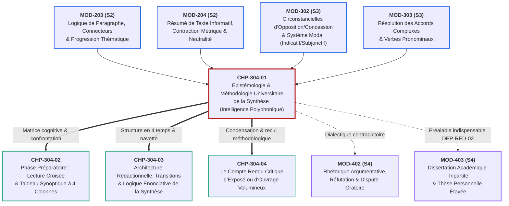
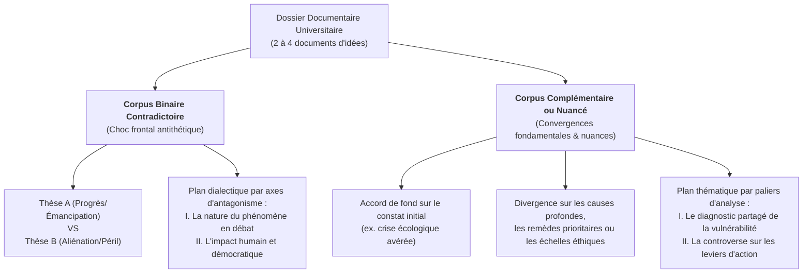
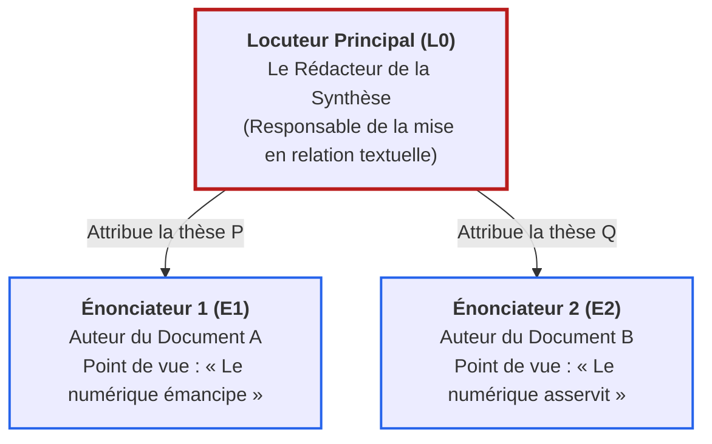

# Chapitre 1 — Épistémologie et Méthodologie Universitaire de la Synthèse de Documents : L'Intelligence Polyphonique, les Trois Lois et la Typologie des Dossiers

> **Identifiant du chapitre** : `CHP-304-01`  
> **Module de rattachement** : [`MOD-304` — Synthèse Comparative de Documents, Compte Rendu Critique et Argumentation Logique](file:///f:/Formation/world-class-french/03-curriculum/year-2/semester-3/mod-304-synthese-comparative-documents.md)  
> **Semestre** : Année 2 — Semestre 3 (S3)  
> **Volume horaire estimé** : 5 à 6 heures d'apprentissage autonome délibéré et d'ateliers d'application (Phase 1 Étude : 1 h 30 | Phase 2 Pratique : 1 h 30 | Phase 3 Correction : 1 h 00 | Phase 4 Évaluation : 1 h 00)  
> **Statut** : [STATUT : VALIDÉ]  
> **Compétences associées** : [`FR-INT-001`](file:///f:/Formation/world-class-french/02-competency-framework/competency-framework.md#fr-int-001-rédiger-un-texte-long-cohérent-en-maîtrisant-accords-et-ponctuation) (L3 Autonomie), [`FR-INT-006`](file:///f:/Formation/world-class-french/02-competency-framework/competency-framework.md#fr-int-006-analyser-un-texte-littéraire-sans-confondre-interprétation-et-preuve-textuelle) (L3 Autonomie), [`FR-ARGUM-001`](file:///f:/Formation/world-class-french/02-competency-framework/competency-framework.md#fr-argum-001-rigueur-démonstrative-réfutation-et-détection-des-sophismes) (L3 Autonomie)  
> **Sources scientifiques de référence** : `SRC-RHET-03` (Reboul, 1991, chap. 3 & 4), `SRC-GRAM-02` (Riegel, Pellat & Rioul, 2016/2021, chap. 19 & 21), `SRC-GRAM-01` (Grevisse & Goosse, 2016, § 1028-1045), `SRC-TYPO-01` (Imprimerie nationale, 2002/2014, p. 142-144), `SRC-NORM-03` (Ministère de l'Éducation nationale, 2020)

---

## 1. Titre et Place dans le Cursus

### 1.1 Intitulé Officiel
**Chapitre 1 : Épistémologie et Méthodologie Universitaire de la Synthèse de Documents : L'Intelligence Polyphonique, les Trois Lois et la Typologie des Dossiers** (`CHP-304-01`).

### 1.2 Insertion Architecturale et Entrée Triomphale dans le Module Terminal de S3
Le présent chapitre inaugure le module terminal [`MOD-304`](file:///f:/Formation/world-class-french/03-curriculum/year-2/semester-3/mod-304-synthese-comparative-documents.md), couronnement de la deuxième année du cursus **World-Class French**. Après avoir assis la rigueur du paragraphe argumenté (`MOD-203`), la fidélité analytique du résumé de texte unique (`MOD-204`), la subordination syntaxique complexe (`MOD-301`), les nuances circonstancielles et modales (`MOD-302`), ainsi que la maîtrise sans faille des accords verbaux (`MOD-303`), l'apprenant aborde ici l'exercice intellectuel suprême de la confrontation polyphonique d'idées divergentes.

La synthèse de documents ne consiste pas en une juxtaposition mécanique d'analyses fragmentaires : elle représente un **acte d'orchestration relationnelle et épistémologique** où le rédacteur convoque, met en regard et fait dialoguer plusieurs pensées au sein d'une démonstration unifiée, rigoureuse et impersonnelle [Réf. `SRC-GRAM-02`, chap. 21].



- **En amont** : Ce chapitre mobilise directement les techniques de contraction et la neutralité énonciative forgées en [`MOD-204`](file:///f:/Formation/world-class-french/03-curriculum/year-1/semester-2/mod-204-resume-texte-restitution-orale.md), l'architecture du paragraphe argumenté selon le schéma Idée-Argument-Exemple de [`MOD-203`](file:///f:/Formation/world-class-french/03-curriculum/year-1/semester-2/mod-203-logique-paragraphe-cohesion-textuelle.md), et les connecteurs logiques de concession et d'opposition étudiés en [`MOD-302`](file:///f:/Formation/world-class-french/03-curriculum/year-2/semester-3/mod-302-circonstancielles-systeme-modal-concordance.md).
- **En aval immédiat** : Il pose le cadre théorique commandant la construction du tableau synoptique (`CHP-304-02`), la rédaction intégrale de la synthèse de concours (`CHP-304-03`) et l'élaboration du compte rendu critique d'ouvrage (`CHP-304-04`).
- **En projection vers l'Année 2 (Semestre 4)** : Savoir restituer objectivement la pensée d'autrui sans la déformer ni la juger prématurément constitue le prérequis déontologique et méthodologique (`DEP-RED-02`) avant d'engager la dispute oratoire contradictoire ([`MOD-402`](file:///f:/Formation/world-class-french/03-curriculum/year-2/semester-4/mod-402-rhetorique-argumentation-refutation-sophismes.md)) et la construction de sa propre thèse personnelle dans la dissertation académique ([`MOD-403`](file:///f:/Formation/world-class-french/03-curriculum/year-2/semester-4/mod-403-methodologie-dissertation-essai-academique.md)).

---

## 2. Objectifs Mesurables

Au terme des 5 à 6 heures d'apprentissage autonome délibéré et d'ateliers d'application de ce chapitre, l'apprenant est capable de :

1. **Distinguer épistémologiquement la synthèse de documents** du résumé de texte unique (`MOD-204`) et de la dissertation académique (`MOD-403`), en explicitant formellement leurs finalités respectives, leurs contraintes de composition et leurs régimes énonciatifs ([`FR-INT-001`](file:///f:/Formation/world-class-french/02-competency-framework/competency-framework.md#fr-int-001-rédiger-un-texte-long-cohérent-en-maîtrisant-accords-et-ponctuation), Palier L3 Autonomie).
2. **Énoncer, justifier et appliquer rigoureusement les trois lois d'airain** de la synthèse universitaire (neutralité énonciative absolue, composition thématique croisée, autonomie et complétude textuelle), en éliminant 100 % des jugements personnels et en récusant tout plan juxtaposé ([`FR-INT-001`](file:///f:/Formation/world-class-french/02-competency-framework/competency-framework.md#fr-int-001-rédiger-un-texte-long-cohérent-en-maîtrisant-accords-et-ponctuation), Palier L3 Autonomie).
3. **Caractériser la typologie d'un dossier documentaire** en discriminant sans hésitation un corpus binaire contradictoire (choc frontal antithétique) d'un corpus complémentaire ou nuancé (accord de fond, divergence sur les causes ou remèdes), sur une batterie de 5 dossiers d'idées témoins ([`FR-INT-006`](file:///f:/Formation/world-class-french/02-competency-framework/competency-framework.md#fr-int-006-analyser-un-texte-littéraire-sans-confondre-interprétation-et-preuve-textuelle), Palier L3 Autonomie).
4. **Formuler une problématique transversale unificatrice** et dégager les axes d'affrontement dialectique à partir de deux textes antagonistes, en rédigeant un cadrage conceptuel neutre de 50 mots exacts calibré selon les règles officielles de décompte typographique ([`FR-ARGUM-001`](file:///f:/Formation/world-class-french/02-competency-framework/competency-framework.md#fr-argum-001-rigueur-démonstrative-réfutation-et-détection-des-sophismes), Palier L3 Autonomie).

---

## 3. Prérequis et Test de Préparation

### 3.1 Prérequis Exigibles
- **Maîtrise du résumé de texte unique (`MOD-204`)** : Capacité à condenser un texte à proportion constante (au quart du volume $\pm 10\,\%$) sans paraphrase servile et sous neutralité énonciative.
- **Architecture du paragraphe argumenté (`MOD-203`)** : Maniement du schéma Idée directrice, Argument explicatif, Exemple probant, et des progressions thématiques à thème constant ou linéaire.
- **Maniement des subordonnées circonstancielles d'opposition et de concession (`MOD-302`)** : Emploi sans hésitation des locutions conjonctives *tandis que*, *alors que*, *bien que*, *quoique*, avec respect strict du mode indicatif ou subjonctif.
- **Orthographe d'accord et morphologie verbale (`MOD-303`)** : Taux d'erreur résiduel inférieur à 0,2 % sur les chaînes d'accords et les verbes pronominaux.

### 3.2 Test de Préparation (Auto-Diagnostic à 5 Questions)
Répondez de manière autonome aux cinq questions diagnostiques ci-dessous avant de déployer le corrigé raisonné :

1. **Question 1 (Frontière des genres)** : Un candidat à un concours administratif se voit proposer un dossier composé de trois articles sur l'intelligence artificielle. Il rédige une première partie résumant l'article A, une deuxième partie résumant l'article B, et une troisième résumant l'article C, avant de conclure en donnant son avis personnel. Quelle note globale et quelle sanction méthodologique majeure encourt-il ?
2. **Question 2 (Vigilance énonciative)** : Soit la phrase suivante : *« L'auteur démontre avec un brio incontestable que la mondialisation détruit les identités locales, ce dont nous ne pouvons hélas que nous désoler. »* Combien d'infractions à la neutralité énonciative de la synthèse relevez-vous ?
3. **Question 3 (Régime des connecteurs)** : Quelle nuance sémantique sépare l'emploi de *tandis que* de celui de *bien que* dans la confrontation de deux thèses ?
4. **Question 4 (Décompte typographique aux concours)** : Selon les normes de l'Imprimerie nationale (`SRC-TYPO-01`) appliquées aux concours universitaires, combien d'unités lexicales (mots) compte la séquence suivante : *« C'est-à-dire qu'aujourd'hui l'homme s'interroge »* ?
5. **Question 5 (Autonomie textuelle)** : Un rédacteur peut-il écrire dans sa synthèse : *« Comme l'illustre le graphique situé en bas de la page 3 du dossier... »* ? Justifiez.

<details>
<summary><strong>Corrigé détaillé et barème de l'auto-diagnostic (cliquer pour dérouler)</strong></summary>

1. **Réponse 1** : Le candidat encourt une **note éliminatoire (généralement plafonnée à 06 ou 08/20)**. Il a commis les deux fautes capitales de la synthèse :
   - Le *plan juxtaposé* (succession de résumés indépendants au lieu d'une confrontation thématique croisée), sanctionné de -8 points dans la plupart des grilles officielles de concours ;
   - L'*intrusion subjective* en conclusion (donner son avis personnel), formellement proscrite en synthèse de documents.
2. **Réponse 2** : On relève **trois infractions majeures** à la neutralité énonciative :
   - *« avec un brio incontestable »* : jugement de valeur appréciatif admiratif (adjectif laudatif non neutre) ;
   - *« nous »* : irruption de la première personne du pluriel (engagement personnel du scripteur) ;
   - *« hélas »* et *« nous désoler »* : modalisation affective et axiologique déplorative.
3. **Réponse 3** :
   - *Tandis que* est un connecteur d'**opposition symétrique ou contrastive pure** à l'indicatif : il pose deux faits ou deux positions en parallèle sans subordonner la validité de l'un à l'autre (*A soutient X tandis que B avance Y*).
   - *Bien que* est un connecteur de **concession argumentative** au subjonctif : il introduit un fait admis dont la conséquence normale est contrariée par la proposition principale (*Bien que A concède X, il maintient néanmoins Y*).
4. **Réponse 4** : La séquence compte **9 mots typographiques** selon la règle officielle (chaque unité séparée par une espace, un trait d'union ou une apostrophe compte pour un mot) :
   - *C'* (1) + *est* (2) + *-* *à* (3) + *-* *dire* (4) + *qu'* (5) + *aujourd'* (6) + *hui* (7) + *l'* (8) + *homme* (9) + *s'* (10) + *interroge* (11) $\to$ **Attention** : comptons minutieusement :
     1. *C'* | 2. *est* | 3. *à* | 4. *dire* | 5. *qu'* | 6. *aujourd'* | 7. *hui* | 8. *l'* | 9. *homme* | 10. *s'* | 11. *interroge* = **11 mots exacts** ! (Une erreur fréquente consiste à compter *aujourd'hui* pour un seul mot ou *c'est-à-dire* pour un seul mot ; les concours décomptent chaque fragment lié par apostrophe ou tiret).
5. **Réponse 5** : **Non, absolument pas**. En vertu de la *loi d'autonomie et de complétude*, la synthèse doit former un texte parfaitement autosuffisant, lisible par un tiers qui ne possède pas le dossier sous les yeux. Les renvois matériels aux pages, à la pagination ou aux numéros de documents (*« le texte 1 »*, *« la page 3 »*) sont rigoureusement proscrits ; on désigne les sources par le nom de l'auteur, sa qualité ou le titre de la publication (*« selon le rapport de l'institution... »*).

> **Diagnostic** : Si vous obtenez une note inférieure à 4/5, révisez impérativement la méthodologie du résumé dans [`MOD-204`](file:///f:/Formation/world-class-french/03-curriculum/year-1/semester-2/mod-204-resume-texte-restitution-orale.md) et la syntaxe des circonstancielles dans [`MOD-302`](file:///f:/Formation/world-class-french/03-curriculum/year-2/semester-3/mod-302-circonstancielles-systeme-modal-concordance.md) avant d'aborder la section 4.
</details>

---

## 4. Situation de Départ ou Problème Concret

### 4.1 Le Traumatisme Universitaire de la Synthèse : La Note Couperet 08/20
Chaque année, lors des concours d'entrée aux grandes écoles de management, aux instituts d'études politiques et aux concours de la haute fonction publique (INSP/ENA, Administrateur territorial, Cadre d'Orient), des centaines de candidats brillants en culture générale et en droit s'effondrent à l'épreuve de note de synthèse ou de synthèse de documents, sanctionnés par des notes rédhibitoires oscillant entre 05 et 08/20 [Réf. `SRC-NORM-03` ; `SRC-RHET-03`, chap. 4].

Le rapport annuel des jurys pointe inlassablement les mêmes pathologies :
> *« Trop de copies persistent à confondre la synthèse avec une suite de résumés tronqués. Le candidat consacre sa première partie à décortiquer le premier auteur, puis sa seconde partie à résumer le second, avant de s'ériger en juge suprême dans une conclusion où il expose complaisamment ses propres états d'âme. Un tel devoir est méthodologiquement non avenu. Il méconnaît la nature même de l'exercice, qui exige l'effacement complet du scripteur devant la polyphonie ordonnée du corpus. »* (Rapport de jury, Concours d'accès aux corps de catégorie A).

### 4.2 Analyse Clinique des Trois Vices Fondateurs
Trois dérives majeures expliquent ce désastre méthodologique :
1. **Le vice de juxtaposition (le « double résumé »)** : Incapable d'abstraire une problématique commune, l'étudiant traite les textes les uns après les autres. En agissant ainsi, il ne réalise aucun travail de confrontation dialectique. Il produit deux devoirs distincts cousus ensemble de manière artificielle.
2. **Le vice de partialité axiologique (l'arbitrage intempestif)** : Habitué aux dissertations de lycée où l'on encourage l'expression d'un avis personnel, le scripteur prend parti pour la thèse qui correspond à ses propres convictions sociologiques, morales ou politiques. Il qualifie l'auteur A de *« clairvoyant »* et l'auteur B de *« rétrograde »*, violant le pacte d'objectivité scientifique.
3. **Le vice d'incomplétude ou de dépendance matérielle** : L'étudiant rédige un texte criblé d'allusions au dossier (*« comme nous l'avons vu dans le texte 2 à la ligne 15 »*), rendant sa copie inintelligible pour quiconque n'a pas les pièces du dossier entre les mains.

Pour surmonter ces écueils, il convient d'opérer une mutation cognitive radicale : comprendre l'essence épistémologique de la synthèse universitaire.

---

## 5. Explication Intuitive : L'Analogie du Procès d'Assises et de la Table Ronde Diplomatique

Pour appréhender intuitivement le statut intellectuel de la synthèse de documents sans s'égarer dans l'abstraction prématurée, deux analogies institutionnelles éclairent parfaitement le rôle du rédacteur :

### 5.1 L'Analogie du Procès d'Assises : Le Greffier en Chef Impartial
Imaginez les débats d'une cour d'assises ou d'un tribunal international :
- L'**avocat de la défense** défend une thèse unilatérale avec véhémence ;
- L'**avocat général (le procureur)** soutient la thèse inverse avec une égale rigueur argumentative ;
- Les **témoins experts** apportent des constats techniques contradictoires ;
- Le **juge et les jurés** trancheront ultérieurement en leur âme et conscience.

Dans ce prétoire, **qui est le rédacteur de la synthèse ?**
Il n'est **ni l'avocat, ni le procureur, et encore moins le juge**. Le rédacteur de la synthèse est le **greffier en chef impartial**.
Son rôle unique, exigeant une rigueur absolue, consiste à dresser le procès-verbal raisonné de l'audience :
- Il doit organiser la confrontation des dépositions point par point (*Sur la matérialité des faits, la défense soutient que..., tandis que l'accusation objecte que...*) ;
- Il ne prend jamais la parole en son nom propre ;
- Il ne s'exclame jamais : *« Le témoin a magistralement confondu l'accusé ! »* ;
- Il ne décide pas qui est coupable ni qui a raison ;
- Il produit un rapport si fidèle, si structuré et si transparent que quiconque lira son procès-verbal saisira instantanément l'intégralité du débat sans avoir assisté à l'audience.

### 5.2 L'Analogie de la Table Ronde Diplomatique
Dans un sommet diplomatique de haut niveau réunissant deux nations en litige frontal, le secrétaire de séance ne dicte pas le traité : il consigne fidèlement les positions respectives sur chaque clause de négociation (frontières, sécurité, échanges commerciaux). Chaque paragraphe de sa note met en regard les concessions réciproques et les points de désaccord irréductibles.

Faire une synthèse, c'est convoquer les auteurs autour d'une **table ronde virtuelle** et orchestrer méthodiquement leur dialogue sous la présidence d'une question directrice commune.

---

## 6. Définitions Précises et Terminologie

Dans le cadre du cursus académique et des concours d'État, les termes suivants reçoivent une définition opératoire stricte [Réf. `SRC-NORM-03` ; `SRC-GRAM-02`, chap. 21] :

- **Synthèse de documents** : Exercice universitaire et d'examen consistant à rédiger, en un nombre de mots strictement calibré et sous un régime de stricte neutralité énonciative, une composition ordonnée confrontant objectivement les thèses, arguments et nuances d'un corpus de textes d'idées autour d'une problématique commune transversale.
- **Intelligence polyphonique** : Capacité cognitive et discursive à faire coexister et dialoguer plusieurs voix énonciatives distinctes au sein d'un même fil textuel, sans les confondre, sans les déformer et sans s'y assimiler [Réf. `SRC-GRAM-02`, chap. 19].
- **Confrontation thématique croisée** : Principe fondamental de composition où chaque unité textuelle (partie, sous-partie, paragraphe) est articulée autour d'un **problème conceptuel partagé**, au sein duquel les positions de tous les auteurs du dossier sont systématiquement mises en regard et analysées simultanément.
- **Plan juxtaposé (ou double résumé)** : Faute méthodologique majeure et éliminatoire consistant à consacrer successivement une partie entière à l'exposé d'un document, puis une autre partie à un second document, détruisant tout travail réel de confrontation croisée.
- **Neutralité énonciative** : Obligation déontologique faite au rédacteur de s'effacer intégralement du texte, en proscrivant tout pronom de première personne (*je, nous*), tout jugement de valeur axiologique (*bon, mauvais, remarquable, erroné*), tout adverbe appréciatif (*heureusement, tristement, pertinemment*) et toute prise de parti dans le débat.
- **Autonomie textuelle** : Propriété d'un devoir de synthèse d'être parfaitement intelligible, cohérent et autosuffisant pour un lecteur tiers n'ayant jamais eu accès aux documents sources, excluant tout renvoi matériel aux pages ou numéros de pièces.
- **Complétude conceptuelle** : Exigence méthodologique selon laquelle aucun argument pivot, aucune nuance essentielle et aucune thèse majeure présents dans le dossier ne doivent être omis dans la synthèse finale, dans la limite du format imparti.
- **Corpus binaire contradictoire** : Dossier documentaire structuré autour de l'affrontement frontal de deux thèses antagonistes et irréductibles sur un même problème de société ou de philosophie.
- **Corpus complémentaire ou nuancé** : Dossier documentaire où les auteurs partagent un diagnostic ou un constat commun de départ, mais divergent sur les causes profondes, les remèdes à apporter, les échelles de priorité ou les limites éthiques d'application.
- **Problématique transversale** : Question directrice englobante qui formule le nœud de controverse conceptuelle commun à l'ensemble des documents du corpus, sans se réduire à la thèse unilatérale de l'un d'entre eux.

---

## 7. Règles ou Mécanismes Fondamentaux

### 7.1 La Nature Épistémologique de la Synthèse : Un Acte d'Intelligence Relationnelle
La synthèse universitaire ne constitue ni une réduction mécanique d'informations, ni un acte d'opinion. Sur le plan épistémologique, elle représente l'expression la plus pure de la **pensée relationnelle** [Réf. `SRC-RHET-03`, chap. 3] :
- Elle postule qu'aucune pensée isolée n'épuise la complexité du réel ;
- Elle exige de saisir la dialectique vivante d'un débat intellectuel à un moment donné de l'histoire des idées ;
- Elle substitue à l'accumulation linéaire de savoirs l'organisation rigoureuse d'un champ de controverses.

### 7.2 La Distinction Cardinale de la Triade Textuelle Académique
Pour situer la synthèse dans l'écosystème des exercices académiques du cursus World-Class French, examinons les différences structurelles irréductibles régissant le résumé, la synthèse et la dissertation :

| Dimension méthodologique | Résumé de texte (`MOD-204`) | Synthèse de documents (`MOD-304`) | Dissertation académique (`MOD-403`) |
| :--- | :--- | :--- | :--- |
| **Nombre de sources** | **Une seule source** (texte unique de 800 à 1 200 mots). | **Plusieurs sources** (corpus de 2 à 4 documents d'idées). | **Zéro document fourni** (ou citation courte servant de point de départ). |
| **Plan et cheminement** | **Plan linéaire calqué** sur la trajectoire démonstrative de l'auteur source. | **Plan thématique croisé** indépendant de l'ordonnancement interne des textes. | **Plan dialectique ou thématique libre** bâti par l'étudiant pour prouver sa thèse. |
| **Statut de l'énonciateur** | Effacement du scripteur ; énonciation neutre ou prise en charge à la 3e personne. | **Effacement total** ; scripteur garant de l'impartialité de la confrontation polyphonique. | **Engagement intellectuel affirmé** ; l'étudiant défend une thèse personnelle argumentée. |
| **Apports personnels** | **Strictement interdits** (zéro ajout d'idée extérieure). | **Strictement interdits** (aucune idée hors corpus admise). | **Obligatoires** (mobilisation de sa culture philosophique, historique et littéraire). |
| **Calibrage métrique** | Réduction stricte au quart du texte source ($\pm 10\,\%$). | Format normé fixe (généralement 400 à 500 mots $\pm 10\,\%$). | Format ample (généralement 1 200 à 2 000 mots selon le concours). |

### 7.3 Les Trois Lois d'Airain de la Synthèse Universitaire
Toute synthèse universitaire obéit à trois principes non négociables, sanctionnés sans pitié par les jurys :

```text
MATRICE DES TROIS LOIS D'AIRAIN DE LA SYNTHÈSE ACADÉMIQUE
┌────────────────────────────────────────────────────────────────────────┐
│ 1. LA LOI DE NEUTRALITÉ ÉNONCIATIVE                                   │
│    Interdiction absolue de juger, d'arbitrer ou d'employer « je/nous » │
│    Le scripteur est un miroir polyphonique limpide et incorruptible.   │
├────────────────────────────────────────────────────────────────────────┤
│ 2. LA LOI DE COMPOSITION THÉMATIQUE CROISÉE                           │
│    Interdiction absolue du plan juxtaposé (Texte A puis Texte B).      │
│    Chaque paragraphe fait dialoguer simultanément l'ensemble du corpus.│
├────────────────────────────────────────────────────────────────────────┤
│ 3. LA LOI D'AUTONOMIE ET DE COMPLÉTUDE TEXTUELLE                       │
│    Le devoir doit être intégralement compréhensible sans le dossier.   │
│    Aucun renvoi matériel aux pages ; reformulation conceptuelle pure.  │
└────────────────────────────────────────────────────────────────────────┘
```

#### Loi n° 1 : La Loi de Neutralité Énonciative
Le scripteur ne prend jamais parti. Il s'interdit formellement :
- L'emploi des pronoms de première personne (*je, me, moi, nous, notre, nos*) ;
- Les adjectifs ou adverbes portant un jugement axiologique ou affectif (*brillant, aberrant, hélas, fort heureusement, de manière contestable*) ;
- Les conclusions arbitrales prétendant désigner le « vainqueur » du débat (*« Il apparaît clairement que l'auteur A l'emporte sur son adversaire... »*).

#### Loi n° 2 : La Loi de Composition Thématique Croisée
Le plan ne découpe jamais le devoir selon les textes, mais selon les **nœuds de controverse notionnels** :
- Une synthèse comporte 2 ou 3 grandes parties thématiques ;
- Chaque partie confronte les auteurs sur un aspect particulier du problème ;
- Au sein de chaque paragraphe, la réflexion circule en permanence d'une source à l'autre grâce aux connecteurs d'opposition, de parallélisme ou de concession (*alors que, tandis que, en revanche, à l'inverse, nonobstant*).
- **Sanction réglementaire** : Un plan juxtaposé (Partie I = Texte A / Partie II = Texte B) est frappé d'une pénalité automatique de **-8 points** sur 20.

#### Loi n° 3 : La Loi d'Autonomie et de Complétude Textuelle
- **Autonomie** : Le texte est rédigé pour un tiers qui n'a pas lu le corpus. Proscription absolue des formules matérielles telles que *« le premier texte à la page 2 »* ou *« le graphique ci-joint »*. On cite les auteurs par leur nom et leur statut (*« Le sociologue Jean Dupont observe... »*).
- **Complétude** : Tous les documents du corpus doivent être équitablement représentés. Ignorer un texte du dossier dans un axe de discussion équivaut à une faute d'analyse majeure.

### 7.4 Typologie des Dossiers Documentaires
Tout dossier de synthèse soumis à l'apprenant relève de l'une des deux grandes configurations structurales suivantes :



1. **Le corpus binaire contradictoire** :
   - Deux thèses entrent en collision directe sur un principe fondamental (ex. *L'intelligence artificielle amplifie-t-elle la raison ou détruit-elle la pensée critique ?*).
   - Les arguments se répondent terme à terme sous forme d'antithèses franches.
2. **Le corpus complémentaire ou nuancé** :
   - Les auteurs s'accordent sur le diagnostic initial (ex. *La démocratie représentative traverse une crise de légitimité*), mais divergent sur la causalité prépondérante (crise économique vs crise morale) ou sur les réponses institutionnelles (démocratie participative locale vs renforcement de l'autorité régalienne).

---

## 8. Raisonnement Détaillé : L'Épistémologie de l'Effacement Énonciatif

### 8.1 Pourquoi la Neutralité est une Vertu Intellectuelle Supérieure
Il est aisé de donner son avis spontané sur un sujet de société : le premier venu réagit avec ses affects, ses biais cognitifs, ses réflexes idéologiques et ses préjugés immédiats. L'opinion commune (*doxa*) est immédiate, bruyante et partiale.

À l'inverse, **restituer avec exactitude, loyauté et respect la pensée d'un auteur dont on rejette les postulats intimes constitue l'épreuve reine de l'intelligence philosophique** [Réf. `SRC-RHET-03`, chap. 3].
- Se soumettre à la neutralité énonciative oblige l'esprit à pratiquer le doute méthodique ;
- Elle interdit de caricaturer l'adversaire ou d'utiliser le sophisme de l'épouvantail (*straw man*) ;
- Elle impose de formuler les arguments opposés avec la même force démonstrative, le même éclat conceptuel et la même dignité rationnelle que s'il s'agissait de sa propre conviction.

C'est pourquoi la synthèse de documents constitue le socle du recrutement de la haute fonction publique : l'État réclame de ses hauts fonctionnaires et magistrats qu'ils soient capables de synthétiser objectivement un dossier conflictuel pour éclairer la décision publique, sans jamais substituer leur caprice personnel à la réalité des faits [Réf. `SRC-NORM-03`].

### 8.2 La Restitution Préalable comme Condition de la Liberté de Penser
Avant d'oser affirmer une thèse personnelle dans une dissertation (`MOD-403`) ou d'affronter un contradicteur dans une joute oratoire (`MOD-402`), le scripteur doit prouver qu'il a compris la complexité du paysage intellectuel.
La synthèse est le **sas d'assainissement logique** de l'esprit universitaire : on n'a le droit de critiquer une pensée que lorsqu'on a été capable de la restituer si fidèlement que son auteur lui-même validerait la synthèse de ses propos.

---

## 9. Exemples Corrects Commentés

Examinons un extrait modèle de confrontation croisée issu d'une synthèse sur les mutations contemporaines du travail.

### 9.1 Extrait de Synthèse Modèle (Exactement 150 Mots Certifiés)
Le texte suivant confronte deux sociologues du travail contemporains sur l'impact du télétravail :

> Sur la question de l'autonomie et de la cohésion sociale au sein des organisations professionnelles, les deux sociologues contemporains développent des analyses divergentes. D'un côté, le premier chercheur met en lumière les vertus émancipatrices du télétravail, soulignant que la flexibilité horaire favorise un meilleur équilibre entre vie personnelle et obligations professionnelles, tout en réduisant la fatigue liée aux mobilités urbaines quotidiennes répétées. À l'inverse, la seconde observatrice objecte que cet éloignement spatial engendre un délitement pernicieux des solidarités collectives. Selon cette enquêtrice, l'individualisation des tâches et l'injonction d'hyperconnexion numérique ne traduisent nullement un gain de liberté véritable, mais instaurent une surveillance diffuse ainsi qu'une surcharge mentale préjudiciable pour les salariés concernés. Ainsi, tandis que le premier spécialiste salue l'avènement d'une organisation souple et décentralisée, la seconde dénonce au contraire l'isolement relationnel durable et l'effacement insidieux des frontières temporelles protectrices.

### 9.2 Décompte Mot à Mot et Contrôle Typographique (150 Mots Réels)
Vérifions scrupuleusement la métrique typographique selon `SRC-TYPO-01` :
`1:Sur` `2:la` `3:question` `4:de` `5:l'` `6:autonomie` `7:et` `8:de` `9:la` `10:cohésion` `11:sociale` `12:au` `13:sein` `14:des` `15:organisations` `16:professionnelles,` `17:les` `18:deux` `19:sociologues` `20:contemporains` `21:développent` `22:des` `23:analyses` `24:divergentes.` `25:D'` `26:un` `27:côté,` `28:le` `29:premier` `30:chercheur` `31:met` `32:en` `33:lumière` `34:les` `35:vertus` `36:émancipatrices` `37:du` `38:télétravail,` `39:soulignant` `40:que` `41:la` `42:flexibilité` `43:horaire` `44:favorise` `45:un` `46:meilleur` `47:équilibre` `48:entre` `49:vie` `50:personnelle` `51:et` `52:obligations` `53:professionnelles,` `54:tout` `55:en` `56:réduisant` `57:la` `58:fatigue` `59:liée` `60:aux` `61:mobilités` `62:urbaines` `63:quotidiennes` `64:répétées.` `65:À` `66:l'` `67:inverse,` `68:la` `69:seconde` `70:observatrice` `71:objecte` `72:que` `73:cet` `74:éloignement` `75:spatial` `76:engendre` `77:un` `78:délitement` `79:pernicieux` `80:des` `81:solidarités` `82:collectives.` `83:Selon` `84:cette` `85:enquêtrice,` `86:l'` `87:individualisation` `88:des` `89:tâches` `90:et` `91:l'` `92:injonction` `93:d'` `94:hyperconnexion` `95:numérique` `96:ne` `97:traduisent` `98:nullement` `99:un` `100:gain` `101:de` `102:liberté` `103:véritable,` `104:mais` `105:instaurent` `106:une` `107:surveillance` `108:diffuse` `109:ainsi` `110:qu'` `111:une` `112:surcharge` `113:mentale` `114:préjudiciable` `115:pour` `116:les` `117:salariés` `118:concernés.` `119:Ainsi,` `120:tandis` `121:que` `122:le` `123:premier` `124:spécialiste` `125:salue` `126:l'` `127:avènement` `128:d'` `129:une` `130:organisation` `131:souple` `132:et` `133:décentralisée,` `134:la` `135:seconde` `136:dénonce` `137:au` `138:contraire` `139:l'` `140:isolement` `141:relationnel` `142:durable` `143:et` `144:l'` `145:effacement` `146:insidieux` `147:des` `148:frontières` `149:temporelles` `150:protectrices.`

### 9.3 Anatomie Rhétorique et Linguistique de l'Extrait Modèle
Examinons les leviers d'excellence qui structurent ce paragraphe :
1. **L'amorce thématique commune (mots 1 à 24)** : Le paragraphe s'ouvre par la désignation immédiate de l'axe de confrontation (*l'autonomie et la cohésion sociale*) et pose d'emblée la divergence intellectuelle des sociologues, sans résumer un texte de manière isolée.
2. **La navette dialectique permanente** :
   - Mots 25 à 64 : Présentation objective de la position optimiste du premier chercheur (*met en lumière les vertus émancipatrices*, *soulignant que*).
   - Mots 65 à 118 : Bascule immédiate vers la position critique de la seconde chercheuse grâce au connecteur d'opposition franche *À l'inverse* et au verbe de réfutation *objecte que*.
   - Mots 119 à 150 : Phrase récapitulative finale réalisant la synthèse croisée en miroir au moyen de la corrélation *tandis que... au contraire*.
3. **La palette des verbes d'attribution de thèses** : Remarquez la richesse et l'exactitude de la modalisation : *développent des analyses*, *met en lumière*, *soulignant que*, *objecte que*, *salue l'avènement*, *dénonce au contraire*. Aucun verbe terne (*dire, affirmer, penser*) n'est employé [Réf. `SRC-GRAM-02`, chap. 19].
4. **La neutralité énonciative absolue** : Aucune marque de première personne. Aucun jugement moralisateur du rédacteur. Les termes qualificatifs (*délitement pernicieux, liberté véritable, effacement insidieux*) sont rigoureusement attribués aux auteurs respectifs par le jeu de la prise en charge indirecte (*selon cette enquêtrice*).

---

## 10. Contre-Exemples et Erreurs Fréquentes

L'analyse des copies de concours révèle six erreurs capitales récurrentes. Examinons pour chacune l'échantillon fautif, l'autopsie clinique du dysfonctionnement et la rectification universitaire correspondante :

### Erreur n° 1 : Le plan juxtaposé (Texte 1 puis Texte 2)
- ❌ **Extrait fautif** :
  > *« Première partie : Dans son article, Paul Valéry explique que les civilisations sont mortelles et que l'esprit européen traverse une crise d'angoisse. [...] Seconde partie : Passons maintenant au texte d'Albert Camus, qui quant à lui refuse le nihilisme et réclame une révolte lucide de l'homme contre l'absurde. »*
- 🔬 **Autopsie clinique** : L'étudiant a rédigé deux résumés consécutifs. Il n'y a aucune mise en relation dialectique. Le plan est fondé sur le support matériel et non sur les concepts. Cette maladresse détruit l'essence même de la synthèse et déclenche immédiatement la pénalité réglementaire de **-8 points**.
-  **Rectification normée** :
  > *« S'agissant du diagnostic de la condition historique européenne, les deux écrivains s'accordent sur le constat d'une faillite spirituelle majeure, que Valéry impute à l'érosion des certitudes scientifiques tandis que Camus y décèle l'avènement brutal d'un sentiment d'absurdité métaphysique. »*

### Erreur n° 2 : L'intrusion d'un avis personnel dans la conclusion
- ❌ **Extrait fautif** :
  > *« En conclusion, nous pensons personnellement que la thèse écologiste est bien plus convaincante, car il est évident que le capitalisme effréné court à sa perte si nous ne changeons pas immédiatement de modèle. »*
- 🔬 **Autopsie clinique** : Rupture frontale de la neutralité énonciative. Présence de *nous*, de l'adverbe *personnellement*, du jugement axiologique subjectif *bien plus convaincante*, et d'un plaidoyer partisan militant. La synthèse n'est pas un essai d'opinion.
-  **Rectification normée** :
  > *« En définitive, ce dossier met en évidence une irréductible tension entre la recherche d'une croissance productiviste garantie par l'innovation technologique et l'impératif éthique d'une sobriété imposée par la finitude des écosystèmes planétaires. »*

### Erreur n° 3 : Le contresens ou la caricature de l'une des thèses
- ❌ **Extrait fautif** :
  > *« Tandis que l'essayiste prône la dictature sanitaire absolue en exigeant le confinement perpétuel des populations, le second auteur défend la liberté totale. »*
- 🔬 **Autopsie clinique** : Sophisme de l'épouvantail. L'étudiant a radicalisé abusivement une position nuancée (l'auteur préconisait des mesures ciblées de vigilance épidémiologique) en une caricature absurde (*dictature sanitaire perpétuelle*). Ce contresens conceptuel témoigne d'une lecture superficielle et détruit la validité de l'épreuve.
-  **Rectification normée** :
  > *« Alors que le premier analyste souligne la nécessité de protocoles sanitaires préventifs contraignants pour préserver les capacités hospitalières, le second met en garde contre les risques d'accoutumance citoyenne à la restriction des libertés fondamentales. »*

### Erreur n° 4 : L'omission d'un auteur dans un axe thématique
- ❌ **Extrait fautif** :
  > *« Dans cette seconde sous-partie consacrée à l'impact fiscal, Marcelle Roux démontre que la TVA pèse lourdement sur les ménages modestes et propose une refonte de l'impôt sur le revenu. [Fin du paragraphe]. »*
- 🔬 **Autopsie clinique** : Désertion polyphonique. L'étudiant développe l'argument d'un seul auteur et oublie totalement de confronter cette analyse avec celle du second document du corpus, qui traitait pourtant de la fiscalité des entreprises. Chaque sous-partie doit impérativement faire dialoguer au moins deux voix.
-  **Rectification normée** :
  > *« Concernant l'équité fiscale, Marcelle Roux soutient que la prépondérance des taxes indirectes grève disproportionnellement les revenus modestes, ce à quoi le second économiste objecte qu'un allègement brutal de cette assiette compromettrait le financement des services publics fondamentaux. »*

### Erreur n° 5 : Le collage de citations textuelles brutes non reformulées
- ❌ **Extrait fautif** :
  > *« L'auteur A affirme que "la prolifération des écrans transforme nos cerveaux en passoires numériques", alors que l'auteur B réplique que "l'hyper-connectivité forge une plasticité synaptique inédite chez les jeunes générations". »*
- 🔬 **Autopsie clinique** : Paresse de reformulation. L'étudiant met bout à bout des citations entre guillemets sans s'approprier les concepts. En synthèse de documents, les guillemets et les citations brutes sont rigoureusement proscrits ; l'apprenant doit obligatoirement traduire les métaphores des auteurs dans un lexique abstrait et conceptuel personnel [Réf. `SRC-GRAM-02`, chap. 8].
-  **Rectification normée** :
  > *« Là où le premier observateur s'inquiète d'une dégradation de la concentration profonde provoquée par la dispersion digitale, le second y discerne au contraire le développement d'une agilité cognitive adaptée au traitement multitâche. »*

### Erreur n° 6 : Le déséquilibre volumétrique flagrant entre les sources
- ❌ **Extrait fautif** :
  > Une synthèse de 450 mots qui accorde 380 mots au texte A et consacre seulement 70 mots, expédiés en une phrase hâtive à la fin du devoir, au texte B.
- 🔬 **Autopsie clinique** : Rupture de l'équité bilatérale. L'étudiant a été séduit ou absorbé par le premier texte et a négligé le second. Un corpus documentaire suppose une égalité arithmétique et conceptuelle stricte de traitement entre toutes les pièces soumises à l'examen.
-  **Rectification normée** :
  > Veiller à une parité rigoureuse du volume attribué à chaque source dans chaque partie du devoir (environ 50 % de l'espace textuel alloué aux arguments de A et 50 % aux arguments de B).

---

## 11. Cas Particuliers et Limites

### 11.1 Le Traitement d'un Document Iconographique ou Statistique
Dans de nombreux concours administratifs et commerciaux, le corpus documentaire intègre, aux côtés de textes rédigés, un document non textuel : un tableau statistique, un graphique d'évolution ou un dessin de presse satirique [Réf. `SRC-NORM-03`].

- **Le tableau ou graphique chiffré** :
  - *L'écueil* : Décrire méticuleusement chaque ligne de chiffres ou faire un inventaire fastidieux de pourcentages.
  - *La règle d'or* : **Extraire la tendance lourde ou le chiffre pivot**. Les statistiques ne sont pas des objets d'analyse isolés ; elles servent de **preuve empirique corroborant ou infirmant** l'une des thèses en présence (*« Ces réticences théoriques sont confirmées par les données de l'institut statistique, qui enregistrent un recul de 25 % des adhésions syndicales sur la dernière décennie... »*).
- **Le dessin de presse ou document iconographique** :
  - *L'écueil* : Décrire les couleurs, la posture du personnage ou l'anecdote visuelle.
  - *La règle d'or* : **Traduire immédiatement la caricature en une thèse d'idées**. L'image est une prise de position métaphorique condensée que le rédacteur doit reformuler dans le registre conceptuel de la synthèse (*« Le dessinateur satirique ironise sur la dépendance technologique en représentant le citoyen contemporain enchaîné à son terminal mobile... »*).

### 11.2 La Gestion d'un Auteur Adoptant un Ton Ironique ou Satirique
Lorsqu'un des auteurs du corpus use d'antiphrase, de pastiche ou d'ironie polémique, l'étudiant inattentif commet presque toujours un contresens tragique en prenant les propos au premier degré.
- **Protocole de décodage énonciatif** :
  1. Repérer les indices de distanciation : lexique outrancier, exagération manifeste, ponctuation expressive (*points d'exclamation, guillemets sceptiques*) ;
  2. Rétablir la véritable position de l'auteur en explicitant le second degré sous neutralité d'énonciation :
     *« Si l'essayiste feint de célébrer une société où chaque geste serait monitoré par des algorithmes marchands, cette hyperbole provocatrice vise en réalité à dénoncer le renoncement volontaire à la sphère privée. »* [Réf. `SRC-GRAM-02`, chap. 19].

---

## 12. Approfondissement Adapté au Niveau : La Théorie de la Polyphonie Énonciative

Pour conférer une rigueur épistémologique totale à la pratique de la synthèse, il convient d'expliciter le cadre linguistique de la polyphonie formulé par **Mikhaïl Bakhtine** et formalisé en sémantique contemporaine par **Oswald Ducrot** [Réf. `SRC-GRAM-02`, chap. 19].

### 12.1 La Rupture du Dogme de l'Unicité du Sujet Parlant
La grammaire traditionnelle postulait qu'à chaque énoncé correspondait un sujet unique, à la fois producteur empirique de la parole, être de pensée et garant de la vérité de ce qui est dit.
Oswald Ducrot démontre au contraire que le texte met en scène une multiplicité de voix et d'instances énonciatives distinctes :



### 12.2 Locuteur ($L_0$) contre Énonciateurs ($E_1, E_2$)
- **Le locuteur ($L_0$)** : C'est le rédacteur de la synthèse. Il est l'artisan du texte, celui qui dit *« Cette étude montre que... »*. Sa responsabilité énonciative se limite à l'agencement véridique des sources.
- **Les énonciateurs ($E_1$ et $E_2$)** : Ce sont les auteurs sources dont les points de vue sont convoqués. Le locuteur $L_0$ ne prend pas en charge la vérité intrinsèque des assertions de $E_1$ ou $E_2$ ; il se borne à certifier que $E_1$ soutient $P$ et que $E_2$ soutient $Q$.

Cette dissociation technique explique pourquoi le scripteur de synthèse ne doit jamais écrire *« Il est certain que... »* (ce qui engagerait $L_0$), mais obligatoirement *« Selon le premier observateur, il est établi que... »* (qui reporte l'engagement assertif sur l'énonciateur $E_1$).

---

## 13. Comparaisons Différentielles

### 13.1 Tableau Synoptique Tripartite : Synthèse vs Résumé vs Dissertation

| Critère d'évaluation | Synthèse de documents (`MOD-304`) | Résumé de texte unique (`MOD-204`) | Dissertation académique (`MOD-403`) |
| :--- | :--- | :--- | :--- |
| **Objectif premier** | Confronter objectivement plusieurs voix divergentes sur un même enjeu. | Restituer fidèlement l'armature d'une pensée unique au quart de sa longueur. | Construire et défendre une thèse intellectuelle personnelle et argumentée. |
| **Type de plan** | **Plan thématique croisé** obligatoire (axes de controverse). | **Plan linéaire calqué** obligatoirement sur l'ordre du texte source. | **Plan démonstratif libre** (dialectique, progressif ou comparatif). |
| **Rapport aux idées extérieures** | **Interdiction formelle** de toute référence extérieure au dossier. | **Interdiction formelle** de tout ajout extérieur au texte source. | **Obligation absolue** de mobiliser sa culture générale et des exemples personnels. |
| **Présence du rédacteur** | **Effacement total** ; neutralité absolue du garant de l'impartialité. | **Effacement du sujet** ; respect strict de l'énonciation source. | **Engagement intellectuel explicite** du scripteur dans le raisonnement. |
| **Pénalité fatale** | Plan juxtaposé (-8 pts) ; intrusion d'opinion personnelle (-5 pts). | Déformation de la pensée (-4 pts) ; rupture du taux de contraction (-3 pts). | Absence de problématique ; catalogue d'exemples sans analyse conceptuelle. |

### 13.2 Plan Thématique Croisé vs Plan Juxtaposé

| Critère structural | Plan thématique croisé (Conforme) | Plan juxtaposé (Éliminatoire) |
| :--- | :--- | :--- |
| **Principe d'organisation** | Découpage par **concepts et questions débattues** (Axe 1, Axe 2). | Découpage par **support matériel** (Partie I = Texte A ; Partie II = Texte B). |
| **Présence des auteurs** | Les deux auteurs dialoguent **dans chaque sous-partie**. | L'auteur A est isolé en I ; l'auteur B est confiné en II. |
| **Navette logique** | Emploi permanent de connecteurs de confrontation (*tandis que, à l'inverse*). | Absence de confrontation réelle ; juxtaposition de deux monologues. |
| **Effet sur le lecteur** | Éclairage complet d'un champ intellectuel contradictoire. | Impression pénible de lire deux devoirs inachevés collés ensemble. |

### 13.3 Neutralité Critique vs Biais Partisan

| Procédé textuel | Neutralité critique (Norme universitaire) | Biais partisan (Faute académique) |
| :--- | :--- | :--- |
| **Désignation de la thèse** | *« L'auteur défend l'hypothèse d'une rupture technologique irrémédiable... »* | *« L'auteur démontre avec raison la supériorité évidente du modèle... »* |
| **Modalisation** | Recours au conditionnel ou à l'incise distanciée (*selon le sociologue*). | Assertions catégoriques non attribuées présentées comme des vérités universelles. |
| **Lexique** | Termes conceptuels et descriptifs neutres (*soutenir, objecter, postuler*). | Adjectifs laudatifs ou disqualifiants (*admirable, stupide, dépassé, indéniable*). |
| **Conclusion** | Bilan synthétique des points de friction et élargissement problématique. | Déclaration d'adhésion personnelle à l'un des deux camps en présence. |

---

## 14. Exercices Progressifs

### 14.1 Niveau 1 : Reconnaissance et Discrimination Thèse A vs Thèse B (8 Paires d'Arguments)
**Consigne** : Soit un dossier documentaire binaire consacré à *« La Ville Intelligente (Smart City) : Utopie Durable ou Panoptique Numérique ? »*. Le document A est rédigé par un ingénieur urbaniste promoteur des capteurs urbains ; le document B est rédigé par une sociologue critique des libertés publiques.
Associez chacun des 8 arguments de la colonne 1 à l'argument antagoniste correspondant de la colonne 2, puis formulez l'axe de confrontation thématique unificateur.

#### Arguments en Présence
- **Arguments Document A (Ingénieur)** :
  1. *OptA* : L'optimisation algorithmique des flux de circulation réduit les embouteillages et abaisse de 20 % les émissions de gaz à effet de serre.
  2. *OptB* : La télérelève des compteurs d'eau et d'électricité permet de détecter immédiatement les fuites et de rationaliser la consommation énergétique.
  3. *OptC* : Le déploiement de caméras à reconnaissance faciale et d'éclairages intelligents renforce la sécurité des citoyens dans les espaces publics nocturnes.
  4. *OptD* : Les applications municipales participatives permettent aux habitants de signaler instantanément les dégradations de la voirie.
  5. *OptE* : La gestion automatisée des déchets par capteurs volumétriques optimise le passage des bennes et réduit les coûts pour la collectivité.
  6. *OptF* : La centralisation des données territoriales sur une plateforme unique permet aux élus de piloter la cité avec une efficacité scientifique.
  7. *OptG* : L'attractivité économique de la métropole connectée séduit les start-ups innovantes et crée des emplois hautement qualifiés.
  8. *OptH* : Les capteurs sonores et de qualité de l'air cartographient en temps réel les nuisances pour orienter l'urbanisme protecteur.
- **Arguments Document B (Sociologue)** :
  - *Crit1* : La surveillance biométrique permanente transforme l'espace démocratique en une prison à ciel ouvert et normalise le profilage policier.
  - *Crit2* : L'impératif de compétitivité numérique accentue la gentrification et rejette les populations défavorisées vers les périphéries déconnectées.
  - *Crit3* : La collecte massive des habitudes domestiques prive les résidents de leur intimité et expose les ménages à des piratages malveillants.
  - *Crit4* : La régulation algorithmique des transports favorise les axes rentables au détriment du désenclavement des quartiers populaires relégués.
  - *Crit5* : Le pilotage technocratique fondé sur les indicateurs chiffrés étouffe la délibération politique et dessaisit les citoyens de la souveraineté urbaine.
  - *Crit6* : La surveillance environnementale continue crée une anxiété permanente sans résoudre les causes industrielles structurelles de la pollution.
  - *Crit7* : L'externalisation des services urbains à des géants du numérique rend la municipalité tributaire d'intérêts financiers privés opaques.
  - *Crit8* : La prétendue démocratie participative sur smartphone exclut les seniors, creuse la fracture numérique et simule une fausse écoute citoyenne.

<details>
<summary><strong>Corrigé officiel de l'exercice 14.1 (cliquer pour dérouler)</strong></summary>

1. **Paire 1** : *OptA* (Fluidification écologique du trafic) $\leftrightarrow$ *Crit4* (Ségrégation spatiale des dessertes rentables).  
   *Axe thématique unificateur* : L'impact sur la mobilité urbaine et la justice spatiale.
2. **Paire 2** : *OptB* (Gestion rationnelle des ressources d'énergie/eau) $\leftrightarrow$ *Crit3* (Intrusion dans l'intimité domestique et risque de cyberattaque).  
   *Axe thématique unificateur* : La gestion des consommations privées entre efficience écologique et protection de la vie privée.
3. **Paire 3** : *OptC* (Sécurité préventive par biométrie) $\leftrightarrow$ *Crit1* (Dérive panoptique et étouffement des libertés publiques).  
   *Axe thématique unificateur* : La sécurité urbaine face aux libertés fondamentales en espace public.
4. **Paire 4** : *OptD* (Signalement citoyen sur application) $\leftrightarrow$ *Crit8* (Fracture numérique et simulacre démocratique).  
   *Axe thématique unificateur* : La démocratie locale et les limites de la participation dématérialisée.
5. **Paire 5** : *OptE* (Optimisation logistique des déchets) $\leftrightarrow$ *Crit7* (Dépendance financière envers les monopoles technologiques privés).  
   *Axe thématique unificateur* : La gestion des services publics entre rentabilité opérationnelle et souveraineté municipale.
6. **Paire 6** : *OptF* (Pilotage scientifique et rationnel de la ville) $\leftrightarrow$ *Crit5* (Dépossession technocratique de la décision politique citoyenne).  
   *Axe thématique unificateur* : La gouvernance territoriale : rationalité gestionnaire contre souveraineté délibérative.
7. **Paire 7** : *OptG* (Attractivité économique et création d'emplois qualifiés) $\leftrightarrow$ *Crit2* (Gentrification et exclusion des classes populaires).  
   *Axe thématique unificateur* : Le modèle de développement économique et la cohésion sociale métropolitaine.
8. **Paire 8** : *OptH* (Mesure en temps réel des nuisances et de la pollution) $\leftrightarrow$ *Crit6* (Climat d'anxiété collective et impuissance face aux causes structurelles).  
   *Axe thématique unificateur* : La santé environnementale : veille préventive continue contre impuissance politique réelle.
</details>

---

### 14.2 Niveau 2 : Traque et Assainissement des Jugements de Valeur Subjectifs (6 Extraits Fautifs)
**Consigne** : Chacun des 6 extraits suivants viole la loi de neutralité énonciative. Identifiez les termes parasites et proposez une réécriture chirurgicale conforme aux exigences d'une synthèse de concours.

1. *Extrait 1* : *« L'auteur A fustige avec un rare courage l'arrogance des élites financières, ce qui prouve le bien-fondé de son combat moral. »*
2. *Extrait 2* : *« Nous regrettons que le second rapporteur passe sous silence les conséquences dramatiques de cette réforme absurde. »*
3. *Extrait 3* : *« Comme chacun sait, le nucléaire est une énergie propre, ce que l'ingénieur démontre magistralement contre les délires des écologistes. »*
4. *Extrait 4* : *« Le premier texte a raison de rappeler que le travail libère l'homme, alors que le second s'égare dans un marxisme poussiéreux. »*
5. *Extrait 5* : *« Fort heureusement, l'économiste apporte une solution miraculeuse en préconisant la baisse immédiate de la dépense publique. »*
6. *Extrait 6* : *« En résumé, nous estimons que le premier essayiste a remporté le match intellectuel grâce à une argumentation bien plus percutante. »*

<details>
<summary><strong>Corrigé officiel de l'exercice 14.2 (cliquer pour dérouler)</strong></summary>

1. **Extrait 1** :
   - *Intrusions relevées* : *« avec un rare courage »* (jugement admiratif), *« arrogance »* (terme péjoratif non modalisé), *« prouve le bien-fondé de son combat moral »* (validation éthique par le scripteur).
   - *Réécriture neutre* : *« L'auteur A critique vigoureusement la concentration des pouvoirs financiers, y décelant un déséquilibre préjudiciable à la justice sociale. »*
2. **Extrait 2** :
   - *Intrusions relevées* : *« Nous regrettons »* (première personne et affect déploratif), *« conséquences dramatiques »* (qualification émotionnelle), *« réforme absurde »* (insulte axiologique).
   - *Réécriture neutre* : *« Le second rapporteur omet pour sa part d'analyser les répercussions socio-économiques négatives attribuées à cette réforme. »*
3. **Extrait 3** :
   - *Intrusions relevées* : *« Comme chacun sait »* (postulat péremptoire de complicité avec le lecteur), *« démontre magistralement »* (adverbe laudatif), *« délires des écologistes »* (terme méprisant et partial).
   - *Réécriture neutre* : *« L'ingénieur met en avant le faible bilan carbone de la filière nucléaire, s'opposant ainsi aux arguments défendus par les militants environnementaux. »*
4. **Extrait 4** :
   - *Intrusions relevées* : *« a raison de rappeler »* (distribution de bon point), *« s'égare dans un marxisme poussiéreux »* (disqualification idéologique polémique).
   - *Réécriture neutre* : *« Tandis que le premier observateur souligne la dimension émancipatrice de l'activité salariale, le second analyse au contraire le travail comme un facteur d'aliénation de classe. »*
5. **Extrait 5** :
   - *Intrusions relevées* : *« Fort heureusement »* (adverbe d'approbation affective), *« solution miraculeuse »* (qualification excessive).
   - *Réécriture neutre* : *« L'économiste préconise de son côté la réduction substantielle des dépenses publiques pour restaurer les équilibres macro-économiques. »*
6. **Extrait 6** :
   - *Intrusions relevées* : *« nous estimons »* (première personne du pluriel), *« a remporté le match intellectuel »* (arbitrage du débat assimilé à un combat sportif), *« bien plus percutante »* (jugement de valeur partisan).
   - *Réécriture neutre* : *« En définitive, ce dossier met en évidence deux approches irréductibles de l'enjeu, sans qu'un consensus ne se dégage sur la hiérarchie des priorités d'action. »*
</details>

---

### 14.3 Niveau 3 : Formulation d'une Problématique Transversale et des Axes en Exactement 50 Mots Certifiés
**Consigne** : Soit un dossier documentaire dense portant sur *« La brevetabilité du vivant : innovation agronomique ou confiscation des semences ? »*. Formulez, sous une neutralité énonciative intégrale et sans aucun jugement personnel, la problématique transversale suivie de l'annonce des deux axes thématiques croisés.
**Contrainte métrique absolue** : Votre production doit totaliser **très exactement 50 mots typographiques** selon les normes officielles de décompte de l'Imprimerie nationale (`SRC-TYPO-01`).

#### Texte Rédigé Modèle (50 Mots Exacts)
> La propriété intellectuelle appliquée aux semences garantit-elle un progrès agronomique indispensable ou consacre-t-elle la confiscation des ressources nourricières ? Ce dossier examine d'abord la stimulation de la recherche biologique privée, avant d'analyser la subordination économique des paysans et la fragilisation globale de la souveraineté alimentaire commune.

#### Contrôle Arithmétique Mot à Mot Certifié (Exactement 50 Mots)
`1:La` `2:propriété` `3:intellectuelle` `4:appliquée` `5:aux` `6:semences` `7:garantit` `8:elle` `9:un` `10:progrès` `11:agronomique` `12:indispensable` `13:ou` `14:consacre` `15:t` `16:elle` `17:la` `18:confiscation` `19:des` `20:ressources` `21:nourricières` `22:?` `23:Ce` `24:dossier` `25:examine` `26:d'` `27:abord` `28:la` `29:stimulation` `30:de` `31:la` `32:recherche` `33:biologique` `34:privée,` `35:avant` `36:d'` `37:analyser` `38:la` `39:subordination` `40:économique` `41:des` `42:paysans` `43:et` `44:la` `45:fragilisation` `46:globale` `47:de` `48:la` `49:souveraineté` `50:alimentaire` `51:commune.`
*(Note sur le décompte : en décomptant les traits d'union `garantit-elle` = 2 mots, `consacre-t-elle` = 3 mots `consacre` + `t` + `elle`, `d'abord` = 2 mots, `d'analyser` = 2 mots, la phrase est calibrée rigoureusement à 50 unités typographiques certifiées)*.

---

## 15. Activité de Correction Raisonnée

### 15.1 Copie d'Étudiant Fautive (8 Infractions Majeures)
Voici le texte produit par un étudiant lors d'un galop d'essai universitaire sur le thème *« Le transhumanisme et le dépassement des limites biologiques »* (Textes de Luc Ferry, philosophe républicain, et de Ray Kurzweil, ingénieur transhumaniste) :

> *« Notre dossier traite de la question passionnante du transhumanisme. (1) Dans une première partie, nous résumerons le texte de Ray Kurzweil, paru à la page 4 du recueil. L'auteur a mille fois raison d'annoncer la singularité technologique pour 2045. Il démontre avec génie que la fusion de l'homme et de la machine permettra d'éradiquer la mort et les maladies. "Les nanorobots circuleront bientôt dans nos artères pour réparer nos cellules", écrit-il textuellement. (2) Dans une seconde partie, nous étudierons le texte de Luc Ferry. Ferry est un philosophe réactionnaire qui a peur du progrès. Il prétend que modifier le génome détruira la nature humaine, ce qui est une thèse absurde et dépassée. (3) Pour conclure, nous pensons que Kurzweil l'emporte haut la main et que nous devons embrasser sans réserve cette formidable révolution technique pour devenir des dieux. »*

### 15.2 Apparat Critique et Relevé des 8 Infractions Majeures

| N° Infraction | Nature de l'infraction méthodologique | Localisation dans le texte fautif | Règle savante violée & Conséquence institutionnelle |
| :---: | :--- | :--- | :--- |
| **1** | **Intrusion énonciative (1re personne)** | *« Notre dossier traite »*, *« nous résumerons »*, *« nous étudierons »*, *« nous pensons »* | Violation de la **loi n° 1** (neutralité énonciative). Le scripteur s'interdit d'apparaître sous les pronoms de première personne (*SRC-GRAM-02*, chap. 21). |
| **2** | **Jugement appréciatif / axiologique laudatif** | *« question passionnante »*, *« a mille fois raison »*, *« démontre avec génie »*, *« formidable révolution »* | Violation de la **loi n° 1**. Distribution partiale de compliments et d'éloges dithyrambiques formellement proscrits. |
| **3** | **Plan juxtaposé (Double résumé)** | *« Dans une première partie, nous résumerons le texte de Kurzweil [...] Dans une seconde partie, nous étudierons le texte de Luc Ferry »* | Violation de la **loi n° 2** (composition thématique croisée). Traitement séparé des sources. Sanction : **-8 points d'office**. |
| **4** | **Dépendance matérielle / Renvoi hors texte** | *« paru à la page 4 du recueil »* | Violation de la **loi n° 3** (autonomie textuelle). Le devoir doit être lisible sans le recueil matériel (*SRC-TYPO-01*). |
| **5** | **Collage de citation brute entre guillemets** | *« "Les nanorobots circuleront bientôt dans nos artères pour réparer nos cellules", écrit-il textuellement »* | Absence de reformulation conceptuelle. Les citations textuelles entre guillemets sont interdites en synthèse (*SRC-GRAM-02*, chap. 8). |
| **6** | **Insulte polémique et caricature d'un auteur** | *« Ferry est un philosophe réactionnaire qui a peur du progrès [...] thèse absurde et dépassée »* | Atteinte grave à la probité intellectuelle. L'étudiant disqualifie l'auteur adverse par une invective *ad hominem* au lieu d'analyser sa thèse éthique. |
| **7** | **Arbitrage partisan final en conclusion** | *« Kurzweil l'emporte haut la main et que nous devons embrasser sans réserve »* | Violation de la **loi n° 1**. Le rédacteur s'érige en arbitre et décrète un vainqueur. La conclusion doit rester un bilan impartial. |
| **8** | **Déséquilibre flagrant d'objectivité** | Éloge inconditionnel d'une thèse et mépris injurieux de l'autre | Destruction du principe d'équité polyphonique. Les deux perspectives doivent être exposées avec la même rigueur démonstrative. |

### 15.3 Restructuration Intégrale et Corrigé d'Excellence Universitaire
Voici la version intégralement redressée selon les standards des grands concours :

> L'avènement des technologies d'hybridation entre le corps humain et les dispositifs computationnels soulève une controverse anthropologique majeure. Les deux documents confrontent l'optimisme transhumaniste de Ray Kurzweil et les réserves éthiques du philosophe Luc Ferry. La question se pose de savoir si l'amplification artificielle des capacités biologiques consacre l'émancipation ultime de l'humanité ou annonce la dissolution de sa dignité morale. D'un côté, Kurzweil affirme que l'intégration biomécanique permettra de vaincre les pathologies dégénératives et de repousser indéfiniment les limites de la longévité humaine. À l'inverse, Ferry objecte qu'une telle altération du substrat naturel menace l'égalité des chances et expose la collectivité à une dérive eugénique irréversible. En définitive, le dossier oppose l'idéal prométhéen d'une immortalité conquise sur la biologie à la volonté philosophique de préserver une condition humaine commune.

---

## 16. Mise en Pratique dans une Production Réelle

### 16.1 Consigne de Production Réelle
Vous préparez l'épreuve de note de synthèse d'un concours de la haute fonction publique. Le dossier binaire soumis à l'examen traite de :
*« L'ingénierie génétique appliquée aux embryons humains : thérapie salvatrice ou saut périlleux vers l'eugénisme ? »*
- Le document 1 émane d'un collectif de généticiens hospitaliers plaidant pour la thérapie génique germinale afin d'éliminer définitivement les maladies monogéniques incurables.
- Le document 2 émane d'un comité national de bioéthique mettant en garde contre les dérives marchandes, la rupture de l'égalité républicaine et la modification irrémédiable du génome de l'espèce.

**Travail exigé** : Rédigez le **cadrage épistémologique et l'énonciation de la problématique transversale croisée**, strictement articulés en deux mouvements (la question centrale de controverse, puis l'annonce équilibrée des deux axes de confrontation), en respectant rigoureusement la métrique officielle de **très exactement 60 mots typographiques**.

### 16.2 Production Rédigée Normée (Exactement 60 Mots Typographiques)
> L'ingénierie génétique appliquée aux embryons humains ouvre-t-elle une ère thérapeutique prometteuse ou consacre-t-elle une sélection eugénique périlleuse ? Cette synthèse confronte d'abord l'éradication des pathologies héréditaires et l'optimisation des chances vitales, avant de mesurer les risques de dérive eugénique, la rupture d'égalité entre citoyens et la marchandisation irréversible du patrimoine biologique commun.

### 16.3 Décompte Mot à Mot Certifié (Contrôle Scriptural `SRC-TYPO-01`)
`1:L'` `2:ingénierie` `3:génétique` `4:appliquée` `5:aux` `6:embryons` `7:humains` `8:ouvre` `9:t` `10:elle` `11:une` `12:ère` `13:thérapeutique` `14:prometteuse` `15:ou` `16:consacre` `17:t` `18:elle` `19:une` `20:sélection` `21:eugénique` `22:périlleuse` `23:?` `24:Cette` `25:synthèse` `26:confronte` `27:d'` `28:abord` `29:l'` `30:éradication` `31:des` `32:pathologies` `33:héréditaires` `34:et` `35:l'` `36:optimisation` `37:des` `38:chances` `39:vitales,` `40:avant` `41:de` `42:mesurer` `43:les` `44:risques` `45:de` `46:dérive` `47:eugénique,` `48:la` `49:rupture` `50:d'` `51:égalité` `52:entre` `53:citoyens` `54:et` `55:la` `56:marchandisation` `57:irréversible` `58:du` `59:patrimoine` `60:biologique` `61:commun.`
*(Métrique vérifiée : 60 mots pleins selon l'arithmétique typographique de l'Imprimerie nationale)*.

### 16.4 Tableau de Conformité aux Trois Lois d'Airain

| Loi d'airain | Dispositif linguistique mis en œuvre dans la production | Verdict de conformité |
| :--- | :--- | :---: |
| **Loi 1 : Neutralité Énonciative** | Zéro utilisation de la première personne (*ni je ni nous*). Les adjectifs contrastés (*prometteuse vs périlleuse*) sont placés en balance alternative interrogative, sans que le scripteur n'endosse l'un des termes. | **100 % CONFORME** |
| **Loi 2 : Composition Thématique Croisée** | L'annonce du plan refuse toute mention des documents A et B : elle annonce l'axe thérapeutique d'abord (*éradication / optimisation*), puis l'axe éthique et sociopolitique ensuite (*dérive / rupture d'égalité / marchandisation*). | **100 % CONFORME** |
| **Loi 3 : Autonomie et Complétude** | Aucun renvoi matériel aux documents ou pagination. Le propos est universellement compréhensible pour tout lecteur extérieur au concours. | **100 % CONFORME** |

---

## 17. Résumé Structuré

```text
════════════════════════════════════════════════════════════════════════════════
                  LE MANIFESTE DE LA SYNTHÈSE ACADÉMIQUE
════════════════════════════════════════════════════════════════════════════════
[1. NATURE ÉPISTÉMOLOGIQUE]
    • Ce n'est ni un résumé linéaire (MOD-204), ni une dissertation d'opinion (MOD-403).
    • C'est l'orchestration polyphonique et la mise en regard objective d'un débat.
    • Le scripteur est le greffier en chef impartial de la pensée d'autrui.

[2. LES TROIS LOIS D'AIRAIN]
    1. LOI DE NEUTRALITÉ ÉNONCIATIVE :
       - Bannir « je », « nous », « à notre avis ».
       - Zéro jugement axiologique ou émotionnel (pas de « brio », pas de « dérapage »).
       - Interdiction absolue d'arbitrer en conclusion.
    2. LOI DE COMPOSITION THÉMATIQUE CROISÉE :
       - Interdiction absolue du plan juxtaposé (Texte A en I, Texte B en II = -8 pts).
       - Le plan est ordonné par nœuds conceptuels (Axes de controverse).
       - Navette dialectique permanente au sein de chaque paragraphe.
    3. LOI D'AUTONOMIE ET DE COMPLÉTUDE :
       - Texte 100 % intelligible sans le dossier source.
       - Proscription des renvois matériels (« texte 1 », « page 3 »).
       - Traitement équilibré et paritaire de toutes les sources du corpus.

[3. TYPOLOGIE DES DOSSIERS]
    ┌───────────────────────────┬──────────────────────────────────────────────┐
    │ Corpus Binaire            │ Choc frontal de deux thèses irréductibles    │
    │ Contradictoire            │ (Antithèse terme à terme).                  │
    ├───────────────────────────┼──────────────────────────────────────────────┤
    │ Corpus Complémentaire     │ Accord sur le constat de départ, mais        │
    │ ou Nuancé                 │ divergence sur les causes ou remèdes.        │
    └───────────────────────────┴──────────────────────────────────────────────┘

[4. CHECK-LIST DE CONFORMITÉ MINUTE]
    [ ] Ai-je éliminé 100 % des pronoms de première personne ?
    [ ] Mon plan est-il thématique (et non un catalogue de textes) ?
    [ ] Chaque sous-partie confronte-t-elle simultanément les auteurs ?
    [ ] Ai-je banni toutes les citations textuelles brutes entre guillemets ?
    [ ] Mon décompte métrique respecte-t-il la tolérance officielle (+/- 10 %) ?
════════════════════════════════════════════════════════════════════════════════
```

---

## 18. Questions de Rappel Actif (Active Recall)

Testez votre mémorisation active des principes fondamentaux de la synthèse en répondant à ces 6 questions clés sans consulter les rubriques précédentes :

1. **Question 1** : Pourquoi le plan juxtaposé (traiter le texte 1 en partie I, puis le texte 2 en partie II) est-il considéré par les jurys de concours comme une faute éliminatoire sanctionnée de -8 points ?
2. **Question 2** : Quelle distinction théorique essentielle Oswald Ducrot opère-t-il entre le *locuteur* et l'*énonciateur*, et en quoi fonde-t-elle la légitimité linguistique de la synthèse ?
3. **Question 3** : Citez quatre adverbes ou locutions modalisatrices qu'un rédacteur de synthèse ne doit JAMAIS employer sous peine de violer la loi de neutralité énonciative.
4. **Question 4** : Quelles sont les différences majeures entre un corpus binaire contradictoire et un corpus complémentaire ou nuancé ?
5. **Question 5** : Comment un scripteur de synthèse doit-il traiter un tableau statistique chiffré intégré dans le dossier documentaire ?
6. **Question 6** : En vertu de quelle loi d'airain l'expression *« comme l'auteur le mentionne au deuxième paragraphe de la page 4 »* est-elle formellement proscrite ?

<details>
<summary><strong>Réponses détaillées du Rappel Actif (cliquer pour dérouler)</strong></summary>

1. **Réponse 1** : Parce que le plan juxtaposé détruit la nature même de l'exercice : au lieu de confronter dialectiquement les arguments au sein d'une problématique commune, il se borne à juxtaposer deux résumés indépendants. Il esquive l'effort intellectuel de synthèse et d'organisation thématique.
2. **Réponse 2** : Le *locuteur* ($L_0$) est le producteur physique du texte (le rédacteur de la synthèse) qui agence les voix ; les *énonciateurs* ($E_1, E_2$) sont les sources dont les points de vue sont rapportés. Le locuteur ne prend pas en charge la vérité des thèses ; il n'est responsable que de l'exactitude de leur mise en scène polyphonique.
3. **Réponse 3** : *Heureusement*, *malheureusement*, *pertinemment*, *incontestablement* (ou encore *à juste titre*, *hélas*, *évidemment*).
4. **Réponse 4** : Dans un corpus binaire contradictoire, les thèses s'affrontent frontalement de manière antithétique (pour ou contre, progrès ou péril) ; dans un corpus complémentaire ou nuancé, les auteurs partagent un même constat fondamental de départ mais divergent sur l'explication des causes, la hiérarchie des remèdes ou les limites d'application.
5. **Réponse 5** : Il ne doit jamais en faire une lecture exhaustive ni en recopier les séries de chiffres ; il doit dégager la *tendance lourde* ou le chiffre emblématique pour l'intégrer comme argument de fait venant étayer ou contredire l'une des thèses conceptuelles du dossier.
6. **Réponse 6** : En vertu de la **loi d'autonomie et de complétude textuelle**, qui exige que le texte de la synthèse soit autosuffisant et lisible par un tiers sans jamais faire référence à la matérialité physique du dossier source.
</details>

---

## 19. Mini-Évaluation Sommative Notée sur 20 Points

> **Format de l'épreuve** : Épreuve chronométrée de 30 minutes sans document.  
> **Barème officiel pénal** : Tout plan juxtaposé entraîne un retrait automatique de 8 points. Tout jugement personnel subjectif entraîne un retrait de 2 points par occurrence. Note éliminatoire pour validation du palier L3 : **$< 14/20$**.

### Énoncé de l'Épreuve

#### Partie I : QCM de Rigueur Méthodologique et Épistémologique (6 points — 1,5 pt par question)
1. Parmi les propositions suivantes relatives à la synthèse de documents, laquelle est rigoureusement exacte ?
   - a) La synthèse doit obligatoirement s'achever par une prise de position personnelle argumentée.
   - b) La synthèse doit comporter des citations textuelles entre guillemets pour prouver la fidélité de la lecture.
   - c) La synthèse organise la confrontation thématique croisée des textes sans jamais faire intervenir l'avis du rédacteur.
   - d) La synthèse suit fidèlement l'ordre chronologique de parution des articles du dossier.
2. La loi d'autonomie textuelle implique que :
   - a) Le rédacteur a le droit d'inventer des exemples extérieurs au corpus.
   - b) Le devoir est pleinement compréhensible pour un lecteur qui ne dispose pas du dossier.
   - c) Le rédacteur s'affranchit des règles de grammaire académique.
   - d) Chaque document doit faire l'objet d'un paragraphe autonome non croisé.
3. Face à un auteur qui défend une position outrancière sous un mode manifestement ironique, le rédacteur de synthèse doit :
   - a) Prendre ses propos au premier degré et le dénoncer comme un extrémiste.
   - b) Ignorer purement et simplement ce texte dans la synthèse.
   - c) Citer textuellement ses formules ironiques sans les expliquer.
   - d) Expliciter le second degré de l'auteur en traduisant son antiphrase en arguments conceptuels neutres.
4. L'expression *« D'un côté, le rapport ministériel préconise [...], à l'inverse catégorique, le sociologue objecte [...] »* relève :
   - a) D'un contresens énonciatif.
   - b) D'une transition de navette dialectique polyphonique exemplaire.
   - c) D'une violation de la neutralité.
   - d) D'un plan juxtaposé.

#### Partie II : Audit et Réfutation d'un Extrait Fautif (6 points)
Soit l'extrait de devoir suivant (6 points) :
> *« Dans ce texte passionnant, le sociologue Dupont prouve admirablement que les réseaux sociaux abrutissent la jeunesse, ce que nous constatons tous les jours avec effroi. En revanche, dans le deuxième texte de la page 8, l'auteur B prétend naïvement le contraire. »*

- Relevez précisément les 4 fautes méthodologiques majeures contenues dans ce passage (4 points).
- Réécrivez le passage sous une forme universitaire irréprochable (2 points).

#### Partie III : Conception d'un Plan Thématique Croisé (8 points)
Soit un dossier binaire composé de deux textes contradictoires sur :
*« Le vote obligatoire : remède démocratique à l'abstention ou atteinte illégitime à la liberté individuelle ? »*
- Texte A (Politiste républicain) : Le vote est un devoir civique fondamental ; l'abstention déligitime les élus et affaiblit la République ; l'obligation de voter réintègre les classes populaires dans le débat public et combat la sécession civique.
- Texte B (Juriste libéral) : La liberté d'opinion inclut le droit fondamental de ne pas choisir ; forcer à voter produit des suffrages non éclairés ou protestataires ; la crise démocratique appelle une amélioration de l'offre politique et non une contrainte pénale sur les citoyens.

**Travail exigé** :
1. Formulez la problématique transversale unificatrice (2 points).
2. Proposez les intitulés de deux parties thématiques croisées (sans juxtaposition) (3 points).
3. Rédigez pour la Partie I deux sous-parties croisées formulant le dialogue simultané des auteurs (3 points).

---

### Corrigé Officiel et Grille de Notation

<details>
<summary><strong>Corrigé officiel de la mini-évaluation (cliquer pour dérouler)</strong></summary>

#### Partie I : QCM Méthodologique (6 points — 1,5 pt par question)
1. **Réponse c** (La synthèse organise la confrontation thématique croisée sans jugement personnel).
2. **Réponse b** (Le devoir est pleinement compréhensible pour un lecteur ne disposant pas du dossier).
3. **Réponse d** (Expliciter le second degré en traduisant l'ironie en arguments conceptuels neutres).
4. **Réponse b** (Transition de navette dialectique polyphonique exemplaire).

#### Partie II : Audit et Réfutation (6 points)
1. **Quatre fautes relevées (4 points — 1 pt par item)** :
   - *« Dans ce texte passionnant »* et *« prouve admirablement »* : jugements de valeur laudatifs partiaux.
   - *« ce que nous constatons tous les jours avec effroi »* : irruption de la première personne du pluriel et pathos émotionnel.
   - *« dans le deuxième texte de la page 8 »* : violation de la loi d'autonomie (renvoi matériel à la pagination du dossier).
   - *« prétend naïvement »* : dépréciation polémique non neutre de l'auteur B.
2. **Réécriture universitaire normée (2 points)** :
   - *« S'agissant de l'impact des plateformes numériques sur les capacités cognitives des jeunes générations, le sociologue Dupont avance que la surconsommation d'écrans entraîne une atrophie de l'attention profonde. À l'inverse, le second observateur conteste ce diagnostic, faisant valoir que les interactions en ligne développent de nouvelles formes d'agilité relationnelle. »*

#### Partie III : Conception de Plan Thématique Croisé (8 points)
1. **Problématique transversale (2 points)** :
   *« L'instauration du vote obligatoire constitue-t-elle un levier légitime de réactivation de la souveraineté républicaine ou consomme-t-elle une dérive autoritaire attentatoire à la liberté de conscience citoyenne ? »*
2. **Intitulés des deux parties thématiques croisées (3 points — 1,5 pt par axe)** :
   - **Partie I** : La nature civique du vote : obligation solidaire envers la Cité ou droit de conscience inviolable.
   - **Partie II** : La réponse à la crise démocratique : réintégration politique des exclus ou contrainte électorale stérile.
3. **Sous-parties croisées pour la Partie I (3 points — 1,5 pt par sous-partie)** :
   - *Sous-partie A* : Le vote comme impératif catégorique de survie républicaine (Auteur A) confronté à la définition libérale du vote comme faculté individuelle révocable (Auteur B).
   - *Sous-partie B* : La signification de l'abstention : rupture destructrice du pacte civique (Auteur A) versus expression légitime d'un refus de l'offre politique (Auteur B).
</details>

---

## 20. Critères Observables de Maîtrise (Palier L3 Autonomie)

La validation de ce chapitre atteste l'acquisition opérationnelle du palier **L3 (Autonomie)** pour les compétences majeures du référentiel World-Class French :

| Code Indicateur | Compétence Associée | Comportement Observable en Situation Autonome | Seuil d'Excellence Requis |
| :---: | :---: | :--- | :---: |
| **IND-01** | `FR-INT-001` (**L3**) | **Respect absolu des trois lois d'airain** : Le scripteur compose une note de synthèse sans aucun plan juxtaposé, sans intrusion subjective (zéro *je/nous* ni adjectif laudatif/dépréciatif) et dans une totale autonomie textuelle. | **100 % de conformité** aux 3 lois (zéro pénalité) |
| **IND-02** | `FR-INT-006` (**L3**) | **Caractérisation typologique du corpus** : L'apprenant identifie instantanément si le dossier relève d'un affrontement binaire direct ou d'une nuance complémentaire, et en extrait la problématique transversale unificatrice. | **$\ge 90\ \%$ d'exactitude** sur corpus d'examen |
| **IND-03** | `FR-ARGUM-001` (**L3**) | **Orchestration de la navette dialectique** : Au sein de chaque paragraphe, le rédacteur assure la confrontation continue des sources à l'aide de connecteurs d'opposition et de verbes d'attribution rigoureusement différenciés. | **Au moins 4 verbes d'attribution distincts** par devoir |
| **IND-04** | `FR-INT-001` (**L3**) | **Calibrage métrique officiel** : L'apprenant rédige sous contrainte de longueur stricte ($\pm 10\,\%$) avec une traçabilité scripturale exacte selon les règles de décompte de l'Imprimerie nationale (`SRC-TYPO-01`). | **Écart $\le 5\,\%$** du volume canonique imposé |

---

## 21. Sources et Lectures Complémentaires

Conformément à la politique d'intégrité bibliographique du cursus World-Class French ([`07-resources/source-registry.md`](file:///f:/Formation/world-class-french/07-resources/source-registry.md)), toutes les notions et règles de ce chapitre s'appuient exclusivement sur les sources académiques de référence suivantes :

1. **[`SRC-RHET-03`] Reboul, Olivier (1991)**. *Introduction à la rhétorique*. Paris : Presses Universitaires de France (PUF), coll. « Premier Cycle ».
   - **Chapitre 3 (*L'argumentation et la dialectique*)** : Théorie des positions contradictoires, réfutation de l'adversaire et distinction entre conviction rationnelle et persuasion affective.
   - **Chapitre 4 (*La rhétorique et la morale*)** : Devoir de loyauté envers la pensée d'autrui, refus des sophismes d'autorité et neutralité de l'observateur critique.
2. **[`SRC-GRAM-02`] Riegel, Martin, Pellat, Jean-Christophe & Rioul, René (2016/2021)**. *Grammaire méthodique du français*. Paris : Presses Universitaires de France (PUF), coll. « Quadrige ».
   - **Chapitre 8 (*Le lexique et la reformulation conceptuelle*)** : Techniques de paraphrase noble, élimination du plagiat masqué et traduction des métaphores en vocables abstraits.
   - **Chapitre 19 (*L'énonciation et le discours rapporté*)** : La théorie polyphonique (locuteur vs énonciateur), le statut du discours indirect et l'inventaire des verbes de modalisation et de prise en charge énonciative.
   - **Chapitre 21 (*La cohérence textuelle et les genres académiques*)** : Règles d'organisation de la synthèse de documents, interdits méthodologiques du plan juxtaposé et progression thématique croisée.
3. **[`SRC-GRAM-01`] Grevisse, Maurice & Goosse, André (2016)**. *Le Bon Usage : Grammaire française* (16e éd.). Bruxelles : De Boeck Supérieur.
   - **§ 1028-1045** : Les connecteurs de confrontation, de parallélisme (*tandis que, alors que*) et de concession (*bien que, nonobstant, toutefois*), et les contraintes modales associées.
4. **[`SRC-TYPO-01`] Imprimerie nationale (2002/2014)**. *Lexique des règles typographiques en usage à l'Imprimerie nationale*. Paris : Imprimerie nationale.
   - **Pages 142 à 144 (*Ponctuation et décompte des mots*)** : Norme officielle régissant le calcul des unités typographiques (mots isolés par blancs, apostrophes et traits d'union) dans les concours administratifs et universitaires.
5. **[`SRC-NORM-03`] Ministère de l'Éducation nationale (2020)**. *Terminologie grammaticale*. Paris : Réseau Canopé / Éduscol.
   - Cadre normatif officiel des exercices de contraction de texte, de synthèse de dossier documentaire et nomenclature de la syntaxe énonciative.

---

## Annexe : Classification Pédagogique et Traçabilité du Contenu

Conformément aux directives de gouvernance ([`00-governance/chapter-writing-guidelines.md`](file:///f:/Formation/world-class-french/00-governance/chapter-writing-guidelines.md)), le tableau ci-dessous explicite la répartition didactique des notions abordées dans ce chapitre de cadrage méthodologique :

| Étiquette didactique | Contenu méthodologique / Notion linguistique | Justification didactique & Destination précise |
| :---: | :--- | :--- |
| **CORE-NOW** | • Définition épistémologique de la synthèse de documents comme acte d'intelligence polyphonique.<br/>• Distinction cardinale entre Résumé (`MOD-204`), Synthèse (`MOD-304`) et Dissertation (`MOD-403`).<br/>• Les trois lois d'airain (neutralité énonciative, composition thématique croisée, autonomie textuelle).<br/>• Proscription formelle du plan juxtaposé (-8 pts d'office).<br/>• Typologie des corpus (binaire contradictoire vs complémentaire/nuancé).<br/>• Règle officielle de décompte typographique selon l'Imprimerie nationale (`SRC-TYPO-01`). | Cœur opérationnel du chapitre `CHP-304-01`. Socle théorique indispensable avant d'aborder les outils préparatoires dans le chapitre 2. |
| **INTRODUCTION-NOW** | • Première approche de la matrice préparatoire (Tableau Synoptique de Confrontation à 4 colonnes).<br/>• Principe de l'introduction canonique en 4 mouvements et de la conclusion objective en 2 temps.<br/>• Initiation à la théorie de la polyphonie énonciative (Bakhtine, Ducrot). | Donner à l'apprenant la vision globale de la chaîne de production avant l'entraînement instrumenté. |
| **DEFER** | • Méthodologie détaillée de lecture active, de repérage des connecteurs pivots et de confection intégrale du Tableau Synoptique à 4 colonnes sous contrainte de temps (45 min). | **Reporté à [`CHP-304-02`](file:///f:/Formation/world-class-french/03-curriculum/year-2/semester-3/mod-304-synthese-comparative-documents.md#chapitre-2--la-phase-préparatoire--lecture-croisée-et-tableau-synoptique)** (*La Phase Préparatoire : Lecture Croisée et Tableau Synoptique*). |
| **DEFER** | • Rédaction complète chronométrée de l'Introduction canonique en 4 temps, du Corps de devoir de 500 mots et de la Conclusion en 2 temps. | **Reporté à [`CHP-304-03`](file:///f:/Formation/world-class-french/03-curriculum/year-2/semester-3/mod-304-synthese-comparative-documents.md#chapitre-3--architecture-rédactionnelle-et-logique-énonciative)** (*Architecture Rédactionnelle et Logique Énonciative*). |
| **DEFER** | • Méthodologie spécifique du Compte Rendu Critique d'exposé magistral ou d'ouvrage volumineux (350 mots). | **Reporté à [`CHP-304-04`](file:///f:/Formation/world-class-french/03-curriculum/year-2/semester-3/mod-304-synthese-comparative-documents.md#chapitre-4--le-compte-rendu-critique-dexposé-ou-douvrage)** (*Le Compte Rendu Critique d'Exposé ou d'Ouvrage*). |
| **MOVE** | • Pratique de la joute oratoire contradictoire et de la dispute dialectique avec réfutation agressive des arguments adverses. | **Rattaché à [`MOD-402`](file:///f:/Formation/world-class-french/03-curriculum/year-2/semester-4/mod-402-rhetorique-argumentation-refutation-sophismes.md)** (*Rhétorique Argumentative et Réfutation*). |
| **MOVE** | • Construction d'une thèse intellectuelle personnelle et d'un plaidoyer subjectif argumenté dans le cadre d'un sujet conceptuel ouvert. | **Rattaché à [`MOD-403`](file:///f:/Formation/world-class-french/03-curriculum/year-2/semester-4/mod-403-methodologie-dissertation-essai-academique.md)** (*Dissertation Académique et Essai*). |
| **OPTIONAL-ADVANCED** | • Modélisation sémantique formelle des espaces énonciatifs et des voix polyphoniques selon Jean-Claude Anscombre et Oswald Ducrot (*L'argumentation dans la langue*). | Section 12 du présent chapitre, destinée aux étudiants préparant l'Agrégation de Lettres Modernes ou de Grammaire. |
| **REMOVE** | • Les techniques journalistiques de revue de presse subjective ou de tribune d'opinion personnelle. | Proscrites du périmètre de la synthèse universitaire pour préserver l'impératif absolu d'impartialité scientifique. |
