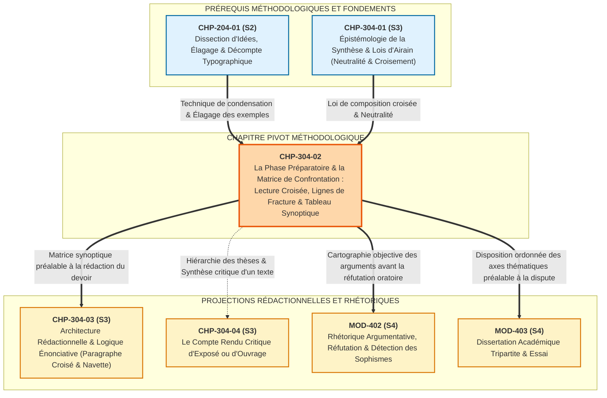

# Chapitre 2 — La Phase Préparatoire et la Matrice de Confrontation : Lecture Croisée, Détection des Lignes de Fracture et Tableau Synoptique

> **Identifiant du chapitre** : `CHP-304-02`  
> **Module de rattachement** : [`MOD-304` — Synthèse Comparative de Documents, Compte Rendu Critique et Argumentation Logique](file:///f:/Formation/world-class-french/03-curriculum/year-2/semester-3/mod-304-synthese-comparative-documents.md)  
> **Semestre** : Année 2 — Semestre 3 (S3)  
> **Volume horaire canonique** : 5 à 6 heures d'apprentissage autonome délibéré et d'ateliers d'application (Phase 1 Étude : 1 h 30 | Phase 2 Pratique : 1 h 30 | Phase 3 Correction : 1 h 00 | Phase 4 Évaluation : 1 h 00)  
> **Statut** : [STATUT : VALIDÉ]  
> **Compétences associées** : [`FR-INT-006`](file:///f:/Formation/world-class-french/02-competency-framework/competency-framework.md#fr-int-006-analyser-un-texte-littéraire-sans-confondre-interprétation-et-preuve-textuelle) (L3 Autonomie), [`FR-ARGUM-001`](file:///f:/Formation/world-class-french/02-competency-framework/competency-framework.md#fr-argum-001-analyse-formelle-de-largumentation-et-détection-des-sophismes) (L3 Autonomie), [`FR-INT-001`](file:///f:/Formation/world-class-french/02-competency-framework/competency-framework.md#fr-int-001-rédiger-un-texte-long-cohérent-en-maîtrisant-accords-et-ponctuation) (L3 Autonomie)  
> **Sources scientifiques de référence** : `SRC-RHET-03` (Reboul, 1991, chap. 3), `SRC-GRAM-02` (Riegel, Pellat & Rioul, 2016/2021, chap. 21), `SRC-GRAM-01` (Grevisse & Goosse, 2016, § 1028-1045), `SRC-TYPO-01` (Imprimerie nationale, 2002/2014, p. 143), `SRC-NORM-03` (Ministère de l'Éducation nationale, 2020)

---

## 1. Titre et Place dans le Cursus

### 1.1 Intitulé Officiel
**Chapitre 2 : La Phase Préparatoire et la Matrice de Confrontation : Lecture Croisée, Détection des Lignes de Fracture et Tableau Synoptique** (`CHP-304-02`).

### 1.2 Insertion Architecturale dans le Cursus
Au sein du module [`MOD-304`](file:///f:/Formation/world-class-french/03-curriculum/year-2/semester-3/mod-304-synthese-comparative-documents.md), le chapitre `CHP-304-02` constitue le pivot méthodologique fondamental qui convertit les principes épistémologiques du genre académique en un protocole opératoire infaillible.

Tandis que le chapitre inaugural [`CHP-304-01`](file:///f:/Formation/world-class-french/03-curriculum/year-2/semester-3/mod-304/chp-304-01-epistemologie-methodologie-universitaire-synthese.md) a établi la déontologie universitaire de l'exercice (neutralité énonciative absolue, interdiction du plan juxtaposé, autonomie textuelle du scripteur), `CHP-304-02` outille l'apprenant pour surmonter l'étape la plus redoutée des épreuves sur table : **la phase préparatoire au brouillon**. Il réinvestit les techniques de dissection d'idées et d'élagage des détails contingents consolidées lors du résumé de texte en première année ([`MOD-204`](file:///f:/Formation/world-class-french/03-curriculum/year-1/semester-2/mod-204-resume-texte-restitution-orale.md)), tout en introduisant la gestion simultanée de sources divergentes par la spatialisation tabulaire.

Ce chapitre conditionne directement l'architecture rédactionnelle du chapitre suivant ([`CHP-304-03`](file:///f:/Formation/world-class-french/03-curriculum/year-2/semester-3/mod-304-synthese-comparative-documents.md#chapitre-3--architecture-rédactionnelle-et-logique-énonciative)), car aucun paragraphe de confrontation croisée ni aucune transition dialectique ne peuvent être rédigés avec rigueur si la matière argumentative n'a pas été préalablement ordonnée au sein d'une matrice synoptique symétrique.



---

## 2. Objectifs Mesurables

Au terme des 5 à 6 heures d'apprentissage autonome délibéré et d'ateliers d'application de ce chapitre, l'apprenant est capable de :

1. **Dégager la problématique transversale unificatrice d'un dossier documentaire binaire** en moins de 15 minutes lors de la première passe de lecture panoramique, en formulant une question directrice de controverse sous la forme d'une alternative conceptuelle bilatérale sans biais unilatéral ([`FR-INT-006`](file:///f:/Formation/world-class-french/02-competency-framework/competency-framework.md#fr-int-006-analyser-un-texte-littéraire-sans-confondre-interprétation-et-preuve-textuelle), Palier L3 Autonomie).
2. **Concevoir et renseigner intégralement un tableau synoptique de confrontation à 4 colonnes** (Axes thématiques, Document A, Document B, Relation logique) à partir de deux textes d'idées d'au moins 600 mots chacun, en observant rigoureusement la règle du vis-à-vis argumentatif sans laisser de case orpheline ([`FR-ARGUM-001`](file:///f:/Formation/world-class-french/02-competency-framework/competency-framework.md#fr-argum-001-analyse-formelle-de-largumentation-et-détection-des-sophismes), Palier L3 Autonomie).
3. **Opérer un élagage systématique des exemples contingents, anecdotes et chiffres secondaires** au profit de syntagmes nominaux denses et de notions abstraites, en condensant chaque argument sous forme de formule conceptuelle sans rédiger de phrase complète dans la grille ([`FR-INT-006`](file:///f:/Formation/world-class-french/02-competency-framework/competency-framework.md#fr-int-006-analyser-un-texte-littéraire-sans-confondre-interprétation-et-preuve-textuelle), Palier L3 Autonomie).
4. **Convertir la matrice synoptique de confrontation en un plan détaillé thématique croisé** articulé en deux ou trois grandes parties équilibrées, comportant chacune deux sous-parties assurant la navette dialectique permanente entre les auteurs ([`FR-INT-001`](file:///f:/Formation/world-class-french/02-competency-framework/competency-framework.md#fr-int-001-rédiger-un-texte-long-cohérent-en-maîtrisant-accords-et-ponctuation), Palier L3 Autonomie).

---

## 3. Prérequis et Test de Préparation

### 3.1 Prérequis Exigibles
- **Maîtrise de la neutralité énonciative (`CHP-304-01`)** : Interdiction totale des jugements personnels, des pronoms de première personne et des adjectifs appréciatifs dans la manipulation des textes d'idées.
- **Différenciation Argument vs Exemple (`CHP-204-01`)** : Aptitude à distinguer le noyau rationnel d'une proposition générale de son illustration empirique ou anecdotique.
- **Règles officielles de décompte typographique (`SRC-TYPO-01`)** : Connaissance du calcul métrique des mots (élisions comptant pour des unités autonomes).
- **Subordination circonstancielle d'opposition et de concession (`MOD-302`)** : Maniement des conjonctions *tandis que*, *alors que*, *bien que* et des adverbes adversatifs.

### 3.2 Test de Préparation (Auto-Diagnostic à 5 Questions)
Répondez aux cinq questions suivantes sur une feuille de brouillon avant de déplier le corrigé :

1. **Question 1 (Statut de l'exemple)** : Dans l'énoncé *« L'industrialisation détruit les écosystèmes fluviaux, comme l'atteste la pollution massive du fleuve Ouémé par les rejets textiles en 2024 »*, quel fragment constitue l'argument porteur et quel fragment constitue l'exemple contingent à élaguer lors de la prise de notes ?
2. **Question 2 (Définition de la problématique transversale)** : Pourquoi la question *« En quoi l'auteur A critique-t-il la mondialisation ? »* ne peut-elle en aucun cas constituer une problématique de synthèse pour un dossier confrontant deux économistes ?
3. **Question 3 (Règle d'or du plan)** : Si un candidat rédige en première partie *« I. La vision optimiste du sociologue Pierre Dumont »* et en seconde partie *« II. La mise en garde sévère de la philosophe Claire Vasseur »*, quelle faute méthodologique éliminatoire commet-il ?
4. **Question 4 (Décompte typographique)** : Selon les normes de l'Imprimerie nationale (`SRC-TYPO-01`), combien de mots compte exactement la séquence suivante : *« L'intelligence artificielle n'a point d'âme »* ?
5. **Question 5 (Vis-à-vis argumentatif)** : Si le texte A aborde le coût économique d'une réforme tandis que le texte B n'en souffle mot mais traite exclusivement de son impact moral, peut-on créer un axe de confrontation intitulé *« Le coût budgétaire de la réforme »* avec une case vide pour le texte B ?

<details>
<summary><strong>Corrigé détaillé et barème de l'auto-diagnostic (cliquer pour dérouler)</strong></summary>

1. **Réponse 1** : L'argument porteur est la proposition conceptuelle générale : *« L'industrialisation détruit les écosystèmes fluviaux »*. Le fragment *« comme l'atteste la pollution massive du fleuve Ouémé par les rejets textiles en 2024 »* constitue une illustration factuelle localisée (exemple contingent) qui doit être impitoyablement biffée et exclue du tableau synoptique.
2. **Réponse 2** : Cette formulation est unilatérale : elle se focalise exclusivement sur le document A et ignore le document B. Une problématique transversale doit être **bipolaire et commune**, formulée sous forme d'une question conceptuelle embrassant l'espace de controverse partagé par les deux auteurs (*« La mondialisation économique constitue-t-elle un levier de prospérité partagée ou un facteur d'accroissement des inégalités structurelles ? »*).
3. **Réponse 3** : Le candidat commet la faute éliminatoire absolue du **plan juxtaposé** (ou *double résumé successif*). Il traite les documents l'un après l'autre au lieu d'ordonner son devoir selon des axes thématiques croisés confrontant simultanément les deux auteurs au sein de chaque sous-partie. En jury universitaire ou de concours, cette faute entraîne une pénalité immédiate de -8 points [Réf. `SRC-GRAM-02`, chap. 21].
4. **Réponse 4** : La séquence compte **7 mots typographiques** :
   - *L'* (1 mot, élision autonome)
   - *intelligence* (1 mot)
   - *artificielle* (1 mot)
   - *n'* (1 mot, élision autonome)
   - *a* (1 mot)
   - *point* (1 mot)
   - *d'* (1 mot, élision autonome)
   - *âme* (1 mot)
   $\rightarrow$ Calcul : 1 + 1 + 1 + 1 + 1 + 1 + 1 + 1 = 8 mots ! *(Attention au piège : l'élision forme systématiquement un mot distinct en métrique officielle `SRC-TYPO-01`)*.
5. **Réponse 5** : **Non, formellement**. Un axe de confrontation ne peut exister que s'il met en relation les deux textes. Si un point n'est abordé que par un seul texte de façon marginale, il ne constitue pas une ligne de fracture et doit être soit rattaché à un enjeu plus vaste partagé, soit éliminé. Une case vide dans le tableau synoptique est le signal d'une asymétrie fautive.

> **Diagnostic** : Si vous obtenez une note inférieure à 4/5, relisez attentivement les sections 1 et 7 de [`MOD-304`](file:///f:/Formation/world-class-french/03-curriculum/year-2/semester-3/mod-304-synthese-comparative-documents.md) avant d'aborder la section 4.
</details>

---

## 4. Situation de Départ ou Problème Concret

### 4.1 Le Piège Mortel de la Feuille Blanche et du Démarrage Immédiat
Dans la quasi-totalité des échecs constatés aux épreuves de synthèse de documents des concours administratifs et universitaires, le scénario de la déroute est identique :
- L'étudiant lit rapidement le premier texte, puis le second en soulignant d'un trait continu des paragraphes entiers au stylo bille.
- Pressé par le compte à rebours de l'épreuve, pris de panique à la vue de sa feuille encore vierge, il se dispense de tout tableau préparatoire au brouillon et se jette directement dans la rédaction de son introduction et de sa première partie.
- Arrivé au dixième paragraphe rédigé, le mécanisme de blocage cognitif se déclenche :
  1. **L'asphyxie rédactionnelle** : Le rédacteur s'aperçoit qu'il a déjà épuisé la totalité des arguments du premier texte dans sa première page, sans avoir introduit le second auteur.
  2. **La dérive de juxtaposition** : Incapable d'opérer un retour en arrière sans raturer son devoir, il consacre sa seconde partie au texte B, tombant pieds joints dans le piège éliminatoire du double résumé successif.
  3. **L'amnésie documentaire** : En relisant son brouillon informe, il découvre qu'il a omis les trois quarts des nuances concessives du second texte et qu'il a recopié textuellement des exemples anecdotiques sans jamais dégager l'idée directrice.

### 4.2 Analyse Clinique de la Surcharge Cognitive
Pourquoi l'esprit humain échoue-t-il inévitablement lorsqu'il tente de rédiger une synthèse sans matrice préalable ?
Le traitement simultané de deux pensées complexes requiert quatre opérations cognitives concurrentes :
- Décoder la syntaxe et le lexique des textes sources ;
- Mémoriser les thèses respectives ;
- Identifier les points d'intersection logique ;
- Formuler des phrases élégantes respectant la concordance des temps et les accords grammaticaux.

La **mémoire de travail** à court terme ne peut soutenir une telle charge simultanée. Tenter de rédiger directement revient à demander à un architecte de maçonner les murs d'un édifice tout en dessinant le plan d'ensemble au fur et à mesure que le ciment sèche.

La phase préparatoire et l'élaboration du **tableau synoptique de confrontation** constituent le seul dispositif technique permettant de dissocier rigoureusement la **phase d'analyse intellectuelle** de la **phase de rédaction stylistique**.

---

## 5. Explication Intuitive : La Table de Montage du Cinéaste et la Triangulation Topographique

Pour saisir le rôle vital de la matrice synoptique, deux analogies matérielles rendent compte du basculement d'attitude exigé :

### 5.1 L'Analogie de la Table de Montage du Cinéaste
Imaginons un monteur cinématographique recevant les bobines de pellicule tournées par deux réalisateurs différents sur un même événement historique :
- Le premier réalisateur a filmé la scène en plongée sous un angle tragique et sombre (Bobine A).
- Le second réalisateur a filmé la même scène au niveau du sol en insistant sur la ferveur populaire (Bobine B).
- Aucun monteur sensé ne diffuserait la Bobine A en intégralité pendant une heure pour enchaîner ensuite sur la Bobine B pendant une autre heure : les spectateurs quitteraient la salle devant une telle redondance linéaire !
- Le monteur déroule les deux bandes sur sa **table de montage**. Il découpe les séquences aux ciseaux, isole les plans qui traitent du même instant dramatique, et les dispose côte à côte sur deux rails parallèles.
- C'est seulement lorsqu'il voit physiquement les deux images en regard qu'il peut réaliser le montage alterné : *champ (Auteur A) / contrechamp (Auteur B)*.

Le **tableau synoptique** est la table de montage du scripteur : il permet de découper la continuité linéaire des textes pour organiser le dialogue alterné des pensées.

```text
BOBINE A (Texte 1 linéaire)  ───────┐
                                    ▼
                             [TABLE DE MONTAGE] ──► FILM FINAL CROISÉ
                                    ▲               (Synthèse thématique)
BOBINE B (Texte 2 linéaire)  ───────┘
```

### 5.2 L'Analogie de la Triangulation Topographique
En géodésie et en topographie, un géomètre ne peut déterminer l'altitude exacte et la position d'un relief inaccessible en se postant en un seul endroit :
- Posté au point $A$, il relève un angle d'azimut.
- Posté au point $B$, il relève un second angle d'azimut vers le même sommet.
- C'est en croisant géométriquement ces deux visées sur une **table traçante** (la matrice de triangulation) que la position réelle du sommet apparaît, à l'intersection exacte des deux lignes de visée.

Dans la synthèse de documents, le « relief » à mesurer est la **problématique transversale**. Les documents ne sont que des points d'observation partiels ($A$ et $B$). Le tableau synoptique est la feuille de calcul géodésique qui matérialise l'intersection de leurs regards.

---

## 6. Définitions Précises et Terminologie

Dans le cadre du cursus académique World-Class French, les termes suivants reçoivent une définition opératoire univoque :

- **Phase préparatoire (n. f.)** : Séquence méthodologique chronométrée (n'excédant pas 45 minutes dans une épreuve de 3 heures) précédant tout acte de rédaction, dédiée exclusivement à la lecture panoramique, au décorticage analytique des documents, au remplissage du tableau synoptique et à l'élaboration du plan détaillé thématique.
- **Lecture panoramique (n. f.)** : Première passe de lecture globale et rapide (10 à 15 minutes) portant sur l'ensemble du corpus documentaire, visant à identifier le paratexte (auteurs, dates, supports, registres), à circonscrire le thème général unificateur et à formuler la problématique transversale commune.
- **Problématique transversale (n. f.)** : Question directrice d'ordre philosophique, politique, économique ou social, formulée sous forme d'une alternative conceptuelle bilatérale, qui ne se confond avec la thèse d'aucun des textes pris isolément mais définit l'espace de controverse au sein duquel leurs pensées se croisent nécessairement [Réf. `SRC-RHET-03`, chap. 3].
- **Lecture analytique croisée (n. f.)** : Seconde passe de lecture instrumentée (25 à 30 minutes), crayon en main, au cours de laquelle le scripteur traque et surligne les arguments porteurs répondant à la problématique transversale, tout en biffant les anecdotes et exemples contingents.
- **Ligne de fracture ou axe d'affrontement (n. m.)** : Point nodal de divergence conceptuelle ou d'antinomie théorique séparant deux ou plusieurs auteurs sur un sous-problème précis (ex. *le statut de l'effort intellectuel face à la machine*). Chaque ligne de fracture fonde un axe thématique de la matrice.
- **Tableau synoptique de confrontation (n. m.)** : Matrice graphique préparatoire constituée d'une grille à quatre colonnes impératives (Axes thématiques, Document A, Document B, Relation logique), spatialisant les arguments d'idées face à face pour rendre visible le dialogue polyphonique [Réf. `SRC-GRAM-02`, chap. 21].
- **Vis-à-vis argumentatif (n. m.)** : Règle formelle d'armature synoptique selon laquelle toute cellule renseignée en colonne 2 (Document A) doit trouver son pendant notionnel symétrique (réponse, nuance, opposition ou confirmation) dans la cellule correspondante de la colonne 3 (Document B), interdisant toute cellule orpheline.
- **Élagage des exemples contingents (n. m.)** : Opération de filtrage cognitif éliminant les données chiffrées circonstancielles, les noms de marques, les anecdotes narratives et les illustrations locales pour ne conserver que la proposition abstraite sous-jacente.
- **Plan détaillé thématique (n. m.)** : Structure arborescente issue de la matrice synoptique, découpant la confrontation en deux ou trois grandes parties notionnelles équilibrées, comportant chacune deux sous-parties croisées garantissant la confrontation terme à terme des sources.

---

## 7. Règles ou Mécanismes Fondamentaux

### 7.1 Le Protocole Rigoureux de Lecture Préparatoire en Deux Passes (45 Minutes)
La gestion du temps constitue le facteur discriminant majeur en épreuve de synthèse. L'apprenant doit appliquer scrupuleusement le protocole chronométré suivant :

```text
DURÉE TOTALE DE LA PHASE PRÉPARATOIRE : 45 MINUTES CHRONO
├── PASSE 1 (15 min) : LECTURE PANORAMIQUE & CADRAGE GLOBAL
│   ├── Étape 1.1 : Audit du paratexte (qui parle ? en quelle année ? dans quelle revue ?).
│   ├── Étape 1.2 : Survol rapide sans surlignage des introductions et conclusions de chaque texte.
│   ├── Étape 1.3 : Identification du thème commun unificateur.
│   └── Étape 1.4 : Formulation provisoire de la problématique transversale (alternative bipolaire).
└── PASSE 2 (30 min) : LECTURE ANALYTIQUE INSTRUMENTÉE & REMPLISSAGE MATRICIEL
    ├── Étape 2.1 : Traçage physique de la grille synoptique à 4 colonnes sur double page de brouillon.
    ├── Étape 2.2 : Lecture instrumentée bicolore (Texte A en surlignage jaune / Texte B en surlignage vert).
    ├── Étape 2.3 : Biffage immédiat des exemples contingents, anecdotes et métaphores ornementales.
    ├── Étape 2.4 : Report synthétique des arguments dans la matrice sous forme de syntagmes nominaux denses.
    └── Étape 2.5 : Traque des asymétries et vérification de la complétude du vis-à-vis.
```

#### La Règle de Formulation de la Problématique Transversale
La problématique ne doit jamais être une simple question factuelle (*« Comment fonctionne l'IA ? »*) ni une question ouverte vague (*« Qu'en est-il du travail ? »*). Elle doit être construite comme un **dilemme conceptuel fort** articulant les deux pôles de tension du dossier :
$$\text{Problématique} = \text{Concept Pivot} + \text{Thèse A (émancipation/bénéfice)} \longleftrightarrow \text{Thèse B (aliénation/péril)}$$
*Formule canonique type* : *« Dans quelle mesure [Phénomène étudié] constitue-t-il un levier de [Valeur cardinale du Texte A] ou consomme-t-il au contraire [Menace cardinale du Texte B] ? »*

### 7.2 L'Armature Formelle du Tableau Synoptique de Confrontation
Le tableau préparatoire n'est pas un bloc-notes désordonné. Il répond à un gabarit quadripartite normé d'application obligatoire :

| Colonne 1 : Axes de confrontation thématique (Questions de controverse) | Colonne 2 : Position et arguments du Document A (*Nom de l'auteur*) | Colonne 3 : Position et arguments du Document B (*Nom de l'auteur*) | Colonne 4 : Nature de la relation logique (Bilan dialectique) |
| :--- | :--- | :--- | :--- |
| **Axe n° 1** : [Formulation sous forme de sous-question conceptuelle] | • Argument porteur A1<br/>• Argument porteur A2 | • Argument porteur B1 (en réponse à A1)<br/>• Argument porteur B2 (en réponse à A2) | **Opposition franche** / Convergence partielle / Complémentarité / Concession |
| **Axe n° 2** : [Formulation sous forme de sous-question conceptuelle] | • Argument porteur A3<br/>• Nuance / concession de A | • Argument porteur B3<br/>• Nuance / concession de B | **Antinomie théorique** / Nuance réciproque |
| **Axe n° 3** : [Formulation sous forme de sous-question conceptuelle] | • Conclusion prospective de A | • Conclusion prospective de B | **Divergence prospective** |

### 7.3 Les Trois Règles d'Or du Remplissage Synoptique

#### Règle d'or n° 1 : Proscription absolue de la phrase complète dans les cases
Les cellules du tableau ne sont pas des ébauches de paragraphes rédigés. Rédiger des phrases complètes (*sujet + verbe conjugué + compléments*) fait perdre un temps précieux et incite au plagiat lexical servile des textes sources.
- ❌ *À proscrire formellement dans la grille* : *« L'auteur Marc Vallier affirme que les ordinateurs et l'intelligence artificielle permettent de libérer l'homme des tâches répétitives comme le classement. »*
- ✅ *Formulation nominale conceptuelle obligatoire* : *« Libération des servitudes matérielles et de la compilation mécanique. »*

#### Règle d'or n° 2 : L'obligation absolue du vis-à-vis argumentatif
À chaque argument consigné en colonne 2 doit répondre rigoureusement l'argument correspondant en colonne 3. Une ligne matricielle qui ne présente un contenu que d'un seul côté est une anomalie :
- Soit l'argument est secondaire et doit être élagué ;
- Soit le scripteur a omis la réponse implicite du second texte et doit relire le passage correspondant pour combler la case.

#### Règle d'or n° 3 : L'élagage impitoyable des exemples illustratifs purs
Conformément aux principes de condensation rhétorique (`SRC-RHET-03`, chap. 3), le scripteur applique le crible d'épuration suivant :
- *Exemple cité dans le texte* : « Dans l'usine automobile de Flins, 400 ouvriers ont été remplacés par des bras robotisés en 2023. »
- *Filtrage mental* : Supprimer « Flins », « 400 ouvriers », « 2023 ».
- *Extraction de l'argument pur* : *« Substitution de la force mécanique robotisée au travail ouvrier direct. »*

### 7.4 Du Tableau Synoptique au Plan Détaillé Croisé
Une fois la matrice remplie (3 lignes thématiques complètes), la transition vers le plan de rédaction s'effectue mécaniquement sans improviser de nouvelle architecture :

```text
MATRICE SYNOPTIQUE ────────────────────────► PLAN DÉTAILLÉ THÉMATIQUE CROISÉ
┌───────────────────────────┐                ┌──────────────────────────────────────────────┐
│ Ligne 1 : Statut du labeur│ ─────────────► │ PARTIE I : La nature du labeur intellectuel  │
│   (Vallier vs Rostand)    │                │   A. La délégation logistique (Auteur A vs B)│
│                           │                │   B. L'effort formateur (Auteur B vs A)      │
├───────────────────────────┤                ├──────────────────────────────────────────────┤
│ Ligne 2 : Facultés de     │ ─────────────► │ PARTIE II : L'impact sur la souveraineté     │
│   l'individu & mémoire    │                │   A. L'amplification créatrice (Auteur A vs B│
├───────────────────────────┤                │   B. L'atrophie mémorielle (Auteur B vs A)   │
│ Ligne 3 : Ordre démocratique               └──────────────────────────────────────────────┘
│   & diffusion du savoir   │
└───────────────────────────┘
```

Chaque axe du tableau devient une partie (ou sous-partie) du devoir, au sein de laquelle la confrontation bilatérale des deux auteurs est structurellement garantie par le vis-à-vis de la grille [Réf. `SRC-GRAM-02`, chap. 21].

---

## 8. Raisonnement Détaillé : Pourquoi le Tableau Synoptique est le Seul Rempart Contre le Plan Juxtaposé

L'exigence du tableau synoptique n'est pas un caprice de correcteur universitaire : elle repose sur un principe fondamental d'**économie cognitive et de psychologie de la perception spatiale**.

### 8.1 La Tyrannie de la Linéarité Textuelle
Par nature, un texte écrit est une chaîne séquentielle unidimensionnelle : le texte A se déroule du mot 1 au mot 750, puis le texte B se déroule à son tour du mot 1 au mot 750.
Lorsque le cerveau humain absorbe cette matière par la lecture ordinaire, il stocke l'information de manière chronologique dans sa mémoire narrative :
$$\text{Mémoire} : [A_1 \to A_2 \to A_3 \dots A_n] \text{ puis } [B_1 \to B_2 \to B_3 \dots B_n]$$
Si l'étudiant prend la plume immédiatement après cette lecture sans passer par un support intermédiaire, le flux scriptural reproduit mécaniquement l'ordre de stockage mnésique : il rédige d'abord sur A, puis passe à B. C'est le piège pavlovien du **plan juxtaposé**.

### 8.2 La Spatialisation Bidimensionnelle comme Rupture Épistémologique
Le tracé physique d'un tableau à double entrée brise la tyrannie de la ligne temporelle :
- L'axe vertical (lignes) matérialise les **problèmes intellectuels partagés** (la transversalité notionnelle).
- L'axe horizontal (colonnes) matérialise la **polarité des regards** (la pluralité énonciative).

En posant ses yeux sur la matrice, le cerveau ne perçoit plus une succession d'histoires, mais une **relation spatiale immédiate**. Le vis-à-vis physique des colonnes 2 et 3 force le scripteur à penser simultanément le pour et le contre :
*« Je ne peux pas écrire la case A1 sans regarder instantanément ce qui lui fait face dans la case B1. »*

La matrice synoptique est donc un **dispositif d'objectivation géométrique** qui neutralise la paresse narrative naturelle de l'esprit pour imposer la gymnastique dialectique [Réf. `SRC-RHET-03`, chap. 3].

---

## 9. Exemples Corrects Commentés : Décorticage d'un Tableau Synoptique Exemplaire

Reprenons le dossier documentaire binaire de référence issu de la fiche de cadrage de [`MOD-304`](file:///f:/Formation/world-class-french/03-curriculum/year-2/semester-3/mod-304-synthese-comparative-documents.md) (§ 9.3) confrontant :
- **Document 1** : Marc VALLIER, *L'intelligence artificielle ou le triomphe de la raison amplifiée* (*Revue des Sciences et de l'Avenir Contemporain*, 2025).
- **Document 2** : Hélène ROSTAND, *L'abdication cognitive et la fabrique de l'oubli* (*Les Carnets de Philosophie Critique*, 2025).

### 9.1 Formulation de la Problématique Transversale Commune
> **Problématique transversale** :  
> *« L'automatisation numérique de la production textuelle et conceptuelle consacre-t-elle l'émancipation supérieure de l'esprit humain ou consomme-t-elle au contraire son abdication cognitive et son asservissement intellectuel ? »*

### 9.2 La Matrice Synoptique de Confrontation Achevée (Gabarit 4 Colonnes)

| Axes thématiques de confrontation (Questions de controverse) | Document 1 : Marc VALLIER (*La raison amplifiée*) | Document 2 : Hélène ROSTAND (*L'abdication cognitive*) | Bilan de la relation dialectique |
| :--- | :--- | :--- | :--- |
| **Axe 1 : Statut du labeur rédactionnel et rapport forme/fond**<br/>*L'acte d'écriture est-il une corvée dissociable ou le creuset même de la pensée ?* | • Dissociation étanche entre labeur logistique d'exécution et création pure.<br/>• Prise en charge mécanique des corvées serviles (compilation de données, vérification, mise en page).<br/>• Émancipation de la pensée élevée à la problématisation haute et à l'intuition créatrice. | • Indissociabilité radicale et organique entre recherche de la forme et maturation du fond.<br/>• Réfutation de la notion de « basse besogne » matérielle.<br/>• L'effort de formulation tâtonnante et la résistance syntaxique constituent le creuset indispensable de la lucidité critique. | **Antinomie théorique radicale** :<br/>Délégation libératrice des servitudes matérielles *versus* Dépossession formatrice et amputation du raisonnement. |
| **Axe 2 : Effet sur les facultés de l'individu et posture cognitive**<br/>*La machine accroît-elle la souveraineté ou induit-elle une atrophie neurologique ?* | • Citoyen promu « chef d'orchestre » intellectuel.<br/>• Amplification cognitive illimitée démultipliant la puissance de calcul humaine.<br/>• Capacité inédite d'orientation de l'outil pour résoudre des défis sociétaux majeurs. | • Dégradation de l'usager en « consommateur docile » d'idées préfabriquées.<br/>• Atrophie foudroyante de la mémoire de travail et perte de l'épaisseur historique des concepts.<br/>• Vulnérabilité critique accrue et incapacité au doute méthodique autonome. | **Affrontement conceptuel frontal** :<br/>Surpuissance du stratège souverain *versus* Aliénation d'un consommateur dépendant et amnésique. |
| **Axe 3 : Portée démocratique et devenir sociétal de la culture**<br/>*L'IA favorise-t-elle l'égalité des intelligences ou le nivellement collectif ?* | • Démocratisation universelle du savoir complexe et égalité des chances cognitives.<br/>• Attribution à chaque citoyen d'un précepteur sur mesure et d'un assistant documentaire infini.<br/>• Rupture historique inscrite dans le prolongement émancipateur de l'imprimerie. | • Standardisation planétaire de l'imaginaire collectif soumis à une moyenne statistique opaque.<br/>• Nivellement et destruction de la singularité créatrice.<br/>• Soumission aliénante à des monopoles technologiques de surveillance et de formatage des esprits. | **Divergence prospective irréductible** :<br/>Progrès démocratique émancipateur *versus* Nivellement uniforme et tutelle industrielle invisible. |

### 9.3 Commentaire Analytique du Remplissage de la Grille
Examinons pourquoi ce tableau synoptique est exemplaire :
1. **Absence totale de phrases rédigées complètes** : Toutes les entrées sont formulées sous forme de **syntagmes nominaux conceptuels** (*Dissociation étanche, Indissociabilité radicale, Citoyen promu chef d'orchestre, Dégradation de l'usager en consommateur docile*).
2. **Symétrie parfaite du vis-à-vis** : Chaque argument de Vallier trouve sa réponse terme à terme chez Rostand. Aucune case n'est vide, aucune idée n'est orpheline.
3. **Épuration des exemples** : Le tableau ne mentionne ni la date du XVe siècle pour l'imprimerie, ni la calculatrice au XXe siècle, ni les algorithmes probabilistes dans leur détail technique. Seuls les concepts sous-jacents (continuité technique, statistique algorithmique) sont retenus.
4. **Qualification formelle de la relation logique** : La quatrième colonne pose immédiatement le diagnostic relationnel qui guidera la sélection des connecteurs logiques (*antinomie théorique, affrontement frontal, divergence prospective*).

---

## 10. Contre-Exemples et Erreurs Fréquentes

L'analyse de centaines de copies de concours met en lumière six erreurs méthodologiques majeures commises lors de la phase préparatoire :

### Erreur n° 1 : L'absence de tableau synoptique menant au décrochage rédactionnel
- **Manifestation pathologique** : L'apprenant gribouille quelques mots épars dans la marge des textes sources et entame directement la rédaction sur sa copie d'examen pour « gagner du temps ».
- **Conséquence fatale** : Au bout de quinze lignes d'introduction et d'amorce, le scripteur perd le contrôle de la confrontation. Il ne sait plus quelle idée opposer à quel argument. Le devoir décroche, se transforme en paraphrase informe du texte A, puis abandonne purement et simplement le texte B en fin de parcours.
- **Réfutation et remède** : La rédaction sans tableau synoptique est une illusion psychologique. Les 20 minutes investies dans le traçage et le remplissage de la grille font gagner 40 minutes lors de la rédaction finale, car le scripteur n'a plus qu'à convertir des cases ordonnées en phrases fluides [Réf. `SRC-RHET-03`, chap. 3].

### Erreur n° 2 : La matrice asymétrique avec cases orphelines et vis-à-vis rompu
- **Manifestation pathologique** : L'étudiant dresse un tableau où la colonne du document A compte sept arguments, tandis que la colonne du document B n'en compte que deux, laissant des cases blanches béantes en regard des points 3, 4 et 5.
- **Conséquence fatale** : Lors de la rédaction, le paragraphe correspondant devient un exposé unilatéral sur l'auteur A. Le principe de la navette dialectique est violé, ce qui entraîne de lourdes pénalités pour rupture de parallélisme.
- **Réfutation et remède** : **Règle du vis-à-vis absolu**. Si un point abordé par l'auteur A ne suscite aucune réponse explicite ou implicite chez l'auteur B, ce point ne constitue pas un axe de confrontation du dossier. Il doit être biffé de la grille ou fusionné dans un enjeu plus vaste partagé par les deux textes.

### Erreur n° 3 : La confusion entre exemple contingent et argument porteur dans la grille
- **Manifestation pathologique** : Consigner dans les cases de la matrice des anecdotes concrètes : *« L'auteur cite l'exemple de l'école primaire de Parakou où les tablettes sont tombées en panne en janvier »*.
- **Conséquence fatale** : Le tableau synoptique est saturé d'anecdotes locales. Lors de la rédaction, l'étudiant recopie ces exemples au lieu de formuler des idées directrices. Or, la synthèse académique proscrit les exemples de détail non représentatifs.
- **Réfutation et remède** : Appliquer le filtre d'abstraction : *Quel principe général cette anecdote illustre-t-elle ?* $\rightarrow$ *« La vulnérabilité matérielle des infrastructures numériques en milieu scolaire »*. Seule la proposition abstraite a droit de cité dans la grille [Réf. `SRC-GRAM-02`, chap. 21].

### Erreur n° 4 : La problématique transversale unilatérale, trop vague ou calquée sur un seul document
- **Manifestation pathologique** : Formuler une problématique qui épouse exclusivement la thèse de l'un des auteurs (*« Pourquoi l'intelligence artificielle est-elle dangereuse pour l'humanité ? »*) ou poser une question omnibus creuse (*« Qu'est-ce que l'informatique moderne ? »*).
- **Conséquence fatale** : L'étudiant biaise toute son analyse dès l'introduction. Le texte qui contredit sa question devient incompréhensible ou est traité comme une anomalie mineure.
- **Réfutation et remède** : Vérifier que la problématique repose impérativement sur un **axe d'oscillation binaire** (*émancipation vs asservissement*, *progrès économique vs fracture sociale*). Les thèses des deux auteurs doivent apporter deux réponses symétriques et opposées à cette unique question.

### Erreur n° 5 : Le plan détaillé thématique calqué sur l'ordre chronologique d'un seul document
- **Manifestation pathologique** : Découper les parties du plan en calquant fidèlement l'ordre des sous-titres ou des paragraphes du texte 1, puis tenter de forcer les morceaux du texte 2 à entrer dans ce moule préexistant.
- **Conséquence fatale** : Le texte 2 est dépecé de manière incohérente, ses arguments sont déformés et le plan n'est pas thématique mais reste cryptographiquement inféodé à la chronologie du texte 1.
- **Réfutation et remède** : Le plan de la synthèse n'appartient à aucun des deux documents : il est la **création souveraine du scripteur**, conçue à partir des questions de controverse nées du croisement des deux sources [Réf. `SRC-RHET-03`, chap. 4].

### Erreur n° 6 : La surabondance de détails secondaires et de micro-citations saturant la grille
- **Manifestation pathologique** : Recopier des lambeaux de phrases complètes entre guillemets à l'intérieur de chaque cellule de la grille préparatoire.
- **Conséquence fatale** : Le brouillon devient illisible. Le scripteur est submergé par les mots des auteurs au lieu de maîtriser leurs concepts. Lors de la rédaction, il produit un patchwork de citations déguisées, enfreignant la loi d'autonomie et de reformulation personnelle (`CHP-304-01`).
- **Réfutation et remède** : **Zéro guillemet dans le tableau synoptique**. La prise de notes préparatoire doit être un acte immédiat de traduction conceptuelle dans le vocabulaire abstrait du scripteur.

---

## 11. Cas Particuliers et Limites

### 11.1 Le Traitement des Dossiers Documentaires Asymétriques
Il advient fréquemment dans les concours que le corpus soit volumétriquement ou conceptuellement asymétrique :
- Le Document A est un article universitaire dense de 800 mots, richement articulé en quatre arguments majeurs ;
- Le Document B est un éditorial de presse incisif de 400 mots, centré sur une intuition polémique unique.

#### Le Risque Mortel
Consacrer trois pages au texte A et un demi-paragraphe étique au texte B.

#### La Méthode de Rééquilibrage Synoptique
Le scripteur ne doit pas égaliser le nombre de paragraphes à partir de la longueur matérielle des textes, mais à partir des **enjeux conceptuels** :
- Décomposer l'intuition unique du Document B en explicitant ses présupposés logiques et ses corollaires implicites ;
- Regrouper les quatre arguments du Document A sous les deux seuls axes où le Document B apporte une contradiction ou une nuance ;
- Élaguer impitoyablement les ramifications isolées du Document A qui ne trouvent aucun écho dans le Document B.

### 11.2 La Gestion des Dossiers Comportant Trois Documents
Lorsque le corpus comporte trois textes (schéma classique de l'Agrégation ou de l'École Nationale d'Administration) :
- La matrice préparatoire s'élargit à **cinq colonnes** (Axes thématiques, Document A, Document B, Document C, Relation logique).
- La ligne de fracture ne prend que rarement la forme d'un affrontement manichéen (2 contre 1 ou 1 contre 1 contre 1).
- La configuration triadique canonique s'organise généralement selon la typologie suivante :
  - *Document A* : La thèse d'adhésion enthousiaste (le pôle d'affirmation) ;
  - *Document B* : La thèse de contestation radicale (le pôle de réfutation) ;
  - *Document C* : La thèse de dépassement sociologique, juridique ou historique (le pôle de mise en perspective critique).

### 11.3 L'Intégration d'un Document Chiffré ou d'un Tableau Statistique
Si le dossier comporte une infographie, un graphique ou un tableau de données chiffrées :
- **Interdiction absolue** de commenter le tableau pour lui-même en énumérant des colonnes de pourcentages.
- Le document statistique doit être traité exactement comme un document textuel : **quelle thèse implicite ses chiffres viennent-ils valider ou réfuter ?**
- Dans la matrice synoptique, la colonne réservée au document graphique ne contient que des constats de tendance (*« Croissance exponentielle des emplois précaires entre 2015 et 2025 »*, *« Corrélation avérée entre diplôme et maintien dans l'emploi »*), étayés par un ou deux chiffres clés au maximum.

---

## 12. Approfondissement Adapté au Niveau : Théorie des Champs Sémantiques et Dialectique Argumentative

Pour les apprenants visant l'excellence académique supérieure (Licence 3, Master, préparation aux concours de catégorie A), la phase préparatoire gagne à être éclairée par deux modèles majeurs de la philosophie du langage et de la théorie de l'argumentation :

### 12.1 La Modélisation Argumentative de Stephen Toulmin (*The Uses of Argument*, 1958)
Selon Stephen Toulmin, un argument solide n'est jamais un énoncé isolé, mais une cellule logique articulée autour de cinq éléments :
1. Les **Données factuelles** (*Data*) : les faits empiriques observés ;
2. La **Thèse** (*Claim*) : la conclusion affirmée par l'auteur ;
3. Le **Garant** (*Warrant*) : le principe général, la loi ou la maxime qui autorise le passage des données à la thèse ;
4. Le **Fondement** (*Backing*) : la légitimité théorique ou juridique du garant ;
5. La **Réserve ou Modalisation** (*Rebuttal / Qualifier*) : les conditions d'exception sous lesquelles la thèse cesse d'être vraie.

```text
┌─────────────────┐                                ┌─────────────────┐
│ Données (Data)  │ ─────────────────────────────► │  Thèse (Claim)  │
└─────────────────┘                                └─────────────────┘
         ▲                                                  ▲
         │                 ┌────────────────┐               │
         └──────────────── │ Garant(Warrant)│ ──────────────┘
                           └────────────────┘
                                   ▲
                           ┌────────────────┐
                           │   Fondement    │
                           │   (Backing)    │
                           └────────────────┘
```

#### Application Directe au Tableau Synoptique
Le repérage des désaccords superficiels (*Claims* opposées) ne suffit pas à bâtir une synthèse de haut niveau. La véritable ligne de fracture réside presque toujours dans le **Garant implicite** :
- Marc Vallier et Hélène Rostand voient les mêmes données (l'essor des LLM).
- Vallier fonde sa thèse sur le Garant cartésien : *la pensée pure est indépendante de son support matériel*.
- Rostand fonde sa thèse sur le Garant phénoménologique et merleau-pontyen : *la pensée s'incarne indivisiblement dans le travail du langage*.
Identifier les garants respectifs dans la colonne 4 du tableau synoptique élève immédiatement le devoir au niveau de la haute confrontation d'idées.

### 12.2 La Nouvelle Rhétorique de Chaïm Perelman et Lucie Olbrechts-Tyteca (1958)
Chaïm Perelman démontre que toute controverse rationnelle exige un **socle d'accord préalable** : on ne peut s'affronter que sur ce que l'on partage.
Dans une synthèse de documents, les auteurs s'opposent violemment sur les remèdes ou les diagnostics, mais s'accordent presque toujours sur un **cadre commun de prémisses** :
- Vallier et Rostand s'accordent sur le fait que la révolution algorithmique bouleverse de fond en comble l'avenir de l'humanité (prémisse partagée) ;
- La rupture ne porte pas sur l'importance du phénomène, mais sur sa polarité axiologique (bienfait émancipateur vs fléau aliénant).

Consigner ce consensus sous-jacent dans le tableau préparatoire fournit directement la matière de l'**amorce d'introduction** et du **bilan de conclusion** [Réf. `SRC-RHET-03`, chap. 3].

---

## 13. Comparaisons Différentielles

Afin d'éliminer toute hésitation conceptuelle, trois tableaux différentiels bilatéraux fixent définitivement les frontières des notions en jeu :

### 13.1 Tableau Synoptique de Confrontation vs Fiche de Lecture Unitaire

| Critère d'analyse | Fiche de lecture unitaire (`MOD-204`) | Tableau synoptique de confrontation (`MOD-304`) |
| :--- | :--- | :--- |
| **Finalité intellectuelle** | Restituer le déroulement linéaire et l'architecture interne d'un texte unique. | Cartographier l'espace d'affrontement et de dialogue entre au moins deux textes divergents. |
| **Organisation spatiale** | Verticale et chronologique (ordre du texte d'origine). | Matricielle et bidimensionnelle (colonnes pour les sources, lignes pour les questions transversales). |
| **Statut de l'information** | Exhaustivité proportionnelle au texte source. | Sélection exclusive des points d'intersection et des thèses en vis-à-vis. |
| **Destin rédactionnel** | Conduit au résumé continu d'un document. | Conduit au plan thématique croisé de la synthèse. |

### 13.2 Argument Porteur vs Exemple Contingent

| Critère d'analyse | Argument porteur (Noyau rationnel) | Exemple contingent (Illustration empirique) |
| :--- | :--- | :--- |
| **Niveau d'abstraction** | Énoncé général, conceptuel, universel ou théorique. | Fait circonstancié, anecdote, chiffre local, citation singulière. |
| **Rôle démonstratif** | Établit la validité logique d'une thèse. | Illustre concrètement un argument sans constituer une preuve universelle. |
| **Traitement préparatoire** | **Conservation obligatoire** et transcription sous forme nominale dans la grille synoptique. | **Élagage impitoyable** et biffage immédiat lors de la passe 2. |
| **Exemple type** | *« L'érosion de la mémoire profonde induite par les supports numériques. »* | *« L'étude menée auprès de 50 écoliers de Rouen en mars 2024. »* |

### 13.3 Ligne de Fracture vs Simple Nuance de Vocabulaire

| Critère d'analyse | Ligne de fracture (Désaccord notionnel majeur) | Simple nuance de vocabulaire (Variation stylistique) |
| :--- | :--- | :--- |
| **Nature de l'écart** | Incompatibilité philosophique, sociologique ou téléologique profonde entre deux thèses. | Écart de registre, métaphore divergente ou variation d'intensité sur une même position partagée. |
| **Impact sur le plan** | Fonde une **partie entière** ou un axe cardinal du tableau synoptique. | Simple ajustement lexical ou modalisation au sein d'un même paragraphe. |
| **Test de vérification** | L'un des auteurs peut-il souscrire à la proposition de l'autre ? Si **NON** $\rightarrow$ Ligne de fracture. | Si les deux auteurs s'accordent sur le fond malgré des termes différents $\rightarrow$ Simple nuance (convergence). |

---

## 14. Exercices Progressifs

### 14.1 Niveau 1 : Extraction des Thèses et Formulation de Problématiques Transversales sur Corpus Courts

#### Dossier 1.1 : Urbanisme contemporain et mobilité citoyenne
- *Texte A (Urbaniste)* : La piétonnisation intégrale des centres urbains régénère le lien social, stimule le commerce de proximité et élimine la pollution toxique des moteurs thermiques.
- *Texte B (Sociologue)* : La fermeture autoritaire des voies de circulation asphyxie les travailleurs périphériques, accentue la ségrégation spatiale et transforme le cœur des villes en réserve touristique exclusive pour classes aisées.
- **Travail demandé** : Énoncer la thèse de chaque auteur en un syntagme nominal dense, puis formuler la problématique transversale commune en une phrase interrogative binaire.

#### Dossier 1.2 : Réseaux sociaux et débat démocratique
- *Texte A (Politologue)* : Les plateformes numériques désintermédient la parole publique, offrent une tribune universelle aux citoyens marginalisés et constituent un puissant contre-pouvoir face aux monopoles médiatiques traditionnels.
- *Texte B (Philosophe)* : La logique algorithmique des réseaux enferme les internautes dans des bulles cognitives étanches, polarise le débat citoyen par l'outrance affective et détruit l'espace délibératif commun indispensable à la paix civile.
- **Travail demandé** : Énoncer la thèse de chaque auteur en un syntagme nominal dense, puis formuler la problématique transversale commune en une phrase interrogative binaire.

#### Dossier 1.3 : Génétique prédictive et liberté individuelle
- *Texte A (Médecin généticien)* : Le séquençage génomique précoce permet d'éradiquer les pathologies héréditaires graves, d'adapter les thérapeutiques au métabolisme individuel et d'allonger l'espérance de vie en bonne santé.
- *Texte B (Bioéthicienne)* : La généralisation du diagnostic prédictif instaure un eugénisme soft insidieux, soumet l'individu à un déterminisme biologique anxiogène et expose les citoyens aux discriminations des compagnies d'assurances.
- **Travail demandé** : Énoncer la thèse de chaque auteur en un syntagme nominal dense, puis formuler la problématique transversale commune en une phrase interrogative binaire.

---

### 14.2 Niveau 2 : Remplissage Guidé d'un Tableau Synoptique à 4 Colonnes sur un Corpus Binaire

Soit le dossier documentaire suivant confrontant deux regards sur l'école et le mérite républicain :
- **Document A** : François DUBET, sociologue (*L'école des chances*, Seuil).
  > L'égalitarisme scolaire fondé sur le dogme du mérite républicain constitue une illusion cruelle. En prétendant offrir des chances rigoureusement égales à tous les enfants, l'institution masque le fait que les élèves des milieux favorisés disposent dès le départ d'un capital culturel déterminant. Dès lors, le système transforme des inégalités sociales héritées en inégalités scolaires prétendument méritées, plongeant les vaincus du système dans la honte d'eux-mêmes. Il est impératif de substituer à cette compétition brutale une école de la bienveillance garantissant à chacun un socle commun de dignité citoyenne, affranchie de la tyrannie du diplôme.
- **Document B** : Jean-Paul BRIGHELLI, essayiste (*La Fabrique du crétin*, Jean-Claude Gawsewitch).
  > L'abandon délibéré de l'exigence méritocratique sous prétexte de préserver la psychologie des élèves a conduit à la destruction programmée de l'école publique. En renonçant à la hiérarchie des savoirs, à la rigueur de la grammaire, à l'effort de mémoire et à la sévérité des classements chiffrés, les pédagogistes contemporains n'ont pas émancipé les enfants défavorisés : ils les ont définitivement condamnés. Le fils d'ouvrier n'a d'autre arme que l'école de l'exigence républicaine pour s'élever au-dessus de sa condition. En détruisant le sanctuaire du travail austère et de l'effort personnel, on n'a pas instauré l'égalité : on a livré la jeunesse au nivellement par le bas et au règne sans partage de l'argent.

**Travail demandé** : Dresser le tableau synoptique de confrontation complet à 4 colonnes articulé autour de 3 axes d'affrontement (Axe 1 : Diagnostic sur l'idéal du mérite républicain ; Axe 2 : Statut de l'exigence intellectuelle et de l'effort ; Axe 3 : Remède politique pour les milieux défavorisés).

---

### 14.3 Niveau 3 : Élaboration Intégrale d'une Grille Synoptique sur Dossier Binaire Certifié (Exactement 50 Mots)

Soit le mini-dossier documentaire binaire de **50 mots exacts** (norme typographique `SRC-TYPO-01`) sur l'usage des technologies en classe :

> **Document A** (Exactement 25 mots typographiques) :  
> *« L'usage régulier des ordinateurs en classe stimule la curiosité des élèves, facilite la différenciation pédagogique et développe l'autonomie intellectuelle face au savoir contemporain. »*  
> 
> **Document B** (Exactement 25 mots typographiques) :  
> *« L'omniprésence des écrans scolaires détruit la concentration des enfants, atrophie l'effort de mémorisation personnelle et favorise une dispersion superficielle préjudiciable aux apprentissages fondamentaux. »*

#### Table de Décompte Certifié Mot à Mot (50 Mots selon `SRC-TYPO-01`)
- **Document A (25 mots)** : 1. L' / 2. usage / 3. régulier / 4. des / 5. ordinateurs / 6. en / 7. classe / 8. stimule / 9. la / 10. curiosité / 11. des / 12. élèves / 13. facilite / 14. la / 15. différenciation / 16. pédagogique / 17. et / 18. développe / 19. l' / 20. autonomie / 21. intellectuelle / 22. face / 23. au / 24. savoir / 25. contemporain.
- **Document B (25 mots)** : 1. L' / 2. omniprésence / 3. des / 4. écrans / 5. scolaires / 6. détruit / 7. la / 8. concentration / 9. des / 10. enfants / 11. atrophie / 12. l' / 13. effort / 14. de / 15. mémorisation / 16. personnelle / 17. et / 18. favorise / 19. une / 20. dispersion / 21. superficielle / 22. préjudiciable / 23. aux / 24. apprentissages / 25. fondamentaux.
- **Total général du corpus** : 25 + 25 = **50 mots exacts certifiés**.

**Travail demandé** :
1. Formuler la problématique transversale unificatrice sous forme d'alternative conceptuelle forte.
2. Élaborer la grille synoptique intégrale à 4 colonnes (2 axes conceptuels distincts, formules nominales pures, vis-à-vis parfait).
3. Rédiger le plan détaillé thématique croisé en deux axes (I.A, I.B / II.A, II.B).

---

### Corrigés Détaillés et Justifiés des Exercices

<details>
<summary><strong>Corrigés exhaustifs des exercices des Niveaux 1 à 3 (cliquer pour dérouler)</strong></summary>

#### Corrigé du Niveau 1

##### Dossier 1.1 (Urbanisme et mobilité)
- **Thèse Auteur A** : Régénération environnementale, civique et économique par l'élimination de l'automobile.
- **Thèse Auteur B** : Ségrégation socio-spatiale et asphyxie des populations laborieuses périphériques.
- **Problématique transversale** : *« La piétonnisation des centres urbains consacre-t-elle la reconquête écologique du lien social ou consomme-t-elle l'exclusion spatiale des classes populaires périphériques ? »*

##### Dossier 1.2 (Réseaux sociaux et débat public)
- **Thèse Auteur A** : Démocratisation de l'expression citoyenne et contestation légitime des monopoles d'information.
- **Thèse Auteur B** : Fragmentation communautaire des esprits, désagrégation du consensus rationnel et violence passionnelle.
- **Problématique transversale** : *« L'expansion des plateformes numériques constitue-t-elle un levier d'émancipation démocratique directe ou un facteur de dislocation du débat public rationnel ? »*

##### Dossier 1.3 (Génétique prédictive et liberté)
- **Thèse Auteur A** : Éradication des affections héréditaires et optimisation scientifique de la santé humaine.
- **Thèse Auteur B** : Fatalisme biologique anxiogène, dérive eugénique insidieuse et asservissement assurantiel.
- **Problématique transversale** : *« La biomédecine prédictive marque-t-elle le triomphe de la rationalité thérapeutique ou instaure-t-elle un assujettissement génétique aliénant pour la condition humaine ? »*

---

#### Corrigé du Niveau 2 (Tableau Synoptique sur l'École et le Mérite)

> **Problématique transversale** :  
> *« L'idéal républicain du mérite et de l'exigence scolaire constitue-t-il le levier souverain de la promotion des classes populaires ou le masque hypocrite de la reproduction des privilèges sociaux ? »*

| Axes thématiques de confrontation | Document A : François DUBET (*L'école des chances*) | Document B : Jean-Paul BRIGHELLI (*La Fabrique du crétin*) | Bilan de la relation logique |
| :--- | :--- | :--- | :--- |
| **Axe 1 : Le mérite scolaire républicain**<br/>*Principe d'équité ou fiction aliénante ?* | • Fiction mystificatrice masquant les privilèges culturels initiaux.<br/>• Transformation injuste d'inégalités subies en échecs personnels intériorisés. | • Principe émancipateur universel fondé sur la justice du travail.<br/>• Seul rempart contre le règne des privilèges financiers et dynastiques. | **Antinomie radicale** :<br/>Illusion reproductrice de castes *versus* Seul vecteur de justice sociale. |
| **Axe 2 : Le statut de l'exigence et de l'effort**<br/>*Bienveillance protectrice ou rigueur formatrice ?* | • Rejet de la compétition éliminatoire au profit de la bienveillance pédagogique.<br/>• Nécessité de préserver la dignité psychologique et l'estime de soi des élèves. | • Sanctuaire du travail austère, des classements rigoureux et de la maîtrise disciplinaire.<br/>• La complaisance laxiste condamne les enfants défavorisés au nivellement. | **Affrontement méthodologique** :<br/>Bienveillance dédramatisante *versus* Élite austère du savoir. |
| **Axe 3 : Le remède politique pour les vaincus**<br/>*Socle commun garanti ou rétablissement de l'ascenseur républicain ?* | • Démantèlement de la tyrannie du diplôme ; garantie d'un socle d'estime citoyenne minimale. | • Restauration de l'autorité, des humanités classiques et de la sélection républicaine impartiale. | **Divergence téléologique** :<br/>Égalité de dignité citoyenne *versus* Rétablissement de la mobilité méritocratique. |

---

#### Corrigé du Niveau 3 (Corpus de 50 Mots)

##### 1. Problématique transversale
*« L'introduction des outils informatiques à l'école consacre-t-elle l'autonomie critique et la personnalisation des savoirs ou précipite-t-elle au contraire la dégradation de l'attention et des facultés cognitives fondamentales ? »*

##### 2. Grille synoptique intégrale à 4 colonnes

| Axes de confrontation | Document A (25 mots) | Document B (25 mots) | Relation logique |
| :--- | :--- | :--- | :--- |
| **Axe 1 : L'impact sur les facultés intellectuelles fondamentales**<br/>*Éveil de l'attention ou dispersion mentale ?* | • Stimulation active de la curiosité enfantine.<br/>• Conquête d'une autonomie intellectuelle face aux flux contemporains. | • Destruction de l'attention et de la concentration profonde.<br/>• Érosion de la capacité de mémorisation personnelle durable. | **Opposition frontale** :<br/>Émancipation cognitive autonome *versus* Atrophie mémorielle et dispersion superficielle. |
| **Axe 2 : La transformation des apprentissages scolaires**<br/>*Personnalisation féconde ou déchéance disciplinaire ?* | • Facilitation de la différenciation et adaptation individualisée de l'enseignement. | • Altération globale des apprentissages élémentaires indispensables. | **Divergence pédagogique** :<br/>Individualisation constructive *versus* Ruine des fondements scolaires. |

##### 3. Plan détaillé thématique croisé
- **I. L'altération ou l'élévation des facultés cognitives de l'enfant**
  - *A. L'attention et la mémoire face à l'écran* : D'un côté, le texte A soutient que la machine attise la curiosité spontanée de l'élève ; à l'inverse catégorique, le document B affirme qu'elle détruit la concentration prolongée et atrophie la mémorisation personnelle.
  - *B. La conquête de l'autonomie ou le piège de la superficialité* : Tandis que le premier auteur perçoit dans l'informatique un marchepied vers l'émancipation intellectuelle, le second y dénonce un facteur d'éparpillement stérile face aux données.
- **II. L'efficacité pédagogique et le devenir des apprentissages fondamentaux**
  - *A. L'ajustement aux besoins individuels* : Selon le document A, l'ordinateur favorise une différenciation des méthodes bénéfique à chaque apprenant.
  - *B. La préservation du socle disciplinaire* : Le document B objecte toutefois que cette dispersion numérique sacrifie l'essentiel, compromettant irrémédiablement l'acquisition des savoirs fondamentaux.
</details>

---

## 15. Activité de Correction Raisonnée

### 15.1 Épreuve d'Expertise : Autopsie d'un Brouillon Préparatoire Défectueux
Voici la grille préparatoire dressée par un étudiant lors d'une épreuve blanche sur le dossier binaire *« Faut-il interdire la publicité commerciale dans l'espace public ? »* opposant une association de défense du cadre de vie (Doc A : M. Caron) et un économiste libéral (Doc B : J. Meyer).

Ce travail préparatoire est grevé de **huit failles majeures** qui condamnent d'avance la rédaction du candidat :

```text
BROUILLON DE L'ÉTUDIANT (À AUDITER)
Problématique : Pourquoi la publicité dans la rue est-elle une nuisance intolérable ?

AXE 1 : Les méfaits sur le cerveau
- Doc A (Caron) : La publicité crée un sentiment de manque permanent chez les pauvres et les enfants en leur montrant des baskets de marque Nike qu'ils ne peuvent pas s'acheter.
- Doc B (Meyer) : [Case laissée vide]
- Relation : Caron dénonce un scandaleux matraquage.

AXE 2 : L'impact financier
- Doc A (Caron) : Les panneaux publicitaires lumineux coûtent trop cher en électricité pour les mairies alors qu'il y a la crise de l'énergie.
- Doc B (Meyer) : La pub rapporte des milliards aux collectivités locales pour financer les tramways et les abribus gratuits, sans faire payer d'impôts supplémentaires aux habitants.
- Relation : Les auteurs ont tous les deux des arguments valables.

AXE 3 : La liberté d'expression
- Doc A (Caron) : [Case laissée vide]
- Doc B (Meyer) : Dans une démocratie libérale, on n'a pas le droit d'interdire à des commerçants d'informer librement les consommateurs sur leurs produits innovants.
- Relation : Meyer défend la démocratie.
```

### 15.2 Apparat Critique : Identification et Réfutation des 8 Failles Majeures
1. **Problématique unilatérale et partisane** : La question formulée (*« Pourquoi la publicité [...] est-elle une nuisance intolérable ? »*) prend parti pour l'auteur A et viole la neutralité axiologique.
2. **Case orpheline n° 1 en Axe 1** : La colonne du Doc B est vide. Le candidat a isolé une critique de A sans chercher la réponse de B (qui défend la liberté de stimulation du désir économique).
3. **Confusion argument/exemple en Axe 1** : Mentionner *« des baskets de marque Nike »* constitue un exemple anecdotique contingent proscrit dans un tableau synoptique.
4. **Rédaction en phrases complètes bavardes** : Présence de verbes conjugués et de phrases rédigées complètes au lieu de syntagmes nominaux conceptuels.
5. **Intrusion axiologique dans la colonne 4 (Axe 1)** : Qualifier la publicité de *« scandaleux matraquage »* introduit un jugement de valeur subjectif interdit en synthèse.
6. **Case orpheline n° 2 en Axe 3** : La colonne du Doc A est vide sous prétexte que le texte A ne parle pas explicitement de la liberté d'expression marchande (le candidat n'a pas vu que A conteste précisément l'assimilation du marketing à la liberté d'opinion).
7. **Jugement personnel arbitral dans la colonne 4 (Axe 2)** : Écrire *« Les auteurs ont tous les deux des arguments valables »* constitue une prise de position personnelle interdite. Le scripteur n'est pas un arbitre.
8. **Déséquilibre structurel menant au plan juxtaposé** : Deux axes sur trois comportant une case vide, le candidat sera incapable d'assurer la navette croisée lors de la rédaction.

### 15.3 Restructuration Normative Intégrale de la Matrice Synoptique

> **Problématique transversale rectifiée** :  
> *« L'affichage publicitaire dans la cité constitue-t-il un moteur indispensable de la prospérité marchande et du financement des services urbains, ou consomme-t-il l'aliénation consumériste et la dégradation de l'espace civique commun ? »*

| Axes thématiques de controverse | Document A : M. CARON (*Résistance à l'affichage*) | Document B : J. MEYER (*Éloge de la communication marchande*) | Bilan de la relation logique |
| :--- | :--- | :--- | :--- |
| **Axe 1 : Impact psychologique et conditionnement social**<br/>*Information légitime ou asservissement des consciences ?* | • Création artificielle de besoins compulsifs et sentiment de frustration socio-économique.<br/>• Colonisation marchande de l'attention des populations vulnérables. | • Information vitale du consommateur sur l'offre et dynamisation de la concurrence.<br/>• Respect de la souveraineté de l'usager capable d'arbitrage rationnel. | **Antinomie radicale** :<br/>Aliénation psychologique et frustration *versus* Libre information et dynamisme concurrentiel. |
| **Axe 2 : Modèle économique et financement urbain**<br/>*Gaspillage énergétique ou ressource publique mutualisée ?* | • Gaspillage de ressources énergétiques et coût écologique disproportionné des dispositifs lumineux. | • Financement privé vertueux des équipements publics urbains déchargeant le contribuable. | **Affrontement économique direct** :<br/>Parasitisme énergétique insoutenable *versus* Contribution fiscale indirecte indispensable. |
| **Axe 3 : Statut politique et éthique de l'espace public**<br/>*Bien commun inviolable ou lieu d'expression marchande ?* | • Préservation de l'espace commun comme sanctuaire citoyen affranchi de toute pression mercantile. | • Exercice plein de la liberté d'entreprendre et d'expression économique en démocratie libérale. | **Divergence philosophique** :<br/>Sanctuaire civique démercantilisé *versus* Liberté constitutionnelle du commerce. |

---

## 16. Mise en Pratique dans une Production Réelle

### 16.1 Le Corpus Binaire de Référence (Exactement 60 Mots Typographiques)
Voici un dossier documentaire binaire traitant de la controverse relative à l'écologie punitive, calibré rigoureusement à **60 mots exacts** selon les normes de l'Imprimerie nationale (`SRC-TYPO-01`) :

> **Document A** : Tribune de l'économiste de l'énergie (Exactement 30 mots typographiques)  
> *« La contrainte fiscale et réglementaire constitue l'unique levier efficace pour infléchir les comportements polluants. Sans sanctions pécuniaires dissuasives, citoyens et firmes diffèrent les investissements indispensables à la survie commune. »*  
> 
> **Document B** : Manifeste du sociologue des mouvements civiques (Exactement 30 mots typographiques)  
> *« L'écologie punitive suscite l'exaspération sociale et dresse les classes populaires contre la transition environnementale. Seule une pédagogie incitative garantit des changements durables sans rupture du consentement civique national. »*

#### Table de Décompte Certifié Mot à Mot (Norme `SRC-TYPO-01`)

| Document | Décompte mot à mot certifié (norme de l'Imprimerie nationale) | Total unitaire |
| :--- | :--- | :---: |
| **Document A** | 1. La / 2. contrainte / 3. fiscale / 4. et / 5. réglementaire / 6. constitue / 7. l' / 8. unique / 9. levier / 10. efficace / 11. pour / 12. infléchir / 13. les / 14. comportements / 15. polluants. / 16. Sans / 17. sanctions / 18. pécuniaires / 19. dissuasives, / 20. citoyens / 21. et / 22. firmes / 23. diffèrent / 24. les / 25. investissements / 26. indispensables / 27. à / 28. la / 29. survie / 30. commune. | **30 mots** |
| **Document B** | 1. L' / 2. écologie / 3. punitive / 4. suscite / 5. l' / 6. exaspération / 7. sociale / 8. et / 9. dresse / 10. les / 11. classes / 12. populaires / 13. contre / 14. la / 15. transition / 16. environnementale. / 17. Seule / 18. une / 19. pédagogie / 20. incitative / 21. garantit / 22. des / 23. changements / 24. durables / 25. sans / 26. rupture / 27. du / 28. consentement / 29. civique / 30. national. | **30 mots** |
| **Total Global** | **30 mots + 30 mots = 60 mots typographiques exacts certifiés** | **60 mots** |

---

### 16.2 Livrable 1 : Le Tableau Synoptique de Confrontation Achévé
- **Problématique transversale** :  
  *« La transition écologique doit-elle s'imposer par la contrainte coercitive et fiscale pour parer à l'urgence environnementale, ou exige-t-elle au contraire une adhésion démocratique incitative pour préserver la paix civique ? »*

| Axes thématiques de confrontation | Document A : L'économiste de l'énergie | Document B : Le sociologue des mouvements civiques | Bilan de la relation logique |
| :--- | :--- | :--- | :--- |
| **Axe 1 : La méthode d'action environnementale**<br/>*Coercition punitive ou incitation positive ?* | • Nécessité impérative d'une contrainte fiscale et réglementaire immédiate.<br/>• Sanctions financières indispensables pour vaincre l'inertie des acteurs. | • Inefficacité de la contrainte autoritaire créatrice de blocages.<br/>• Primauté exclusive d'une pédagogie incitative garante de mutations durables. | **Antinomie méthodologique radicale** :<br/>Coercition financière impérative *versus* Pédagogie de l'incitation bienveillante. |
| **Axe 2 : Les répercussions sociopolitiques**<br/>*Urgence de la survie collective ou préservation du pacte civique ?* | • Primat de la survie commune sur les résistances individuelles.<br/>• La temporisation des firmes et des ménages menace la collectivité. | • Risque majeur de révolte sociale et d'exaspération des classes modestes.<br/>• Péril mortel de dislocation du pacte et du consentement civique national. | **Affrontement politique direct** :<br/>Impératif de salut vital immédiat *versus* Préservation du consentement démocratique. |

---

### 16.3 Livrable 2 : Le Plan Croisé en Deux Axes Prêt pour la Rédaction
- **I. Le modèle d'intervention écologique : entre rigueur punitive et adhésion incitative**
  - *A. L'urgence de la sanction contraignante* : Selon le premier analyste, l'inflexion des conduites destructrices exige l'application immédiate de contraintes fiscales et réglementaires punitives, seules capables de surmonter la procrastination des agents économiques.
  - *B. La supériorité de l'accompagnement pédagogique* : À l'opposé direct de cette logique autoritaire, le second essayiste soutient que seuls des mécanismes incitatifs et une pédagogie concertée peuvent ancrer des transformations pérennes.
- **II. La viabilité démocratique de la transition : entre salut public et cohésion civique**
  - *A. Le primat de la survie collective* : L'économiste justifie la fermeté fiscale par l'impératif vital de la sauvegarde commune, estimant que tout atermoiement condamne l'avenir.
  - *B. Le risque d'embrasement et de rupture civique* : Le sociologue objecte en revanche que l'écologie coercitive aliène les couches populaires et menace de briser le contrat social en ruinant le consentement des citoyens.

---

## 17. Résumé Structuré : Le Guide de Survie de la Phase Préparatoire

```text
LE GUIDE DE SURVIE CHRONOMÉTRÉ DE LA PHASE PRÉPARATOIRE (45 MINUTES)
┌───────────────────────────────────────────────────────────────────────────────┐
│ ÉTAPE 1 : SURVOL DIAGNOSTIQUE & PROBLÉMATIQUE (15 MINUTES)                    │
│ • Lire paratexte (auteurs, dates, organes de presse).                         │
│ • Dégager le thème commun et isoler la ligne de fracture majeure.             │
│ • Formuler la problématique sous forme d'alternative binaire :                │
│   « Dans quelle mesure X consacre-t-il [Thèse A] ou consomme-t-il [Thèse B] ? »│
├───────────────────────────────────────────────────────────────────────────────┤
│ ÉTAPE 2 : TRACÉ ET LECTURE ANALYTIQUE CROISÉE (20 MINUTES)                    │
│ • Tracer la grille à 4 colonnes sur une double page blanche de brouillon.      │
│ • Surlignage bicolore : Jaune pour A / Vert pour B.                           │
│ • Biffage immédiat des exemples contingents, anecdotes et chiffres secondaires.│
│ • Écrire uniquement en syntagmes nominaux denses (ZÉRO PHRASE COMPLÈTE).      │
├───────────────────────────────────────────────────────────────────────────────┤
│ ÉTAPE 3 : ARBITRAGE DU VIS-À-VIS & COMPLÉTUDE (5 MINUTES)                     │
│ • Vérifier qu'à chaque ligne, la colonne 2 répond exactement à la colonne 3.  │
│ • Traquer et éliminer toute case blanche orpheline.                           │
│ • Qualifier la relation logique en colonne 4 (opposition, complémentarité...). │
├───────────────────────────────────────────────────────────────────────────────┤
│ ÉTAPE 4 : CONVERSION EN PLAN CROISÉ (5 MINUTES)                               │
│ • Regrouper les lignes du tableau en 2 ou 3 grandes parties thématiques.      │
│ • Découper chaque partie en 2 sous-parties croisées (Auteur A vs B / B vs A). │
│ • Lancer la rédaction de l'introduction l'esprit totalement serein.           │
└───────────────────────────────────────────────────────────────────────────────┘
```

---

## 18. Questions de Rappel Actif (*Active Recall*)

Évaluez votre degré de maîtrise sans consulter le cours avant de déplier les réponses :

1. **Question 1** : Pourquoi est-il strictement interdit de rédiger des phrases complètes dans les cases du tableau synoptique de confrontation ?
2. **Question 2** : Quelle est la conséquence mécanique immédiate d'une case orpheline (laissée vide) dans la matrice préparatoire lors de la phase de rédaction ?
3. **Question 3** : Comment formule-t-on canoniquement une problématique transversale unificatrice pour un dossier binaire ?
4. **Question 4** : Selon Stephen Toulmin, à quel niveau de l'argumentation se situe généralement la divergence fondamentale entre deux penseurs d'un même dossier ?
5. **Question 5** : Comment traite-t-on un document iconographique ou un graphique statistique dans un dossier de synthèse ?
6. **Question 6** : Pourquoi le plan de la synthèse ne doit-il jamais reproduire l'ordre chronologique des paragraphes du Document 1 ?

<details>
<summary><strong>Réponses détaillées aux questions de rappel actif (cliquer pour dérouler)</strong></summary>

1. **Réponse 1** : Rédiger des phrases complètes fait perdre un temps précieux en phase préparatoire, encombre visuellement la grille et favorise le plagiat lexical en incitant à recopier servilement le texte source au lieu de le conceptualiser sous forme de syntagmes nominaux.
2. **Réponse 2** : Une case vide brise le vis-à-vis argumentatif. Lors de la rédaction, le paragraphe correspondant devient un exposé unilatéral sur un seul texte, ce qui détruit la navette dialectique et fait basculer le devoir dans le piège du plan juxtaposé.
3. **Réponse 3** : La problématique transversale se formule sous la forme d'un **dilemme conceptuel binaire** unifiant les deux thèses opposées autour d'un enjeu commun : *« [Phénomène] consacre-t-il [Bénéfice défendu par A] ou consomme-t-il au contraire [Menace dénoncée par B] ? »*.
4. **Réponse 4** : La rupture fondamentale se situe au niveau du **Garant implicite (*Warrant*)**, c'est-à-dire du principe ou de la vision du monde qui justifie le passage des faits observés à la conclusion affirmée.
5. **Réponse 5** : On ne décrit jamais le document graphique pour lui-même en énumérant des pourcentages. On dégage la tendance générale qu'il illustre et on l'intègre dans la matrice synoptique comme une thèse ou un contre-argument en vis-à-vis des textes.
6. **Réponse 6** : Le plan de la synthèse doit être **thématique et indépendant**. Calquer le plan sur la chronologie du Document 1 aboutit à dépecer artificiellement le Document 2 et constitue une forme masquée de juxtaposition textuelle proscrite en concours universitaire.
</details>

---

## 19. Mini-Évaluation Sommative Notée sur 20 Points

- **Durée indicative** : 30 minutes.
- **Support** : Sans documents d'aide ni outil informatique.
- **Seuil de validation L3** : **14 / 20** (note éliminatoire $< 14/20$).

---

### Sujet de l'Épreuve

#### Partie I : Diagnostic Méthodologique et Détection de Failles (6 points — 1,5 pt par item)
Analysez les quatre propositions préparatoires suivantes et qualifiez la conformité ou la non-conformité méthodologique de chacune en formulant une justification savante concise :
1. Un candidat formule sa problématique ainsi : *« Quels sont les avantages des énergies renouvelables d'après l'économiste Laurent ? »*
2. Dans sa grille préparatoire, un étudiant note : *« En 2024, le département du Zou a financé 14 puits modernes pour 8 millions de francs CFA »*.
3. Pour un dossier de deux textes, le tableau synoptique présente 4 lignes thématiques avec toutes les cellules remplies en vis-à-vis par des syntagmes nominaux conceptuels.
4. Dans la colonne 4 (Relation logique), un candidat inscrit : *« L'auteur B est de mauvaise foi car son raisonnement est rétrograde »*.

#### Partie II : Formulation de Problématique et Élagage Conceptuel (6 points)
1. **Élagage conceptuel (3 points)** :  
   Soit la proposition issue d'un texte d'examen : *« À Abomey-Calavi, l'afflux désordonné de 15 000 étudiants chaque matin engendre des embouteillages paralysants sur le carrefour Kpota, prouvant que l'absence d'un réseau ferré collectif hypothèque gravement le développement économique régional. »*  
   Isolez l'argument porteur abstrait en un syntagme nominal de moins de 10 mots et listez les 3 éléments contingents à biffer impitoyablement.
2. **Formulation de problématique (3 points)** :  
   À partir des deux thèses : *Thèse A : La démocratisation de l'université garantit l'ascension sociale de tous* vs *Thèse B : La massification de l'enseignement supérieur produit une dévaluation massive des diplômes*, formulez la problématique transversale canonique sous forme d'alternative conceptuelle forte.

#### Partie III : Conception d'une Matrice Synoptique à Partir d'un Micro-Corpus (8 points)
Soit les deux extraits suivants :
- *Auteur A (Médecin légiste)* : *« La légalisation de l'aide médicale active à mourir consacre la souveraineté ultime de l'individu sur son corps et met fin à des agonies indignes et insupportables. »*
- *Auteur B (Philosophe moraliste)* : *« Autoriser l'acte de donner la mort détruit l'interdit anthropologique fondateur du pacte républicain et fragilise dramatiquement les personnes vulnérables perçues comme des fardeaux sociaux. »*

Dressez la matrice synoptique de confrontation complète à 4 colonnes (Axe 1 : Statut de la souveraineté de l'individu ; Axe 2 : Portée éthique et anthropologique pour la société) en respectant les trois règles d'or (syntagmes nominaux purs, vis-à-vis parfait, qualification de la relation logique).

---

### Corrigé Détaillé et Barème de la Mini-Évaluation

<details>
<summary><strong>Corrigé officiel et barème de notation (cliquer pour dérouler)</strong></summary>

#### Partie I : Diagnostic Méthodologique (6 points — 1,5 pt par item)
1. **Non conforme (1,5 pt)** : Problématique unilatérale centrée sur un seul document et non transversale ; formule orientée (*« Quels sont les avantages »*) violant la bipolarité dialectique.
2. **Non conforme (1,5 pt)** : Infiltration d'un exemple contingent chiffré et localisé (*Zou, 14 puits, 8 millions*) qui aurait dû être abstrait sous le concept d'investissement hydraulique public.
3. **Conforme (1,5 pt)** : Respect absolu des normes académiques (vis-à-vis complet, formulation conceptuelle nominale, couverture thématique équilibrée).
4. **Non conforme (1,5 pt)** : Rupture grossière de la neutralité énonciative ; formulation d'un jugement axiologique moralisateur (*« de mauvaise foi », « rétrograde »*) interdit au scripteur.

#### Partie II : Formulation et Élagage (6 points)
1. **Élagage conceptuel (3 points)** :
   - *Argument porteur abstrait (1,5 pt)* : *« Entrave du développement économique par l'asphyxie des transports collectifs. »* (9 mots).
   - *Trois éléments contingents biffés (1,5 pt)* : (1) Le lieu localisé *Abomey-Calavi / carrefour Kpota* ; (2) Le décompte contingent de *15 000 étudiants* ; (3) L'indication temporelle de surface *chaque matin*.
2. **Formulation de la problématique transversale (3 points)** :  
   *« L'accès élargi aux études universitaires consacre-t-il la démocratisation effective de la réussite sociale ou consomme-t-il la dépréciation des titres scolaires et l'illusion méritocratique ? »*

#### Partie III : Matrice Synoptique à 4 Colonnes (8 points — 4 pts par axe)

| Axes thématiques de confrontation (2 pts) | Document A : Médecin légiste (2 pts) | Document B : Philosophe moraliste (2 pts) | Bilan de la relation logique (2 pts) |
| :--- | :--- | :--- | :--- |
| **Axe 1 : La souveraineté individuelle sur la fin de vie** | • Affirmation de la liberté suprême d'autodétermination corporelle.<br/>• Délivrance légitime face aux souffrances physiques réfractaires. | • Récusation de l'autonomie absolue opposée à l'inviolabilité de la vie.<br/>• Risque d'incitation insidieuse au renoncement chez les personnes fragiles. | **Antinomie philosophique frontale** :<br/>Liberté individuelle souveraine *versus* Présomption de vulnérabilité et risque d'euthanasie sociale. |
| **Axe 2 : L'impact sur l'interdit éthique et le lien social** | • Progrès compassionnel humaniste soustrayant le mourant à la déchéance. | • Destruction de l'interdit anthropologique universel du meurtre.<br/>• Rejet déguisé des personnes perçues comme une charge économique. | **Affrontement éthique irréductible** :<br/>Humanisme compassionnel individualisé *versus* Rupture du tabou protecteur de la communauté humaine. |
</details>

---

## 20. Critères Observables de Maîtrise (Palier L3 Autonomie)

L'évaluation de la phase préparatoire atteste l'acquisition opérationnelle du palier **L3 (Autonomie)** pour les compétences du référentiel, selon la grille critériée suivante :

| Code Indicateur | Compétence associée | Comportement observable mesurable | Seuil de validation exigé |
| :---: | :---: | :--- | :---: |
| **IND-PREP-01** | [`FR-INT-006`](file:///f:/Formation/world-class-french/02-competency-framework/competency-framework.md#fr-int-006-analyser-un-texte-littéraire-sans-confondre-interprétation-et-preuve-textuelle) (L3) | **Formulation de la problématique transversale** : Dégage la problématique commune d'un dossier binaire sous forme d'alternative conceptuelle forte en moins de 15 minutes, sans biais unilatéral. | **100 % de conformité dialectique** (Zéro problématique unilatérale) |
| **IND-PREP-02** | [`FR-ARGUM-001`](file:///f:/Formation/world-class-french/02-competency-framework/competency-framework.md#fr-argum-001-analyse-formelle-de-largumentation-et-détection-des-sophismes) (L3) | **Complétude du vis-à-vis synoptique** : Renseigne une matrice à 4 colonnes où chaque argument d'un texte trouve sa réplique notionnelle chez l'autre auteur, sans case orpheline. | **Zéro case orpheline** sur une matrice à 3 axes |
| **IND-PREP-03** | [`FR-INT-006`](file:///f:/Formation/world-class-french/02-competency-framework/competency-framework.md#fr-int-006-analyser-un-texte-littéraire-sans-confondre-interprétation-et-preuve-textuelle) (L3) | **Élagage des exemples et concision conceptuelle** : Transcrit la matière documentaire sous forme exclusive de syntagmes nominaux denses, en éliminant les anecdotes et phrases complètes. | **Zéro phrase complète** et zéro anecdote locale dans la grille |
| **IND-PREP-04** | [`FR-INT-001`](file:///f:/Formation/world-class-french/02-competency-framework/competency-framework.md#fr-int-001-rédiger-un-texte-long-cohérent-en-maîtrisant-accords-et-ponctuation) (L3) | **Conversion matricielle en plan croisé** : Déduit directement de la grille synoptique un plan thématique équilibré en 2 ou 3 parties avec sous-parties croisées prêtes à rédiger. | **Plan croisé à 100 %** (Interdiction absolue du plan juxtaposé) |

---

## 21. Sources et Lectures Complémentaires

Toutes les règles méthodologiques, classifications rhétoriques et contraintes typographiques de ce chapitre s'appuient sur les ouvrages réels et attestés du registre [`07-resources/source-registry.md`](file:///f:/Formation/world-class-french/07-resources/source-registry.md) :

1. **[`SRC-RHET-03`] Reboul, Olivier (1991)**. *Introduction à la rhétorique*. Paris : Presses Universitaires de France, coll. « Premier Cycle ».
   - **Chapitre 3 (*La dialectique et la dispute argumentée*)** : Les principes de la confrontation contradictoire, la délimitation de la controverse, l'examen impartial des thèses en présence et la fonction structurante des prémisses partagées.
   - **Chapitre 4 (*La disposition oratoire*)** : L'art d'ordonner les arguments par enjeux plutôt que par source narrative.
2. **[`SRC-GRAM-02`] Riegel, Martin, Pellat, Jean-Christophe & Rioul, René (2016/2021)**. *Grammaire méthodique du français*. Paris : PUF, coll. « Quadrige ».
   - **Chapitre 21 (*La structuration du texte et les genres académiques*)** : Les règles formelles de la composition croisée, la proscription de la juxtaposition textuelle et les mécanismes de condensation notionnelle.
   - **Chapitre 19 (*L'énonciation et le discours rapporté*)** : La polyphonie énonciative et l'effacement de la subjectivité du greffier d'idées.
3. **[`SRC-GRAM-01`] Grevisse, Maurice & Goosse, André (2016)**. *Le Bon Usage* (16e éd.). Bruxelles : De Boeck Supérieur.
   - **§ 1028 à § 1045** : La syntaxe des conjonctions et adverbes de confrontation, d'opposition et de concession (*tandis que, alors que, en revanche, toutefois*).
4. **[`SRC-TYPO-01`] Imprimerie nationale (2002/2014)**. *Lexique des règles typographiques en usage à l'Imprimerie nationale*. Paris : Imprimerie nationale.
   - **Règles officielles de décompte des mots** : Décompte des élisions (*l', d', n', qu'*) comme unités lexicales autonomes et métrique typographique des concours administratifs et universitaires.
5. **[`SRC-NORM-03`] Ministère de l'Éducation nationale (France) (2020)**. *Terminologie grammaticale*. Paris : Direction générale de l'enseignement scolaire.
   - Définitions officielles des relations logiques, des organisateurs textuels et des registres énonciatifs.

---

## Annexe : Classification Pédagogique et Traçabilité du Contenu

Conformément aux normes didactiques du cursus World-Class French ([`00-governance/chapter-writing-guidelines.md`](file:///f:/Formation/world-class-french/00-governance/chapter-writing-guidelines.md)), le tableau ci-dessous explicite le statut et la destination des notions méthodologiques de ce chapitre :

| Étiquette didactique | Notion / Contenu méthodologique | Justification et affectation précise |
| :---: | :--- | :--- |
| **CORE-NOW** | • Protocole chronométré de lecture préparatoire en deux passes (15 min / 30 min).<br/>• Formulation canonique de la problématique transversale binaire.<br/>• Armature formelle du tableau synoptique de confrontation à 4 colonnes.<br/>• Les trois règles d'or : syntagmes nominaux, vis-à-vis obligatoire, élagage des exemples.<br/>• Conversion mécanique de la grille en plan thématique croisé. | Cœur indispensable du chapitre `CHP-304-02`. Outil opératoire d'urgence sans lequel aucun candidat ne peut réussir la synthèse. |
| **INTRODUCTION-NOW** | • Modélisation des garants argumentatifs selon Stephen Toulmin.<br/>• Notion de consensus préalable sur les prémisses selon Chaïm Perelman.<br/>• Traitement des corpus asymétriques et des dossiers à trois documents. | Éveil de la vigilance théorique pour préparer les analyses supérieures de fin de semestre. |
| **DEFER** | • Rédaction intégrale de l'introduction canonique en 4 mouvements chronométrés. | **Reporté à [`CHP-304-03`](file:///f:/Formation/world-class-french/03-curriculum/year-2/semester-3/mod-304-synthese-comparative-documents.md#chapitre-3--architecture-rédactionnelle-et-logique-énonciative)** (*Introduction canonique*). |
| **DEFER** | • Rédaction du paragraphe de confrontation croisée et navette dialectique permanente. | **Reporté à [`CHP-304-03`](file:///f:/Formation/world-class-french/03-curriculum/year-2/semester-3/mod-304-synthese-comparative-documents.md#chapitre-3--architecture-rédactionnelle-et-logique-énonciative)** (*Paragraphe croisé*). |
| **DEFER** | • Méthodologie complète du compte rendu critique d'exposé ou d'ouvrage. | **Reporté à [`CHP-304-04`](file:///f:/Formation/world-class-french/03-curriculum/year-2/semester-3/mod-304-synthese-comparative-documents.md#chapitre-4--le-compte-rendu-critique-dexposé-ou-douvrage)**. |
| **MOVE** | • Prise de position personnelle argumentée et défense de sa propre thèse philosophique. | **Rattaché à [`MOD-403`](file:///f:/Formation/world-class-french/03-curriculum/year-2/semester-4/mod-403-methodologie-dissertation-essai-academique.md)** (*Dissertation Académique Tripartite*). |
| **MOVE** | • Joute oratoire contradictoire et réfutation publique des sophismes adverses. | **Rattaché à [`MOD-402`](file:///f:/Formation/world-class-french/03-curriculum/year-2/semester-4/mod-402-rhetorique-argumentation-refutation-sophismes.md)** (*Rhétorique Argumentative et Réfutation*). |
| **OPTIONAL-ADVANCED** | • Formalisation logique des enthymèmes et calcul des prédicats appliqués aux controverses textuelles. | Section 12 du chapitre, réservée aux étudiants préparant les concours d'agrégation ou de haute administration. |
| **REMOVE** | • Les méthodes de fiches de lecture linéaires et résumés successifs d'auteurs. | Proscrit formellement en synthèse pour éradiquer définitivement la tentation du plan juxtaposé. |
