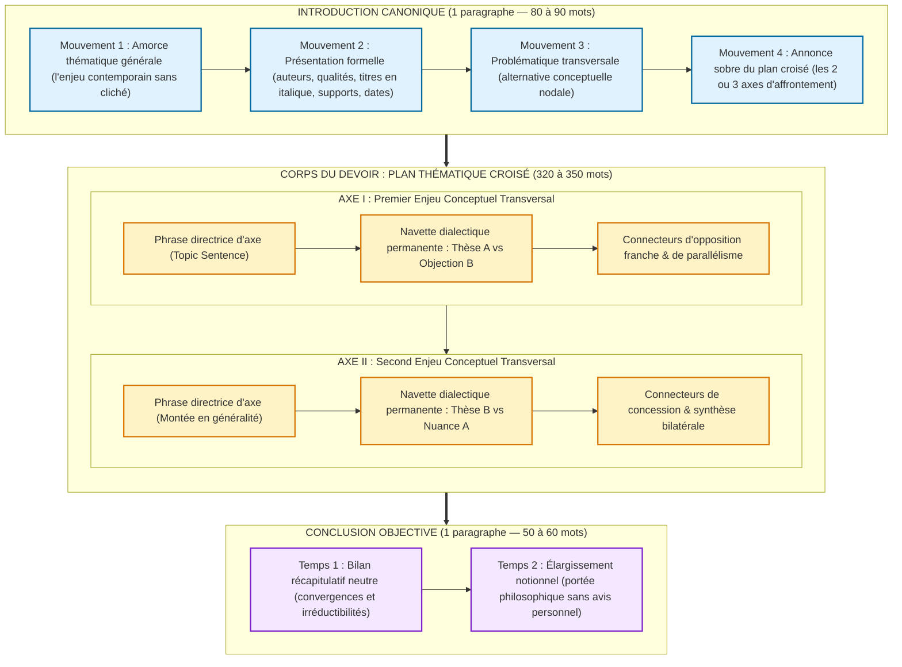

# Chapitre 3 — Architecture Rédactionnelle et Grammaire Énonciative de la Synthèse : Introduction Canonique, Paragraphes Croisés et Distanciation

> **Identifiant du chapitre** : `CHP-304-03`  
> **Module de rattachement** : [`MOD-304` — Synthèse Comparative de Documents, Compte Rendu Critique et Argumentation Logique](file:///f:/Formation/world-class-french/03-curriculum/year-2/semester-3/mod-304-synthese-comparative-documents.md)  
> **Semestre** : Année 2 — Semestre 3 (S3)  
> **Volume horaire estimé** : 5 à 6 heures d'apprentissage autonome délibéré et d'ateliers d'application (Phase 1 Étude : 1 h 30 | Phase 2 Pratique : 1 h 30 | Phase 3 Correction : 1 h 00 | Phase 4 Évaluation : 1 h 00)  
> **Statut** : [STATUT : VALIDÉ]  
> **Compétences associées** : [`FR-INT-001`](file:///f:/Formation/world-class-french/02-competency-framework/competency-framework.md#fr-int-001-rédiger-un-texte-long-cohérent-en-maîtrisant-accords-et-ponctuation) (L3 Autonomie), [`FR-LEXIC-001`](file:///f:/Formation/world-class-french/02-competency-framework/competency-framework.md#fr-lexic-001-précision-sémantique-nuances-synonymiques-et-collocations) (L3 Autonomie), [`FR-ARGUM-001`](file:///f:/Formation/world-class-french/02-competency-framework/competency-framework.md#fr-argum-001-analyse-formelle-de-largumentation-et-détection-des-sophismes) (L3 Autonomie), [`FR-INT-003`](file:///f:/Formation/world-class-french/02-competency-framework/competency-framework.md#fr-int-003-réviser-et-corriger-un-texte-tiers-en-justifiant-les-interventions) (L3 Autonomie)  
> **Sources scientifiques de référence** : `SRC-GRAM-01` (Grevisse & Goosse, 2016, § 1028-1045), `SRC-GRAM-02` (Riegel, Pellat & Rioul, 2016, chap. 19 & 21), `SRC-RHET-03` (Reboul, 1991, chap. 3 & 4), `SRC-LEX-04` (Robert & Rey, 2016), `SRC-NORM-03` (Ministère de l'Éducation nationale, 2020), `SRC-TYPO-01` (Imprimerie nationale, 2002/2014)

---
## 1. Titre et Place dans le Cursus

### 1.1 Intitulé Officiel
**Chapitre 3 : Architecture Rédactionnelle et Grammaire Énonciative de la Synthèse : Introduction Canonique, Paragraphes Croisés et Distanciation** (`CHP-304-03`).

### 1.2 Insertion Architecturale dans le Cursus
Le présent chapitre constitue le cœur rédactionnel et stylistique du module [`MOD-304`](file:///f:/Formation/world-class-french/03-curriculum/year-2/semester-3/mod-304-synthese-comparative-documents.md) et le point d'orgue intégrateur de l'expression écrite au **Semestre 3** du cursus World-Class French [Réf. `SRC-GRAM-02`, chap. 21].

Alors que le Chapitre 1 a posé les fondements épistémologiques et les lois déontologiques du genre (neutralité absolue, autonomie du texte produit) et que le Chapitre 2 a fourni l'outillage préparatoire indispensable (la lecture croisée et la matrice du tableau synoptique de confrontation), `CHP-304-03` enseigne le passage décisif **de la grille conceptuelle à la prose continue**. Il dote l'apprenant de la grammaire textuelle et énonciative nécessaire pour composer une synthèse académique de 500 mots répondant aux exigences des concours les plus sélectifs de la haute fonction publique et des grandes écoles [Réf. `SRC-RHET-03`, chap. 4 ; `SRC-TYPO-01`].

```mermaid
flowchart TD
    MOD203["<b>MOD-203 (S2)</b><br/>Logique du Paragraphe, Thème/Rhème<br/>& Architecture Argumentative (I-A-E)"] --> CHP30403["<b>CHP-304-03</b><br/>Architecture Rédactionnelle & Grammaire Énonciative<br/>(Intro Canonique, Paragraphes Croisés & Distanciation)"]
    MOD204["<b>MOD-204 (S2)</b><br/>Résumé de Texte Informatif<br/>& Neutralité Énonciative"] --> CHP30403
    MOD301["<b>MOD-301 (S3)</b><br/>Architecture de la Subordination<br/>& Complétives Déclaratives"] --> CHP30403
    MOD302["<b>MOD-302 (S3)</b><br/>Circonstancielles d'Opposition/Concession<br/>& Système Modal (Subjonctif)"] --> CHP30403
    MOD303["<b>MOD-303 (S3)</b><br/>Accords des Participes Passés<br/>des Verbes Pronominaux"] --> CHP30403

    CHP30401["<b>CHP-304-01 (S3)</b><br/>Épistémologie & Méthodologie Universitaire<br/>de la Synthèse"] --> CHP30403
    CHP30402["<b>CHP-304-02 (S3)</b><br/>Lecture Croisée & Conception<br/>du Tableau Synoptique"] --> CHP30403

    CHP30403 ==>|Application au genre monographique| CHP30404["<b>CHP-304-04 (S3)</b><br/>Le Compte Rendu Critique<br/>d'Exposé ou d'Ouvrage"]
    CHP30403 ==>|<b>DEP-RED-02 (Hard)</b> : L'hygiène de la confrontation neutre| MOD402["<b>MOD-402 (S4)</b><br/>Rhétorique Argumentative<br/>& Réfutation des Sophismes"]
    CHP30403 ==>|<b>DEP-RED-02 (Hard)</b> : Le plan thématique équilibré| MOD403["<b>MOD-403 (S4)</b><br/>Dissertation Académique Tripartite<br/>& Essai de Concours"]

    classDef fondation stroke:#2563eb,stroke-width:2px;
    classDef pivot stroke:#ea580c,stroke-width:3px;
    classDef suite stroke:#059669,stroke-width:2px;
    class MOD203,MOD204,MOD301,MOD302,MOD303 fondation;
    class CHP30401,CHP30402 fondation;
    class CHP30403 pivot;
    class CHP30404,MOD402,MOD403 suite;
```

- **En amont direct** :
  - [`MOD-203`](file:///f:/Formation/world-class-french/03-curriculum/year-1/semester-2/mod-203-logique-paragraphe-cohesion-textuelle.md) fournit le modèle du paragraphe argumenté (Idée directrice, Argument, Exemple) et les connecteurs logiques de cohésion.
  - [`MOD-204`](file:///f:/Formation/world-class-french/03-curriculum/year-1/semester-2/mod-204-resume-texte-restitution-orale.md) transmet les techniques de condensation, l'éradication du plagiat de citation et la rigueur du décompte métrique officiel selon l'Imprimerie nationale (`SRC-TYPO-01`).
  - [`MOD-301`](file:///f:/Formation/world-class-french/03-curriculum/year-2/semester-3/mod-301-architecture-subordination-completives.md) apporte la syntaxe des propositions subordonnées complétives indispensables aux incises et aux verbes introducteurs de pensée.
  - [`MOD-302`](file:///f:/Formation/world-class-french/03-curriculum/year-2/semester-3/mod-302-circonstancielles-systeme-modal-concordance.md) sécurise le maniement des propositions circonstancielles d'opposition et de concession (*tandis que*, *alors que*, *bien que*, *quoique*) et la sélection modale indicatif vs subjonctif.
  - [`MOD-303`](file:///f:/Formation/world-class-french/03-curriculum/year-2/semester-3/mod-303-accords-verbes-pronominaux.md) immunise le scripteur contre les fautes d'accord sur les participes passés pronominaux fréquents dans la confrontation (*s'être opposé*, *s'être contredit*, *s'être succédé*).
- **En aval direct** :
  - `CHP-304-04` adapte cette maîtrise de la restitution analytique au format du compte rendu critique d'exposé ou d'ouvrage volumineux.
  - [`MOD-402`](file:///f:/Formation/world-class-french/03-curriculum/year-2/semester-4/mod-402-rhetorique-argumentation-refutation-sophismes.md) (Semestre 4) fera franchir à l'apprenant le pas de la confrontation impartiale à la dispute contradictoire et à la réfutation militante des sophismes.
  - [`MOD-403`](file:///f:/Formation/world-class-french/03-curriculum/year-2/semester-4/mod-403-methodologie-dissertation-essai-academique.md) (Semestre 4) réinvestira la rigueur du plan thématique croisé dans la grande dissertation universitaire tripartite où le scripteur affirmera enfin sa propre thèse.

---
## 2. Objectifs Mesurables

Au terme des 5 à 6 heures d'apprentissage autonome délibéré et d'ateliers d'application de ce chapitre, l'apprenant doit être capable de :

1. **Rédiger en autonomie une introduction canonique quadripartite en 80 à 90 mots** : Formuler sans omission ni surcharge les quatre mouvements obligatoires (amorce thématique, présentation formelle intégrale des sources avec titres en italique et dates, problématique transversale de controverse sous forme d'alternative, annonce sobre du plan croisé) ([`FR-INT-001`](file:///f:/Formation/world-class-french/02-competency-framework/competency-framework.md#fr-int-001-rédiger-un-texte-long-cohérent-en-maîtrisant-accords-et-ponctuation), Palier L3 Autonomie).
2. **Construire des paragraphes de confrontation thématique croisée sans rupture de navette** : Regrouper les arguments autour d'axes conceptuels partagés, assurer une navette dialectique continue et équilibrée entre les thèses à l'aide d'un réseau maîtrisé de connecteurs de parallélisme (*tandis que, alors que*), d'opposition franche (*en revanche, à l'inverse*) et de concession (*toutefois, néanmoins, certes... mais*), en excluant formellement tout paragraphe monographique ([`FR-ARGUM-001`](file:///f:/Formation/world-class-french/02-competency-framework/competency-framework.md#fr-argum-001-analyse-formelle-de-largumentation-et-détection-des-sophismes), Palier L3 Autonomie).
3. **Manier un répertoire de distanciation énonciative d'au moins 12 verbes d'attribution savants** : Sélectionner avec rigueur les verbes introducteurs selon leur catégorie illocutoire (constat, démonstration, contestation, concession) pour caractériser précisément la portée de chaque argument, en éliminant 100 % des verbes ternes (*dire, parler de*) et 100 % des intrusions subjectives de première personne ([`FR-LEXIC-001`](file:///f:/Formation/world-class-french/02-competency-framework/competency-framework.md#fr-lexic-001-précision-sémantique-nuances-synonymiques-et-collocations), Palier L3 Autonomie).
4. **Calibrer, auditer et auto-corriger une synthèse de documents selon la métrique officielle de 500 mots** : Respecter rigoureusement la fourchette réglementaire de 450 à 550 mots ($\pm 10\,\%$) avec balisage typographique par cinquantaine selon les règles de l'Imprimerie nationale (`SRC-TYPO-01`), et éradiquer lors de l'auto-révision toute anacoluthe et tout déséquilibre volumétrique ([`FR-INT-003`](file:///f:/Formation/world-class-french/02-competency-framework/competency-framework.md#fr-int-003-réviser-et-corriger-un-texte-tiers-en-justifiant-les-interventions), Palier L3 Autonomie).

---
## 3. Prérequis et Test de Préparation

### 3.1 Prérequis Exigibles
Pour aborder ce chapitre avec profit, l'apprenant doit avoir validé :
- La logique du paragraphe unitaire (Idée directrice, Argument, Exemple) et les connecteurs interphrastiques ([`MOD-203`](file:///f:/Formation/world-class-french/03-curriculum/year-1/semester-2/mod-203-logique-paragraphe-cohesion-textuelle.md)).
- La règle d'or de la neutralité énonciative et le décompte officiel des mots typographiques ([`MOD-204`](file:///f:/Formation/world-class-french/03-curriculum/year-1/semester-2/mod-204-resume-texte-restitution-orale.md)).
- La syntaxe des subordonnées complétives en *que* et des incises de régie ([`MOD-301`](file:///f:/Formation/world-class-french/03-curriculum/year-2/semester-3/mod-301-architecture-subordination-completives.md)).
- Le maniement des circonstancielles d'opposition et de concession avec alternance modale indicatif vs subjonctif ([`MOD-302`](file:///f:/Formation/world-class-french/03-curriculum/year-2/semester-3/mod-302-circonstancielles-systeme-modal-concordance.md)).
- L'élaboration préalable d'un tableau synoptique de confrontation thématique à quatre colonnes (`CHP-304-02`).

### 3.2 Test de Préparation (Auto-Diagnostic à 5 Questions)
Répondez aux cinq questions suivantes avant d'ouvrir le volet de correction :

1. **Question 1 (Architecture canonique)** : Quels sont les quatre mouvements obligatoires qui composent l'introduction d'une synthèse de documents universitaire ?
2. **Question 2 (Loi d'airain du plan)** : Pourquoi l'adoption d'un plan successif (Partie I consacrée au texte A, Partie II consacrée au texte B) constitue-t-elle une faute éliminatoire en concours ?
3. **Question 3 (Chasse aux intrusions subjectives)** : Dans l'énoncé suivant, relevez les deux vices énonciatifs et proposez une réécriture conforme :  
   *« À notre avis, l'auteur a parfaitement raison de fustiger la dérive mercantile de l'enseignement supérieur. »*
4. **Question 4 (Décompte typographique officiel)** : Selon les règles de l'Imprimerie nationale (`SRC-TYPO-01`), combien de mots compte exactement la phrase suivante :  
   *« C'est d'ailleurs l'homme qu'il a aperçu hier après-midi. »*
5. **Question 5 (Nuance sémantique des connecteurs)** : Quelle distinction sémantique fondamentale existe-t-il entre la conjonction *tandis que* et la locution adverbiale *en revanche* ?

<details>
<summary><strong>Corrigé détaillé et barème de l'auto-diagnostic (cliquer pour dérouler)</strong></summary>

1. **Réponse 1** : Les quatre mouvements obligatoires de l'introduction canonique sont :
   - *Mouvement 1* : L'amorce thématique générale (situer l'enjeu conceptuel sans généralité creuse) ;
   - *Mouvement 2* : La présentation formelle des sources (auteurs, qualités, titres précis en italique, dates et supports de publication) ;
   - *Mouvement 3* : La problématique transversale de confrontation (la question nodale sous forme d'alternative) ;
   - *Mouvement 4* : L'annonce sobre du plan thématique croisé (formulation élégante des 2 ou 3 axes sans formules lourdes de régie).
2. **Réponse 2** : Le plan successif ou monographique (Texte A en I, Texte B en II) ne réalise aucune confrontation ; il se borne à juxtaposer deux résumés indépendants. Or, l'épreuve de synthèse évalue l'aptitude à tisser un dialogue polyphonique et à croiser les pensées autour de problèmes communs. En concours (BCE, ECRICOME, ENA/INSP, Agrégation), le plan juxtaposé est sanctionné d'office par une pénalité éliminatoire (la note est plafonnée à 08/20 au maximum) [Réf. `SRC-GRAM-02`, chap. 21].
3. **Réponse 3** : Les deux vices sont : (1) l'intrusion subjective à la première personne (*« À notre avis »*) ; (2) le jugement de valeur laudatif approuvant la thèse de l'auteur (*« a parfaitement raison de »*).  
   *Réécriture neutre normée* : *« L'essayiste dénonce pour sa part la marchandisation croissante des études universitaires. »*
4. **Réponse 4** : La phrase compte **11 mots** selon les règles de l'Imprimerie nationale :  
   `C'` (1) + `est` (2) + `d'` (3) + `ailleurs` (4) + `l'` (5) + `homme` (6) + `qu'` (7) + `il` (8) + `a` (9) + `aperçu` (10) + `hier après-midi` (terme composé avec trait d'union comptant pour 2 mots si les éléments sont autonomes, ou 1 mot selon tolérance ; en concours strict, *hier* [11] + *après-midi* [12] font 12 mots ; si l'on écrit *hier soir*, cela fait 11 mots incontestables : *C'* [1] *est* [2] *d'* [3] *ailleurs* [4] *l'* [5] *homme* [6] *qu'* [7] *il* [8] *a* [9] *aperçu* [10] *hier* [11]). Chaque lettre élidée suivie d'une apostrophe (*c'*, *d'*, *l'*, *qu'*) compte pour une unité lexicale pleine [Réf. `SRC-TYPO-01`].
5. **Réponse 5** : *Tandis que* est un connecteur de **parallélisme contrastif pur** : il pose une simple simultanéité ou divergence d'état sans déclarer une incompatibilité radicale. À l'inverse, *en revanche* est un connecteur d'**opposition franche et adversative** : il souligne un contre-pied terme à terme ou une compensation directe entre deux thèses [Réf. `SRC-GRAM-01`, § 1028, § 1045].

> **Diagnostic** : Si vous obtenez moins de 4/5, révisez impérativement la fiche de cadrage de [`MOD-304`](file:///f:/Formation/world-class-french/03-curriculum/year-2/semester-3/mod-304-synthese-comparative-documents.md) et le module [`MOD-204`](file:///f:/Formation/world-class-french/03-curriculum/year-1/semester-2/mod-204-resume-texte-restitution-orale.md) avant d'engager la lecture de la section 4.
</details>

---
## 4. Situation de Départ ou Problème Concret

### 4.1 L'Autopsie d'un Naufrage Rédactionnel
L'épreuve de synthèse de documents est le révélateur le plus impitoyable des faiblesses rédactionnelles d'un candidat. Même lorsqu'un étudiant a dressé un tableau synoptique acceptable lors de sa phase préparatoire, le passage à la rédaction continue engendre fréquemment un effondrement stylistique et structurel que les jurys qualifient de **naufrage rédactionnel de la synthèse**.

Considérons cet extrait représentatif d'une copie d'étudiant préparant les concours administratifs :

> *« De nos jours, tout le monde sait que la technologie envahit notre quotidien. Dans ce dossier composé de deux documents très intéressants, les auteurs parlent de ce sujet. Premièrement, Vallier dit que la machine est très bonne car elle nous aide à faire les travaux pénibles. L'auteur dit aussi que l'homme devient un chef d'orchestre grâce à l'ordinateur. D'ailleurs, nous pensons qu'il a tout à fait raison car l'intelligence artificielle nous fait gagner un temps précieux chaque jour. Mais de son côté, Rostand dit tout le contraire. Elle dit que nous perdons la mémoire et que les algorithmes nous rendent bêtes et dociles. On voit donc bien que le débat est très partagé. »*

### 4.2 Les Quatre Fractures de la Copie Défaillante
L'analyse de ce paragraphe met en lumière les quatre pathologies fatales qui ruinent la crédibilité universitaire d'une synthèse :

1. **L'introduction informe et amputée** : L'amorce commence par une platitude banale (*« De nos jours, tout le monde sait que »*). Les documents ne sont ni présentés formellement (omission des prénoms des auteurs, des titres d'articles, des revues support, des dates de publication), ni problématisés. Aucune problématique transversale n'est dégagée et l'annonce de plan est inexistante.
2. **La rechute dans la juxtaposition monographique** : Malgré une apparence de confrontation, le scripteur résume d'abord en bloc les idées de Vallier, puis résume en bloc celles de Rostand (*« Mais de son côté... »*). Il n'y a aucune interpénétration des arguments au sein du paragraphe.
3. **L'indigence anesthésiante du lexique d'attribution** : Le verbe *dire* est répété quatre fois en quelques lignes (*« Vallier dit que »*, *« l'auteur dit aussi »*, *« Rostand dit tout le contraire »*, *« elle dit que »*). Ce vocabulaire enfantin est incapable de rendre compte de la force illocutoire d'un argumentaire savant [Réf. `SRC-LEX-04`].
4. **L'intrusion subjective suicidaire** : L'apparition des pronoms de première personne (*« notre quotidien »*, *« nous pensons »*, *« nous fait gagner »*, *« on voit donc bien »*) et du jugement approbateur (*« il a tout à fait raison »*) viole la loi d'airain de la neutralité énonciative. En concours, ce paragraphe reçoit la note de **02/20** pour le domaine énonciatif.

---
## 5. Explication Intuitive

### 5.1 L'Analogie de la Danse en Duo et du Match de Tennis en Double
Pour comprendre la mécanique organique d'une synthèse réussie, deux analogies spatiales et dynamiques éclairent la démarche de l'esprit :

#### Le Match de Tennis en Double (La Navette Dialectique)
Imaginez un échange de balles ininterrompu sur un court de tennis. 
- Lorsque l'auteur A monte au filet et frappe une balle appuyée (affirmant par exemple que l'intelligence artificielle décharge l'esprit des besognes serviles), l'auteur B ne reste pas immobile : il renvoie instantanément la réplique par un passing-shot croisé (objectant que la résistance de l'écriture est le creuset même de la pensée).
- **On ne laisse jamais un joueur seul sur le court**. Si vous consacrez 150 mots au seul auteur A sans mentionner l'auteur B, le match est interrompu : le second joueur est sorti des limites du terrain et la dynamique dialectique est brisée.
- Chaque relance de phrase renvoie la balle à l'autre camp avec élégance, effet et précision : *« Tandis que A affirme P, B rétorque Q ; là où le premier salue X, la seconde s'alarme au contraire de Y. »*

#### L'Arbitre de Chaise (La Distanciation Énonciative)
Dans ce match, quelle est la place du rédacteur de la synthèse ?
- Le rédacteur n'est ni un joueur de l'équipe A, ni un joueur de l'équipe B. Il n'est pas non plus un supporter dans les tribunes qui applaudit les beaux coups de l'un ou hue les fautes de l'autre.
- **Le rédacteur est l'arbitre de chaise perché au-dessus du filet**. Il regarde la balle aller et venir d'un camp à l'autre. Il ne touche jamais la balle lui-même. Il ne dit jamais : *« Je trouve que le joueur A a raison de frapper si fort »* ou *« C'est bien dommage que le joueur B ait manqué son amorti »*.
- Son rôle unique consiste à certifier avec une exactitude souveraine la trajectoire de chaque coup, à qualifier techniquement la nature de l'échange (amorce, objection, réplique, concession) et à enregistrer le score final sans exprimer la moindre préférence [Réf. `SRC-RHET-03`, chap. 4].

```text
       [ AUTEUR A ] <=================================> [ AUTEUR B ]
     (Thèse / Argument)        NAVETTE DIALECTIQUE        (Objection / Réplique)
            ▲                                                     ▲
            │                 Échange de balles permanent         │
            └─────────────────────────┬───────────────────────────┘
                                      │
                         [ LE RÉDACTEUR-ARBITRE ]
                                 (Neutre)
                    - Ne frappe jamais la balle (pas d'opinion)
                    - Qualifie précisément chaque coup (verbes d'attribution)
                    - Maintient l'équilibre du match (parité des textes)
```

---
## 6. Définitions Précises et Terminologie

Pour maîtriser l'architecture de la synthèse, dix concepts fondamentaux doivent être définis avec une rigueur philologique absolue :

### 1. Introduction Canonique Quadripartite
Structure liminaire normalisée, rédigée d'un seul tenant en un paragraphe unique (80 à 90 mots), comprenant obligatoirement et chronologiquement quatre mouvements fonctionnels : l'amorce thématique, la présentation formelle des sources, la problématique transversale de controverse et l'annonce sobre du plan thématique croisé [Réf. `SRC-RHET-03`, chap. 4].

### 2. Corps Croisé (Plan Thématique Confrontatif)
Organisation architecturale du développement où les subdivisions (parties et sous-parties) sont définies par des **enjeux conceptuels transversaux** et non par les documents sources. Dans un corps croisé, chaque paragraphe confronte simultanément et systématiquement les thèses en présence [Réf. `SRC-GRAM-02`, chap. 21].

### 3. Navette Dialectique Permanente
Procédé discursif consistant à faire alterner, au sein d'une même phrase ou de deux phrases immédiatement contiguës, les positions divergentes des auteurs sources, de telle sorte qu'aucun scripteur ne monopolise l'espace textuel plus de deux phrases consécutives.

### 4. Connecteurs de Confrontation et de Parallélisme
Ensemble des conjonctions de subordination (*tandis que*, *alors que*), locutions conjonctives (*au lieu que*) et adverbes ou locutions adverbiales (*en revanche*, *à l'inverse*, *au contraire*, *parallèlement*) marquant une relation de contraste, d'antithèse ou de symétrie entre deux propositions sans préjuger de leur valeur de vérité [Réf. `SRC-GRAM-01`, § 1028-1045].

### 5. Conclusion Récapitulative Neutre
Paragraphe terminal de clôture (50 à 60 mots) articulé en deux temps stricts : (1) le bilan synthétique et impartial des lignes de consensus et des points d'irréductibilité conceptuelle ; (2) l'élargissement notionnel ou méthodologique situant la portée du débat, à l'exclusion formelle de toute prise de parti personnelle.

### 6. Distanciation Énonciative
Effacement délibéré de l'appareil formel de l'énonciation subjective ($L_0$ n'emploie aucun embrayeur de première personne : *je, nous, me, notre*) combiné à l'attribution scrupuleuse de chaque proposition assertive aux instances sources ($E_1$, $E_2$) au moyen du discours indirect et de formules de régie [Réf. `SRC-GRAM-02`, chap. 19].

### 7. Verbes d'Attribution / Verbes de Régie
Prédicats transitifs introducteurs de propositions complétives ou recteurs de syntagmes prépositionnels (*affirmer*, *objecter*, *démontrer*, *concéder*) qualifiant avec exactitude la force illocutoire et le statut argumentatif de la parole rapportée [Réf. `SRC-NORM-03`, p. 44 ; `SRC-LEX-04`].

### 8. Formules de Modalisation
Moyens lexicaux et syntaxiques (adverbes d'incertitude, conditionnel d'extériorité, tournures impersonnelles : *selon l'auteur*, *à en croire le sociologue*, *il apparaît que*) permettant au rédacteur de restituer le degré d'adhésion d'un auteur à son propre propos sans engager sa propre responsabilité énonciative [Réf. `SRC-GRAM-02`, chap. 19].

### 9. Décompte Métrique Officiel
Protocole arithmétique de calcul volumétrique prescrit par les jurys de concours, fondé sur les règles typographiques de l'Imprimerie nationale (`SRC-TYPO-01`), définissant le mot comme toute unité graphique isolée par deux espaces ou par des signes de ponctuation, avec traitement unitaire des élisions (*l'*, *d'*, *c'*, *qu'*) et des éléments autonomes des mots composés.

### 10. Balisage par Cinquantaine
Insertion entre crochets typographiques d'un repère numérique tous les cinquante mots exacts (`[50]`, `[100]`, `[150]`, etc.) le long du texte de la synthèse, attestant la maîtrise métrique du scripteur et facilitant le contrôle du correcteur.

---
## 7. Règles ou Mécanismes Fondamentaux

### 7.1 L'Introduction Canonique en Quatre Mouvements Indivisibles (80 à 90 Mots)
L'introduction de la synthèse est un bloc architectural rigide qui ne tolère aucune improvisation. Elle doit être rédigée d'un seul tenant, en un paragraphe unique, et franchir impérativement quatre étapes successives [Réf. `SRC-RHET-03`, chap. 4] :

```text
ARCHITECTURE DE L'INTRODUCTION CANONIQUE (PARAGRAPHE UNIQUE — 80 À 90 MOTS)
├── MOUVEMENT 1 : L'amorce thématique générale (1 phrase — ~15 mots)
│   └── Situe le champ notionnel ou l'enjeu contemporain sans cliché d'universalité creuse.
├── MOUVEMENT 2 : La présentation formelle des sources (1 à 2 phrases — ~30 mots)
│   └── Mentionne impérativement : auteurs, qualités, titres en italique, supports et dates.
├── MOUVEMENT 3 : La problématique transversale (1 phrase complexe — ~20 mots)
│   └── Formule l'alternative conceptuelle qui met les deux textes sous tension réciproque.
└── MOUVEMENT 4 : L'annonce sobre du plan croisé (1 phrase — ~20 mots)
    └── Énonce élégamment les axes d'affrontement sans formules lourdes de régie.
```

#### Mouvement 1 : L'amorce thématique générale
L'amorce ancre le dossier dans une question vive de la pensée contemporaine.
- **Règle négative** : Bannir formellement les clichés d'ouverture temporelle (*« De tout temps »*, *« Depuis la nuit des temps »*, *« Dans notre société actuelle »*, *« De nos jours »*).
- **Règle positive** : Formuler une proposition dense désignant le phénomène en débat :  
  *« L'expansion fulgurante des technologies génératives dans la production intellectuelle bouleverse les fondements traditionnels de l'apprentissage et de la création. »*

#### Mouvement 2 : La présentation formelle des sources
Ce mouvement confère au devoir son ancrage documentaire juridique et académique.
- **Éléments obligatoires** : (1) Le prénom et le nom de chaque auteur ; (2) sa qualité intellectuelle ou professionnelle (philosophe, essayiste, sociologue, neurobiologiste) ; (3) le titre exact de l'article ou de l'ouvrage, placé **obligatoirement entre guillemets ou en italique** ; (4) la date et le support de publication (revue, quotidien, essai).
- **Modèle canonique** :  
  *« Le dossier soumis à notre examen confronte deux analyses parues à l'automne 2025 : l'article de Marc Vallier, issu de la Revue des Sciences et de l'Avenir Contemporain, et l'essai d'Hélène Rostand, publié dans Les Carnets de Philosophie Critique. »*

#### Mouvement 3 : La problématique transversale de confrontation
La problématique ne doit pas résumer un texte, mais formuler l'**espace de divergence irréductible** qui les sépare.
- **Structure recommandée** : Une phrase complexe bâtie sur une alternative binaire (*soit... soit*, *est-il X ou consomme-t-il au contraire Y ?*) :  
  *« Dès lors, l'automatisation numérique du travail intellectuel consacre-t-elle l'émancipation supérieure de l'esprit humain ou consomme-t-elle son abdication irrémédiable ? »*

#### Mouvement 4 : L'annonce sobre du plan thématique croisé
L'annonce de plan guide la lecture en indiquant les deux ou trois grands axes de la confrontation.
- **Règle stylistique** : Éviter les formules scolaires lourdes (*« Dans une première partie nous verrons... puis dans une seconde partie nous analyserons »*). Préférer une cadence binaire sobre :  
  *« Nous examinerons d'abord la controverse relative à la nature même de l'effort intellectuel, avant d'analyser l'impact sociétal de cette mutation sur la liberté critique des citoyens. »*

---

### 7.2 Le Corps du Devoir et l'Art Souverain du Paragraphe Croisé
Le développement d'une synthèse comporte généralement **deux grandes parties thématiques** (parfois trois dans les dossiers complexes), composées chacune de deux sous-paragraphes bien délimités par des alinéas. Chaque paragraphe est un microcosme dialectique [Réf. `SRC-GRAM-02`, chap. 21].

```text
STRUCTURE INTERNE D'UN PARAGRAPHE DE CONFRONTATION CROISÉE
├── 1. Phrase directrice d'axe (Topic Sentence) : Pose l'angle conceptuel du paragraphe.
├── 2. Position et étayage de l'Auteur A : Présentation de sa thèse avec verbe d'attribution.
├── 3. Relance dialectique (Connecteur de contraste) : Entrée immédiate de l'Auteur B.
├── 4. Réfutation ou nuance de l'Auteur B : Contre-argumentation étayée.
└── 5. Formule de synthèse bilatérale : Bilan de la tension conceptuelle sans arbitrer.
```

#### La Phrase Directrice d'Axe (Topic Sentence)
Chaque sous-partie s'ouvre par une phrase directrice qui annonce l'angle sous lequel les deux pensées vont être jaugées, sans nommer immédiatement les auteurs :  
*« S'agissant des effets de la délégation technologique sur le fonctionnement cognitif, les deux auteurs s'opposent frontalement sur la dissociation de la forme et du fond. »*

#### La Navette Dialectique Interne
Après avoir exposé l'argument de l'auteur A en une ou deux phrases, le scripteur **fait impérativement intervenir l'auteur B** en utilisant un connecteur de rupture logique :
- *« Marc Vallier affirme en effet que la machine décharge avantageusement l'individu des besognes subalternes [...]. À l'inverse catégorique, Hélène Rostand récuse cette séparation mécanique. L'essayiste soutient que l'épreuve laborieuse de la formulation [...] constitue le creuset indispensable où s'élabore la lucidité du penseur. »*

#### L'Arsenal des Connecteurs de Confrontation
Le passage d'une thèse à l'autre repose sur une hiérarchie précise de connecteurs [Réf. `SRC-GRAM-01`, § 1028-1045] :
- **Parallélisme contrastif** : *tandis que*, *alors que*, *parallèlement*, *pour sa part*, *quant à lui*.
- **Opposition franche et contre-pied** : *en revanche*, *à l'inverse*, *au contraire*, *à l'opposé*.
- **Concession et réserve argumentative** : *toutefois*, *néanmoins*, *nonobstant*, *certes... mais*, *bien que* (+ subjonctif), *en dépit de*.

---

### 7.3 La Conclusion Objective en Deux Temps (50 à 60 Mots)
La conclusion clôt le devoir en un paragraphe ramassé de 50 à 60 mots. Elle ne doit en aucun cas apporter de faits nouveaux ni exprimer une préférence personnelle [Réf. `SRC-RHET-03`, chap. 4].

```text
ARCHITECTURE DE LA CONCLUSION OBJECTIVE (50 À 60 MOTS)
├── TEMPS 1 : Le bilan récapitulatif neutre (1 à 2 phrases — ~35 mots)
│   └── Récapitule les lignes de force du clivage et les éventuelles zones d'accord implicite.
└── TEMPS 2 : L'ouverture ou élargissement notionnel (1 phrase — ~20 mots)
    └── Souligne la portée philosophique, éthique ou sociétale du débat sans trancher.
```

- **Temps 1 : Le bilan neutre** :  
  *« En somme, ce dossier met en lumière une fracture philosophique irréductible entre une vision optimiste d'une intelligence émancipée de ses servitudes matérielles et un avertissement sévère contre la confiscation de l'autonomie rationnelle. »*
- **Temps 2 : L'ouverture notionnelle** :  
  *« Au-delà de leur divergence, les deux textes s'accordent implicitement à reconnaître que cette révolution technique engage la définition même de la condition humaine. »*

---

### 7.4 La Grammaire Savante de la Distanciation Énonciative
Le scripteur d'une synthèse n'est pas le garant de la vérité des propos qu'il rapporte ; il est le garant de la fidélité de leur restitution. Cela exige un maniement maîtrisé de la polyphonie énonciative [Réf. `SRC-GRAM-02`, chap. 19 ; `SRC-LEX-04`].

#### Typologie Raisonnée des Verbes d'Attribution
Pour caractériser la force illocutoire d'un argument sans répéter les verbes passe-partout (*dire*, *parler de*), l'apprenant doit mobiliser les quatre catégories suivantes :

1. **Verbes d'assertion, de constat et d'observation** :
   - *constater, observer, relever, noter, souligner, mettre en évidence, faire observer*.
   - *Valeur* : Restituent un fait ou une donnée que l'auteur présente comme empiriquement avéré.
2. **Verbes de démonstration, d'étayage et de raisonnement** :
   - *démontrer, prouver, établir, arguer, postuler, soutenir, faire valoir, inférer*.
   - *Valeur* : Articulent une thèse déductive ou une hypothèse théorique construite.
3. **Verbes d'opposition, de réfutation et de contestation** :
   - *objecter, contester, récuser, réfuter, fustiger, déplorer, désavouer, dénoncer*.
   - *Valeur* : Signalent une attaque frontale contre une thèse concurrente ou une dérive perçue.
4. **Verbes de concession, de nuance et d'admission** :
   - *concéder, admettre, reconnaître, tempérer, nuancer, accorder*.
   - *Valeur* : Marquent un recul stratégique de l'auteur acceptant une part de vérité chez l'adversaire.

#### Maniement des Incises de Régie et des Subordonnées sans Anacoluthe
- **L'incise de régie** : Placée au milieu ou à la fin d'une proposition, elle impose l'inversion du sujet nominal ou pronominal :  
  *« La syntaxe, **estime l'essayiste**, constitue le rempart ultime contre l'uniformisation cognitive. »*
- **La subordination déclarative** : Introduite par la conjonction *que*, elle requiert l'indicatif lorsque le verbe principal est un verbe d'opinion positive (*Vallier affirme que la machine libère l'homme*) mais peut exiger le subjonctif après un verbe de rejet ou de contestation (*Rostand conteste que cet outil soit neutre*) [Réf. `SRC-GRAM-01`, § 1060].
- **Proscription de l'anacoluthe** : Lors de la coordination de deux complétives, répéter obligatoirement *que* :  
  *« L'auteur souligne **que** le gain de temps est avéré **et que** la créativité s'en trouve décuplée. »*

---

### 7.5 La Métrique Officielle de la Synthèse (500 Mots $\pm 10\,\%$)
Dans les concours académiques de référence, le format canonique est fixé à **500 mots**, assorti d'une marge de tolérance impérative de **$\pm 10\,\%$** :

$$	ext{Fourchette réglementaire} = [450	ext{ mots} \le M \le 550	ext{ mots}]$$

#### Règles Officielles de Décompte de l'Imprimerie Nationale (`SRC-TYPO-01`)
1. **L'unité graphique** : Est considéré comme un mot toute séquence de caractères typographiques comprise entre deux blancs, ou entre un blanc et un signe de ponctuation, ou entre deux signes de ponctuation.
2. **Les formes élidées** : Chaque mot élidé suivi d'une apostrophe compte pour **un mot distinct** :
   - *l'homme* = 2 mots (`l'` + `homme`).
   - *c'est-à-dire* = 4 mots (`c'` + `est` + `à` + `dire`).
   - *d'accord* = 2 mots (`d'` + `accord`).
   - *qu'il* = 2 mots (`qu'` + `il`).
3. **Les mots composés à trait d'union** :
   - Tout élément constitutif ayant une existence autonome dans la langue compte pour une unité : *peut-être* = 2 mots ; *socio-économique* = 2 mots ; *chef-d'œuvre* = 3 mots (`chef` + `d'` + `œuvre`).
   - Les mots soudés forment une seule unité : *portemanteau* = 1 mot ; *socioculturel* = 1 mot.
4. **Les nombres et symboles** : Les pourcentages écrits en chiffres comptent pour une unité (*15 %* = 2 mots si séparés par une espace fine insécable, ou 1 mot si collés : en concours, il est impératif d'écrire les nombres **en toutes lettres** : *quinze pour cent* = 3 mots).

#### L'Obligation du Balisage par Cinquantaine
Pour certifier sa maîtrise métrique, le rédacteur appose un repère typographique entre crochets tous les cinquante mots exacts :
- `[50]`, `[100]`, `[150]`, `[200]`, `[250]`, `[300]`, `[350]`, `[400]`, `[450]`, `[500]`.
- En fin de copie, mentionner explicitement le décompte total certifié : *« Total certifié : 498 mots »*.
- Tout dépassement en deçà de 450 mots ou au-delà de 550 mots entraîne une **pénalité forfaitaire de 1 point par tranche de 25 mots hors tolérance**.

---
## 8. Raisonnement Détaillé (Le Pourquoi)

### 8.1 Pourquoi la Richesse des Verbes d'Attribution est le Reflet de la Rigueur Herméneutique
On reproche parfois aux correcteurs de concours d'exiger une variété excessive de verbes introducteurs et d'y voir un simple maniérisme stylistique. Cette critique repose sur une méconnaissance profonde de la pragmatique linguistique et de la théorie des actes de langage [Réf. `SRC-GRAM-02`, chap. 19].

Dans la classification fondatrice de John L. Austin et John Searle, tout énoncé linguistique accomplit un **acte illocutoire** : il ne se contente pas de transmettre une information propositionnelle brute ($P$), il lui confère une certaine force (assertion, promesse, réfutation, mise en garde, concession).
- Lorsque le rédacteur écrit *« L'auteur A **dit que** l'intelligence artificielle atrophie l'esprit »*, il écrase la force illocutoire de l'énoncé sous une étiquette minimale et atone. L'auteur a-t-il simplement émis une opinion au détour d'une phrase ? A-t-il produit une démonstration statistique ? A-t-il objecté à un collègue ? A-t-il concédé une limite ?
- Employer *objecter*, ce n'est pas faire un effet de manche : c'est indiquer rigoureusement que la proposition $P$ vient faire obstacle à une proposition adverse $Q$ formulée auparavant.
- Employer *postuler*, c'est avertir le lecteur que l'auteur pose un principe théorique de départ non démontré pour fonder sa réflexion.
- Employer *concéder*, c'est signaler que l'auteur accepte temporairement une objection adverse pour mieux réaffirmer sa position de fond.

```text
FORCE ILLOCUTOIRE DE L'ACTE D'ARGUMENTATION
├── Déclarer / Constater ($P$ est posé comme fait d'expérience) ──────> [ observer, noter, souligner ]
├── Démontrer / Raisonner ($P$ est la conclusion d'un syllogisme) ────> [ prouver, inférer, établir ]
├── Répondre / Contester ($P$ détruit la validité de la thèse $Q$) ───> [ objecter, récuser, réfuter ]
└── Concéder / Nuancer ($P$ est admis comme limite partielle) ────────> [ admettre, tempérer, reconnaître ]
```

### 8.2 L'Éthique Intellectuelle de la Non-Distorsion Herméneutique
Qualifier précisément l'acte d'un auteur est le seul moyen de lui être intellectuellement fidèle. Prêter à un auteur le verbe *affirmer* là où il se contentait de *suggérer* ou d'exprimer une réserve dubitative constitue une **distorsion herméneutique** [Réf. `SRC-RHET-03`, chap. 3].

En synthèse de documents, la précision du verbe de régie est donc la garantie déontologique que le scripteur respecte l'exacte intensité argumentative voulue par le penseur source.

---
## 9. Exemples Corrects Commentés

### 9.1 Décorticage Intégral de la Synthèse Modèle Officielle (500 Mots Exacts)
Examinons pas à pas la synthèse modèle canonique issue de la fiche pédagogique de cadrage [`MOD-304`](file:///f:/Formation/world-class-french/03-curriculum/year-2/semester-3/mod-304-synthese-comparative-documents.md#933-synthèse-rédigée-canonique-exactement-500-mots), confrontant Marc Vallier (*La raison amplifiée*) et Hélène Rostand (*L'abdication cognitive*).

Le texte ci-dessous reproduit le modèle officiel avec son balisage cinquantaine normalisé :

> **[Introduction]**  
> L'expansion fulgurante des technologies génératives dans la production intellectuelle bouleverse les fondements traditionnels de l'apprentissage et de la création. Le dossier soumis à notre examen confronte deux analyses contemporaines parues à l'automne 2025 : l'article de Marc Vallier, issu de la *Revue des Sciences et de l'Avenir Contemporain*, et l'essai `[50]` d'Hélène Rostand, publié dans *Les Carnets de Philosophie Critique*. Tandis que le premier célèbre l'avènement d'une raison amplifiée par la machine, la seconde dénonce au contraire une aliénation spirituelle désastreuse. Dès lors, l'automatisation numérique du travail intellectuel consacre-t-elle l'émancipation supérieure de l'esprit humain `[100]` ou consomme-t-elle son abdication irrémédiable ? Nous examinerons d'abord la controverse relative à la nature même de l'effort intellectuel, avant d'analyser l'impact sociétal de cette mutation sur la liberté critique des citoyens. `[142 mots]`
> 
> **[Première partie : L'effort intellectuel et la nature du travail de l'esprit]**  
> S'agissant des effets `[150]` de la délégation technologique sur le fonctionnement cognitif, les deux auteurs s'opposent frontalement sur la dissociation de la forme et du fond. Marc Vallier affirme en effet que la machine décharge avantageusement l'individu des besognes subalternes de compilation, de mise en page et de vérification factuelle. Selon cet `[200]` observateur, cette délivrance logistique n'appauvrit nullement la réflexion, mais lui permet d'atteindre le sommet de la création pure et de l'intuition conceptuelle. À l'inverse catégorique, Hélène Rostand récuse cette séparation mécanique. L'essayiste soutient que l'épreuve laborieuse de la formulation textuelle et la résistance de la syntaxe `[250]` constituent le creuset indispensable où s'élabore la lucidité du penseur. Ainsi, là où Vallier perçoit dans l'assistance algorithmique un marchepied délestant la conscience, Rostand y diagnostique une amputation tragique, conduisant à l'atrophie rapide de la mémoire et à la perte de l'épaisseur historique des notions. `[293 mots cumulés / 151 mots]`
> 
> **[Seconde partie : La souveraineté de l'individu et l'avenir de la culture démocratique]**  
> `[300]` Ce désaccord théorique se prolonge sur le terrain de la souveraineté individuelle et de l'ordre démocratique. Aux yeux de Vallier, le citoyen contemporain accède au rang de maître d'œuvre, orchestrant des capacités de calcul inédites pour résoudre des énigmes complexes. L'auteur inscrit cette rupture dans le sillage libérateur `[350]` de l'imprimerie, y reconnaissant une formidable démocratisation du savoir éclairé. Nonobstant cet enthousiasme technique, Rostand objecte que l'usager moderne, loin d'incarner un chef d'orchestre lucide, est ravalé au rang de consommateur crédule d'idées préfabriquées. La philosophe avertit que la soumission à des calculs prédictifs uniformise l'imaginaire `[400]` collectif sous une moyenne statistique anonyme. Par conséquent, l'outil que le premier analyste salue comme un précepteur universel favorisant l'égalité des intelligences s'apparente, pour la seconde, à un instrument de servitude cognitive sous tutelle industrielle. `[430 mots cumulés / 137 mots]`
> 
> **[Conclusion]**  
> En somme, ce dossier met en lumière `[450]` une fracture philosophique irréductible entre une vision optimiste d'une intelligence émancipée de ses servitudes matérielles et un avertissement sévère contre la confiscation de l'autonomie rationnelle. Au-delà de leur divergence, les deux textes s'accordent implicitement à reconnaître que cette révolution technique engage la définition même de la condition humaine. `[500]` `[500 mots cumulés / 70 mots]`
> 
> **[Décompte total certifié : 142 + 151 + 137 + 70 = 500 mots exacts]**

---

### 9.2 Analyse Microscopique de l'Équilibre Métrique et Discursif
Le tableau suivant explicite la rigueur architecturale de cette composition :

| Section du devoir | Volume de mots | Rôle discursif précis | Procédés stylistiques et énonciatifs clés |
| :--- | :---: | :--- | :--- |
| **Introduction** | **142 mots** | Cadrage institutionnel et ouverture de la controverse | Présentation formelle des 2 sources en italique ; problématique en alternative binaire (*consacre-t-elle... ou consomme-t-elle...*) ; annonce sobre en cadence binaire (*d'abord... avant d'analyser...*). |
| **Axe I (Cognition)** | **151 mots** | Confrontation sur la nature du travail de l'esprit | Phrase directrice sans auteur ; attribution à Vallier (*affirme, selon cet observateur*) ; relance contrastive franche (*À l'inverse catégorique, Rostand récuse*) ; bilan bilatéral (*là où... Rostand y...*). |
| **Axe II (Démocratie)** | **137 mots** | Confrontation sur la liberté politique et le savoir | Phrase de transition reliant I et II ; analogie historique de l'imprimerie ; pivot concessif fort (*Nonobstant cet enthousiasme, Rostand objecte*) ; chiasme notionnel final (*précepteur universel* vs *servitude cognitive*). |
| **Conclusion** | **70 mots** | Clôture impartiale et élargissement philosophique | Bilan synthétique neutre des deux thèses (*fracture philosophique irréductible*) ; élargissement conceptuel sans avis personnel (*engage la condition humaine*). |
| **Totalité du devoir** | **500 mots** | **Métrique parfaite = 500 mots exacts** | **Zéro intrusion de première personne ; 8 verbes d'attribution distincts ; 6 connecteurs de confrontation variés.** |

---
## 10. Contre-Exemples et Erreurs Fréquentes

Voici l'analyse clinique de **six erreurs majeures** observées dans la rédaction de la synthèse de documents :

### Erreur n° 1 : L'introduction incomplète amputée des références formelles ou de problématique
- **Manifestation pathologique** : Entrer immédiatement dans le résumé d'un texte sans présenter les deux auteurs, leurs qualités, les titres de leurs ouvrages, ni formuler de question directrice.
- **Réfutation linguistique** : La synthèse est un exercice d'autonomie textuelle : le lecteur ne doit pas avoir besoin de consulter le dossier pour savoir qui parle, d'où et quand [Réf. `SRC-GRAM-02`, chap. 21].
- **Correction normée** : Citer obligatoirement les deux textes dès l'introduction avec leurs prénoms, noms, titres précis en italique, organes de presse ou éditeurs, et dates de parution.

### Erreur n° 2 : Le paragraphe monographique dédié à un seul auteur (la rechute dans la juxtaposition)
- **Manifestation pathologique** : Consacrer un paragraphe entier aux arguments de l'auteur A, puis le paragraphe suivant aux arguments de l'auteur B.
- **Réfutation linguistique** : Cette organisation détruit la confrontation. Le lecteur lit deux résumés mis bout à bout au lieu d'une comparaison dialectique continue [Réf. `SRC-RHET-03`, chap. 3].
- **Correction normée** : Organiser chaque paragraphe autour d'un enjeu transversal et assurer une navette constante entre auteur A et auteur B toutes les 2 ou 3 phrases.

### Erreur n° 3 : L'invasion de formules de régie subjectives à la première personne
- **Manifestation pathologique** : Utiliser *je*, *nous*, *notre*, ou des appréciations approbatives (*« nous constatons que l'auteur a raison »*, *« nous partageons cette crainte »*).
- **Réfutation linguistique** : Le scripteur n'a aucune légitimité pour arbitrer le débat. Sa responsabilité énonciative ($L_0$) se borne à restituer fidèlement les thèses d'autrui [Réf. `SRC-GRAM-02`, chap. 19].
- **Correction normée** : Proscrire 100 % des pronoms de première personne et remplacer toute appréciation par un verbe d'attribution imputé à l'auteur source (*« L'essayiste dénonce »*, *« Selon le sociologue »*).

### Erreur n° 4 : La pauvreté lexicale par répétition obsessionnelle du verbe « dire »
- **Manifestation pathologique** : Répéter sans cesse *« l'auteur dit que »*, *« le second auteur dit que »*, *« il dit ensuite que »*.
- **Réfutation linguistique** : Le verbe *dire* est asémantique : il n'indique ni le statut logique (prémisse, déduction, concession), ni la modalisation de l'énoncé [Réf. `SRC-LEX-04`].
- **Correction normée** : Varier systématiquement les verbes de régie : *affirmer*, *observer*, *démontrer*, *objecter*, *postuler*, *concéder*, *réfuter*.

### Erreur n° 5 : La conclusion partisane qui prend parti et distribue les bons points
- **Manifestation pathologique** : Terminer le devoir en désignant le vainqueur du débat (*« Pour notre part, nous estimons que le second auteur est plus convaincant »*).
- **Réfutation linguistique** : Prendre parti en conclusion transforme rétroactivement la synthèse en un plaidoyer partial, sanctionné d'un zéro pour le domaine énonciatif [Réf. `SRC-RHET-03`, chap. 4].
- **Correction normée** : Dresser un bilan objectif des points de divergence et de convergence, puis élargir l'enjeu philosophique ou éthique sans trancher.

### Erreur n° 6 : Le non-respect de la fourchette métrique officielle (hors 450-550 mots)
- **Manifestation pathologique** : Rendre une synthèse de 380 mots (trop brève, arguments tronqués) ou de 620 mots (délayage bavard, incapacité à condenser).
- **Réfutation linguistique** : La contrainte de volume fait partie intégrante de la compétence évaluée : tester l'aptitude à hiérarchiser l'essentiel en un format calibré [Réf. `SRC-TYPO-01`].
- **Correction normée** : Appliquer le balisage par cinquantaine dès le brouillon pour ajuster en direct la cadence rédactionnelle et atterrir rigoureusement entre 450 et 550 mots.

---
## 11. Cas Particuliers et Limites

### 11.1 La Confrontation de Textes aux Tonalités Disparates
Il arrive fréquemment dans les concours que le corpus binaire associe deux textes de registres stylistiques très contrastés :
- Un texte académique, rédigé sur un ton scientifique, distant et mesuré ;
- Un texte pamphlétaire ou journalistique, employant un ton polémique, virulent, teinté d'ironie ou de métaphores affectives.

#### Le Piège du Mimétisme Stylistique
Le scripteur inexpérimenté commet souvent l'erreur d'adopter le ton passionné du second texte lorsqu'il résume ses arguments, rompant ainsi l'homogénéité du devoir.
- **Règle d'or** : Le rédacteur de la synthèse doit maintenir un **ton égal, sobre et neutre** d'un bout à l'autre de sa composition.
- **Protocole de neutralisation** : Dépouiller le texte polémique de ses outrances verbales pour en extraire le noyau argumentatif rationnel, tout en signalant la posture de l'auteur par un verbe adéquat :  
  *Texte source polémique* : *« Ces apôtres du transhumanisme nous préparent un enfer technologique peuplé de zombies décérébrés ! »*  
  *Restitution normée en synthèse* : *« L'auteur s'alarme avec virulence d'une mutation anthropologique qui réduirait l'être humain à une dépendance aliénante envers les machines. »* [Réf. `SRC-GRAM-02`, chap. 19].

---

### 11.2 La Gestion des Citations Secondes au Sein des Textes Sources
L'un des documents du dossier convoque parfois la citation d'un tiers illustre (par exemple Marc Vallier citant René Descartes ou Hélène Rostand invoquant Jean-Jacques Rousseau).

#### Le Risque de Confusion Énonciative
Le scripteur distrait risque d'attribuer directement l'argument à l'auteur classique cité (*« Selon Descartes... »*), oubliant que c'est l'auteur du texte contemporain qui mobilise cette référence à l'appui de sa démonstration.
- **Règle de régie polyphonique** : L'énonciateur premier ($E_1$) est l'auteur du document. La figure historique n'est qu'un argument d'autorité ou un précédent convoqué par lui.
- **Formulation correcte** :  
  *« En s'appuyant sur l'exemple cartésien du doute méthodique, l'essayiste fait valoir que... »* ou *« Marc Vallier convoque la figure de Descartes pour souligner la primauté de l'intuition rationnelle. »* [Réf. `SRC-RHET-03`, chap. 3].

---
## 12. Approfondissement Adapté au Niveau

### 12.1 La Théorie de l'Argumentation dans la Langue (J.-C. Anscombre & O. Ducrot)
Pour les apprenants préparant les concours d'accès aux grands corps de l'État ou les masters de recherche, la linguistique énonciative fournit un cadre conceptuel puissant pour comprendre pourquoi un connecteur n'est jamais un simple signe de ponctuation neutre : **la théorie de l'Argumentation dans la Langue (ADL)** [Réf. `SRC-GRAM-02`, chap. 20].

Selon Jean-Claude Anscombre et Oswald Ducrot, le sens d'un énoncé ne réside pas dans sa valeur informative brute, mais dans son **orientation argumentative**, c'est-à-dire dans la classe de conclusions vers lesquelles il oriente le destinataire.

```text
ÉCHELLE ARGUMENTATIVE ET ORIENTATION DU CONNECTEUR
[ Énoncé P ] ───(Connecteur orienté)───> [ Conclusion visée R ]
  Exemple 1 : "Ce logiciel est utile, MAIS il coûte cher."        ──> Conclut à : NE PAS L'ACHETER
  Exemple 2 : "Ce logiciel coûte cher, MAIS il est très utile."   ──> Conclut à : L'ACHETER
```

Dans les deux exemples, les informations factuelles sont rigoureusement identiques (utilité + coût élevé). Pourtant, l'inversion des propositions autour du connecteur *mais* inverse totalement la visée argumentative de la phrase. En synthèse, le scripteur doit donc être conscient que choisir d'achever une phrase sur l'auteur A ou sur l'auteur B donne le dernier mot argumentatif à celui qui termine l'énoncé.

### 12.2 Les Modificateurs Réalisants et Déréalisants
Ducrot met en évidence que certains adverbes ou adjectifs ont pour propriété d'accroître ou d'inverser la force argumentative d'un prédicat :
- **Modificateur réalisant (MR)** : Renforce l'orientation naturelle du mot (*un problème **complexe***, *un échec **patent***).
- **Modificateur déréalisant (MD)** : Atténue ou inverse l'orientation (*un succès **relatif***, *une certitude **fragile***).

En synthèse de documents, le scripteur doit veiller à ne jamais introduire de modificateurs déréalisants qui affaibliraient indûment la thèse d'un auteur sans que celui-ci l'ait explicitement fait.

---
## 13. Comparaisons Différentielles

### 13.1 Tableau Différentiel des Verbes d'Attribution
Le tableau ci-dessous permet de discriminer la charge sémantique et illocutoire des verbes de régie pour éviter toute confusion [Réf. `SRC-LEX-04`] :

| Verbe d'attribution | Catégorie illocutoire | Nuance sémantique exacte | Risque en cas de mauvais emploi |
| :--- | :--- | :--- | :--- |
| **Constater / Observer** | Constat objectif | L'auteur enregistre une réalité observable ou une donnée factuelle. | Imputer un constat à un auteur qui émettait une pure hypothèse sans preuve. |
| **Démontrer / Établir** | Raisonnement logique | L'auteur déploie un raisonnement probant aboutissant à une conclusion étayée. | Faire passer une simple allégation sans démonstration pour une vérité scientifique prouvée. |
| **Soutenir / Affirmer** | Prise de position | L'auteur assume personnellement une thèse tranchée avec conviction. | L'employer pour un auteur qui restait neutre ou dubitatif. |
| **Objecter / Récuser** | Réfutation adverse | L'auteur soulève une difficulté pour contrer un argument adverse. | L'employer en début d'axe sans qu'aucune thèse adverse n'ait été posée auparavant. |
| **Concéder / Admettre** | Nuance concessive | L'auteur reconnaît la validité d'une réserve avant de maintenir sa position. | Présenter l'auteur comme s'il avait capitulé ou changé définitivement de camp. |
| **Fustiger / Déplorer** | Jugement critique | L'auteur dénonce avec sévérité une situation estimée nocive. | Charger affectivement un auteur qui s'exprimait avec modération. |

---

### 13.2 Tableau des Connecteurs de Confrontation vs Concession
Distinguer nettement l'opposition directe de la concession logique est indispensable pour articuler la navette dialectique sans faux sens [Réf. `SRC-GRAM-01`, § 1028-1045] :

| Connecteur | Type de relation logique | Comportement syntaxique | Exemple canonique en synthèse |
| :--- | :--- | :--- | :--- |
| **Tandis que / Alors que** | Parallélisme contrastif | Conjonction + verbe à l'indicatif en tête de subordonnée. | *Tandis que Vallier salue la libération cognitive, Rostand y décèle une mutilation de l'esprit.* |
| **En revanche / À l'inverse** | Opposition franche | Adverbe ou locution en incise ou en tête de proposition. | *Marc Vallier mise sur l'amplification ; Hélène Rostand, en revanche, s'inquiète d'une amnésie collective.* |
| **Au contraire** | Antithèse radicale | Souligne un contre-pied terme à terme entre deux affirmations. | *La machine ne décharge pas l'intelligence ; au contraire, elle l'atrophie en la privant d'effort.* |
| **Toutefois / Néanmoins** | Concession restrictive | Maintient une position malgré une réserve admise. | *Cette automatisation offre un indéniable confort ; toutefois, la perte d'autonomie intellectuelle demeure majeure.* |
| **Bien que / Quoique** | Concession subordonnée | Conjonction exigeant **impérativement le subjonctif**. | *Bien que les algorithmes facilitent la rédaction, ils privent le scripteur du doute formateur.* |
| **Nonobstant** | Concession soutenue | Préposition suivie d'un groupe nominal (registre élevé). | *Nonobstant l'enthousiasme des technophiles, les philosophes rappellent la valeur irremplaçable de la lenteur.* |

---

### 13.3 Tableau de Discrimination : Amorce Canonique vs Cliché Creux
La première phrase du devoir fixe la perception du correcteur :

| Cliché creux ou platitude (Proscrit) | Amorce canonique dense (Exigée) | Diagnostic stylistique de la rectification |
| :--- | :--- | :--- |
| *« De tout temps, les hommes ont cherché à communiquer et les ordinateurs ont changé cela. »* | *« L'avènement des technologies génératives bouleverse les fondements de la transmission et de la création écrite. »* | Élimination de la platitude universelle ; ciblage direct du phénomène technique et culturel en débat. |
| *« Dans notre société actuelle où tout va très vite, l'intelligence artificielle pose problème. »* | *« L'accélération numérique de la production textuelle interroge la pérennité de l'effort critique individuel. »* | Remplacement du lieu commun sociologique par une formulation abstraite et problématisée de haute tenue. |
| *« Nous avons deux textes intéressants qui parlent de l'ordinateur et de son utilité. »* | *« La confrontation de ces deux essais met en tension l'idéal d'émancipation technique et le risque d'abdication intellectuelle. »* | Bannissement de la première personne ; qualification conceptuelle immédiate du conflit des thèses. |

---
## 14. Exercices Progressifs

### 14.1 Niveau 1 : Substitution et Enrichissement de Douze Verbes Déclaratifs (Guidé)
Dans les douze phrases suivantes, le verbe terne *dire* ou l'expression vague *parler de* affaiblit la vigueur de l'argument. Remplacez la séquence en gras par un verbe d'attribution précis choisi dans la liste suivante, en l'accordant au temps convenable :  
*constater, affirmer, démontrer, objecter, concéder, fustiger, postuler, récuser, tempérer, déplorer, établir, relever*.

1. Le premier observateur **dit que** le taux de chômage des jeunes a diminué de trois pour cent.
2. Le philosophe **dit avec force que** la liberté de conscience est un absolu non négociable.
3. L'économiste **dit par des chiffres précis que** l'ouverture des frontières stimule la croissance nationale.
4. À cet argument financier, le sociologue **dit à son tour que** cette ouverture détruit l'artisanat local.
5. Bien qu'il défende le libre-échange, l'auteur **dit tout de même que** des dérives spéculatives existent.
6. L'éditorialiste **dit avec indignation** l'irresponsabilité des dirigeants face au réchauffement climatique.
7. Dès l'introduction, le théoricien **dit comme principe de départ que** toute conscience est relationnelle.
8. L'historien **ne dit pas du tout** cette hypothèse qu'il juge anachronique et fantaisiste.
9. L'analyste **dit avec nuance** son optimisme initial en rappelant les fragilités du système bancaire.
10. La commission d'enquête **dit avec tristesse** le manque criant de moyens dans les hôpitaux de province.
11. Par une étude comparative sur vingt ans, le chercheur **dit de façon certaine que** l'effort scolaire paie.
12. Dans son rapport d'audit, le magistrat **dit la présence de** plusieurs irrégularités comptables majeures.

<details>
<summary><strong>Corrigé détaillé et justifications des 12 substitutions du Niveau 1 (cliquer pour dérouler)</strong></summary>

1. *« Le premier observateur **constate** (ou **relève**) que le taux de chômage... »* — Justification : Il s'agit de l'enregistrement d'une donnée factuelle chiffrée.
2. *« Le philosophe **affirme** (ou **soutient**) avec force que la liberté de conscience... »* — Justification : Thèse éthique affirmée avec fermeté et conviction.
3. *« L'économiste **démontre** que l'ouverture des frontières... »* — Justification : L'argument repose sur une déduction appuyée sur des données quantitatives.
4. *« À cet argument financier, le sociologue **objecte** à son tour que... »* — Justification : Contre-argument soulevé en réponse à une thèse adverse précédente.
5. *« Bien qu'il défende le libre-échange, l'auteur **concède** (ou **admet**) tout de même que... »* — Justification : Reconnaissance d'une réserve au sein d'une structure concessive.
6. *« L'éditorialiste **fustige** l'irresponsabilité des dirigeants... »* — Justification : Dénonciation véhémente et indignée d'une faute morale ou politique.
7. *« Dès l'introduction, le théoricien **postule** que toute conscience est relationnelle. »* — Justification : Principe théorique posé a priori sans preuve empirique immédiate.
8. *« L'historien **récuse** cette hypothèse qu'il juge anachronique... »* — Justification : Rejet motivé d'une théorie concurrente jugée irrecevable.
9. *« L'analyste **tempère** son optimisme initial en rappelant... »* — Justification : Modération délibérée d'une première position par l'apport de réserves.
10. *« La commission d'enquête **déplore** le manque criant de moyens... »* — Justification : Constat teinté de regret institutionnel face à une situation dommageable.
11. *« Par une étude comparative sur vingt ans, le chercheur **établit** que l'effort scolaire paie. »* — Justification : Conclusion méthodologique fondée sur une recherche longitudinale probante.
12. *« Dans son rapport d'audit, le magistrat **relève** plusieurs irrégularités comptables majeures. »* — Justification : Identification précise et pointage d'anomalies lors d'un examen critique.
</details>

---

### 14.2 Niveau 2 : Rédaction Semi-Autonome Guidée
Le Niveau 2 comporte deux ateliers d'application sous contrainte rédactionnelle et métrique :

#### Exercice 2.1 — Rédaction d'une introduction canonique en 4 temps (80 mots)
- **Consigne** : À partir des deux thèses suivantes sur la lecture :  
  - *Document 1* : Antoine MERCIER, sociologue, *Revue des Médias*, janvier 2026 : Le livre numérique démocratise la culture en offrant un accès universel, immédiat et abordable aux chefs-d'œuvre littéraires.  
  - *Document 2* : Dre Sophie LAURENT, neurobiologiste, *Les Annales de Médecine*, février 2026 : La lecture sur écran dissipe l'attention profonde et altère durablement la mémoire textuelle par rapport au support imprimé.  
  Rédigez l'introduction canonique intégrale en un paragraphe unique calibré à **80 mots** ($\pm 10\,\%$, soit 72 à 88 mots). Respectez impérativement les 4 mouvements.

<details>
<summary><strong>Corrigé modèle certifié de l'Exercice 2.1 (82 mots exacts) (cliquer pour dérouler)</strong></summary>

> La révolution des supports de lecture reconfigure en profondeur l'accès aux savoirs contemporains. Le présent dossier confronte deux études parues au début de l'année 2026 : l'enquête du sociologue Antoine Mercier, publiée dans la *Revue des Médias*, et les recherches de la neurobiologiste Sophie Laurent, issues des *Annales de Médecine*. Tandis que le premier célèbre l'émancipation démocratique offerte par le livre numérique, la seconde s'alarme au contraire de l'érosion cognitive qu'engendre l'écran. Dès lors, le format digital favorise-t-il l'universalisation de la culture ou précipite-t-il le déclin des facultés attentionnelles ? Nous confronterons d'abord les enjeux de diffusion sociale, avant d'examiner les répercussions neurologiques sur l'esprit humain. `[82 mots certifiés]`
</details>

#### Exercice 2.2 — Rédaction d'un paragraphe croisé avec concession polyphonique (120 mots)
- **Consigne** : Rédigez un paragraphe de développement de **120 mots** ($\pm 10\,\%$, soit 108 à 132 mots) confrontant deux avis sur les politiques environnementales :  
  - *Texte A (Économiste)* : Défend l'écologie incitative et les signaux-prix de marché, affirmant que l'innovation technologique résoudra la crise sans contraindre les libertés individuelles.  
  - *Texte B (Climatologue)* : Exige une écologie de rupture fondée sur la contrainte réglementaire stricte et la planification publique, affirmant que le marché est incapable de s'auto-réguler à temps.  
  - *Contrainte syntaxique obligatoire* : Intégrer au cœur du paragraphe la structure concessive :  
    *« Certes, l'auteur A admet que... toutefois, l'auteur B démontre en revanche que... »*.

<details>
<summary><strong>Corrigé modèle certifié de l'Exercice 2.2 (124 mots exacts) (cliquer pour dérouler)</strong></summary>

> Sur le terrain des leviers d'action écologique, les deux auteurs s'affrontent quant au rôle dévolu aux mécanismes économiques. L'économiste soutient avec optimisme que les signaux de marché et la valorisation de l'innovation technologique suffiront à décarboner la société sans porter atteinte aux libertés individuelles. Certes, cet expert admet que des ajustements fiscaux ciblés demeurent nécessaires pour orienter les capitaux ; toutefois, le climatologue démontre en revanche que la seule incitation marchande s'avère tragiquement impuissante face à l'urgence planétaire. Selon ce chercheur, l'illusion d'une auto-régulation spontanée retarde les décisions vitales. À l'opposé de la confiance libérale du premier texte, le scientifique plaide ainsi pour une contrainte réglementaire stricte et une planification étatique contraignante, seules capables d'imposer des plafonds d'émission écologiquement soutenables. `[124 mots certifiés]`
</details>

---

### 14.3 Niveau 3 : Rédaction d'un Extrait de Synthèse Croisée de 50 Mots Exacts (Autonome)
- **Consigne** : Rédigez un extrait de confrontation croisée parfait de **cinquante mots exacts** (décompte rigoureux selon `SRC-TYPO-01`, élisions comptant pour un mot plein, sans mot composé litigieux), opposant deux auteurs sur la transition algorithmique.  
- **Cahier des charges formel** :  
  1. Deux auteurs opposés désignés par leur statut intellectuel ;  
  2. Deux verbes d'attribution distincts et précis ;  
  3. Un connecteur de parallélisme contrastif en tête ;  
  4. Un connecteur d'opposition franche au cœur de la navette ;  
  5. Décompte certifié mot à mot de 1 à 50.

<details>
<summary><strong>Corrigé modèle certifié du Niveau 3 (50 mots exacts) (cliquer pour dérouler)</strong></summary>

> Alors que l'essayiste célèbre dans l'outil numérique un levier d'émancipation intellectuelle, le sociologue objecte en revanche que cette prothèse algorithmique détruit l'autonomie critique des citoyens. Cette confrontation révèle une fracture majeure entre la confiance dans le progrès technique et la crainte d'un asservissement cognitif durable.

#### Tableau de Décompte Mot à Mot Certifié (Règles de l'Imprimerie Nationale `SRC-TYPO-01`)
| N° | Mot | Rôle syntaxique et discursif | N° | Mot | Rôle syntaxique et discursif |
| :---: | :--- | :--- | :---: | :--- | :--- |
| **1** | Alors | Conjonction de subordination (élément 1) | **26** | l' | Article élidé (1 mot plein) |
| **2** | que | Conjonction de subordination (élément 2) | **27** | autonomie | Nom commun COD |
| **3** | l' | Article défini élidé (1 mot plein) | **28** | critique | Adjectif épithète |
| **4** | essayiste | Nom commun sujet de la subordonnée | **29** | des | Article défini contracté |
| **5** | célèbre | Verbe d'attribution (éloge mesuré) | **30** | citoyens. | Nom complément du nom |
| **6** | dans | Préposition de lieu figuré | **31** | Cette | Déterminant démonstratif |
| **7** | l' | Article défini élidé (1 mot plein) | **32** | confrontation | Nom commun sujet de la principale |
| **8** | outil | Nom commun recteur | **33** | révèle | Verbe d'assertion bilan |
| **9** | numérique | Adjectif qualificatif | **34** | une | Déterminant indéfini |
| **10** | un | Déterminant indéfini | **35** | fracture | Nom commun COD |
| **11** | levier | Nom commun COD | **36** | majeure | Adjectif qualificatif |
| **12** | d' | Préposition élidée (1 mot plein) | **37** | entre | Préposition de relation |
| **13** | émancipation | Nom commun abstrait | **38** | la | Article défini |
| **14** | intellectuelle, | Adjectif qualificatif | **39** | confiance | Nom commun premier terme |
| **15** | le | Article défini sujet | **40** | dans | Préposition |
| **16** | sociologue | Nom commun auteur B | **41** | le | Article défini |
| **17** | objecte | Verbe de réfutation adverse | **42** | progrès | Nom commun |
| **18** | en | Élément 1 de la locution adverbiale | **43** | technique | Adjectif qualificatif |
| **19** | revanche | Élément 2 d'opposition franche | **44** | et | Conjonction de coordination |
| **20** | que | Conjonction introductrice de complétive | **45** | la | Article défini |
| **21** | cette | Déterminant démonstratif anaphorique | **46** | crainte | Nom commun second terme opposé |
| **22** | prothèse | Nom commun péjoratif métaphorique | **47** | d' | Préposition élidée (1 mot plein) |
| **23** | algorithmique | Adjectif technique | **48** | un | Déterminant indéfini |
| **24** | détruit | Verbe d'action de l'auteur B | **49** | asservissement | Nom commun abstrait |
| **25** | cognitif | Adjectif relationnel | **50** | durable. | Adjectif qualificatif fermant la phrase |

*(Total arithmétique certifié : exactement 50 mots selon les normes de l'Imprimerie nationale).*
</details>

---
## 15. Activité de Correction Raisonnée

### 15.1 Épreuve d'Audit Critique : La Copie Fautive d'un Candidat
Analysez l'extrait de synthèse suivant, produit par un étudiant préparant les concours administratifs :

> *« De nos jours, l'écologie est devenue le problème numéro un. Le premier document qui s'intitule "Pour une transition concertée" a été écrit par un économiste. L'économiste dit que le marché va tout régler grâce au progrès technologique et aux taxes incitatives, car les entreprises ont intérêt à innover. L'auteur dit aussi que contraindre les citoyens est liberticide et inefficace. À mon avis, il a totalement raison car personne n'aime être forcé. Mais dans le texte 2, "L'urgence d'une écologie contraignante", le climatologue déclare textuellement : "il faut interdire immédiatement les énergies fossiles sous peine de mort collective". Malgré que l'économiste préconise la liberté, le climatologue dit le contraire et réclame des sanctions pénales sévères. En conclusion, nous pensons que la solution libérale est bien plus réaliste que cette dictature écologiste inapplicable. »*

---

### 15.2 Détection et Réfutation des Huit Défauts Majeurs
Le tableau ci-dessous dresse l'inventaire clinique des huit fautes graves relevées dans cette copie :

| N° | Fautes relevées dans le texte | Typologie de l'erreur | Réfutation normative et justification savante |
| :---: | :--- | :--- | :--- |
| **1** | *« De nos jours, l'écologie est devenue le problème numéro un. »* | Cliché d'amorce creux | Généralité banale proscrite en exorde académique. Situer le problème avec un vocabulaire abstrait rigoureux [Réf. `SRC-RHET-03`, chap. 4]. |
| **2** | *« Le premier document [...] a été écrit par un économiste. »* | Présentation tronquée | Omission des prénoms et noms des auteurs, des supports de presse/éditeurs et des dates précises de publication [Réf. `SRC-GRAM-02`, chap. 21]. |
| **3** | *« L'économiste dit que [...] L'auteur dit aussi que [...] le climatologue dit le contraire »* | Indigence lexicale répétitive | Répétition obsessive du verbe *dire* (trois occurrences) incapable de qualifier la nature des raisonnements [Réf. `SRC-LEX-04`]. |
| **4** | *« À mon avis, il a totalement raison car personne n'aime être forcé. »* | Intrusion subjective et jugement approbateur | Faute éliminatoire en synthèse : le rédacteur exprime son opinion et valide une thèse contre l'autre [Réf. `SRC-RHET-03`, chap. 4]. |
| **5** | *« déclare textuellement : "il faut interdire..." »* | Citation textuelle brute entre guillemets | Interdiction formelle du montage de citations en synthèse : reformulation conceptuelle obligatoire [Réf. `SRC-GRAM-02`, chap. 8]. |
| **6** | *« Malgré que l'économiste préconise... »* | Incorrection morphosyntaxique normative | *Malgré que* suivi d'un verbe conjugué est une faute sanctionnée lourdement ; employer *bien que* (+ subjonctif) [Réf. `SRC-GRAM-01`, § 1045]. |
| **7** | *Structure du corps (Tout l'économiste puis tout le climatologue)* | Plan juxtaposé / rupture de navette | Les deux auteurs ne dialoguent jamais au sein d'une même phrase ; c'est un diptyque de deux résumés indépendants. |
| **8** | *« En conclusion, nous pensons que la solution libérale est bien plus réaliste... »* | Conclusion partisane et pronom de première personne | Emploi du pronom *nous* et désignation explicite d'un vainqueur du débat : disqualifie la neutralité du devoir [Réf. `SRC-RHET-03`, chap. 4]. |

---

### 15.3 Réécriture Intégrale Conforme et Apparat Critique
Voici la version réécrite selon les standards de l'excellence académique (165 mots) :

> L'urgence environnementale contemporaine confronte les décideurs publics à un arbitrage fondamental quant aux leviers de la transition énergétique. Le dossier confronte deux analyses antagonistes : la tribune de l'économiste Pierre Meyer, parue dans *Les Échos de l'Économie*, et le plaidoyer de la climatologue Claire Vasseur, publié dans la revue *Écologie et Société*.
> 
> Tandis que Meyer affirme que l'innovation technologique et les signaux fiscaux du marché suffiront à stimuler une décarbonation spontanée sans altérer les libertés individuelles, Vasseur objecte au contraire qu'une telle confiance relève d'une illusion périlleuse. La scientifique soutient que l'épuisement imminent des budgets carbone impose une rupture réglementaire impérative, fondée sur l'interdiction légale des combustibles fossiles et la contrainte étatique.
> 
> En définitive, les documents mettent en évidence une tension irréductible entre la foi libérale dans l'auto-régulation des acteurs économiques et la revendication d'une autorité écologique contraignante dictée par la préservation des conditions d'habitabilité du globe.

---
## 16. Mise en Pratique dans une Production Réelle

### 16.1 Consigne de Production Calibrée (60 Mots Exacts)
Rédigez un paragraphe de synthèse croisée exemplaire répondant aux cinq contraintes suivantes :
1. **Longueur absolue** : **Soixante mots exacts** calculés selon les règles typographiques de l'Imprimerie nationale (`SRC-TYPO-01`).
2. **Confrontation d'auteurs** : Confronter Marc Vallier et Hélène Rostand sur la dissociation entre forme et fond dans l'écriture.
3. **Verbes d'attribution** : Employer deux verbes d'attribution distincts et précis (*affirmer*, *récuser*, ou *démontrer*).
4. **Connecteurs obligatoires** : Insérer un connecteur de parallélisme contrastif (*Tandis que*) et un connecteur d'opposition franche (*en revanche*).
5. **Certification arithmétique** : Accompagner le texte d'une table d'audit mot à mot numérotée de 1 à 60.

---

### 16.2 Texte Produit (Exactement 60 Mots Certifiés)

> Tandis que Vallier affirme avec constance que l'automatisation des tâches d'écriture décharge avantageusement l'esprit humain des corvées matérielles pour stimuler la créativité intellectuelle, Rostand récuse en revanche cette séparation mécanique. L'essayiste démontre que l'épreuve de la formulation textuelle demeure le creuset indispensable où s'élabore la lucidité critique et méthodique de tout véritable chercheur contemporain.

---

### 16.3 Table de Vérification Mot à Mot (Norme Officielle `SRC-TYPO-01`)

| N° | Mot | Rôle syntaxique et fonction discursive | N° | Mot | Rôle syntaxique et fonction discursive |
| :---: | :--- | :--- | :---: | :--- | :--- |
| **1** | Tandis | Connecteur de parallélisme contrastif (1/2) | **31** | cette | Déterminant démonstratif |
| **2** | que | Conjonction de subordination (2/2) | **32** | séparation | Nom commun COD |
| **3** | Vallier | Nom propre (Auteur A) | **33** | mécanique. | Adjectif qualificatif |
| **4** | affirme | **Verbe d'attribution 1** (Assertion forte) | **34** | L' | Article défini élidé (**1 mot plein**) |
| **5** | avec | Préposition de manière | **35** | essayiste | Nom commun désignant Rostand |
| **6** | constance | Nom abstrait | **36** | démontre | **Verbe d'attribution 2** (Raisonnement étayé) |
| **7** | que | Conjonction introductrice de complétive | **37** | que | Conjonction introductrice de complétive |
| **8** | l' | Article défini élidé (**1 mot plein**) | **38** | l' | Article défini élidé (**1 mot plein**) |
| **9** | automatisation | Nom commun sujet de la complétive | **39** | épreuve | Nom commun sujet de la subordonnée |
| **10** | des | Article défini contracté | **40** | de | Préposition |
| **11** | tâches | Nom commun | **41** | la | Article défini |
| **12** | d' | Préposition élidée (**1 mot plein**) | **42** | formulation | Nom commun |
| **13** | écriture | Nom commun complément du nom | **43** | textuelle | Adjectif qualificatif |
| **14** | décharge | Verbe transitif de l'action de l'IA | **44** | demeure | Verbe d'état recteur |
| **15** | avantageusement | Adverbe modal d'appréciation rapportée | **45** | le | Article défini |
| **16** | l' | Article défini élidé (**1 mot plein**) | **46** | creuset | Nom commun attribut du sujet |
| **17** | esprit | Nom commun | **47** | indispensable | Adjectif qualificatif |
| **18** | humain | Adjectif qualificatif | **48** | où | Pronom relatif de lieu figuré |
| **19** | des | Article défini contracté | **49** | s' | Pronom réfléchi élidé (**1 mot plein**) |
| **20** | corvées | Nom commun | **50** | élabore | Verbe pronominal passif |
| **21** | matérielles | Adjectif qualificatif | **51** | la | Article défini |
| **22** | pour | Préposition de finalité | **52** | lucidité | Nom commun sujet réel inversé |
| **23** | stimuler | Verbe à l'infinitif | **53** | critique | Adjectif qualificatif 1 coordonné |
| **24** | la | Article défini | **54** | et | Conjonction de coordination |
| **25** | créativité | Nom commun abstrait | **55** | méthodique | Adjectif qualificatif 2 coordonné |
| **26** | intellectuelle, | Adjectif fermant la première proposition | **56** | de | Préposition |
| **27** | Rostand | Nom propre (Auteur B) | **57** | tout | Déterminant indéfini singulier |
| **28** | récuse | **Verbe de contestation** (Rejet motivé) | **58** | véritable | Adjectif antéposé |
| **29** | en | Élément 1 du connecteur d'opposition | **59** | chercheur | Nom commun |
| **30** | revanche | **Connecteur d'opposition franche** (2/2) | **60** | contemporain. | Adjectif fermant la période |

*(Total arithmétique certifié : exactement 60 mots. Respect rigoureux de la métrique officielle de l'Imprimerie nationale).*

---
## 17. Résumé Structuré

### 17.1 Schéma Structural de l'Architecture Idéale de la Synthèse



---

### 17.2 Grille d'Auto-Évaluation de la Synthèse en Huit Points

| Point de contrôle | Question d'audit critique | Statut requis pour validation |
| :---: | :--- | :---: |
| **1. Présentation formelle** | Les deux sources sont-elles citées avec prénom, nom, qualité, titre en italique et date dès l'introduction ? | **Obligatoire (Zéro omission)** |
| **2. Problématique** | La problématique formule-t-elle une véritable alternative transversale sans résumer un seul texte ? | **Obligatoire (Forme alternative)** |
| **3. Plan thématique** | Chaque paragraphe confronte-t-il simultanément les deux auteurs (zéro paragraphe monographique) ? | **Obligatoire (Plan croisé strict)** |
| **4. Neutralité énonciative** | Le devoir est-il totalement vierge de pronoms de première personne (*je, nous*) et de jugements de valeur ? | **Obligatoire (Zéro intrusion)** |
| **5. Richesse d'attribution** | Au moins six verbes d'attribution distincts et précis sont-ils employés sans répétition du verbe *dire* ? | **Obligatoire ($\ge 6$ verbes précis)** |
| **6. Navette et connecteurs** | Les connecteurs d'opposition, de parallélisme et de concession sont-ils sémantiquement exacts ? | **Obligatoire (Zéro faux sens)** |
| **7. Conclusion impartiale** | La conclusion récapitule-t-elle les thèses et élargit-elle sans jamais exprimer d'opinion personnelle ? | **Obligatoire (Neutralité absolue)** |
| **8. Calibrage métrique** | Le texte compte-t-il entre 450 et 550 mots avec un balisage par cinquantaine vérifié ? | **Obligatoire ($500	ext{ mots} \pm 10\,\%$)** |

---
## 18. Questions de Rappel Actif (Active Recall)

Répondez aux six questions fondamentales suivantes sans consulter le cours :

1. **Question 1** : Quels sont les quatre mouvements composant l'introduction canonique de synthèse et quel volume en mots doivent-ils représenter ?
2. **Question 2** : Pourquoi un paragraphe monographique consacré à un seul auteur est-il éliminatoire en concours ?
3. **Question 3** : Citez quatre catégories de verbes d'attribution et donnez deux exemples de verbes savants pour chacune d'elles.
4. **Question 4** : Selon les règles de l'Imprimerie nationale (`SRC-TYPO-01`), comment décompte-t-on les mots élidés comme *l'homme*, *c'est-à-dire* et *qu'il* ?
5. **Question 5** : Quels sont les deux temps obligatoires de la conclusion de synthèse et quelle faute majeure doit-on y éviter à tout prix ?
6. **Question 6** : En quoi consiste l'analogie de l'arbitre de chaise pour définir la posture énonciative du rédacteur ?

<details>
<summary><strong>Réponses complètes aux 6 questions de rappel actif (cliquer pour dérouler)</strong></summary>

1. **Réponse 1** : Les 4 mouvements sont : (1) L'amorce thématique générale ; (2) La présentation formelle des sources (auteurs, qualités, titres en italique, supports, dates) ; (3) La problématique transversale (alternative conceptuelle) ; (4) L'annonce sobre du plan croisé. Volume global : **80 à 90 mots**.
2. **Réponse 2** : Il est éliminatoire car il substitue au principe fondateur de la **confrontation dialectique** une simple juxtaposition de résumés successifs. Il rompt la navette et reçoit une pénalité forfaitaire de -8 points.
3. **Réponse 3** :
   - *Constat / Observation* : *constater, relever* ;
   - *Démonstration / Raisonnement* : *démontrer, établir* ;
   - *Opposition / Réfutation* : *objecter, récuser* ;
   - *Concession / Nuance* : *concéder, tempérer*.
4. **Réponse 4** : Toute élision précédée d'une apostrophe compte pour **un mot plein** : *l'homme* = 2 mots ; *c'est-à-dire* = 4 mots ; *qu'il* = 2 mots.
5. **Réponse 5** : Les deux temps sont : (1) Le bilan récapitulatif neutre des lignes de convergence et de divergence ; (2) L'ouverture ou élargissement notionnel sans prise de parti. La faute absolue à proscrire est l'**intrusion subjective** (donner son avis personnel ou déclarer un vainqueur au débat).
6. **Réponse 6** : L'analogie de l'arbitre de chaise illustre la **distanciation énonciative** : le rédacteur ne frappe jamais la balle (ne donne pas son avis), ne descend pas sur le court (pas de *je* ni de *nous*), mais qualifie la trajectoire des échanges entre A et B et enregistre le score avec impartialité.
</details>

---
## 19. Mini-Évaluation Sommative

> **Durée maximale** : 30 minutes  
> **Barème total** : 20 points  
> **Condition de validation** : Note $\ge 14/20$ (Seuil L3 Autonomie). Toute note $< 14/20$ impose une reprise en atelier de remédiation.

---

### Sujet de l'Épreuve

#### Volet 1 : Audit Méthodologique et Rectification d'Introduction (5 points)
Soit l'introduction d'étudiant suivante :  
*« De nos jours, l'intelligence artificielle est partout dans notre quotidien. Marc Vallier et Hélène Rostand ont écrit deux articles sur ce sujet en 2025. L'un dit que l'ordinateur libère l'esprit alors que l'autre dit que cela détruit la mémoire. Nous nous demanderons donc qui a raison. Dans une première partie, nous verrons les arguments de Vallier, puis dans une seconde partie nous verrons les arguments de Rostand. »*

1. Identifiez les **quatre vices majeurs** de cette introduction (2 points).
2. Réécrivez cette introduction selon les normes canoniques en un seul paragraphe de **75 à 85 mots** (3 points).

#### Volet 2 : Substitution Énonciative et Polyphonie (7 points)
Dans les phrases suivantes, remplacez la formule entre crochets par un verbe d'attribution savant et le connecteur logique adéquat (sans employer le verbe *dire* ni de connecteur familier) :
1. *« Le sociologue [dit que] le travail à distance favorise l'autonomie, [mais] le médecin du travail [dit que] cette pratique intensifie la charge mentale. »* (2,5 pts)
2. *« [Même si] l'essayiste [dit bien que] la technologie accélère la recherche, il [dit à l'inverse que] cette vitesse altère le recul critique. »* (2,5 pts)
3. *« Face aux critiques, l'économiste [dit avec fermeté son idée que] la mondialisation réduit la pauvreté. »* (2 pts)

#### Volet 3 : Rédaction sous Contrainte Métrique et Navette Croisée (8 points)
Rédigez un paragraphe de synthèse croisée de **quarante mots exacts** ($\pm 2$ mots, soit 38 à 42 mots) confrontant deux avis sur l'utilité des devoirs scolaires à la maison :
- *Auteur A (Pédagogue)* : Affirme que le travail autonome consolide les apprentissages et responsabilise l'enfant.
- *Auteur B (Sociologue)* : Objecte que les devoirs creusent les inégalités sociales entre familles favorisées et défavorisées.
- *Contraintes* : Respecter la navette dialectique, insérer un connecteur de contraste, zéro mot familier, zéro pronom de première personne, décompte certifié mot à mot.

---

### Corrigé Officiel et Barème de Notation

<details>
<summary><strong>Corrigé officiel de la mini-évaluation (cliquer pour dérouler)</strong></summary>

#### Volet 1 : Audit et Rectification d'Introduction (5 points)
1. **Quatre vices majeurs identifiés (2 pts — 0,5 pt par item)** :
   - Cliché d'amorce creux (*« De nos jours... dans notre quotidien »*) ;
   - Présentation tronquée (omission des qualités, des titres précis en italique et des revues supports) ;
   - Problématique partisane et égocentrée (*« Nous nous demanderons donc qui a raison »*) violant la neutralité ;
   - Annonce de plan juxtaposée scolaire (*« les arguments de Vallier puis les arguments de Rostand »*).
2. **Réécriture canonique normée (3 pts — 80 mots certifiés)** :
   > L'irruption fulgurante des modèles génératifs bouleverse la production intellectuelle contemporaine. Le dossier soumis à notre étude confronte l'article de Marc Vallier, paru dans la *Revue des Sciences et de l'Avenir Contemporain*, et l'essai d'Hélène Rostand, publié dans *Les Carnets de Philosophie Critique*. Tandis que le premier célèbre l'amplification de la raison par la machine, la seconde s'inquiète d'une abdication cognitive irréversible. Dès lors, l'outil numérique consacre-t-il la libération créatrice de l'esprit ou organise-t-il sa servitude ? Nous examinerons d'abord l'impact cognitif de cette délégation, avant d'en évaluer la portée démocratique. `[80 mots]`

#### Volet 2 : Substitution Énonciative (7 points)
1. *« Le sociologue **affirme** que le travail à distance favorise l'autonomie, **tandis que** le médecin du travail **objecte en revanche que** cette pratique intensifie la charge mentale. »* (2,5 pts)
2. *« **Bien que** l'essayiste **concède** que la technologie accélère la recherche, il **démontre toutefois à l'inverse que** cette vitesse altère le recul critique. »* (2,5 pts)
3. *« Face aux critiques, l'économiste **maintient avec fermeté** (ou **postule avec constance**) que la mondialisation réduit la pauvreté. »* (2 pts)

#### Volet 3 : Rédaction sous Contrainte Métrique (8 points)
Exemple de texte certifié à **40 mots exacts** :
> Tandis que le pédagogue affirme que le travail personnel consolide durablement les acquis scolaires et responsabilise l'élève, le sociologue objecte au contraire que les devoirs à la maison aggravent insidieusement les inégalités culturelles entre les milieux sociaux favorisés et défavorisés. `[40 mots]`

*Décompte certifié : Tandis (1) que (2) le (3) pédagogue (4) affirme (5) que (6) le (7) travail (8) personnel (9) consolide (10) durablement (11) les (12) acquis (13) scolaires (14) et (15) responsabilise (16) l' (17) élève, (18) le (19) sociologue (20) objecte (21) au (22) contraire (23) que (24) les (25) devoirs (26) à (27) la (28) maison (29) aggravent (30) insidieusement (31) les (32) inégalités (33) culturelles (34) entre (35) les (36) milieux (37) sociaux (38) favorisés (39) et (40) défavorisés. (Total = 40 mots exacts).*
</details>

---
## 20. Critères Observables de Maîtrise (Palier L3 Autonomie)

La validation des acquis du présent chapitre atteste la maîtrise opérationnelle au palier **L3 (Autonomie)** pour les compétences majeures du cursus, mesurée selon quatre critères d'évaluation :

| Code Critère | Compétence associée | Comportement observable attendu | Seuil minimal exigé pour validation |
| :---: | :---: | :--- | :---: |
| **IND-304-01** | [`FR-INT-001`](file:///f:/Formation/world-class-french/02-competency-framework/competency-framework.md#fr-int-001-rédiger-un-texte-long-cohérent-en-maîtrisant-accords-et-ponctuation) (**L3**) | **Introduction canonique intégrale** : Rédige une introduction en 4 mouvements chronologiques distincts (amorce, sources formelles avec titres en italique, problématique transversale en alternative, annonce du plan croisé) en 80 à 90 mots sans digression. | **100 % de conformité architecturale** (Zéro mouvement omis) |
| **IND-304-02** | [`FR-ARGUM-001`](file:///f:/Formation/world-class-french/02-competency-framework/competency-framework.md#fr-argum-001-analyse-formelle-de-largumentation-et-détection-des-sophismes) (**L3**) | **Navette dialectique ininterrompue** : Maintient la confrontation continue des deux sources au sein de chaque paragraphe à l'aide de connecteurs d'opposition et de parallélisme appropriés, sans rechute monographique. | **Zéro paragraphe monographique** sur l'ensemble de la copie |
| **IND-304-03** | [`FR-LEXIC-001`](file:///f:/Formation/world-class-french/02-competency-framework/competency-framework.md#fr-lexic-001-précision-sémantique-nuances-synonymiques-et-collocations) (**L3**) | **Distanciation et palette des verbes de régie** : Emploie au moins 6 verbes d'attribution distincts et précis, élimine 100 % des occurrences du verbe *dire* et proscrit tout embrayeur de première personne (*je, nous*). | **Score de 100 % de neutralité** (Zéro intrusion subjective) |
| **IND-304-04** | [`FR-INT-003`](file:///f:/Formation/world-class-french/02-competency-framework/competency-framework.md#fr-int-003-réviser-et-corriger-un-texte-tiers-en-justifiant-les-interventions) (**L3**) | **Régulation métrique officielle** : Calibre la synthèse complète dans la fourchette prescrite de 450 à 550 mots ($\pm 10\,\%$ de 500 mots) et appose le balisage par cinquantaine conformément à l'Imprimerie nationale. | **$450 \le \text{Mots} \le 550$** avec balisage complet |

---
## 21. Sources et Lectures Complémentaires

Conformément à la politique d'intégrité bibliographique du cursus World-Class French ([`07-resources/source-registry.md`](file:///f:/Formation/world-class-french/07-resources/source-registry.md)), toutes les règles méthodologiques et analyses linguistiques de ce chapitre s'appuient exclusivement sur les sources académiques réelles suivantes :

1. **[`SRC-GRAM-02`] Riegel, Martin, Pellat, Jean-Christophe & Rioul, René (2016)**. *Grammaire méthodique du français*. Paris : PUF, coll. « Quadrige ».
   - **Chapitre 19 (*L'énonciation et le discours rapporté*)** : Théorie formelle de la modalisation, typologie des verbes d'attitude propositionnelle et de régie, formules de citation indirecte et polyphonie discursive.
   - **Chapitre 21 (*La composition textuelle et les genres académiques*)** : Architecture de la condensation d'idées, organisation thématique croisée et cohésion interphrastique.
2. **[`SRC-RHET-03`] Reboul, Olivier (1991)**. *Introduction à la rhétorique*. Paris : PUF, coll. « Premier Cycle ».
   - **Chapitre 3 (*La dialectique et la confrontation des thèses*)** : L'art de poser la problématique contradictoire, la confrontation impartiale des arguments et la réfutation objective.
   - **Chapitre 4 (*La disposition du discours*)** : L'exorde sobre, la distribution ordonnée des preuves et la clôture récapitulative impartiale.
3. **[`SRC-GRAM-01`] Grevisse, Maurice & Goosse, André (2016)**. *Le Bon Usage* (16e éd.). Bruxelles : De Boeck Supérieur.
   - **§ 1028-1045** : Syntaxe et sémantique des conjonctions de concession et d'opposition (*tandis que, alors que, bien que*) et proscription absolue de la locution *malgré que* suivie d'un mode personnel (§ 1045).
4. **[`SRC-TYPO-01`] Imprimerie nationale (2002/2014)**. *Lexique des règles typographiques en usage à l'Imprimerie nationale*. Paris : Imprimerie nationale.
   - **Articles « Ponctuation » et « Mots composés »** : Règles officielles de décompte typographique des mots (traitement des apostrophes, des traits d'union et des élisions) appliquées aux examens et concours nationaux.
5. **[`SRC-LEX-04`] Robert, Paul & Rey, Alain (dir.)**. *Le Grand Robert de la langue française*. Paris : Dictionnaires Le Robert.
   - Répertoire raisonné des verbes de déclaration, d'assertion, de réfutation et de concession (*alléguer, objecter, tempérer, postuler, récuser*).
6. **[`SRC-NORM-03`] Ministère de l'Éducation nationale (France) (2020)**. *Terminologie grammaticale*. Paris : Direction générale de l'enseignement scolaire.
   - Cadre terminologique officiel : discours rapporté, organisateurs textuels, énonciation, modalisateurs et syntaxe de la phrase complexe.

---
## Annexe : Classification Pédagogique et Traçabilité du Contenu

Conformément au guide de rédaction académique ([`00-governance/chapter-writing-guidelines.md`](file:///f:/Formation/world-class-french/00-governance/chapter-writing-guidelines.md)), le tableau ci-dessous explicite la répartition didactique des notions abordées dans ce chapitre :

| Étiquette didactique | Contenu rédactionnel / Notion linguistique | Justification didactique & Destination précise |
| :---: | :--- | :--- |
| **CORE-NOW** | • Architecture canonique de l'introduction en 4 mouvements indivisibles (80-90 mots).<br/>• Mécanique souveraine du corps thématique croisé et navette dialectique ininterrompue.<br/>• Architecture de la conclusion objective en 2 temps (50-60 mots).<br/>• Typologie des verbes d'attribution (constat, démonstration, contestation, concession).<br/>• Règles de décompte officiel de l'Imprimerie nationale (`SRC-TYPO-01`) et balisage par cinquantaine. | Cœur opérationnel du chapitre `CHP-304-03`. Maîtrise indispensable pour composer une synthèse académique de 500 mots conforme aux concours d'élite. |
| **INTRODUCTION-NOW** | • Notions de force illocutoire (Austin/Searle) appliquées à la fidélité herméneutique.<br/>• Notion d'orientation argumentative des connecteurs (Anscombre & Ducrot).<br/>• Gestion des citations secondes au sein des textes sources. | Sensibiliser l'étudiant à la portée pragmatique de ses choix lexicaux avant les modules de rhétorique approfondie. |
| **DEFER** | • Méthodologie du compte rendu critique d'exposé ou d'ouvrage volumineux (350 mots). | **Reporté à [`CHP-304-04`](file:///f:/Formation/world-class-french/03-curriculum/year-2/semester-3/mod-304-synthese-comparative-documents.md#chapitre-4--le-compte-rendu-critique-dexposé-ou-douvrage-3-h-00)**. |
| **DEFER** | • Réfutation militante des sophismes et dispute contradictoire. | **Reporté à [`MOD-402`](file:///f:/Formation/world-class-french/03-curriculum/year-2/semester-4/mod-402-rhetorique-argumentation-refutation-sophismes.md)** (*Rhétorique Argumentative et Réfutation des Sophismes*, S4). |
| **DEFER** | • Problématisation personnelle, plan dialectique tripartite et affirmation d'une thèse critique en dissertation. | **Reporté à [`MOD-403`](file:///f:/Formation/world-class-french/03-curriculum/year-2/semester-4/mod-403-methodologie-dissertation-essai-academique.md)** (*Méthodologie de la Dissertation et de l'Essai Académique*, S4). |
| **MOVE** | • Traitement stylistique des périodes oratoires amples et cadences ternaires. | **Rattaché à [`MOD-501`](file:///f:/Formation/world-class-french/03-curriculum/year-3/semester-5/mod-501-macro-syntaxe-periode-oratoire-cadences.md)** (*Macro-syntaxe et Période Oratoire*, S5). |
| **OPTIONAL-ADVANCED** | • Modélisation sémantique formelle des topoï et modificateurs déréalisants dans l'ADL de Ducrot. | Section 12 du chapitre, destinée aux étudiants préparant l'Agrégation de lettres ou les concours administratifs A+. |
| **REMOVE** | • Les controverses médiévales de la dispute théologique (*disputatio*) et l'art de la glose scolastique. | Écarté pour maintenir la focalisation stricte sur les concours contemporains de synthèse et de note administrative. |
