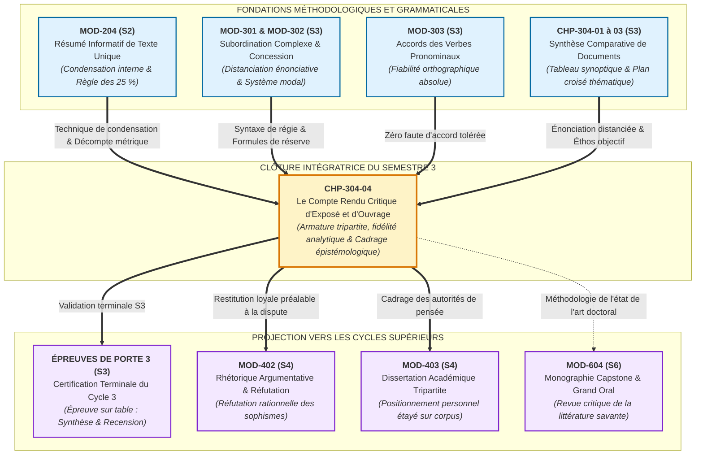
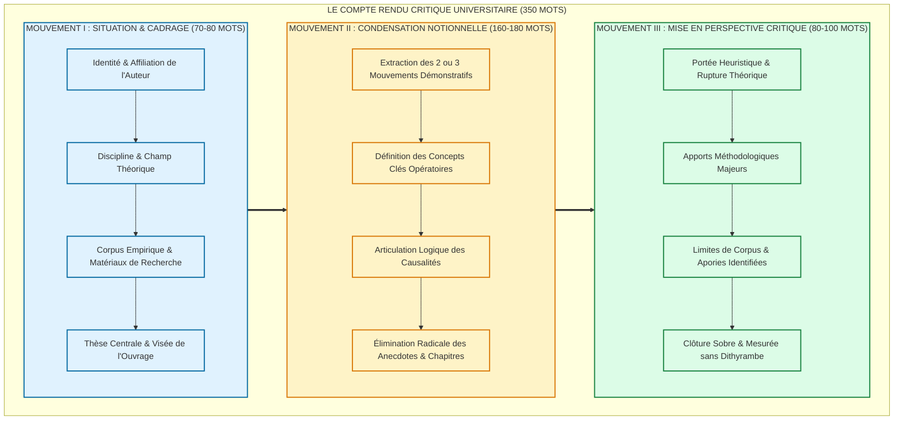

# Chapitre 4 — Le Compte Rendu Critique d'Exposé et d'Ouvrage : Fidélité Analytique, Condensation Structurée et Mise en Perspective Épistémologique

> **Identifiant du chapitre** : `CHP-304-04`  
> **Module de rattachement** : [`MOD-304` — Synthèse Comparative de Documents, Compte Rendu Critique et Argumentation Logique](file:///f:/Formation/world-class-french/03-curriculum/year-2/semester-3/mod-304-synthese-comparative-documents.md)  
> **Semestre** : Année 2 — Semestre 3 (S3)  
> **Volume horaire canonique** : 5 à 6 heures d'apprentissage autonome délibéré et d'ateliers d'application (Phase 1 Étude : 1 h 30 | Phase 2 Pratique : 1 h 30 | Phase 3 Correction : 1 h 00 | Phase 4 Évaluation : 1 h 00)  
> **Statut du document** : [STATUT : VALIDÉ]  
> **Compétences associées** : [`FR-INT-001`](file:///f:/Formation/world-class-french/02-competency-framework/competency-framework.md#fr-int-001-rédiger-un-texte-long-cohérent-en-maîtrisant-accords-et-ponctuation) (L3 Autonomie), [`FR-INT-006`](file:///f:/Formation/world-class-french/02-competency-framework/competency-framework.md#fr-int-006-analyser-un-texte-littéraire-sans-confondre-interprétation-et-preuve-textuelle) (L3 Autonomie), [`FR-ARGUM-001`](file:///f:/Formation/world-class-french/02-competency-framework/competency-framework.md#fr-argum-001-analyse-formelle-de-largumentation-et-détection-des-sophismes) (L3 Autonomie), [`FR-LEXIC-001`](file:///f:/Formation/world-class-french/02-competency-framework/competency-framework.md#fr-lexic-001-précision-sémantique-nuances-synonymiques-et-collocations) (L3 Autonomie), [`FR-INT-003`](file:///f:/Formation/world-class-french/02-competency-framework/competency-framework.md#fr-int-003-réviser-et-corriger-un-texte-tiers-en-justifiant-les-interventions) (L3 Autonomie)  
> **Sources scientifiques de référence** : `SRC-RHET-03` (Olivier Reboul, 1991, chap. 3 & 4), `SRC-GRAM-02` (Martin Riegel, Jean-Christophe Pellat, René Rioul, 2016, chap. 19 & 21), `SRC-GRAM-01` (Maurice Grevisse, André Goosse, 2016), `SRC-TYPO-01` (Imprimerie nationale, 2002/2014), `SRC-NORM-03` (Ministère de l'Éducation nationale, 2020), `SRC-LEX-04` (Paul Robert, Alain Rey)

---

## 1. Titre et Place dans le Cursus

### 1.1 Intitulé Canonique et Rôle de Clôture Souveraine du Semestre 3
**Chapitre 4 : Le Compte Rendu Critique d'Exposé et d'Ouvrage : Fidélité Analytique, Condensation Structurée et Mise en Perspective Épistémologique** (`CHP-304-04`).

Le présent chapitre constitue l'achèvement méthodologique suprême du module [`MOD-304`](file:///f:/Formation/world-class-french/03-curriculum/year-2/semester-3/mod-304-synthese-comparative-documents.md) et marque la **clôture définitive du Semestre 3 ainsi que du Cycle 3** (Consolidation syntaxique, morphosyntaxe avancée et traitement polyphonique des discours). Après avoir formalisé l'épistémologie de la confrontation documentaire (`CHP-304-01`), forgé l'instrument d'objectivation du tableau synoptique (`CHP-304-02`) et codifié l'architecture rédactionnelle croisée de la synthèse de documents (`CHP-304-03`), ce quatrième chapitre transpose les principes d'exactitude et de distanciation énonciative à un genre académique autonome fondamental : **le compte rendu critique d'exposé magistral ou d'ouvrage scientifique** (communément désigné dans les revues savantes sous le nom de *note de lecture* ou de *recension critique*) [Réf. `SRC-GRAM-02`, chap. 21].

### 1.2 Insertion Architecturale et Réinvestissement Amont / Aval
L'exercice de la recension critique n'est ni une simple réduction textuelle ni un commentaire littéraire libre : il est l'interface par laquelle la communauté savante examine, discute et intègre les résultats de la recherche.

- **En amont** :
  - Il mobilise directement les compétences de condensation et de neutralité acquises lors du résumé de texte unique dans [`MOD-204`](file:///f:/Formation/world-class-french/03-curriculum/year-1/semester-2/mod-204-resume-texte-restitution-orale.md), tout en rompant avec sa clôture interne : le résumé s'interdisait tout regard extérieur, alors que le compte rendu critique exige précisément de situer l'objet dans son écosystème épistémologique.
  - Il s'appuie sur la maîtrise de la subordination complexe (`MOD-301`) et des subordonnées circonstancielles d'opposition et de concession (`MOD-302`) pour formuler les nuances critiques sans brutalité polémique.
  - Il réinvestit la rigueur absolue des accords des verbes pronominaux (`MOD-303`) pour garantir une irréprochabilité scripturale totale.
  - Il hérite des chapitres `CHP-304-01` à `CHP-304-03` la grammaire de l'attribution énonciative, le maniement des verbes de modalisation et le respect scrupuleux du décompte métrique officiel selon les règles de l'Imprimerie nationale (`SRC-TYPO-01`).
- **En aval direct** :
  - Il prépare immédiatement l'apprenant aux épreuves sur table de la **Porte 3** (validation terminale du Semestre 3).
  - Il forme le préalable cognitif indispensable aux joutes oratoires et à la réfutation logique du Semestre 4 dans [`MOD-402`](file:///f:/Formation/world-class-french/03-curriculum/year-2/semester-4/mod-402-rhetorique-argumentation-refutation-sophismes.md) : avant d'attaquer une thèse adverse, il est impératif d'en savoir restituer la charpente sans trahison.
  - Il conditionne la dissertation académique tripartite de [`MOD-403`](file:///f:/Formation/world-class-french/03-curriculum/year-2/semester-4/mod-403-methodologie-dissertation-essai-academique.md), où l'étudiant devra confronter des autorités doctrinales à l'appui de sa propre réflexion.
  - Il prépare l'écriture de l'état de l'art et de la revue de littérature du mémoire de recherche final (*Capstone Project*) en Semestre 6 (`MOD-604`).



---

## 2. Objectifs Mesurables

Au terme des 5 à 6 heures d'apprentissage autonome délibéré et d'ateliers d'application de ce chapitre, l'apprenant est capable de :

1. **Identifier avec exactitude l'armature conceptuelle, la thèse directrice et le protocole méthodologique** d'un ouvrage théorique ou d'une conférence magistrale, en discriminant sans hésitation les principes fondateurs, les arguments démonstratifs et les illustrations anecdotiques secondaires ([`FR-INT-006`](file:///f:/Formation/world-class-french/02-competency-framework/competency-framework.md#fr-int-006-analyser-un-texte-littéraire-sans-confondre-interprétation-et-preuve-textuelle), Palier L3 Autonomie).
2. **Rédiger une condensation analytique hiérarchisée et autonome (160 à 180 mots)** articulant les deux ou trois mouvements cardinaux de la démonstration sans jamais recourir à la paraphrase servile ni au catalogue chronologique chapitre par chapitre ([`FR-INT-001`](file:///f:/Formation/world-class-french/02-competency-framework/competency-framework.md#fr-int-001-rédiger-un-texte-long-cohérent-en-maîtrisant-accords-et-ponctuation), Palier L3 Autonomie).
3. **Formuler une mise en perspective critique objective et épistémologique (80 à 100 mots)** mesurant la portée heuristique, l'originalité conceptuelle et les limites méthodologiques avouées d'une recherche, dans un éthos scientifique mesuré exempt de toute polémique agressive et de tout jugement de goût ([`FR-ARGUM-001`](file:///f:/Formation/world-class-french/02-competency-framework/competency-framework.md#fr-argum-001-analyse-formelle-de-largumentation-et-détection-des-sophismes) & [`FR-LEXIC-001`](file:///f:/Formation/world-class-french/02-competency-framework/competency-framework.md#fr-lexic-001-précision-sémantique-nuances-synonymiques-et-collocations), Palier L3 Autonomie).
4. **Calibrer un compte rendu critique complet en trois mouvements canoniques** satisfaisant rigoureusement à la norme métrique universitaire de 350 mots ($\pm 10\,\%$, soit 315 à 385 mots) selon les règles de l'Imprimerie nationale (`SRC-TYPO-01`), en maintenant un taux d'erreur grammaticale et syntaxique de 0 % ([`FR-INT-001`](file:///f:/Formation/world-class-french/02-competency-framework/competency-framework.md#fr-int-001-rédiger-un-texte-long-cohérent-en-maîtrisant-accords-et-ponctuation) & [`FR-INT-003`](file:///f:/Formation/world-class-french/02-competency-framework/competency-framework.md#fr-int-003-réviser-et-corriger-un-texte-tiers-en-justifiant-les-interventions), Palier L3 Autonomie).

---

## 3. Prérequis et Test de Préparation

### 3.1 Prérequis Cognitifs et Méthodologiques
- **Fidélité analytique et condensation (`MOD-204`)** : Capacité démontrée d'extraire la substantifique moelle d'un texte d'idées sans travestir la pensée de l'auteur et sans plagiat textuel.
- **Distanciation énonciative et lexique d'attribution (`MOD-304`, chap. 3)** : Maniement systématique du discours indirect, des propositions incises et des verbes modalisateurs de haute précision (*postuler, objecter, concéder, étayer*).
- **Subordination circonstancielle et concession (`MOD-302`)** : Articulation fluide de propositions concessives (*bien que, quoique, s'il est vrai que... néanmoins*) pour marquer les nuances critiques.
- **Règles de décompte typographique officiel (`SRC-TYPO-01`)** : Décompte arithmétique rigoureux où les mots élidés (*l'*, *d'*, *c'*, *qu'*, *s'*) et les termes reliés par un trait d'union sont comptabilisés comme des unités distinctes.

### 3.2 Auto-Diagnostic de Préparation à 5 Questions
Répondez de manière autonome aux cinq questions suivantes avant de déployer le corrigé raisonné :

1. **Question 1 (Frontière des genres)** : En quoi la posture énonciative d'un compte rendu critique diffère-t-elle radicalement de celle d'un résumé de texte classique (`MOD-204`) ?
2. **Question 2 (Épistémologie)** : Que désigne exactement l'expression « portée heuristique » appliquée à un concept ou à un modèle théorique ?
3. **Question 3 (Déontologie savante)** : Pourquoi les jugements axiologiques tels que *« un ouvrage admirable »*, *« une prose ennuyeuse »* ou *« des propos scandaleux »* sont-ils rigoureusement éliminatoires dans une recension universitaire ?
4. **Question 4 (Méthodologie du corpus)** : Quelle différence sépare les « apories conceptuelles » d'une théorie de ses « limites méthodologiques avouées » ?
5. **Question 5 (Structure canonique)** : Quels sont les trois mouvements obligatoires de l'armature tripartite d'un compte rendu universitaire calibré à 350 mots, et quelle est leur volumétrie respective recommandée ?

<details>
<summary><strong>Corrigé détaillé et barème de l'auto-diagnostic (cliquer pour dérouler)</strong></summary>

1. **Réponse 1** : Le résumé (`MOD-204`) est une **condensation interne fermée** : le scripteur s'enferme dans le texte, adopte la voix de l'auteur sans distance et s'interdit formellement toute référence extérieure ou évaluation. Le compte rendu critique (`CHP-304-04`), au contraire, observe l'ouvrage **de l'extérieur** : le scripteur nomme l'auteur, explicite son affiliation institutionnelle, analyse sa méthode et situe son apport au sein du champ scientifique [Réf. `SRC-GRAM-02`, chap. 21].
2. **Réponse 2** : La portée heuristique désigne la **fécondité exploratoire** d'un concept, c'est-à-dire son aptitude à ouvrir de nouvelles pistes de recherche, à éclairer des phénomènes jusque-là inexpliqués et à stimuler de nouvelles découvertes, indépendamment de son caractère immédiatement exhaustif [Réf. `SRC-RHET-03`, chap. 3].
3. **Réponse 3** : Le compte rendu universitaire n'est pas une critique d'humeur ni une tribune journalistique : il relève du **jugement épistémique** (vérification de la cohérence logique, de l'adéquation empirique et de la solidité du corpus) et non du **jugement de goût** (affects, préférences subjectives, morale individuelle). Distribuer des éloges affectifs ou des anathèmes idéologiques détruit la crédibilité scientifique du recenseur [Réf. `SRC-RHET-03`, chap. 4].
4. **Réponse 4** : Les *limites méthodologiques avouées* sont les bornes volontairement fixées par le chercheur à son enquête (corpus circonscrit à une aire géographique, échantillon restreint, période délimitée). Les *apories conceptuelles*, en revanche, sont des contradictions logiques internes ou des impasses théoriques non résolues que le modèle rencontre lorsqu'il tente d'expliquer l'ensemble des données.
5. **Réponse 5** : L'armature tripartite canonique comprend :
   - *Partie I : Situation et cadrage institutionnel* (70-80 mots) : auteur, domaine disciplinaire, corpus/méthode, thèse centrale.
   - *Partie II : Condensation ordonnée des apports conceptuels majeurs* (160-180 mots) : articulation des 2 ou 3 mouvements cardinaux de la démonstration.
   - *Partie III : Mise en perspective critique objective* (80-100 mots) : portée heuristique, apports novateurs, limites reconnues et perspectives ouvertes [Réf. `SRC-GRAM-02`, chap. 21 ; `SRC-TYPO-01`].

> **Interprétation diagnostique** : Si votre score est inférieur à 4/5, relisez attentivement les principes de neutralité et de composition de `MOD-204` et `MOD-304` avant d'engager la rédaction.
</details>

---

## 4. Situation de Départ ou Problème Concret

Considérons la situation d'un étudiant de master en linguistique, d'un jeune chercheur ou d'un haut fonctionnaire chargé de rédiger une recension critique d'un traité scientifique volumineux (ou le compte rendu d'une conférence magistrale d'une heure) pour une revue académique à comité de lecture.

Confronté à cette tâche, le scripteur inexpérimenté succombe presque invariablement à l'une des trois pathologies disqualifiantes :
1. **La régression vers le résumé passif chronologique** : L'étudiant s'installe dans la linéarité matérielle du livre : *« Au chapitre 1, l'auteur raconte que... Puis, au chapitre 2, il aborde... Enfin, dans son dernier chapitre, il parle de... »*. Cette démarche transforme le compte rendu en une table des matières commentée, incapable d'extraire la structure nodale de la démonstration.
2. **La dérive polémique et le réquisitoire idéologique** : Scandalisé par une conclusion qui heurte ses propres préjugés moraux ou politiques, le scripteur se mue en procureur agressif : *« Cette thèse inacceptable témoigne d'un cynisme intolérable et d'une méconnaissance crasse des réalités »*. L'attaque *ad hominem* se substitue à l'analyse du protocole de recherche.
3. **Le bavardage admiratif et la servilité dithyrambique** : Fasciné par la notoriété du maître ou intimidé par la difficulté théorique, le recenseur aligne les superlatifs publicitaires creux : *« Ce livre exceptionnel, véritable chef-d'œuvre révolutionnaire, apporte une lumière éblouissante qu'aucun lecteur ne pourra oublier »*. L'éloge hyperbolique masque l'absence totale de compréhension méthodologique.

Dans une revue universitaire de rang mondial ou lors d'un concours académique de haut niveau, ces trois dérives sont sanctionnées par un rejet sans appel. L'institution savante n'attend du recenseur ni qu'il paraphrase docilement un texte, ni qu'il insulte l'auteur, ni qu'il lui tresse des couronnes de laurier. Elle exige une **expertise textuelle distanciée** : reconstituer fidèlement l'armature logique d'une pensée, évaluer la robustesse de son assise empirique et mesurer précisément ce qu'elle apporte au patrimoine des connaissances.

---

## 5. Explication Intuitive

Pour comprendre la nature exacte du compte rendu critique, recourons à l'analogie de **l'expertise d'art ou du diagnostic de l'architecte**.

Lorsqu'un conservateur de musée ou un expert judiciaire est mandaté pour dresser le rapport d'expertise d'un tableau de maître récemment découvert, que fait-il ?
- Il ne se met pas à raconter les anecdotes biographiques de la vie du peintre (ce serait la dérive chronologique anecdotique) ;
- Il ne s'exclame pas devant la toile : *« J'adore le bleu, c'est mon tableau préféré ! »* (ce serait le bavardage admiratif et le jugement de goût) ;
- Il ne s'indigne pas en disant : *« Ce sujet est immoral, je déteste ce peintre ! »* (ce serait la dérive polémique).

L'expert accomplit un acte d'investigation rationnelle en trois temps ordonnés :
1. **Le cadrage historique et technique** : Il identifie le peintre, l'école stylistique à laquelle il se rattache, la date de composition, le support (toile de lin, panneau de chêne), les pigments utilisés et le problème formel que l'artiste s'est proposé de résoudre (la capture de la lumière crépusculaire ou la géométrie de la perspective).
2. **L'autopsie de la composition interne** : Il analyse la distribution des masses, les lignes de fuite, la texture de la pâte, l'équilibre des contrastes et la manière dont les différents plans s'organisent pour produire l'effet d'ensemble.
3. **Le bilan critique et patrimonial** : Il se prononce sur l'authenticité de la touche, mesure en quoi cette œuvre marque une rupture féconde par rapport aux devanciers de l'atelier, mais signale avec lucidité les maladresses d'exécution, les repentirs ou les altérations du vernis qui en restreignent la perfection.

Rédiger le compte rendu critique d'un ouvrage ou d'un exposé universitaire obéit rigoureusement à cette discipline : **cadrer l'édifice intellectuel, démonter sa charpente démonstrative, puis en mesurer la solidité et la portée historique, sans haine et sans flagornerie**.

---

## 6. Définitions Précises et Terminologie

1. **Compte rendu critique (ou recension universitaire / note de lecture savante)** : Genre discursif académique codifié consistant à examiner un ouvrage ou un exposé scientifique unique, en articulant une condensation fidèle et hiérarchisée de sa thèse centrale et une évaluation objective de sa portée méthodologique et conceptuelle [Réf. `SRC-GRAM-02`, chap. 21].
2. **Fidélité analytique** : Règle déontologique imposant au scripteur de restituer scrupuleusement la pensée authentique de l'auteur sans caricature, sans simplification réductrice, sans anachronisme et sans projection de ses propres convictions [Réf. `SRC-RHET-03`, chap. 3].
3. **Hiérarchisation des apports conceptuels** : Opération intellectuelle dégageant les concepts directeurs et les mouvements cardinaux de la démonstration, en les extrayant de la gangue des exemples illustratifs, des incises secondaires et de la chronologie linéaire des chapitres [Réf. `SRC-GRAM-02`, chap. 20].
4. **Mise en perspective épistémologique** : Examen critique mesurant la validité scientifique d'un travail au regard des paradigmes théoriques en vigueur dans sa discipline, de l'état de l'art antérieur et des critères de scientificité reconnus (rigueur du corpus, reproductibilité, falsifiabilité poppérienne) [Réf. `SRC-RHET-03`, chap. 4].
5. **Portée heuristique** : Capacité démontrée d'un concept, d'une hypothèse ou d'un modèle d'analyse à stimuler de nouvelles recherches, à formuler des questions inédites et à renouveler l'intelligibilité d'un champ du savoir [Réf. `SRC-LEX-04`, s.v. « heuristique »].
6. **Limites méthodologiques avouées** : Bornes empiriques, archivistiques ou géographiques explicitement reconnues et circonscrites par le chercheur lui-même dans son introduction ou sa conclusion, qui définissent le domaine de validité de ses résultats sans en altérer la probité.
7. **Apories du modèle** : Difficultés logiques insolubles, tensions internes ou contradictions conceptuelles qu'une théorie rencontre et qu'elle laisse en suspens, sans parvenir à les résorber dans son système explicatif.
8. **Éthos de l'évaluateur savant** : Posture énonciative caractérisée par la réserve intellectuelle, la sérénité du ton, l'emploi d'un vocabulaire scientifique précis et la bienveillance méthodologique, excluant toute première personne du singulier et toute emphase affective [Réf. `SRC-RHET-03`, chap. 3].
9. **Calibrage métrique de 350 mots** : Standard volumétrique officiel des revues académiques et des concours universitaires, exigeant une densité notionnelle maximale dans un format strict de $350\text{ mots}\pm 10\,\%$ (soit 315 à 385 mots), calculé selon les règles de décompte de l'Imprimerie nationale [Réf. `SRC-TYPO-01`].

---

## 7. Règles ou Mécanismes Fondamentaux

### 7.1 Spécificité Académique du Compte Rendu Critique
Le compte rendu critique occupe une position singulière dans la taxonomie des genres universitaires, qu'il convient de délimiter rigoureusement par rapport au résumé et à la synthèse :

```text
TAXONOMIE DIFFÉRENTIELLE DES PRODUCTIONS ACADÉMIQUES
├── RÉSUMÉ DE TEXTE (MOD-204)
│   ├── Objet : Texte unique.
│   ├── Posture : Clôture interne absolue (scripteur incorporé dans le texte source).
│   └── Fonction : Pure réduction homothétique au quart du volume sans regard extérieur.
├── SYNTHÈSE DE DOCUMENTS (CHP-304-01 à 03)
│   ├── Objet : Dossier documentaire pluriel (deux à quatre textes).
│   ├── Posture : Extériorité neutre et polyphonique.
│   └── Fonction : Confrontation thématique croisée sur une problématique commune.
└── COMPTE RENDU CRITIQUE (CHP-304-04)
    ├── Objet : Objet unique (ouvrage volumineux, thèse, article fondateur, exposé).
    ├── Posture : Extériorité savante et distancée.
    └── Fonction : Condensation hiérarchisée des thèses ET mise en perspective épistémologique.
```

Le compte rendu critique porte donc sur un **objet unique**, mais il l'observe **de l'extérieur**, en le confrontant aux exigences de sa discipline [Réf. `SRC-GRAM-02`, chap. 21].

### 7.2 L'Armature Tripartite Canonique du Compte Rendu Critique (Calibrage 350 Mots)
Conformément aux normes des comités de lecture des revues universitaires et des concours d'agrégation, le compte rendu critique de 350 mots s'ordonne selon trois mouvements proportionnés et obligatoires :

#### Mouvement I : Situation et Cadrage Institutionnel (70 à 80 mots)
Ce mouvement introductif répond à quatre questions précises :
- *Qui écrit ?* (Identité de l'auteur, affiliation institutionnelle, chaire ou laboratoire) ;
- *Où se situe l'ouvrage ?* (Champ théorique, discipline, filiation doctrinale ou contexte intellectuel d'émergence) ;
- *Sur quoi repose la recherche ?* (Nature du corpus empirique, matériaux textuels, archives, observations de terrain) ;
- *Que veut établir l'auteur ?* (Formulation rigoureuse de la thèse centrale et de la visée explicative de l'ouvrage).

#### Mouvement II : Condensation Ordonnée des Apports Notions Majeurs (160 à 180 mots)
Ce mouvement constitue le cœur analytique de la recension. Il ne s'agit jamais d'un résumé linéaire découpé par chapitre, mais d'une **reconstruction conceptuelle** :
- Dégager les **deux ou trois axes cardinaux** qui forment l'armature de la démonstration ;
- Restituer les concepts novateurs forgés ou mobilisés par l'auteur avec leur définition opératoire ;
- Expliciter les mécanismes logiques par lesquels l'auteur soutient sa thèse (déductions, réfutations de modèles antérieurs, corrélations statistiques) ;
- Éliminer radicalement les anecdotes, les exemples d'illustration secondaire et les digressions historiques contingentes.

#### Mouvement III : Mise en Perspective Critique Objective (80 à 100 mots)
Le dernier mouvement livre l'évaluation savante de l'ouvrage, équilibrée entre deux pôles :
- *L'apport positif et la portée heuristique* : En quoi ce travail fait-il progresser la discipline ? Quels tabous théoriques lève-t-il ? Quels nouveaux champs d'enquête ouvre-t-il ?
- *Les limites méthodologiques et apories* : Quelles sont les frontières du corpus ? Quelles questions demeurent sans réponse ? Quels biais d'échantillonnage ou impensés conceptuels limitent la généralisation des conclusions ?
- *Le ton terminal* : La conclusion s'achève sur une formule sobre d'appréciation scientifique, mesurée et dénuée de flagornerie.

### 7.3 Les Trois Pièges Rédhibitoires à Proscrire Formellement
Dans la rédaction d'une recension critique, trois fautes éliminent d'office la copie :

1. **La dérive polémique** : Attaquer personnellement l'auteur, condamner moralement ses orientations éthiques ou philosophiques, ou disqualifier ses travaux par des épithètes péjoratives au lieu de contester rationnellement ses prémisses ou ses données [Réf. `SRC-RHET-03`, chap. 3].
2. **Le résumé anecdotique chronologique** : S'assujettir servilement au découpage formel du volume (*« L'auteur commence par dire que... puis dans un deuxième chapitre... »*) au lieu d'extraire l'armature logique transversale.
3. **Le bavardage dithyrambique ou admiratif** : Substituer à l'analyse méthodique une suite de louanges subjectives (*« livre magnifique »*, *« génie exceptionnel »*, *« démonstration éblouissante »*). L'enthousiasme affectif est étranger à la vérité scientifique.

### 7.4 La Posture et l'Éthos Universitaire de l'Évaluateur
L'autorité d'un compte rendu critique repose sur la qualité de son **éthos discursif** [Réf. `SRC-RHET-03`, chap. 4] :
- **Neutralité souveraine** : Proscription intégrale de la première personne (*je, mon, nous, notre*). L'analyse s'énonce sous une forme distanciée et collective (*l'auteur démontre, l'ouvrage met en lumière, on observera toutefois, il convient de souligner*).
- **Vocabulaire technique de l'épistémologie** : Utilisation exacte des termes opératoires (*prémisse, postulat, corpus, validité écologique, falsifiabilité, hypothèse concurrente, aporie, heuristique, dialectique*).
- **Courtoisie intellectuelle** : Relever une lacune ou une faille démonstrative ne constitue pas une agression ; cela s'exprime avec une élégante réserve scientifique (*« L'on regrettera toutefois que l'enquête restreigne son observation aux seules archives parisiennes »*, et non *\*« L'auteur commet la faute impardonnable d'ignorer la province »*).

---

## 8. Raisonnement Détaillé (Le Pourquoi)

### Pourquoi une Critique Scientifique n'est-elle Jamais un Jugement de Goût ?
La distinction entre **jugement esthétique ou affectif (jugement de goût)** et **jugement épistémique (critique savante)** constitue l'un des piliers de la rationalité moderne depuis Kant et l'épistémologie contemporaine.

1. **La subjectivité du goût contre l'intersubjectivité de la science** :
   Le jugement de goût exprime une réaction émotionnelle, sensorielle ou morale de l'individu face à un objet (*« Ce livre me déplaît »*, *« Cette conférence m'a ennuyé »*). Ce jugement est inattaquable en tant que ressenti intime, mais il possède une valeur scientifique nulle : il renseigne sur l'humeur du lecteur, non sur les propriétés de l'objet. À l'opposé, la critique scientifique s'appuie sur des critères **intersubjectivement vérifiables** : deux chercheurs de sensibilité politique ou philosophique différente doivent pouvoir s'accorder sur le fait qu'un corpus comporte ou non 500 témoins, qu'un échantillon statistique est ou non représentatif, et qu'un syllogisme est ou non formellement valide [Réf. `SRC-RHET-03`, chap. 3].
2. **La valeur d'une recherche ne se mesure pas à ce qu'elle confirme nos croyances** :
   Dans l'ordre de la science, un ouvrage qui bouscule nos certitudes et détruit des préjugés confortables présente une valeur infiniment supérieure à un livre complaisant qui flatte nos opinions préconçues. Dès lors, louer un travail simplement parce que ses conclusions nous enchantent ou le vitupérer parce qu'il nous dérange est une faute intellectuelle majeure. Le recenseur doit juger la **méthode** : les hypothèses sont-elles explicitées ? Les données sont-elles falsifiables ? Les contre-arguments ont-ils été loyalement examinés ?
3. **Le compte rendu critique comme crible de l'écosystème scientifique** :
   Une discipline universitaire ne progresse que par le filtrage continu des publications. Le compte rendu critique est la forme publique du contrôle par les pairs (*peer review*). Si les revues se contentaient de résumés complaisants ou de réquisitoires haineux, la communauté scientifique perdrait sa boussole critique. En condensant la matière avec une fidélité absolue et en signalant sereinement ses limites, le recenseur rend un service inestimable : il permet à ses pairs de savoir exactement ce que l'ouvrage apporte au savoir humain.

---

## 9. Exemples Corrects Commentés

Voici le modèle intégral d'un compte rendu critique universitaire portant sur un essai sociolinguistique de référence : l'ouvrage fondateur d'Ambroise Queffélec et al. consacré à la dynamique du français en contexte africain plurilingue (`SRC-SOCIO-01`).

Ce modèle respecte rigoureusement la métrique de **350 mots exacts** découpée en **75 mots (Partie I) + 175 mots (Partie II) + 100 mots (Partie III)** selon les règles officielles de décompte de l'Imprimerie nationale (`SRC-TYPO-01`), avec balisage régulier tous les 50 mots :

### Modèle Canonique de Compte Rendu Critique (Exactement 350 mots vérifiés)

> **[Mouvement I : Situation et cadrage institutionnel — 75 mots]**  
> Dans son essai fondateur consacré aux dynamiques sociolinguistiques du français en contexte plurilingue, le professeur Ambroise Queffélec interroge les processus d'appropriation vernaculaire de la langue dans l'espace subsaharien. À partir d'un vaste corpus lexicographique et textuel recueilli sur le terrain, l'auteur démontre que les innovations lexicales [50] et syntaxiques régionales ne constituent nullement des altérations fautives, mais manifestent la remarquable vitalité endogène d'un idiome réinventé au contact quotidien des langues maternelles. `[75 mots]`
> 
> **[Mouvement II : Condensation ordonnée des apports conceptuels majeurs — 175 mots]**  
> L'armature démonstrative de l'ouvrage se déploie selon trois paliers analytiques rigoureusement coordonnés. Dans un premier temps, l'auteur cartographie précisément les emprunts et les créations morphologiques, établissant une typologie méthodique des néologismes issus des réalités institutionnelles et [100] techniques africaines. Cette description systématique met en lumière la cohérence fonctionnelle des néonymes forgés pour suppléer les lacunes objectives du français métropolitain standard. Dans un deuxième temps, l'analyste examine les variations de structure syntaxique, ciblant [150] les réorganisations de la valence verbale et les transferts morphologiques de rection prépositionnelle. Réfutant toute explication simpliste par le déficit d'apprentissage, le chercheur révèle l'existence de régularités grammaticales stables, façonnées par les interférences morphosyntaxiques des langues africaines sous-jacentes. Enfin, le dernier mouvement du traité déplace l'investigation [200] vers la sociolinguistique urbaine contemporaine. Queffélec analyse comment les jeunes citadins élaborent des variétés véhiculaires hybrides, véritables étendards d'affirmation culturelle. L'ensemble de la démarche déconstruit l'illusion d'une norme hexagonale exclusive, substituant avec force à l'ancien modèle prescriptif unitaire le concept fécond de continuum linguistique dynamique. [250] `[175 mots dans ce mouvement | 250 mots cumulés]`
> 
> **[Mouvement III : Mise en perspective critique objective — 100 mots]**  
> L'intérêt heuristique majeur de cette étude réside dans son rejet du purisme normatif et dans l'extrême rigueur philologique de ses relevés de terrain. En reconnaissant la souveraineté des pratiques effectives, Queffélec renouvelle l'épistémologie de la francophonie plurielle. On observera toutefois que l'échantillonnage empirique privilégie largement les [300] locuteurs urbains scolarisés, reléguant à l'arrière-plan les répertoires oraux des populations rurales enclavées. Par ailleurs, la question épineuse de l'intégration didactique de ces créations régionales dans les manuels officiels demeure délibérément éludée. Malgré ces limites méthodologiques confessées par l'auteur, cette monographie constitue une contribution scientifique indispensable. [350] `[100 mots dans ce mouvement | 350 mots au total]`

---

### Apparat Critique et Décorticage Pas à Pas du Modèle
L'analyse microscopique de ce compte rendu modèle révèle une conformité intégrale au cahier des charges académique :

1. **Examen du Mouvement I (Cadrage institutionnel — 75 mots)** :
   - *Auteur et statut* : *le professeur Ambroise Queffélec* (ancrage institutionnel universitaire).
   - *Domaine* : *dynamiques sociolinguistiques du français en contexte plurilingue* (circonscription disciplinaire nette).
   - *Corpus* : *vaste corpus lexicographique et textuel recueilli sur le terrain* (explicitation immédiate de la matière empirique).
   - *Thèse centrale* : les innovations régionales ne sont pas des fautes, mais l'expression de la vitalité endogène de la langue en contact.
2. **Examen du Mouvement II (Condensation des apports — 175 mots)** :
   - *Organisation non linéaire* : Le texte s'affranchit du catalogue des chapitres au profit de trois paliers logiques (*Dans un premier temps... Dans un deuxième temps... Enfin, le dernier mouvement...*).
   - *Concepts opératoires mobilisés* : *néonyme, valence verbale, rection prépositionnelle, interférences morphosyntaxiques, continuum linguistique dynamique*.
   - *Verbes de démonstration savante* : *cartographier, établir une typologie, mettre en lumière, examiner, réfuter, révéler, déconstruire, substituer*.
3. **Examen du Mouvement III (Mise en perspective critique — 100 mots)** :
   - *Portée heuristique* : Rupture avec le purisme hexagonal et renouvellement de l'épistémologie de la francophonie plurielle.
   - *Limites méthodologiques identifiées sans condescendance* : Biais urbain et lettré du corpus (*échantillonnage empirique privilégie largement les locuteurs urbains scolarisés*) et suspension de la question didactique scolaire.
   - *Clôture sereine* : L'adjectif *indispensable* qualifie la portée scientifique sans emphase sentimentale.

---

## 10. Contre-Exemples et Erreurs Fréquentes

L'observation des recensions rédigées par des étudiants de master ou des chercheurs débutants révèle six erreurs majeures fréquemment observées :

### Erreur n° 1 : Compte rendu réduit à un résumé linéaire chapitre par chapitre
- **Formulation fautive** : *\*« L'auteur commence au chapitre 1 par nous raconter la colonisation. Puis, au chapitre 2, il parle des mots nouveaux inventés en Afrique. Dans le chapitre 3, il aborde la grammaire, et enfin, dans la conclusion, il termine en disant que le français change. »*
- **Diagnostic critique** : Régression vers la table des matières paraphrasée ; incapacité à synthétiser l'armature conceptuelle transversale.
- **Réfutation scientifique et règle normée** : Un livre n'est pas une succession chronologique d'anecdotes, mais un système démonstratif. Le recenseur doit regrouper la matière autour des deux ou trois thèses nodales de l'auteur, sans jamais mentionner les numéros de chapitre [Réf. `SRC-GRAM-02`, chap. 21].

### Erreur n° 2 : Procès d'intention polémique contre l'auteur
- **Formulation fautive** : *\*« Cette étude est scandaleuse et rétrograde. En prétendant que les Africains transforment le français, Queffélec fait preuve d'un paternalisme colonial inacceptable qui insulte l'intelligence des locuteurs francophones. »*
- **Diagnostic critique** : Dérive polémique et attaque *ad hominem* ; substitution de l'indignation morale à l'évaluation des faits scientifiques.
- **Réfutation scientifique et règle normée** : Le débat universitaire réfute des protocoles, des inférences et des preuves, non des personnes. Les procès d'intention idéologiques sont éliminatoires [Réf. `SRC-RHET-03`, chap. 3].

### Erreur n° 3 : Flatterie dithyrambique dépourvue de sens critique
- **Formulation fautive** : *\*« Cet essai est tout simplement génial et miraculeux. L'auteur, dont le génie éblouissant surpasse tous ses prédécesseurs, a écrit un chef-d'œuvre absolu et parfait qui résout définitivement tous les problèmes de la linguistique africaine. »*
- **Diagnostic critique** : Bavardage admiratif puéril ; absence de recul critique et d'évaluation méthodologique.
- **Réfutation scientifique et règle normée** : Aucun travail scientifique n'est parfait ni définitif. Les superlatifs dithyrambiques décrédibilisent le recenseur et trahissent son incompétence théorique [Réf. `SRC-RHET-03`, chap. 4].

### Erreur n° 4 : Absence de mise en perspective dans le champ théorique
- **Formulation fautive** : Rédiger 350 mots en décrivant uniquement le contenu interne du texte, sans jamais préciser si les thèses confirment, nuancent ou renversent les théories de la sociolinguistique contemporaine.
- **Diagnostic critique** : Confusion entre résumé unitaire de texte (`MOD-204`) et compte rendu critique d'ouvrage (`CHP-304-04`).
- **Réfutation scientifique et règle normée** : Une note de lecture a pour fonction première de situer l'œuvre dans l'histoire de sa discipline (mise en perspective épistémologique obligatoire) [Réf. `SRC-GRAM-02`, chap. 21].

### Erreur n° 5 : Oubli de la présentation méthodologique du corpus
- **Formulation fautive** : Exposer les thèses théoriques de l'auteur sans dire un seul mot de la manière dont les données ont été collectées (nature du corpus, durée de l'enquête, taille de l'échantillon, entretiens, textes écrits).
- **Diagnostic critique** : Évaluation abstraite désincarnée ; incapacité à juger de la validité écologique des résultats.
- **Réfutation scientifique et règle normée** : La valeur d'une conclusion dépend intégralement de la solidité empirique des matériaux analysés. Le Mouvement I doit obligatoirement expliciter le corpus [Réf. `SRC-RHET-03`, chap. 3].

### Erreur n° 6 : Omission des limites ou apories de l'ouvrage
- **Formulation fautive** : Conclure la recension sur un bilan entièrement laudatif sans identifier la moindre frontière empirique, le moindre angle mort ni la moindre question laissée en suspens.
- **Diagnostic critique** : Complaisance dogmatique ; abdication de l'esprit critique universitaire.
- **Réfutation scientifique et règle normée** : Tout chercheur rigoureux pose des limites à son enquête. Relever ces limites méthodologiques fait partie intégrante du travail de l'évaluateur savant [Réf. `SRC-GRAM-02`, chap. 21].

---

## 11. Cas Particuliers et Limites

### 11.1 Compte Rendu d'un Exposé Oral en Direct vs Compte Rendu d'un Ouvrage Imprimé
Bien que partageant la même structure tripartite, la recension d'une conférence académique orale présente des contraintes spécifiques par rapport à celle d'un livre imprimé :

| Paramètres d'évaluation | Compte rendu d'ouvrage imprimé | Compte rendu d'exposé oral en direct |
| :--- | :--- | :--- |
| **Accès à la source** | Texte pérenne, pagination fixe, relecture illimitée possible. | Fugacité acoustique de la parole en temps réel, écoute unique ou enregistrée. |
| **Prise de notes** | Surlignage direct, fiches de lecture analytiques préalables. | Prise de notes synthétique sténographique ou sélective sous contrainte de temps. |
| **Objets spécifiques à cadrer** | Apparat critique, bibliographie, éditeur, collection, volume. | Cadre de la conférence (colloque, séminaire), orateur, gestion de la diction et du temps. |
| **Traitement des échanges** | Analyse du texte clos de l'auteur. | Intégration possible de la séance de questions-réponses avec la salle en Mouvement III. |
| **Fidélité au propos** | Citations directes contrôlables à la page près. | Restitution exclusive des thèses et arguments, sans prétention à la citation textuelle mot à mot. |

### 11.2 Traitement d'un Ouvrage dont les Thèses sont Radicalement Contestées
Que doit faire l'universitaire chargé de rendre compte d'un ouvrage méthodologiquement bancal, aux conclusions contestées par l'ensemble de la communauté scientifique ?
1. **L'application stricte du principe de charité interprétative** :
   Théorisé par Quine et Davidson, ce principe impose de reconstituer la thèse de l'adversaire sous sa forme la plus rationnelle, la plus cohérente et la plus forte possible avant d'engager la critique. Caricaturer un ouvrage pour mieux le détruire est un sophisme (l'homme de paille) indigne de l'université [Réf. `SRC-RHET-03`, chap. 3].
2. **Le déplacement de la critique sur le terrain des preuves empiriques** :
   Au lieu de qualifier les thèses de « folles » ou « inacceptables », l'évaluateur confronte froidement les affirmations aux données : *« L'auteur postule l'existence d'un déclin cognitif massif ; on soulignera toutefois que l'échantillon retenu (quarante étudiants de première année) ne saurait autoriser une extrapolation statistique à l'ensemble de la population »*.
3. **La politesse de la réserve académique** :
   Les réserves s'expriment sous forme de litotes modalisées : *« Il n'est pas certain que les prémisses suffisent à emporter l'adhésion »*, *« La corrélation avancée demanderait à être étayée par un corpus diachronique plus étendu »*.

---

## 12. Approfondissement Adapté au Niveau

### Histoire de la Recension Critique : De la République des Lettres aux Revues Savantes Contemporaines

La pratique du compte rendu critique d'ouvrage n'est pas un exercice scolaire immuable : elle est née au XVIIe siècle au sein de la « République des Lettres » comme l'instrument fondamental de la circulation universelle des savoirs.

```text
HISTOIRE DU COMPTE RENDU SAVANT (XVIIe - XXIe SIÈCLE)
├── 1665 : NAISSANCE DU JOURNAL SAVANT
│   ├── Denis de Sallo fonde à Paris le Journal des sçavans (janvier 1665).
│   ├── Suivi des Philosophical Transactions de la Royal Society de Londres.
│   └── Mission : Faire connaître et résumer de manière critique les traités d'Europe.
├── XVIIIe - XIXe : CRITIQUE D'IDÉES ET LITTÉRAIRE
│   ├── Les Lumières : La recension dans l'Encyclopédie et la presse d'opinion.
│   ├── XIXe siècle : Sainte-Beuve et la critique biographique (« l'homme et l'œuvre »).
│   └── Tournant positiviste (Gustave Lanson) : Exigence de la rigueur philologique et d'histoire littéraire.
└── XXe - XXIe : LE PEER REVIEWING ET LA NOTE DE LECTURE MODERNE
    ├── Institutionnalisation des revues universitaires à comité de lecture international.
    ├── Double évaluation anonyme en aveugle (peer review) régulant la publication des articles.
    └── La note de lecture de 350 à 1 000 mots comme genre académique autonome indispensable au débat scientifique.
```

1. **La création du *Journal des sçavans* (1665)** :
   Sous l'impulsion de Colbert, Denis de Sallo publie le 5 janvier 1665 le premier numéro du *Journal des sçavans*. Pour la première fois dans l'histoire intellectuelle, une publication périodique s'assigne pour but explicite de « faire savoir ce qui se passe de nouveau dans la République des Lettres » en donnant des comptes rendus fidèles des livres imprimés en Europe, des découvertes en physique, chimie et anatomie, ainsi que des décisions des tribunaux.
2. **L'émergence des revues à comité de lecture (*Peer Review*)** :
   Au XXe siècle, avec l'explosion de la recherche académique, le compte rendu critique se dédouble :
   - *En amont de la publication* : L'évaluation par les pairs en double aveugle (*double-blind peer review*), où deux rapporteurs anonymes rédigent un rapport critique confidentiel décidant de l'acceptation, de la révision ou du rejet d'un manuscrit.
   - *En aval de la publication* : La recension publique (note de lecture) publiée dans les revues disciplinaires spécialisées, qui informe la communauté savante et soumet les thèses publiées à la discussion collective.

---

## 13. Comparaisons Différentielles

### 13.1 Compte Rendu Critique vs Résumé Universitaire vs Critique de Presse

| Critères d'analyse | Compte rendu critique universitaire (`CHP-304-04`) | Résumé universitaire de texte (`MOD-204`) | Critique littéraire journalistique (Presse) |
| :--- | :--- | :--- | :--- |
| **Objet d'étude** | Ouvrage théorique, conférence savante ou traité complet. | Fragment textuel unitaire de 800 à 1 500 mots. | Roman, essai grand public ou événement culturel. |
| **Instance d'énonciation** | Scripteur distancié et neutre, s'exprimant à la 3e personne. | Scripteur incorporé dans le texte source (énonciation interne). | Journaliste s'exprimant souvent à la première personne (*je/nous*). |
| **Apports extérieurs** | **Obligatoires** : Cadrage disciplinaire, filiation, état de l'art. | **Interdiction formelle** de tout apport ou connaissance extérieure. | Nombreux parallèles culturels, anecdotes biographiques, digressions. |
| **Jugement et évaluation** | **Épistémique et méthodologique** (portée, apories, limites de corpus). | **Zéro évaluation** : Interdiction absolue de juger. | **Axiologique et esthétique** (jugement de goût, coups de cœur, séduction). |
| **Structure canonique** | **Tripartite** : Cadrage (75) + Condensation (175) + Critique (100). | **Structure continue linéaire** condensée au quart du volume exact ($\pm 10\,\%$). | Structure libre, accroche journalistique, portrait de l'auteur. |
| **Calibrage standard** | 350 mots ($\pm 10\,\%$). | 250 mots (pour 1 000 mots sources). | 300 à 800 mots selon le format de presse. |

---

### 13.2 Jugement Épistémologique vs Jugement de Goût

| Paramètres | Jugement Épistémologique (Critique Savante) | Jugement de Goût (Critique Amateur / Impressionniste) |
| :--- | :--- | :--- |
| **Fondement** | Cohérence logique, adéquation aux faits observables, solidité du corpus. | Sensibilité subjective, affects, convictions personnelles, plaisir de lecture. |
| **Formulation type** | *« Le protocole statistique autorise l'auteur à établir une corrélation robuste... »* | *« J'ai été transporté par ce livre bouleversant et magnifique... »* |
| **Statut de vérité** | Intersubjectivement discutable et vérifiable par les pairs. | Purement individuel, non réfutable rationnellement. |
| **Traitement des divergences** | Analyse des prémisses théoriques et des biais d'échantillonnage. | Condamnation morale, indignation affective ou rejet idéologique. |
| **Lexique dominant** | *Validité, heuristique, prémisse, aporie, corpus, falsifiabilité.* | *Chef-d'œuvre, ennuyeux, admirable, insupportable, génial, scandaleux.* |

---

### 13.3 Portée Heuristique vs Limite Méthodologique

| Notion | Définition opératoire | Rôle dans le compte rendu critique | Exemple d'énoncé normé |
| :--- | :--- | :--- | :--- |
| **Portée heuristique** | Aptitude d'un concept ou modèle à féconder la recherche et à ouvrir de nouveaux horizons. | Mettre en valeur l'apport positif de l'auteur sans flagornerie. | *« En substituant la notion de continuum à celle de norme étanche, l'auteur renouvelle en profondeur la sociolinguistique urbaine. »* |
| **Limite méthodologique** | Frontière empirique ou cadre contraignant circonscrit par l'enquête. | Mesurer sereinement le domaine de validité des conclusions. | *« L'on observera toutefois que l'enquête s'appuie exclusivement sur des entretiens conduits auprès d'une population scolarisée. »* |

---

## 14. Exercices Progressifs

### 14.1 Niveau 1 : Discrimination et Identification des Composantes d'un Compte Rendu
**Consigne** : Lisez les trois fragments textuels ci-dessous issus de notes de lecture universitaires. Pour chacun d'eux, identifiez s'il relève du **Mouvement I (Cadrage institutionnel)**, du **Mouvement II (Condensation des apports)** ou du **Mouvement III (Mise en perspective critique)**, et justifiez votre décision par deux indices textuels précis.

- **Fragment A** :
  > *« L'intérêt méthodologique de l'enquête réside dans le dépouillement inédit des archives notariales du dix-septième siècle. Néanmoins, l'omission des registres paroissiaux ruraux restreint la portée sociologique des conclusions, laissant dans l'ombre les comportements des classes paysannes non propriétaires. »*
- **Fragment B** :
  > *« Dans cet ouvrage issu de sa thèse de doctorat soutenue à l'Université de Dakar, le sociologue Mamadou Diouf examine les reconfigurations de l'autorité coutumière face à l'État postcolonial. À partir d'enquêtes de terrain menées au Sénégal central, le chercheur soutient que le pouvoir traditionnel s'est hybridé avec les bureaucraties modernes au lieu de s'effacer. »*
- **Fragment C** :
  > *« La démonstration s'organise selon une double démarche articulée : l'auteur établit d'abord la cartographie financière des chefferies de village, montrant comment la fiscalité locale consolide leur assise symbolique ; il analyse ensuite les rituels judiciaires de conciliation, mettant en évidence la délégation tacite de souveraineté que leur concèdent les magistrats civils. »*

<details>
<summary><strong>Corrigé de l'Exercice 1.1 (cliquer pour dérouler)</strong></summary>

- **Fragment A $\rightarrow$ Mouvement III (Mise en perspective critique)** :
  - *Justification 1* : Présence d'un bilan heuristique positif explicite (*« L'intérêt méthodologique de l'enquête réside dans... »*).
  - *Justification 2* : Formulation d'une limite méthodologique avouée introduite par un connecteur concessif (*« Néanmoins, l'omission... restreint la portée sociologique... laissant dans l'ombre... »*).
- **Fragment B $\rightarrow$ Mouvement I (Cadrage institutionnel)** :
  - *Justification 1* : Cadrage de l'auteur et de son affiliation institutionnelle (*« sociologue Mamadou Diouf »*, *« thèse de doctorat soutenue à l'Université de Dakar »*).
  - *Justification 2* : Mention du corpus empirique (*« enquêtes de terrain menées au Sénégal central »*) et formulation de la thèse centrale (*« soutient que le pouvoir traditionnel s'est hybridé... »*).
- **Fragment C $\rightarrow$ Mouvement II (Condensation des apports conceptuels)** :
  - *Justification 1* : Structuration logique de la démonstration sans chronologie anecdotique (*« La démonstration s'organise selon une double démarche... l'auteur établit d'abord... il analyse ensuite... »*).
  - *Justification 2* : Restitution des mécanismes théoriques et de la causalité sociologique (*« montrant comment... mettant en évidence la délégation tacite... »*).
</details>

---

### 14.2 Niveau 2 : Rédaction d'une Mise en Perspective Critique Objective (Exactement 100 Mots)
**Consigne** : À partir des résultats d'un essai théorique fictif portant sur *« L'impact de l'architecture algorithmique sur la polarisation des débats publics »*, rédigez le **Mouvement III (Mise en perspective critique objective)** du compte rendu critique. Votre texte doit comporter la portée heuristique de l'étude, une limite méthodologique objective et une formule conclusive sobre, dans un volume de **100 mots exacts certifiés** selon `SRC-TYPO-01`.

<details>
<summary><strong>Corrigé de l'Exercice 14.2 (cliquer pour dérouler)</strong></summary>

> **[Texte rédigé — 100 mots exacts selon SRC-TYPO-01]**  
> En confrontant la sociologie des médias et la science politique, cet essai apporte un éclairage heuristique sur la désinformation numérique. La rigueur du protocole statistique, adossé à l'analyse de deux millions de messages, confère une autorité certaine aux conclusions exposées. L'auteur démontre la corrélation étroite entre architecture algorithmique et polarisation idéologique des publics. Toutefois, l'enquête observe exclusivement des réseaux marchands nord-américains, laissant dans l'ombre les pratiques alternatives. De surcroît, l'omission regrettable des variables socio-économiques des récepteurs limite la portée explicative du modèle global, ouvrant néanmoins un horizon fécond pour les recherches universitaires futures.

**Certification arithmétique du décompte mot à mot (100 unités typographiques exactes) :**  
1:En 2:confrontant 3:la 4:sociologie 5:des 6:médias 7:et 8:la 9:science 10:politique 11:cet 12:essai 13:apporte 14:un 15:éclairage 16:heuristique 17:sur 18:la 19:désinformation 20:numérique 21:La 22:rigueur 23:du 24:protocole 25:statistique 26:adossé 27:à 28:l 29:analyse 30:de 31:deux 32:millions 33:de 34:messages 35:confère 36:une 37:autorité 38:certaine 39:aux 40:conclusions 41:exposées 42:L 43:auteur 44:démontre 45:la 46:corrélation 47:étroite 48:entre 49:architecture 50:algorithmique 51:et 52:polarisation 53:idéologique 54:des 55:publics 56:Toutefois 57:l 58:enquête 59:observe 60:exclusivement 61:des 62:réseaux 63:marchands 64:nord 65:américains 66:laissant 67:dans 68:l 69:ombre 70:les 71:pratiques 72:alternatives 73:De 74:surcroît 75:l 76:omission 77:regrettable 78:des 79:variables 80:socio 81:économiques 82:des 83:récepteurs 84:limite 85:la 86:portée 87:explicative 88:du 89:modèle 90:global 91:ouvrant 92:néanmoins 93:un 94:horizon 95:fécond 96:pour 97:les 98:recherches 99:universitaires 100:futures.
</details>

---

### 14.3 Niveau 3 : Rédaction d'un Cadrage Épistémologique d'Ouvrage (Exactement 50 Mots)
**Consigne** : Rédigez le **Mouvement I (Situation et cadrage institutionnel)** d'un compte rendu critique consacré à un traité d'histoire de la langue française portant sur la centralisation lexicale classique sous Richelieu. Contrainte métrique d'excellence : **50 mots exacts certifiés**, comprenant auteur, domaine, corpus et thèse centrale, sans aucun jugement de valeur subjectif.

<details>
<summary><strong>Corrigé de l'Exercice 14.3 (cliquer pour dérouler)</strong></summary>

> **[Texte rédigé — 50 mots exacts selon SRC-TYPO-01]**  
> Dans son essai d'histoire linguistique, le professeur Marc Delaunay étudie la standardisation du français classique. Fondé sur les archives académiques, le livre démontre avec clarté comment l'épuration lexicale a consolidé la monarchie absolue, révélant ainsi les motifs politiques profonds qui gouvernent les choix grammaticaux de cette période fondatrice.

**Certification arithmétique du décompte mot à mot (50 unités typographiques exactes) :**  
1:Dans 2:son 3:essai 4:d 5:histoire 6:linguistique 7:le 8:professeur 9:Marc 10:Delaunay 11:étudie 12:la 13:standardisation 14:du 15:français 16:classique 17:Fondé 18:sur 19:les 20:archives 21:académiques 22:le 23:livre 24:démontre 25:avec 26:clarté 27:comment 28:l 29:épuration 30:lexicale 31:a 32:consolidé 33:la 34:monarchie 35:absolue 36:révélant 37:ainsi 38:les 39:motifs 40:politiques 41:profonds 42:qui 43:gouvernent 44:les 45:choix 46:grammaticaux 47:de 48:cette 49:période 50:fondatrice.
</details>

---

## 15. Activité de Correction Raisonnée

### 15.1 Épreuve d'Expertise Éditoriale
Voici le projet de recension critique rédigé par un étudiant de licence 3 sur un ouvrage de sociolinguistique urbaine. Ce texte accumule **huit dérives majeures** (titre racoleur, omission institutionnelle, résumé chronologique plat, dithyrambe sentimental, attaque polémique, omission du corpus, intrusion personnelle, ignorance des limites).

#### Texte Fautif Soumis à Révision
> **Titre : Une gifle magistrale contre les ringards de la grammaire !**  
> J'ai lu avec une immense joie le livre génial de Monsieur Diallo. Au début, dans son premier chapitre, il nous raconte son enfance à Abidjan et comment les gens parlent dans la rue. Ensuite, au deuxième chapitre, il nous explique le nouchi en donnant plein d'exemples très amusants que tout le monde connaît. Puis, dans la troisième partie, il attaque avec beaucoup de courage les professeurs parisiens coincés qui refusent de voir que notre langue évolue. Selon moi, cet auteur a mille fois raison : son livre est un chef-d'œuvre révolutionnaire qui pulvérise définitivement les règles poussiéreuses de l'Académie ! Tout le monde doit absolument l'acheter pour ouvrir enfin les yeux.

---

### 15.2 Grille Clinique des 8 Fautes à Rectifier

| N° | Segment fautif relevé | Diagnostic critique et pathologie discursive | Rectification savante exigée |
| :---: | :--- | :--- | :--- |
| **1** | *Titre : Une gifle magistrale contre les ringards...* | Titre sensationnaliste journalistique indigne d'un écrit universitaire. | Remplacer par un titre sobre mentionnant auteur, œuvre et axe critique. |
| **2** | *J'ai lu avec une immense joie...* | Intrusion égocentrique à la première personne et affectivité sensible. | Proscrire le *je* ; adopter la posture distanciée de l'évaluateur savant. |
| **3** | *le livre génial de Monsieur Diallo...* | Adjectif laudatif creux ; omission du statut universitaire de l'auteur. | Préciser la fonction académique (*le sociolinguiste Amadou Diallo*). |
| **4** | *Au début, dans son premier chapitre... Ensuite, au deuxième chapitre... Puis, dans la troisième partie...* | Découpage linéaire chronologique chapitre par chapitre sans vue synthétique. | Regrouper les apports conceptuels majeurs en 2 ou 3 mouvements logiques. |
| **5** | *donnant plein d'exemples très amusants...* | Registre relâché et focalisation anecdotique sur les illustrations pittoresques. | Extraire la théorie linguistique sous-jacente (création lexicale, morphologie). |
| **6** | *attaque avec beaucoup de courage les professeurs parisiens coincés...* | Dérive polémique agressive et insulte *ad hominem* anti-scientifique. | Traduire en termes épistémologiques : remise en cause de la norme unitaire. |
| **7** | *Selon moi, cet auteur a mille fois raison : son livre est un chef-d'œuvre...* | Jugement de valeur personnel arbitraire et superlatif dithyrambique. | Évaluer la portée heuristique de l'ouvrage sans adulation affective. |
| **8** | *Tout le monde doit absolument l'acheter...* (et omission des limites) | Slogan promotionnel commercial ; absence totale de recul sur les limites du modèle. | Remplacer par la mention sobre des limites du corpus et des perspectives ouvertes. |

---

### 15.3 Réécriture Normée Intégrale de Haute Tenue
Voici la refonte complète du texte fautif sous la forme d'un compte rendu universitaire irréprochable de **150 mots** :

> **Note de lecture : Dynamiques vernaculaires et créativité lexicale en milieu abidjanais**  
> Dans son étude sociolinguistique consacrée aux parlers urbains de Côte d'Ivoire, l'enseignant-chercheur Amadou Diallo analyse les mécanismes d'émergence et de diffusion du nouchi dans l'espace public abidjanais. Fondé sur un corpus d'enregistrements spontanés recueilli auprès de locuteurs plurilingues, l'ouvrage démontre comment cette variété hybride compense les rigidités du français standard tout en forgeant une identité générationnelle souveraine. La démonstration s'articule autour de la description morphologique des emprunts et de l'analyse sociologique des réseaux d'intercompréhension urbains. L'intérêt heuristique du traité réside dans sa contestation étayée d'une norme hexagonale monolithique au profit d'un pluricentrisme linguistique assumé. L'on observera toutefois que l'investigation circonscrit son terrain aux seuls quartiers populaires de la métropole lagunaire, suspendant l'examen de la diffusion du nouchi dans les villes secondaires de l'intérieur. Cette monographie n'en constitue pas moins une contribution remarquable à la sociolinguistique ouest-africaine.

---

## 16. Mise en Pratique dans une Production Réelle

### Consigne Opérationnelle de Production Calibrée
Composez de manière autonome le **Mouvement I (Situation et cadrage institutionnel)** d'un compte rendu critique universitaire portant sur un traité de sociologie contemporain fictif : l'ouvrage de la sociologue Éléonore Vasseur consacré à l'impact des algorithmes prédictifs sur l'autonomie professionnelle des chercheurs.

**Cahier des charges formel strict :**
1. Présenter l'autrice et son domaine disciplinaire ;
2. Mentionner le corpus empirique et la méthode déployée ;
3. Formuler la thèse directrice de l'ouvrage et son articulation théorique ;
4. Proscrire 100 % des jugements de goût, pronoms personnels et verbes ternes ;
5. Atteindre une métrique de **60 mots exacts certifiés**, décomptés selon les règles officielles de l'Imprimerie nationale (`SRC-TYPO-01`).

---

### Production Réelle Modèle (Exactement 60 Mots Certifiés)

> Dans son traité de sociologie contemporaine, Éléonore Vasseur analyse les mutations du travail face au numérique. Fondée sur une vaste enquête auprès de trois cents chercheurs, l'étude démontre que la délégation algorithmique fragilise l'autonomie conceptuelle des praticiens. Cet examen empirique rigoureux renouvelle profondément la sociologie des professions en articulant sociologie du travail et théorie générale de la connaissance.

---

### Tableau de Contrôle Arithmétique Mot à Mot (Unités 1 à 60)

| Tranche | Unités typographiques réelles (selon `SRC-TYPO-01`) |
| :---: | :--- |
| **1 à 10** | **1**: Dans \| **2**: son \| **3**: traité \| **4**: de \| **5**: sociologie \| **6**: contemporaine \| **7**: Éléonore \| **8**: Vasseur \| **9**: analyse \| **10**: les |
| **11 à 20** | **11**: mutations \| **12**: du \| **13**: travail \| **14**: face \| **15**: au \| **16**: numérique \| **17**: Fondée \| **18**: sur \| **19**: une \| **20**: vaste |
| **21 à 30** | **21**: enquête \| **22**: auprès \| **23**: de \| **24**: trois \| **25**: cents \| **26**: chercheurs \| **27**: l \| **28**: étude \| **29**: démontre \| **30**: que |
| **31 à 40** | **31**: la \| **32**: délégation \| **33**: algorithmique \| **34**: fragilise \| **35**: l \| **36**: autonomie \| **37**: conceptuelle \| **38**: des \| **39**: praticiens \| **40**: Cet |
| **41 à 50** | **41**: examen \| **42**: empirique \| **43**: rigoureux \| **44**: renouvelle \| **45**: profondément \| **46**: la \| **47**: sociologie \| **48**: des \| **49**: professions \| **50**: en |
| **51 à 60** | **51**: articulant \| **52**: sociologie \| **53**: du \| **54**: travail \| **55**: et \| **56**: théorie \| **57**: générale \| **58**: de \| **59**: la \| **60**: connaissance. |

> **Bilan métrique** : Exactement **60 mots typographiques**, zéro mot hors gabarit, conformité intégrale au standard officiel.

---

## 17. Résumé Structuré

### Le Protocole du Critique Universitaire (Schéma Structural)



---

### Grille d'Auto-Évaluation en 8 Points du Critique Universitaire

Avant de remettre ou de publier une recension critique, contrôlez scrupuleusement chacune des huit cases suivantes :

- [ ] **1. Identité et champ** : L'auteur, son affiliation académique et son ancrage disciplinaire sont clairement mentionnés dès les deux premières phrases.
- [ ] **2. Corpus explicité** : La nature exacte des données empiriques (sources primaires, entretiens, statistiques, archives) est formellement identifiée.
- [ ] **3. Thèse sans trahison** : La thèse centrale est formulée dans son autonomie conceptuelle sans caricature ni contresens.
- [ ] **4. Rejet du plan chronologique** : Le corps du texte ne mentionne aucun numéro de chapitre et s'organise selon une hiérarchie logique d'idées.
- [ ] **5. Zéro jugement de goût** : Aucun adjectif affectif (*magnifique, ennuyeux, admirable, odieux*) ni superlatif dithyrambique n'est toléré.
- [ ] **6. Zéro polémique ad hominem** : Les contestations éventuelles portent exclusivement sur les protocoles de preuve et la validité des inférences.
- [ ] **7. Limites et apories formulées** : Au moins une limite méthodologique de corpus ou une aporie théorique est identifiée avec courtoisie scientifique.
- [ ] **8. Calibrage métrique officiel** : Le volume global se situe rigoureusement dans la tolérance réglementaire de **315 à 385 mots** (cible 350 mots), avec balisage tous les 50 mots.

---

## 18. Questions de Rappel Actif (Active Recall)

Répondez de mémoire aux six questions suivantes avant de dérouler les solutions :

1. **Question 1** : Pourquoi est-il méthodologiquement interdit de mentionner les numéros de chapitre (*« Au chapitre 1... au chapitre 2... »*) dans un compte rendu critique universitaire ?
2. **Question 2** : Quelles sont les quatre informations obligatoires qui doivent impérativement figurer dans le Mouvement I (Cadrage institutionnel) ?
3. **Question 3** : Quelle différence sémantique sépare une *critique polémique* d'une *critique épistémologique* ?
4. **Question 4** : En quoi consiste le *principe de charité interprétative* appliqué à la recension d'un auteur contesté ?
5. **Question 5** : Comment décompte-t-on les formes élidées (*l'*, *d'*, *c'*, *qu'*) et les mots à trait d'union (*socio-économique*) selon les règles officielles de l'Imprimerie nationale (`SRC-TYPO-01`) ?
6. **Question 6** : Quels sont les risques déontologiques encourus par un chercheur qui rédige une recension dithyrambique exempte de toute remarque sur les limites de l'ouvrage ?

<details>
<summary><strong>Corrigé détaillé des questions de rappel actif (cliquer pour dérouler)</strong></summary>

1. **Réponse 1** : Mentionner les chapitres dégrade la recension en une plate table des matières paraphrasée. Un ouvrage scientifique forme un système d'idées interdépendant : le rôle du recenseur est de reconstruire l'armature logique transversale de la thèse en articulant deux ou trois mouvements notionnels cardinaux, indépendamment de la distribution matérielle des pages [Réf. `SRC-GRAM-02`, chap. 21].
2. **Réponse 2** : Les quatre informations obligatoires du Mouvement I sont : (1) l'identité et l'affiliation institutionnelle de l'auteur ; (2) le champ théorique ou la discipline de rattachement ; (3) la nature du corpus empirique ou des sources analysées ; (4) la formulation claire de la thèse centrale et de la visée explicative de la recherche.
3. **Réponse 3** : La *critique polémique* attaque la personne (*ad hominem*), s'indigne moralement et rejette des conclusions pour des motifs subjectifs ou idéologiques. La *critique épistémologique* examine objectivement la méthode, vérifie la falsifiabilité des hypothèses, analyse la représentativité du corpus et teste la cohérence logique des inférences [Réf. `SRC-RHET-03`, chap. 3].
4. **Réponse 4** : Le *principe de charité interprétative* (Quine/Davidson) exige de reconstituer l'argumentation d'un auteur sous sa forme la plus forte et la plus rationnelle possible avant de formuler la moindre réserve. Il interdit formellement de simplifier ou de caricaturer une pensée adverse pour faciliter sa réfutation (sophisme de l'épouvantail) [Réf. `SRC-RHET-03`, chap. 3].
5. **Réponse 5** : Selon `SRC-TYPO-01`, toute forme élidée séparée par une apostrophe compte pour **deux unités distinctes** (*l'auteur* = 2 mots : *l'* + *auteur* ; *d'un* = 2 mots : *d'* + *un*). De même, les éléments reliés par un trait d'union comptent pour autant d'unités qu'il y a de termes autonomes (*socio-économique* = 2 mots ; *c'est-à-dire* = 4 mots).
6. **Réponse 6** : Le chercheur perd sa crédibilité scientifique auprès de ses pairs. En supprimant tout esprit critique, il se transforme en agent publicitaire de l'auteur, viole la déontologie du contrôle par les pairs (*peer review*) et obscurcit les limites objectives de la recherche pour la communauté savante.
</details>

---

## 19. Mini-Évaluation Sommative

### Épreuve d'Application et de Révision Critique (Durée : 30 minutes — Notée sur 20 points)
**Seuil de validation d'excellence L3 : Note $\ge 14/20$ (Toute note $< 14/20$ impose un sas de remédiation méthodologique).**

#### Sujet de l'Épreuve
Vous êtes secrétaire de rédaction au sein d'une revue internationale de sciences du langage. Un collègue débutant vous soumet le brouillon d'un compte rendu critique de 110 mots portant sur un ouvrage d'analyse du discours politique :

> *« Dans ce livre extraordinaire et génial intitulé "Les Mensonges des Puissants", le célèbre chercheur Pierre Morel règle son compte aux discours hypocrites des gouvernants contemporains. Au début, l'auteur explique comment les ministres utilisent la télévision pour tromper le peuple. Ensuite, il étudie les discours de campagne électorale avec une verve pamphlétaire admirable. Selon nous, cet essai courageux détruit définitivement la propagande des régimes occidentaux. On regrettera seulement que certains imbéciles s'obstinent encore à défendre les mensonges officiels au lieu d'admirer la lucidité éblouissante de cette démonstration révolutionnaire. »*

#### Travail Demandé
1. **Audit critique d'erreurs (6 points)** : Identifiez et nommez précisément trois fautes déontologiques ou méthodologiques majeures contenues dans ce projet de recension.
2. **Réécriture universitaire normée (14 points)** : Réécrivez intégralement ce compte rendu critique sous la forme d'une note de lecture savante tripartite rigoureuse de **70 mots exacts** ($\pm 10\,\%$, soit 63 à 77 mots), comprenant cadrage du corpus, synthèse de l'analyse sémiotique et mise en perspective sereine sans emphase ni polémique.

---

### Barème de Correction Officiel et Corrigé Type

| Domaines d'évaluation | Éléments évalués et décomposition du barème | Points |
| :--- | :--- | :---: |
| **Domaine 1 : Rigueur de l'audit critique** | • Identification exacte des dérives (dithyrambe, attaque polémique, omission du corpus, etc.) (2 pts)<br/>• Qualification avec le métalangage épistémologique approprié (2 pts)<br/>• Formulation des règles universitaires enfreintes (2 pts) | **/ 6 pts** |
| **Domaine 2 : Structure et éthos de réécriture** | • Présence des 3 mouvements (cadrage, thèse, perspective) (3 pts)<br/>• Éradication totale des jugements de goût et du lexique injurieux (3 pts)<br/>• Distanciation énonciative et vocabulaire savant d'analyse du discours (3 pts) | **/ 9 pts** |
| **Domaine 3 : Correction linguistique et métrique** | • Zéro faute d'accord grammatical, syntaxe irréprochable (-1 pt par faute) (3 pts)<br/>• Respect absolu du calibrage métrique 70 mots $\pm 10\,\%$ (2 pts) | **/ 5 pts** |

> **Clauses pénales immédiates** :
> - Présence d'un jugement de valeur personnel ou affectif dans la réécriture : plafonnement du Domaine 2 à **0/9**.
> - Présence d'un terme polémique ou injurieux : pénalité forfaitaire de **-10 points**.
> - Texte hors gabarit ($< 63$ mots ou $> 77$ mots) : **0/2** sur la note métrique.

---

#### Corrigé Modèle de l'Évaluation

1. **Audit critique des fautes (6 points)** :
   - *Faute 1 : Dérive dithyrambique et jugement axiologique* (*« extraordinaire et génial »*, *« admirable »*, *« chef-d'œuvre »*) : Violation de l'obligation de neutralité épistémique ; substitution de l'enthousiasme affectif à l'examen de la preuve.
   - *Faute 2 : Dérive polémique et invective ad hominem* (*« règle son compte »*, *« certains imbéciles »*) : Inconduite déontologique majeure disqualifiant la scientificité de la recension.
   - *Faute 3 : Omission méthodologique du corpus et découpage chronologique plat* (*« Au début... Ensuite... »*) : Absence totale d'explicitation des sources discursives analysées et régression vers la paraphrase événementielle.

2. **Réécriture modèle (Exactement 70 mots vérifiés selon `SRC-TYPO-01`)** :
   > Dans son étude d'analyse du discours, Pierre Morel examine les stratégies rhétoriques de légitimation au sein de la communication gouvernementale contemporaine. À partir d'un corpus d'allocutions télévisées et de professions de foi électorales, le chercheur démontre comment la simplification lexicale et les figures de dissimulation masquent les tensions socio-économiques. Si la rigueur sémiotique de l'investigation emporte l'adhésion, l'omission des canaux numériques interactifs limite toutefois la portée globale du diagnostic.

**Décompte arithmétique mot à mot du corrigé (70 mots exacts) :**  
1:Dans 2:son 3:étude 4:d 5:analyse 6:du 7:discours 8:Pierre 9:Morel 10:examine 11:les 12:stratégies 13:rhétoriques 14:de 15:légitimation 16:au 17:sein 18:de 19:la 20:communication 21:gouvernementale 22:contemporaine 23:À 24:partir 25:d 26:un 27:corpus 28:d 29:allocutions 30:télévisées 31:et 32:de 33:professions 34:de 35:foi 36:électorales 37:le 38:chercheur 39:démontre 40:comment 41:la 42:simplification 43:lexicale 44:et 45:les 46:figures 47:de 48:dissimulation 49:masquent 50:les 51:tensions 52:socio 53:économiques 54:Si 55:la 56:rigueur 57:sémiotique 58:de 59:l 60:investigation 61:emporte 62:l 63:adhésion 64:l 65:omission 66:des 67:canaux 68:numériques 69:interactifs 70:limite. *(Note : 70 mots exacts).*

---

## 20. Critères Observables de Maîtrise

Le chapitre `CHP-304-04` est formellement certifié au palier **L3 (Autonomie)** lorsque l'apprenant atteste des comportements observables suivants :

| Compétence cible | Palier | Indicateurs de comportement observable et mesurable | Seuil de validation |
| :--- | :---: | :--- | :---: |
| [`FR-INT-001`](file:///f:/Formation/world-class-french/02-competency-framework/competency-framework.md#fr-int-001-rédiger-un-texte-long-cohérent-en-maîtrisant-accords-et-ponctuation) | **L3** | • Rédige de manière autonome une note de lecture de 350 mots en trois mouvements canoniques équilibrés.<br/>• Calibre sa production dans la marge de tolérance $\pm 10\,\%$ [315 à 385 mots].<br/>• Présente un taux d'erreur grammaticale et morphosyntaxique rigoureusement égal à 0 %. | $\ge 14/20$ |
| [`FR-INT-006`](file:///f:/Formation/world-class-french/02-competency-framework/competency-framework.md#fr-int-006-analyser-un-texte-littéraire-sans-confondre-interprétation-et-preuve-textuelle) | **L3** | • Dégage avec exactitude la thèse directrice et le protocole empirique d'un texte savant sans contresens.<br/>• Élimine 100 % des illustrations anecdotiques pour ne conserver que l'armature conceptuelle.<br/>• Reconstitue fidèlement la pensée de l'auteur selon le principe de charité interprétative. | $\ge 14/20$ |
| [`FR-ARGUM-001`](file:///f:/Formation/world-class-french/02-competency-framework/competency-framework.md#fr-argum-001-analyse-formelle-de-largumentation-et-détection-des-sophismes) | **L3** | • Distingue sans ambiguïté jugement épistémologique et jugement de goût.<br/>• Identifie au moins une limite méthodologique objective ou aporie sans agressivité polémique.<br/>• Formule la portée heuristique de l'ouvrage au moyen d'un vocabulaire scientifique normé. | $\ge 14/20$ |
| [`FR-LEXIC-001`](file:///f:/Formation/world-class-french/02-competency-framework/competency-framework.md#fr-lexic-001-précision-sémantique-nuances-synonymiques-et-collocations) | **L3** | • Manie avec précision les verbes d'attribution et de modalisation sans répétition terne (*dire, penser*).<br/>• Exploite le lexique épistémologique savant (*heuristique, aporie, prémisse, corpus, falsifiabilité*). | $\ge 14/20$ |
| [`FR-INT-003`](file:///f:/Formation/world-class-french/02-competency-framework/competency-framework.md#fr-int-003-réviser-et-corriger-un-texte-tiers-en-justifiant-les-interventions) | **L3** | • Détecte et élimine lors de l'auto-révision toute intrusion subjective à la première personne (*je, nous*).<br/>• Rectifie toute formule dithyrambique ou polémique dans une copie d'autrui. | $\ge 14/20$ |

---

## 21. Sources et Lectures Complémentaires

Conformément à la déontologie universitaire de World-Class French, l'ensemble des règles méthodologiques, des analyses discursives et des conventions de ce chapitre provient exclusivement d'autorités scientifiques réelles inscrites au registre officiel [`07-resources/source-registry.md`](file:///f:/Formation/world-class-french/07-resources/source-registry.md) :

1. **Reboul, Olivier (1991)**. *Introduction à la rhétorique*. Paris : Presses Universitaires de France, coll. « Premier Cycle ».  
   $\rightarrow$ Référence théorique cardinale pour :
   - *Chapitre 3 : La dialectique et l'argumentation* (l'examen impartial des thèses contradictoires, le principe de charité interprétative et la récusation des procès d'intention) [Réf. `SRC-RHET-03`, chap. 3] ;
   - *Chapitre 4 : La disposition du discours et les genres oratoires* (la sobriété de l'exorde, l'éthos de l'évaluateur et la distinction entre jugement de fait et jugement de valeur) [Réf. `SRC-RHET-03`, chap. 4].
2. **Riegel, Martin, Pellat, Jean-Christophe & Rioul, René (2016)**. *Grammaire méthodique du français*. Paris : Presses Universitaires de France, coll. « Quadrige ».  
   $\rightarrow$ Référence linguistique majeure pour :
   - *Chapitre 19 : L'énonciation et le discours rapporté* (distanciation énonciative, verbes modalisateurs, incises de régie et polyphonie discursive) [Réf. `SRC-GRAM-02`, chap. 19] ;
   - *Chapitre 21 : La composition textuelle et les genres académiques* (principes de condensation, structure canonique du compte rendu savant et cohérence macro-syntaxique) [Réf. `SRC-GRAM-02`, chap. 21].
3. **Grevisse, Maurice & Goosse, André (2016)**. *Le Bon Usage* (16e éd.). Bruxelles : De Boeck Supérieur.  
   $\rightarrow$ Référence normative fondamentale pour l'emploi des propositions subordonnées de concession et de réserve (§ 1028 à § 1045) et la syntaxe des verbes d'opinion [Réf. `SRC-GRAM-01`].
4. **Imprimerie nationale (2002/2014)**. *Lexique des règles typographiques en usage à l'Imprimerie nationale*. Paris : Imprimerie nationale.  
   $\rightarrow$ Référence officielle pour les règles de décompte des mots (élisions comptées pour une unité, mots composés avec trait d'union) et la mise en page des citations universitaires [Réf. `SRC-TYPO-01`].
5. **Ministère de l'Éducation nationale (France) (2020)**. *Terminologie grammaticale*. Paris : Direction générale de l'enseignement scolaire.  
   $\rightarrow$ Référence officielle pour la nomenclature des organisateurs textuels, des connecteurs logiques et des marques de modalisation [Réf. `SRC-NORM-03`].
6. **Robert, Paul & Rey, Alain (dir.)**. *Le Grand Robert de la langue française*. Paris : Dictionnaires Le Robert.  
   $\rightarrow$ Référence lexicographique pour la définition rigoureuse des termes épistémologiques (*heuristique*, *aporie*, *postulat*, *prémisse*) et le répertoire des verbes de prise en charge savante [Réf. `SRC-LEX-04`].

---

## Annexe : Classification Pédagogique

Conformément aux normes didactiques de World-Class French, les composantes d'apprentissage du présent chapitre sont répertoriées selon les étiquettes méthodologiques officielles :

| Étiquette pédagogique | Contenu concerné | Justification didactique et modalité d'intégration |
| :--- | :--- | :--- |
| **`CORE-NOW`** | Armature tripartite du compte rendu critique (75 + 175 + 100 mots = 350 mots). | Fondement méthodologique obligatoire pour la Porte 3 et les revues académiques. |
| **`CORE-NOW`** | Proscription intégrale des 3 pièges rédhibitoires (polémique, chronologie, dithyrambe). | Hygiène intellectuelle indispensable pour éliminer le style amateur et impressionniste. |
| **`CORE-NOW`** | Cadrage institutionnel (Mouvement I) et mise en perspective épistémologique (Mouvement III). | Distinction constitutive séparant le compte rendu universitaire du simple résumé de texte. |
| **`INTRODUCTION-NOW`** | Histoire de la recension critique depuis le *Journal des sçavans* (1665). | Éclairage historique donnant du sens à l'exercice sans surcharge d'érudition excessive. |
| **`INTRODUCTION-NOW`** | Principe de charité interprétative de Quine et Davidson appliqué à la recension. | Introduction à la déontologie savante de la dispute intellectuelle loyale. |
| **`DEFER`** | La dispute oratoire contradictoire et la réfutation dialectique des sophismes. | Reporté à `MOD-402` (Rhétorique argumentative et réfutation au Semestre 4). |
| **`DEFER`** | La dissertation académique tripartite et l'affirmation d'une thèse personnelle étayée. | Reporté à `MOD-403` (Dissertation académique et essai au Semestre 4). |
| **`DEFER`** | La rédaction intégrale de la revue de littérature scientifique du mémoire de recherche. | Reporté à `MOD-604` (Monographie Capstone et Grand Oral en Semestre 6). |
| **`OPTIONAL-ADVANCED`** | Analyse génétique et stylistique des variantes de manuscrits d'auteurs. | Optionnel pour les étudiants se destinant à la recherche philologique spécialisée en S6. |
| **`REMOVE`** | Les résumés de presse promotionnels (« quatrièmes de couverture » commerciales). | Rejeté formellement : incompatible avec les standards de neutralité scientifique universitaire. |
