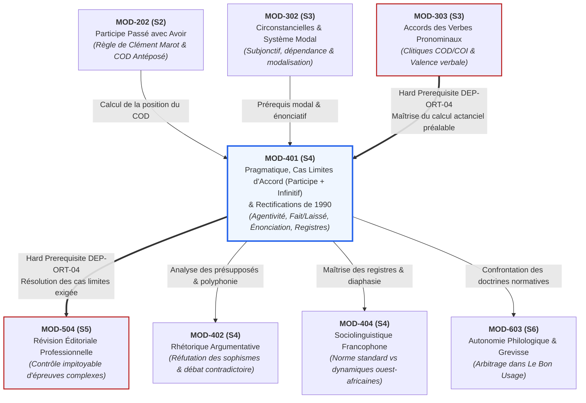

# Fiche Pédagogique Opérationnelle — Module MOD-401

> **Identifiant** : `MOD-401`  
> **Titre** : *Pragmatique Énonciative, Cas Limites d'Accord (Participe + Infinitif), Rectifications de 1990 et Registres de Langue*  
> **Semestre** : Année 2 — Semestre 4 (S4)  
> **Domaines mobilisés** : DOM-02 (Orthographe grammaticale et lexicale), DOM-04 (Conjugaison, syntaxe et sémantique du verbe), DOM-07 (Expression écrite et stylistique), DOM-12 (Correction, révision et contrôle qualité éditorial)  
> **Volume horaire estimé** : 18 heures (Étude théorique : 5 h | Pratique délibérée : 6 h 30 | Correction raisonnée : 3 h 30 | Révision active : 3 h)  
> **Statut** : [STATUT : VALIDÉ]  
> **Alignement** : [`academic-structure.md` (S4)](file:///f:/Formation/world-class-french/01-architecture/academic-structure.md#5-fiche-détaillée--semestre-4-s4), [`dependency-graph.md` (DEP-ORT-04)](file:///f:/Formation/world-class-french/01-architecture/dependency-graph.md#22-axe-orthographe-grammaticale--accords-du-canonique-aux-cas-limites), [`competency-framework.md` (FR-ORTHO-003, FR-ORTHO-004, FR-SOCIOL-001)](file:///f:/Formation/world-class-french/02-competency-framework/competency-framework.md), [`syllabus.md` (S4)](file:///f:/Formation/world-class-french/03-curriculum/year-2/semester-4/syllabus.md#module-mod-401--pragmatique-énonciative-cas-limites-daccord-et-rectifications-de-1990), [`source-registry.md`](file:///f:/Formation/world-class-french/07-resources/source-registry.md)

---

## 1. Présentation et Intérêt du Module

Le module `MOD-401` constitue la clé de voûte du deuxième cycle du cursus **World-Class French**. Situé au seuil du Semestre 4, il orchestre la bascule décisive entre la maîtrise mécanique des structures morphosyntaxiques acquise aux semestres 1 à 3 et l'intelligence discursive, pragmatique et stylistique indispensable au scripteur et orateur d'élite.

Ce module résout deux défis majeurs de la langue française qui départagent le locuteur empirique de l'expert :

1. **La pragmatique énonciative et l'architecture des registres** : La langue n'est pas un système neutre d'énoncés abstraits ; elle est une activité située dans laquelle un sujet parlant s'inscrit au moyen d'embrayeurs, module son adhésion, fait entendre d'autres voix (polyphonie, présupposition, ironie, discours rapportés) et adapte son registre selon la distance sociale et l'intention communicative [Réf. SRC-GRAM-02, chap. 18-20]. Comprendre la pragmatique, c'est maîtriser la dynamique du sens sous-jacent et s'approprier les variations diaphasiques (familier, courant, soutenu, solennel) sans jamais succomber à l'insécurité linguistique ni aux ruptures de ton.
2. **La résolution des cas limites d'accord et la lucidité normative** : L'accord du participe passé suivi d'un infinitif représente l'un des sommets d'achoppement de l'orthographe grammaticale française. Trop souvent enseigné sous la forme de recettes mnémotechniques floues, il obéit en réalité à une mécanique actancielle rigoureuse fondée sur l'agentivité : le sujet logique de l'infinitif [Réf. SRC-GRAM-01, § 956-965]. Ce module installe une grille de décomposition infaillible pour les verbes de perception (*voir, entendre, regarder, écouter, sentir*), consacre l'invariabilité absolue du verbe factitif *faire* suivi d'un infinitif (*je les ai fait venir*), et explicite le double statut de *laisser* (doctrine classique vs recommandation de régularisation des rectifications de 1990). Conjointement, il dote l'apprenant d'une compréhension exacte des **Rectifications de 1990** [Réf. SRC-NORM-02], lui permettant de distinguer règle traditionnelle, graphie rectifiée recommandée et hypercorrection fautive.

---

## 2. Place dans le Cursus

- **Position séquentielle** : Semaines 2 à 4 du Semestre 4 (S4). Ce module ouvre le semestre en verrouillant simultanément la dernière grande frontière de l'accord verbal et les fondations linguistiques de la rhétorique et de la dissertation.
- **Rôle architectural** : Pivot d'intégration entre la phrase complexe et le discours long. Il transforme l'apprenant en un analyste capable d'arbitrer les controverses normatives les plus aiguës et d'ajuster son expression à l'ensemble du spectre des registres.
- **Relations amont / aval** :
  - *En amont* :
    - `MOD-202` (accord du participe passé avec l'auxiliaire *avoir* sur COD antéposé, base de calcul de la position d'objet) ;
    - `MOD-301` & `MOD-302` (architecture de la subordination complexe, système modal de l'énonciation, indicatif vs subjonctif) ;
    - `MOD-303` (lien bloquant direct *Hard Prerequisite*, [`dependency-graph.md`, DEP-ORT-03](file:///f:/Formation/world-class-french/01-architecture/dependency-graph.md#22-axe-orthographe-grammaticale--accords-du-canonique-aux-cas-limites) : résolution des accords des verbes pronominaux et identification du statut actanciel du clitique).
  - *En aval* :
    - Lien de dépendance bloquante directe (*Hard Prerequisite*, [`dependency-graph.md`, DEP-ORT-04](file:///f:/Formation/world-class-french/01-architecture/dependency-graph.md#22-axe-orthographe-grammaticale--accords-du-canonique-aux-cas-limites)) vers `MOD-504` (Semestre 5 : Révision éditoriale professionnelle d'épreuves complexes, où les cas limites et l'orthographe de 1990 sont exigés au niveau de relecteur professionnel) ;
    - Alimentation conceptuelle directe de `MOD-402` (rhétorique argumentative, où le repérage des présupposés et sous-entendus est le préalable à la réfutation des sophismes) ;
    - Alimentation directe de `MOD-404` (sociolinguistique francophone et contextes ouest-africains, où la maîtrise des registres standard vs familiers est indispensable) ;
    - Préparation à l'autonomie philologique de `MOD-603` (recherche experte dans *Le Bon Usage* de Grevisse).

---

## 3. Prérequis et Diagnostic

### 3.1 Prérequis Stricts
1. **Identification immédiate du COD antéposé** (`MOD-202`, `FR-ORTHO-003`, palier L3) : Capacité à localiser le pronom ou groupe nominal COD placé en amont du verbe et à neutraliser les faux compléments (compléments de mesure, de durée, de prix).
2. **Analyse de la valence et des verbes pronominaux** (`MOD-303`, `FR-ORTHO-004`, palier L3) : Capacité à déterminer si un verbe admet un complément direct ou indirect et à manipuler les pronoms conjoints d'objet.
3. **Syntaxe de la proposition infinitive** (`MOD-201`, `FR-SYNTAX-001`, palier L3) : Capacité à distinguer une proposition subordonnée infinitive ayant son propre sujet logique d'un infinitif complément d'objet direct ou indirect d'un verbe recteur.

### 3.2 Protocole Diagnostique d'Entrée (Semaine 2, 30 minutes)
Le diagnostic obligatoire évalue trois compétences clés :
- **Volet A — Test actanciel d'agentivité de l'infinitif (8 items)** : L'apprenant doit déterminer, dans des phrases contenant un verbe de perception suivi d'un infinitif, quel élément nominal ou pronominal accomplit l'action dénotée par l'infinitif.
- **Volet B — Épreuve d'accord sur verbes factitifs et semi-auxiliaires (6 items)** : Formes passées brutes de *faire* et *laisser* suivies d'infinitif (*« les maisons qu'il a (fait) bâtir »*, *« la lettre qu'elle a (laissé) traîner »*).
- **Volet C — Détection des indices d'énonciation et registres (6 items)** : Repérage de déictiques, modalisateurs et identification du registre de courts fragments textuels.
- **Seuil d'alerte** : Tout score inférieur à 16/20 ($80\,\%$) impose un module de consolidation de 2 heures centré sur la distinction entre sujet sémantique et objet de l'infinitif avant d'aborder les cas limites.

---

## 4. Objectifs Pédagogiques Mesurables

Au terme des 18 heures d'enseignement et d'ateliers du module `MOD-401`, l'apprenant doit être capable de :

1. **Décomposer** l'appareil formel de l'énonciation dans un texte complexe : repérer les embrayeurs spatio-temporels (déictiques), distinguer la corrélation de personne (1re et 2e personnes engagées dans l'interlocution) de la non-personne (3e personne objective ou narrative) selon la théorie d'Émile Benveniste [Réf. SRC-GRAM-02, chap. 18].
2. **Analyser** la polyphonie discursive (Oswald Ducrot) : discriminer rigoureusement le posé, le présupposé (maintenu sous la négation et l'interrogation) et le sous-entendu (déduit pragmatiquement du contexte) ; caractériser l'ironie comme discordance polyphonique et identifier les trois régimes de discours rapportés (direct, indirect, indirect libre) [Réf. SRC-GRAM-02, chap. 19-20].
3. **Résoudre** avec une fiabilité de $100\,\%$ l'accord du participe passé suivi d'un infinitif pour les verbes de perception (*voir, entendre, écouter, sentir, regarder*) en appliquant l'algorithme de l'agent sujet de l'infinitif [Réf. SRC-GRAM-01, § 956-960].
4. **Appliquer sans la moindre exception** l'invariabilité absolue du participe passé *fait* suivi d'un infinitif (*je les ai fait venir*, *la maison qu'elle a fait construire*) en justifiant la formation d'un prédicat complexe causatif [Réf. SRC-GRAM-01, § 961 ; SRC-GRAM-02, chap. 17].
5. **Arbitrer** le cas de *laissé* suivi d'un infinitif selon les deux normes en vigueur : application de la règle d'agentivité de la grammaire traditionnelle vs application de l'invariabilité systématique recommandée par les rectifications de 1990 [Réf. SRC-GRAM-01, § 962 ; SRC-NORM-02].
6. **Identifier, expliciter et appliquer** les quatre grands chantiers des Rectifications de l'orthographe de 1990 :
   - la généralisation du trait d'union dans tous les numéraux composés (*vingt-et-un*, *deux-cents*) ;
   - la régularisation du pluriel des mots composés de type Verbe + Nom sur le modèle des mots simples (*des tire-bouchons*, *des essuie-mains*) ;
   - la suppression de l'accent circonflexe sur *i* et *u* (avec conservation stricte sur les homophonies distinctives *mûr, sûr, jeûne, dû* et au passé simple / subjonctif imparfait) ;
   - la régularisation morphologique des verbes en *-eler* et *-eter* en *-èle* et *-ète* (à l'exception canonique d'*appeler*, *jeter* et leurs familles) [Réf. SRC-NORM-02].
7. **Caractériser et pratiquer** les quatre registres de langue majeurs (familier, courant/standard, soutenu, solennel) en explicitant de manière contrastée leurs indices aux plans phonétique/prosodique, lexical et syntaxique [Réf. SRC-GRAM-02, chap. 2 ; SRC-SOCIO-02].
8. **Réécrire** un même passage argumentatif ou narratif d'un registre à un autre sans rupture de ton ni contamination lexicale.

---

## 5. Compétences Visées et Niveaux de Maîtrise Attendus

| Identifiant | Intitulé de la Compétence | Palier d'Entrée | Palier Cible MOD-401 | Preuve Observable Spécifique |
| :--- | :--- | :---: | :---: | :--- |
| [`FR-ORTHO-003`](file:///f:/Formation/world-class-french/02-competency-framework/competency-framework.md#fr-ortho-003-accord-rigoureux-du-participe-passé-avec-lauxiliaire-avoir) / [`FR-ORTHO-004`](file:///f:/Formation/world-class-french/02-competency-framework/competency-framework.md#fr-ortho-004-résolution-des-accords-des-verbes-pronominaux) | **Résolution des cas limites d'accord (participe + infinitif, 1990)** | L3 | **L4 (Maîtrise approfondie)** | Arbitrage sans faute d'un corpus de 25 phrases pièges complexes avec arbre de décision explicite et note $\ge 18/20$. |
| [`FR-SOCIOL-001`](file:///f:/Formation/world-class-french/02-competency-framework/competency-framework.md#fr-sociol-001-conscience-sociolinguistique-et-navigation-entre-registres) | **Conscience sociolinguistique et navigation entre registres** | L2 | **L3 (Autonomie)** | Réécriture d'un même texte en 3 registres distincts (familier, courant, soutenu/solennel) sans contamination ni anachronisme. |
| [`FR-INT-003`](file:///f:/Formation/world-class-french/02-competency-framework/competency-framework.md#fr-int-003-réviser-et-corriger-un-texte-tiers-en-justifiant-les-interventions) | **Révision éditoriale et contrôle normatif des épreuves** | L3 | **L3+ (Autonomie avancée)** | Détection et justification de $100\,\%$ des fautes sur *fait/laissé*, verbes de perception et graphies de 1990. |
| [`FR-INT-004`](file:///f:/Formation/world-class-french/02-competency-framework/competency-framework.md#fr-int-004-adapter-instantanément-son-registre-de-langue-au-contexte) | **Adaptation situationnelle et stylistique de registre** | L2 | **L3 (Autonomie)** | Production de transcriptions contrastées avec grille d'attestation linguistique conforme. |

### Définition Observable du Palier L4 pour `FR-ORTHO-003` / `FR-ORTHO-004` :
Face à un participe passé suivi d'un infinitif, l'apprenant ne recourt jamais à l'intuition auditive. Il applique instantanément le protocole d'arbitrage actanciel en quatre filtres :
1. *Filtre du causatif « faire »* : Si le participe est *fait*, invariabilité immédiate et absolue sans chercher le COD.
2. *Filtre du semi-auxiliaire « laisser »* : Choix conscient et documenté de la graphie (invariable selon 1990 ou calcul d'agentivité selon la tradition).
3. *Filtre d'agentivité sur verbes de perception* : Localisation du COD antéposé $\rightarrow$ ce COD accomplit-il l'action de l'infinitif ?
   - Si OUI : accord avec le COD (*les musiciennes que j'ai entendues jouer*).
   - Si NON : invariabilité absolue (*les sérénades que j'ai entendu jouer*).
4. *Filtre des verbes de sentiment et mouvement* : Traitement de la rection prépositionnelle (*les efforts qu'il a semblé faire* $\rightarrow$ COD de l'infinitif $\rightarrow$ participe invariable).

---

## 6. Plan Détaillé des Chapitres

```text
ARCHITECTURE PÉDAGOGIQUE DU MODULE MOD-401 (18 HEURES)
├── CHAPITRE 1 : LINGUISTIQUE DE L'ÉNONCIATION ET CADRE PRAGMATIQUE (3 h)
│   ├── 1.1 Énoncé vs Énonciation : l'appropriation de l'appareil formel de la langue (Benveniste)
│   ├── 1.2 Les embrayeurs et la déixis spatio-temporelle (ici, maintenant, hier, ce jour-là)
│   ├── 1.3 La corrélation de personne : je/tu (interlocution) vs il/elle (non-personne)
│   └── 1.4 Les modalisateurs : certitude, probabilité, appréciation et distance critique
├── CHAPITRE 2 : POLYPHONIE ÉNONCIATIVE ET DISCOURS RAPPORTÉS (2 h)
│   ├── 2.1 Théorie polyphonique de Ducrot : sujet parlant, locuteur et énonciateurs
│   ├── 2.2 La triade sémantique : le posé, le présupposé et le sous-entendu
│   ├── 2.3 L'ironie comme discordance énonciative et la négation polémique
│   └── 2.4 Typologie des discours rapportés : direct, indirect et indirect libre
├── CHAPITRE 3 : LE PARTICIPE PASSÉ SUIVI D'UN INFINITIF : VERBES DE PERCEPTION (3 h)
│   ├── 3.1 Statut syntaxique de la proposition subordonnée infinitive
│   ├── 3.2 La règle d'or de l'agent : qui fait l'action de l'infinitif ?
│   ├── 3.3 Verbes de perception (voir, entendre, écouter, sentir, regarder)
│   └── 3.4 Analyse comparée : « entendues chanter » vs « entendu chanter »
├── CHAPITRE 4 : CAS LIMITES : L'INVARIABILITÉ DE « FAIT » ET LE STATUT DE « LAISSÉ » (2 h 30)
│   ├── 4.1 La périphrase causative « faire + infinitif » : formation d'un bloc verbal indivisible
│   ├── 4.2 Invariabilité absolue de « fait » suivi d'infinitif : l'éradication de « je les ai faites venir »
│   ├── 4.3 Le verbe « laisser » : dualité normative (règle classique d'agent vs recommandation de 1990)
│   └── 4.4 Les verbes semi-auxiliaires de modalité et de mouvement (devoir, pouvoir, vouloir, aller, venir)
├── CHAPITRE 5 : LES RECTIFICATIONS ORTHOGRAPHIQUES DE 1990 (3 h)
│   ├── 5.1 Contexte historique, statut officiel et principe du double usage toléré
│   ├── 5.2 Les numéraux composés : généralisation méthodique du trait d'union (vingt-et-un)
│   ├── 5.3 Pluriel des noms composés Verbe + Nom sur le modèle des mots simples (tire-bouchons)
│   ├── 5.4 L'accent circonflexe sur « i » et « u » : suppression raisonnée et exceptions d'homophonie
│   └── 5.5 La régularisation morphologique des verbes en -eler et -eter (modèle peler / acheter)
├── CHAPITRE 6 : SOCIOLINGUISTIQUE DES REGISTRES DE LANGUE (2 h 30)
│   ├── 6.1 Les variations diaphasiques : familier, courant (standard), soutenu et solennel
│   ├── 6.2 Analyse contrastée au niveau phonétique et prosodique (élisions, chutes du « ne », débit)
│   ├── 6.3 Analyse contrastée au niveau lexical (argot, termes neutres, vocabulaire abstrait, archaïsmes)
│   └── 6.4 Analyse contrastée au niveau syntaxique (dislocations, inversion du sujet, périodes oratoires)
└── CHAPITRE 7 : SYNTHÈSE ALGORITHMIQUE ET PROTOCOLE D'ARBITRAGE ÉDITORIAL (2 h)
    ├── 7.1 L'arbre de décision unifié pour le participe passé suivi d'un infinitif
    ├── 7.2 Guide de politique éditoriale pour l'application cohérente de 1990
    └── 7.3 Méthodologie de la grille d'arbitrage universitaire et professionnelle
```

---

## 7. Concepts Fondamentaux et Notions Avancées

### 7.1 Concepts Fondamentaux

#### 1. L'appareil formel de l'énonciation (Émile Benveniste)
L'énonciation est l'acte individuel de mise en fonctionnement de la langue par lequel un locuteur mobilise le système linguistique pour produire un énoncé singulier [Réf. SRC-GRAM-02, chap. 18].
- **La polarité de personne** : Benveniste démontre que la 1re personne (*je*) et la 2e personne (*tu*) sont indissociables de la situation d'interlocution présente ; elles désignent les partenaires de l'acte de parole. En revanche, la 3e personne (*il/elle/ils/elles*) est une **non-personne** : elle désigne ce dont on parle et peut renvoyer à un être absent ou à une chose, participant de la narration objective.
- **Les embrayeurs (ou déictiques)** : Unités linguistiques dont le référent ne peut être déterminé qu'en référence à l'instance de discours (au moment et au lieu de l'énonciation) :
  - *Déictiques spatiaux* : *ici, là-bas, à ma droite, ce bureau-ci*.
  - *Déictiques temporels* : *maintenant, hier, aujourd'hui, dans trois jours*.
  - À l'inverse, dans le récit pur (ou énoncé coupé de la situation d'énonciation), les repères deviennent absolus ou anaphoriques : *ce jour-là, la veille, le lendemain, à cet endroit*.
- **La modalisation** : Ensemble des marques par lesquelles le locuteur manifeste son attitude, son degré d'adhésion ou son jugement à l'égard de son propre énoncé :
  - *Modalités d'énoncé* : épistémique (certitude, probabilité : *il est indéniable que, peut-être*), appréciative (*heureusement, hélas*), déontique (obligation : *il faut que*).

#### 2. La règle d'or de l'agent pour le participe passé suivi d'un infinitif
Lorsqu'un participe passé est suivi d'un infinitif, la règle de Clément Marot (*accord avec le COD s'il précède*) est subordonnée à une condition préalable impérative : **le COD antéposé doit être le sujet logique (l'agent) de l'action exprimée par l'infinitif** [Réf. SRC-GRAM-01, § 956] :
- Si le COD antéposé accomplit l'action dénotée par l'infinitif $\rightarrow$ **ACCORD DU PARTICIPE**.
- Si le COD antéposé subit l'action de l'infinitif (ou est l'objet de cet infinitif) $\rightarrow$ **INVARIABILITÉ DU PARTICIPE**.

### 7.2 Notions Avancées

#### 1. Discordance polyphonique et niveaux d'implicite (Oswald Ducrot)
La théorie de la polyphonie réfute l'illusion selon laquelle un énoncé ne véhiculerait qu'une seule voix unifiée [Réf. SRC-GRAM-02, chap. 19] :
- **Sujet parlant vs Locuteur vs Énonciateurs** :
  - *Le sujet parlant* est l'être psychophysique qui prononce ou écrit matériellement les mots.
  - *Le locuteur ($L$)* est l'instance discursive responsable de l'énoncé (celui désigné par *je*).
  - *Les énonciateurs ($E1, E2, \dots$)* sont les points de vue abstraits mis en scène par le locuteur sans que celui-ci ne les prenne nécessairement à son compte.
- **Le posé vs le présupposé vs le sous-entendu** :
  - *Le posé* : Ce qui est explicitement affirmé par la proposition.
  - *Le présupposé* : Information préexistante inscrite dans la structure sémantique même des mots employés, qui demeure invariante sous le test de la négation ou de l'interrogation :
    - Énoncé : *« Pierre a cessé de fumer. »*
    - Posé : Actuellement, Pierre ne fume pas.
    - Présupposé : Auparavant, Pierre fumait. (Vérification : *« Pierre n'a pas cessé de fumer »* conserve intact le fait qu'il fumait).
  - *Le sous-entendu* : Sens implicite résultant d'un calcul interprétatif dépendant entièrement du contexte pragmatique et des lois du discours (maximes de Grice). Contrairement au présupposé, le sous-entendu peut être réfuté sans contradiction logique :
    - Énoncé : *« Il fait un peu frais ici. »* $\rightarrow$ Sous-entendu : *Fermez la fenêtre* (mais le locuteur peut se réfugier derrière la simple remarque météorologique).
- **L'ironie comme polyphonie discordante** : Le locuteur met en scène un énonciateur formulant une thèse absurde tout en laissant voir qu'il s'en dissocie radicalement.
- **La négation polémique** : Dans *« Cet article n'est pas bon, il est remarquable »*, la négation réfute l'énonciateur qui qualifierait le texte de simplement « bon ».

#### 2. L'invariabilité absolue de « fait » et le statut factitif
Pourquoi *fait + infinitif* est-il rigoureusement invariable ?
En linguistique moderne, l'assemblage du verbe *faire* et d'un infinitif constitue une **périphrase causative** formant un bloc verbal unitaire à prédicat complexe [Réf. SRC-GRAM-02, chap. 17]. Le verbe *faire* perd son autonomie lexicale et s'efface pour fonctionner comme un opérateur de transitivité ou un auxiliaire actanciel. 
Par conséquent, dans l'énoncé *« Les actrices que j'ai fait venir »*, les actrices ne sont pas le COD de *faire* seul (on n'a pas « fait les actrices ») ; elles sont le complément du bloc verbal indivisible *faire venir*. L'Académie française et la totalité des grammairiens contemporains considèrent ainsi l'invariabilité de *fait* suivi d'un infinitif comme une règle d'airain sans la moindre exception [Réf. SRC-GRAM-01, § 961]. L'accord *\*« je les ai faites venir »* est une faute lourde par fausse analogie.

#### 3. Le statut prescriptif des Rectifications de 1990
Publiées au *Journal officiel de la République française* le 6 décembre 1990 après avis favorable unanime de l'Académie française et des instances francophones de Belgique et du Québec, les rectifications ne constituent pas une « nouvelle orthographe » obligatoire imposée par décret répressif [Réf. SRC-NORM-02]. Elles constituent des **recommandations officielles régularisant des anomalies historiques**.
- **Règle institutionnelle d'or** : *« Aucune des deux graphies ne peut être tenue pour fautive »*. Ni un correcteur d'examen, ni un réviseur éditorial ne peut pénaliser l'usage d'une forme rectifiée ou d'une forme traditionnelle.
- **Principe d'homogénéité éditoriale** : L'apprenant doit s'interdire de panacher de manière incohérente les deux systèmes au sein d'un même document (par exemple, écrire *« évènement »* avec accent grave à la ligne 2 et *« événement »* avec accent aigu à la ligne 10).

---

## 8. Erreurs et Confusions Fréquentes

| Énoncé fautif ou ambigu | Faille cognitive / Source d'erreur | Analyse linguistique rigoureuse et forme normée | Source de doctrine |
| :--- | :--- | :--- | :--- |
| *\*« Ces chanteuses, je les ai faites venir de Paris. »* | **Biais d'accord sur COD antéposé.** L'apprenant constate que *les* (féminin pluriel) précède le verbe et accorde mécaniquement le participe. | *Faire + infinitif* forme une périphrase causative indivisible. Le participe passé *fait* est **absolument invariable** devant un infinitif : *« Ces chanteuses, je les ai **fait** venir de Paris. »* | [SRC-GRAM-01, § 961 ; SRC-GRAM-02, chap. 17] |
| *\*« Les chansons que j'ai entendues chanter hier soir. »* | **Confusion entre l'agent et le patient de l'infinitif.** L'apprenant voit *que* (représentant *les chansons*) placé avant et accorde sans analyser le rôle sémantique. | Les chansons n'accomplissent pas l'action de chanter ; elles *sont chantées* par autrui (*les chansons* est l'objet de *chanter*). Le COD n'est pas le sujet de l'infinitif $\rightarrow$ invariabilité : *« Les chansons que j'ai **entendu** chanter. »* | [SRC-GRAM-01, § 957] |
| *\*« La cantatrice que j'ai entendu chanter hier. »* | **Omission de l'accord d'agent.** L'apprenant applique par excès une règle d'invariabilité générale devant infinitif. | C'est la cantatrice qui chante (*elle est le sujet logique de chanter*). Le COD antéposé *que* fait l'action de l'infinitif $\rightarrow$ accord obligatoire : *« La cantatrice que j'ai **entendue** chanter. »* | [SRC-GRAM-01, § 957] |
| *\*« Elle s'est laissée mourir de chagrin. »* (en graphie rectifiée ou style factitif) | **Méconnaissance de la régularisation de 1990 sur laissé.** Hésitation entre tradition et rectifications. | Traditionnellement, *se* est l'objet qui meurt (accord admis : *laissée*). Mais les rectifications de 1990 alignent *laisser* sur *faire* : l'invariabilité est recommandée : *« Elle s'est **laissé** mourir de chagrin. »* | [SRC-NORM-02 ; SRC-GRAM-01, § 962] |
| *\*« Cet écrivain a écrit vingt et un livres. »* (en refusant 1990) vs *\*« vingt-et-un »* (qualifié à tort de faute) | **Ignorance de la régularisation des numéraux de 1990.** Croyance que le trait d'union ne s'applique qu'aux nombres inférieurs à cent sans conjonction. | Traditionnellement : *vingt et un* (sans traits d'union). Depuis 1990 : le trait d'union relie tous les éléments numéraux : *« vingt-et-un »*, *« deux-cents »*, *« trois-mille-quatre-cent-quatre-vingt-dix-neuf »*. Les deux formes sont correctes. | [SRC-NORM-02 ; SRC-TYPO-01] |
| *\*« Il a mangé un fruit mûr »* $\rightarrow$ écrit *\*« fruit mur »* | **Hypercorrection aveugle sur le circonflexe.** L'apprenant applique la suppression du circonflexe sur *u* sans vérifier l'homophonie. | Le circonflexe est conservé obligatoirement pour distinguer les homophones : *mûr* (adj.) vs *mur* (subst.), *sûr* (adj.) vs *sur* (prép.), *jeûne* (privation) vs *jeune* (âge), *dû* (participe de devoir) vs *du* (article). | [SRC-NORM-02 ; SRC-GRAM-05, § 23] |
| *\*« Des tire-bouchon »* (en croyant appliquer la tradition) | **Confusion sur le modèle pluriel de Verbe + Nom.** L'apprenant croit que les mots composés sont toujours invariables. | En tradition : *un tire-bouchon $\rightarrow$ des tire-bouchons* (le nom prend la marque du pluriel). En 1990 : pluriel régulier sur le second élément (*des tire-bouchons*). L'invariabilité *\*des tire-bouchon* est une faute dans les deux systèmes. | [SRC-NORM-02 ; SRC-GRAM-01, § 523] |
| *\*« Qu'il vous souvienne que nous vous avons causé hier. »* | **Télescopage diaphasique (rupture de registre).** Mélange d'une formule solennelle/archaïque et d'un tour familier oral. | *« Causer »* au sens de discuter est familier. Associé à la tournure impersonnelle solennelle *« Qu'il vous souvienne »*, cela crée un choc de registre ridicule. En soutenu : *« Qu'il vous souvienne de notre entretien d'hier. »* | [SRC-GRAM-02, chap. 2] |

---

## 9. Exemples Simples, Intermédiaires et Complexes

### 9.1 Niveau Simple (Structures Canoniques et Directes)
- **Agentivité limpide avec verbe de perception** :
  - *Les enfants que j'ai vu**s** jouer dans la cour.* (Ce sont les enfants qui jouent $\rightarrow$ accord masculin pluriel).
  - *La sonate que j'ai entendu jouer par l'orchestre.* (La sonate ne joue pas, elle est jouée $\rightarrow$ participe invariable).
- **Invariabilité mécanique de faire** :
  - *Les robes que j'ai fait nettoyer au pressing.* (*fait* suivi d'infinitif $\rightarrow$ invariable sans hésitation).
  - *Il les a fait venir sans délai.* (*fait* suivi d'infinitif $\rightarrow$ invariable).
- **Numéraux rectifiés de 1990** :
  - *Trente-et-un candidats se sont présentés.* (Trait d'union généralisé selon 1990).
  - *Deux-cent-quatre-vingt-dix-mille électeurs.* (Unification graphique intégrale par traits d'union).

### 9.2 Niveau Intermédiaire (Disjonctions Actancielles et Subtilités Énonciatives)
- **Concurrence actancielle avec pronom ou agent indirect introduit par « par » ou « à »** :
  - *Les voleurs que j'ai vu**s** arrêter par les gendarmes ?* **NON !** C'est *« Les voleurs que j'ai vu arrêter par les gendarmes. »* (Les voleurs n'arrêtent personne, ils sont arrêtés $\rightarrow$ invariabilité).
  - *Les comédiens que j'ai regardé**s** répéter leur rôle.* (Les comédiens accomplissent l'action de répéter $\rightarrow$ accord masculin pluriel *regardés*).
- **Le double arbitrage de « laissé »** :
  - *Règle traditionnelle* : *La captive s'est laissé**e** délivrer par ses alliés ? Non : elle s'est laissé délivrer* (elle est délivrée), mais *Elle s'est laissé**e** tomber* (elle accomplit l'action de tomber).
  - *Règle des rectifications de 1990* : *Elle s'est laissé tomber* ; *elle s'est laissé délivrer* (invariabilité systématique admise et recommandée, alignée sur *fait*).
- **Polyphonie et négation polémique** :
  - *« Ce rapport n'est pas insuffisant : il est délibérément mensonger. »* (La négation ne porte pas sur la réalité de l'insuffisance, mais réfute l'énonciateur qui atténuait la gravité de la faute).
- **Circonflexes régularisés vs indispensables** :
  - *La boîte à outils et le coût de la vie* (traditionnel) $\rightarrow$ *La boite à outils et le cout de la vie* (rectifié 1990).
  - *Il est sûr de son fait et le fruit est mûr.* (Maintien obligatoire des circonflexes dans les deux systèmes pour éviter la confusion avec *sur* et *mur*).

### 9.3 Niveau Complexe (Ambiguïtés Actancielles, Enchâssements et Transpositions Diaphasiques)
- **Le cas critique de la double interprétation sémantique** :
  - *La pianiste que j'ai entendu**e** jouer.* $\rightarrow$ J'ai entendu la pianiste pendant qu'elle jouait (accord : elle est agent de *jouer*).
  - *La pièce de théâtre que j'ai entendu jouer.* $\rightarrow$ La pièce est jouée (invariable).
  - *L'actrice que j'ai entendu applaudir.* $\rightarrow$ J'ai entendu la foule qui applaudissait l'actrice (*l'actrice* est l'objet d'applaudir $\rightarrow$ invariabilité absolue).
  - *L'actrice que j'ai entendu**e** applaudir ses confrères.* $\rightarrow$ C'est l'actrice qui applaudissait ses confrères (elle est l'agent $\rightarrow$ accord féminin singulier *entendue*).
- **Participe suivi d'un infinitif sous-entendu (ellipse verbale)** :
  - *J'ai fait tous les efforts que j'ai pu [faire].* (Le COD *que* dépend de l'infinitif sous-entendu *faire* et non du participe *pu* $\rightarrow$ participe invariable).
  - *Elle a obtenu tous les honneurs qu'elle a voulu [obtenir].* (Invariable pour la même raison d'ellipse).
- **Transposition diaphasique complète d'un même fait énonciatif** :
  - *Registre familier* : *« T'as vu le topo ? Les mecs se sont fait choper direct par la police, c'est trop naze. »*
  - *Registre courant (standard)* : *« Vous avez vu la situation ? Ces individus ont été arrêtés immédiatement par les forces de l'ordre ; c'est vraiment regrettable. »*
  - *Registre soutenu* : *« Avez-vous mesuré la portée de ces événements ? Les contrevenants ont été appréhendés sans désemparer par l'autorité publique, ce qui témoigne d'une impéritie consternante. »*
  - *Registre solennel* : *« Qu'il plaise à chacun de constater ici la rigueur inexorable de la loi : les instigateurs de ces désordres furent saisis sur-le-champ par la maréchaussée, offrant au public le spectacle d'une déchéance irrémédiable. »*

---

## 10. Activités d'Observation et de Découverte

### Atelier 1 : « Le scalpel de l'agent : Dissection actancielle du participe » (1 h 30)
- **Dispositif** : Un tableau de 12 phrases contenant des verbes de perception au passé composé suivis d'un infinitif avec pronoms antéposés.
- **Tâche** : Pour chaque phrase, l'apprenant doit poser la question de l'agentivité :
  1. *Quel est le sujet grammatical du verbe principal ?*
  2. *Quel est le COD antéposé ?*
  3. *Ce COD fait-il l'action de l'infinitif (Agent), ou subit-il cette action (Patient) ?*
  - Exemple de travail : *« Les coupables que le juge a (entendu / entendus) condamner. »* $\rightarrow$ Le juge entend ; les coupables ne condamnent pas, ils sont condamnés par autrui $\rightarrow$ *entendu* invariable !
- **Objectif didactique** : Dissiper définitivement l'illusion d'optique selon laquelle le mot placé juste avant l'infinitif en serait automatiquement le sujet.

### Atelier 2 : « L'échographie polyphonique : Démasquer présupposés et ironie » (1 h 15)
- **Dispositif** : Analyse d'un éditorial de presse satirique et d'un discours politique.
- **Tâche** :
  1. Isoler dans le texte 5 présupposés en appliquant le test du crible négatif (*« Si je nie la phrase, l'information reste-t-elle vraie ? »*).
  2. Relever 3 sous-entendus et démontrer comment le locuteur s'aménage une porte de sortie pour nier l'intention calomnieuse.
  3. Identifier un passage d'ironie et nommer l'énonciateur absurde mis en scène.
- **Objectif didactique** : Développer la lucidité critique indispensable à la réfutation rhétorique du module `MOD-402`.

### Atelier 3 : « Le crible de 1990 : Enquête comparative d'imprimerie » (1 heure)
- **Dispositif** : Confrontation d'un texte d'examen rédigé en graphie pré-1990 et de sa version rectifiée de 1990.
- **Tâche** :
  1. Classer chaque divergence orthographique dans l'un des quatre chantiers de la réforme (numéraux, pluriel de mots composés, circonflexe sur *i/u*, verbes en *-eler/-eter*).
  2. Détecter deux pièges d'hypercorrection introduits volontairement (ex. *\*« un mur mûr »* transformé à tort en *\*« un mur mur »*).
- **Objectif didactique** : Intégrer les rectifications non comme un laxisme, mais comme un système logique rigoureux exigeant une vigilance accrue sur les homophonies.

### Atelier 4 : « Le caméléon des registres : Déconstruction d'un échange » (1 h 15)
- **Dispositif** : Une scène dialoguée enregistrée ou transcrite issue de la vie quotidienne.
- **Tâche** : Identifier pour chaque réplique les indices phonétiques (chutes de voyelles, apocopes), lexicaux (vocabulaire expressif) et syntaxiques (dislocations, omissions de la particule *ne*). Transposer ensuite la scène en registre soutenu puis en registre solennel en explicitant les substitutions opérées.

---

## 11. Exercices Progressifs

### 11.1 Niveau 1 : Discrimination et Application Directe (2 h)
- **Exercice 1.1 (Agentivité canonique)** : Dans 15 phrases comportant des verbes de perception (*voir, entendre, regarder, écouter, sentir*), accorder le participe passé entre parenthèses en justifiant si le pronom antéposé est l'agent ou le patient de l'infinitif.
- **Exercice 1.2 (L'invariabilité de faire)** : Résoudre l'accord de 12 phrases contenant le verbe *faire* suivi d'un infinitif avec antéposition de pronoms variés (*les, la, nous, que*). Formuler la règle à chaque fois.
- **Exercice 1.3 (Numéraux et pluriels de 1990)** : Réécrire en toutes lettres 10 nombres cardinaux complexes selon les rectifications de 1990 (*31, 80, 101, 280, 1995, 3000*) et mettre au pluriel 10 noms composés de type Verbe + Nom (*porte-monnaie, tire-bouchon, grille-pain, coupe-ongles*).

### 11.2 Niveau 2 : Concurrence Actancielle et Analyse Énonciative (2 h 30)
- **Exercice 2.1 (Le laboratoire de laissé et des verbes pronominaux suivis d'infinitif)** :
  Accorder les participes passés dans 15 phrases complexes :
  - *Elle s'est (senti/sentie) défaillir.*
  - *Elle s'est (senti/sentie) piquer par une guêpe.*
  - *Ils se sont (laissé/laissés) séduire par ces flatteries.* (Donner la solution classique et la solution 1990).
  - *Les enfants que nous avons (regardé/regardés) s'éloigner.*
- **Exercice 2.2 (Décorticage des présupposés et sous-entendus)** :
  Pour 10 énoncés tirés de discours politiques ou juridiques, expliciter :
  a) Le contenu posé ;
  b) Le ou les présupposés déclenchés par le lexique ou la syntaxe ;
  c) Le sous-entendu pragmatique le plus probable en contexte.
- **Exercice 2.3 (Circonflexe et verbes en -eler / -eter)** :
  Conjuguer au présent de l'indicatif et au passé simple les verbes *amonceler, voleter, jeter, appeler, crocheter* selon les rectifications de 1990, et justifier la présence ou l'absence du circonflexe sur une liste de 20 mots (*abîme/abime, coût/cout, chaîne/chaine, dû, mûr, jeûne*).

### 11.3 Niveau 3 : Arbitrage de Haute Précision et Textes d'Élite (2 h)
- **Exercice 3.1 (Cas d'ambiguïté actancielle littéraire)** :
  Analyser et arbitrer l'orthographe du participe dans 10 extraits classiques (Racine, Voltaire, Flaubert, Proust) comportant des structures actancielles denses :
  - *« Les ennemis que le général a (vu/vus) capituler. »*
  - *« Les ordres que le souverain a (entendu/entendus) donner à ses troupes. »*
  - *« La cantatrice que j'ai (entendu/entendue) siffler par le parterre. »*
- **Exercice 3.2 (Transposition diaphasique tridimensionnelle)** :
  Prendre un paragraphe de 100 mots rédigé en style familier d'Afrique de l'Ouest ou d'Europe et le transposer rigoureusement :
  a) en français standard international neutre ;
  b) en français soutenu académique ;
  c) en français solennel protocolaire.
  Rédiger une note d'analyse justifiant les modifications phonétiques, lexicales et syntaxiques opérées.

---

## 12. Ateliers de Correction et de Révision

### Protocole d'Arbitrage Algorithmique du Participe Passé suivi d'un Infinitif
Pour éradiquer les hésitations en situation d'examen ou de révision éditoriale, l'apprenant applique l'arbre de décision unifié :

```text
                  [PARTICIPE PASSÉ SUIVI D'UN INFINITIF]
                                    │
               Le participe est-il une forme du verbe FAIRE ?
                               /          \
                           OUI              NON
                            │                │
                    INVARIABILITÉ     Le participe est-il LAISSER ?
                       ABSOLUE                  /          \
                (« fait venir »)             OUI            NON
                                              │              │
                   ┌──────────────────────────┴────┐   Existe-t-il un COD
                   │ Application des Rectifications│   placé AVANT le verbe ?
                   │ de 1990 (recommandée) :       │          /        \
                   │   INVARIABLE ABSOLU           │        NON        OUI
                   │   (« laissé tomber »)         │         │          │
                   │                               │    INVARIABLE   Ce COD fait-il l'action
                   │ Application classique :       │                 de l'infinitif ?
                   │   Calcul d'agentivité (voir   │                  (Test de l'agent)
                   │   branche de droite)          │                     /         \
                   └───────────────────────────────┘                   OUI         NON
                                                                        │           │
                                                                   ACCORD AVEC   INVARIABLE
                                                                     LE COD     (ex: « entendu
                                                                  (ex: « entendus  chanter »
                                                                      jouer »)    des chansons)
```

### Grille d'Audit Diaphasique en Trois Colonnes
Pour toute réécriture de texte, l'apprenant contrôle les marqueurs de registre selon la matrice d'alignement :

```text
MATRICE D'AUDIT DIAPHASIQUE (CONTRÔLE DES REGISTRES)
├── COMPOSANTE 1 : PHONÉTIQUE ET PROSODIE
│   ├── Familier : Chute du « e » muet, assimilation (ch'sais pas), suppression de « ne ».
│   ├── Courant : Réalisation standard des liaisons obligatoires, maintien partiel de « ne ».
│   ├── Soutenu : Respect absolu de la négation bipartite (ne... pas), liaisons facultatives soignées.
│   └── Solennel : Prosodie ample, diction hiératique, liaisons d'apparat, tempo ralenti.
├── COMPOSANTE 2 : LEXIQUE ET SÉMANTIQUE
│   ├── Familier : Argotismes, troncation (apocopes : ciné, télé), termes expressifs vagues.
│   ├── Courant : Termes usuels précis, dénotation exacte, collocations neutres.
│   ├── Soutenu : Vocabulaire abstrait, sémantique riche, proscription des verbes passe-partout.
│   └── Solennel : Termes nobles, archaïsmes d'apparat, formules protocolaires consacrées.
└── COMPOSANTE 3 : SYNTAXE ET AGENCEMENT
    ├── Familier : Phrase disloquée (Moi, mon frère, il...), interrogation par intonation pure.
    ├── Courant : Ordre Sujet-Verbe-Complément direct, subordination simple.
    ├── Soutenu : Inversion interrogative, subordination complexe hiérarchisée, subjonctif.
    └── Solennel : Grande période oratoire équilibrée, subjonctif imparfait, passif d'apparat.
```

---

## 13. Production Intégratrice

La production intégratrice du module `MOD-401` comporte **deux volets obligatoires** menés de front, sanctionnant à la fois l'expertise normative d'arbitrage et la souplesse d'expression situationnelle :

### Volet A : Arbitrage Argumenté d'un Corpus de 25 Phrases Pièges Complexes
L'apprenant reçoit le corpus officiel des 25 phrases litigieuses ci-dessous. Pour chacune d'elles, il doit :
1. Rétablir l'orthographe irréprochable du participe passé (et justifier les deux options pour *laissé*).
2. Fournir l'analyse actancielle explicite : identification du sujet du verbe principal, du COD antéposé, et démonstration de l'agentivité vis-à-vis de l'infinitif.
3. Citer l'article de référence de la doctrine (*Le Bon Usage* [SRC-GRAM-01] ou *Rectifications de 1990* [SRC-NORM-02]).

#### Corpus Officiel des 25 Phrases Pièges d'Arbitrage :
1. *Ces éminentes solistes, nous les avons (entendu) interpréter le concerto avec brio.*
2. *La symphonie magistrale que nous avons (entendu) jouer hier soir a bouleversé l'auditoire.*
3. *Les enfants turbulents que j'ai (vu) courir à travers la cour de récréation.*
4. *Les bêtes féroces que les chasseurs ont (vu) abattre au fond du ravin.*
5. *Ces coupables avérés, le magistrat instructeur les a (fait) comparaître immédiatement.*
6. *Les somptueuses villas que le promoteur a (fait) édifier sur le littoral.*
7. *Elle s'est (laissé) convaincre par des arguments fallacieux sans poser de questions.* (Analyser en tradition et en 1990).
8. *Les opportunités magnifiques que tu as (laissé) échapper par simple négligence.*
9. *L'oratrice passionnée que la foule a (écouté) discourir pendant plus de deux heures.*
10. *Les discours enflammés que nous avons (écouté) prononcer à la tribune.*
11. *Cette jeune femme s'est (senti) défaillir sous l'effet de la chaleur.*
12. *La violente piqûre qu'elle a (senti) irradier dans son bras gauche.*
13. *Les conspirateurs que la garde royale a (regardé) s'enfuir par les toits.*
14. *Les pièces de monnaie que nous avons (regardé) jeter dans la fontaine.*
15. *Les témoins capitaux que le juge a (entendu) déposer sous serment.*
16. *Les dépositions capitales que le greffier a (entendu) lire à haute voix.*
17. *Les difficultés insurmontables que cet ingénieur a (cru) pouvoir surmonter aisément.*
18. *Tous les efforts pénibles que nous avons (dû) déployer pour achever le chantier.*
19. *Les égards et les faveurs que vous auriez (voulu) recevoir lors de cette cérémonie.*
20. *Les deux accusées se sont (senti) observer par les policiers en civil.*
21. *Ces comédiennes talentueuses, je les ai (vu) répéter sans relâche avant la générale.*
22. *La pièce dramatique que nous avons (vu) jouer par la troupe nationale.*
23. *Elle s'est (laissé) mourir de chagrin après l'annonce de la tragédie.*
24. *Les déclarations mensongères que les journalistes ont (laissé) publier sans vérification.*
25. *Ces ouvrières qualifiées, la direction les a (fait) travailler d'arrache-pied.*

---

### Volet B : Réécriture Polylectale Contrastée en Trois Registres
L'apprenant reçoit le texte brut suivant, représentatif d'une dispute administrative informelle (registre relâché / familier) :

> *« Franchement, le chef de service, il a abusé grave. Hier, il a débarqué dans le bureau et il nous a crié dessus direct parce que les dossiers étaient pas bouclés à midi. Il a dit qu'on foutait rien et qu'on allait voir ce qu'on allait voir. Moi, j'ai failli lui rentrer dedans, mais les collègues m'ont dit de laisser tomber pour pas avoir d'emmerdes. N'empêche, sa manière de faire, ça passe pas du tout, c'est n'importe quoi. »*

#### Consigne Opérationnelle :
1. **Version 1 (Registre courant / standard)** : Rédiger un compte rendu factuel et neutre destiné à un responsable des ressources humaines, en français correct, clair, équilibré, sans familier ni préciosité.
2. **Version 2 (Registre soutenu)** : Rédiger un mémo administratif formel ou un grief syndical articulé, caractérisé par un vocabulaire riche et précis, des tournures passives ou impersonnelles, l'inversion et la subordination équilibrée.
3. **Version 3 (Registre solennel / académique)** : Rédiger une adresse protocolaire ou un extrait de plaidoyer digne d'une cour d'honneur, mobilisant le rythme de la prose classique, des figures de rhétorique (litote, antithèse) et une tenue morale exemplaire.
4. **Apparat critique** : Rédiger un tableau comparatif analysant les choix de substitution opérés sur 5 termes lexicaux et 3 structures syntaxiques entre les trois versions.

---

## 14. Évaluation et Barème

L'évaluation sommative du module `MOD-401` est notée sur **20 points**. Conformément aux exigences du cursus World-Class French, elle applique le principe de la **note éliminatoire fixée à 14/20** :

| Épreuve sommatrice | Contenu et modalités | Barème et pénalités | Seuil éliminatoire |
| :--- | :--- | :--- | :---: |
| **Partie 1 : Dictée de précision et cas limites (8 points)** | Dictée universitaire de 180 mots intégrant 6 participes passés suivis d'infinitif (*fait, laissé, verbes de perception*), 3 numéraux composés et 3 formes rectifiées de 1990. | • **-4,0 pts par accord fautif sur *fait + infinitif*** (faute rédhibitoire : ex. *\*faites venir*).<br/>• **-3,0 pts par contresens sur l'agentivité de l'infinitif** (*entendu* vs *entendues*).<br/>• **-1,0 pt par faute sur les numéraux ou circonflexes obligatoires** (*mûr, sûr*).<br/>• **-0,5 pt par faute lexicale ordinaire**. | $< 6/8$ |
| **Partie 2 : Justification d'arbitrage actanciel (6 points)** | Analyse rédigée de 4 phrases du corpus intégrant décomposition actancielle et citation de la doctrine du *Bon Usage*. | • **1,5 pt par analyse intégrale et irréprochable** (0 pt si la terminaison est correcte mais que l'analyse de l'agentivité est erronée ou absente). | $< 4/6$ |
| **Partie 3 : Épreuve de transposition de registres (6 points)** | Réécriture d'un passage relâché en registres courant, soutenu et solennel avec justification linguistique. | • **2 pts par registre parfaitement maîtrisé** sans rupture de ton ni contamination de vocabulaire (-1 pt par maladresse ou terme incongru). | $< 4/6$ |

### Règle d'Attribution et Conséquence du Seuil Éliminatoire :
- **Validation du module** : Note finale $\ge 14/20$ ET aucune note de sous-partie inférieure au seuil éliminatoire.
- **Sanction de la faute rédhibitoire** : Écrire *\*« je les ai faites venir »* ou *\*« elle s'est faite avoir »* dans la Partie 1 entraîne une pénalité immédiate de 4 points, plaçant la dictée sous le seuil critique. En cas d'échec global ($< 14/20$), l'apprenant est orienté vers un sas de remédiation de 2 semaines axé exclusivement sur l'analyse actancielle avant d'être autorisé à se présenter aux épreuves de fin de Semestre 4.

---

## 15. Critères de Maîtrise

Le module `MOD-401` est formellement certifié au palier **L4 (Maîtrise approfondie)** pour l'orthographe grammaticale et au palier **L3 (Autonomie)** pour la sociolinguistique lorsque l'apprenant démontre de manière observable :

1. **Exactitude absolue sur fait + infinitif** : Maintien inconditionnel de l'invariabilité de *fait* ($100\,\%$ de réussite sur toute batterie de test).
2. **Discrimination infaillible de l'agentivité** : Identification exacte de la fonction d'agent vs de patient du COD antéposé sur les verbes de perception (*voir, entendre, regarder, écouter, sentir*).
3. **Double compétence sur laissé** : Capacité à restituer et justifier tant l'arbitrage traditionnel (agent direct) que la recommandation officielle de 1990 (invariabilité).
4. **Maîtrise éclairée des Rectifications de 1990** :
   - Application sans faute du trait d'union aux numéraux composés ;
   - Pluralisation régulière des noms composés Verbe + Nom ;
   - Respect de la conservation des circonflexes discriminants sur les homophones (*dû, mûr, sûr, jeûne*).
5. **Aisance diaphasique sans contamination** : Production de textes dans les quatre registres (familier, courant, soutenu, solennel) avec une étanchéité stylistique parfaite et zéro collision lexicale.
6. **Autonomie d'analyse énonciative** : Capacité à formaliser les présupposés, sous-entendus et marques de polyphonie dans un texte complexe d'idées.

---

## 16. Révisions Espacées Recommandées

Pour ancrer durablement ces automatismes de haute précision et neutraliser les rechutes d'accord spontané sous la fatigue, le protocole de répétition espacée suivant est programmé :

- **J+3 après validation du module** : Test flash de rappel (10 minutes) : 5 phrases pièges chronométrées axées exclusivement sur *fait + infinitif*, *entendu chanter* et les circonflexes discriminants (*mûr/sûr*).
- **J+7** : Test actanciel de discrimination (15 minutes) : 8 phrases confrontant l'agent et le patient de l'infinitif avec verbes de perception.
- **J+21** : Exercice d'audit éditorial (20 minutes) : Révision d'un texte de 200 mots contenant 6 pièges de 1990 et 4 accords de participes suivis d'infinitif.
- **J+45 (Semaine 13 de S4)** : Réactivation majeure intégrée dans la révision cumulative pré-Porte 4 (dictée blanche de niveau universitaire).
- **Semestre 5 (S5)** : Réinvestissement permanent dans le cadre de la révision éditoriale d'épreuves complexes (`MOD-504`).

---

## 17. Sources de Référence Vérifiées

Toutes les analyses linguistiques, règles d'accord, descriptions pragmatiques et décisions normatives de ce document s'appuient exclusivement sur les autorités reconnues du registre des sources :

1. **Grevisse, Maurice & Goosse, André (2016)**. *Le Bon Usage* (16e éd.). Bruxelles : De Boeck Supérieur.  
   $\rightarrow$ Ouvrage cardinal pour l'accord du participe passé suivi d'un infinitif (§ 956-965), la règle de l'agent pour les verbes de perception (§ 957-960), l'invariabilité absolue de *fait* (§ 961), l'historique et les règles de *laisser* (§ 962), l'accord des verbes d'opinion et de mouvement suivis d'infinitif (§ 963-965), et le pluriel des mots composés (§ 521-529) [Réf. `SRC-GRAM-01`].
2. **Riegel, Martin, Pellat, Jean-Christophe & Rioul, René (2016/2021)**. *Grammaire méthodique du français*. Paris : PUF, coll. « Quadrige ».  
   $\rightarrow$ Référence universitaire pour la linguistique de l'énonciation et les déictiques (chap. 18), la sémantique de la modalisation et les actes de parole (chap. 19), la polyphonie et les discours rapportés (chap. 20), ainsi que la syntaxe des périphrases causatives et propositions infinitives (chap. 11 et 17) [Réf. `SRC-GRAM-02`].
3. **Conseil supérieur de la langue française (1990)**. *Les rectifications de l'orthographe (Journal officiel de la République française)*. Documents administratifs n° 100, 6 décembre 1990. Paris.  
   $\rightarrow$ Texte normatif officiel établissant la recommandation d'invariabilité pour *laissé + infinitif*, la généralisation du trait d'union aux numéraux, la régularisation du pluriel des mots composés Verbe + Nom, l'aménagement du circonflexe sur *i* et *u*, et la morphologie des verbes en *-eler / -eter* [Réf. `SRC-NORM-02`].
4. **Imprimerie nationale (2002/2014)**. *Lexique des règles typographiques en usage à l'Imprimerie nationale*. Paris : Imprimerie nationale.  
   $\rightarrow$ Norme professionnelle pour l'écriture des nombres en toutes lettres, les traits d'union et la typographie des discours rapportés [Réf. `SRC-TYPO-01`].
5. **Ministère de l'Éducation nationale (2020)**. *Terminologie grammaticale*. Paris : Réseau Canopé.  
   $\rightarrow$ Nomenclature officielle définissant l'énonciation, les registres de langue, les propositions infinitives et les compléments de verbe [Réf. `SRC-NORM-03`].
6. **Benveniste, Émile (1966)**. *Problèmes de linguistique générale*, tome 1. Paris : Gallimard.  
   $\rightarrow$ Théorie fondatrice de l'appareil formel de l'énonciation, de la corrélation de personne (*je/tu* vs non-personne *il*) et des déictiques.
7. **Ducrot, Oswald (1984)**. *Le Dire et le Dit*. Paris : Éditions de Minuit.  
   $\rightarrow$ Théorie de la polyphonie énonciative, distinction locuteur / énonciateurs, analyse du présupposé et du sous-entendu.
8. **Calvet, Louis-Jean (2017)**. *La sociolinguistique* (9e éd.). Paris : PUF, coll. « Que sais-je ? ».  
   $\rightarrow$ Caractérisation des variations linguistiques (diatopiques, diastratiques, diaphasiques) et dynamique des registres [Réf. `SRC-SOCIO-02`].

---

## 18. Liens avec les Modules Précédents et Suivants


