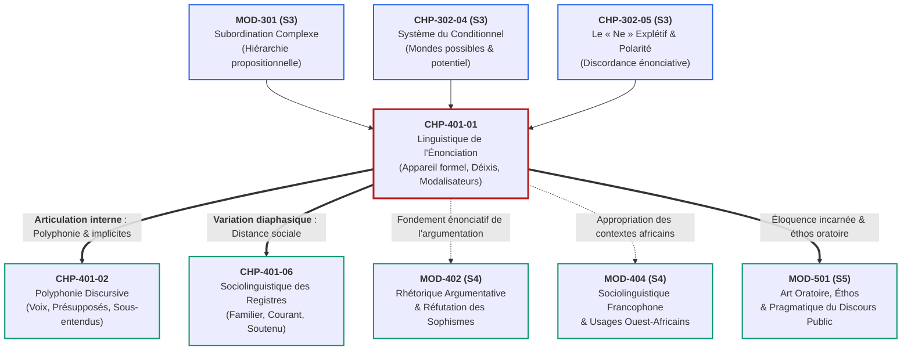
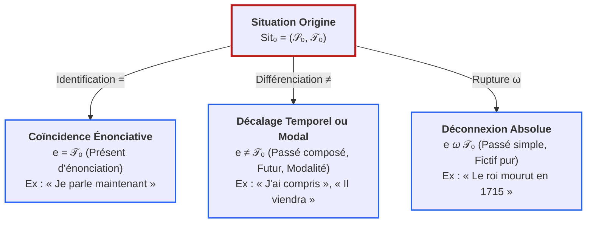

# Chapitre 1 — Linguistique de l'Énonciation et Cadre Pragmatique : Appropriation de l'Appareil Formel, Déixis, Corrélation de Personne et Modalisateurs

> **Identifiant du chapitre** : `CHP-401-01`  
> **Module de rattachement** : [`MOD-401` — Pragmatique Énonciative, Cas Limites d'Accord (Participe + Infinitif), Rectifications de 1990 et Registres de Langue](file:///f:/Formation/world-class-french/03-curriculum/year-2/semester-4/mod-401-pragmatique-accords-limites-rectifications-1990.md)  
> **Semestre** : Année 2 — Semestre 4 (S4)  
> **Volume horaire estimé** : 5 à 6 heures d'apprentissage autonome délibéré et d'ateliers d'application (Phase 1 Étude : 1 h 30 | Phase 2 Pratique : 1 h 30 | Phase 3 Correction : 1 h 00 | Phase 4 Évaluation : 1 h 00)  
> **Statut** : [STATUT : VALIDÉ]  
> **Compétences associées** : [`FR-SOCIOL-001`](file:///f:/Formation/world-class-french/02-competency-framework/competency-framework.md#fr-sociol-001-conscience-sociolinguistique-et-navigation-entre-registres) (L3 Autonomie), [`FR-INT-004`](file:///f:/Formation/world-class-french/02-competency-framework/competency-framework.md#fr-int-004-adapter-instantanément-son-registre-de-langue-au-contexte) (L3 Autonomie), [`FR-STYLE-001`](file:///f:/Formation/world-class-french/02-competency-framework/competency-framework.md#fr-style-001-maîtrise-des-figures-de-rhétorique-et-commentaire-stylistique) (L3 Autonomie)  
> **Sources scientifiques de référence** : `SRC-GRAM-01` (Grevisse & Goosse, 2016, § 380, § 1018), `SRC-GRAM-02` (Riegel, Pellat & Rioul, 2016/2021, chap. 18), `SRC-NORM-03` (Ministère de l'Éducation nationale, 2020, p. 12-14), `SRC-SOCIO-02` (Calvet, 2017), `SRC-TYPO-01` (Imprimerie nationale, 2002/2014)

---

## 1. Titre et Place dans le Cursus

### 1.1 Intitulé Officiel
**Chapitre 1 : Linguistique de l'Énonciation et Cadre Pragmatique : Appropriation de l'Appareil Formel, Déixis, Corrélation de Personne et Modalisateurs** (`CHP-401-01`).

### 1.2 Insertion Architecturale dans le Cursus
Le présent chapitre ouvre le **Semestre 4** du cursus World-Class French en opérant une mutation épistémologique déterminante : le passage de la syntaxe de la phrase à la **linguistique du discours en situation** [Réf. `SRC-GRAM-02`, chap. 18]. 

Jusqu'alors, les semestres 1 à 3 ont doté l'apprenant d'une maîtrise rigoureuse des formes morphosyntaxiques closes : morphologie verbale, subordination complexe (`MOD-301`), régimes modaux de virtualité (`MOD-302`), et accords des verbes pronominaux (`MOD-303`). Le chapitre `CHP-401-01` prend appui sur ces fondations structurales pour révéler que la langue n'est jamais une collection inerte d'énoncés désincarnés, mais un **acte vivant d'appropriation individuelle**, par lequel un sujet parlant s'installe comme locuteur, balise son espace-temps et module son adhésion à ce qu'il asserte.



- **En amont** : Ce chapitre mobilise l'analyse des complétives et des propositions régies (`MOD-301`), le potentiel et l'irréel du conditionnel (`CHP-302-04`), ainsi que le traitement de la discordance énonciative inauguré par le *ne* explétif (`CHP-302-05`).
- **Au sein de MOD-401** : Il fournit la grille théorique indispensable pour aborder la polyphonie d'Oswald Ducrot (`CHP-401-02`), où l'on découvre que le locuteur ne s'exprime pas d'une voix monolithique, et l'architecture diaphasique des registres de langue (`CHP-401-06`).
- **En aval** : Il prépare directement l'analyse critique des discours politiques et argumentatifs (`MOD-402`), la sociolinguistique contrastée du français en Afrique de l'Ouest (`MOD-404`), et la posture oratoire du grand oral (`MOD-501`).

---

## 2. Objectifs Mesurables

Au terme des 5 à 6 heures d'apprentissage autonome délibéré et d'ateliers d'application de ce chapitre, l'apprenant est capable de :

1. **Discriminer formellement l'énoncé de l'énonciation** dans tout corpus écrit ou oral, en isolant les traces linguistiques de l'acte de production par rapport au contenu propositionnel brut ([`FR-SOCIOL-001`](file:///f:/Formation/world-class-french/02-competency-framework/competency-framework.md#fr-sociol-001-conscience-sociolinguistique-et-navigation-entre-registres), Palier L3 Autonomie).
2. **Identifier, catégoriser et convertir sans erreur les embrayeurs déictiques** (personnels, spatiaux, temporels) en les opposant rigoureusement aux repères anaphoriques et absolus du récit historique désembrayé ([`FR-INT-004`](file:///f:/Formation/world-class-french/02-competency-framework/competency-framework.md#fr-int-004-adapter-instantanément-son-registre-de-langue-au-contexte), Palier L3 Autonomie).
3. **Restituer et appliquer la théorie benvenistienne de la corrélation de personne**, en démontrant pourquoi le couple interlocutif *je/tu* s'oppose radicalement à la non-personne *il/elle*, et en exploitant cette distinction pour réguler la posture énonciative dans les écrits académiques et diplomatiques ([`FR-INT-004`](file:///f:/Formation/world-class-french/02-competency-framework/competency-framework.md#fr-int-004-adapter-instantanément-son-registre-de-langue-au-contexte), Palier L3 Autonomie).
4. **Détecter, classifier et doser l'arsenal des modalisateurs** (épistémiques, appréciatifs/axiologiques, déontiques) dans un texte d'opinion ou un rapport officiel, afin de déjouer les pièges de la fausse neutralité et d'assumer une prise en charge énonciative nuancée ([`FR-STYLE-001`](file:///f:/Formation/world-class-french/02-competency-framework/competency-framework.md#fr-style-001-maîtrise-des-figures-de-rhétorique-et-commentaire-stylistique), Palier L3 Autonomie).

---

## 3. Prérequis et Test de Préparation

### 3.1 Prérequis Cognitifs Minimaux
- **Morphosyntaxe des pronoms personnels et démonstratifs (`MOD-102`)** : Distinction entre pronoms conjoints et disjoints, possessifs et démonstratifs.
- **Système des temps du passé (`MOD-103`)** : Opposition fondamentale entre passé composé (temps lié au présent) et passé simple (temps historique coupé de la situation d'énonciation).
- **Valeurs modales du conditionnel (`CHP-302-04`)** : Connaissance du conditionnel journalistique de réserve et de modalisation épistémique.

### 3.2 Test de Préparation (Auto-Diagnostic à 5 Questions)
Répondez aux cinq questions suivantes sans consulter de document avant d'ouvrir le corrigé repliable :

1. **Question 1 (Référenciation contextuelle)** : Si vous ramassez sur un trottoir un feuillet froissé portant l'inscription *« Je t'attends ici demain à dix heures »*, pouvez-vous savoir qui attend, qui est attendu, où se trouve le rendez-vous et quel jour il aura lieu ? Pourquoi ?
2. **Question 2 (Transposition temporelle)** : Dans un récit rédigé au passé simple, peut-on écrire : *« Napoléon réunit ses maréchaux. Hier, l'armée avait franchi le fleuve »* ? Quel mot doit obligatoirement remplacer l'adverbe *hier* ?
3. **Question 3 (Valeur modale)** : Dans la dépêche *« Le Premier ministre présenterait sa démission ce soir »*, quel effet de sens précis apporte l'emploi du conditionnel par rapport à l'indicatif *présentera* ?
4. **Question 4 (Catégorie de personne)** : Pourquoi, dans une conversation en face-à-face, les pronoms *je* et *tu* échangent-ils continuellement leur référence, alors que le pronom *elle* reste stable ?
5. **Question 5 (Détection de jugement)** : Dans les deux énoncés : (a) *« Cette loi a été adoptée à la majorité des deux tiers »* et (b) *« Cette loi déplorable a été adoptée à une faible majorité »*, lequel contient un modalisateur appréciatif et quel est ce modalisateur ?

<details>
<summary><strong>Corrigé détaillé et barème de l'auto-diagnostic (cliquer pour dérouler)</strong></summary>

1. **Réponse 1** : **Non, il est absolument impossible de le savoir.** Les unités *je*, *t'*, *ici* et *demain* sont des déictiques purs : elles n'ont aucune signification référentielle en dehors de la situation matérielle d'énonciation (le locuteur, l'interlocuteur, le lieu et l'instant où le billet a été rédigé). Hors situation, la phrase est une coquille vide de référence.
2. **Réponse 2** : **Non, l'emploi de *hier* est agrammatical dans un récit coupé de l'énonciation.** L'adverbe *hier* est un déictique ancré sur le présent de parole. Dans le récit historique au passé, il doit être remplacé par un repère anaphorique ou absolu : **la veille** (ou une date précise : *le 14 octobre*).
3. **Réponse 3** : Le conditionnel est ici un **modalisateur épistémique** (conditionnel d'emprunt énonciatif ou journalistique). Il signale que le journaliste rapporte une information sans la prendre à son propre compte énonciatif, marquant une réserve quant à son authenticité.
4. **Réponse 4** : Parce que *je* et *tu* désignent les **rôles interlocutifs réversibles** de l'instance de parole : dès que l'allocutaire répond, il s'empare du *je* et renvoie l'ancien locuteur au statut de *tu*. En revanche, *elle* désigne la **non-personne**, c'est-à-dire l'objet du discours extérieur à l'échange.
5. **Réponse 5** : C'est l'énoncé (b) qui comporte un modalisateur appréciatif péjoratif : l'adjectif **déplorable** (auquel s'ajoute le qualificatif subjectif *faible*). L'énoncé (a) se cantonne à une assertion factuelle et dénotative.

> **Barème diagnostique** :  
> • **5 / 5** : Prérequis solides, abordez sereinement la section 4.  
> • **3 ou 4 / 5** : Notions intuitives acquises, lecture attentive requise sur les repères anaphoriques et la déixis.  
> • **$< 3 / 5$** : Consolidation nécessaire des distinctions temps du discours / temps du récit avant de poursuivre.
</details>

---

## 4. Situation de Départ ou Problème Concret

### 4.1 Le Piège de la Phrase Désincarnée
Dans l'enseignement grammatical traditionnel, la phrase est trop souvent traitée comme un objet autoportant, un assemblage mécanique de cases syntaxiques (Sujet + Verbe + Complément) planant dans un éther intemporel. 

Considérons l'énoncé suivant, tiré d'une copie d'étudiant analysant un discours officiel :
> *« L'auteur dit la vérité quand il affirme : "La politique économique menée actuellement constitue un succès remarquable qui profitera bientôt à tous nos concitoyens." »*

L'apprenant qui formule ce jugement commet une **faute d'analyse critique majeure** :
1. Il prend le contenu propositionnel au pied de la lettre sans s'interroger sur le **statut énonciatif** de l'émetteur.
2. Il ne perçoit pas que l'adverbe *actuellement*, le démonstratif *cette* et l'adverbe *bientôt* n'ont de valeur que par rapport à l'instant où l'homme politique s'exprime.
3. Il confond un fait objectif avec un jugement de valeur lourdement subjectif orchestré par deux modalisateurs : l'adjectif axiologique laudatif *remarquable* et le déterminant inclusif *tous nos concitoyens*.

Traiter un tel énoncé sans la grille de l'énonciation, c'est être incapable de discerner **qui parle, d'où il parle, à qui il s'adresse, et quelle part de croyance ou de manipulation il injecte dans sa phrase**.

### 4.2 L'Illusion de l'Objectivité et la Confusion Récit / Discours
Dans la rédaction d'un rapport de synthèse, d'un mémoire universitaire ou d'un réquisitoire, deux pathologies symétriques guettent le scripteur non averti :

1. **La contamination déictique dans le rapport rétrospectif** : L'apprenant écrit dans un compte rendu administratif : *« Le comité s'est réuni hier dans cette salle pour examiner le projet »*. Deux mois plus tard, à la lecture du procès-verbal par le conseil d'administration, personne ne sait plus ce que désignent *hier* ni *cette salle*. L'intrusion anarchique de déictiques transforme un document officiel en un billet privé incompréhensible.
2. **La naïveté devant la fausse neutralité journalistique ou scientifique** : Beaucoup croient qu'un texte rédigé à la 3e personne avec des verbes passifs (*« Il a été constaté que... »*, *« Il apparaît nettement que... »*) est nécessairement neutre. En réalité, l'effacement de la première personne est une **stratégie rhétorique délibérée** d'objectivation, destinée à faire passer une opinion subjective pour une vérité universelle.

Pour dominer ces mécanismes, l'apprenant doit s'approprier les concepts fondamentaux inaugurés par Émile Benveniste : **l'appareil formel de l'énonciation, la déixis spatio-temporelle, la corrélation de personne et l'arsenal des modalisateurs** [Réf. `SRC-GRAM-02`, chap. 18].

---

## 5. Explication Intuitive : La Caméra Subjective et les Balises GPS

Pour saisir la dynamique énonciative sans sombrer dans l'abstraction stérile, recourons à une double analogie cinématographique et topographique :

```text
┌──────────────────────────────────────────────────────────────────────────────────┐
│                      L'ANALOGIE CINÉMATOGRAPHIQUE ET SPATIALE                    │
├────────────────────────────────────────┬─────────────────────────────────────────┤
│ LA CAMÉRA SUBJECTIVE (Énonciation)     │ LE PLAN FIXE DÉSERTÉ (Énoncé coupé)     │
├────────────────────────────────────────┼─────────────────────────────────────────┤
│ • L'opérateur porte la caméra à        │ • La caméra est sur trépied, fixe,      │
│   l'épaule : champ orienté en direct.  │   sans opérateur visible.               │
│ • La caméra enregistre depuis un point │ • Le paysage défile sans qu'on sache qui│
│   d'origine : ICI et MAINTENANT.       │   regarde.                              │
│ • Si l'opérateur avance, le cadre      │ • Les coordonnées sont absolues :       │
│   change.                              │   « Au carrefour nord, à 14 heures ».   │
│ • Fonction : Émission située, ancrée   │ • Fonction : Récit dépersonnalisé,      │
│   dans la voix et le regard du sujet.  │   histoire objective, constat brut.     │
│                                        │                                         │
│ Ex : « Je vous parle ici ce matin »    │ Ex : « César franchit le Rubicon en 49 »│
└────────────────────────────────────────┴─────────────────────────────────────────┘
```

1. **L'appareil formel comme cockpit d'émission** : La langue française n'est pas un musée de statues immobiles. C'est un tableau de bord doté d'interrupteurs. Tant que personne ne parle, le système de la langue sommeille. Dès qu'un locuteur prend la parole ou la plume, il enclenche le circuit : il dit *je*, désigne son allocutaire par *tu*, trace un cercle spatial autour de son corps (*ici*), et fixe une horloge universelle sur l'instant de sa voix (*maintenant*).
2. **Les déictiques comme coordonnées GPS relatives** : Dire *« Je suis à deux mètres à droite »* n'a aucun sens sur une carte satellite ; c'est une coordonnée relative au corps du locuteur. Si vous tournez sur vous-même, votre « droite » a changé de direction. Les déictiques sont ces balises relatives. Pour qu'elles deviennent intelligibles sur une carte neutre, il faut les convertir en coordonnées absolues : non plus *« à ma droite »*, mais *« à l'est du bâtiment »* ; non plus *« hier »*, mais *« le 14 octobre 2026 »*.
3. **Les modalisateurs comme filtres colorés sur l'objectif** : Le caméraman ne se contente pas de filmer ; il peut visser un filtre jaune pour rendre la scène angoissante, ou un filtre flou pour marquer le doute. Les modalisateurs sont ces filtres : en disant *« Il est certain que »* (filtre de netteté maximale), *« Il semble que »* (filtre flou de probabilité) ou *« Cet odieux personnage »* (filtre de réprobation morale), le locuteur imprime sa signature psychologique sur la réalité brute.

---

## 6. Définitions Précises et Terminologie

Conformément à la nomenclature universitaire moderne [Réf. `SRC-GRAM-02`, chap. 18] et à la terminologie officielle [Réf. `SRC-NORM-03`, p. 12-14], les concepts opératoires de l'énonciation sont définis comme suit :

### 6.1 Énoncé vs Énonciation
- **Énonciation** : Acte individuel de mise en fonctionnement de la langue par lequel un locuteur mobilise le système linguistique pour produire un message en situation [Réf. `SRC-GRAM-02`, chap. 18]. L'énonciation est un événement unique, historique et non récurrent.
- **Énoncé** : Produit verbal matériel (oral ou écrit), résultant de l'acte d'énonciation. L'énoncé peut être fixé sur un support, cité, analysé ou conservé dans le temps.

### 6.2 Les Actants de l'Énonciation
- **Sujet de l'énonciation (ou Locuteur, noté $L_0$)** : Instance discursive qui prend en charge l'acte de parole et se désigne par la première personne (*je, nous*). Le locuteur discursif doit être distingué de l'auteur biographique réel.
- **Co-énonciateur (ou Allocutaire, noté $A_0$)** : Instance discursive à laquelle le message est explicitement adressé, inscrite dans l'énoncé par la deuxième personne (*tu, vous*).

### 6.3 Les Embrayeurs (ou Déictiques)
- **Embrayeur (calque de l'anglais *shifter*, Roman Jakobson)** : Unité lexicale ou grammaticale dont le sens référentiel dépend de manière constitutive et exclusive des coordonnées de l'instance d'énonciation.
- **Déixis spatiale** : Ensemble des marques linguistiques situant les êtres et les objets par rapport au lieu où se trouve le locuteur (*ici, là-bas, à gauche, ce livre-ci*).
- **Déixis temporelle** : Ensemble des marques linguistiques situant les procès par rapport au moment même de l'acte d'énonciation ($T_0$) (*maintenant, aujourd'hui, hier, demain, il y a deux jours, dans un an*).

### 6.4 La Corrélation de Personne
- **Personnes de l'interlocution (*je / tu*)** : Formes pronominales renvoyant exclusivement aux partenaires engagés dans la situation de discours. Elles sont caractérisées par la réversibilité dialogique.
- **Non-personne (*il / elle / ils / elles*)** : Selon Émile Benveniste, la 3e personne n'est pas une personne au même titre que les deux premières ; elle désigne ce ou celui dont on parle, extérieur au face-à-face interlocutif. Elle est apte à l'objectivation et à la narration désembrayée.

### 6.5 La Modalisation et les Modalisateurs
- **Modalisation** : Opération énonciative par laquelle le locuteur manifeste son attitude, sa distance, son degré d'adhésion ou son appréciation affective et morale à l'égard du contenu propositionnel de son énoncé.
- **Modalisateurs épistémiques** : Marques évaluant le degré de certitude, de vraisemblance ou de doute attribué au propos (*certainement, sans doute, peut-être, il est possible que, sembler*).
- **Modalisateurs appréciatifs (ou axiologiques)** : Marques exprimant un jugement de valeur qualitatif ou moral, positif ou négatif (*remarquable, indigne, heureusement, par malheur, fléau*).
- **Modalisateurs déontiques** : Marques exprimant l'obligation, la permission, la nécessité ou l'interdiction (*il faut, devoir, il est impératif que, obligatoirement*).

---

## 7. Règles et Mécanismes Fondamentaux

### 7.1 La Révolution Benvenistienne : Appropriation de l'Appareil Formel
Dans ses célèbres articles réunis dans les *Problèmes de linguistique générale* (1966/1974), Émile Benveniste démontre que la langue ne prend vie que par l'énonciation [Réf. `SRC-GRAM-02`, chap. 18] :

1. **L'actualisation sémiotique** : Avant l'énonciation, la langue n'est qu'un répertoire virtuel de signes et de règles combinatoires. Par l'énonciation, le locuteur **s'approprie l'appareil formel** et instaure un état de discours.
2. **L'émergence de la subjectivité** : La subjectivité dans le langage n'est pas une émotion psychologique confuse ; elle est une capacité linguistique formelle :
   > *« Est "ego" qui dit "ego". Nous trouvons là le fondement de la "subjectivité", qui se détermine par le statut linguistique de la "personne". »* (Émile Benveniste).
3. **Le double palier de l'énonciation** : Tout énoncé véhicule simultanément deux niveaux de signification :
   - Le niveau du **dictum** : ce qui est dit (le contenu propositionnel brut : *« Pierre part »*) ;
   - Le niveau du **modus** : la manière dont le locuteur l'énonce (l'attitude prise envers ce contenu : *« Il est fâcheux que Pierre parte »*, *« Pierre partirait peut-être »*).

### 7.2 La Déixis Spatio-Temporelle : Déictiques purs vs Repères Anaphoriques
Pour maîtriser l'architecture temporelle et spatiale du français, il faut distinguer deux systèmes de repérage étanches :

```text
┌──────────────────────────────────────────────────────────────────────────────────┐
│              SYSTÈME DUEL DES REPÈRES TEMPORELS ET SPATIAUX                      │
├────────────────────────────────────────┬─────────────────────────────────────────┤
│ REPÈRES DÉICTIQUES (DISCOURS ANCRÉ)    │ REPÈRES ANAPHORIQUES (RÉCIT DÉSEMBRAYÉ) │
├────────────────────────────────────────┼─────────────────────────────────────────┤
│ Point zéro = Moment de parole (T₀)     │ Point zéro = Événement textuel pivot    │
├────────────────────────────────────────┼─────────────────────────────────────────┤
│ • Maintenant, à l'heure actuelle       │ • En ce moment-là, alors, à cette époque│
│ • Aujourd'hui                          │ • Ce jour-là                            │
│ • Hier                                 │ • La veille                             │
│ • Avant-hier                           │ • L'avant-veille, deux jours plus tôt   │
│ • Demain                               │ • Le lendemain                          │
│ • Après-demain                         │ • Le surlendemain, deux jours plus tard │
│ • Il y a trois jours                   │ • Trois jours auparavant / plus tôt     │
│ • Dans trois jours                     │ • Trois jours après / plus tard         │
│ • L'an prochain                        │ • L'année suivante                      │
│ • Ici, là-bas                          │ • En cet endroit, à cet endroit-là      │
│ • Ce matin, ce soir                    │ • Ce matin-là, ce soir-là               │
└────────────────────────────────────────┴─────────────────────────────────────────┘
```

#### Règle d'or de conversion déictique
Un déictique pur (*hier, maintenant, demain, ici*) est formellement interdit dans un texte de récit déconnecté de l'instance de parole. Si le récit est posé dans le passé historique, la transposition anaphorique est obligatoire (*la veille, à ce moment-là, le lendemain, à cet endroit*).

### 7.3 La Corrélation de Personne : Partenaires d'Interlocution vs Non-Personne
Benveniste a établi une distinction capitale entre les pronoms personnels [Réf. `SRC-GRAM-01`, § 380 ; `SRC-GRAM-02`, chap. 18] :

1. **La corrélation de subjectivité (*je / tu*)** :
   - *Je* est l'individu qui produit la présente instance de discours contenant *je*.
   - *Tu* est l'individu auquel s'adresse la présente instance de discours.
   - Ces deux personnes forment le couple indissociable de l'**interlocution**. Elles ne peuvent jamais désigner un objet inerte. Elles possèdent une référence mobile : à chaque tour de parole, l'allocutaire devient locuteur.
2. **La non-personne (*il / elle / ils / elles*)** :
   - La 3e personne réfère à un être, un fait ou un objet situé **en dehors de l'échange allocutif**.
   - Elle ne comporte aucune marque de subjectivité interlocutive. Elle s'apparente au nom dont elle assure la reprise anaphorique.
   - C'est le pronom par excellence du récit objectif, du compte rendu scientifique, de la description historique et de la loi juridique.
3. **Le cas de la 1re personne du pluriel (*nous*)** :
   - *Nous* n'est pas une simple addition mécanique de *je* (*je + je + je* est impossible, car un seul sujet parle à la fois).
   - *Nous* est une **amplification de la personne** : c'est un *je* dilaté qui englobe d'autres êtres :
     - *Nous inclusif* : *je + tu (vous)* $\rightarrow$ englobe l'interlocuteur (*« Nous devons ensemble préserver notre planète »*) ;
     - *Nous exclusif* : *je + ils (eux)* $\rightarrow$ exclut l'interlocuteur (*« Nous vous informons que votre dossier est accepté »*).

### 7.4 L'Arsenal des Modalisateurs : Typologie Tripartite
Les modalisateurs permettent au locuteur d'ajuster son degré d'adhésion au contenu propositionnel [Réf. `SRC-GRAM-02`, chap. 18]. On distingue trois familles majeures :

#### 1. Modalisateurs Épistémiques (Degré de Certitude et de Savoir)
Ils graduent la probabilité de l'assertion sur une échelle allant de l'impossibilité à la certitude absolue :
- **Certitude catégorique** : *assurément, certainement, indubitablement, incontestablement, il est évident que, être sûr que* ;
- **Probabilité forte** : *sans doute, probablement, selon toute vraisemblance, il y a tout lieu de croire que* ;
- **Possibilité / Hypothèse** : *peut-être, éventuellement, il est possible que, il se peut que* ;
- **Apparence / Réserve** : verbes *sembler, paraître, avoir l'air de, donner l'impression de* ;
- **Morphème grammatical du conditionnel** : le conditionnel dit « journalistique » ou d'emprunt (*« Un traité serait conclu prochainement »*).

#### 2. Modalisateurs Appréciatifs ou Axiologiques (Jugements de Valeur et Affects)
Ils projettent la sensibilité et l'évaluation morale ou esthétique du locuteur sur le référent :
- **Vocabulaire mélioratif (valorisant)** : *admirable, courageux, magistral, heureusement, par chance, exploit, triomphe* ;
- **Vocabulaire péjoratif (dévalorisant)** : *médiocre, inique, scandaleux, hélas, malheureusement, déplorable, fléau, désastre* ;
- **Suffixes expressifs** : diminutifs à valeur péjorative (*chauffard, paperasse, discutailler*).

#### 3. Modalisateurs Déontiques (Norme, Devoir et Obligation)
Ils situent l'action par rapport à une règle, une nécessité ou une volonté régulatrice :
- **Obligation et nécessité** : *devoir, falloir, il est impératif que, obligatoirement, nécessairement* ;
- **Interdiction** : *ne pouvoir pas, il est proscrit de, formellement interdit* ;
- **Permission et légitimité** : *avoir le droit de, être autorisé à, légitimement, licitement*.

### 7.5 Le Plan d'Énonciation : Discours Ancré vs Récit Désembrayé
Benveniste a théorisé l'existence de deux systèmes d'énonciation radicalement distincts dans l'usage du français :

```text
┌──────────────────────────────────────────────────────────────────────────────────┐
│              COMPARAISON DES DEUX PLANS D'ÉNONCIATION (BENVENISTE)               │
├────────────────────────────────────────┬─────────────────────────────────────────┤
│ DISCOURS ANCRÉ DANS LA SITUATION       │ RÉCIT COUPÉ DE L'ÉNONCIATION (HISTOIRE) │
├────────────────────────────────────────┼─────────────────────────────────────────┤
│ • Présence active de l'émetteur et du  │ • Élimination complète de toute trace   │
│   récepteur : Je / Tu / Nous / Vous.   │   d'interlocution : 3e personne seule.  │
├────────────────────────────────────────┼─────────────────────────────────────────┤
│ • Système temporel centré sur T₀ :     │ • Système temporel historique autonome: │
│   Présent, Passé composé, Futur simple │   Passé simple, Imparfait, Plus-que-    │
│   (ancrage contemporain).              │   parfait, Passé antérieur.             │
├────────────────────────────────────────┼─────────────────────────────────────────┤
│ • Déictiques spatio-temporels purs :   │ • Repères anaphoriques et absolus :     │
│   ici, maintenant, hier, demain.       │   alors, ce jour-là, la veille, à Rome. │
├────────────────────────────────────────┼─────────────────────────────────────────┤
│ • Genres privilégiés : Tribune de      │ • Genres privilégiés : Manuel d'histoire│
│   presse, discours politique, dialogue │   roman réaliste classique, compte      │
│   de théâtre, correspondance privée.   │   rendu d'expérimentation scientifique. │
└────────────────────────────────────────┴─────────────────────────────────────────┘
```

> *« Les événements semblent se raconter d'eux-mêmes »* (Benveniste). Dans le récit historique désembrayé, le locuteur feint de s'effacer pour laisser l'illusion d'une histoire vierge de tout narrateur.

---

## 8. Raisonnement Détaillé : L'Illusion de l'Objectivité Absolue

Pourquoi un texte rédigé sans aucun *je* et sans aucun adverbe affectif (*hélas, heureusement*) est-il malgré tout le résultat de choix énonciatifs profonds ?

### 8.1 L'Énonciation comme Filtrage Inévitable
Toute production langagière suppose un point de vue. Même dans la rédaction scientifique la plus austère, le simple fait de :
1. **Sélectionner un terme plutôt qu'un autre** (dire *« l'intervention chirurgicale »* plutôt que *« l'opération »* ou *« la mutilation »*) relève d'un choix lexical orienté ;
2. **Ordonner les informations** (placer un élément en position de thème en tête de phrase ou en rejet en fin de période) guide la lecture de l'allocutaire ;
3. **Employer la voix passive ou une tournure impersonnelle** (*« Il a été décidé d'ajourner la séance »*) est une décision énonciative délibérée : le locuteur choisit d'**effacer l'agent réel de la décision** pour donner à l'acte une force anonyme et institutionnelle incontestable.

### 8.2 La Stratégie de Distanciation Énonciative
L'effacement énonciatif n'est pas une absence d'énonciation : c'est une **posture d'énonciation objectivante**. 

Dans le discours juridique (lois, décrets, arrêts de cours suprêmes), la loi ne dit jamais : *« Moi, législateur, je vous ordonne de payer vos impôts »*. Elle énonce : *« Tout contribuable est tenu de s'acquitter de ses obligations fiscales »*. 
- L'emploi de la 3e personne (*tout contribuable*),
- L'indicatif présent à valeur gnomique ou déontique (*est tenu de*),
- L'absence de tout déictique localisé,
visent à transformer un commandement humain situé dans le temps en une vérité éternelle, universelle et impartiale. Comprendre la linguistique de l'énonciation, c'est savoir décrypter ce rideau de fumée et reconnaître l'opérateur discursif derrière le masque de l'anonymat.

---

## 9. Exemples Corrects Commentés

Analysons deux extraits contrastés illustrant de manière canonique les deux pôles de la dynamique énonciative.

### Exemple A : Tribune de Presse Polémique (Discours Fortement Embrayé)
> *« Nous ne pouvons plus tolérer ici le spectacle affligeant de cette gestion municipale. Les citoyens que vous représentez méritent sans doute mieux que des promesses sans lendemain. Dès demain, notre collectif saisira certainement la justice pour faire la lumière sur ces dérives inacceptables. »*

#### Cartographie Énonciative Détaillée :
1. **Actants de l'interlocution** :
   - *Nous*, *notre collectif* : 1re personne du pluriel (locuteur collectif engagé, posture de porte-parole).
   - *Vous*, *que vous représentez* : 2e personne du pluriel (allocutaire pris à partie, interpellation directe des élus).
2. **Déictiques spatio-temporels** :
   - *ici* : déictique spatial désignant le lieu de vie partagé (la municipalité au moment de l'allocution).
   - *ne pouvons plus* : marque temporelle de rupture par rapport au présent de parole ($T_0$).
   - *cette gestion* : démonstratif déictique désignant la politique sous les yeux des auditeurs.
   - *dès demain* : déictique temporel projetant l'action à $T_0 + 1$ jour.
3. **Modalisateurs axiologiques (jugements de valeur)** :
   - *affligeant* (adjectif péjoratif lourd discréditant la municipalité) ;
   - *inacceptables* (adjectif dévalorisant justifiant l'action en justice) ;
   - *dérives* (substantif péjoratif remplaçant *décisions*).
4. **Modalisateurs épistémiques (degrés de certitude)** :
   - *sans doute* : probabilité nuancée introduisant une fausse concession polémique ;
   - *certainement* : adverbe de certitude affirmant l'inéluctabilité de la plainte.

### Exemple B : Extrait Historique Désembrayé (Récit Pur)
> *« Le 18 brumaire an VIII, le général Bonaparte pénétra dans la salle du Conseil des Anciens à Saint-Cloud. Les députés l'accueillirent par des clameurs hostiles. Deux jours plus tard, les consuls provisoires promulguèrent la constitution nouvelle qui consacrait l'autorité du premier consul. »*

#### Cartographie Énonciative Détaillée :
1. **Absence d'actants de l'interlocution** :
   - Zéro marque de 1re personne (*je/nous*) ni de 2e personne (*tu/vous*).
   - Usage exclusif de la 3e personne (la non-personne benvenistienne : *le général Bonaparte, les députés, les consuls*).
2. **Repères temporels et spatiaux absolus / anaphoriques** :
   - *Le 18 brumaire an VIII* : date calendrier absolue, intelligible sans connaître l'instant d'écriture.
   - *à Saint-Cloud* : toponyme géographique universel.
   - *Deux jours plus tard* : repère temporel anaphorique articulé sur le 18 brumaire (et non *dans deux jours*, qui eût été déictique et fautif).
3. **Système verbal du récit** :
   - Passé simple (*pénétra, accueillirent, promulguèrent*) marquant des actions accomplies, délimitées et coupées du présent de parole.
   - Imparfait (*consacrait*) assurant l'arrière-plan descriptif.
4. **Effacement des modalisateurs affectifs** :
   - Lexique dénotatif et historique rigoureux (*clameurs hostiles, consuls provisoires, constitution nouvelle*). L'historien ne qualifie pas l'événement de *« tragédie »* ou de *« coup de génie »* ; il relate les faits dans leur succession chronologique.

---

## 10. Contre-Exemples et Erreurs Fréquentes

L'analyse de copies universitaires et de rapports d'expertise met en évidence **six erreurs récurrentes** qu'il convient d'éradiquer avec méthode :

### Erreur n° 1 : Confusion entre déictique (« hier ») et repère anaphorique (« la veille ») dans un récit au passé
- ❌ **Formulation fautive** : *« Les conjurés se réunirent à minuit dans la forêt. Hier, le chef avait intercepté la lettre fatale. »*
- 🔍 **Diagnostic linguistique** : L'adverbe *hier* est un déictique pur dont le référent est le jour précédant le moment où le scripteur parle. Dans un récit mené au passé simple et au plus-que-parfait, l'irruption de *hier* crée une distorsion temporelle illogique : elle donne l'impression que le complot historique s'est déroulé hier par rapport à nous, lecteurs d'aujourd'hui.
- ✅ **Formulation normée** : *« Les conjurés se réunirent à minuit dans la forêt. **La veille**, le chef avait intercepté la lettre fatale. »*
- 🛡️ **Règle de prophylaxie** : En récit déconnecté du présent de parole, n'employez jamais *hier, aujourd'hui, demain* ; employez systématiquement **la veille, ce jour-là, le lendemain**.

### Erreur n° 2 : Anachronisme énonciatif dans la transposition du discours direct au discours indirect
- ❌ **Formulation fautive** : *« Lors de son allocution de 1960, le président déclara qu'il viendra ici demain pour inaugurer le pont. »*
- 🔍 **Diagnostic linguistique** : Double télescopage déictique et temporel. Les embrayeurs spatio-temporels du discours direct (*demain, ici*) et le temps de l'indicatif futur (*viendra*) sont restés ancrés sur la bouche de l'orateur de 1960 au lieu d'être transposés dans le système anaphorique subordonné au verbe introducteur au passé.
- ✅ **Formulation normée** : *« Lors de son allocution de 1960, le président déclara qu'il **viendrait là-bas** [ou **sur les lieux**] **le lendemain** pour inaugurer le pont. »*
- 🛡️ **Règle de prophylaxie** : Dans la transposition au discours indirect régie par un verbe au passé, appliquez la concordance des temps (futur simple $\rightarrow$ conditionnel présent) et convertissez chaque déictique en repère anaphorique (*ici $\rightarrow$ là-bas / en ce lieu* ; *demain $\rightarrow$ le lendemain*).

### Erreur n° 3 : Contresens sur le conditionnel journalistique de réserve et d'emprunt énonciatif
- ❌ **Formulation fautive** : *« Selon le quotidien officiel, un cessez-le-feu serait signé demain. Cette annonce prouve donc la fin certaine de la guerre. »*
- 🔍 **Diagnostic linguistique** : Contresens absolu sur la modalisation épistémique. Le rédacteur interprète le conditionnel *serait signé* comme l'annonce d'un fait avéré. Or, le conditionnel journalistique est un morphème de **désengagement énonciatif** : le locuteur refuse d'assumer la vérité du propos et prévient son lecteur que l'information n'est pas vérifiée.
- ✅ **Formulation normée** : *« Selon le quotidien officiel, un cessez-le-feu serait signé demain. Cette annonce **laisse espérer** une trêve, **bien que cette issue demeure hypothétique**. »*
- 🛡️ **Règle de prophylaxie** : Traitez toujours le conditionnel d'emprunt comme un voyant de prudence épistémique signifiant : *« X affirme que P, mais moi, locuteur, je ne garantis pas la réalité de P »*.

### Erreur n° 4 : Confusion entre corrélation de personne benvenistienne et accord grammatical morphosyntaxique
- ❌ **Formulation fautive** : *« Dans la phrase "Le peuple réclame ses droits", "le peuple" est à la première personne parce qu'il désigne nous tous. »*
- 🔍 **Diagnostic linguistique** : Confusion entre le référent sociologique réel et la catégorie grammaticale d'énonciation. Malgré son sémantisme collectif embrassant l'ensemble des citoyens, le syntagme nominal *le peuple* fonctionne syntaxiquement et énonciativement comme une **troisième personne (la non-personne)** : il commande l'accord singulier de non-personne (*réclame*) et s'oppose formellement à *nous réclamons*.
- ✅ **Formulation normée** : *« Le syntagme "le peuple" est une **troisième personne grammaticale** (non-personne), même si son contenu sémantique englobe collectivement les membres de la communauté. »*
- 🛡️ **Règle de prophylaxie** : Ne déduisez jamais la personne énonciative de vos sentiments d'appartenance. Seuls les morphèmes *je/nous* (1re personne) et *tu/vous* (2e personne) constituent des personnes de l'interlocution. Tout groupe nominal extérieur est une 3e personne.

### Erreur n° 5 : Omission des modalisateurs menant au dogmatisme non fondé dans l'écrit académique
- ❌ **Formulation fautive (dans une dissertation ou un mémoire)** : *« Cette politique de santé publique est un désastre absolu et elle a ruiné le pays. »*
- 🔍 **Diagnostic linguistique** : Énonciation dogmatique et pamphlétaire incompatible avec l'exigence universitaire et administrative. L'affirmation assène un jugement personnel sans nuance comme s'il s'agissait d'un théorème mathématique indiscutable, discréditant la scientificité du travail.
- ✅ **Formulation normée** : *« Plusieurs économistes et analystes **estiment que** cette politique de santé **pourrait avoir produit des effets particulièrement préjudiciables** sur les finances publiques. »*
- 🛡️ **Règle de prophylaxie** : Dans l'écrit académique et professionnel de haut niveau, modalisez systématiquement vos thèses audacieuses par des verbes d'opinion (*estimer, considérer*), des auxiliaires modaux (*pouvoir*) et des modalisateurs de mesure (*particulièrement, en partie*).

### Erreur n° 6 : Traitement de la troisième personne (« il / elle ») comme partenaire d'interlocution
- ❌ **Formulation fautive** : *« À la réunion, le directeur m'a dit : "Il doit terminer ce rapport avant midi", alors qu'il parlait directement à moi. »*
- 🔍 **Diagnostic linguistique** : Dysfonctionnement pragmatique majeur. Si le directeur s'adresse directement à son collaborateur en face-à-face, il doit utiliser la 2e personne (*« Vous devez... »* ou *« Tu dois... »*). L'emploi de la 3e personne en adresse directe (sauf forme d'étiquette archaïque et obséquieuse : *« Monsieur le ministre veut-il s'asseoir ? »*) expulse l'interlocuteur du statut de partenaire pour le réifier en objet de discours.
- ✅ **Formulation normée** : *« À la réunion, le directeur m'a dit en face : "**Vous devez terminer** ce rapport avant midi." »*
- 🛡️ **Règle de prophylaxie** : Réservez la 2e personne (*tu/vous*) à toute adresse directe ; l'emploi de *il/elle* pour apostropher un interlocuteur crée une mise à distance hautaine ou un malaise pragmatique.

---

## 11. Cas Particuliers et Limites

### 11.1 Le « Nous » de Modestie et le « Nous » Académique d'Auteur
Dans la prose académique, les thèses et les ouvrages savants, le scripteur unique emploie couramment le pronom *nous* :
> *« Nous avons démontré dans le premier chapitre que la déixis est un repérage situationnel. »*

- **Statut linguistique** : Il s'agit d'un **pluriel de modestie** ou d'un **pluriel d'auteur**. Le locuteur réel est singulier ($L_1$), mais il récuse le *je*, jugé narcissique ou trop personnel [Réf. `SRC-GRAM-01`, § 380].
- **Double valeur pragmatique** :
  1. *Effacement personnel* : le chercheur s'efface derrière sa démarche rationnelle ;
  2. *Association du lecteur* : le *nous* associe pédagogiquement le lecteur au cheminement intellectuel (*nous inclusif* : l'auteur et son lecteur découvrant ensemble la démonstration).
- **Règle d'accord morphosyntaxique impérative** :
  Si l'adjectif ou le participe se rapporte à un *nous* de modestie désignant formellement une seule personne, **l'accord de l'adjectif attribut ou de l'apposition se fait au singulier** selon le genre réel du locuteur :
  - *« Nous sommes **persuadé** (et non \*persuadés) de l'utilité de cette réforme »* (écrit par un chercheur homme).
  - *« Nous sommes **heureuse** de présenter ce travail »* (écrit par une chercheuse femme).
  - En revanche, le verbe s'accorde obligatoirement à la 4e personne du pluriel (*nous sommes*).

### 11.2 Le Pronom Polyvalent « On » : Du Flou Référentiel au « Nous » Familier
Le pronom indéfini *on* (issu du latin *homo*, l'homme) possède une plasticité énonciative sans équivalent en français :

1. **Valeur indéfinie / non-personne généralisante (norme soutenue)** :
   - *« En démocratie, on respecte la volonté du peuple. »* $\rightarrow$ *On* a une valeur universelle équivalant à *quiconque*, *les gens*, *chacun*. Il relève de la non-personne et participe à l'effacement énonciatif.
2. **Substitut de la 1re personne du pluriel (*nous*) (usage courant et familier)** :
   - *« Cet été, on part en vacances à Ouidah avec les enfants. »* $\rightarrow$ *On* est ici un véritable déictique de 1re personne du pluriel. Il désigne des individus concrets parfaitement identifiés.
   - **Contrainte de registre** : Dans la langue administrative, diplomatique et académique soutenue, la substitution de *nous* par *on* est **formellement proscrite**.

### 11.3 La Déixis Mémorielle ou Anaphorique Empathique
Certains démonstratifs (*ce, cette, ces*), traditionnellement déictiques, peuvent s'employer pour pointer un référent non pas présent sous les yeux, mais présent dans la mémoire partagée du locuteur et de son allocutaire :
> *« Te souviens-tu de ce fameux voyage à Parakou ? »*
> *« C'était cette voix inimitable qui avait bercé notre enfance. »*

Ce procédé, appelé **déixis mémorielle** ou **démonstratif d'empathie**, fait appel à la complicité affective du co-énonciateur, instaurant une proximité intime sans ancrage matériel immédiat.

---

## 12. Approfondissement Adapté au Niveau : La Théorie des Opérations Énonciatives d'Antoine Culioli

Pour les étudiants préparant les concours d'excellence (concours de la magistrature, grandes écoles, CAPES, Agrégation), l'apport du linguiste Antoine Culioli (1924-2018) prolonge et formalise l'héritage de Benveniste en une théorie unifiée du repérage énonciatif.

### 12.1 Les Coordonnées de l'Origine Énonciative
Pour Culioli, tout énoncé résulte d'une série d'opérations de repérage par rapport à une situation d'origine intangible, notée $Sit_0$, définie par deux paramètres vectoriels :

$$Sit_0 = (\mathcal{S}_0, \mathcal{T}_0)$$

- $\mathcal{S}_0$ : Le **sujet énonciateur** à l'origine de l'acte de langage ;
- $\mathcal{T}_0$ : Le **temps de l'énonciation** (le moment origine de la parole).

### 12.2 Les Trois Valeurs de Repérage
Lorsqu'un locuteur produit une proposition, il repère l'événement $e$ par rapport à $Sit_0$ selon trois opérations fondamentales :



1. **L'opération d'identification ($=$)** : L'événement coïncide avec le moment de parole. C'est le présent de l'indicatif : le temps de l'événement et le temps de l'énonciation sont confondus ($e = \mathcal{T}_0$).
2. **L'opération de différenciation ($\neq$)** : L'événement est décalé par rapport à l'origine, tout en conservant un lien de pertinence avec elle. C'est le cas du passé composé (procès accompli dont les conséquences durent à $\mathcal{T}_0$) et du futur simple.
3. **L'opération de rupture ($\omega$)** : L'événement est totalement coupé de la situation d'énonciation, sans aucun point de contact avec $\mathcal{T}_0$. C'est le statut exclusif du **passé simple** et des fictions contrefactuelles.

Cette modélisation formelle permet de comprendre pourquoi il est structurellement impossible de combiner le passé simple avec un déictique présent : le passé simple est une opération de rupture pure ($\omega$), tandis que le déictique exige la coïncidence ou le repérage direct sur $\mathcal{T}_0$.

---

## 13. Comparaisons Différentielles

### 13.1 Tableau 1 : Déictique vs Anaphorique
| Critère de distinction | Déictique (Repérage Exophorique) | Anaphorique (Repérage Endophorique) |
| :--- | :--- | :--- |
| **Point d'ancrage zéro** | Le corps du locuteur, le lieu d'émission et le moment de parole ($T_0, L_0$). | Un mot ou un segment textuel déjà mentionné en amont dans le discours (antécédent). |
| **Condition de compréhension** | Connaître la situation physique d'énonciation. | Lire le contexte textuel immédiat. |
| **Exemples spatiaux** | *Ici, là-bas, à ma gauche, ce verre-ci*. | *En cet endroit, là, dans cette ville précédemment citée*. |
| **Exemples temporels** | *Aujourd'hui, hier, demain, il y a deux jours*. | *Ce jour-là, la veille, le lendemain, deux jours plus tôt*. |
| **Comportement hors contexte** | Rend le texte énigmatique et indéchiffrable. | Préserve intégralement la cohérence logique du texte. |

### 13.2 Tableau 2 : Discours Ancré vs Récit Désembrayé (Benveniste)
| Paramètre d'analyse | Discours Ancré dans la Situation | Récit Désembrayé (Histoire Pure) |
| :--- | :--- | :--- |
| **Sujets discursifs** | Présence conjointe de $L$ (*je/nous*) et d'$A$ (*tu/vous*). | Absence d'interlocution ; non-personne (*il/elle/ils/elles*). |
| **Temps verbaux centraux** | Présent, Passé composé, Futur simple, Imparfait. | Passé simple, Imparfait, Plus-que-parfait, Passé antérieur. |
| **Repérage spatial et temporel** | Déictiques purs : *ici, maintenant, ce matin*. | Repères absolus et anaphoriques : *le 14 juillet, ce jour-là*. |
| **Marques de subjectivité** | Modalisateurs épistémiques et appréciatifs fréquents. | Neutralité apparente, effacement des marques affectives. |
| **Finalité pragmatique** | Agir sur l'interlocuteur, convaincre, ordonner, dialoguer. | Témoigner, consigner, raconter les faits dans leur clôture. |

### 13.3 Tableau 3 : Modalisateur Épistémique vs Modalisateur Appréciatif
| Paramètre | Modalisateur Épistémique | Modalisateur Appréciatif (Axiologique) |
| :--- | :--- | :--- |
| **Domaine d'évaluation** | Le savoir, la croyance, la probabilité et la vérité. | Le bien/mal, le beau/laid, le sentiment affectif. |
| **Question sous-jacente** | *« Est-ce vrai ? Est-ce certain ? Est-ce probable ? »* | *« Est-ce souhaitable ? Est-ce admirable ou déplorable ? »* |
| **Exemples lexicaux** | *Certainement, peut-être, il est probable, sembler*. | *Remarquable, odieux, médiocre, heureusement, hélas*. |
| **Rôle dans l'argumentation**| Nuancer la portée scientifique ou logique de la thèse. | Emporter l'adhésion émotionnelle (*pathos*) et morale (*éthos*). |

### 13.4 Tableau 4 : Interlocution (*Je / Tu*) vs Non-Personne (*Il / Elle*)
| Propriété linguistique | Personnes de l'Interlocution (*Je / Tu*) | La Non-Personne (*Il / Elle*) |
| :--- | :--- | :--- |
| **Réversibilité** | Totale : *je* devient *tu* dès que la parole change de camp. | Nulle : *il* demeure l'objet extérieur dont on parle. |
| **Nature du référent** | Être humain doué de parole, présent à l'échange. | Être humain, animal, objet inanimé ou concept abstrait. |
| **Rôle de l'antécédent** | N'a besoin d'aucun antécédent textuel préalable. | Exige le plus souvent un nom antécédent pour être compris. |
| **Fonction discursive** | Instauration du dialogue et de la présence vivante. | Narration objective, formulation des lois et descriptions. |

---

## 14. Exercices Progressifs (3 Niveaux)

### Niveau 1 : Reconnaissance et Discrimination (12 Phrases)
Dans chacune des 12 phrases suivantes, relevez les éléments soulignés, dites s'il s'agit d'un **déictique** ou d'un **repère anaphorique/absolu**, et identifiez la nature exacte des éventuels **modalisateurs** (épistémique, appréciatif, déontique) :

1. *Le témoin a déclaré que l'agresseur se trouvait <u>ici</u> <u>hier soir</u>.*
2. *Le 14 juillet 1789, le peuple de Paris prit la Bastille ; <u>la veille</u>, des armureries avaient été pillées.*
3. *Le directeur financier estime <u>probable</u> un redressement des comptes avant <u>la fin de ce mois</u>.*
4. *Nous devons <u>impérativement</u> livrer ces équipements <u>demain matin</u>.*
5. *À cette époque-là, les souverains régnaient sans partage sur <u>cet immense empire</u>.*
6. *Ce diplomate a prononcé un discours <u>remarquable</u> devant l'assemblée <u>hier</u>.*
7. *Le suspect <u>se trouverait</u> actuellement réfugié dans un pays voisin.*
8. *<u>Heureusement</u>, aucun incident n'a été déploré pendant les festivités.*
9. *L'armée franchit le col des Alpes ; <u>trois jours plus tard</u>, elle atteignait la plaine du Pô.*
10. *Il est <u>incontestable</u> que cette décision constitue un <u>scandaleux</u> recul démocratique.*
11. *Vous trouverez <u>ci-joint</u> le rapport que nous avons rédigé <u>la semaine passée</u>.*
12. *Le procureur a rappelé qu'il est <u>formellement interdit</u> de stationner sur <u>cet emplacement</u>.*

<details>
<summary><strong>Corrigé détaillé du Niveau 1 (cliquer pour dérouler)</strong></summary>

1. *ici* : **déictique spatial** (ancré sur le lieu de parole du témoin) ; *hier soir* : **déictique temporel** (jour précédant l'instance d'énonciation).
2. *la veille* : **repère temporel anaphorique** (calculé par rapport au repère absolu du 14 juillet 1789 dans le récit).
3. *probable* : **modalisateur épistémique** (probabilité forte) ; *la fin de ce mois* : **déictique temporel** (ancré sur le mois en cours du locuteur).
4. *impérativement* : **modalisateur déontique** (obligation absolue) ; *demain matin* : **déictique temporel** ($T_0 + 1$ jour).
5. *À cette époque-là* : **repère temporel anaphorique** (éloignement temporel dans le récit) ; *cet immense empire* : repère anaphorique textuel qualifié par un adjectif descriptif/dimensionnel.
6. *remarquable* : **modalisateur appréciatif / axiologique** (jugement mélioratif) ; *hier* : **déictique temporel**.
7. *se trouverait* : **modalisateur épistémique** (conditionnel d'emprunt énonciatif marquant la réserve d'authenticité) ; *actuellement* : **déictique temporel** (coïncidence avec $T_0$).
8. *Heureusement* : **modalisateur appréciatif / affectif** (soulagement du locuteur sur l'assertion entière).
9. *trois jours plus tard* : **repère temporel anaphorique** (calculé à partir du franchissement du col dans le récit).
10. *incontestable* : **modalisateur épistémique** (certitude absolue) ; *scandaleux* : **modalisateur appréciatif / axiologique** (blâme moral péjoratif).
11. *ci-joint* : déictique spatial textuel ; *la semaine passée* : **déictique temporel** (semaine précédant $T_0$).
12. *formellement interdit* : **modalisateur déontique** (prohibition juridique stricte) ; *cet emplacement* : déictique spatial désignant le lieu sous les yeux.
</details>

---

### Niveau 2 : Désembrayage Énonciatif et Transposition (8 Phrases)
Transposez les 8 phrases suivantes — rédigées en **discours ancré dans la situation d'énonciation** — en un **récit historique désembrayé**, en appliquant les règles de concordance au passé (passé simple / imparfait / plus-que-parfait), la substitution des personnes par la non-personne, et la conversion de tous les déictiques en repères anaphoriques ou absolus :

1. *« Je signe aujourd'hui ce décret ici même dans la capitale. »*
2. *« Nous partirons demain matin pour accomplir notre mission. »*
3. *« Tu as commis hier une faute impardonnable que je ne tolère plus. »*
4. *« Les troupes se rassemblent maintenant de ce côté du fleuve. »*
5. *« J'ai reçu il y a trois jours la notification officielle. »*
6. *« Notre comité examinera ce projet de loi la semaine prochaine. »*
7. *« Je vous confirme que cette décision sera appliquée dès ce soir. »*
8. *« Nous attendons ici depuis deux heures l'arrivée du convoi. »*

<details>
<summary><strong>Corrigé détaillé du Niveau 2 (cliquer pour dérouler)</strong></summary>

1. *« Le ministre signa **ce jour-là** ce décret **en ce lieu même** dans la capitale. »* (ou : *« Il signa ce jour-là... »*).
2. *« Les envoyés partirent **le lendemain matin** pour accomplir **leur** mission. »*
3. *« Le chef déclara à son subordonné qu'il avait commis **la veille** une faute impardonnable qu'il ne tolérait plus. »* (ou en transposition narrative : *« Le lieutenant avait commis la veille une faute impardonnable que le général ne tolérait plus »*).
4. *« Les troupes se rassemblèrent **alors** [ou **à ce moment-là**] **de ce côté-là** du fleuve. »*
5. *« Le magistrat avait reçu **trois jours plus tôt** [ou **trois jours auparavant**] la notification officielle. »*
6. *« Le comité examina ce projet de loi **la semaine suivante**. »*
7. *« Le préfet leur confirma que cette décision serait appliquée **dès ce soir-là**. »*
8. *« Les délégués attendaient **en cet endroit** depuis deux heures l'arrivée du convoi. »*
</details>

---

### Niveau 3 : Analyse Énonciative Intégrale d'un Extrait Certifié de 50 Mots

Soit l'extrait suivant d'une tribune polémique, calibré à **exactement 50 mots** selon les normes de décompte de l'Imprimerie nationale (`SRC-TYPO-01`) :

> *« Nous affirmons ici que cette crise politique exige sans doute un sursaut immédiat. Si les dirigeants persistent dans leur aveuglement, la situation actuelle empirera certainement demain. Notre devoir nous commande d'agir avec fermeté dès maintenant, afin d'éviter le désastre annoncé que chacun redoute dans notre pays depuis hier. »*

#### Décompte Certifié Mot à Mot (1 à 50) :
1. *Nous* | 2. *affirmons* | 3. *ici* | 4. *que* | 5. *cette* | 6. *crise* | 7. *politique* | 8. *exige* | 9. *sans* | 10. *doute* | 11. *un* | 12. *sursaut* | 13. *immédiat.* | 14. *Si* | 15. *les* | 16. *dirigeants* | 17. *persistent* | 18. *dans* | 19. *leur* | 20. *aveuglement,* | 21. *la* | 22. *situation* | 23. *actuelle* | 24. *empirera* | 25. *certainement* | 26. *demain.* | 27. *Notre* | 28. *devoir* | 29. *nous* | 30. *commande* | 31. *d'* | 32. *agir* | 33. *avec* | 34. *fermeté* | 35. *dès* | 36. *maintenant,* | 37. *afin* | 38. *d'* | 39. *éviter* | 40. *le* | 41. *désastre* | 42. *annoncé* | 43. *que* | 44. *chacun* | 45. *redoute* | 46. *dans* | 47. *notre* | 48. *pays* | 49. *depuis* | 50. *hier.*

#### Consigne de l'Épreuve :
Dressez la grille complète d'analyse énonciative de ce texte en renseignant :
1. Le système des personnes et le statut de l'instance d'énonciation ;
2. La liste exhaustive et la typologie des déictiques spatio-temporels ;
3. La classification de l'ensemble des modalisateurs (épistémiques, appréciatifs, déontiques) avec leur portée argumentative.

<details>
<summary><strong>Corrigé détaillé et modélisation d'analyse du Niveau 3 (cliquer pour dérouler)</strong></summary>

#### 1. Système des Personnes et Statut de l'Instance :
- **Instance locutrice engagée** : Forte récurrence de la 1re personne du pluriel (*Nous*, *Notre devoir*, *nous commande*, *notre pays*). Il s'agit d'un **nous politique et citoyen** qui associe les rédacteurs de la tribune et l'ensemble de la collectivité nationale.
- **La non-personne (tiers accusés ou spectateurs)** : *les dirigeants*, *leur aveuglement*, *la situation*, *chacun*. Le texte crée un clivage d'altérité entre le bloc de résistance citoyenne (*nous*) et la classe gouvernante fautive (*ils / les dirigeants*).

#### 2. Déixis Spatio-Temporelle :
- *ici* (mot 3) : déictique spatial désignant l'espace public ou la tribune politique de prise de parole.
- *cette crise* (mots 5-6) : déictique démonstratif désignant la situation contemporaine visible de tous.
- *actuelle* (mot 23) : adjectif déictique temporel marquant la coïncidence avec $T_0$.
- *demain* (mot 26) : déictique temporel projetant la menace à $T_0 + 1$ jour.
- *dès maintenant* (mots 35-36) : locution adverbiale déictique marquant l'urgence immédiate d'action à $T_0$.
- *depuis hier* (mots 49-50) : déictique temporel fixant l'origine récente de la panique au jour précédant la parole.

#### 3. Classification des Modalisateurs :
- **Modalisateurs déontiques** : 
  - *exige* (mot 8) : verbe imposant une contrainte d'obligation morale ;
  - *Notre devoir nous commande* (mots 27 à 30) : formule de nécessité civique impérative.
- **Modalisateurs épistémiques** :
  - *sans doute* (mots 9-10) : atténuateur épistémique introduisant une évidence partagée sous forme de litote ;
  - *certainement* (mot 25) : adverbe de certitude absolue renforçant la prédiction funeste.
- **Modalisateurs appréciatifs / axiologiques** :
  - *aveuglement* (mot 20) : terme péjoratif flétrissant l'incompétence des dirigeants ;
  - *fermeté* (mot 34) : substantif mélioratif valorisant la vertu civique de l'action réclamée ;
  - *désastre* (mot 41) : terme péjoratif à résonance tragique dramatisant l'enjeu.
</details>

---

## 15. Activité de Correction Raisonnée

Considérez le discours suivant, prononcé par un jeune candidat lors d'un rassemblement politique. Ce projet de discours contient **huit incohérences graves** de repérage énonciatif (mélange anarchique de déictiques et d'anaphoriques, anachronismes temporels, et modalisations contradictoires) :

### Texte Fautif Soumis à l'Expertise
> *« Citoyens ! En ce jour mémorable du 12 mai 2024, le gouvernement a capitulé. Demain, le ministre avait pourtant prétendu la veille que l'inflation était jugulée. Je vous affirme qu'il est absolument certain que les prix pourraient éventuellement baisser là-bas dans notre ville. Nous constatons que vous subissez ce désastre depuis hier. Il faut que nous réagissions le lendemain matin ! »*

---

### Apparat Critique et Diagnostic des 8 Incohérences

1. **Incohérence n° 1 (*En ce jour mémorable du 12 mai 2024*)** : Télescopage entre une désignation absolue de calendrier (*12 mai 2024*) et un déictique d'éloquence (*En ce jour*). Si le candidat parle en direct, il doit dire : *« En ce jour mémorable »* ou *« Aujourd'hui »*, sans surcharger par la date calendaire à la manière d'un livre d'histoire.
2. **Incohérence n° 2 (*Demain, le ministre avait pourtant prétendu la veille*)** : Contresens temporel absolu. L'orateur juxtapose le déictique futur *demain* et le repère anaphorique passé *la veille* autour d'un verbe au plus-que-parfait (*avait prétendu*).
3. **Incohérence n° 3 (Télescopage de *la veille* en discours direct oral)** : En situation d'adresse orale directe, le locuteur ne peut employer *la veille* pour un fait d'hier ; il doit employer le déictique naturel **hier**.
4. **Incohérence n° 4 (Collision modale : *absolument certain que les prix pourraient éventuellement* )** : Contradiction épistémique violente. L'orateur associe un modalisateur de certitude absolue (*il est absolument certain*) à un conditionnel d'incertitude (*pourraient*) et à un adverbe d'hypothèse fragile (*éventuellement*). Le propos s'annule lui-même.
5. **Incohérence n° 5 (*là-bas dans notre ville*)** : Contradiction spatiale déictique. L'adverbe *là-bas* indique un lieu éloigné, ce qui s'oppose frontalement au possessif déictique de proximité *notre ville* où se tient le rassemblement (*ici dans notre ville*).
6. **Incohérence n° 6 (*Nous constatons que vous subissez*)** : Rupture de solidarité interlocutive injustifiée. Le passage abrupt de *nous* à *vous* exclut l'orateur de la misère commune qu'il prétend partager avec ses concitoyens.
7. **Incohérence n° 7 (*ce désastre depuis hier*)** : Impropriété temporelle et factuelle. Une crise économique ne devient pas un « désastre » en l'espace de vingt-quatre heures (*depuis hier*) ; l'expression trahit une exagération déictique mal maîtrisée.
8. **Incohérence n° 8 (*le lendemain matin !*)** : Faute de repérage temporel en discours direct. L'orateur enjoint son public d'agir non pas *le lendemain matin* (qui relève du récit d'un tiers au passé), mais **dès demain matin** (déictique impératif du discours d'action).

---

### Texte Entièrement Corrigé et Harmonisé
> *« Citoyens ! En ce jour mémorable, le gouvernement a enfin cédé. Hier encore, le ministre prétendait pourtant que l'inflation était jugulée. Je vous affirme avec une certitude absolue que les prix baisseront ici même dans notre ville si nous nous mobilisons. Nous constatons tous que notre communauté subit cette épreuve depuis des mois. Il faut impérativement que nous réagissions dès demain matin ! »*

---

## 16. Mise en Pratique dans une Production Réelle

### Consigne et Cahier des Charges de la Production
Vous êtes conseiller diplomatique auprès du ministère des Affaires étrangères. Vous devez rédiger une déclaration officielle de presse calibrée à **exactement 60 mots** (selon le décompte officiel de l'Imprimerie nationale `SRC-TYPO-01`).

#### Contraintes Normatives Obligatoires :
1. **Embrayage énonciatif rigoureux** ancré dans le présent de parole ($T_0, L_0$) ;
2. **Exactement deux modalisateurs épistémiques distincts** marquant la nuance de certitude ;
3. **Exactement un modalisateur appréciatif (axiologique)** qualifiant le processus ;
4. **Corrélation de personne maîtrisée** (usage maîtrisé de la 1re personne du pluriel institutionnelle *nous* opposée à la 3e personne des parties en présence) ;
5. **Décompte certifié mot par mot de 1 à 60** (chaque mot élidé compte pour un mot distinct selon `SRC-TYPO-01`).

---

### Texte du Modèle de Référence (60 Mots Exacts)

> *« Face aux tensions constatées ici depuis hier, nous estimons probable qu'un accord intervienne avant la fin de cette semaine. Notre délégation soutient ce dialogue constructif, bien qu'un blocage demeure possible si les parties campent sur leurs positions. Nous réitérons dès ce matin notre engagement en faveur d'une paix durable pour l'ensemble des populations de notre communauté. »*

---

### Décompte Certifié Mot à Mot (1 à 60) :
1. *Face* | 2. *aux* | 3. *tensions* | 4. *constatées* | 5. *ici* | 6. *depuis* | 7. *hier,* | 8. *nous* | 9. *estimons* | 10. *probable* | 11. *qu'* | 12. *un* | 13. *accord* | 14. *intervienne* | 15. *avant* | 16. *la* | 17. *fin* | 18. *de* | 19. *cette* | 20. *semaine.* | 21. *Notre* | 22. *délégation* | 23. *soutient* | 24. *ce* | 25. *dialogue* | 26. *constructif,* | 27. *bien* | 28. *qu'* | 29. *un* | 30. *blocage* | 31. *demeure* | 32. *possible* | 33. *si* | 34. *les* | 35. *parties* | 36. *campent* | 37. *sur* | 38. *leurs* | 39. *positions.* | 40. *Nous* | 41. *réitérons* | 42. *dès* | 43. *ce* | 44. *matin* | 45. *notre* | 46. *engagement* | 47. *en* | 48. *faveur* | 49. *d'* | 50. *une* | 51. *paix* | 52. *durable* | 53. *pour* | 54. *l'* | 55. *ensemble* | 56. *des* | 57. *populations* | 58. *de* | 59. *notre* | 60. *communauté.*

---

### Grille d'Audit et de Conformité aux Cinq Contraintes :

| N° Contrainte | Exigence du Cahier des Charges | Éléments Conformes Identifiés dans le Texte | Statut |
| :---: | :--- | :--- | :---: |
| **1** | **Embrayage énonciatif ($T_0, L_0$)** | • *ici* (mot 5 : déixis spatiale)<br/>• *depuis hier* (mots 6-7 : déixis temporelle passée immédiate)<br/>• *cette semaine* (mots 19-20 : période contemporaine)<br/>• *dès ce matin* (mots 42-44 : déixis temporelle présente). | **CONFORME** |
| **2** | **Deux modalisateurs épistémiques distincts** | • 1er modalisateur : **probable** (mot 10 : probabilité positive régie par *estimons*)<br/>• 2e modalisateur : **possible** (mot 32 : éventualité et réserve face au risque d'échec). | **CONFORME** |
| **3** | **Un modalisateur appréciatif (axiologique)** | • **constructif** (mot 26 : jugement mélioratif valorisant le dialogue engagé). | **CONFORME** |
| **4** | **Corrélation de personne maîtrisée** | • 1re personne plurielle d'institution : *nous* (mot 8), *Notre délégation* (mots 21-22), *Nous* (mot 40), *notre engagement* (mots 45-46), *notre communauté* (mots 59-60)<br/>• 3e personne objective (non-personne) : *les parties* (mots 34-35), *leurs positions* (mots 38-39). | **CONFORME** |
| **5** | **Calibrage arithmétique rigoureux** | • Décompte scrupuleux de 1 à 60 mots selon la norme `SRC-TYPO-01` (comptage autonome de *qu'*, *d'*, *l'*). | **CONFORME (60 mots)** |

---

## 17. Résumé Structuré

### L'Armature de l'Énonciation en Trois Composantes

```text
┌──────────────────────────────────────────────────────────────────────────────────┐
│                           L'ARMATURE DE L'ÉNONCIATION                            │
├──────────────────────────────────────────────────────────────────────────────────┤
│ 1. LE SOCLE INTERLOCUTIF (La Corrélation de Personne - Benveniste)               │
│    • JE / TU (1re & 2e personnes) : Partenaires nécessaires et réversibles       │
│      de l'acte de parole présent.                                                │
│    • IL / ELLE (3e personne) : La « non-personne », ce dont on parle. Base du   │
│      récit objectif, de la science et du droit.                                  │
├──────────────────────────────────────────────────────────────────────────────────┤
│ 2. LE SYSTÈME DE REPÉRAGE SPATIO-TEMPOREL                                        │
│    • En Discours Ancré (autour de T₀ et L₀) : Déictiques purs                    │
│      → ici, maintenant, aujourd'hui, hier, demain, ce mois-ci.                   │
│    • En Récit Désembrayé (autour du texte et de l'histoire) : Repères anaphoriques│
│      → là-bas, alors, ce jour-là, la veille, le lendemain, ce mois-là.           │
├──────────────────────────────────────────────────────────────────────────────────┤
│ 3. LE FILTRE DE PRISE EN CHARGE (L'Arsenal des Modalisateurs)                    │
│    • Modalisateurs Épistémiques : Jaugent le certain et le doute                 │
│      → certainement, sans doute, peut-être, sembler, conditionnel d'emprunt.     │
│    • Modalisateurs Appréciatifs : Portent un jugement de valeur ou d'affect      │
│      → remarquable, déplorable, fléau, heureusement, hélas.                      │
│    • Modalisateurs Déontiques : Posent la règle, le devoir et l'interdiction     │
│      → devoir, falloir, impérativement, formellement interdit.                   │
└──────────────────────────────────────────────────────────────────────────────────┘
```

### Protocole d'Analyse Énonciative en 3 Étapes
1. **Étape 1 : Localiser l'ancrage** : Le texte est-il embrayé dans une situation de parole (*je/tu*, temps du présent/passé composé, déictiques) ou désembrayé dans l'histoire (*il*, passé simple, dates absolues) ?
2. **Étape 2 : Sonder les intentions** : L'émetteur cherche-t-il à masquer sa présence sous des tournures passives ou impersonnelles, ou s'affiche-t-il en chef de file ?
3. **Étape 3 : Peser la modalisation** : Quels filtres modaux (certitude, doute, jugement moral, injonction) colorent le propos et guident l'interprétation du destinataire ?

---

## 18. Questions de Rappel Actif (*Active Recall*)

Testez votre mémoire conceptuelle sans relire le cours avant d'ouvrir les réponses repliables :

1. **Question 1** : Pourquoi Émile Benveniste qualifie-t-il la 3e personne (*il/elle*) de « non-personne » ? En quoi s'oppose-t-elle au couple *je/tu* ?
2. **Question 2** : Citez les trois équivalents anaphoriques ou absolus respectifs des déictiques temporels *hier*, *aujourd'hui* et *demain*.
3. **Question 3** : Quelle est la différence sémantique fondamentale entre un modalisateur épistémique et un modalisateur déontique ? Illustrez par deux verbes.
4. **Question 4** : Dans un article de presse scientifique, pourquoi l'auteur emploie-t-il la tournure *« Il a été démontré que... »* plutôt que *« J'ai démontré que... »* ?
5. **Question 5** : Quelle règle d'accord morphosyntaxique s'applique à l'adjectif attribut lorsque le pronom *nous* est employé comme pluriel de modestie par un auteur unique masculin ?
6. **Question 6** : Dans la phrase : *« Selon nos sources, les ministres seraient parvenus à un accord secret »*, quelle est la nature précise du conditionnel employé et que signale-t-il au plan énonciatif ?

<details>
<summary><strong>Réponses détaillées aux questions de rappel actif (cliquer pour dérouler)</strong></summary>

1. **Réponse 1** : Benveniste la nomme **non-personne** parce qu'elle ne participe pas au face-à-face interlocutif présent ; elle désigne l'objet ou l'être dont on parle. Alors que *je* et *tu* sont réversibles et indissociables de la parole vive, *il/elle* est extérieur au dialogue et constitue le support du récit objectif ou de l'effacement énonciatif.
2. **Réponse 2** :  
   - *Hier* $\rightarrow$ **La veille** (ou *le jour précédent*).  
   - *Aujourd'hui* $\rightarrow$ **Ce jour-là** (ou une date précise : *le 12 mai*).  
   - *Demain* $\rightarrow$ **Le lendemain** (ou *le jour suivant*).
3. **Réponse 3** : Le **modalisateur épistémique** évalue la *vérité ou la probabilité* d'un fait (ex. verbe *sembler* : *« Il semble que l'eau bout »*). Le **modalisateur déontique** évalue la *nécessité, l'obligation ou la permission* d'un fait (ex. verbe *devoir* : *« Tu dois respecter le règlement »*).
4. **Réponse 4** : C'est une stratégie de **distanciation énonciative**. En effaçant le *je* par une tournure impersonnelle passive, le savant présente le résultat comme une vérité autonome et universelle imposée par les faits eux-mêmes, conférant une autorité accrue à sa découverte.
5. **Réponse 5** : L'adjectif attribut s'accorde au **singulier** (selon le genre réel du sujet désigné), tandis que le verbe reste au pluriel : *« Nous sommes **persuadé** »* (et non \*persuadés).
6. **Réponse 6** : Il s'agit du **conditionnel d'emprunt énonciatif** (ou conditionnel journalistique de réserve). Il indique que le journaliste rapporte une information transmise par autrui sans engager sa propre caution énonciative sur son authenticité.
</details>

---

## 19. Mini-Évaluation Sommative Notée sur 20 Points

- **Durée indicative** : 30 minutes (sans aucun document d'appui).
- **Seuil d'autonomie L3** : **14 / 20** (note éliminatoire si $< 14/20$).
- **Barème pénal officiel** : Toute confusion entre un déictique et un repère anaphorique dans l'exercice de transposition entraîne le retrait automatique de **3 points** sur la note globale.

---

### Sujet de l'Épreuve

#### Partie I : Discrimination et Typologie des Marqueurs (6 points — 1 pt par item)
Identifiez la nature exacte des éléments soulignés dans les phrases suivantes (déictique spatial, déictique temporel, repère anaphorique, modalisateur épistémique, modalisateur appréciatif ou modalisateur déontique) :

1. *Le traité a été paraphé le 3 mai ; <u>trois semaines plus tard</u>, les parlements le ratifiaient.*
2. *Notre pays fait face <u>actuellement</u> à une crise financière sans précédent.*
3. *Le directeur soutient qu'il est <u>indispensable</u> de modifier notre stratégie.*
4. *Cet éditorialiste a rédigé une diatribe <u>scandaleuse</u> contre les magistrats.*
5. *Les météorologues prévoient qu'il neigera <u>peut-être</u> sur les hauteurs.*
6. *Venez vous asseoir <u>ici</u> près de moi pour examiner les chiffres.*

#### Partie II : Désembrayage et Transposition Narrative (6 points — 2 pts par phrase)
Transposez les trois énoncés suivants en un récit historique désembrayé au passé (verbe principal au passé simple ou imparfait, conversion anaphorique de tous les déictiques, passage à la non-personne) :

1. *« Je prends ce soir la décision irrévocable de dissoudre cette assemblée. »*
2. *« Notre mouvement manifestera demain devant ce ministère pour réclamer nos droits. »*
3. *« Vous devez m'apporter dès aujourd'hui les conclusions de votre enquête. »*

#### Partie III : Analyse Énonciative d'un Fragment de Discours Diplomatique (8 points)
Soit la déclaration suivante faite à la tribune d'une organisation internationale :
> *« Nous affirmons solennellement que ce conflit odieux doit cesser sans délai. Bien que certains observateurs jugent improbable un cessez-le-feu immédiat, notre institution engagera dès demain des pourparlers décisifs avec les belligérants. »*

1. **Analyse de la posture de personne (2 points)** : Décortiquez l'emploi de *Nous / notre institution* et qualifiez le rôle de la non-personne dans l'extrait.
2. **Identification des modalisateurs (3 points)** : Relevez un modalisateur déontique, un modalisateur épistémique et un modalisateur appréciatif en explicitant leur impact persuasif.
3. **Analyse des embrayeurs spatio-temporels (3 points)** : Relevez deux embrayeurs déictiques et démontrez pourquoi ce texte relève intégralement du plan du discours et non du récit.

---

### Corrigé Détaillé et Barème de Notation

<details>
<summary><strong>Corrigé officiel de la mini-évaluation (cliquer pour dérouler)</strong></summary>

#### Partie I : Discrimination et Typologie (6 points)
1. *trois semaines plus tard* : **Repère temporel anaphorique** (calculé à partir du repère absolu du 3 mai) (1 pt).
2. *actuellement* : **Déictique temporel** (marquant la coïncidence avec $T_0$) (1 pt).
3. *indispensable* : **Modalisateur déontique** (exprimant l'obligation absolue / la nécessité) (1 pt).
4. *scandaleuse* : **Modalisateur appréciatif / axiologique péjoratif** (jugement de blâme moral) (1 pt).
5. *peut-être* : **Modalisateur épistémique** (expression du doute / éventualité) (1 pt).
6. *ici* : **Déictique spatial** (ancré sur le lieu de parole du locuteur $L_0$) (1 pt).

#### Partie II : Désembrayage et Transposition Narrative (6 points)
1. *« Le souverain prit **ce soir-là** la décision irrévocable de dissoudre **cette assemblée-là** [ou **l'assemblée**]. »* (2 pts).  
   *(Pénalité de -3 pts si maintien de « ce soir »).*
2. *« Le mouvement manifesterait **le lendemain** devant **ce ministère-là** [ou **le ministère**] pour réclamer **ses** droits. »* (2 pts).  
   *(Pénalité de -3 pts si maintien de « demain » ou de « nos droits »).*
3. *« Le juge lui ordonna de lui apporter **dès ce jour-là** les conclusions de **son** enquête. »* (2 pts).  
   *(Pénalité de -3 pts si maintien de « aujourd'hui »).*

#### Partie III : Analyse Énonciative Approfondie (8 points)
1. **Posture de personne (2 points)** :  
   - *Nous / notre institution* représente la **1re personne d'institution** (locuteur collectif officiel incarnant l'autorité diplomatique) (1 pt).  
   - Les belligérants et les observateurs sont relégués à la **non-personne (3e personne)** (*certains observateurs, les belligérants*) : ils sont les objets extérieurs du débat, exclus du cercle de décision (1 pt).
2. **Identification des modalisateurs (3 points — 1 pt par famille)** :  
   - *Modalisateur déontique* : **doit cesser sans délai** (injonction d'arrêt immédiat) (1 pt).  
   - *Modalisateur épistémique* : **improbable** (évaluation de la faible vraisemblance attribuée à autrui) (1 pt).  
   - *Modalisateur appréciatif* : **odieux** (qualification morale violemment péjorative disqualifiant le conflit) (1 pt).
3. **Embrayeurs et plan d'énonciation (3 points)** :  
   - Deux embrayeurs : *ce conflit* (démonstratif déictique pointant la crise en cours) et *dès demain* (déictique temporel projetant l'action à $T_0 + 1$ jour) (1,5 pt).  
   - Le texte relève du **discours ancré** car il est articulé sur le présent de parole ($T_0$), mobilise la 1re personne (*nous*), projette l'action au futur simple (*engagera*) et emploie des déictiques purs, dans le but d'exercer une action politique directe sur la scène internationale (1,5 pt).
</details>

---

## 20. Critères Observables de Maîtrise (Palier L3 Autonomie)

La validation de ce chapitre atteste l'acquisition opérationnelle du palier **L3 (Autonomie)** pour les compétences du référentiel World-Class French :

| Code Indicateur | Compétence Associée | Comportement Observable Attendu | Seuil de Validation Exigé |
| :---: | :---: | :--- | :---: |
| **IND-01** | [`FR-SOCIOL-001`](file:///f:/Formation/world-class-french/02-competency-framework/competency-framework.md#fr-sociol-001-conscience-sociolinguistique-et-navigation-entre-registres) (**L3**) | **Discrimination formelle énoncé / énonciation** : L'apprenant distingue sans hésiter le contenu propositionnel des traces d'appropriation du locuteur dans un texte d'opinion. | **100 % d'exactitude** sur corpus témoin |
| **IND-02** | [`FR-INT-004`](file:///f:/Formation/world-class-french/02-competency-framework/competency-framework.md#fr-int-004-adapter-instantanément-son-registre-de-langue-au-contexte) (**L3**) | **Maîtrise de la conversion déictique / anaphorique** : Face à un texte au passé, l'apprenant éradique tout déictique présent (*hier, demain, ici*) au profit des repères anaphoriques adéquats. | **Zéro confusion déictique** tolérée (-3 pts par faute) |
| **IND-03** | [`FR-STYLE-001`](file:///f:/Formation/world-class-french/02-competency-framework/competency-framework.md#fr-style-001-maîtrise-des-figures-de-rhétorique-et-commentaire-stylistique) (**L3**) | **Cartographie des modalisateurs** : L'apprenant catégorise sans faille les modalisateurs épistémiques, appréciatifs et déontiques et décode l'implicite idéologique d'un texte. | $\ge 90\ \%$ d'assignations exactes |
| **IND-04** | [`FR-INT-004`](file:///f:/Formation/world-class-french/02-competency-framework/competency-framework.md#fr-int-004-adapter-instantanément-son-registre-de-langue-au-contexte) (**L3**) | **Calibrage rédactionnel sous contraintes** : L'apprenant rédige un texte diplomatique ou académique calibré au mot près respectant l'ensemble des contraintes d'embrayage et de modalisation. | **Conformité intégrale** du cahier des charges |

---

## 21. Sources et Lectures Complémentaires

Conformément à la politique d'intégrité bibliographique du cursus World-Class French ([`07-resources/source-registry.md`](file:///f:/Formation/world-class-french/07-resources/source-registry.md)), l'ensemble des notions de ce chapitre s'appuie exclusivement sur les références scientifiques réelles suivantes :

1. **[`SRC-GRAM-02`] Riegel, Martin, Pellat, Jean-Christophe & Rioul, René (2016/2021)**. *Grammaire méthodique du français*. Paris : Presses Universitaires de France (PUF), coll. « Quadrige ».
   - **Chapitre 18 (*L'énonciation*)** : Théorie linguistique de l'appareil formel, distinction énoncé/énonciation, étude approfondie de la déixis spatio-temporelle, corrélation de personne, et typologie exhaustive des modalisateurs (épistémiques, appréciatifs, déontiques).
2. **[`SRC-GRAM-01`] Grevisse, Maurice & Goosse, André (2016)**. *Le Bon Usage : Grammaire française* (16e éd.). Bruxelles : De Boeck Supérieur.
   - **§ 380 (*Les pronoms personnels et l'interlocution*)** : Définition des personnes de l'échange, distinction entre personnes du dialogue et personne absente (non-personne), règles morphologiques du *nous* de modestie et d'auteur.
   - **§ 1018 (*La polarité énonciative*)** : Marques syntaxiques de la prise en charge de l'énonciateur.
3. **[`SRC-NORM-03`] Ministère de l'Éducation nationale (2020)**. *Terminologie grammaticale*. Paris : Réseau Canopé / Éduscol.
   - **Pages 12-14 (*L'énonciation, les paroles rapportées et les modalisateurs*)** : Définitions institutionnelles officielles : statut du locuteur et de l'allocutaire, embrayeurs, repérage spatio-temporel, distinction du récit et du discours.
4. **[`SRC-SOCIO-02`] Calvet, Louis-Jean (2017)**. *La sociolinguistique* (9e éd.). Paris : Presses Universitaires de France, coll. « Que sais-je ? ».
   - **Chapitre 3 (*Situation d'énonciation et contextes de communication*)** : Impact de la distance sociale, de l'institution et du cadre pragmatique sur la sélection des formes linguistiques et des modalisateurs.
5. **[`SRC-TYPO-01`] Imprimerie nationale (2002/2014)**. *Lexique des règles typographiques en usage à l'Imprimerie nationale*. Paris : Imprimerie nationale.
   - **Article « Ponctuation et élision »** : Règles officielles de comptage des mots typographiques (les unités séparées par une apostrophe comptent chacune comme un mot autonome : *d'agir* = 2 mots, *l'ensemble* = 2 mots, *qu'un* = 2 mots).

---

## Annexe : Classification Pédagogique et Traçabilité du Contenu

Conformément au guide de rédaction académique ([`00-governance/chapter-writing-guidelines.md`](file:///f:/Formation/world-class-french/00-governance/chapter-writing-guidelines.md)), le tableau ci-dessous explicite la ventilation didactique des notions abordées dans ce chapitre :

| Étiquette didactique | Contenu grammatical / Notion syntaxique | Justification didactique & Destination précise |
| :---: | :--- | :--- |
| **CORE-NOW** | • Distinction fondamentale énoncé vs énonciation.<br/>• Déixis spatio-temporelle : déictiques purs (*ici, maintenant, hier, demain*) vs repères anaphoriques (*ce jour-là, la veille, le lendemain*).<br/>• Corrélation de personne selon Benveniste (*je/tu* interlocutifs vs *il/elle* non-personne).<br/>• Typologie des modalisateurs : épistémiques, appréciatifs/axiologiques, déontiques.<br/>• Opposition des deux plans d'énonciation : discours ancré vs récit désembrayé. | Cœur opérationnel du chapitre `CHP-401-01`. Pose le socle pragmatique indispensable à l'ensemble du Semestre 4. |
| **INTRODUCTION-NOW** | • Stratégie de distanciation énonciative et fausse neutralité des textes juridiques et scientifiques.<br/>• Déixis mémorielle et empathique (*ce fameux voyage*).<br/>• Statut polyvalent du pronom *on* (indéfini universel vs *nous* familier). | Éveille l'esprit critique de l'apprenant à la lecture des discours publics et institutionnels. |
| **DEFER** | • La polyphonie énonciative d'Oswald Ducrot : distinction locuteur vs énonciateurs, la triade posé / présupposé / sous-entendu, négation polémique et ironie. | **Reporté à [`CHP-401-02`](file:///f:/Formation/world-class-french/03-curriculum/year-2/semester-4/mod-401-pragmatique-accords-limites-rectifications-1990.md#chapitre-2--polyphonie-énonciative-et-discours-rapportés-2-h-00)**. |
| **DEFER** | • La variation diaphasique approfondie et les registres de langue (familier, standard, soutenu, solennel) aux plans phonétique, lexical et syntaxique. | **Reporté à [`CHP-401-06`](file:///f:/Formation/world-class-french/03-curriculum/year-2/semester-4/mod-401-pragmatique-accords-limites-rectifications-1990.md#chapitre-6--sociolinguistique-des-registres-de-langue-2-h-30)**. |
| **MOVE** | • L'analyse rhétorique des figures de pensée (prétérition, concession, antithèse) et la détection des sophismes. | **Rattaché à [`MOD-402`](file:///f:/Formation/world-class-french/03-curriculum/year-2/semester-4/mod-401-pragmatique-accords-limites-rectifications-1990.md#relations-amont--aval)** (*Rhétorique Argumentative et Réfutation des Sophismes*). |
| **OPTIONAL-ADVANCED** | • La théorie des opérations énonciatives d'Antoine Culioli : opérations de repérage énonciatif (identification, différenciation, rupture) et calculs d'énonciation formels ($\mathcal{S}_0, \mathcal{T}_0$). | Section 12 du chapitre, réservée aux étudiants préparant les concours de haut niveau (CAPES, Agrégation, magistrature). |
| **REMOVE** | • Les controverses formelles de grammaire générative chomskienne sur l'assignation transformationnelle des pronoms de surface. | Écarté du cursus pour préserver l'approche pragmatique, didactique et fonctionnelle de la langue française. |
