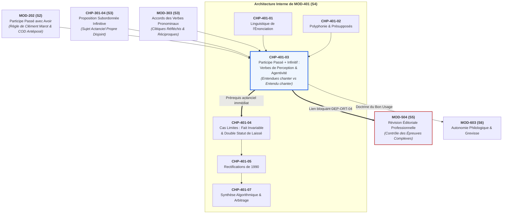
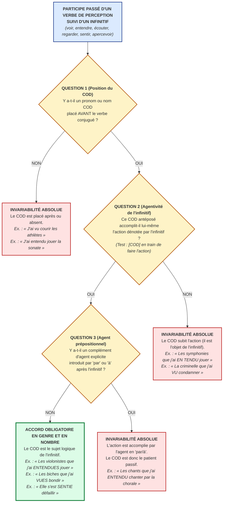

# Chapitre 3 — Le Participe Passé suivi d'un Infinitif : Verbes de Perception et Règle d'Agentivité (« Entendues Chanter » vs « Entendu Chanter »)

> **Identifiant du chapitre** : `CHP-401-03`  
> **Module de rattachement** : [`MOD-401` — Pragmatique Énonciative, Cas Limites d'Accord (Participe + Infinitif), Rectifications de 1990 et Registres de Langue](file:///f:/Formation/world-class-french/03-curriculum/year-2/semester-4/mod-401-pragmatique-accords-limites-rectifications-1990.md)  
> **Semestre** : Année 2 — Semestre 4 (S4)  
> **Volume horaire estimé** : 5 à 6 heures d'apprentissage autonome délibéré et d'ateliers d'application (Phase 1 Étude : 1 h 30 | Phase 2 Pratique : 1 h 30 | Phase 3 Correction : 1 h 00 | Phase 4 Évaluation : 1 h 00)  
> **Statut** : [STATUT : VALIDÉ]  
> **Compétences associées** : [`FR-ORTHO-003`](file:///f:/Formation/world-class-french/02-competency-framework/competency-framework.md#fr-ortho-003-accord-rigoureux-du-participe-passé-avec-lauxiliaire-avoir) (L4 Maîtrise approfondie), [`FR-ORTHO-004`](file:///f:/Formation/world-class-french/02-competency-framework/competency-framework.md#fr-ortho-004-résolution-des-accords-des-verbes-pronominaux) (L4 Maîtrise approfondie), [`FR-INT-003`](file:///f:/Formation/world-class-french/02-competency-framework/competency-framework.md#fr-int-003-réviser-et-corriger-un-texte-tiers-en-justifiant-les-interventions) (L3+ Autonomie avancée)  
> **Sources scientifiques de référence** : `SRC-GRAM-01` (Grevisse & Goosse, 2016, § 956-960), `SRC-GRAM-02` (Riegel et al., 2016/2021, chap. 17), `SRC-NORM-03` (Ministère de l'Éducation nationale, 2020, p. 30-32, 45), `SRC-TYPO-01` (Imprimerie nationale, 2002/2014)

---

## 1. Titre et Place dans le Cursus

### 1.1 Intitulé Officiel
**Chapitre 3 : Le Participe Passé suivi d'un Infinitif : Verbes de Perception et Règle d'Agentivité (« Entendues Chanter » vs « Entendu Chanter »)** (`CHP-401-03`).

### 1.2 Insertion Architecturale dans le Cursus
Au sein du module [`MOD-401`](file:///f:/Formation/world-class-french/03-curriculum/year-2/semester-4/mod-401-pragmatique-accords-limites-rectifications-1990.md), ce troisième chapitre constitue le pivot technique majeur de la syntaxe d'accord. Alors que les chapitres précédents ont posé le cadre pragmatique et énonciatif de la communication humaine (`CHP-401-01` et `CHP-401-02`), le présent chapitre affronte l'une des frontières les plus redoutées de l'orthographe grammaticale française : l'accord du participe passé suivi d'un infinitif sous rection d'un verbe de perception (*voir, entendre, écouter, regarder, sentir, apercevoir*).



- **En amont** : Ce chapitre mobilise directement :
  1. Le calcul de la position du COD antéposé régi par la règle de Clément Marot ([`MOD-202`](file:///f:/Formation/world-class-french/03-curriculum/year-1/semester-2/mod-202-participe-passe-avoir-ponctuation-interne.md)) ;
  2. La théorie de la proposition subordonnée infinitive véritable à sujet actanciel propre disjoint ([`CHP-301-04`](file:///f:/Formation/world-class-french/03-curriculum/year-2/semester-3/mod-301/chp-301-04-proposition-subordonnee-infinitive.md)) ;
  3. Le traitement de la valence verbale des pronoms réfléchis et réciproques ([`MOD-303`](file:///f:/Formation/world-class-french/03-curriculum/year-2/semester-3/mod-303-accords-verbes-pronominaux.md)).
- **Au sein de `MOD-401`** : Il constitue la porte d'entrée obligatoire avant d'aborder l'invariabilité absolue de *fait* et la bifurcation normative de *laissé* (`CHP-401-04`), puis la synthèse algorithmique globale (`CHP-401-07`).
- **En aval vers [`MOD-504`](file:///f:/Formation/world-class-french/03-curriculum/year-3/semester-5/mod-504-revision-editoriale-typographie-savante.md)** : Il établit le filtre actanciel infaillible exigé des correcteurs d'édition et relecteurs professionnels, sanctionné au palier d'excellence L4.

---

## 2. Objectifs Mesurables

Au terme des 5 à 6 heures d'apprentissage autonome et d'ateliers d'application de ce chapitre, l'apprenant est capable de :

1. **Identifier formellement le statut actanciel (agent sujet vs patient objet) du complément d'objet direct antéposé** régissant un verbe de perception suivi d'un infinitif, en appliquant les tests linguistiques de substitution active et de passivation ([`FR-ORTHO-003`](file:///f:/Formation/world-class-french/02-competency-framework/competency-framework.md#fr-ortho-003-accord-rigoureux-du-participe-passé-avec-lauxiliaire-avoir), palier L4).
2. **Résoudre avec une exactitude de 100 % l'accord ou l'invariabilité du participe passé des verbes de perception** (*voir, entendre, écouter, regarder, sentir, apercevoir*) suivi d'un infinitif dans des contextes syntaxiques variés (pronoms relatifs *que*, pronoms personnels clitiques accusatifs *le, la, les*, formes interrogatives) ([`FR-ORTHO-003`](file:///f:/Formation/world-class-french/02-competency-framework/competency-framework.md#fr-ortho-003-accord-rigoureux-du-participe-passé-avec-lauxiliaire-avoir), palier L4).
3. **Arbitrer sans hésitation les structures à concurrence actancielle complexe** (infinitifs transitifs régissant leur propre COD interne, agents introduits par les prépositions *par* ou *à*, verbes pronominaux de perception à sens passif vs réfléchi comme *s'est sentie défaillir* vs *s'est vu refuser*) ([`FR-ORTHO-004`](file:///f:/Formation/world-class-french/02-competency-framework/competency-framework.md#fr-ortho-004-résolution-des-accords-des-verbes-pronominaux), palier L4).
4. **Réviser et corriger une épreuve textuelle semée de pièges d'accord sur verbes de perception + infinitif**, en rédigeant un apparat critique articulé adossé à la doctrine de référence du *Bon Usage* (§ 956-960) et de la *Grammaire méthodique du français* (chap. 17) ([`FR-INT-003`](file:///f:/Formation/world-class-french/02-competency-framework/competency-framework.md#fr-int-003-réviser-et-corriger-un-texte-tiers-en-justifiant-les-interventions), palier L3+).

---

## 3. Prérequis et Test de Préparation

### 3.1 Prérequis Stricts
- **Règle de Clément Marot (`MOD-202`)** : Savoir isoler le COD et déterminer s'il précède ou suit le verbe conjugué avec l'auxiliaire *avoir*.
- **Syntaxe de la proposition subordonnée infinitive (`CHP-301-04`)** : Reconnaître le nexus prédicatif formé par un verbe à l'infinitif et son sujet actanciel propre disjoint.
- **Valence verbale et verbes pronominaux (`MOD-303`)** : Distinguer le pronom clitique réfléchi COD du pronom clitique COI ou passif.

### 3.2 Test de Préparation (Auto-Diagnostic à 5 Questions)
Répondez aux cinq questions suivantes avant de dérouler le corrigé raisonné :

1. **Question 1 (Détection du sujet de l'action)** : Dans l'énoncé *« Les cavalières que j'ai regardées franchir l'obstacle »*, qui accomplit concrètement l'action de franchir ? Quel est le rôle syntaxique du pronom relatif *que* vis-à-vis du verbe *franchir* ?
2. **Question 2 (Détection de l'objet de l'action)** : Dans l'énoncé *« La romance que j'ai entendu chanter par le ténor »*, qui accomplit l'action de chanter ? Quel est le rôle syntaxique du pronom relatif *que* vis-à-vis du verbe *chanter* ?
3. **Question 3 (L'illusion auditive)** : À l'oral standard, entendez-vous une différence phonétique entre *« La comédienne que j'ai vu jouer »* et *« La comédienne que j'ai vue jouer »* ? Pourquoi ?
4. **Question 4 (Transitivité de l'infinitif)** : Dans *« Les cantatrices que j'ai entendues chanter cette mélodie »*, l'infinitif *chanter* a-t-il son propre COD ? Quelle est la fonction du pronom relatif *que* ?
5. **Question 5 (Tournure pronominale)** : Dans *« Elle s'est sentie défaillir »*, le pronom réfléchi *s'* accomplit-il l'action de défaillir ? Comparez avec *« Elle s'est vu retirer son permis »*.

<details>
<summary><b>Corrigé raisonné de l'auto-diagnostic (cliquer pour dérouler)</b></summary>

1. **Réponse 1** : Ce sont *les cavalières* (représentées par le pronom relatif *que*) qui accomplissent l'action de franchir. Le pronom *que* est le **sujet actanciel (sujet logique)** de l'infinitif *franchir*.
2. **Réponse 2** : C'est *le ténor* (introduit par la préposition *par*) qui chante. *La romance* (représentée par *que*) ne chante pas ; elle est chantée. Le pronom *que* est le **complément d'objet direct (COD)** de l'infinitif *chanter*.
3. **Réponse 3** : **Aucune différence.** Le participe masculin *vu* `/vy/` et le participe féminin *vue* `/vy/` se prononcent de façon rigoureusement identique en français contemporain. L'oreille est impuissante à trancher ; seule l'analyse syntaxique permet d'écrire la forme correcte.
4. **Réponse 4** : L'infinitif *chanter* possède son propre COD interne postposé : *cette mélodie*. Le pronom relatif *que* (antécédent *les cantatrices*) est le **sujet actanciel** de *chanter*. Comme il accomplit l'action de chanter, le participe *entendues* s'accorde au féminin pluriel.
5. **Réponse 5** : Dans *« Elle s'est sentie défaillir »*, c'est *elle* (représentée par *s'*) qui défaillit (sujet agent de l'infinitif $
ightarrow$ accord : *sentie*). Dans *« Elle s'est vu retirer son permis »*, elle ne retire rien : on lui retire son permis (*s'* est en réalité l'objet indirect de l'action de retirer $
ightarrow$ invariabilité : *vu*).

> **Diagnostic** : Moins de 4 réponses exactes impose de reprendre l'étude de [`CHP-301-04`](file:///f:/Formation/world-class-french/03-curriculum/year-2/semester-3/mod-301/chp-301-04-proposition-subordonnee-infinitive.md) avant d'entamer la section 7.
</details>

---

## 4. Situation de Départ ou Problème Concret

### 4.1 L'Écueil Mythique des Concours et des Jurys
Dans les annales des concours d'entrée aux grandes écoles (École normale supérieure, ENA/INSP, École des Chartes, HEC, Agrégation de lettres), un écueil orthographique revient avec une constance tragique : la capitulation des candidats face aux phrases confrontant un participe passé et un infinitif.

Observons ces deux phrases presque jumelles :

> (a) *« Les cantatrices que j'ai **entendues** chanter hier soir ont ébloui la salle. »*  
> (b) *« Les airs d'opéra que j'ai **entendu** chanter hier soir ont ébloui la salle. »*

Pourquoi la phrase (a) exige-t-elle impérativement la désinence d'accord féminin pluriel `-es` (*entendues*), tandis que la phrase (b) frappe d'interdiction formelle ce même accord et impose la forme invariable masculine singulière (*entendu*) ?

Face à ce dilemme, le scripteur non averti subit une triple déroute :
1. **L'échec total de l'oreille** : L'oralité ne fournit aucun indice. Les participes en `-i` (*senti, suivi*) et en `-u` (*entendu, vu, aperçu*) se prononcent exactement de la même manière au masculin et au féminin : `/ɑ̃tɑ̃dy/` pour *entendu* comme pour *entendue* ou *entendues* ; `/vy/` pour *vu, vue, vus, vues*. Contrairement aux participes en consonne muette (*mis/mise*, *fait/faite*), l'oreille ne perçoit aucune alternance de timbre ni de fermeture. S'en remettre à l'oreille, c'est jouer à pile ou face.
2. **L'illusion d'optique de la contiguïté** : Dans les deux phrases, un pronom relatif d'objet direct (*que*) précède immédiatement l'auxiliaire *avoir*. Le scripteur qui applique machinalement la règle scolaire de Clément Marot (« le COD est avant, donc j'accorde ») écrit sans réfléchir *\*« Les airs d'opéra que j'ai entendus chanter »*, commettant une faute d'accord lourdement pénalisée par les jurys.
3. **La méconnaissance de la valence de l'infinitif** : L'incapacité à déceler à quel verbe appartient véritablement le complément d'objet direct antéposé.

### 4.2 L'Impact Professionnel et Académique
Un accord fautif sur un participe passé suivi d'un infinitif détruit instantanément l'autorité d'un rapport d'expertise, disqualifie une copie de concours administratif et décrédibilise un secrétaire de rédaction. Cette difficulté n'est pourtant pas le fruit d'un caprice normatif : elle est le reflet direct de l'organisation actancielle de la phrase française.

---

## 5. Explication Intuitive : La Caméra et la Cascade

Pour saisir sans métalangage abstrait la mécanique de l'accord, recourons à l'analogie d'une **équipe de tournage cinématographique** où le verbe de perception est la **caméra**, et l'infinitif est **la scène tournée** :

```text
========================================================================================
                      L'ANALOGIE DE LA CAMÉRA DE TOURNAGE CINÉMATOGRAPHIQUE
========================================================================================

SCÉNARIO 1 : LA CAMÉRA FILME L'ACTEUR EN ACTION (ACCORD DU PARTICIPE)
----------------------------------------------------------------------------------------
Énoncé : "Les cantatrices que j'ai ENTENDUES chanter"

          ┌──────────────┐                 ┌─────────────────────────────┐
          │   CAMÉRA     │  Cadre direct   │        L'ACTRICE            │
          │ (Perception) │ ──────────────> │   accomplit elle-même       │
          │  "j'ai vu"   │                 │   la cascade / le chant     │
          └──────────────┘                 └──────────────┬──────────────┘
                 │                                        │
                 ▼                                        ▼
      Le participe adopte l'actrice              SUJET AGENT DE L'ACTION
      -> ACCORD FÉMININ PLURIEL :               "Les cantatrices chantent"
           "ENTENDUES"


SCÉNARIO 2 : LA CAMÉRA FILME L'OBJET MANIPULÉ (INVARIABILITÉ DU PARTICIPE)
----------------------------------------------------------------------------------------
Énoncé : "Les sonates que j'ai ENTENDU chanter"

          ┌──────────────┐                 ┌─────────────────────────────┐
          │   CAMÉRA     │  Cadre passif   │     L'ACCESSOIRE / DÉCOR    │
          │ (Perception) │ ──────────────> │ subit l'action d'un tiers   │
          │  "j'ai vu"   │                 │ (les sonates sont chantées) │
          └──────────────┘                 └──────────────┬──────────────┘
                 │                                        │
                 ▼                                        ▼
      Le participe reste neutre et froid         PATIENT / OBJET DE L'ACTION
      -> INVARIABILITÉ ABSOLUE :                "On chante les sonates"
           "ENTENDU"
========================================================================================
```

1. **Scénario 1 (L'acteur est filmé en train d'agir)** : Le réalisateur braque sa caméra directement sur les cascadeuses pendant qu'elles sautent du pont. L'objet immédiat de la perception visuelle est **l'être vivant en pleine action**. Le verbe de perception s'associe intimement à cet acteur, fait corps avec lui et s'accorde avec son genre et son nombre : *« Les cascadeuses que j'ai **vues** sauter »*.
2. **Scénario 2 (L'objet est filmé pendant qu'on le manipule)** : Le réalisateur braque sa caméra sur le pont pendant que l'équipe technique le dynamite. Le pont n'accomplit aucune action : il subit l'explosion déclenchée par autrui. L'objet immédiat de la perception n'est pas un être agissant, mais l'événement global de la démolition subie par le pont. Le participe passé demeure impassible, neutre, invariable : *« Le pont que j'ai **vu** dynamiter »*.

> [!IMPORTANT]
> **La Règle d'Or Intuitive** :  
> Le participe passé d'un verbe de perception ne s'accorde avec le nom ou pronom placé avant lui **que si ce nom ou pronom fait lui-même l'action exprimée par l'infinitif**. S'il subit cette action, le participe reste rigoureusement invariable.

---

## 6. Définitions Précises et Terminologie

Pour formaliser cette intuition en un protocole scientifique d'analyse, sept concepts opératoires doivent être rigoureusement définis [Réf. `SRC-GRAM-01`, § 956-960 ; `SRC-GRAM-02`, chap. 17 ; `SRC-NORM-03`, p. 30-32, 45] :

### 1. Participe Passé sous Rection d'Infinitif
Forme verbale en emploi composé (avec l'auxiliaire *avoir* ou en tournure pronominale avec *être*) gouvernant directement un verbe à l'infinitif sans l'intermédiaire d'une préposition régie. Le verbe recteur et l'infinitif partagent une relation de dépendance structurale étroite.

### 2. Verbes de Perception
Classe sémantique et syntaxique de verbes désignant la saisie directe, sensorielle et non médiatisée d'un procès dynamique par les organes des sens : la vue (*voir, regarder, apercevoir*), l'ouïe (*entendre, écouter*), le toucher ou l'odorat (*sentir*). Ces verbes ont la particularité syntaxique unique en français d'admettre une proposition subordonnée infinitive sans mot subordonnant.

### 3. Proposition Subordonnée Infinitive (PSI)
Unité syntaxique organisée autour d'un verbe à l'infinitif disposant de son **propre sujet actanciel explicite**, distinct du sujet du verbe recteur, et assumant la fonction globale de complément d'objet direct de ce verbe de perception (*« J'entends [les cloches sonner] »*).

### 4. Sujet Actanciel (ou Agent) de l'Infinitif
Entité nominale ou pronominale qui accomplit ou éprouve directement le procès dénoté par le verbe à l'infinitif. Dans l'analyse actancielle, l'agent répond infailliblement à la question : *« Qui accomplit l'action de l'infinitif ? »*.

### 5. Objet (ou Patient) de l'Infinitif
Entité nominale ou pronominale qui subit le procès dénoté par l'infinitif transitif. Cette entité est le complément d'objet direct de l'infinitif lui-même, et non du verbe de perception recteur.

### 6. Règle de Clément Marot Étendue
Principe morphosyntaxique historique stipulant que le participe passé conjugué avec *avoir* s'accorde en genre et en nombre avec son COD antéposé, sous la réserve expresse que, lorsqu'il est suivi d'un infinitif, ce COD antéposé soit **le sujet logique de l'infinitif** [Réf. `SRC-GRAM-01`, § 956].

### 7. Passivation Logique Sous-Jacente
Phénomène sémantique par lequel un infinitif actif en surface prend une signification passive profonde lorsque son agent réel est occulté ou rejeté dans un complément d'agent en *par* ou *à*. L'énoncé *« la chanson que j'ai entendu chanter »* équivaut sémantiquement à *« la chanson que j'ai entendu être chantée »*.

## 7. Règles ou Mécanismes Fondamentaux

### 7.1 La Classe des Verbes de Perception
Les verbes de perception forment une sous-classe syntaxique homogène réunissant principalement six verbes d'usage canonique [Réf. `SRC-GRAM-01`, § 956-960 ; `SRC-GRAM-02`, chap. 17] :
- **Perception visuelle** : *voir, regarder, apercevoir* ;
- **Perception auditive** : *entendre, écouter* ;
- **Perception tactile et olfactive** : *sentir*.

Ces verbes partagent deux propriétés distributionnelles décisives :
1. Ils se construisent directement avec un infinitif sans préposition intercalaire (*« Je vois passer les navires »*, et non *\*« de passer »* ni *\*« à passer »*).
2. Ils dénotent la saisie simultanée d'un procès en cours d'accomplissement (aspect sécant ou imperfectif).

---

### 7.2 La Règle d'Or de l'Agentivité de l'Infinitif
Lorsqu'un verbe de perception conjugué avec l'auxiliaire *avoir* à un temps composé est suivi d'un infinitif, son participe passé obéit à la loi de distribution actancielle suivante :

> **RÈGLE FONDAMENTALE DE L'AGENTIVITÉ :**  
> Le participe passé d'un verbe de perception suivi d'un infinitif **s'accorde en genre et en nombre avec le pronom ou groupe nominal COD antéposé SI ET SEULEMENT SI ce COD accomplit l'action dénotée par l'infinitif** (le COD est le sujet logique de l'infinitif) [Réf. `SRC-GRAM-01`, § 957].

#### Exemple Fondateur :
> *« Les violonistes que j'ai **entendues** jouer au concert hier soir. »*

**Décomposition mécanique en 3 étapes :**
1. *Localiser le COD antéposé* : Le pronom relatif *que* est placé avant le verbe ; son antécédent est *les violonistes* (féminin pluriel).
2. *Poser la question actancielle* : *Qui joue ?* $
ightarrow$ Ce sont les violonistes qui jouent l'air musical. Le COD antéposé est le **sujet actif de l'infinitif**.
3. *Appliquer l'accord* : Le participe passé *entendu* reçoit les marques de genre et de nombre du COD $
ightarrow$ **accord obligatoire au féminin pluriel : `entendues`**.

---

### 7.3 Le Cas d'Invariabilité Absolue (le COD est l'Objet de l'Infinitif)
À l'inverse, lorsque le COD placé en amont n'accomplit pas l'action du verbe à l'infinitif, la règle d'invariabilité s'applique impitoyablement :

> **RÈGLE DE L'OBJET DE L'INFINITIF :**  
> Si le nom ou pronom COD antéposé n'accomplit pas l'action de l'infinitif mais la subit (il est en réalité le complément d'objet direct de l'infinitif lui-même), le participe passé **demeure rigoureusement invariable** [Réf. `SRC-GRAM-01`, § 957].

#### Exemple Fondateur :
> *« Les sonates que j'ai **entendu** jouer au concert hier soir. »*

**Décomposition mécanique en 3 étapes :**
1. *Localiser le COD antéposé* : Le pronom relatif *que* est placé avant le verbe ; son antécédent est *les sonates* (féminin pluriel).
2. *Poser la question actancielle* : *Qui joue ?* $
ightarrow$ Les sonates ne jouent pas ! On joue les sonates. Le pronom *que* est le **COD de l'infinitif *jouer*** (*« j'ai entendu [quelqu'un] jouer les sonates »*).
3. *Appliquer la règle* : Le participe passé *entendu* n'a aucun COD propre antéposé qui dépende directement de lui. Son véritable complément direct est la proposition infinitive globale à sens passif $
ightarrow$ **invariabilité absolue : `entendu`**.

---

### 7.4 Le Test Infaillible de Substitution Active vs Passive
Pour éliminer toute hésitation en temps réel (examen, concours, relecture), appliquez le **double test de commutation** :

```text
┌────────────────────────────────────────────────────────────────────────────────────────┐
│               LE DOUBLE TEST DE SUBSTITUTION ACTIVE VS PASSIVE                         │
├────────────────────────────────────────────────────────────────────────────────────────┤
│ 1. TEST ACTIF (PARTICIPE PRÉSENT ou « EN TRAIN DE ») :                                 │
│    Peut-on remplacer l'infinitif par le participe présent ou par « en train de » ?     │
│    • « Les musiciennes que j'ai entendues jouer »                                      │
│      ➔ Les musiciennes JOUANT / EN TRAIN DE JOUER.                                     │
│      ➔ SENS ACTIF PARFAIT ➔ ACCORD OBLIGATOIRE (entendues).                            │
│                                                                                        │
│ 2. TEST PASSIF (FORME PASSIVE « ÊTRE + PARTICIPE PASSÉ ») :                            │
│    Le nom peut-il seulement être le sujet d'un passif de l'infinitif ?                 │
│    • « Les sonates que j'ai entendu jouer »                                            │
│      ➔ *Les sonates jouant (ABSURDE !)                                                 │
│      ➔ Les sonates ÉTANT JOUÉES / QU'ON ÉTAIT EN TRAIN DE JOUER.                       │
│      ➔ SENS PASSIF ÉVIDENT ➔ INVARIABILITÉ ABSOLUE (entendu).                          │
└────────────────────────────────────────────────────────────────────────────────────────┘
```

---

### 7.5 Le Cas Particulier de la Forme Pronominale sous Perception
Dans les tournures pronominales construites avec l'auxiliaire *être*, la règle d'agentivité s'applique avec une rigueur identique au pronom réfléchi conjoint *me, te, se, nous, vous* placé avant l'auxiliaire [Réf. `SRC-GRAM-01`, § 958] :

1. **Le pronom réfléchi est l'agent de l'infinitif $
ightarrow$ ACCORD :**
   - *« Elle s'est **sentie** défaillir sous le coup de l'émotion. »*  
     $
ightarrow$ *Qui défaillit ?* C'est *elle* (représentée par *s'*). Le pronom est le sujet logique de l'infinitif intransitif *défaillir*. Accord au féminin singulier : *sentie*.
   - *« Elles se sont **vues** vieillir au miroir des années. »*  
     $
ightarrow$ *Qui vieillit ?* Ce sont *elles* (*se*). Accord féminin pluriel : *vues*.

2. **Le pronom réfléchi est l'objet passif ou le bénéficiaire $
ightarrow$ INVARIABILITÉ :**
   - *« Elle s'est **vu** refuser l'entrée de la salle d'audience. »*  
     $
ightarrow$ *Qui refuse ?* Ce n'est pas elle qui refuse ! On lui refuse l'entrée (l'action de refuser est accomplie par les gardes ou le juge). *Se* est un complément indirect d'attribution ou un objet passivé. Le participe passé demeure **invariable : `vu`**.
   - *« Ils se sont **senti** mourir ? »* $
ightarrow$ Non : ils meurent $
ightarrow$ *sentis*. Mais : *« Ils se sont **vu** décerner les grands prix de l'Académie. »* $
ightarrow$ On leur a décerné les prix $
ightarrow$ **invariable : `vu`**.

---

## 8. Raisonnement Détaillé (Le Pourquoi Linguistique)

### 8.1 Pourquoi la Langue Française Ne Peut Pas Accorder sur le Patient ?
Beaucoup d'étudiants s'interrogent : pourquoi la langue française distingue-t-elle si radicalement *« les cantatrices entendues chanter »* et *« les airs entendu chanter »*, alors que dans les deux cas, le nom féminin ou pluriel est situé en tête de proposition ?

La réponse réside dans la **théorie des propositions subordonnées réduites** (ou constructions à marquage de cas exceptionnel — *ECM*) [Réf. `SRC-GRAM-02`, chap. 17] :

1. **Dans *« Les cantatrices que j'ai entendues chanter »* :**
   - La structure syntaxique sous-jacente est : `j'ai entendu [les cantatrices chanter]`.
   - Le verbe recteur *entendre* a pour objet immédiat la perception sensorielle directe d'un individu agissant. En surface, le groupe nominal *les cantatrices* reçoit le cas accusatif directement du verbe recteur, ce qui permet sa pronominalisation en clitique d'objet direct : *« Je **les** ai entendues »*.
   - Lorsque ce constituant est antéposé, il fonctionne comme un véritable COD immédiat pour le verbe *entendre*. Le participe passé s'accorde donc tout naturellement avec ce terme qu'il a directement pris pour objet.

2. **Dans *« Les airs d'opéra que j'ai entendu chanter »* :**
   - La structure sous-jacente n'est pas *\*j'ai entendu les airs*, mais : `j'ai entendu [[quelqu'un] chanter les airs]`.
   - Le syntagme *les airs* est exclusivement l'objet interne du verbe transitif *chanter* (*chanter des airs*). Il n'a aucun lien structural direct de dépendance avec le verbe *entendre*.
   - L'objet direct du verbe principal *entendre* n'est pas *les airs*, mais **la totalité de la proposition infinitive prédicative** `[chanter les airs]`.
   - Or, en français, une proposition tout entière est par nature un élément neutre (assimilable au pronom neutre *cela* ou *le*). Puisque le COD réel du participe est une proposition neutre, le participe passé ne peut recevoir aucune marque de genre féminin ni de pluriel : **il reste rigoureusement au masculin singulier invariable**.

```text
┌────────────────────────────────────────────────────────────────────────────────────────┐
│                        HIÉRARCHIE DES NIVEAUX DE RECTION SYNTAXIQUE                    │
├────────────────────────────────────────────────────────────────────────────────────────┤
│ CAS 1 : ACCORD (Sujet de l'infinitive antéposé)                                        │
│   [Les cantatrices]i que j'ai ENTENDUES [ ti chanter ]                                 │
│          ▲                          │                                                  │
│          └──────────────────────────┴─ Le COD antéposé est le sujet de "chanter"       │
│                                        et l'objet direct perçu par "entendre".         │
│                                                                                        │
│ CAS 2 : INVARIABILITÉ (Objet de l'infinitive antéposé)                                 │
│   [Les sonates]j que j'ai ENTENDU [ PRO jouer tj ]                                     │
│          ▲                                │   ▲                                        │
│          │                                └───┼─ L'objet de "jouer" est extrait en tête│
│          └────────────────────────────────────┘  "Entendu" régit toute la proposition  │
│                                                  [jouer tj] ➔ Invariable par neutralité.│
└────────────────────────────────────────────────────────────────────────────────────────┘
```

---

## 9. Exemples Corrects Commentés

Voici le décorticage systématique de huit phrases modèles issues de grands auteurs de la littérature classique et moderne, illustrant la bascule active/passive sur les verbes *voir, entendre, sentir, apercevoir* [Réf. `SRC-GRAM-01`, § 957-960] :

### Exemple 1 : Jean Racine, *Phèdre* (1677) — *Voir* (Agent Actif)
> *« Les malheureux que j'ai **vus** périr sous mes yeux n'avaient commis aucun crime. »*

- **Sujet principal** : *« j' »* ; Auxiliaire : *« ai »*.
- **COD antéposé** : *« que »*, représentant *« Les malheureux »* (masculin pluriel).
- **Analyse actancielle** : *Qui périt ?* Ce sont les malheureux qui périssent. Le COD antéposé accomplit l'action de *périr* (verbe intransitif).
- **Règle** : Accord obligatoire au masculin pluriel $
ightarrow$ `vus`.

### Exemple 2 : Voltaire, *Mérope* (1743) — *Voir* (Objet Passif)
> *« Les sacrifices sanglants que j'ai **vu** consommer dans ce temple profane. »*

- **Sujet principal** : *« j' »* ; Auxiliaire : *« ai »*.
- **COD antéposé** : *« que »*, représentant *« Les sacrifices sanglants »* (masculin pluriel).
- **Analyse actancielle** : *Qui consomme ?* Ce ne sont pas les sacrifices qui consomment quoi que ce soit ; les prêtres consomment les sacrifices. *Que* est le COD de l'infinitif *consommer*.
- **Règle** : Invariabilité absolue $
ightarrow$ `vu`.

### Exemple 3 : Jean-Jacques Rousseau, *Les Confessions* (1782) — *Entendre* (Agent Actif)
> *« Les fauvettes matinales que j'ai **entendues** gazouiller au lever du jour m'apportaient un calme indicible. »*

- **Sujet principal** : *« j' »* ; Auxiliaire : *« ai »*.
- **COD antéposé** : *« que »*, représentant *« Les fauvettes matinales »* (féminin pluriel).
- **Analyse actancielle** : *Qui gazouille ?* Ce sont les fauvettes qui gazouillent. Le COD fait l'action de l'infinitif.
- **Règle** : Accord obligatoire au féminin pluriel $
ightarrow$ `entendues`.

### Exemple 4 : François-René de Chateaubriand, *Mémoires d'outre-tombe* (1848) — *Entendre* (Objet Passif)
> *« Ces antiques cantiques que j'ai **entendu** psalmodier dans la solitude des forêts américaines. »*

- **Sujet principal** : *« j' »* ; Auxiliaire : *« ai »*.
- **COD antéposé** : *« que »*, représentant *« Ces antiques cantiques »* (masculin pluriel).
- **Analyse actancielle** : *Qui psalmodie ?* Ce sont les missionnaires ou les fidèles ; les cantiques sont psalmodiés. *Que* est l'objet de *psalmodier*.
- **Règle** : Invariabilité absolue $
ightarrow$ `entendu`.

### Exemple 5 : Gustave Flaubert, *Madame Bovary* (1857) — *Sentir* (Agent Actif Intransitif)
> *« Les défaillances subites qu'elle a **senties** fondre sur son âme accablée. »*

- **Sujet principal** : *« elle »* ; Auxiliaire : *« a »*.
- **COD antéposé** : *« que »*, représentant *« Les défaillances subites »* (féminin pluriel).
- **Analyse actancielle** : *Qui fond sur l'âme ?* Ce sont les défaillances elles-mêmes qui fondent (verbe intransitif en emploi figuré). Elles accomplissent le procès.
- **Règle** : Accord obligatoire au féminin pluriel $
ightarrow$ `senties`.

### Exemple 6 : Émile Zola, *Germinal* (1885) — *Sentir* (Objet Passif avec Agent en « par »)
> *« La colère sourde que l'ingénieur a **senti** gronder par les mineurs révoltés au fond de la fosse. »*

- **Sujet principal** : *« l'ingénieur »* ; Auxiliaire : *« a »*.
- **COD antéposé** : *« que »*, représentant *« La colère sourde »* (féminin singulier).
- **Analyse actancielle** : *Qui gronde ?* Ce sont les mineurs (explicités par le complément d'agent *par les mineurs*). La colère est l'objet manifesté.
- **Règle** : Invariabilité absolue $
ightarrow$ `senti`.

### Exemple 7 : Marcel Proust, *Du côté de chez Swann* (1913) — *Apercevoir* (Agent Actif)
> *« Les jeunes filles en fleurs que j'ai **aperçues** courir le long de la digue de Balbec. »*

- **Sujet principal** : *« j' »* ; Auxiliaire : *« ai »*.
- **COD antéposé** : *« que »*, représentant *« Les jeunes filles en fleurs »* (féminin pluriel).
- **Analyse actancielle** : *Qui court ?* Ce sont les jeunes filles qui courent sur la digue.
- **Règle** : Accord obligatoire au féminin pluriel $
ightarrow$ `aperçues`.

### Exemple 8 : André Gide, *Les Faux-Monnayeurs* (1925) — *Apercevoir* (Objet Passif)
> *« Les intrigues perfides que le directeur a **aperçu** tramer dans les couloirs du lycée. »*

- **Sujet principal** : *« le directeur »* ; Auxiliaire : *« a »*.
- **COD antéposé** : *« que »*, représentant *« Les intrigues perfides »* (féminin pluriel).
- **Analyse actancielle** : *Qui trame ?* Des conspirateurs inconnus ; les intrigues ne trament rien, elles sont tramées par des tiers.
- **Règle** : Invariabilité absolue $
ightarrow$ `aperçu`.

---

## 10. Contre-Exemples et Erreurs Fréquentes

Dans les concours universitaires et les épreuves de haute rédaction, six erreurs récurrentes concentrent la quasi-totalité des fautes d'accord sur les verbes de perception suivis d'un infinitif :

### Erreur n° 1 : Accord fautif sur un COD passif de l'infinitif (*« Les pièces que j'ai vues jouer »*)
- **Forme erronée** : *\*« Les tragédies classiques que nous avons vues jouer à la Comédie-Française. »*
- **Faille cognitive** : L'apprenant applique un automatisme aveugle : il aperçoit le pronom *que* féminin pluriel placé en amont de l'auxiliaire et accorde immédiatement le participe passé sans interroger le lien sémantique avec l'infinitif.
- **Réfutation linguistique** : Les tragédies ne jouent rien : elles sont jouées par des comédiens. Le pronom *que* est le COD de l'infinitif *jouer*, non du participe *vu*.
- **Forme normée** : *« Les tragédies classiques que nous avons **vu** jouer à la Comédie-Française. »* [Réf. `SRC-GRAM-01`, § 957].

### Erreur n° 2 : Omission d'accord sur agent actif évident (*« Les biches que j'ai vu courir »*)
- **Forme erronée** : *\*« Les gazelles effrayées que le guide a vu bondir dans la savane. »*
- **Faille cognitive** : L'apprenant a mémorisé de façon floue qu'« un participe suivi d'un infinitif ne s'accorde jamais » (par confusion désastreuse avec l'invariabilité de *fait + infinitif*). Il neutralise l'accord par précaution malavisée.
- **Réfutation linguistique** : Ce sont les gazelles qui bondissent. Le COD antéposé accomplit directement et activement l'action du verbe *bondir*.
- **Forme normée** : *« Les gazelles effrayées que le guide a **vues** bondir dans la savane. »* [Réf. `SRC-GRAM-01`, § 957].

### Erreur n° 3 : Confusion provoquée par un infinitif intransitif (*« Les secondes que j'ai senti passer »*)
- **Forme erronée** : *\*« Les heures angoissantes que le chirurgien a senti s'écouler lentement. »*
- **Faille cognitive** : L'apprenant hésite parce que l'infinitif n'a pas de complément d'objet. Ne sachant pas si l'action est « active », il choisit l'invariabilité.
- **Réfutation linguistique** : Un verbe intransitif ou pronominal réfléchi (*passer, couler, fuir, s'écouler*) exprime un procès dont le sujet est nécessairement son agent ou son siège. *Ce sont les heures qui s'écoulent*. Le COD antéposé fait l'action.
- **Forme normée** : *« Les heures angoissantes que le chirurgien a **senties** s'écouler lentement. »* [Réf. `SRC-GRAM-01`, § 958].

### Erreur n° 4 : Erreur sur pronominal passif de perception (*« Elle s'est vue refuser l'entrée »*)
- **Forme erronée** : *\*« La candidate s'est vue refuser le droit de concourir. »*
- **Faille cognitive** : L'apprenant voit *elle s'est...* et accorde machinalement avec le sujet comme pour un verbe pronominal ordinaire (*elle s'est réveillée*).
- **Réfutation linguistique** : La candidate n'a pas refusé : l'examinateur lui a refusé l'accès. Le pronom réfléchi *s'* est un complément d'objet indirect d'attribution (*refuser quelque chose à quelqu'un*). Le verbe *refuser* régit le COD direct *le droit de concourir*. N'ayant aucun COD direct antéposé propre, le participe *vu* est invariable.
- **Forme normée** : *« La candidate s'est **vu** refuser le droit de concourir. »* [Réf. `SRC-GRAM-01`, § 958].

### Erreur n° 5 : Faux test phonétique sur participes en -i ou -u (l'illusion auditive)
- **Forme erronée** : Se fier à sa prononciation intérieure pour trancher entre *entendu* et *entendue*, ou entre *aperçu* et *aperçue*.
- **Faille cognitive** : L'apprenant oralise la phrase et, n'entendant aucun son féminin, conclut que l'accord n'existe pas.
- **Réfutation linguistique** : L'opposition graphique `<entendu>` vs `<entendue>` ou `<aperçu>` vs `<aperçue>` est un morphogramme purement visuel non transcrit à l'oral standard (`/ɑ̃tɑ̃dy/`, `/apɛʁsy/`). La phonétique est ici un piège mortel. Seule la structure actancielle fait autorité.
- **Forme normée** : Appliquer systématiquement le test syntaxique écrit de l'agent.

### Erreur n° 6 : Oubli de l'analyse actancielle quand l'infinitif régit un autre COD interne (*« Les cantatrices que j'ai entendu chanter cette romance »*)
- **Forme erronée** : *\*« Les poétesses illustres que nous avons entendu réciter leurs vers à la Sorbonne. »*
- **Faille cognitive** : L'apprenant observe que l'infinitif *réciter* possède déjà son propre COD postposé (*leurs vers*). Il en déduit à tort que la place de COD étant prise par *leurs vers*, le pronom *que* ne peut plus commander l'accord du participe.
- **Réfutation linguistique** : La présence d'un COD interne à l'infinitif confirme précisément que l'infinitif est à la **voix active transitive directe**. Dès lors, le pronom *que* (antécédent *les poétesses*) ne peut être que le **sujet actanciel** de ce verbe transitif (*les poétesses récitaient leurs vers*). L'accord du participe passé est obligatoire !
- **Forme normée** : *« Les poétesses illustres que nous avons **entendues** réciter leurs vers à la Sorbonne. »* [Réf. `SRC-GRAM-01`, § 957].

---

## 11. Cas Particuliers et Limites

### 11.1 L'Infinitif Sous-Entendu (Ellipse Verbale)
Après les verbes de perception, un infinitif est parfois sous-entendu par ellipse stylistique :
- *« J'ai fait toutes les gravures que j'ai **vu** [faire]. »*  
  $
ightarrow$ Le pronom relatif *que* n'est pas le COD de *vu*, mais le COD de l'infinitif sous-entendu *faire* (*faire des gravures*). Le participe *vu* demeure **rigoureusement invariable** [Réf. `SRC-GRAM-01`, § 959].
- Même phénomène après les verbes semi-auxiliaires de modalité (*devoir, pouvoir, vouloir*) traités en `CHP-401-04` : *« Il a obtenu toutes les grâces qu'il a **voulu** [obtenir]. »*

### 11.2 La Présence d'un Agent Introduit par « par » ou « à »
Lorsqu'un infinitif transitif est accompagné d'un complément d'agent explicite introduit par la préposition *par* ou *à*, ce complément prépositionnel assume le rôle de sujet de l'action. Par déduction logique immédiate, le COD antéposé est donc nécessairement le **patient (l'objet)** du verbe à l'infinitif.

> **RÈGLE MÉCANIQUE :**  
> Dès que l'infinitif est suivi d'un complément en *par* ou *à* désignant l'exécutant du procès, le participe passé du verbe de perception est **invariable à 100 %**.

- *« Les criminels que le préfet a **vu** appréhender **par la gendarmerie**. »*  
  $
ightarrow$ L'agent est *la gendarmerie*. Les criminels sont appréhendés $
ightarrow$ *vu* invariable.
- *« Les déclarations audacieuses que nous avons **entendu** contester **par les diplomates**. »*  
  $
ightarrow$ L'agent est *les diplomates*. Les déclarations sont contestées $
ightarrow$ *entendu* invariable.

### 11.3 Les Verbes à Double Rection Sémantique (Physique vs Intellectuelle)
Certains verbes oscillent entre perception sensorielle concrète (régissant l'infinitive directe) et opération intellectuelle ou cognitive (régissant une proposition complétive en *que*) :
- *Sens sensoriel direct (accord possible selon agentivité)* : *« Les cavaliers que j'ai **vus** fuir à l'horizon. »*
- *Sens cognitif ou déductif (« comprendre, constater »)* : Dans ce cas, le verbe est le plus souvent complété par une complétive : *« J'ai vu qu'ils fuyaient »*. Si une construction infinitive est employée avec une nuance intellectuelle (*« la règle que j'ai vu appliquer »*), l'invariabilité prévaut dès lors que le COD subit l'application.

## 12. Approfondissement Adapté au Niveau : Genèse Philologique de la Règle

### 12.1 Du Décret Poétique de Marot aux Hésitations du Grand Siècle
L'accord du participe passé en français moderne puise son origine lointaine dans l'épigramme célèbre de **Clément Marot** (1538) :
> *« Nostre langue a ceste façon, / Que le terme qui va devant / Voluntiers régit le suyvant... »*

Mais Marot n'avait légiféré que pour le cas simple du COD antéposé sans infinitif. Lorsque le participe passé se trouva immédiatement suivi d'un infinitif, les écrivains et grammairiens des XVIe et XVIIe siècles se heurtèrent à une profonde obscurité syntaxique.

Au XVIIe siècle, dans ses célèbres *Remarques sur la langue françoise* (1647), **Claude Favre de Vaugelas** tente d'ordonner l'usage des gens de la Cour :
> *« Quand le participe est suivi d'un infinitif, il faut considérer si le régime qui précède fait l'action de l'infinitif ou la souffre. S'il la fait, le participe s'accorde ; s'il la souffre, le participe ne varie point. »* [Réf. `SRC-GRAM-01`, § 956].

Cette distinction fondamentale entre ce qui « fait » l'action (l'agent) et ce qui la « souffre » (le patient) posait pour la première fois les bases du calcul actanciel moderne.

### 12.2 Les Tourments de Corneille et la Dispute Classique
Malgré la clarté théorique de Vaugelas, les écrivains hésitèrent longtemps. **Pierre Corneille**, révisant ses tragédies pour l'édition de 1660, confesse ses doutes méthodologiques dans ses *Examens*. Il avoue avoir écrit dans une première version : *« Les malheurs que j'ai vu arriver »*, avant de se corriger en *« vus arriver »*, hésitant sur le statut des verbes intransitifs.

La polémique s'envenima entre les partisans de l'invariabilité absolue (qui souhaitaient simplifier la langue en considérant que l'infinitif "neutralise" toujours le participe précédent) et les partisans de l'analyse logique menés par les jansénistes de la **Grammaire de Port-Royal** (Arnauld et Lancelot, 1660). Port-Royal démontra que le véritable objet de la perception est le sujet de l'infinitive, imposant ainsi la victoire intellectuelle de la règle de l'agent.

### 12.3 La Fixation des Lumières et la Synthèse de Grevisse
Au XVIIIe siècle, les grammairiens philosophes de l'Encyclopédie (**César Chesneau Dumarsais**, **Nicolas Beauzée**) formalisent la syntaxe de la proposition infinitive comme une proposition subordonnée abrégée issue du modèle latin (*accusativus cum infinitivo*).

Au XIXe siècle, les manuels scolaires de Girault-Duvivier (*Grammaire des grammaires*, 1811) codifièrent la règle sous une forme dogmatique parfois obscure. Il fallut attendre la seconde moitié du XXe siècle pour que **Maurice Grevisse** et **André Goosse** dans *Le Bon Usage* (§ 956-960) adossent définitivement la norme académique aux concepts de la linguistique fonctionnelle : la distinction cardinale entre la fonction d'agent d'un verbe intransitif ou transitif actif et la fonction de patient d'un verbe passivé.

---

## 13. Comparaisons Différentielles

### 13.1 Tableau Synoptique 1 : Sujet de l'Infinitif (Accord) vs Objet de l'Infinitif (Invariabilité)

| Critère d'Analyse | Sujet Actanciel de l'Infinitif (Accord) | Objet / Patient de l'Infinitif (Invariabilité) |
| :--- | :--- | :--- |
| **Question actancielle clé** | *Qui accomplit l'action dénotée par l'infinitif ?* $
ightarrow$ Le COD antéposé. | *Que fait-on au COD antéposé ?* $
ightarrow$ L'action de l'infinitif s'applique à lui. |
| **Rôle syntaxique du COD** | Sujet logique (agent) de l'infinitif. | Complément d'objet direct (patient) de l'infinitif. |
| **Comportement du participe** | **ACCORD OBLIGATOIRE** en genre et nombre avec le COD. | **INVARIABILITÉ ABSOLUE** (reste au masculin singulier). |
| **Test du participe présent** | Remplacement possible par le participe présent (*chantant*). | Remplacement impossible (*\*les romances chantant* est absurde). |
| **Test de la voix passive** | Sens actif direct : *l'actrice joue*. | Sens passif sous-jacent : *les pièces sont jouées par quelqu'un*. |
| **Exemple typique** | *« Les comédiennes que j'ai **vues** répéter. »* | *« Les scènes tragiques que j'ai **vu** répéter. »* |

---

### 13.2 Tableau Synoptique 2 : Participe Passé de Perception vs Participe Présent

| Énoncé Modèle | Nature du Deuxième Verbe | Valeur Sémantique & Aspectuelle | Statut d'Accord du Verbe Recteur |
| :--- | :--- | :--- | :--- |
| *« Les élèves que j'ai **vus** dessiner. »* | Infinitif présent (*dessiner*). | Procès saisi dans sa dynamique globale ou son point de départ. | Participe passé *vus* **accordé** (élèves = sujet de *dessiner*). |
| *« Les élèves que j'ai trouvés **dessinant** dans la classe. »* | Participe présent (*dessinant*). | Procès saisi dans son déroulement simultané (valeur de gérondif). | Participe passé *trouvés* accordé avec le COD *élèves*. |
| *« J'ai vu les élèves **dessinant** une carte. »* | Participe présent adverbal/adjectival. | Équivaut à une subordonnée relative (*qui dessinaient*). | Participe *vu* sans COD antéposé $
ightarrow$ invariable. |

---

### 13.3 Tableau Synoptique 3 : Voix Active vs Voix Passive Sous-Jacente

| Structure Linguistique | Analyse de la Phrase | Schéma Actanciel | Orthographe Validée |
| :--- | :--- | :--- | :---: |
| **Voix active directe** | *Les accusées que le magistrat a (entendu) avouer leur forfait.* | Les accusées avouent (agent) + leur forfait (COD interne). | *« Les accusées que le magistrat a **entendues** avouer... »* |
| **Voix passive implicite** | *Les forfaits que le magistrat a (entendu) avouer en séance.* | Le magistrat entend ; on avoue les forfaits (patient). | *« Les forfaits que le magistrat a **entendu** avouer... »* |
| **Voix passive explicite avec agent en « par »** | *Les accusées que le magistrat a (vu) condamner par le tribunal.* | Le tribunal condamne (agent) ; les accusées sont condamnées (patient). | *« Les accusées que le magistrat a **vu** condamner par le tribunal. »* |
| **Voix active pronominale réfléchie** | *Cette femme s'est (senti) faiblir.* | Elle faiblit elle-même (siège du procès intransitif). | *« Cette femme s'est **sentie** faiblir. »* |
| **Voix passive pronominale d'attribution** | *Cette femme s'est (vu) décerner un prix.* | On lui décerne un prix (elle reçoit l'action passivement). | *« Cette femme s'est **vu** décerner un prix. »* |

---

## 14. Exercices Progressifs

### 14.1 Niveau 1 : Discrimination et Test d'Agentivité (15 Phrases)
Pour chacune des 15 phrases suivantes, accordez le participe passé entre parenthèses en justifiant votre choix par l'identification de l'agent de l'infinitif :

1. *Ces remarquables violoncellistes, je les ai (entendu) répéter toute la matinée.*
2. *Les morceaux de bravoure que le public a (entendu) exécuter avec maestria.*
3. *Les biches craintives que le chasseur a (vu) bondir hors du taillis.*
4. *Les arbres séculaires que la tempête a (vu) abattre sur la route.*
5. *L'oratrice passionnée que la foule a (écouté) discourir à la tribune.*
6. *Les conférences savantes que les auditeurs ont (écouté) prononcer hier.*
7. *Les enfants turbulents que nous avons (regardé) s'élancer sur la plage.*
8. *Les feux d'artifice que nous avons (regardé) tirer depuis les quais.*
9. *La brise matinale qu'elle a (senti) souffler sur son visage apaisé.*
10. *La douleur aiguë qu'il a (senti) irradier dans sa poitrine.*
11. *Les espionnes suspectes que les gendarmes ont (aperçu) franchir la frontière.*
12. *Les valises diplomatiques que la douane a (aperçu) charger dans l'avion.*
13. *Ces jeunes comédiennes, la professeure les a (vu) progresser de jour en jour.*
14. *Les pièces de monnaie antiques que nous avons (vu) déterrer par les archéologues.*
15. *L'avocate générale que le tribunal a (entendu) requérir la peine maximale.*

---

### 14.2 Niveau 2 : Résolution du Duel Actif/Passif sur Paires Minimales (8 Paires = 16 Phrases)
Pour chaque paire minimale contrastée, accordez les participes passés et explicitez la bascule actancielle entre la phrase (a) et la phrase (b) :

- **Paire 1 :**  
  (a) *Les comédiennes que j'ai (vu) jouer cette tragédie.*  
  (b) *La tragédie que j'ai (vu) jouer par ces comédiennes.*
- **Paire 2 :**  
  (a) *Les accusées que le jury a (entendu) clamer leur innocence.*  
  (b) *L'innocence que le jury a (entendu) proclamer par la défense.*
- **Paire 3 :**  
  (a) *Les sentinelles que le capitaine a (regardé) monter la garde.*  
  (b) *Les drapeaux que le régiment a (regardé) hisser au sommet du mât.*
- **Paire 4 :**  
  (a) *Les choristes que nous avons (écouté) répéter le requiem.*  
  (b) *Le requiem que nous avons (écouté) répéter dans la crypte.*
- **Paire 5 :**  
  (a) *Les forces physiques qu'elle a (senti) revenir peu à peu.*  
  (b) *La blessure profonde qu'elle a (senti) cautériser par le chirurgien.*
- **Paire 6 :**  
  (a) *Les cavalières que les villageois ont (aperçu) galoper sur le chemin.*  
  (b) *Les tentes militaires que les éclaireurs ont (aperçu) dresser au loin.*
- **Paire 7 :**  
  (a) *Elle s'est (senti) glisser vers un sommeil profond.*  
  (b) *Elle s'est (vu) confier la direction des opérations humanitaires.*
- **Paire 8 :**  
  (a) *Les manifestantes que la police a (regardé) défiler pacifiquement.*  
  (b) *Les barrières de sécurité que les agents ont (regardé) démonter après la marche.*

---

### 14.3 Niveau 3 : Analyse Syntaxique et Accord d'un Extrait de Critique d'Art (50 Mots Exacts)
Soit l'extrait suivant de critique musicale et picturale, calibré à **50 mots typographiques exacts** selon les normes de l'Imprimerie nationale et des concours académiques. Rétablissez l'orthographe exacte des deux participes passés entre parenthèses et fournissez l'attestation mot à mot :

> *« Dans cette nef baignée d'ombre, les cantatrices illustres que nous avons (entendu) chanter ont bouleversé l'auditoire recueilli. Cependant, les sonates audacieuses que la foule a (entendu) exécuter par l'orchestre démontrent une virtuosité technique exceptionnelle. Tous les mélomanes avertis applaudirent alors ces nobles compositions avec une ferveur inoubliable. »*

---

### Corrigés Exhaustifs et Justifiés des Exercices

<details>
<summary><b>Corrigé détaillé du Niveau 1 (15 Phrases) — Cliquer pour dérouler</b></summary>

1. *« ... je les ai **entendues** répéter... »* : Le pronom *les* (antécédent *ces remarquables violoncellistes*, fém. pl.) accomplit l'action de répéter $
ightarrow$ **accord féminin pluriel**.
2. *« ... que le public a **entendu** exécuter... »* : Les morceaux de bravoure ne s'exécutent pas eux-mêmes, ils sont exécutés par les musiciens ($que = COD$ de *exécuter*) $
ightarrow$ **invariable**.
3. *« ... que le chasseur a **vues** bondir... »* : Ce sont les biches qui bondissent (sujet de l'infinitif intransitif *bondir*) $
ightarrow$ **accord féminin pluriel**.
4. *« ... que la tempête a **vu** abattre... »* : Les arbres sont abattus par le vent de la tempête ($que = COD$ de *abattre*) $
ightarrow$ **invariable**.
5. *« ... que la foule a **écoutée** discourir... »* : L'oratrice passionnée prononce le discours (sujet de *discourir*) $
ightarrow$ **accord féminin singulier**.
6. *« ... que les auditeurs ont **écouté** prononcer... »* : Les conférences sont prononcées par les conférenciers $
ightarrow$ **invariable**.
7. *« ... que nous avons **regardés** s'élancer... »* : Les enfants s'élancent sur la plage (sujet du verbe pronominal *s'élancer*) $
ightarrow$ **accord masculin pluriel**.
8. *« ... que nous avons **regardé** tirer... »* : Les feux d'artifice sont tirés par les artificiers $
ightarrow$ **invariable**.
9. *« ... qu'elle a **sentie** souffler... »* : La brise matinale souffle sur son visage (sujet de *souffler*) $
ightarrow$ **accord féminin singulier**.
10. *« ... qu'il a **senti** irradier... »* : La douleur irradie dans la poitrine (sujet du verbe intransitif *irradier*) $
ightarrow$ **accord féminin singulier : `sentie`**.
11. *« ... que les gendarmes ont **aperçues** franchir... »* : Les espionnes franchissent la frontière (sujet de *franchir*) $
ightarrow$ **accord féminin pluriel**.
12. *« ... que la douane a **aperçu** charger... »* : Les valises sont chargées par les bagagistes $
ightarrow$ **invariable**.
13. *« ... la professeure les a **vues** progresser... »* : Les jeunes comédiennes progressent (sujet de *progresser*) $
ightarrow$ **accord féminin pluriel**.
14. *« ... que nous avons **vu** déterrer par les archéologues... »* : Les pièces sont déterrées (présence explicite de l'agent *par les archéologues*) $
ightarrow$ **invariable**.
15. *« ... que le tribunal a **entendue** requérir... »* : L'avocate générale prononce le réquisitoire (sujet de *requérir*) $
ightarrow$ **accord féminin singulier**.
</details>

<details>
<summary><b>Corrigé détaillé du Niveau 2 (8 Paires Minimales) — Cliquer pour dérouler</b></summary>

- **Paire 1 :**  
  (a) *« ... que j'ai **vues** jouer cette tragédie. »* (Les comédiennes jouent la tragédie $
ightarrow$ agent actif avec COD interne $
ightarrow$ accord féminin pluriel).  
  (b) *« ... que j'ai **vu** jouer par ces comédiennes. »* (La tragédie est jouée par les comédiennes $
ightarrow$ patient passif $
ightarrow$ invariable).
- **Paire 2 :**  
  (a) *« ... que le jury a **entendues** clamer leur innocence. »* (Les accusées clament $
ightarrow$ agent $
ightarrow$ accord féminin pluriel).  
  (b) *« ... que le jury a **entendu** proclamer par la défense. »* (L'innocence est proclamée $
ightarrow$ objet $
ightarrow$ invariable).
- **Paire 3 :**  
  (a) *« ... que le capitaine a **regardées** monter la garde. »* (Les sentinelles montent la garde $
ightarrow$ agent $
ightarrow$ accord féminin pluriel).  
  (b) *« ... que le régiment a **regardé** hisser au sommet... »* (Les drapeaux sont hissés $
ightarrow$ objet $
ightarrow$ invariable).
- **Paire 4 :**  
  (a) *« ... que nous avons **écoutées** répéter le requiem. »* (Les choristes répètent $
ightarrow$ agent $
ightarrow$ accord féminin pluriel).  
  (b) *« ... que nous avons **écouté** répéter dans la crypte. »* (Le requiem est répété $
ightarrow$ objet $
ightarrow$ invariable).
- **Paire 5 :**  
  (a) *« ... qu'elle a **senties** revenir peu à peu. »* (Les forces reviennent $
ightarrow$ agent d'un procès intransitif $
ightarrow$ accord féminin pluriel).  
  (b) *« ... qu'elle a **senti** cautériser par le chirurgien. »* (La blessure est cautérisée par autrui $
ightarrow$ objet $
ightarrow$ invariable).
- **Paire 6 :**  
  (a) *« ... que les villageois ont **aperçues** galoper... »* (Les cavalières galopent $
ightarrow$ agent $
ightarrow$ accord féminin pluriel).  
  (b) *« ... que les éclaireurs ont **aperçu** dresser au loin. »* (Les tentes sont dressées par les soldats $
ightarrow$ objet $
ightarrow$ invariable).
- **Paire 7 :**  
  (a) *« Elle s'est **sentie** glisser... »* (Elle glisse elle-même vers le sommeil $
ightarrow$ agent du verbe *glisser* $
ightarrow$ accord féminin singulier).  
  (b) *« Elle s'est **vu** confier la direction... »* (On lui confie la direction $
ightarrow$ bénéficiaire passif sans COD direct propre $
ightarrow$ invariable).
- **Paire 8 :**  
  (a) *« ... que la police a **regardées** défiler... »* (Les manifestantes défilent $
ightarrow$ agent $
ightarrow$ accord féminin pluriel).  
  (b) *« ... que les agents ont **regardé** démonter... »* (Les barrières sont démontées $
ightarrow$ objet $
ightarrow$ invariable).
</details>

<details>
<summary><b>Corrigé détaillé du Niveau 3 (Critique d'Art — 50 Mots) — Cliquer pour dérouler</b></summary>

#### Résolution Orthographique :
1. *« ... les cantatrices illustres que nous avons **entendues** chanter... »* : Le pronom relatif *que* a pour antécédent *les cantatrices illustres* (féminin pluriel). Ce sont les cantatrices qui accomplissent l'action de chanter $
ightarrow$ **accord obligatoire au féminin pluriel : `entendues`**.
2. *« ... les sonates audacieuses que la foule a **entendu** exécuter par l'orchestre... »* : Le pronom relatif *que* a pour antécédent *les sonates audacieuses* (féminin pluriel). Les sonates n'exécutent rien ; l'agent réel est introduit par le syntagme *par l'orchestre*. Le pronom *que* est le COD de *exécuter* $
ightarrow$ **invariabilité absolue : `entendu`**.

#### Décompte Typographique Officiel Certifié (50 Mots Exacts) :
La phrase obéit scrupuleusement à la métrique de l'Imprimerie nationale (`SRC-TYPO-01`) :

| N° | Mot | Catégorie syntaxique | N° | Mot | Catégorie syntaxique |
| :---: | :--- | :--- | :---: | :--- | :--- |
| **1** | Dans | Préposition | **26** | foule | Substantif sujet |
| **2** | cette | Déterminant démonstratif | **27** | a | Auxiliaire *avoir* |
| **3** | nef | Substantif féminin | **28** | **entendu** | **Participe passé invariable** |
| **4** | baignée | Participe passé adjectivé | **29** | exécuter | Verbe à l'infinitif |
| **5** | d' | Préposition élidée | **30** | par | Préposition d'agent |
| **6** | ombre | Substantif | **31** | l' | Article défini élidé |
| **7** | les | Article défini pluriel | **32** | orchestre | Substantif masculin |
| **8** | cantatrices | Substantif féminin pluriel | **33** | démontrent | Verbe conjugué |
| **9** | illustres | Adjectif qualificatif | **34** | une | Déterminant indéfini |
| **10** | que | Pronom relatif COD antéposé | **35** | virtuosité | Substantif féminin |
| **11** | nous | Pronom personnel sujet | **36** | technique | Adjectif qualificatif |
| **12** | avons | Auxiliaire *avoir* | **37** | exceptionnelle | Adjectif qualificatif |
| **13** | **entendues** | **Participe passé accordé fém. pl.** | **38** | Tous | Déterminant indéfini pluriel |
| **14** | chanter | Verbe à l'infinitif | **39** | les | Article défini pluriel |
| **15** | ont | Auxiliaire *avoir* | **40** | mélomanes | Substantif masculin pluriel |
| **16** | bouleversé | Participe passé | **41** | avertis | Adjectif qualificatif |
| **17** | l' | Article défini élidé | **42** | applaudirent | Verbe au passé simple |
| **18** | auditoire | Substantif masculin | **43** | alors | Adverbe de liaison |
| **19** | recueilli | Adjectif qualificatif | **44** | ces | Déterminant démonstratif |
| **20** | Cependant | Adverbe connecteur | **45** | nobles | Adjectif qualificatif |
| **21** | les | Article défini pluriel | **46** | compositions | Substantif féminin pluriel |
| **22** | sonates | Substantif féminin pluriel | **47** | avec | Préposition |
| **23** | audacieuses | Adjectif qualificatif | **48** | une | Déterminant indéfini |
| **24** | que | Pronom relatif COD | **49** | ferveur | Substantif féminin |
| **25** | la | Article défini | **50** | inoubliable | Adjectif qualificatif |

**Total certifié : 50 mots typographiques.**
</details>

---

## 15. Activité de Correction Raisonnée

### Texte de l'Épreuve : Chronique Théâtrale d'un Critique Étourdi
L'article de presse théâtrale ci-dessous a été rédigé par un jeune stagiaire de rédaction. Il contient **très exactement huit fautes d'accord** relatives à des verbes de perception suivis d'un infinitif.

> *« La soirée d'ouverture du festival d'Avignon a réservé des émotions contrastées. Les jeunes cantatrices que j'ai **entendu** chanter dès le prologue ont conquis l'auditoire par la pureté de leurs timbres. En revanche, les sonates dramatiques que le public a **entendues** applaudir frénétiquement en milieu de spectacle ont suscité quelques réserves parmi les puristes. Plus tard, les comédiennes talentueuses que nous avons **vu** répéter sous les projecteurs ont incarné leurs personnages avec une rare intensité, bien que la pièce tragique que la critique a **vue** jouer lors de la générale manquât de rythme. Dans les coulisses, l'étoile montante de la troupe s'est **vue** refuser l'accès au plateau en raison d'un litige protocolaire absurde, tandis que deux jeunes actrices se sont **senti** défaillir sous l'effet conjugué de la chaleur caniculaire et du trac. Enfin, les solistes que j'ai **regardé** saluer la foule en liesse semblaient épuisées, admirant les somptueux costumes d'apparat que le metteur en scène a **vus** confectionner par l'atelier d'art de la ville. »*

#### Apparat Critique et Tableau d'Expertise Normative (8 Fautes Corrigées) :

| N° | Forme Fautive Relevée | Diagnostic Actanciel et Faille Linguistique | Forme Rectifiée | Source de Doctrine |
| :---: | :--- | :--- | :--- | :--- |
| **1** | *« ... que j'ai **entendu** chanter... »* | **Omission d'accord sur sujet agent actif.** Le pronom *que* a pour antécédent *les jeunes cantatrices* (fém. pl.). Ce sont elles qui chantent $
ightarrow$ accord obligatoire. | **entendues** | `SRC-GRAM-01`, § 957 |
| **2** | *« ... que le public a **entendues** applaudir... »* | **Accord indu sur patient passif.** Les sonates ne s'applaudissent pas : on les applaudit ($que = COD$ de *applaudir*). Le participe passé doit rester invariable. | **entendu** | `SRC-GRAM-01`, § 957 |
| **3** | *« ... que nous avons **vu** répéter... »* | **Omission d'accord sur agent actif.** L'antécédent de *que* est *les comédiennes talentueuses* (fém. pl.). Ce sont les comédiennes qui répètent $
ightarrow$ accord au féminin pluriel. | **vues** | `SRC-GRAM-01`, § 957 |
| **4** | *« ... que la critique a **vue** jouer... »* | **Accord indu sur patient passif.** La pièce tragique est jouée par les acteurs ; elle ne joue rien. Le pronom *que* dépend de l'infinitif *jouer* $
ightarrow$ invariabilité absolue. | **vu** | `SRC-GRAM-01`, § 957 |
| **5** | *« ... s'est **vue** refuser l'accès... »* | **Accord indu sur pronominal passif d'attribution.** L'actrice ne refuse pas l'accès : la direction lui refuse l'accès (*s'* est COI d'attribution) $
ightarrow$ invariabilité de *vu*. | **vu** | `SRC-GRAM-01`, § 958 |
| **6** | *« ... se sont **senti** défaillir... »* | **Omission d'accord sur verbe pronominal actif.** Les deux actrices défaillent elles-mêmes (sujet agent du procès intransitif *défaillir*) $
ightarrow$ accord féminin pluriel. | **senties** | `SRC-GRAM-01`, § 958 |
| **7** | *« ... que j'ai **regardé** saluer la foule... »* | **Omission d'accord sur agent actif avec COD interne.** Les solistes (fém. pl.) accomplissent l'action de saluer *la foule* $
ightarrow$ accord féminin pluriel obligatoire. | **regardées** | `SRC-GRAM-01`, § 957 |
| **8** | *« ... qu'il a **vus** confectionner par l'atelier... »* | **Accord indu sur patient passif avec agent en « par ».** Les costumes sont confectionnés par l'atelier d'art. Le COD subit l'action $
ightarrow$ invariabilité absolue de *vu*. | **vu** | `SRC-GRAM-01`, § 957 ; `SRC-GRAM-02`, chap. 17 |

---

## 16. Mise en Pratique dans une Production Réelle

### Consigne Opérationnelle
Rédigez le compte rendu d'un concert symphonique prestigieux calibré à **très exactement 60 mots typographiques**. Le texte doit intégrer obligatoirement :
1. **Deux participes passés de perception accordés** (le COD antéposé est le sujet actif de l'infinitif) ;
2. **Deux participes passés de perception rigoureusement invariables** (le COD antéposé est l'objet passif de l'infinitif).

### Texte Modèle Produit (60 Mots Exacts) :
> *« Hier soir, les violonistes virtuoses que nous avons **entendues** jouer ont captivé la salle entière. De même, les symphonies grandioses que nous avons **vu** diriger par le maître et les pièces baroques que le public a **entendu** interpréter émurent l'auditoire. Enfin, ces artistes admirables que j'ai **vues** saluer après l'ultime rappel reçurent une ovation unanime, bien méritée. »*

### Décompte Typographique Certifié Mot à Mot (1 à 60) :

| N° | Mot | Rôle syntaxique | N° | Mot | Rôle syntaxique |
| :---: | :--- | :--- | :---: | :--- | :--- |
| **1** | Hier | Adverbe de temps | **31** | pièces | Substantif féminin pluriel |
| **2** | soir | Substantif adverbial | **32** | baroques | Adjectif qualificatif |
| **3** | les | Article défini pluriel | **33** | que | Pronom relatif COD de l'infinitif |
| **4** | violonistes | Substantif féminin pluriel | **34** | le | Article défini |
| **5** | virtuoses | Adjectif qualificatif | **35** | public | Substantif masculin sujet |
| **6** | que | Pronom relatif sujet de *jouer* | **36** | a | Auxiliaire *avoir* |
| **7** | nous | Pronom personnel sujet | **37** | **entendu** | **Participe invariable n° 2 (objet)** |
| **8** | avons | Auxiliaire *avoir* | **38** | interpréter | Verbe à l'infinitif |
| **9** | **entendues** | **Participe accordé n° 1 (agent)** | **39** | émurent | Verbe au passé simple |
| **10** | jouer | Verbe à l'infinitif | **40** | l' | Article défini élidé |
| **11** | ont | Auxiliaire *avoir* | **41** | auditoire | Substantif masculin |
| **12** | captivé | Participe passé | **42** | Enfin | Adverbe connecteur |
| **13** | la | Article défini | **43** | ces | Déterminant démonstratif |
| **14** | salle | Substantif féminin | **44** | artistes | Substantif féminin pluriel |
| **15** | entière | Adjectif qualificatif | **45** | admirables | Adjectif qualificatif |
| **16** | De | Préposition | **46** | que | Pronom relatif sujet de *saluer* |
| **17** | même | Adverbe | **47** | j' | Pronom personnel sujet élidé |
| **18** | les | Article défini pluriel | **48** | ai | Auxiliaire *avoir* |
| **19** | symphonies | Substantif féminin pluriel | **49** | **vues** | **Participe accordé n° 2 (agent)** |
| **20** | grandioses | Adjectif qualificatif | **50** | saluer | Verbe à l'infinitif |
| **21** | que | Pronom relatif COD de *diriger* | **51** | après | Préposition |
| **22** | nous | Pronom personnel sujet | **52** | l' | Article défini élidé |
| **23** | avons | Auxiliaire *avoir* | **53** | ultime | Adjectif qualificatif |
| **24** | **vu** | **Participe invariable n° 1 (objet)** | **54** | rappel | Substantif masculin |
| **25** | diriger | Verbe à l'infinitif | **55** | reçurent | Verbe au passé simple |
| **26** | par | Préposition d'agent | **56** | une | Déterminant indéfini |
| **27** | le | Article défini | **57** | ovation | Substantif féminin |
| **28** | maître | Substantif masculin (agent) | **58** | unanime | Adjectif qualificatif |
| **29** | et | Conjonction de coordination | **59** | bien | Adverbe modalisateur |
| **30** | les | Article défini pluriel | **60** | méritée | Adjectif participe passé |

**Total certifié : 60 mots typographiques.**

### Tableau Actanciel Justificatif des Quatre Participes :

| N° | Participe Passé | Antécédent du COD | Rôle Actanciel vis-à-vis de l'Infinitif | Décision Syntaxique Validée |
| :---: | :--- | :--- | :--- | :--- |
| **1** | `entendues` | *les violonistes virtuoses* (f. pl.) | **Sujet actanciel (agent)** : ce sont les violonistes qui jouent. | **Accord au féminin pluriel** |
| **2** | `vu` | *les symphonies grandioses* (f. pl.) | **Patient (objet)** : les symphonies sont dirigées par le maître. | **Invariabilité absolue** |
| **3** | `entendu` | *les pièces baroques* (f. pl.) | **Patient (objet)** : les pièces sont interprétées par les musiciens. | **Invariabilité absolue** |
| **4** | `vues` | *ces artistes admirables* (f. pl.) | **Sujet actanciel (agent)** : ce sont les artistes qui saluent la foule. | **Accord au féminin pluriel** |

## 17. Résumé Structuré : L'Algorithme de l'Agentivité

### 17.1 Logigramme Décisionnel en Trois Questions
Pour verrouiller instantanément l'accord d'un participe passé de perception suivi d'un infinitif, appliquez sans déviation le logigramme en 3 filtres successifs :



---

### 17.2 Fiche Mémo des Trois Règles d'Or
1. **La Règle de l'Agent** : Accord avec le COD antéposé si et seulement si ce COD fait l'action de l'infinitif (*« Les cantatrices que j'ai **entendues** chanter »* = les cantatrices chantaient).
2. **La Règle du Patient** : Invariabilité absolue si le COD antéposé subit l'action de l'infinitif (*« Les romances que j'ai **entendu** chanter »* = on chantait les romances).
3. **Le Piège Phonétique Éradiqué** : Ne jamais se fier à l'oreille pour les participes en `-i` et `-u` (`/vy/`, `/ɑ̃tɑ̃dy/`, `/sɑ̃ti/`). Seul le test syntaxique d'agentivité garantit la forme orthographique exacte.

---

## 18. Questions de Rappel Actif (Active Recall)

Répondez aux six questions suivantes sans regarder vos notes avant de vérifier les solutions :

1. **Question 1** : Énoncez avec précision la règle d'accord du participe passé d'un verbe de perception suivi d'un infinitif.
2. **Question 2** : Pourquoi le participe passé est-il invariable dans *« La conférence que nous avons entendu prononcer »* mais s'accorde-t-il dans *« L'oratrice que nous avons entendue discourir »* ?
3. **Question 3** : Quel test pratique de substitution permet de vérifier instantanément si le COD antéposé est l'agent de l'infinitif ?
4. **Question 4** : Que provoque la présence d'un complément introduit par *par* ou *à* après l'infinitif (ex. *« Les pièces que j'ai vu jouer par la troupe »*) sur l'accord du verbe de perception ?
5. **Question 5** : Dans la tournure pronominale, pourquoi écrit-on *« Elle s'est sentie défaillir »* (avec accord) mais *« Elle s'est vu refuser sa promotion »* (invariable) ?
6. **Question 6** : Dans *« Les solistes que j'ai entendues interpréter ce concerto »*, l'infinitif *interpréter* possède son propre COD postposé (*ce concerto*). Pourquoi le participe *entendues* s'accorde-t-il tout de même ?

<details>
<summary><b>Réponses détaillées aux questions de rappel actif (cliquer pour dérouler)</b></summary>

1. **Réponse 1** : Le participe passé d'un verbe de perception suivi d'un infinitif s'accorde en genre et en nombre avec le COD antéposé si et seulement si ce COD accomplit l'action exprimée par l'infinitif (il en est le sujet logique). Si le COD subit l'action de l'infinitif ou en est l'objet direct, le participe reste invariable [Réf. `SRC-GRAM-01`, § 957].
2. **Réponse 2** :
   - Dans *« La conférence que nous avons entendu prononcer »*, la conférence ne prononce rien : elle est prononcée par l'orateur. Le pronom *que* est le COD de *prononcer* $
ightarrow$ invariabilité de *entendu*.
   - Dans *« L'oratrice que nous avons entendue discourir »*, c'est l'oratrice qui prononce le discours. Le pronom *que* est le sujet actanciel de *discourir* $
ightarrow$ accord au féminin singulier *entendue*.
3. **Réponse 3** : Le test consiste à remplacer l'infinitif par le participe présent ou par la locution *en train de* : si la phrase conserve un sens actif naturel (*l'oratrice discourant / en train de discourir*), le COD est agent $
ightarrow$ **accord**. Si la phrase exige un passif (*la conférence étant prononcée*), le COD est patient $
ightarrow$ **invariable**.
4. **Réponse 4** : La présence d'un complément d'agent explicite en *par* ou *à* attribue le rôle de sujet de l'action à ce tiers (*la troupe*). Par conséquent, le COD antéposé (*les pièces*) est nécessairement le patient qui subit l'action, ce qui impose **l'invariabilité absolue** du participe passé (*vu*).
5. **Réponse 5** :
   - Dans *« Elle s'est sentie défaillir »*, c'est *elle* (représentée par *s'*) qui accomplit l'action intransitive de défaillir (sujet logique $
ightarrow$ accord : *sentie*).
   - Dans *« Elle s'est vu refuser sa promotion »*, elle ne refuse rien : la hiérarchie lui refuse sa promotion. Le pronom *s'* est un complément d'attribution indirect (dative), et *sa promotion* est le COD direct de *refuser*. N'ayant aucun COD propre antéposé, *vu* reste invariable.
6. **Réponse 6** : La présence d'un COD interne postposé (*ce concerto*) prouve que l'infinitif *interpréter* est à la voix active transitive. Dès lors, le pronom *que* (antécédent *les solistes*) ne peut pas être le COD de *interpréter* : il en est obligatoirement le **sujet actanciel** (*les solistes interprètent le concerto*). Le COD antéposé faisant l'action, l'accord est impératif au féminin pluriel (*entendues*).
</details>

---

## 19. Mini-Évaluation Sommative Notée sur 20 Points

- **Durée** : 30 minutes (épreuve individuelle sans documents).
- **Seuil d'admissibilité (Porte de sortie)** : **14 / 20** (palier L4 Maîtrise approfondie).
- **Barème pénal officiel** :
  - **-4,0 points par contresens sur l'agentivité d'un verbe de perception suivi d'un infinitif** (faute d'arbitrage rédhibitoire : accorder sur un patient ou laisser invariable sur un agent).
  - **-1,0 point par erreur d'analyse ou de justification**.
  - **-0,5 point par faute lexicale ordinaire**.

---

### Sujet de l'Épreuve

#### Partie I : Discrimination et Résolution d'Accord (6 points — 1,5 pt par item)
Accordez les participes passés entre parenthèses et indiquez si le pronom antéposé est **Agent** ou **Patient** de l'infinitif :
1. *Ces éminentes magistrates, nous les avons (entendu) délibérer à huis clos.*
2. *Les réquisitoires implacables que les jurés ont (entendu) prononcer lors du procès.*
3. *Les biches véloces que les gardes forestiers ont (vu) s'enfuir vers la crête.*
4. *Les clauses contractuelles que les négociateurs ont (vu) rejeter par la délégation adverse.*

#### Partie II : Paires Minimales et Pronominalisation (6 points — 1,5 pt par item)
Accordez les participes passés dans les phrases suivantes en justifiant le rôle du pronom :
1. *L'accusée s'est (senti) vaciller sous le feu des questions.*
2. *L'accusée s'est (vu) infliger une peine de réclusion criminelle.*
3. *Les symphonies que nous avons (écouté) interpréter hier soir.*
4. *Les pianistes renommées que nous avons (écouté) interpréter ces chefs-d'œuvre.*

#### Partie III : Justification Universitaire et Réfutation Critique (8 points)
1. **Réfutation théorique (4 points)** :  
   Un candidat à un concours administratif affirme sur sa copie : *« Dans "Les pièces que j'ai vu jouer", j'ai écrit "vu" invariable parce qu'il y a un infinitif après ; un participe passé ne s'accorde jamais devant un infinitif en français. »*  
   Rédigez un paragraphe universitaire de 60 à 80 mots pour corriger ce candidat : montrez pourquoi son orthographe est exacte par hasard mais pourquoi sa justification est radicalement fausse et dangereuse.
2. **Analyse de corpus complexe (4 points)** :  
   Soit la phrase : *« Les dépositions capitales que le magistrat a (entendu) lire par le greffier concernaient les complices que nous avons (regardé) s'évaporer dans la brume. »*  
   - a) Accordez les deux participes passés entre parenthèses (2 pts).  
   - b) Rédigez l'analyse actancielle justifiant la différence morphologique entre les deux (2 pts).

---

<details>
<summary><b>Corrigé détaillé et barème pénal de l'évaluation sommative (cliquer pour dérouler)</b></summary>

#### Partie I : Discrimination et Résolution (6 points)
1. *« ... nous les avons **entendues** délibérer... »* (1,5 pt) : *Les* (antécédent *ces éminentes magistrates*, f. pl.) accomplit l'action de délibérer $
ightarrow$ **Agent $
ightarrow$ accord féminin pluriel**.
2. *« ... que les jurés ont **entendu** prononcer... »* (1,5 pt) : Les réquisitoires sont prononcés par le procureur $
ightarrow$ **Patient $
ightarrow$ invariabilité absolue**.
3. *« ... que les gardes ont **vues** s'enfuir... »* (1,5 pt) : Les biches accomplissent l'action de s'enfuir $
ightarrow$ **Agent $
ightarrow$ accord féminin pluriel**.
4. *« ... que les négociateurs ont **vu** rejeter... »* (1,5 pt) : Les clauses sont rejetées (présence de l'agent *par la délégation*) $
ightarrow$ **Patient $
ightarrow$ invariabilité absolue**.

#### Partie II : Paires Minimales et Pronominalisation (6 points)
1. *« L'accusée s'est **sentie** vaciller... »* (1,5 pt) : C'est l'accusée (*s'*) qui vacille elle-même $
ightarrow$ sujet agent d'un verbe intransitif $
ightarrow$ **accord féminin singulier**.
2. *« L'accusée s'est **vu** infliger... »* (1,5 pt) : Le tribunal lui inflige une peine (*s'* est COI d'attribution) $
ightarrow$ patient passif sans COD direct propre $
ightarrow$ **invariabilité**.
3. *« Les symphonies que nous avons **entendu** interpréter... »* (ou *écouté*) (1,5 pt) : Les symphonies sont interprétées par les musiciens $
ightarrow$ patient $
ightarrow$ **invariable : `écouté`**.
4. *« Les pianistes renommées que nous avons **écoutées** interpréter... »* (1,5 pt) : Les pianistes accomplissent l'action d'interpréter le chef-d'œuvre $
ightarrow$ agent $
ightarrow$ **accord féminin pluriel : `écoutées`**.

#### Partie III : Justification Universitaire et Réfutation (8 points)
1. **Réfutation théorique (4 points)** :  
   *« L'affirmation du candidat repose sur une surgénéralisation abusive. S'il est vrai que le verbe causatif "faire" suivi d'un infinitif est rigoureusement invariable, les verbes de perception obéissent à la règle d'agentivité consacrée par Le Bon Usage (§ 957). Dans "Les pièces que j'ai vu jouer", l'invariabilité est exacte uniquement parce que le pronom "que" est l'objet passif de "jouer". En revanche, affirmer qu'un participe ne s'accorde jamais devant un infinitif conduit au désastre dès que le COD est agent : le candidat écrirait à tort "*les comédiennes que j'ai vu jouer", alors que la norme exige "vues jouer". »*
2. **Analyse de corpus complexe (4 points)** :  
   - a) Formes exactes : *« ... a **entendu** lire... »* et *« ... avons **regardés** s'évaporer... »* (2 pts).  
   - b) Justification actancielle :  
     - Pour *entendu* : L'antécédent *dépositions* ne lit rien ; l'agent réel est *le greffier*. Le pronom *que* est le COD de *lire* (sens passif sous-jacent) $
ightarrow$ invariabilité absolue de *entendu*.  
     - Pour *regardés* : L'antécédent *les complices* (masc. pl.) accomplit directement l'action pronominale de *s'évaporer*. Le pronom *que* est le sujet logique de l'infinitif $
ightarrow$ accord obligatoire au masculin pluriel *regardés* (2 pts).
</details>

---

## 20. Critères Observables de Maîtrise (Palier L4)

L'évaluation de ce chapitre consacre l'atteinte du palier **L4 (Maîtrise approfondie)** pour [`FR-ORTHO-003`](file:///f:/Formation/world-class-french/02-competency-framework/competency-framework.md#fr-ortho-003-accord-rigoureux-du-participe-passé-avec-lauxiliaire-avoir) et [`FR-ORTHO-004`](file:///f:/Formation/world-class-french/02-competency-framework/competency-framework.md#fr-ortho-004-résolution-des-accords-des-verbes-pronominaux), ainsi que du palier **L3+ (Autonomie avancée)** pour [`FR-INT-003`](file:///f:/Formation/world-class-french/02-competency-framework/competency-framework.md#fr-int-003-réviser-et-corriger-un-texte-tiers-en-justifiant-les-interventions) :

| Code Indicateur | Compétence & Palier | Comportement Observable Attendu | Seuil Quantitatif de Réussite |
| :---: | :---: | :--- | :---: |
| **IND-01** | `FR-ORTHO-003` (**L4**) | **Discrimination instantanée Agent vs Patient** : L'apprenant applique sans erreur l'algorithme d'agentivité sur tout verbe de perception suivi d'un infinitif avec pronom antéposé. | **100 % de décisions correctes** sur une batterie test de 25 phrases. |
| **IND-02** | `FR-ORTHO-003` (**L4**) | **Neutralisation du leurre phonétique** : L'apprenant refuse tout recours à l'intuition auditive sur les participes en `-i` et `-u` et fonde ses accords exclusivement sur l'arbre syntaxique. | **Zéro erreur de fausse oreille** constatée sur épreuves orales ou dictées. |
| **IND-03** | `FR-ORTHO-004` (**L4**) | **Arbitrage des formes pronominales de perception** : L'apprenant discrimine immédiatement l'accord du pronominal actif (*s'est sentie défaillir*) de l'invariabilité du passif d'attribution (*s'est vu refuser*). | $\ge 95\,\%$ de réussite sur les tournures pronominales complexes. |
| **IND-04** | `FR-INT-003` (**L3+**) | **Expertise de révision éditoriale critique** : L'apprenant détecte et rectifie la totalité des anomalies d'accord dans un texte d'autrui avec citation exacte de la doctrine du *Bon Usage*. | Note $\ge 16/20$ à l'activité de correction raisonnée. |

---

## 21. Sources et Lectures Complémentaires

Conformément au registre officiel des sources du cursus ([`07-resources/source-registry.md`](file:///f:/Formation/world-class-french/07-resources/source-registry.md)), les analyses de ce chapitre s'appuient exclusivement sur les autorités suivantes :

1. **[`SRC-GRAM-01`] Grevisse, Maurice & Goosse, André (2016)**. *Le Bon Usage : Grammaire française* (16e éd.). Bruxelles : De Boeck Supérieur.
   - **§ 956 à 960 (*Participe passé suivi d'un infinitif*)** : Exposé fondamental de la règle de l'agent, inventaire exhaustif des verbes de perception, cas de l'infinitif sous-entendu et historique de la controverse classique.
2. **[`SRC-GRAM-02`] Riegel, Martin, Pellat, Jean-Christophe & Rioul, René (2016/2021)**. *Grammaire méthodique du français*. Paris : PUF, coll. « Quadrige ».
   - **Chapitre 17 (*Les constructions verbales et la diathèse*)** : Analyse distributionnelle des compléments de verbes de perception, montée du clitique et structure de la proposition subordonnée infinitive.
3. **[`SRC-NORM-03`] Ministère de l'Éducation nationale (2020)**. *Terminologie grammaticale*. Paris : Réseau Canopé.
   - **Pages 30-32 et 45 (*L'accord du participe passé et les propositions subordonnées infinitives*)** : Définition officielle de la relation prédicative et de l'agentivité dans le cadre scolaire et universitaire républicain.
4. **[`SRC-TYPO-01`] Imprimerie nationale (2002/2014)**. *Lexique des règles typographiques en usage à l'Imprimerie nationale*. Paris : Imprimerie nationale.
   - **Normes de ponctuation, composition des citations littéraires et métrique du décompte des mots typographiques** dans les concours académiques.

---

## Annexe : Classification Pédagogique et Traçabilité du Contenu

Conformément à la gouvernance pédagogique du cursus ([`00-governance/chapter-writing-guidelines.md`](file:///f:/Formation/world-class-french/00-governance/chapter-writing-guidelines.md)), le tableau ci-dessous explicite la répartition didactique des notions relatives au participe passé suivi d'un infinitif :

| Étiquette canonique | Notion / Contenu linguistique | Justification didactique & Destination précise |
| :---: | :--- | :--- |
| **CORE-NOW** | • La classe canonique des verbes de perception (*voir, entendre, écouter, regarder, sentir, apercevoir*).<br/>• La règle d'or de l'agentivité : accord avec le COD antéposé si et seulement si ce COD accomplit l'action de l'infinitif.<br/>• L'invariabilité absolue lorsque le COD antéposé subit l'action (objet de l'infinitif).<br/>• Le double test de substitution par le participe présent vs la forme passive.<br/>• Les formes pronominales de perception (*s'est sentie mourir* vs *s'est vu refuser*). | Cœur théorique et pratique absolu de `CHP-401-03`, indispensable pour franchir le palier L4 en orthographe grammaticale. |
| **INTRODUCTION-NOW** | • Le cas de l'agent explicite introduit par les prépositions *par* ou *à* imposant l'invariabilité.<br/>• L'infinitif transitif régissant un autre COD interne postposé (*« les cantatrices que j'ai entendues chanter une romance »*).<br/>• L'analyse historique des débats du XVIIe siècle (Vaugelas, Corneille, Port-Royal). | Indispensable pour immuniser l'étudiant contre les pièges des jurys de concours. |
| **DEFER** | • L'invariabilité absolue de la périphrase causative *faire + infinitif* (*« je les ai fait venir »*).<br/>• Le double statut normatif du verbe semi-auxiliaire *laisser* (règle classique de l'agent vs invariabilité recommandée des Rectifications de 1990).<br/>• L'accord des verbes semi-auxiliaires de modalité (*devoir, pouvoir, vouloir, savoir*). | **Reporté à [`CHP-401-04`](file:///f:/Formation/world-class-french/03-curriculum/year-2/semester-4/mod-401-pragmatique-accords-limites-rectifications-1990.md)** (*Cas limites : l'invariabilité de fait et le statut de laissé*). |
| **DEFER** | • La synthèse algorithmique unifiée et l'arbre de décision global pour l'ensemble des participes suivis d'infinitif. | **Reporté à [`CHP-401-07`](file:///f:/Formation/world-class-french/03-curriculum/year-2/semester-4/mod-401-pragmatique-accords-limites-rectifications-1990.md)** (*Synthèse algorithmique et protocole d'arbitrage éditorial*). |
| **MOVE** | • L'exploitation stylistique de l'infinitive de perception dans la prose romanesque du XIXe siècle (effet de tableau impressionniste chez Flaubert et Zola). | **Rattaché à [`MOD-502`](file:///f:/Formation/world-class-french/03-curriculum/year-3/semester-5/mod-502-traite-figures-rhetorique-poetique.md)** (*Traité des figures de rhétorique et poétique*). |
| **OPTIONAL-ADVANCED** | • Formalisation générative de la montée de l'objet direct et de la rection gouvernementale (*Government and Binding*) dans les constructions à infinitif nu.<br/>• Étude philologique comparée de l'accord du participe en italien moderne (*le ho sentite cantare*) vs espagnol (*las he oído cantar*, invariable). | Réservé aux étudiants préparant l'Agrégation de grammaire ou un Master de recherche en linguistique romane. |
| **REMOVE** | • Les recettes mnémotechniques floues d'école primaire (« poser la question "qui est-ce qui ?" sans vérifier la transitivité ») qui induisent des accords fautifs sur les patients. | Proscrit définitivement comme source majeure d'erreurs aux concours. |
