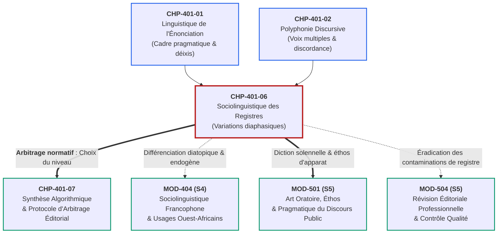
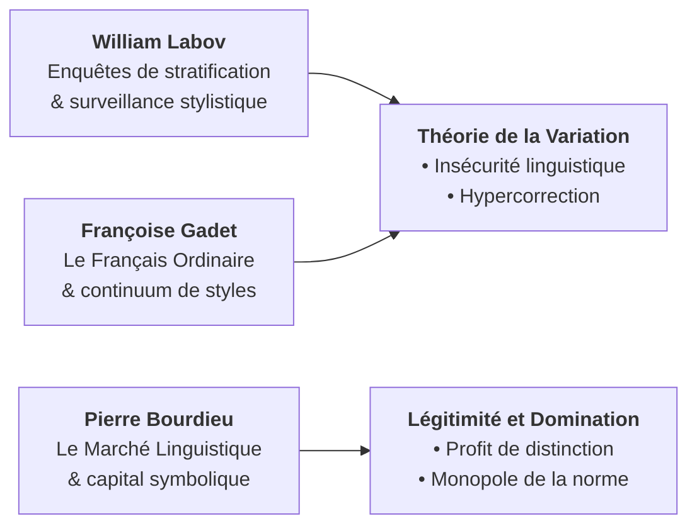

# Chapitre 6 — Sociolinguistique des Registres de Langue : Variations Diaphasiques (Familier, Courant, Soutenu, Solennel) aux Niveaux Phonétique, Lexical et Syntaxique

> **Identifiant du chapitre** : `CHP-401-06`  
> **Module de rattachement** : [`MOD-401` — Pragmatique Énonciative, Cas Limites d'Accord (Participe + Infinitif), Rectifications de 1990 et Registres de Langue](file:///f:/Formation/world-class-french/03-curriculum/year-2/semester-4/mod-401-pragmatique-accords-limites-rectifications-1990.md)  
> **Semestre** : Année 2 — Semestre 4 (S4)  
> **Volume horaire estimé** : 5 à 6 heures d'apprentissage autonome délibéré et d'ateliers d'application (Phase 1 Étude : 1 h 30 | Phase 2 Pratique : 1 h 30 | Phase 3 Correction : 1 h 00 | Phase 4 Évaluation : 1 h 00)  
> **Statut** : [STATUT : VALIDÉ]  
> **Compétences associées** : [`FR-SOCIOL-001`](file:///f:/Formation/world-class-french/02-competency-framework/competency-framework.md#fr-sociol-001-conscience-sociolinguistique-et-navigation-entre-registres) (L3 Autonomie), [`FR-INT-004`](file:///f:/Formation/world-class-french/02-competency-framework/competency-framework.md#fr-int-004-adapter-instantanément-son-registre-de-langue-au-contexte) (L3 Autonomie), [`FR-STYLE-001`](file:///f:/Formation/world-class-french/02-competency-framework/competency-framework.md#fr-style-001-maîtrise-des-figures-de-rhétorique-et-commentaire-stylistique) (L3 Autonomie)  
> **Sources scientifiques de référence** : `SRC-SOCIO-02` (Calvet, 2017 ; Gadet, 1989/2003), `SRC-GRAM-02` (Riegel, Pellat & Rioul, 2016/2021, chap. 2), `SRC-GRAM-01` (Grevisse & Goosse, 2016, § 14-22), `SRC-NORM-03` (Ministère de l'Éducation nationale, 2020, p. 8-10), `SRC-TYPO-01` (Imprimerie nationale, 2002/2014)

---

## 1. Titre et Place dans le Cursus

### 1.1 Intitulé Officiel
**Chapitre 6 : Sociolinguistique des Registres de Langue : Variations Diaphasiques (Familier, Courant, Soutenu, Solennel) aux Niveaux Phonétique, Lexical et Syntaxique** (`CHP-401-06`).

### 1.2 Insertion Architecturale dans le Cursus
Le présent chapitre constitue le cœur stylistique et sociolinguistique du module **MOD-401**. Si les premiers chapitres ont exploré l'appareil formel de l'énonciation (`CHP-401-01`) et la polyphonie discursive (`CHP-401-02`), et si les chapitres centraux ont résolu les cas limites de l'accord grammatical (`CHP-401-03`, `CHP-401-04`) et l'unification orthographique (`CHP-401-05`), le chapitre `CHP-401-06` arme l'apprenant pour la **maîtrise intégrale de la variation situationnelle** [Réf. `SRC-GRAM-02`, chap. 2 ; `SRC-SOCIO-02`].

La langue française n'est pas un bloc monolithique figé dans une norme unique : elle se déploie selon des registres régis par la distance sociale, l'enjeu discursif et le cadre institutionnel. Loin d'être un simple ornement rhétorique, la navigation fluide et étanche entre les registres familier, courant, soutenu et solennel est la condition sine qua non de l'autorité intellectuelle, de la réussite universitaire et du leadership professionnel.



- **En amont** : Ce chapitre prend appui sur le cadre énonciatif de Benveniste (`CHP-401-01`), où la relation entre locuteur et allocutaire détermine la distance communicative, et sur la polyphonie de Ducrot (`CHP-401-02`), où l'ironie naît fréquemment du télescopage parodique de registres.
- **Au sein de MOD-401** : Il fournit les critères d'évaluation stylistique indispensables au protocole d'arbitrage éditorial de clôture (`CHP-401-07`).
- **En aval** : Il prépare l'analyse fine des dynamiques sociolinguistiques ouest-africaines et béninoises (`MOD-404`), l'art oratoire républicain et cérémoniel (`MOD-501`), et la détection intransigeante des ruptures de ton dans les épreuves de révision éditoriale (`MOD-504`).

---

## 2. Objectifs Mesurables

Au terme des 5 à 6 heures d'apprentissage autonome délibéré et d'ateliers d'application de ce chapitre, l'apprenant est capable de :

1. **Distinguer et caractériser formellement les variations diaphasiques (situationnelles) des variations diastratiques (sociales) et diatopiques (géographiques)** dans tout corpus discursif francophone, sans confusion conceptuelle ni jugement moralisant ([`FR-SOCIOL-001`](file:///f:/Formation/world-class-french/02-competency-framework/competency-framework.md#fr-sociol-001-conscience-sociolinguistique-et-navigation-entre-registres), Palier L3 Autonomie).
2. **Identifier, segmenter et classifier les marques linguistiques discriminantes sur le spectre quadripartite des quatre registres** (familier, courant/standard, soutenu, solennel) aux trois niveaux simultanés : phonétique/prosodique, lexical et syntaxique ([`FR-INT-004`](file:///f:/Formation/world-class-french/02-competency-framework/competency-framework.md#fr-int-004-adapter-instantanément-son-registre-de-langue-au-contexte), Palier L3 Autonomie).
3. **Détecter, réfuter et éradiquer sans faille les ruptures de ton et contaminations diaphasiques** dans un écrit académique, administratif ou littéraire, en assurant l'homogénéité stylistique absolue du texte ([`FR-INT-004`](file:///f:/Formation/world-class-french/02-competency-framework/competency-framework.md#fr-int-004-adapter-instantanément-son-registre-de-langue-au-contexte) & [`FR-STYLE-001`](file:///f:/Formation/world-class-french/02-competency-framework/competency-framework.md#fr-style-001-maîtrise-des-figures-de-rhétorique-et-commentaire-stylistique), Palier L3 Autonomie).
4. **Transposer avec une étanchéité totale un même événement ou énoncé d'un registre à un autre** (du familier relâché au solennel cérémoniel, et inversement), en justifiant chaque substitution par l'appareil d'analyse sociolinguistique ([`FR-INT-004`](file:///f:/Formation/world-class-french/02-competency-framework/competency-framework.md#fr-int-004-adapter-instantanément-son-registre-de-langue-au-contexte) & [`FR-STYLE-001`](file:///f:/Formation/world-class-french/02-competency-framework/competency-framework.md#fr-style-001-maîtrise-des-figures-de-rhétorique-et-commentaire-stylistique), Palier L3 Autonomie).

---

## 3. Prérequis et Test de Préparation

### 3.1 Prérequis Cognitifs Minimaux
- **Cadre formel de l'énonciation (`CHP-401-01`)** : Connaissance des embrayeurs, de la déixis spatio-temporelle et de la relation locuteur / allocutaire.
- **Syntaxe de la phrase canonique vs phrase transformée (`MOD-201`)** : Ordre Sujet-Verbe-Objet (SVO), mécanismes d'inversion du sujet et interrogations.
- **Morphosyntaxe de la négation (`CHP-302-05`)** : Structure bipartite de la forclusion négative en français (*ne... pas*, *ne... point*).

### 3.2 Test de Préparation (Auto-Diagnostic à 5 Questions)
Répondez aux cinq questions suivantes sans consulter de document avant d'ouvrir le corrigé repliable :

1. **Question 1 (Phonétique et liaison)** : Dans les deux énoncés : (a) *« Ils vont en ville »* et (b) *« C'est un grand homme »*, la liaison est-elle obligatoire, facultative ou interdite ? Qu'en est-il dans *« Ils parlent / avec franchise »* ?
2. **Question 2 (Morphosyntaxe de la négation)** : Quelle composante de la négation bipartite s'amuit systématiquement dans l'usage oral spontané ? Quel est son statut morphologique exact ?
3. **Question 3 (Syntaxe interrogative)** : Citez les trois structures fondamentales permettant de formuler une interrogation totale directe en français, et classez-les de la plus informelle à la plus soignée.
4. **Question 4 (Taxonomie lexicale)** : Parmi les vocables *bagnole*, *automobile*, *voiture* et *carrosse*, attribuez à chacun son registre d'appartenance standard.
5. **Question 5 (Procédé d'agencement syntaxique)** : Dans l'énoncé *« Mon frère, il arrive ce soir »*, quel mécanisme syntaxique est mis en œuvre ? Appartient-il à la norme écrite surveillée ou à l'oralité spontanée ?

<details>
<summary><strong>Corrigé détaillé et barème de l'auto-diagnostic (cliquer pour dérouler)</strong></summary>

1. **Réponse 1** :  
   - Dans *« Ils vont en ville »* (`/il vɔ̃ t‿ɑ̃ vil/`) et *« C'est un grand homme »* (`/s‿ɛ t‿œ̃ gʁɑ̃ t‿ɔm/`), les liaisons sont **obligatoires** (pronom sujet + verbe monosyllabique ; adjectif préposé au nom).  
   - Dans *« Ils parlent avec franchise »*, la liaison après un verbe pluriel n'est pas obligatoire en registre courant : elle est **facultative** en registre soigné (`/il paʁl t‿avɛk/`) et omise dans l'usage relâché.
2. **Réponse 2** : C'est le morphème préverbal négatif **ne** (dit morphème discontinu ou forclusif) qui disparaît dans l'oral spontané (*« J'sais pas »* au lieu de *« Je ne sais pas »*). Le forclusif *pas* assure alors seul la charge sémantique négative.
3. **Réponse 3** :  
   1. Interrogation par simple intonation montante (*« Tu viens ? »*) : familier / oral relâché.  
   2. Interrogation par périphrase *est-ce que* (*« Est-ce que tu viens ? »*) : registre courant / standard neutre.  
   3. Interrogation par inversion du sujet (*« Viens-tu ? »*) : registre soutenu / soigné.
4. **Réponse 4** :  
   - *bagnole* : familier (argotisme lexicalisé) ;  
   - *voiture* : courant / standard neutre ;  
   - *automobile* : soutenu / technique soigné ;  
   - *carrosse* : solennel / noble ou archaïque (souvent métaphorique).
5. **Réponse 5** : Il s'agit d'une **dislocation à gauche** (ou thématisation avec reprise pronominale anaphorique par *il*). Elle relève de la syntaxe de l'oral spontané et du registre familier ; elle est proscrite dans la rédaction académique formelle au profit de la structure ordonnée : *« Mon frère arrive ce soir »*.

> **Barème diagnostique** :  
> • **5 / 5** : Prérequis maîtrisés, abordez directement la section 4.  
> • **3 ou 4 / 5** : Notions solides, mais attention requise sur les variations phonétiques et syntaxiques.  
> • **$< 3 / 5$** : Révision impérative des bases syntaxiques (`MOD-201`) et négatives (`CHP-302-05`).
</details>

---

## 4. Situation de Départ ou Problème Concret

### 4.1 Le Naufrage de la Rupture de Ton
Dans la pratique universitaire, administrative et professionnelle, la maîtrise du vocabulaire et de la grammaire fondamentale ne suffit pas à garantir la pertinence d'une production. Le piège le plus insidieux réside dans la **rupture de ton** (le clash diaphasique), c'est-à-dire l'intrusion brutale et inconsciente d'un marqueur issu d'un registre inadapté dans un discours donné [Réf. `SRC-GRAM-02`, chap. 2].

Considérons les deux cas cliniques suivants, relevés dans des contextes réels :

#### Cas 1 : L'intrusion familière en dissertation académique
> *« Dans Phèdre, Racine démontre avec une rigueur implacable comment la passion amoureuse fout en l'air la dignité et la raison de l'héroïne tragique. Dès lors, le spectateur assiste au naufrage d'une reine incapable de gérer ses pulsions. »*

L'étudiant qui rédige ces lignes produit une dissonance stylistique désastreuse :
1. Il introduit l'expression familière et triviale *« fout en l'air »* au beau milieu d'une analyse littéraire noble et rigoureuse.
2. Il utilise le verbe passe-partout et relâché *« gérer ses pulsions »*, emprunté au jargon managérial contemporain, ruinant l'exigence tragique du XVIIe siècle.
3. La sanction universitaire est immédiate : bien que la proposition critique soit sémantiquement exacte, la copie est déclassée pour vulgarité et absence de tenue stylistique.

#### Cas 2 : Le ridicule du pédantisme solennel dans un courriel professionnel
> *« Qu'il plaise à votre haute bienveillance de considérer avec sollicitude ma requête touchant le versement de mes émoluments pour la vacation susmentionnée, attendu que les deniers nécessaires à ma subsistance font présentement défaut. »*

À l'opposé du premier cas, ce collaborateur voulant réclamer le paiement d'une note de frais à un gestionnaire des ressources humaines sombre dans un **pédantisme grandiloquent et archaïsant** :
1. L'emploi de formules de supplique d'Ancien Régime (*« Qu'il plaise à votre haute bienveillance »*) est ressenti par l'interlocuteur comme une raillerie ironique ou le symptôme d'une névrose bureaucratique.
2. Le vocabulaire employé (*« émoluments »*, *« deniers »*, *« présentement »*) est disproportionné par rapport à l'acte de communication ordinaire.
3. Ce travers procède d'une pathologie bien identifiée en sociolinguistique : **l'insécurité linguistique**, qui pousse le scripteur à surinvestir des formes archaïques ou pompeuses par peur d'être jugé inculte.

### 4.2 L'Enjeu de la Souveraineté Diaphasique
L'excellence en français ne réside pas dans l'adoption permanente et rigide d'un ton d'académicien guindé. Parler à des amis dans l'intimité en utilisant des inversions complexes et des subjonctifs imparfaits est tout aussi inepte que d'interpeller un magistrat ou un ambassadeur avec des tics oraux d'adolescent.

La souveraineté linguistique réside dans la **commutation consciente, instantanée et étanche** entre les différents registres de la langue.

---

## 5. Explication Intuitive : L'Analogie de la Garde-Robe Situationnelle

Pour appréhender intuitivement les registres de langue sans les réduire à une hiérarchie morale binaire (« bien parler » vs « mal parler »), recourons à **l'analogie de la garde-robe vestimentaire situationnelle** :

```text
┌────────────────────────────────────────────────────────────────────────────────────────┐
│               L'ANALOGIE DE LA GARDE-ROBE SITUATIONNELLE ET VERBALE                   │
├──────────────────┬─────────────────────────────┬───────────────────────────────────────┤
│    REGISTRE      │     TENUE VESTIMENTAIRE     │          SITUATION SOCIALE            │
├──────────────────┼─────────────────────────────┼───────────────────────────────────────┤
│ 1. FAMILIER      │ Vêtements d'intérieur       │ Intimité domestique, cercle d'amis,   │
│    (Relâché)     │ (jogging, baskets, t-shirt) │ détente, conversations spontanées.    │
├──────────────────┼─────────────────────────────┼───────────────────────────────────────┤
│ 2. COURANT       │ Tenue de ville / travail    │ Rue, commerces, enseignement, presse  │
│    (Standard)    │ (chemise, pantalon neutre)  │ d'information, réunions ordinaires.   │
├──────────────────┼─────────────────────────────┼───────────────────────────────────────┤
│ 3. SOUTENU       │ Costume d'affaires / tailleur│ Concours universitaires, essais, haute│
│    (Élaboré)     │ (veston soigné, cravate)    │ administration, littérature surveillée│
├──────────────────┼─────────────────────────────┼───────────────────────────────────────┤
│ 4. SOLENNEL      │ Habit d'apparat / toge      │ Discours d'État, cérémonies funèbres, │
│    (Cérémoniel)  │ (queue-de-pie, robe d'avocat)│ prestation de serment, liturgie légale│
└──────────────────┴─────────────────────────────┴───────────────────────────────────────┘
```

Cette analogie met en lumière trois vérités sociolinguistiques fondamentales :
1. **L'adéquation au contexte** : Aucun vêtement n'est « coupable » ou « laid » en lui-même. Un jogging est confortable et légitime pour courir dans un parc ; mais si vous vous présentez en jogging et baskets devant un jury d'examen, vous commettez un outrage aux convenances. Inversement, faire son jogging en habit queue-de-pie ou faire ses courses au marché en toge d'apparat relève de la pure bouffonnerie.
2. **La règle d'or de l'étanchéité** : Le pire outrage esthétique n'est ni le jogging ni le costume : c'est le **mélange incongru**, comme enfiler une veste de smoking par-dessus un bas de survêtement et des claquettes de plage. C'est exactement ce que commet l'étudiant qui glisse un mot familier au cœur d'une phrase noble.
3. **Le confort de la maîtrise** : Le locuteur averti dispose dans sa garde-robe verbale de toutes les tenues. Il ne méprise pas les vêtements confortables du quotidien, mais il sait ajuster son habit d'apparat dès que les circonstances l'exigent.

---

## 6. Définitions Précises et Terminologie

Dans le cadre normatif des sciences du langage (`SRC-SOCIO-02` ; `SRC-GRAM-02`, chap. 2 ; `SRC-NORM-03`), les notions relatives à la variation linguistique sont définies avec une rigueur absolue :

1. **Sociolinguistique** : Discipline des sciences du langage qui étudie les relations d'interdépendance entre la structure de la langue, les comportements langagiers et les structures de la société (normes, institutions, rapports de classe, représentations sociales).
2. **Variation diaphasique (ou situationnelle)** : Modalité de variation de la langue conditionnée par la situation de communication. Elle dépend de la nature de l'activité, de la relation sociale unissant les interlocuteurs (distance hiérarchique, complicité, respect), de l'enjeu discursif et du canal de transmission (oral immédiat vs écrit formalisé). C'est la variation de **registre** ou de **style**.
3. **Variation diastratique (ou sociale)** : Modalité de variation liée aux caractéristiques sociales des locuteurs (origine socio-économique, niveau d'instruction, profession, classe d'âge, genre). Elle se manifeste sous la forme de **sociolectes**.
4. **Variation diatopique (ou géographique)** : Modalité de variation liée à l'origine ou à l'implantation géographique des locuteurs. Elle englobe les parlers régionaux, les dialectes et les variétés géographiques du français (français de France, du Québec, de Belgique, de Suisse, du Bénin, du Sénégal, de Côte d'Ivoire).
5. **Registre familier (ou relâché)** : Registre caractérisé par un relâchement de la surveillance normative, propre à l'intimité, à la familiarité et à la spontanéité orale. Il privilégie l'économie articulatoire, l'expressivité affective, les dislocations syntaxiques et un lexique argotique ou imagé.
6. **Registre courant (ou standard / neutre)** : Registre de communication sociale commune servant de norme véhiculaire. Il respecte les règles grammaticales fondamentales, adopte une syntaxe directe non contournée et un lexique usuel dénotatif, sans recherche oratoire ni relâchement familier. C'est la langue des manuels scolaires, des médias généralistes et de l'administration courante.
7. **Registre soutenu (ou élaboré / soigné)** : Registre propre à l'écrit surveillé, à la haute culture, aux concours universitaires et aux échanges officiels. Il se signale par une haute densité intellectuelle, un vocabulaire abstrait et précis, une syntaxe complexe et hiérarchisée (inversions du sujet, subordonnées équilibrées), et une phonétique soignée respectant les liaisons facultatives.
8. **Registre solennel (ou cérémoniel / d'apparat)** : Sommet du registre soutenu mobilisé lors d'événements publics exceptionnels (discours d'État, oraisons funèbres, réquisitoires de cours d'assises, serments solennels). Il emprunte à la grande tradition rhétorique classique : périodes oratoires amples, clausules harmonieuses, figures d'amplification, archaïsmes consacrés et temps verbaux d'apparat (passé simple, subjonctif imparfait, conditionnel passé 2e forme).
9. **Rupture de ton (ou télescopage diaphasique)** : Faute stylistique majeure consistant à faire coexister au sein d'un même ensemble textuel des unités linguistiques relevant de registres incompatibles, brisant l'unité esthétique et pragmatique du message.
10. **Contamination stylistique** : Phénomène d'interférence par lequel des habitudes discursives propres à un registre relâché ou informel viennent polluer inconsciemment une production qui se veut soutenue ou académique.

---

## 7. Règles ou Mécanismes Fondamentaux

### 7.1 La Typologie des Variations Linguistiques
Pour analyser scientifiquement un fait de langue, le linguiste applique le principe de distinction tripartite établi par Eugenio Coseriu et repris par Françoise Gadet et Louis-Jean Calvet [Réf. `SRC-SOCIO-02` ; `SRC-GRAM-02`, chap. 2] :

| Type de Variation | Facteur Déterminant | Question Fondamentale | Exemples Canoniques |
| :--- | :--- | :--- | :--- |
| **Variation Diatopique** | Géographie / Territoire | *D'où vient le locuteur ?* | • *chocolatine* (Sud-Ouest France) vs *pain au chocolat*.<br/>• *dîner* (repas du midi en Belgique/Québec) vs *déjeuner*.<br/>• *durer* (tarder, au Bénin et en Afrique de l'Ouest) vs *prendre du temps*. |
| **Variation Diastratique** | Groupe social / Instruction | *Qui parle socialement ?* | • Emploi d'un jargon technique ouvrier, médical ou juriste.<br/>• Langage des cités périurbaines (verlan, sociolecte jeune).<br/>• Sociolecte de la haute bourgeoisie patrimoniale. |
| **Variation Diaphasique** | Situation / Contexte / Rôle | *À qui s'adresse-t-on et où ?* | • *« J'ai la frousse »* (familier) vs *« J'ai peur »* (courant) vs *« Je suis en proie à l'effroi »* (soutenu).<br/>• Seul un même locuteur varie selon la circonstance. |

> [!IMPORTANT]
> **Règle fondamentale d'autonomie diaphasique** :  
> Un même locuteur, issu d'une même région (diatopie) et d'une même classe sociale (diastratie), doit être capable de voyager à travers toute l'échelle diaphasique : parler familièrement avec ses enfants à la maison, s'exprimer en registre courant avec un commerçant, rédiger en registre soutenu un article scientifique, et prononcer un discours solennel lors d'une cérémonie académique.

---

### 7.2 Le Spectre Quadripartite des Registres de Langue
Le français contemporain s'organise selon un spectre continu articulé en **quatre paliers fonctionnels majeurs** [Réf. `SRC-GRAM-02`, chap. 2 ; `SRC-NORM-03`] :

```text
┌────────────────────────────────────────────────────────────────────────────────────────┐
│                        LE SPECTRE QUADRIPARTITE DES REGISTRES                          │
├────────────────────┬────────────────────┬────────────────────┬─────────────────────────┤
│    1. FAMILIER     │    2. COURANT      │    3. SOUTENU      │      4. SOLENNEL        │
├────────────────────┼────────────────────┼────────────────────┼─────────────────────────┤
│ Relâchement oral,  │ Norme sociale de   │ Rigueur de l'écrit │ Haute rhétorique d'État,│
│ complicité intime, │ référence, école,  │ universitaire,     │ cérémonies républicaines│
│ expressivité brute,│ presse quotidienne,│ concours d'élite,  │ ou funèbres, liturgie   │
│ tabous suspendus.  │ échanges neutres.  │ haute diplomatie.  │ judiciaire d'assises.   │
└────────────────────┴────────────────────┴────────────────────┴─────────────────────────┘
```

---

### 7.3 Analyse Contrastée au Niveau Phonétique et Prosodique
La phonétique et la prosodie sont les révélateurs les plus immédiats du registre employé à l'oral ou transcrit à l'écrit littéraire [Réf. `SRC-SOCIO-02` ; `SRC-GRAM-02`, chap. 2] :

#### 1. Registre Familier / Relâché : L'économie articulatoire
- **Amuïssement systématique du *ne* forclusif** : *« Il vient pas »* `/i vjɛ̃ pa/` au lieu de *« Il ne vient pas »*.
- **Élisions illicites et apocopes vocaliques** : *« T'as vu »* `/ta vy/` pour *« Tu as vu »* ; *« Y a du monde »* `/ja dy mɔ̃d/` pour *« Il y a du monde »*.
- **Assimilations consonantiques régressives** : *« Je sais pas »* prononcé *« Chais pas »* `/ʃɛpa/` (la consonne voisée `/ʒ/` s'assourdit en `/ʃ/` au contact de `/s/`, avec chute totale du schwa `/ə/`).
- **Suppression des semi-voyelles et liquides finales** : *« Not' table »* pour *« Notre table »* ; *« Plus d'aut' chose »*.

#### 2. Registre Courant / Standard : L'équilibre articulatoire
- Réalisation standardisée et limpide des phonèmes du français.
- Respect rigoureux des **liaisons obligatoires** (Déterminant + Nom : *« les‿enfants »* ; Pronom sujet + Verbe : *« ils‿arrivent »*).
- Maintien fréquent ou partiel du morphème *ne* à l'oral surveillé ; présence obligatoire à l'écrit.
- Débit régulier, sans précipitation ni théâtralité excessive.

#### 3. Registre Soutenu et Solennel : L'ornementation phonologique et la prosodie hiératique
- **Activation des liaisons facultatives de haute tenue** :
  - Après une forme conjuguée du verbe *être* : *« C'est‿impossible »* `/s‿ɛ t‿ɛ̃pɔsibl/`.
  - Après les verbes polysyllabiques : *« Ils arrivèrent‿en vain »* `/il z‿aʁivɛʁ t‿ɑ̃ vɛ̃/`.
  - Après les noms pluriels : *« Des projets‿ambitieux »* `/de pʁɔʒɛ z‿ɑ̃bisjø/`.
- **Réalisation soignée et appuyée du *e* caduc (schwa `/ə/`)** : Le schwa n'est pas brutalement écrasé ; il soutient le rythme syllabique régulier.
- **Prosodie hiératique** : Tempo ralenti, amplitude intonative mesurée, marquage oratoire des pauses silencieuses avant les termes cardinaux (silences d'accentuation).

---

### 7.4 Analyse Contrastée au Niveau Lexical
Le choix du vocabulaire manifeste immédiatement le degré de raffinement intellectuel et l'attitude sociale du locuteur [Réf. `SRC-GRAM-01`, § 14-22] :

#### Séries Quadripartites Contrastées :
Examinons comment une même notion s'incarne à travers les quatre paliers :

```text
1. VÉHICULE :
   bagnole / tacot (Familier) 
   → voiture (Courant) 
   → automobile / véhicule (Soutenu) 
   → carrosse / équipage d'apparat (Solennel)

2. ARGENT :
   fric / thunes / pèze (Familier) 
   → argent (Courant) 
   → fonds / capitaux / ressources financières (Soutenu) 
   → deniers publics / trésor / fortune (Solennel)

3. TRAVAIL :
   bosser / trimer / taffer (Familier) 
   → travailler (Courant) 
   → œuvrer / exercer une profession (Soutenu) 
   → consacrer son labeur / accomplir sa tâche historique (Solennel)

4. MOURIR :
   clamecer / crever / passer l'arme à gauche (Familier) 
   → mourir / décéder (Courant) 
   → s'éteindre / succomber / rendre son dernier soupir (Soutenu) 
   → trépasser / entrer dans l'éternité / consommer son sacrifice (Solennel)

5. NOURRITURE :
   bouffe / graille / tambouille (Familier) 
   → nourriture / repas (Courant) 
   → mets / chère / collation délicate (Soutenu) 
   → festin sacré / agapes cérémonielles (Solennel)
```

> [!NOTE]
> Le registre soutenu privilégie les vocables abstraits, polysémiques et étymologiques, tandis que le registre familier use de métaphores corporelles concrètes et de troncations apocopiques (*ciné*, *télé*, *bac*, *resto*). Le registre solennel, quant à lui, réactive des archaïsmes consacrés et des termes empreints de gravité morale ou historique.

---

### 7.5 Analyse Contrastée au Niveau Syntaxique
La syntaxe constitue l'architecture maîtresse de la différenciation diaphasique. C'est à ce niveau que se jouent la précision logique et l'autorité discursive [Réf. `SRC-GRAM-02`, chap. 2] :

#### 1. Registre Familier : La syntaxe segmentée et expressive
- **Dislocation systématique du sujet et des compléments** : *« Mon patron, il me saoûle avec ses réunions »* ; *« Je la connais pas, moi, cette histoire »*. La phrase n'est pas liée organiquement ; elle procède par juxtaposition d'un thème détaché et d'une proposition à pronom de reprise.
- **Interrogation in situ ou purement intonative** : *« Tu viens quand ? »* ; *« Il fait quoi, là ? »* (le mot interrogatif reste à la place du complément, sans inversion).
- **Suppression du pronom sujet explétif impersonnel** : *« Faut voir »* au lieu de *« Il faut voir »* ; *« Vaut mieux partir »* au lieu de *« Il vaut mieux partir »*.
- **Asyndète généralisée** : Absence de connecteurs logiques formels (*« J'ai trop mangé, j'ai mal au ventre »*).

#### 2. Registre Courant : La syntaxe canonique linéaire
- **Ordre canonique strict Sujet-Verbe-Complément (SVO)** sans détachement excessif : *« Le directeur a convoqué les employés ce matin »*.
- **Interrogation périphrastique par *est-ce que*** : *« Est-ce que vous avez reçu le compte rendu ? »*
- **Subordination directe et basique** : Emploi des conjonctions courantes (*parce que, quand, si, pour que*) sans emboîtements multiples.

#### 3. Registre Soutenu : La syntaxe hiérarchisée et intégrée
- **Inversion complexe et élégante du sujet** :
  - Inversion simple avec pronom : *« Que désirez-vous prouver ? »*
  - Inversion complexe avec sujet nominal : *« Cette mesure produira-t-elle les effets escomptés ? »*
- **Connecteurs logiques de haute précision sémantique** : *nonobstant*, *dès lors que*, *en outre*, *pour autant que*, *singulièrement*, *advenue la décision*.
- **Intégration participiale et gérondive** : Remplacement des lourdes propositions circonstancielles par des participes présents ou passés absolus : *« Le quorum n'ayant pas été atteint, la séance fut levée »*.
- **Concordance des temps rigoureuse** : Maintien des temps de l'irréel et maîtrise des nuances aspectuelles.

#### 4. Registre Solennel : La grande période oratoire classique
- **Construction de la période oratoire équilibrée** : La phrase s'articule en membres amples comprenant une **protase** (tension montante), une **acmé** (point d'orgue syntaxique) et une **apodose** (retombée conclusive apaisée).
- **Hyperbates et inversions stylistiques expressives** : Rejet d'un constituant en fin de phrase pour en souligner la majesté (*« Vaincue fut alors la tyrannie »*).
- **Emploi des modes et temps d'apparat** :
  - Subjonctif imparfait et plus-que-parfait : *« Qu'il fallût agir ainsi, nul ne l'ignorait »* ;
  - Conditionnel passé deuxième forme : *« Eussions-nous cédé à la panique, la patrie eût péri »*.

---

### 7.6 La Proscription Absolue des Ruptures de Ton : La Règle d'Or de l'Étanchéité
La règle sociolinguistique fondamentale du rédacteur et orateur d'élite est **la règle d'or de l'étanchéité diaphasique** :

$$\text{Règle d'or} : \forall x \in \text{Texte}, \quad \text{Registre}(x) \equiv \text{Registre}_{\text{cible}}$$

Il est formellement interdit de panacher les niveaux. Une phrase commencée sous les auspices du registre soutenu ne peut tolérer en son sein la moindre scorie familière. Toute irruption incontrôlée est taxée d'une pénalité éliminatoire immédiate.

---

## 8. Raisonnement Détaillé : La Flexibilité Diaphasique comme Souveraineté

Pourquoi la didactique moderne du français refuse-t-elle d'imposer un registre unique et rigide ? Pourquoi ne pas enseigner exclusivement le registre soutenu de l'Académie ?

La réponse réside dans la nature même de la communication humaine théorisée par la sociolinguistique contemporaine [Réf. `SRC-SOCIO-02`] :

### 1. Le Piège de l'Inadéquation Pragmatique
Parler ou écrire n'est pas une performance abstraite ; c'est un acte social orienté vers un destinataire singulier. Un locuteur qui s'enfermerait dans un registre soutenu indifférencié commettrait un contresens pragmatique constant :
- En s'adressant à des artisans sur un chantier ou à des enfants dans un club de sport avec la syntaxe de Chateaubriand, il ne ferait pas preuve d'érudition : il dresserait un mur d'incompréhension et d'arrogance, s'aliénant son auditoire.
- L'efficacité communicative repose sur **l'accordage diaphasique** : faire résonner son langage avec les attentes légitimes de la situation.

### 2. Le Vrai Visage de l'Insécurité Linguistique
L'insécurité linguistique pousse souvent les apprenants issus de milieux populaires ou de contextes périphériques à croire que « bien parler », c'est utiliser les mots les plus compliqués possibles. C'est l'illusion de l'hypercorrection [Labov, 1976] :
- L'individu incertain compense son angoisse en surchargeant ses phrases de termes précieux mal maîtrisés.
- À l'inverse, l'individu linguistiquement souverain est parfaitement décontracté : il sait manier le mot populaire avec verve au moment opportun, adopter la clarté limpide du registre courant en réunion de travail, et déployer sans effort la pompe majestueuse de la période oratoire lorsqu'il prend la parole devant une assemblée solennelle.

### 3. La Maîtrise des Trois Paliers de l'Ascension Diaphasique
L'acquisition de la maîtrise diaphasique se déploie selon trois degrés successifs :
1. **La conscience passive (Détection)** : Être capable de reconnaître instantanément à l'écoute ou à la lecture le registre d'un extrait et d'isoler les indices lexicaux, syntaxiques et phonétiques qui le signent.
2. **La rigueur négative (Éradication)** : Être capable de purger impitoyablement ses propres écrits académiques et professionnels de tout tic familier inconscient (éradication des ruptures de ton).
3. **La compétence active (Transposition)** : Être capable de traduire n'importe quel contenu informatif d'un registre à l'autre en recomposant intégralement l'appareillage phonétique, lexical et syntaxique.

---

## 9. Exemples Corrects Commentés

Pour démontrer la mécanique de transposition diaphasique intégrale, analysons le même événement factuel (une interpellation policière consécutive à une infraction) restitué successivement dans les **quatre registres étanches** :

---

### Exemple 1 : Version en Registre Familier / Relâché
> *« T'as vu le cirque hier soir ? Deux lascars ont essayé de fracturer la boutique de fringues du coin. Pas de bol pour eux, la police débarque direct en bagnole et les chope sur le fait. Franchement, c'est trop naze de se faire serrer comme des bleus ! »*

#### Décorticage linguistique :
- **Phonétique / Prosodie** : Élision illicite du pronom personnel (*« T'as vu »* pour *« Tu as vu »*) ; ellipse totale de la particule négative (*« Pas de bol »* pour *« Ils n'ont pas eu de chance »*).
- **Lexique** : Argotismes et vocabulaire expressif familier (*cirque*, *lascars*, *fringues*, *pas de bol*, *débarque*, *bagnole*, *chope*, *naze*, *serrer*, *bleus*).
- **Syntaxe** : Interrogation intonative directe (*« T'as vu... ? »*) ; présent de narration oralisé ; absence de subordination complexe ; adverbe employé comme modalisateur d'intensité relâché (*« trop naze »*, *« direct »*).

---

### Exemple 2 : Version en Registre Courant / Standard
> *« Avez-vous assisté aux incidents survenus hier soir ? Deux individus ont tenté de cambrioler le magasin de vêtements du quartier. Malheureusement pour eux, les forces de police sont arrivées immédiatement en patrouille et les ont arrêtés en flagrant délit. Il est vraiment regrettable d'échouer avec autant d'imprudence. »*

#### Décorticage linguistique :
- **Phonétique / Prosodie** : Réalisation standard des mots ; respect scrupuleux des liaisons obligatoires (*« deux‿individus »*).
- **Lexique** : Termes usuels, précis et neutres (*incidents*, *individus*, *cambrioler*, *magasin de vêtements*, *quartier*, *forces de police*, *patrouille*, *arrêtés*, *flagrant délit*, *regrettable*, *imprudence*).
- **Syntaxe** : Interrogation par inversion simple sans emphase (*« Avez-vous assisté... ? »*) ; ordre canonique SVO ; phrases coordonnées par *et* ; adjectifs attributs régis par des verbes impersonnels (*« Il est vraiment regrettable de... »*).

---

### Exemple 3 : Version en Registre Soutenu
> *« Nul n'ignore les graves désordres qui troublèrent notre quiétude hier au crépuscule. Deux malfaiteurs s'efforcèrent de pénétrer par effraction dans une échoppe de confection textile. Or, prévenue avec diligence, la maréchaussée fit irruption sur les lieux et appréhenda sur-le-champ les contrevenants. Une telle témérité, doublée d'une impéritie si manifeste, ne pouvait que précipiter leur ruine. »*

#### Décorticage linguistique :
- **Phonétique / Prosodie** : Élocution surveillée favorisant les liaisons facultatives de prestige (*« troublèrent‿hier »*, *« désordres‿inattendus »*).
- **Lexique** : Vocabulaire abstrait, littéraire et juridique (*désordres*, *quiétude*, *crépuscule*, *malfaiteurs*, *effraction*, *échoppe de confection textile*, *diligence*, *maréchaussée*, *appréhender*, *contrevenants*, *témérité*, *impéritie*).
- **Syntaxe** : Tournure litotique négative initiale (*« Nul n'ignore... »*) ; passé simple de narration littéraire (*troublèrent*, *s'efforcèrent*, *fit*, *appréhenda*) ; connecteur logique d'articulation rigoureux (*« Or »*) ; participe passé apposé (*« prévenue avec diligence »*) ; structure restrictive soignée (*« ne pouvait que... »*).

---

### Exemple 4 : Version en Registre Solennel / Cérémoniel
> *« Qu'il soit ici rappelé devant cette assemblée la solennelle leçon des événements survenus hier lorsque descendirent les ombres de la nuit. Deux contempteurs de l'ordre public prétendirent violer le sanctuaire du labeur d'autrui. Mais la puissance publique, vigilante gardienne de la cité, surgit sans désemparer pour foudroyer l'iniquité en son acte même. Qu'ils mesurent désormais, au fond de leur geôle, le châtiment inexorable que réserve la loi aux artisans de la discorde. »*

#### Décorticage linguistique :
- **Phonétique / Prosodie** : Déclamation hiératique à tempo ample ; diction appuyant sur les clausules et cadences majeures.
- **Lexique** : Termes éthiques, nobles et majestueux (*solennelle leçon*, *contempteurs de l'ordre public*, *sanctuaire du labeur*, *puissance publique*, *foudroyer l'iniquité*, *geôle*, *châtiment inexorable*, *artisans de la discorde*).
- **Syntaxe** : Subjonctif injonctif d'apparat en tête de période (*« Qu'il soit ici rappelé... »*, *« Qu'ils mesurent désormais... »*) ; inversion oratoire du sujet en subordonnée (*« lorsque descendirent les ombres »*) ; métaphores filées à valeur sacrée ; période ample et majestueuse.

---

### Tableau Comparatif Synthétique des Faits de Langue :

| Niveau d'Analyse | Version 1 (Familier) | Version 2 (Courant) | Version 3 (Soutenu) | Version 4 (Solennel) |
| :--- | :--- | :--- | :--- | :--- |
| **Phonétique & Énonciation** | Élisions illicites (*t'as*), chute du *ne*, oralité brute. | Liaisons obligatoires, négation complète, diction neutre. | Liaisons soignées, maintien absolu de la double négation. | Prosodie oratoire d'apparat, cadences amples, solennité. |
| **Désignation des acteurs** | *lascars, police, bleus* | *individus, forces de police* | *malfaiteurs, maréchaussée* | *contempteurs, puissance publique* |
| **Désignation du lieu** | *boutique de fringues* | *magasin de vêtements* | *échoppe de confection* | *sanctuaire du labeur* |
| **Action d'arrestation** | *les chope, serrer* | *les ont arrêtés* | *appréhenda sur-le-champ* | *foudroyer l'iniquité* |
| **Temps verbaux** | Présent oralisé / Passé composé | Passé composé descriptif | Passé simple historique | Passé simple + Subjonctifs d'apparat |
| **Architecture syntaxique**| Asyndètes, segmentation | Phrase liée canonique (SVO) | Participle apposé, inversions | Grandes périodes oratoires équilibrées |

---

## 10. Contre-Exemples et Erreurs Fréquentes

L'audit des productions écrites et orales permet de formaliser une typologie clinique de six erreurs récurrentes majeures [Réf. `SRC-GRAM-02`, chap. 2 ; `SRC-NORM-03`] :

### Erreur n° 1 : Chute du « ne » forclusif dans un écrit académique ou professionnel
- **Énoncé fautif** : *\*« L'administration a décidé qu'elle prendra pas en charge ces dépenses. »*
- **Réfutation linguistique** : L'omission de la particule préverbale *ne* est une marque exclusive de l'oral relâché et du registre familier. À l'écrit surveillé, la négation est obligatoirement **bipartite** (*ne... pas*, *ne... point*, *ne... jamais*).
- **Explication sociolinguistique** : Cette erreur trahit une transcription paresseuse des habitudes articulatoires orales dans un support écrit, signalant un manque de révision élémentaire.
- **Correction conforme** : *« L'administration a décidé qu'elle **ne** prendra **pas** en charge ces dépenses. »*

---

### Erreur n° 2 : Intrusion d'un terme familier ou argotique dans une dissertation académique
- **Énoncé fautif** : *\*« Montesquieu montre dans les Lettres persanes que le roi de France a un pouvoir tellement fort qu'il embobine tous ses sujets avec des titres en carton. »*
- **Réfutation linguistique** : Les termes *embobiner* et *en carton* appartiennent au registre familier imagé. Ils désamorcent l'analyse conceptuelle et décrédibilisent le propos critique.
- **Explication sociolinguistique** : Le scripteur cède à la facilité de l'expressivité populaire au détriment de l'analyse politique et philosophique rigoureuse.
- **Correction conforme** : *« Montesquieu démontre dans les Lettres persanes que le monarque français jouit d'une autorité si absolue qu'il **mystifie** ses sujets en leur conférant de **vains** titres de noblesse. »*

---

### Erreur n° 3 : Pédantisme comique par abus de vocabulaire solennel en situation quotidienne
- **Énoncé fautif** : *\*« Auriez-vous l'extrême obligeance de m'octroyer céans une modique portion de liquide caféiné ? »* (adressé à un serveur de café).
- **Réfutation linguistique** : L'emploi d'adverbes archaïques (*céans*), de périphrases solennelles (*modique portion de liquide caféiné*) et de formules courtisanes dans une transaction marchande ordinaire constitue un contresens diaphasique total.
- **Explication sociolinguistique** : Ce pédantisme grotesque résulte d'une incompréhension des lois du décorum social et d'une tentative désespérée de distinction qui aboutit à l'effet inverse (ridicule et rejet).
- **Correction conforme** : *« Un café, s'il vous plaît. »* (registre courant).

---

### Erreur n° 4 : Dislocation syntaxique orale dans un écrit administratif
- **Énoncé fautif** : *\*« Le dossier du requérant, il a été transmis hier au service juridique et les pièces manquantes, on les attend encore. »*
- **Réfutation linguistique** : La dislocation à gauche (*Le dossier..., il* ; *les pièces..., on les attend*) est un procédé d'oralité servant à poser le thème avant d'avoir planifié le prédicat. Elle détruit la rigueur de la syntaxe administrative écrite.
- **Explication sociolinguistique** : Le scripteur est incapable d'organiser sa phrase sous forme de constituants hiérarchisés autonomes.
- **Correction conforme** : *« Le dossier du requérant a été transmis hier au service juridique ; les pièces complémentaires demeurent en attente de réception. »*

---

### Erreur n° 5 : Fausse inversion interrogative hybride
- **Énoncé fautif** : *\*« Pourquoi que vous n'êtes pas venu ? »* ou *\*« Est-ce que viendrez-vous demain ? »*
- **Réfutation linguistique** : Le premier énoncé hybride le mot interrogatif avec un *que* populaire agrammatical. Le second télescope deux systèmes interrogatifs mutuellement exclusifs : la périphrase *est-ce que* (qui exige l'ordre direct SVO) et l'inversion du sujet *viendrez-vous*.
- **Explication sociolinguistique** : Confusion structuraliste entre les différents paliers d'interrogation du français.
- **Correction conforme** :  
  - En registre courant : *« Pourquoi n'êtes-vous pas venu ? »* / *« Est-ce que vous viendrez demain ? »*  
  - En registre soutenu : *« Pour quel motif fîtes-vous défaut ? »* / *« Viendrez-vous demain ? »*

---

### Erreur n° 6 : Rupture de cohérence diaphasique au sein d'un même paragraphe (télescopage de niveaux)
- **Énoncé fautif** : *\*« Nous vous prions d'agréer, Monsieur le Ministre, l'expression de notre haute considération. N'empêche qu'on aimerait bien avoir une réponse fissa concernant nos thunes. »*
- **Réfutation linguistique** : La formule protocolaire finale la plus solennelle est immédiatement fracassée par une seconde phrase conjuguant une locution populaire relâchée (*N'empêche que*), l'omission du conditionnel soigné, un adverbe d'argot militaire d'origine arabe (*fissa*) et un vocable argotique (*thunes*).
- **Explication sociolinguistique** : Absence totale de maîtrise du canal écrit et incapacité à maintenir une posture énonciative stable.
- **Correction conforme** : *« Nous vous prions d'agréer, Monsieur le Ministre, l'expression de notre haute considération, dans l'attente d'une décision prompte relative au déblocage des subventions allouées à notre institution. »*

---

## 11. Cas Particuliers et Limites

### 11.1 L'Emploi Stylistique Conscient du Registre Familier en Littérature
Si la rupture de ton involontaire est une faute disqualifiante chez l'étudiant, l'intégration délibérée et maîtrisée du registre familier et populaire à l'écrit constitue une révolution esthétique majeure dans la littérature moderne :
- **Louis-Ferdinand Céline (*Voyage au bout de la nuit*, 1932)** : Céline ne commet pas d'erreurs : il forge un « style parlé écrit » stylisé, brisant le corset de la prose bourgeoise par des ellipses, des dislocations, des rythmes ternaires syncopés et l'introduction massive du lexique argotique de la guerre et des faubourgs.
- **Raymond Queneau (*Zazie dans le métro*, 1959)** : Dès l'incipit mythique *« Doukipudonktan »* (transcription phonétique d'une séquence relâchée : *« D'où qu'ils puent donc tant ? »*), Queneau dynamite ironiquement l'académisme en confrontant la norme orthographique à la réalité phonique du français ordinaire [Réf. `SRC-SOCIO-02`].
- **La règle didactique** : Pour transgresser sciemment une norme à des fins artistiques, il faut d'abord en posséder la maîtrise absolue.

### 11.2 L'Effet Parodique et Comique par Décalage de Registre
Le comique verbal repose très souvent sur le décalage systématique entre le sujet traité et le registre mobilisé :
- **Le style burlesque** : Traiter un sujet héroïque ou mythologique noble en registre trivial et familier (ex. Scarron, *Virgile travesti*).
- **Le style héroï-comique** : Traiter un incident dérisoire du quotidien dans le style solennel de l'épopée homérique ou racinienne (ex. Boileau, *Le Lutrin*).
- Dans ces deux cas, la polyphonie stylistique produit une discordance voulue et savoureuse.

### 11.3 La Dynamique des Registres dans les Contextes Francophones Ouest-Africains
En Afrique de l'Ouest et au Bénin, la sociolinguistique observe une configuration diaphasique singulière [Réf. `SRC-SOCIO-02`] :
1. **L'hyper-norme administrative et scolaire** : Le français officiel écrit des concours et de l'État y maintient souvent un registre soutenu plus traditionnel et châtié que dans les administrations européennes contemporaines (maintien de formules de déférence classiques, richesse des connecteurs logiques).
2. **Le français véhiculaire endogène et familier** : En situation informelle de marché ou de rue, le français entre en contact intime avec les langues nationales (fongbe, yoruba, baatonu), donnant naissance à des expressions familières savoureuses (*« durer »* pour tarder, *« faire que »* pour provoquer, interrogations emphatiques avec particule finale).
3. **L'impératif de discernement** : L'apprenant doit être fier de cette créativité lexicale endogène dans la sphère conviviale, tout en sachant mobiliser le code international standard et soutenu dans les rapports officiels et les publications académiques.

---

## 12. Approfondissement Adapté au Niveau : La Sociolinguistique de Labov, Gadet et Bourdieu

Pour les étudiants se destinant à la recherche universitaire, aux concours d'enseignement (CAPES, Agrégation) ou à la haute administration, les variations de registre doivent être adossées aux théories sociologiques et linguistiques de référence :



### 1. La Stratification Stylistique selon William Labov
Dans ses enquêtes fondatrices sur l'anglais new-yorkais (1966), William Labov a démontré que les variations de style ne sont pas aléatoires, mais obéissent au degré d'**attention prêtée à la parole** (*attention paid to speech*).
- Lorsque le locuteur lit une liste de mots isolés ou de paires minimales, sa surveillance cognitive est maximale : il produit les formes les plus prestigieuses.
- Lorsqu'il raconte une anecdote émouvante dans l'intimité, sa surveillance baisse : les traits vernaculaires ressurgissent spontanément.
- **L'hypercorrection de la petite bourgeoisie** : Labov met en évidence une courbe spectaculaire : dans les situations les plus formelles de test, la classe moyenne inférieure utilise les formes de prestige à une fréquence supérieure à celle de la classe supérieure elle-même ! Cette sur-utilisation anxieuse trahit le désir d'ascension sociale et la hantise du déclassement.

### 2. Le Français Ordinaire selon Françoise Gadet
Dans *Le français ordinaire* (1989) et *La variation en français* (2003/2007) [Réf. `SRC-SOCIO-02`], Françoise Gadet démontre que le français parlé informel n'est pas un français « dégradé » ou « dégénéré », mais un système linguistique parfaitement structuré doté de ses propres régularités :
- La réduction des voyelles, l'élision de *ne*, la grammaticalisation de *on* à la place de *nous*, la thématisation par dislocation constituent le fonctionnement naturel et universel de la langue parlée vivante.
- L'erreur méthodologique consiste à juger l'oral spontané avec les catégories exclusives de l'écrit normé.

### 3. Le « Marché Linguistique » et le « Capital Symbolique » de Pierre Bourdieu
Dans *Ce que parler veut dire : L'économie des échanges linguistiques* (1982), le sociologue Pierre Bourdieu déconstruit l'illusion d'une langue neutre :
- La langue officielle est la langue des dominants érigée en norme universelle par l'institution scolaire.
- S'exprimer en registre soutenu ou solennel ne communique pas seulement de l'information : cela procure un **profit de distinction** et atteste la possession d'un **capital linguistique** légitime.
- La maîtrise des registres est donc un instrument de pouvoir : elle permet de décoder les stratégies de domination symbolique et de ne jamais être pris au piège de l'exclusion sociale.

---

## 13. Comparaisons Différentielles

### Tableau 1 : Matrice Synoptique Quadripartite Intégrale

| Paramètre | 1. Familier / Relâché | 2. Courant / Standard | 3. Soutenu / Soigné | 4. Solennel / Cérémoniel |
| :--- | :--- | :--- | :--- | :--- |
| **Sphère sociale** | Intimité, amis, famille, réseaux sociaux informels. | Rue, commerce, école, presse grand public, travail. | Universités, concours, essais, haute administration. | Discours d'État, réquisitoires, cérémonies nationales. |
| **Canal privilégié** | Oral spontané ou messages instantanés (SMS). | Oral surveillé ou écrits professionnels ordinaires. | Écrit surveillé, conférences académiques, diplomatie. | Proclamations officielles orales ou écrites d'apparat. |
| **Chute du « ne »** | Systématique (*« J'sais pas »*). | Exceptionnelle à l'écrit, tolérée à l'oral fluide. | Totalement proscrite (*« Nul ne l'ignore »*). | Proscrite ; formules de négation absolue (*point, nullement*). |
| **Liaisons** | Limitées aux liaisons obligatoires strictes. | Liaisons obligatoires respectées sans excès. | Liaisons facultatives fréquentes et soignées. | Liaisons facultatives d'apparat systématiques. |
| **Interrogation** | Intonation montante ou in situ (*« Tu vas où ? »*). | Périphrase *est-ce que* (*« Où est-ce que tu vas ? »*). | Inversion simple du sujet (*« Où allez-vous ? »*). | Inversion complexe oratoire (*« Où Monsieur daigne-t-il se rendre ? »*). |
| **Syntaxe** | Dislocation, asyndète, phrases inachevées. | Ordre canonique SVO, subordination simple. | Périodes équilibrées, participes, inversions. | Grandes périodes classiques, subjonctif imparfait. |
| **Lexique** | Argotique, imagé, affectif, troncations (*télé*). | Dénotatif, neutre, précis, termes usuels. | Abstrait, étymologique, polysémique, noble. | Sacré, moral, archaïsant, figures de majesté. |

---

### Tableau 2 : Oral Relâché vs Écrit Soigné (Synthèse Phonologique et Morphosyntaxique)

| Phénomène Linguistique | Réalisation en Oral Relâché | Réalisation en Écrit Soigné |
| :--- | :--- | :--- |
| **Morphème de négation** | Amuïssement : *« Faut pas »* | Bipartite obligatoire : *« Il ne faut pas »* |
| **Élision du pronom sujet « tu »** | Élision fautive : *« T'as tort »* | Maintien absolu : *« Tu as tort »* |
| **Pronom de 1re personne plurielle**| Quasi-généralisation de *on* : *« On y va »* | Emploi rigoureux de *nous* : *« Nous nous y rendons »* |
| **Pronom sujet impersonnel « il »**| Chute du *il* : *« Paraît qu'il pleut »* | Présence du pronom : *« Il paraît qu'il pleut »* |
| **Interrogation indirecte** | Particule parasite : *« J'sais pas si qu'il vient »* | Subordonnée directe : *« J'ignore s'il viendra »* |
| **Liaison après « et »** | Maladroite ou fautive (liaison interdite) | Proscription absolue de liaison après la conjonction *et* |

---

### Tableau 3 : Dislocation Orale vs Inversion Stylistique

| Critère | Dislocation Orale (Registre Familier) | Inversion Stylistique (Registre Soutenu) |
| :--- | :--- | :--- |
| **Structure formelle** | `[Syntagme détaché] + [Pronom de reprise] + [Verbe]` | `[Verbe / Auxiliaire] + [Pronom ou Sujet nominal]` |
| **Exemple type** | *« Mon collègue, il a pas rendu son rapport. »* | *« À peine votre collègue eut-il achevé son rapport qu'il le remit. »* |
| **Mécanisme cognitif** | Planification au fil de l'eau : on nomme l'objet avant de construire l'assertion. | Anticipation globale : la phrase est pensée comme une unité architecturale avant d'être émise. |
| **Effet produit** | Proximité, familiarité, relâchement formel. | Rythme, autorité intellectuelle, solennité esthétique. |
| **Acceptabilité académique** | **Formellement proscrite** dans les écrits d'examen. | **Fortement valorisée** dans les dissertations et discours. |

---

## 14. Exercices Progressifs

### 14.1 Niveau 1 : Identification et Discrimination de Registre (12 Fragments)
Pour chacun des 12 fragments textuels ci-dessous, identifiez le registre dominant (Familier, Courant, Soutenu, Solennel) et relevez au moins deux indices linguistiques précis (phonétiques, lexicaux ou syntaxiques) qui justifient votre classement :

1. *« Dis donc, file-moi tes clés de caisse, faut que j'aille chercher les mômes à l'école. »*
2. *« Le prévenu fut conduit à la barre où le procureur général lui donna lecture de son acte d'accusation. »*
3. *« Pourriez-vous m'indiquer à quelle heure part le prochain train à destination de Cotonou ? »*
4. *« Qu'il me soit permis d'exprimer ici la profonde gratitude de la nation envers ces illustres disparus qui scellèrent notre liberté de leur sang. »*
5. *« J'suis crevé, j'en ai ras le bol de trimer toute la sainte journée pour trois sous. »*
6. *« Les résultats financiers du premier trimestre témoignent d'une progression encourageante de notre chiffre d'affaires. »*
7. *« À peine eurent-ils franchi le seuil du palais que les dignitaires s'inclinèrent avec déférence. »*
8. *« T'inquiète pas pour ça, on va gérer le truc sans se prendre la tête. »*
9. *« Veuillez trouver ci-joint les documents requis pour le renouvellement de votre titre de séjour. »*
10. *« Puisse le Tout-Puissant accorder à notre peuple la sagesse et la paix en cette heure de péril national. »*
11. *« Mon frère, il m'a raconté qu'il s'était fait piquer son larfeuille dans le métro. »*
12. *« Nonobstant les objections soulevées par la partie adverse, le tribunal a validé la légalité de la procédure. »*

---

### 14.2 Niveau 2 : Réécriture et Manipulation Diaphasique (8 Phrases)
Transposez chacune des 8 phrases familières ci-dessous :  
a) en **registre courant / standard** (neutre, correct, clair) ;  
b) en **registre soutenu** (vocabulaire élaboré, syntaxe complexe ou inversion).

1. *« J'en sais rien du tout, demande à ton pote s'il est au courant. »*
2. *« Mon daron s'est acheté une bagnole d'occase qui avance pas un caramel. »*
3. *« Faut se grouiller si on veut pas rater le début du concert ! »*
4. *« Ce mec est trop chelou, j'ai pas confiance en lui. »*
5. *« Y a plein de boulot aujourd'hui, on va pas chômer. »*
6. *« Les flics ont fini par lui tomber dessus au petit matin. »*
7. *« Arrête de te plaindre tout le temps, t'as une chance de malade ! »*
8. *« Cette boîte a coulé direct parce que le patron a fait n'importe quoi avec le pèze. »*

---

### 14.3 Niveau 3 : Analyse Sociolinguistique Intégrale d'un Dialogue de Comédie Sociale (50 Mots Exacts)
Analysez de manière exhaustive le dialogue suivant extrait d'une comédie sociale, confrontant un haut fonctionnaire guindé et un jeune employé contractuel.

#### Texte du Dialogue (Calibré à 50 Mots Exacts selon `SRC-TYPO-01`) :
> *« — Vous daignez enfin paraître, monsieur ? Votre retard inadmissible compromet gravement notre séance de travail.*  
> *— Arrêtez de râler ! Mon train avait du retard, c'est tout. On commence ou quoi ?*  
> *— Quelle insupportable insolence ! Sachez que le respect scrupuleux des horaires constitue la première des vertus diplomatiques. Veuillez mesurer vos propos ici. »*

#### Décompte certifié mot à mot (1 à 50) :
1. *Vous* | 2. *daignez* | 3. *enfin* | 4. *paraître,* | 5. *monsieur ?* | 6. *Votre* | 7. *retard* | 8. *inadmissible* | 9. *compromet* | 10. *gravement* | 11. *notre* | 12. *séance* | 13. *de* | 14. *travail.* | 15. *Arrêtez* | 16. *de* | 17. *râler !* | 18. *Mon* | 19. *train* | 20. *avait* | 21. *du* | 22. *retard,* | 23. *c'* | 24. *est* | 25. *tout.* | 26. *On* | 27. *commence* | 28. *ou* | 29. *quoi ?* | 30. *Quelle* | 31. *insupportable* | 32. *insolence !* | 33. *Sachez* | 34. *que* | 35. *le* | 36. *respect* | 37. *scrupuleux* | 38. *des* | 39. *horaires* | 40. *constitue* | 41. *la* | 42. *première* | 43. *des* | 44. *vertus* | 45. *diplomatiques.* | 46. *Veuillez* | 47. *mesurer* | 48. *vos* | 49. *propos* | 50. *ici.*

#### Consignes de l'Analyse :
1. **Confrontation des registres** : Identifiez le registre de chacune des trois répliques en vous appuyant sur les faits lexicaux et syntaxiques.
2. **Dynamique du pouvoir symbolique** : En mobilisant les concepts de Pierre Bourdieu, montrez comment le premier locuteur tente d'imposer son monopole de la légitimité linguistique et comment le second conteste cette autorité par un refus délibéré du décorum.

---

### Corrigés Exhaustifs et Justifiés des Exercices

<details>
<summary><strong>Corrigé officiel des exercices progressifs (cliquer pour dérouler)</strong></summary>

#### Corrigé Niveau 1 : Identification et Indices (12 items)
1. **Familier** : impératif argotique *file-moi*, substantifs familiers *clés de caisse* (voiture), *mômes* (enfants), suppression du pronom impersonnel *faut que*.
2. **Soutenu / Juridique** : temps du passé simple (*fut conduit*, *donna lecture*), vocabulaire technique du tribunal (*prévenu*, *barre*, *procureur général*, *acte d'accusation*).
3. **Courant** : formule de politesse standard au conditionnel (*Pourriez-vous*), interrogative indirecte canonique (*à quelle heure part...*), lexique neutre.
4. **Solennel** : subjonctif oratoire d'apparat (*Qu'il me soit permis d'exprimer*), lexique de la commémoration républicaine (*illustres disparus*, *scellèrent de leur sang*).
5. **Familier** : élision orale *J'suis*, adjectif familier *crevé*, locution proverbiale relâchée *en avoir ras le bol*, verbe *trimer*, expression *trois sous*.
6. **Courant / Professionnel** : vocabulaire économique standard (*résultats financiers*, *chiffre d'affaires*), syntaxe directe SVO sans recherche précieuse.
7. **Soutenu** : inversion complexe après adverbe restrictif initial (*À peine eurent-ils franchi*), passé antérieur littéraire, lexique châtié (*dignitaires*, *déférence*).
8. **Familier** : apocope orale *T'inquiète*, généralisation du pronom *on*, termes vagues familiers *gérer le truc*, *se prendre la tête*.
9. **Courant / Administratif** : formule administrative épistolaire consacrée (*Veuillez trouver ci-joint*), vocabulaire juridique usuel (*pièces requises*, *titre de séjour*).
10. **Solennel** : subjonctif optatif d'invocation avec inversion du sujet (*Puisse le Tout-Puissant accorder*), lexique sacré et patriotique (*heure de péril national*).
11. **Familier** : dislocation syntaxique à gauche (*Mon frère, il m'a raconté*), passif familier causatif (*s'était fait piquer*), argotisme *larfeuille* (portefeuille).
12. **Soutenu** : connecteur d'opposition rare et soutenu (*Nonobstant*), lexique du contentieux juridique (*objections soulevées*, *partie adverse*, *légalité de la procédure*).

---

#### Corrigé Niveau 2 : Réécriture Diaphasique (8 phrases)
1. *« J'en sais rien du tout... »*  
   - **Courant** : *« Je ne le sais pas du tout ; demande à ton ami s'il est informé. »*  
   - **Soutenu** : *« J'ignore absolument cette affaire ; veuillez vous enquérir auprès de votre compagnon s'il en a reçu notification. »*
2. *« Mon daron s'est acheté une bagnole... »*  
   - **Courant** : *« Mon père a acheté une voiture d'occasion qui roule très lentement. »*  
   - **Soutenu** : *« Mon père fit l'acquisition d'une automobile d'occasion dont la vélocité s'avère singulièrement réduite. »*
3. *« Faut se grouiller... »*  
   - **Courant** : *« Il faut nous dépêcher si nous ne voulons pas manquer le début du concert. »*  
   - **Soutenu** : *« Hâtons-nous, de peur que nous ne manquions l'ouverture de ce concert. »*
4. *« Ce mec est trop chelou... »*  
   - **Courant** : *« Cet individu est très étrange ; je ne lui fais pas confiance. »*  
   - **Soutenu** : *« Cet homme m'apparaît fort suspect ; je me refuse à lui accorder ma créance. »*
5. *« Y a plein de boulot... »*  
   - **Courant** : *« Il y a beaucoup de travail aujourd'hui ; nous n'allons pas manquer d'activité. »*  
   - **Soutenu** : *« L'ampleur de la tâche qui nous incombe aujourd'hui bannira tout répit. »*
6. *« Les flics ont fini par lui tomber dessus... »*  
   - **Courant** : *« Les policiers ont fini par l'arrêter à l'aube. »*  
   - **Soutenu** : *« Les forces de l'ordre parvinrent enfin à appréhender le fugitif dès les premières lueurs du jour. »*
7. *« Arrête de te plaindre... »*  
   - **Courant** : *« Cesse de te plaindre constamment ; tu as une chance extraordinaire. »*  
   - **Soutenu** : *« Tarissez vos récriminations incessantes ; le sort vous gratifia d'une faveur insigne. »*
8. *« Cette boîte a coulé direct... »*  
   - **Courant** : *« Cette entreprise a fait faillite immédiatement parce que le dirigeant a mal géré l'argent. »*  
   - **Soutenu** : *« Cette société sombra incontinent dans la faillite, son directeur ayant dilapidé les fonds sociaux avec une insigne impéritie. »*

---

#### Corrigé Niveau 3 : Analyse Sociolinguistique du Dialogue (50 mots)
1. **Confrontation des registres** :  
   - *Réplique 1 (Le supérieur)* : **Registre soutenu**. Mobilisation d'un verbe noble à nuance condescendante (*daigner*), adverbe d'intensité soigné (*gravement*), qualification axiologique sévère (*inadmissible*), interrogation oratoire par inversion.  
   - *Réplique 2 (Le subordonné)* : **Registre familier / relâché**. Impératif familier d'exaspération (*Arrêtez de râler !*), formule d'évacuation expéditive (*c'est tout*), pronom indéfini *on* à valeur de *nous*, interrogation in situ tronquée et abrupte (*ou quoi ?*).  
   - *Réplique 3 (Le supérieur)* : **Registre solennel / magistral**. Exclamation indignée sur substantif abstrait (*insupportable insolence*), impératif didactique (*Sachez que*), période équilibrée définissant la vertu morale (*respect scrupuleux* / *vertus diplomatiques*), formule d'autorité protocolaire (*Veuillez mesurer vos propos*).
2. **Dynamique du marché linguistique et du pouvoir symbolique (Bourdieu)** :  
   Le dialogue met en scène un conflit de légitimité sociale. Le premier locuteur détient le capital linguistique légitime : il utilise la langue de l'institution pour marquer la distance hiérarchique et rappeler le subordonné à l'ordre. Le subordonné, en répondant en registre familier et agressif (*Arrêtez de râler !*), commet une **transgression délibérée du marché linguistique** : il refuse d'endosser le rôle de dominé respectueux des codes bourgeois. En réaction immédiate, le supérieur bascule dans le registre solennel moralisateur, brandissant l'appareil des « vertus diplomatiques » pour requalifier l'écart de registre en faute déontologique impardonnable.
</details>

---

## 15. Activité de Correction Raisonnée

### Contexte de l'Épreuve
L'extrait ci-dessous est tiré du brouillon d'un discours officiel de remise d'un prix académique, rédigé par un membre du comité d'organisation. Ce texte est semé d'exactement **huit ruptures de ton et contaminations diaphasiques majeures**, oscillant de manière anarchique entre la pompe protocolaire et la trivialité de la conversation familière.

### Texte à Assainir :
> *« Chers collègues, nous sommes réunis ce soir pour honorer un savant dont les travaux ont révolutionné notre discipline. N'empêche qu'au début, tout le monde disait qu'il racontait des conneries et que ses théories tiendraient jamais la route. Mais notre lauréat, il a rien lâché du tout ! Il a continué de bosser comme un forcené dans son labo pendant que les mandarins de la fac ricanaient dans son dos. Aujourd'hui, nous constatons avec une indicible fierté que ses découvertes cartonnent grave à l'international et rapportent un max de pépètes à nos universités. Qu'il me soit permis de lui décerner céans cette médaille en témoignage de notre vénération suprême, et franchement, chapeau l'artiste pour ce boulot de dingue ! »*

---

### Apparat Critique et Relevé des 8 Ruptures Diaphasiques :

| N° | Segment Fautif / Contamination | Diagnostic Sociolinguistique | Substitution en Registre Soutenu Conforme |
| :---: | :--- | :--- | :--- |
| **1** | *« N'empêche qu'au début »* | Locution conjonctive populaire familière et orale en tête de phrase. | *« Sans doute, à l'origine, »* ou *« Certes, à ses débuts, »* |
| **2** | *« racontait des conneries »* | Vulgarité et trivialité lexicale totalement inacceptables dans un hommage académique. | *« professait des chimères »* ou *« avançait des thèses extravagantes »* |
| **3** | *« tiendraient jamais la route »* | Métaphore familière relâchée + chute agrammaticale de la particule négative *ne*. | *« ne résisteraient jamais à l'examen critique »* |
| **4** | *« notre lauréat, il a rien lâché »* | Dislocation syntaxique orale à gauche (*sujet nominal + pronom il*) + omission fautive de *ne*. | *« notre lauréat ne désespéra point »* ou *« fit preuve d'une constance admirable »* |
| **5** | *« bosser comme un forcené »* | Verbe familier relâché (*bosser*) détruisant la dignité de la recherche scientifique. | *« œuvrer avec abnégation »* ou *« poursuivre ses recherches avec ardeur »* |
| **6** | *« cartonnent grave »* | Jargon d'adolescent combinant un verbe argotique de succès et un adverbe d'intensité relâché. | *« suscitent un retentissement considérable »* |
| **7** | *« un max de pépètes »* | Apocope populaire (*un max*) associée à un terme d'argot financier désuet et vulgaire (*pépètes*). | *« de substantiels financements »* ou *« d'importantes ressources »* |
| **8** | *« chapeau l'artiste pour ce boulot de dingue ! »* | Formule d'apostrophe de music-hall relâchée, verlan/argot (*dingue*) et mot familier (*boulot*). | *« qu'il reçoive l'hommage mérité que la communauté scientifique rend à son génie. »* |

---

### Réécriture Intégrale Assainie en Registre Soutenu d'Apparat :
> *« Chers collègues, nous sommes réunis ce soir pour honorer un savant dont les travaux ont révolutionné notre discipline. Certes, à ses débuts, une partie du monde académique jugeait ses thèses téméraires et doutait qu'elles pussent résister à l'examen rationnel. Mais notre lauréat fit preuve d'une constance inébranlable : il poursuivit ses recherches avec abnégation au sein de son laboratoire, en dépit du scepticisme hautain de ses pairs. Aujourd'hui, nous constatons avec une indicible fierté que ses découvertes jouissent d'un retentissement planétaire et apportent de substantielles ressources à nos universités. Qu'il me soit donc permis de lui décerner céans cette médaille en témoignage de notre profonde reconnaissance, et de saluer avec déférence l'accomplissement exceptionnel d'une vie consacrée à la science. »*

---

## 16. Mise en Pratique dans une Production Réelle

### Consigne Opérationnelle
Rédigez le compte rendu d'un **incident de séance** survenu lors d'un conseil municipal houleux (une altercation entre le maire et son premier adjoint au sujet d'un retard répété).  
Vous devez produire **deux versions strictement étanches de 30 mots chacune** (soit un total rigoureusement exact de 60 mots) :
- **Version A (30 mots)** : Transcription en **registre familier** (oralité d'un témoin spontané).
- **Version B (30 mots)** : Procès-verbal en **registre solennel d'apparat** (haute tenue administrative).

---

### Version A : Registre Familier Transcrit (30 Mots Exacts)
> *« Le maire s'est emporté direct contre son adjoint. Il lui a crié dessus pour son retard et il a menacé de couper ses indemnités sur-le-champ devant tout le monde. »*

#### Décompte certifié mot à mot Version A (1 à 30) :
1. *Le* | 2. *maire* | 3. *s'* | 4. *est* | 5. *emporté* | 6. *direct* | 7. *contre* | 8. *son* | 9. *adjoint.* | 10. *Il* | 11. *lui* | 12. *a* | 13. *crié* | 14. *dessus* | 15. *pour* | 16. *son* | 17. *retard* | 18. *et* | 19. *il* | 20. *a* | 21. *menacé* | 22. *de* | 23. *couper* | 24. *ses* | 25. *indemnités* | 26. *sur-le-champ* | 27. *devant* | 28. *tout* | 29. *le* | 30. *monde.*

---

### Version B : Registre Solennel d'Apparat (30 Mots Exacts)
> *« Monsieur le maire apostropha vivement son adjoint en séance publique. Il fustigea son inexcusable retard et le somma d'abandonner ses fonctions devant l'assemblée délibérante consternée par cet esclandre. »*

#### Décompte certifié mot à mot Version B (1 à 30) :
1. *Monsieur* | 2. *le* | 3. *maire* | 4. *apostropha* | 5. *vivement* | 6. *son* | 7. *adjoint* | 8. *en* | 9. *séance* | 10. *publique.* | 11. *Il* | 12. *fustigea* | 13. *son* | 14. *inexcusable* | 15. *retard* | 16. *et* | 17. *le* | 18. *somma* | 19. *d'* | 20. *abandonner* | 21. *ses* | 22. *fonctions* | 23. *devant* | 24. *l'* | 25. *assemblée* | 26. *délibérante* | 27. *consternée* | 28. *par* | 29. *cet* | 30. *esclandre.*

---

### Tableau d'Équivalences Lexicales et Syntaxiques :

| Fonction / Idée Exprimée | Version A (Familier - 30 mots) | Version B (Solennel - 30 mots) | Justification du Choix Stylistique |
| :--- | :--- | :--- | :--- |
| **Désignation de l'autorité** | *Le maire* | *Monsieur le maire* | Titulature protocolaire de déférence obligatoire en registre solennel. |
| **Agression verbale** | *s'est emporté direct contre* | *apostropha vivement* | Remplacement d'un tour pronominal avec adverbe relâché (*direct*) par un verbe noble au passé simple. |
| **Reproche véhément** | *lui a crié dessus pour son retard* | *fustigea son inexcusable retard* | Substitution d'une locution prépositive familière (*crier dessus*) par le verbe transitif littéraire *fustiger*. |
| **Mesure de sanction** | *a menacé de couper ses indemnités*| *le somma d'abandonner ses fonctions*| Passage d'une menace pécuniaire triviale (*couper*) à une sommation d'autorité institutionnelle (*sommer*). |
| **Témoins de la scène** | *devant tout le monde* | *devant l'assemblée délibérante consternée par cet esclandre* | Remplacement d'une formule passe-partout orale par la désignation juridique de l'institution et la qualification morale de l'incident (*esclandre*). |

---

## 17. Résumé Structuré : La Boussole des Registres

```text
┌────────────────────────────────────────────────────────────────────────────────────────┐
│                        LA BOUSSOLE QUADRIPARTITE DES REGISTRES                         │
├───────────────┬────────────────────────┬───────────────────────┬───────────────────────┤
│   REGISTRE    │ PHONÉTIQUE & PROSODIE  │  LEXIQUE & SÉMANTIQUE │ SYNTAXE & AGENCEMENT  │
├───────────────┼────────────────────────┼───────────────────────┼───────────────────────┤
│ 1. FAMILIER   │ • Amuïssement du « ne »│ • Argot, termes imagés│ • Dislocation à gauche│
│    (Relâché)  │ • Élisions illicites   │ • Troncations apocopes│ • Interrogation directe│
│               │ • Assimilations orales │ • Vocables passe-partout • Asyndète & ellipses│
├───────────────┼────────────────────────┼───────────────────────┼───────────────────────┤
│ 2. COURANT    │ • Liaisons obligatoires│ • Termes usuels précis│ • Ordre canonique SVO │
│    (Standard) │ • Maintien écrit de ne │ • Dénotation exacte   │ • Est-ce que direct   │
│               │ • Débit fluide standard│ • Collocations neutres│ • Subordination simple│
├───────────────┼────────────────────────┼───────────────────────┼───────────────────────┤
│ 3. SOUTENU    │ • Liaisons facultatives│ • Vocabulaire abstrait│ • Inversion du sujet  │
│    (Élaboré)  │ • Respect strict de ne │ • Richesse synonymique│ • Connecteurs savants │
│               │ • Schwa soigné         │ • Proscription argot  │ • Participes intégrés │
├───────────────┼────────────────────────┼───────────────────────┼───────────────────────┤
│ 4. SOLENNEL   │ • Prosodie d'apparat   │ • Termes nobles sacrés│ • Périodes équilibrées│
│  (Cérémoniel) │ • Cadences majeures    │ • Archaïsmes consacrés│ • Subjonctif imparfait│
│               │ • Silences oratoires   │ • Métaphores morales  │ • Inversions oratoires│
└───────────────┴────────────────────────┴───────────────────────┴───────────────────────┘
```

### Les Trois Règles Cardinales de Navigation Diaphasique :
1. **La règle d'étanchéité absolue** : Ne jamais introduire un mot familier dans une structure soutenue, ni singer le registre solennel dans une conversation ordinaire.
2. **La règle d'adéquation situationnelle** : Choisir son registre en fonction du statut social de l'interlocuteur, du lieu d'énonciation et de l'enjeu institutionnel.
3. **La règle de surveillance du canal écrit** : À l'écrit surveillé, éradiquer impitoyablement toute trace d'oralité (rétablir les *ne*, supprimer les dislocations, bannir les adverbes d'intensité relâchés).

---

## 18. Questions de Rappel Actif (*Active Recall*)

Testez votre mémoire conceptuelle sans relire le cours avant d'ouvrir les réponses repliables :

1. **Question 1** : Quelle est la distinction conceptuelle exacte entre une variation *diaphasique*, une variation *diastratique* et une variation *diatopique* ?
2. **Question 2** : Citez les trois principaux faits de phonétique et de prosodie qui caractérisent le registre familier à l'oral.
3. **Question 3** : Pourquoi la syntaxe disloquée (*« Mon frère, il arrive »*) est-elle proscrite dans un écrit académique ? Quelle structure doit lui être substituée ?
4. **Question 4** : Quels sont les trois modes de formation de l'interrogation directe en français et à quels registres respectifs correspondent-ils ?
5. **Question 5** : Qu'appelle-t-on l'« hypercorrection » selon William Labov et par quel mécanisme sociopsychologique s'explique-t-elle ?
6. **Question 6** : En quoi consiste la notion de « marché linguistique » développée par Pierre Bourdieu ?

<details>
<summary><strong>Réponses détaillées aux questions de rappel actif (cliquer pour dérouler)</strong></summary>

1. **Réponse 1** :  
   - **Diaphasique** : variation selon la *situation de communication* et la distance sociale (registres).  
   - **Diastratique** : variation selon le *groupe social* ou le niveau d'instruction (sociolectes).  
   - **Diatopique** : variation selon l'*origine géographique* ou régionale des locuteurs (géoleptes).
2. **Réponse 2** :  
   - La chute systématique du *ne* de négation (*« J'sais pas »*).  
   - Les élisions illicites de voyelles (*« T'as vu »*, *« Y a »*).  
   - Les assimilations consonantiques et apocopes (*« Chais pas »*, *« Not' table »*).
3. **Réponse 3** : La dislocation fragmente artificiellement la phrase en séparant le thème (posé d'abord) du propos (reprise pronominale anaphorique), trahissant une absence de planification syntaxique globale. Dans l'écrit académique, elle doit être remplacée par la **phrase liée canonique ordonnée** (*« Mon frère arrive »*).
4. **Réponse 4** :  
   1. Interrogation intonative / in situ (*« Tu pars quand ? »*) : Registre familier.  
   2. Interrogation par la périphrase *est-ce que* (*« Quand est-ce que tu pars ? »*) : Registre courant.  
   3. Interrogation par inversion du sujet (*« Quand partez-vous ? »*) : Registre soutenu.
5. **Réponse 5** : L'**hypercorrection** est la sur-application anxieuse et fautive de règles perçues comme prestigieuses par des locuteurs d'une classe sociale intermédiaire désireuse de promotion. Elle s'explique par l'**insécurité linguistique** : la peur d'être jugé vulgaire conduit à en faire trop et à créer des monstres stylistiques.
6. **Réponse 6** : Le **marché linguistique** de Bourdieu est l'espace social où les énoncés sont évalués comme des produits dotés d'une valeur marchande symbolique. La maîtrise de la norme légitime (registre soutenu) confère un « capital linguistique » procurant pouvoir, autorité et bénéfice de distinction, tandis que les registres relâchés subissent une décote symbolique immédiate.
</details>

---

## 19. Mini-Évaluation Sommative Notée sur 20 Points

- **Durée indicative** : 30 minutes (sans aucun document d'appui).
- **Seuil d'autonomie L3** : **14 / 20** (note éliminatoire si $< 14/20$).
- **Barème pénal officiel** : Toute rupture de ton non corrigée ou tout maintien d'un terme familier dans un énoncé soutenu entraîne le retrait automatique de **3 points** sur la note globale.

---

### Sujet de l'Épreuve

#### Partie I : Discrimination des Registres et Analyse des Indices (6 points — 1,5 pt par item)
Déterminez le registre précis des quatre phrases suivantes et justifiez votre verdict par deux arguments linguistiques distincts :

1. *« Mon chef de service m'a convoqué dans son bureau pour m'expliquer le nouveau projet. »*
2. *« Écoute mon vieux, laisse béton cette histoire, ça vaut pas le coup de se prendre la tête. »*
3. *« Puissent nos successeurs célébrer avec fierté la mémoire de cette heureuse concorde. »*
4. *« Les conclusions auxquelles aboutit l'enquête préliminaire corroborent pleinement les soupçons du magistrat instructeur. »*

#### Partie II : Détection et Traitement de Ruptures Diaphasiques (6 points — 2 pts par phrase)
Identifiez la rupture de ton dans chacune des phrases ci-dessous et réécrivez la phrase en registre soutenu homogène :

1. *« Le gouvernement a promulgué un décret d'urgence, mais franchement, tout le monde sait que c'est du grand n'importe quoi. »*
2. *« Nous vous saurions gré de bien vouloir nous transmettre vos justificatifs fissa avant la clôture des débats. »*
3. *« Bien que les pourparlers diplomatiques progressent, les ministres ont pas réussi à tomber d'accord sur le tarif douanier. »*

#### Partie III : Transposition Polylectale sous Contrainte (8 points)
Soit la déclaration familière suivante :
> *« Franchement, la nouvelle loi sur les impôts, elle est trop injuste : les riches s'en tirent toujours peinards pendant que les pauvres raquent un max. »*

1. **Version en registre courant (3 points)** : Rédigez un compte rendu neutre et objectif pour un article de presse d'information générale (environ 25 à 30 mots).
2. **Version en registre soutenu / solennel (5 points)** : Rédigez un plaidoyer oratoire pour une tribune parlementaire, en recourant à l'inversion stylistique, à un lexique philosophique et à la subordination hiérarchisée (environ 30 à 40 mots).

---

### Corrigé Détaillé et Barème de Notation

<details>
<summary><strong>Corrigé officiel de la mini-évaluation (cliquer pour dérouler)</strong></summary>

#### Partie I : Discrimination et Indices (6 points)
1. **Registre courant** (1,5 pt) : Ordre linéaire canonique SVO, vocabulaire usuel sans recherche oratoire (*chef de service, bureau, expliquer, projet*), phrase affirmative déclarative neutre.
2. **Registre familier** (1,5 pt) : Verlan lexicalisé (*laisse béton* pour *laisse tomber*), formule d'apostrophe complice (*mon vieux*), chute de la particule négative (*ça vaut pas*), locution verbale familière (*se prendre la tête*).
3. **Registre solennel** (1,5 pt) : Emploi du subjonctif optatif d'apparat en tête de phrase (*Puissent nos successeurs célébrer*), inversion du sujet, lexique moral noble (*mémoire, heureuse concorde*).
4. **Registre soutenu** (1,5 pt) : Subordonnée relative complexe introduite par *auxquelles*, vocabulaire juridique précis et abstrait (*enquête préliminaire, corroborent pleinement, magistrat instructeur*), absence totale de passivité ou d'ellipse.

#### Partie II : Traitement des Ruptures Diaphasiques (6 points)
1. **Anomalie** : Rupture par irruption de l'adverbe oral relâché *franchement* et de la formule familière *c'est du grand n'importe quoi* (0,5 pt).  
   **Correction soutenue** (1,5 pt) : *« Le gouvernement a promulgué un décret d'urgence, bien qu'il apparaisse manifestement dénué de tout fondement rationnel. »*
2. **Anomalie** : Rupture par insertion de l'adverbe d'argot militaire *fissa* au sein d'une formule de politesse épistolaire soignée au conditionnel (*Nous vous saurions gré*) (0,5 pt).  
   **Correction soutenue** (1,5 pt) : *« Nous vous saurions gré de bien vouloir nous transmettre vos pièces justificatives avec diligence, avant la clôture des débats. »*
3. **Anomalie** : Omission agrammaticale du *ne* forclusif (*ont pas réussi*) et emploi de la locution familière *tomber d'accord* (0,5 pt).  
   **Correction soutenue** (1,5 pt) : *« Bien que les négociations diplomatiques progressent, les ministres ne sont point parvenus à s'accorder sur le barème douanier. »*

#### Partie III : Transposition Polylectale (8 points)
1. **Version en registre courant (3 points)** :  
   *« De nombreux observateurs estiment que la récente réforme fiscale manque d'équité, dans la mesure où elle favorise les contribuables aisés au détriment des ménages modestes. »* (26 mots — 3 pts).
2. **Version en registre soutenu / solennel (5 points)** :  
   *« Qu'il me soit permis de dénoncer l'iniquité criante de cette législation financière : loin de répartir équitablement l'effort de la nation, elle exonère les patrimoines opulents tout en accablant d'un fardeau disproportionné les citoyens les plus vulnérables. »* (38 mots — 5 pts).  
   *(Pénalité de -3 pts si présence d'une dislocation ou omission de la particule « ne »).*
</details>

---

## 20. Critères Observables de Maîtrise (Palier L3 Autonomie)

La validation de ce chapitre atteste l'acquisition opérationnelle du palier **L3 (Autonomie)** pour les compétences du référentiel World-Class French :

| Code Indicateur | Compétence Associée | Comportement Observable Attendu | Seuil de Validation Exigé |
| :---: | :---: | :--- | :---: |
| **IND-01** | [`FR-SOCIOL-001`](file:///f:/Formation/world-class-french/02-competency-framework/competency-framework.md#fr-sociol-001-conscience-sociolinguistique-et-navigation-entre-registres) (**L3**) | **Discrimination formelle des registres** : L'apprenant classifie sans hésiter un extrait selon la grille quadripartite en isolant au moins deux indices par niveau linguistique. | **100 % d'exactitude** sur corpus témoin |
| **IND-02** | [`FR-INT-004`](file:///f:/Formation/world-class-french/02-competency-framework/competency-framework.md#fr-int-004-adapter-instantanément-son-registre-de-langue-au-contexte) (**L3**) | **Éradication des ruptures de ton** : Dans un devoir académique ou un texte officiel, l'apprenant ne laisse subsister aucune scorie d'oral relâché ni intrusion familière. | **Zéro rupture de ton** tolérée (-3 pts par faute) |
| **IND-03** | [`FR-STYLE-001`](file:///f:/Formation/world-class-french/02-competency-framework/competency-framework.md#fr-style-001-maîtrise-des-figures-de-rhétorique-et-commentaire-stylistique) (**L3**) | **Maîtrise de la période oratoire soutenue** : L'apprenant construit des phrases complexes avec inversions, subordonnées équilibrées et lexique abstrait châtié. | $\ge 90\ \%$ de structures conformes |
| **IND-04** | [`FR-INT-004`](file:///f:/Formation/world-class-french/02-competency-framework/competency-framework.md#fr-int-004-adapter-instantanément-son-registre-de-langue-au-contexte) (**L3**) | **Transposition polylectale sous contraintes de calibrage** : L'apprenant transpose un incident en deux versions étanches calibrées mot à mot sans contamination. | **Conformité intégrale** du cahier des charges |

---

## 21. Sources et Lectures Complémentaires

Conformément à la politique d'intégrité bibliographique du cursus World-Class French ([`07-resources/source-registry.md`](file:///f:/Formation/world-class-french/07-resources/source-registry.md)), l'ensemble des notions et analyses de ce chapitre s'appuie exclusivement sur les sources scientifiques et normatives réelles suivantes :

1. **[`SRC-SOCIO-02`] Calvet, Louis-Jean (2017)**. *La sociolinguistique* (9e éd.). Paris : Presses Universitaires de France (PUF), coll. « Que sais-je ? ».
   - **Chapitre 2 (*Les variations linguistiques*) & Chapitre 4 (*L'insécurité linguistique et la norme*)** : Typologie des variations (diatopique, diastratique, diaphasique), stratification stylistique et mécanismes de prestige social.
   - *Ouvrages associés majeurs* : Gadet, Françoise (1989), *Le français ordinaire*, Paris : Armand Colin ; Gadet, Françoise (2003/2007), *La variation en français*, Paris : Ophrys.
2. **[`SRC-GRAM-02`] Riegel, Martin, Pellat, Jean-Christophe & Rioul, René (2016/2021)**. *Grammaire méthodique du français*. Paris : Presses Universitaires de France (PUF), coll. « Quadrige ».
   - **Chapitre 2 (*Les variations du français*)** : Analyse descriptive et systématique des registres de langue, contrastes phonétiques, syntaxe parlée vs syntaxe écrite, thématisation et dislocation.
3. **[`SRC-GRAM-01`] Grevisse, Maurice & Goosse, André (2016)**. *Le Bon Usage : Grammaire française* (16e éd.). Bruxelles : De Boeck Supérieur.
   - **§ 14-22 (*L'usage et la norme. Les registres de langue*)** : Définition des niveaux de langue, du français littéraire au français populaire, analyse des archaïsmes, néologismes et tolérances d'usage.
4. **[`SRC-NORM-03`] Ministère de l'Éducation nationale (2020)**. *Terminologie grammaticale*. Paris : Réseau Canopé / Éduscol.
   - **Pages 8-10 (*La variation de la langue*)** : Nomenclature officielle : registres familier, courant, soutenu, manifestations dans les programmes scolaires et universitaires républicains.
5. **[`SRC-TYPO-01`] Imprimerie nationale (2002/2014)**. *Lexique des règles typographiques en usage à l'Imprimerie nationale*. Paris : Imprimerie nationale.
   - **Articles « Ponctuation » et « Coupure et comptage des mots »** : Normes de découpage lexical et règles officielles de décompte des mots typographiques (comptage autonome des formes élidées avec apostrophe).

---

## Annexe : Classification Pédagogique et Traçabilité du Contenu

Conformément au guide de rédaction académique ([`00-governance/chapter-writing-guidelines.md`](file:///f:/Formation/world-class-french/00-governance/chapter-writing-guidelines.md)), le tableau ci-dessous explicite la ventilation didactique des notions abordées dans ce chapitre :

| Étiquette Didactique | Contenu Linguistique / Notions Didactiques | Justification Didactique & Destination Précise |
| :---: | :--- | :--- |
| **CORE-NOW** | • Typologie tripartite des variations : diaphasique, diastratique, diatopique.<br/>• Spectre quadripartite des registres : familier, courant, soutenu, solennel.<br/>• Analyse contrastée aux trois niveaux : phonétique/prosodique, lexical, syntaxique.<br/>• Proscription absolue des ruptures de ton et règle d'or de l'étanchéité.<br/>• Protocole de transposition polylectale et audit d'adéquation situationnelle. | Cœur opérationnel du chapitre `CHP-401-06`. Dote l'apprenant de la flexibilité stylistique indispensable à l'écrit comme à l'oral d'élite. |
| **INTRODUCTION-NOW** | • Notions d'insécurité linguistique et d'hypercorrection de la petite bourgeoisie (Labov).<br/>• Dynamique singulière du français en contexte ouest-africain et béninois (hyper-norme vs créativité endogène). | Éveille la conscience sociolinguistique de l'apprenant et le prémunit contre le double écueil du relâchement et du pédantisme. |
| **DEFER** | • L'analyse approfondie des emprunts, calques et créations lexicales endogènes du français en Afrique noire subsaharienne (Queffélec et al.). | **Reporté à [`MOD-404`](file:///f:/Formation/world-class-french/03-curriculum/year-2/semester-4/mod-401-pragmatique-accords-limites-rectifications-1990.md#relations-amont--aval)** (*Sociolinguistique Francophone et Usages Ouest-Africains*). |
| **DEFER** | • La construction de la grande période oratoire académique avec protase, acmé et apodose déclamée en public. | **Reporté à [`MOD-501`](file:///f:/Formation/world-class-french/03-curriculum/year-2/semester-4/mod-401-pragmatique-accords-limites-rectifications-1990.md#relations-amont--aval)** (*Art Oratoire, Éthos et Pragmatique du Discours Public*). |
| **MOVE** | • La révision éditoriale professionnelle d'épreuves complexes sous contraintes de charte de maison d'édition. | **Rattaché à [`MOD-504`](file:///f:/Formation/world-class-french/03-curriculum/year-2/semester-4/mod-401-pragmatique-accords-limites-rectifications-1990.md#relations-amont--aval)** (*Révision Éditoriale Professionnelle et Contrôle Qualité*). |
| **OPTIONAL-ADVANCED** | • La théorie du marché linguistique et de la reproduction symbolique de Pierre Bourdieu (*Ce que parler veut dire*). | Section 12 du chapitre, réservée aux étudiants préparant les concours de haut niveau (Agrégation, concours administratifs supérieurs). |
| **REMOVE** | • Les débats normatifs puristes ou moralisateurs sur la « décadence de la langue » ou la dénonciation stérile du français populaire. | Écarté du cursus au profit d'une approche strictement descriptive, sociolinguistique et fonctionnelle de la variation. |
