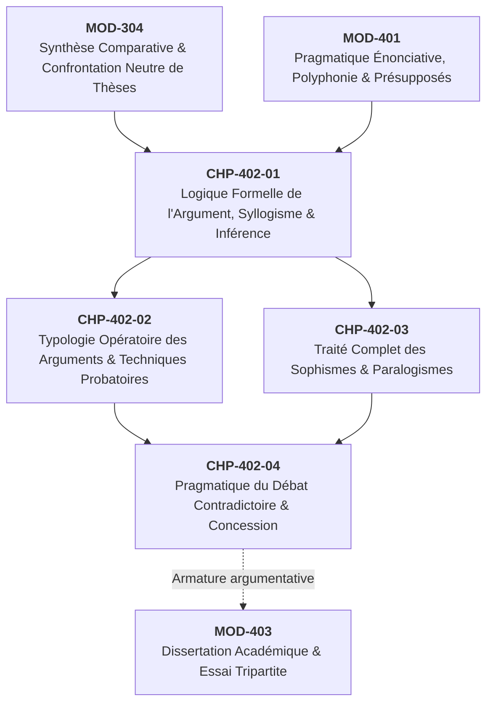
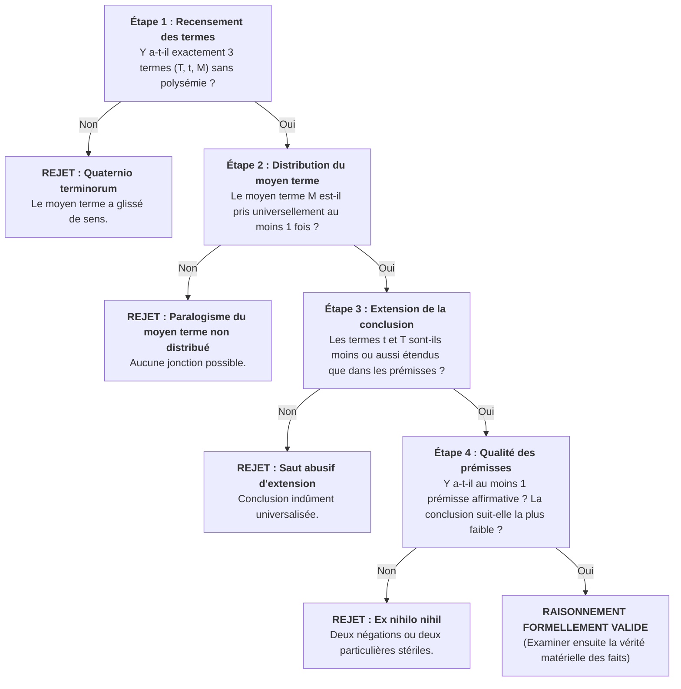

# Chapitre 1 — Logique Formelle de l'Argument et Mécanique du Raisonnement : Syllogisme Canonique, Enthymème et Modes d'Inférence

> **Identifiant du chapitre** : `CHP-402-01`  
> **Module de rattachement** : [`MOD-402` — Rhétorique Argumentative : Thèses, Réfutation et Détection des Sophismes](file:///f:/Formation/world-class-french/03-curriculum/year-2/semester-4/mod-402-rhetorique-argumentation-refutation-sophismes.md)  
> **Semestre** : Année 2 — Semestre 4 (S4)  
> **Volume horaire estimé** : 5 à 6 heures d'apprentissage autonome délibéré et d'ateliers d'application (Phase 1 Étude : 1 h 30 | Phase 2 Pratique : 1 h 30 | Phase 3 Correction : 1 h 00 | Phase 4 Évaluation : 1 h 00)  
> **Statut** : [STATUT : VALIDÉ]  
> **Compétences associées** : [`FR-ARGUM-001`](file:///f:/Formation/world-class-french/02-competency-framework/competency-framework.md#fr-argum-001-rigueur-démonstrative-réfutation-et-détection-des-sophismes) (L3 Autonomie), [`FR-LEXIC-001`](file:///f:/Formation/world-class-french/02-competency-framework/competency-framework.md#fr-lexic-001-précision-sémantique-nuances-synonymiques-et-collocations) (L3 Autonomie), [`FR-INT-005`](file:///f:/Formation/world-class-french/02-competency-framework/competency-framework.md#fr-int-005-présenter-oralement-un-raisonnement-structuré-et-éloquent) (L3 Autonomie)  
> **Sources scientifiques de référence** : `SRC-RHET-03` (Reboul, 1991), `SRC-RHET-01` (Fontanier, 1827/1977), `SRC-RHET-02` (Molinié, 1992), `SRC-GRAM-02` (Riegel et al., 2016), `SRC-NORM-03` (Ministère de l'Éducation nationale, 2020), `SRC-TYPO-01` (Imprimerie nationale, 2002/2014)

---

## 1. Titre et Place dans le Cursus

### 1.1 Intitulé Officiel
**Chapitre 1 : Logique Formelle de l'Argument et Mécanique du Raisonnement : Syllogisme Canonique, Enthymème et Modes d'Inférence** (`CHP-402-01`).

### 1.2 Insertion Architecturale dans le Cursus
Le chapitre inaugural du module `MOD-402` établit les fondations logico-déductives indispensables à toute joute oratoire et à toute composition académique avancée. Il opère la transition décisive entre l'analyse distanciée et comparative des textes (acquise en `MOD-304`) et l'intervention délibérative active.



- **En amont** : Ce chapitre réinvestit les compétences de confrontation d'idées de `MOD-304` et les concepts énonciatifs de `MOD-401` (polyphonie de Ducrot, décryptage des présupposés et sous-entendus).
- **Au sein du module `MOD-402`** : Il dote l'apprenant de l'outillage formel qui conditionne immédiatement la classification des arguments probants (`CHP-402-02`), le diagnostic chirurgical des sophismes (`CHP-402-03`) et la pratique réglée de la dispute oratoire (`CHP-402-04`).
- **En aval dans le cursus** : Il constitue le garant logique de la dissertation académique tripartite (`MOD-403`), de l'analyse stylistique des grands textes (`MOD-502`) et du Grand Oral de soutenance finale (`MOD-604`).

---

## 2. Objectifs Mesurables

Au terme des 5 à 6 heures d'apprentissage autonome et d'ateliers dirigés de ce chapitre, l'apprenant doit être capable de :

1. **Décomposer et formaliser un raisonnement déductif** : isoler la prémisse majeure, la prémisse mineure et la conclusion au sein de n'importe quel texte argumentatif dense, identifier le grand terme ($T$), le petit terme ($t$) et le moyen terme ($M$), et statuer sur la validité formelle selon les quatre règles fondamentales de la logique aristotélicienne [Réf. `SRC-RHET-03`, chap. 3].
2. **Expliciter et éprouver l'armature d'un enthymème** : repérer la prémisse masquée (garantie ou fondement sous-entendu) dans un discours politique, journalistique ou publicitaire, et juger si sa réintégration consolide ou détruit la force probante de la conclusion [Réf. `SRC-RHET-01`, partie II].
3. **Classifier et discriminer les trois modes d'inférence universels** : distinguer sans équivoque la déduction nécessaire, l'induction probabiliste et l'abduction heuristique, en précisant leurs degrés de certitude épistémique et leurs limites intrinsèques.
4. **Mobiliser avec précision le métalangage de la controverse logique** : employer sans impropriété sémantique les vocables *inférer, déduire, prémisse, validité formelle, vérité matérielle, quaternio terminorum, moyen terme non distribué* et *non sequitur* [Réf. `SRC-GRAM-02`, chap. 21 ; Réf. `SRC-NORM-03`].

---

## 3. Prérequis et Test de Préparation (Auto-Diagnostic)

### 3.1 Prérequis Cognitifs
- Maîtrise de la structure du paragraphe argumentatif unitaire (Idée directrice, Argument, Illustration textuelle) validée en `MOD-203`.
- Maniement rigoureux des connecteurs logiques de cause (*car, parce que, puisque*), de conséquence (*donc, par conséquent, ainsi*) et d'opposition (*or, mais, cependant*).
- Capacité à distinguer un fait vérifiable d'une opinion subjective et d'un jugement de valeur [validée en `MOD-304`].

### 3.2 Test de Préparation Immédiat
Répondez aux cinq questions suivantes avant d'aborder le cours, puis déployez le volet de correction pour évaluer votre acuité initiale.

1. Dans le raisonnement canonique : *« Tous les hommes sont mortels ; or Socrate est un homme ; donc Socrate est mortel »*, quel est l'élément qui sert de passerelle entre les deux prémisses et qui disparaît obligatoirement dans la conclusion ?
2. Un raisonnement peut-il être irréprochable sur le plan de la déduction logique tout en énonçant une absurdité matérielle au regard des faits réels ?
3. Dans la déclaration suivante : *« Cet étudiant réussira brillamment son examen de droit, car il passe ses nuits à la bibliothèque »*, quelle proposition fondamentale le locuteur admet-il implicitement sans la prononcer ?
4. Quelle différence fondamentale existe-t-il entre observer cent corbeaux noirs pour affirmer que *« tous les corbeaux sont noirs »*, et partir de la loi *« tous les corbeaux sont noirs »* pour en déduire qu'un spécimen particulier sera noir ?
5. Que désigne précisément le terme *inférence* par rapport au terme *affirmation* ?

---

<details>
<summary><b>Consulter le corrigé de l'auto-diagnostic</b></summary>

1. C'est le **moyen terme** (ici : *« homme / hommes »*). Il assure le pivot logique entre le prédicat de la majeure (*mortel*) et le sujet de la mineure (*Socrate*), puis s'efface dans la conclusion.
2. **Oui, absolument**. C'est la distinction cardinale entre la **validité formelle** (respect strict des règles d'inférence) et la **vérité matérielle** (adéquation empirique des propositions au réel). Si l'on pose que *« tous les poissons volent »* et que *« la carpe est un poisson »*, la déduction *« donc la carpe vole »* est formellement valide mais matériellement fausse.
3. La prémisse sous-entendue est : *« Tout étudiant qui passe ses nuits à la bibliothèque réussit brillamment ses examens »* (généralisation implicite qui fonde l'argument).
4. La première démarche est une **induction** (généralisation empirique à partir de cas observés, toujours sujette à réfutation par un contre-exemple) ; la seconde démarche est une **déduction** (application nécessaire d'une règle universelle admise à une occurrence particulière).
5. Une **affirmation** pose un fait ou un jugement de manière isolée (*« Il fait froid »*) ; une **inférence** est une opération mentale par laquelle on tire légitimement une proposition nouvelle (la conclusion) à partir d'une ou plusieurs propositions déjà posées (les prémisses).

</details>

---

## 4. Situation de Départ ou Problème Concret : Le Naufrage du Raisonnement Boiteux

### 4.1 L'Illusion de la Cohérence Spontanée
Dans les débats publics, les concours administratifs ou les mémoires universitaires, d'innombrables candidats défendent des thèses légitimes en employant des enchaînements discursifs qu'ils croient inattaquables, mais qui s'effondrent sous le premier examen méthodique.

Considérons les trois cas cliniques suivants :

- **Cas n° 1 — Le télescopage de la vérité empirique et de la rigueur déductive** :  
  Un candidat soutient : *« La démocratie garantit les droits fondamentaux. Or la Norvège protège scrupuleusement la liberté d'expression. Donc la Norvège est une démocratie. »*  
  L'auditoire acquiesce spontanément parce que les trois phrases sont historiquement et politiquement exactes dans le monde réel. Pourtant, **ce raisonnement est formellement nul**. Poser que la démocratie garantit des droits ne signifie nullement qu'elle soit le *seul* régime capable de les protéger, ni que la protection d'un droit suffise à qualifier une démocratie. La structure logique est défectueuse : c'est un paralogisme d'affirmation du conséquent.
- **Cas n° 2 — Le piège du moyen terme équivoque (*quaternio terminorum*)** :  
  Observez cette déduction classique :  
  *« Tout ce qui est rare est cher. Or un cheval bon marché est rare. Donc un cheval bon marché est cher. »*  
  La conclusion est absurde, bien que les deux prémisses semblent recevables au sens commun. Pourquoi la machine logique déraille-t-elle ? Parce que le mot *« rare »* a changé subrepticement de valeur sémantique en passant de la majeure (rareté par pénurie et valeur marchande) à la mineure (rareté par improbabilité statistique). Le raisonnement compte en réalité **quatre termes** masqués sous trois mots.
- **Cas n° 3 — L'enthymème manipulateur et sa prémisse clandestine** :  
  Un éditorialiste proclame : *« Cet ingénieur n'a jamais exercé de responsabilités syndicales ; il ne saura donc jamais négocier un plan de sauvegarde de l'emploi. »*  
  L'argument semble percutant par sa concision. Mais quel est son ressort secret ? L'auteur fait l'économie d'une prémisse universelle clandestine : *« Seules les personnes ayant exercé des responsabilités syndicales possèdent les aptitudes requises pour négocier un plan de sauvegarde. »* Dès que cette proposition masquée est mise en pleine lumière, l'auditoire constate sa fragilité arbitraire et l'argument s'effondre.

Pour échapper à ces errements et acquérir une autorité dialectique indiscutable, il est impératif d'ouvrir le capot de la langue et d'en démonter l'engrenage logique fondamental.

---

## 5. Explication Intuitive : L'Engrenage Mécanique et le Pont Suspendu

Pour appréhender la mécanique du raisonnement logique, mobilisons deux métaphores structurelles précises.

### 5.1 L'Engrenage à Trois Roues Dentées (Le Syllogisme)
Imaginons un mécanisme horloger composé de trois roues dentées en contact direct :

```text
  [ ROUE MAJEURE (T) ]  <--->  [ ROUE PIVOT : MOYEN TERME (M) ]  <--->  [ ROUE MINEURE (t) ]
   (Règle universelle)             (Passerelle de transmission)          (Cas d'application)
                                                 │
                                                 ▼
                              [ TRANSMISSION NÉCESSAIRE ]
                           L'arbre de sortie tourne obligatoirement :
                                  CONCLUSION : t est lié à T
```

1. La **première roue** représente le domaine général (le grand terme $T$) et la loi universelle qui le régit.
2. La **roue centrale**, ou roue d'embrayage, représente le **moyen terme ($M$)** : son rôle unique est de s'engrener parfaitement à la fois avec la première roue et avec la troisième.
3. La **troisième roue** représente le cas particulier ou singulier (le petit terme $t$).

Si la roue centrale $M$ est parfaitement calibrée, lorsque la première roue s'active, la troisième est entraînée **mécaniquement, nécessairement et infailliblement**. Il n'est point besoin de croire, d'espérer ou d'avoir de l'intuition : la conclusion s'impose en vertu de la structure géométrique du système.  
En revanche, si la roue centrale présente des dents cassées (moyen terme non distribué) ou change de diamètre en cours de rotation (moyen terme équivoque), l'engrenage se bloque ou tourne à vide : le mouvement ne se transmet pas.

### 5.2 Le Pont Suspendu à Pile Invisible (L'Enthymème)
Dans la conversation courante et l'éloquence politique, nul ne prend le temps de déployer les trois propositions d'un syllogisme d'école. Nous parlons par **enthymèmes**.

L'enthymème ressemble à une passerelle qui franchit un fleuve en semblant reposer uniquement sur les deux rives (la donnée particulière et la conclusion). Mais en réalité, le tablier ne tient que parce qu'il s'appuie sur une **pile centrale immergée sous l'eau**. Cette pile invisible, c'est la **prémisse sous-entendue**, admise tacitement par l'auditoire.  
- Si la pile repose sur un socle rocheux inébranlable (une vérité scientifique partagée, un principe de droit incontesté), le pont est robuste : la persuasion s'opère instantanément.
- Si la pile repose sur du sable vaseux (un stéréotype douteux, une généralisation hâtive, un préjugé sociologique), il suffit au contradicteur de plonger sous la surface pour désigner la pourriture du pilier : tout l'édifice s'abîme alors d'un coup.

---

## 6. Définitions Précises et Terminologie Fondamentale

Chaque notion de ce répertoire constitue une arme conceptuelle indispensable au logicien et au rhétoricien.

### 6.1 L'Argument
> **Définition** : Un **argument** est un énoncé linguistique ou un ensemble articulé d'énoncés (prémisses) destiné à soutenir, justifier ou faire admettre une proposition controversée appelée la **conclusion** [Réf. `SRC-RHET-03`, chap. 2].

### 6.2 Les Prémisses et la Conclusion
- **Prémisse majeure** : Proposition générale de départ, établissant une relation conceptuelle universelle ou quasi universelle entre le moyen terme ($M$) et le grand terme ($T$).  
  *Exemple* : *« Tout citoyen majeur a le droit de vote. »*
- **Prémisse mineure** : Proposition particulière ou factuelle, rattachant le sujet d'étude (le petit terme $t$) au moyen terme ($M$).  
  *Exemple* : *« Or Aïcha est une citoyenne majeure. »*
- **Conclusion** : Proposition finale inférée, reliant nécessairement le petit terme ($t$) au grand terme ($T$), après élimination complète du moyen terme.  
  *Exemple* : *« Donc Aïcha a le droit de vote. »*

### 6.3 Validité Formelle vs Vérité Matérielle
Il s'agit du clivage fondamental de l'épistémologie logique :
- **Validité formelle** : Propriété d'un raisonnement dont la conclusion découle nécessairement et légitimement de ses prémisses en vertu des règles du calcul logique, indépendamment du contenu empirique des phrases. Un raisonnement est valide ou non valide (invalide).
- **Vérité matérielle** : Adéquation d'une proposition descriptive avec la réalité observable du monde sensible. Une proposition est vraie ou fausse.

$$\text{Raisonnement sain (ou solide)} = \text{Validité formelle} + \text{Vérité matérielle de toutes ses prémisses}$$

### 6.4 Le Syllogisme Canonique et ses Trois Termes
Formalisé par Aristote dans les *Premiers Analytiques*, le **syllogisme** est une déduction médiate reliant deux termes au moyen d'un troisième [Réf. `SRC-RHET-03`, chap. 3] :
- **Le Grand Terme ($T$)** : Le terme qui sert de prédicat dans la conclusion (le concept le plus englobant).
- **Le Petit Terme ($t$)** : Le terme qui sert de sujet dans la conclusion (l'entité spécifique examinée).
- **Le Moyen Terme ($M$)** : Le terme intermédiaire présent dans les deux prémisses, mais rigoureusement **absent de la conclusion**.

### 6.5 La *Quaternio Terminorum* (Sophisme des Quatre Termes)
Paralogisme formel consistant à utiliser un syllogisme comportant en réalité quatre termes distincts au lieu de trois, généralement par glissement sémantique ou polysémie du moyen terme entre la majeure et la mineure.

### 6.6 Le Moyen Terme Non Distribué
Vice formel dans lequel le moyen terme $M$ n'est jamais pris dans la totalité de son extension (au sens universel) dans aucune des deux prémisses. Dès lors, le petit terme et le grand terme peuvent se rapporter à des sous-ensembles totalement disjoints de $M$, rendant toute inférence nulle.

### 6.7 L'Enthymème
> **Définition** : Syllogisme abrégé ou tronqué, propre au discours rhétorique, dans lequel l'une des deux prémisses (parfois la conclusion elle-même) est passée sous silence, car elle est réputée acquise et partagée par l'auditoire [Réf. `SRC-RHET-01`, partie II ; Réf. `SRC-RHET-03`, chap. 3].  
> *Exemple canonique* : *« Je pense, donc je suis »* (Descartes supprime la majeure universelle : *« Tout ce qui pense existe »*).

### 6.8 Les Trois Modes d'Inférence
- **Déduction** : Inférence analytique procédant de la règle générale au cas singulier, conférant une **certitude absolue** sous condition de prémisses vraies.
- **Induction** : Inférence synthétique procédant de l'observation répétée de cas particuliers pour formuler une loi générale, n'aboutissant qu'à un **degré de probabilité empirique**.
- **Abduction** : Inférence conjecturale formulée à partir d'un fait surprenant constaté, remontant à l'hypothèse explicative la plus vraisemblable [définie par C. S. Peirce]. C'est la démarche reine de l'enquêteur, de l'historien et du médecin clinicien.

---

## 7. Règles et Mécanismes Fondamentaux

### 7.1 L'Anatomie de l'Argument selon Aristote et Toulmin
Pour dépasser le cadre rigide de la logique pure et analyser l'argumentation vivante dans les textes complexes, le philosophe Stephen Toulmin (1958) a modernisé l'analyse aristotélicienne en décomposant tout argument en six fonctions organiques [Réf. `SRC-RHET-03`, chap. 2] :

```text
  [ DONNÉES (D) ] ───────────────────────────> [ CONCLUSION (C) ]
  (Faits bruts constatés)                             │
         │                                            │
         │                                   [ MODALISATEUR (M) ]
         ▼                                   (Probablement, nécessairement)
  [ GARANTIE (G) ]                                    │
  (Règle générale, loi, licence d'inférer)            │
         │                                            │
         ▼                                            ▼
  [ FONDEMENT (F) ]                            [ RÉSERVE (R) ]
  (Texte de loi, théorie, preuve scientifique)  (Cas d'exception invalidant)
```

1. **Les Données (*Data*)** : Les faits empiriques avérés servant de point de départ (*« Paul a commis un vol à main armée »*).
2. **La Conclusion (*Claim*)** : La thèse que l'on veut faire admettre (*« Paul doit être condamné à une peine de réclusion »*).
3. **La Garantie (*Warrant*)** : Le principe de droit, la maxime d'expérience ou la règle logique qui autorise le saut des données à la conclusion (*« Quiconque commet un vol à main armée s'expose aux peines de réclusion criminelle »*).
4. **Le Fondement (*Backing*)** : La source d'autorité ultime ou le corpus juridique qui soutient la garantie (*« Article 311 du Code pénal »*).
5. **Le Modalisateur (*Qualifier*)** : L'indice d'intensité ou de certitude affecté à la conclusion (*« Assurément »*, *« Sauf circonstances exceptionnelles »*).
6. **La Réserve (*Rebuttal*)** : La clause d'exception prévisible qui anéantirait l'inférence (*« À moins qu'il n'agisse sous l'empire d'une contrainte physique irrésistible ou d'un trouble psychique abolissant son discernement »*).

### 7.2 Le Syllogisme Classique et les Règles d'Or de Validité
La logique formelle d'ascendance aristotélicienne et scolastique a codifié des règles intangibles permettant de tester instantanément la consistance d'un raisonnement déductif [Réf. `SRC-RHET-03`, chap. 3].

#### Règle 1 : La Triade des Termes et la Proscription de la *Quaternio Terminorum*
Un syllogisme ne peut comporter que **trois termes** : le Grand Terme ($T$), le Petit Terme ($t$) et le Moyen Terme ($M$).  
Chaque terme doit être employé dans la même acception exacte d'un bout à l'autre de la démonstration. Tout glissement polysémique introduit un quatrième terme clandestin qui vicie l'inférence.

#### Règle 2 : La Distribution Impérative du Moyen Terme
Le Moyen Terme ($M$) doit être **distribué** — c'est-à-dire pris dans toute son extension universelle — **au moins une fois** dans les prémisses.  
*Pourquoi ?* Si $M$ n'est considéré que partiellement dans la majeure et partiellement dans la mineure, le petit terme et le grand terme risquent de s'accrocher à deux segments distincts de son extension sans jamais se rencontrer.  
- *Paralogisme du moyen terme non distribué* :  
  *« Tous les criminels respirent de l'air ; or cet accusé respire de l'air ; donc cet accusé est un criminel. »*  
  $M$ (*« respirer de l'air »*) englobe l'humanité entière ; l'intersection entre les criminels et les innocents n'autorise aucune liaison entre l'accusé et le crime.

#### Règle 3 : La Loi de Non-Extension de la Conclusion
Les termes de la conclusion ($t$ et $T$) ne peuvent jamais avoir une **extension plus large** dans la conclusion que dans les prémisses.  
On ne peut pas passer subrepticement du particulier à l'universel dans la proposition déductive terminale. Si un terme est particulier dans sa prémisse, il demeure strictement particulier dans la conclusion.

#### Règle 4 : La Loi des Prémisses Négatives et Particulières
- **De deux prémisses négatives, rien ne suit** (*Ex nihilo nihil*) : Si ni $t$ ni $T$ n'ont de point commun avec $M$, aucune relation (ni d'inclusion ni d'exclusion) ne peut être établie entre eux.  
  *Exemple stérile* : *« Aucun chat n'est un oiseau ; or aucun reptile n'est un chat ; donc... »* (Inférence impossible).
- **De deux prémisses particulières, rien ne suit** : Si l'on ne dispose que d'énoncés partiels (*« Certains étudiants dorment ; or certains dormeurs ronflent »*), aucune synthèse nécessaire n'est possible.
- **La conclusion suit toujours la prémisse la plus faible** : Si une prémisse est négative, la conclusion sera obligatoirement négative ; si une prémisse est particulière, la conclusion sera obligatoirement particulière.

### 7.3 L'Enthymème : Le Syllogisme de la Rhétorique Vivante
Aristote qualifie l'enthymème de *« chair et colonne vertébrale de la persuasion »* (*Rhétorique*, I, 1). Contrairement au logicien pur qui opère sur des concepts abstraits, l'orateur s'adresse à un public dont l'attention est limitée et qui refuserait d'écouter l'énoncé pesant de toutes les évidences.

#### La Mécanique de l'Enthymème
L'enthymème raccourcit le raisonnement en supprimant le maillon qui semble aller de soi :
- *Exemple usuel* : *« Cet homme est innocent, puisqu'il était à cent lieues de la scène du crime au moment des faits. »*  
  - Prémisse mineure explicite : *Cet homme était éloigné du lieu du crime au moment des faits.*  
  - Conclusion explicite : *Cet homme est innocent.*  
  - Prémisse majeure sous-entendue : *Nul ne peut commettre personnellement un crime en un lieu où il ne se trouve pas (principe d'ubiquité impossible).*

#### Protocole d'Audit d'un Enthymème
Pour désamorcer un discours persuasif ou tester la solidité de sa propre pensée, l'apprenant doit appliquer la **procédure d'explicitation en trois étapes** :
1. **Étape 1 : Localiser la conclusion** (repérer les marques d'aboutissement : *donc, par conséquent, ainsi, c'est pourquoi*).
2. **Étape 2 : Identifier la prémisse fournie** (repérer les connecteurs de justification : *car, parce que, étant donné que, puisque*).
3. **Étape 3 : Reconstituer la prémisse absente** en formulant la règle générale qui rend la déduction mathématiquement possible. Une fois formulée, poser la question critique : *Cette règle est-elle une vérité démontrée, une probabilité raisonnable ou un pur préjugé idéologique ?*

### 7.4 Les Trois Modes d'Inférence Universels

| Mode d'Inférence | Vecteur Logique | Exemple Type | Degré Épistémique | Vulnérabilité Majeure |
| :--- | :--- | :--- | :--- | :--- |
| **Déduction** | De la règle générale ($A \to B$) et du cas ($A$) vers le résultat nécessaire ($B$). | *Tous les métaux conduisent l'électricité ; or le cuivre est un métal ; donc le cuivre conduit l'électricité.* | **Certitude nécessaire** (si les prémisses sont vraies et la forme valide). | Fausseté ou pétition de principe dissimulée dans les prémisses. |
| **Induction** | De l'accumulation de cas particuliers ($A_1, A_2, A_n$ sont $B$) vers la loi générale ($Tous\ les\ A\ sont\ B$). | *Tous les cygnes observés jusqu'ici en Europe sont blancs ; donc tous les cygnes sur Terre sont blancs.* | **Probabilité empirique** (jamais absolue). | Le cygne noir : réfutation immédiate par un seul contre-exemple. |
| **Abduction** | D'un résultat surprenant constaté ($B$) et d'une règle admise ($A \to B$) vers l'hypothèse explicative ($A$ s'est produit). | *La chaussée est trempée au réveil ; or une averse nocturne mouille la chaussée ; j'infère qu'il a plu cette nuit.* | **Plausibilité / Conjectrice** (la meilleure explication disponible). | Pluralité des causes alternatives (une arroseuse municipale est peut-être passée). |

---

## 8. Raisonnement Détaillé : La Dualité Forme / Contenu

### Pourquoi un Raisonnement Valide Peut-il Être Matériellement Faux ?
L'un des obstacles majeurs pour l'esprit non formé consiste à croire que la logique s'occupe de la vérité du monde. La logique formelle ne dit rien de la composition chimique des corps, ni de l'histoire politique des nations : elle s'assure exclusivement de la **conservation de la valeur de vérité au long de la chaîne déductive**.

Considérons le syllogisme suivant :
$$\begin{array}{rll}
\text{Majeure :} & \text{Tous les félins sont des vertébrés.} & (\text{Vraie dans la nature}) \\
\text{Mineure :} & \text{Or le baobab est un félin.} & (\text{Absurde et matériellement fausse}) \\
\hline
\text{Conclusion :} & \text{Donc le baobab est un vertébré.} & (\text{Matériellement fausse})
\end{array}$$

Sur le plan de la logique pure, **ce raisonnement est parfait**. Sa structure appartient au mode canonique *Barbara* (Tout $M$ est $P$ ; tout $S$ est $M$ ; donc tout $S$ est $P$). Si la mineure avait été vraie, la conclusion aurait été inéluctablement vraie. L'erreur ne réside pas dans le *raisonnement* (la machine formelle), mais dans le *carburant* injecté (la donnée empirique).

À l'inverse, considérons cet énoncé :
$$\begin{array}{rll}
\text{Majeure :} & \text{Paris est la capitale de la France.} & (\text{Vraie}) \\
\text{Mineure :} & \text{Or la Seine traverse Paris.} & (\text{Vraie}) \\
\hline
\text{Conclusion :} & \text{Donc le climat de la Terre se réchauffe.} & (\text{Vraie})
\end{array}$$

Ici, les trois propositions énoncent des réalités matérielles indiscutables. Pourtant, l'ensemble est une **monstruosité logique** : c'est un *non sequitur* absolu. Aucun terme n'articule la conclusion aux prémisses. La vérité des faits ne confère aucune valeur démonstrative à l'énoncé.

> [!IMPORTANT]
> En argumentation et en débat public, le premier travail d'autodéfense intellectuelle consiste à scinder l'analyse en deux temps étanches :
> 1. *Examen syntaxique/formel* : La conclusion découle-t-elle rigoureusement des propositions antérieures ?
> 2. *Examen sémantique/matériel* : Les propositions initiales sont-elles conformes à l'expérience et aux sources documentaires avérées ?

---

## 9. Exemples Corrects Commentés

### 9.1 Décorticage de Quatre Syllogismes Canoniques

#### Exemple 1 : Le Mode *Barbara* (Universel Affirmatif Direct)
- **Prémisse majeure** : *Tout acte de corruption délibéré ($M$) dégrade l'autorité morale de l'État ($T$).*
- **Prémisse mineure** : *Or la concussion commise par ce haut fonctionnaire ($t$) est un acte de corruption délibéré ($M$).*
- **Conclusion** : *Donc la concussion commise par ce haut fonctionnaire ($t$) dégrade l'autorité morale de l'État ($T$).*
- **Analyse formelle** :
  - Moyen terme ($M$) : *« acte de corruption délibéré »*. Il est distribué dans la majeure (quantificateur universel *« Tout »*).
  - Grand terme ($T$) : *« dégrader l'autorité morale de l'État »*.
  - Petit terme ($t$) : *« la concussion commise par ce haut fonctionnaire »*.
  - **Verdict** : Raisonnement parfaitement valide et sain (prémisses empiriquement démontrées en droit public).

#### Exemple 2 : Le Mode *Celarent* (Universel Négatif)
- **Prémisse majeure** : *Nulle juridiction d'exception ($M$) ne garantit les droits imprescriptibles de la défense ($T$).*
- **Prémisse mineure** : *Or cette cour martiale improvisée ($t$) est une juridiction d'exception ($M$).*
- **Conclusion** : *Donc cette cour martiale improvisée ($t$) ne garantit pas les droits imprescriptibles de la défense ($T$).*
- **Analyse formelle** :
  - La majeure est universelle négative (*Nulle*). Le moyen terme est distribué universellement.
  - La conclusion est universelle négative conformément à la règle de la proposition la plus faible.
  - **Verdict** : Validité formelle absolue.

#### Exemple 3 : Le Mode *Darii* (Particulier Affirmatif)
- **Prémisse majeure** : *Toute loi rétroactive attentatoire aux droits acquis ($M$) est contraire à la sécurité juridique ($T$).*
- **Prémisse mineure** : *Or certains décrets fiscaux promulgués récemment ($t$) sont des lois rétroactives attentatoires aux droits acquis ($M$).*
- **Conclusion** : *Donc certains décrets fiscaux promulgués récemment ($t$) sont contraires à la sécurité juridique ($T$).*
- **Analyse formelle** :
  - La mineure est particulière affirmative (*« certains décrets »*).
  - La conclusion conserve strictement cette extension particulière (*« certains décrets »*). Elle ne commet pas l'erreur de généraliser à l'ensemble des décrets fiscaux.
  - **Verdict** : Validité formelle irréprochable.

#### Exemple 4 : Le Mode *Ferio* (Particulier Négatif)
- **Prémisse majeure** : *Nul contrat obtenu sous la contrainte physique ($M$) n'a de validité civile ($T$).*
- **Prémisse mineure** : *Or quelques cessions d'actions signées hier ($t$) sont des contrats obtenus sous la contrainte physique ($M$).*
- **Conclusion** : *Donc quelques cessions d'actions signées hier ($t$) n'ont pas de validité civile ($T$).*
- **Analyse formelle** :
  - Majeure universelle négative, mineure particulière affirmative.
  - La conclusion suit la double faiblesse : elle est particulière et négative.
  - **Verdict** : Syllogisme valide.

### 9.2 Analyse de Deux Enthymèmes Historiques et Politiques

#### Enthymème 1 : Tribune Parlementaire contre la Censure
> *« La presse périodique éclaire le peuple sur les abus du gouvernement ; son musellement constitue donc un attentat contre la souveraineté nationale. »*

- **Éléments explicites** :
  - Mineure : *La presse éclaire le peuple sur les abus du gouvernement.*
  - Conclusion : *Le musellement de la presse est un attentat contre la souveraineté nationale.*
- **Reconstruction du maillon masqué (Prémisse majeure)** :
  - *« Tout acte qui prive le peuple de la connaissance des abus du gouvernement constitue un attentat contre la souveraineté nationale. »*
- **Critique rhétorique** : L'argument est redoutablement puissant parce que la majeure sous-entendue est immédiatement accordée par tout auditoire républicain attaché au principe démocratique. Réfuter la conclusion obligerait l'adversaire à soutenir que cacher les abus au peuple est conforme à la souveraineté, position politiquement intenable.

#### Enthymème 2 : Débat sur l'Indépendance Économique
> *« Notre nation dépend de créanciers extérieurs pour financer ses infrastructures vitales ; nous ne disposons donc point d'une souveraineté réelle. »*

- **Éléments explicites** :
  - Mineure : *La nation dépend de créanciers extérieurs pour ses investissements fondamentaux.*
  - Conclusion : *La nation ne possède pas de souveraineté réelle.*
- **Reconstruction du maillon masqué (Prémisse majeure)** :
  - *« Nulle nation tributaire de créanciers extérieurs pour ses investissements fondamentaux ne peut exercer de souveraineté réelle. »*
- **Critique rhétorique** : L'argument déplace le débat du plan formel (la souveraineté juridique inscrite dans les traités) vers le plan matériel (la dépendance financière). La force persuasive repose sur l'adhésion de l'auditoire à une définition économique de la souveraineté.

### 9.3 Modélisation d'une Inférence Abductive (Enquête Institutionnelle)
- **Constat empirique surprenant ($B$)** : *Le registre des votes électroniques du scrutin universitaire affiche une participation de 100 % dans le collège doctoral entre 3 heures et 4 heures du matin.*
- **Règle générale connue ($A \to B$)** : *Une injection de scripts malveillants automatisés sur le serveur de base de données produit typiquement un afflux massif et régulier d'émargements aux heures de veille.*
- **Inférence abductive ($A$ est l'explication la plus plausible)** : *Les auditeurs émettent l'hypothèse d'une intrusion informatique frauduleuse sur le serveur, plutôt que celle d'une mobilisation spontanée nocturne et unanime de tous les doctorants.*
- **Statut logique** : L'abduction ne délivre pas une certitude absolue (les doctorants auraient pu théoriquement organiser un événement nocturne concerté), mais elle oriente légitimement la mise sous séquestre immédiate des journaux de connexion (*logs*).

---

## 10. Contre-Exemples et Erreurs Fréquentes

Examinons la clinique des six pathologies logiques les plus meurtrières pour le raisonnement.

### Erreur n° 1 : Sophisme du moyen terme non distribué
- **Formulation fautive** :  
  *« Tous les terroristes utilisent des messageries chiffrées. Or les diplomates de notre ambassade utilisent des messageries chiffrées. Donc les diplomates de notre ambassade sont des complices du terrorisme. »*
- **Diagnostic formel** :  
  Le moyen terme est *« utiliser des messageries chiffrées »*. Dans la majeure, il est l'attribut d'une affirmative universelle : son extension ne couvre pas l'ensemble des utilisateurs de cryptographie, mais seulement la fraction terroriste. Dans la mineure, il est encore pris particulièrement. N'étant distribué universellement aucune fois, il ne permet aucune jonction entre *« diplomates »* et *« terroristes »*.
- **Correction chirurgicale** :  
  Pour que le raisonnement fonctionne, il faudrait poser l'absurdité : *« Tous les utilisateurs de messageries chiffrées sont des terroristes »*, proposition immédiatement réfutable.

### Erreur n° 2 : Quaternio terminorum par polysémie du moyen terme
- **Formulation fautive** :  
  *« La fin d'une chose est sa perfection. Or la mort est la fin de la vie. Donc la mort est la perfection de la vie. »*
- **Diagnostic formel** :  
  Le mot *« fin »* est employé au sens téléologique d'accomplissement ou de but suprême dans la majeure (*τέλος* / *finis*), tandis qu'il est pris au sens purement chronologique de cessation temporelle dans la mineure. Il y a deux concepts distincts sous une seule étiquette lexicale : le syllogisme compte quatre termes.
- **Correction chirurgicale** :  
  Dissocier explicitement : *« L'accomplissement d'une chose est sa perfection. Or la mort est la cessation chronologique de la vie organique. Aucune conclusion ne s'ensuit. »*

### Erreur n° 3 : Saut inductif non fondé (généralisation abusive)
- **Formulation fautive** :  
  *« J'ai interrogé trois directeurs d'hôpitaux à Cotonou et deux cliniciens à Parakou : tous déplorent des retards d'approvisionnement en réactifs. C'est la preuve définitive que l'ensemble du système de santé béninois est totalement paralysé par une faillite logistique intégrale. »*
- **Diagnostic formel** :  
  Échantillonnage infinitésimal projeté abusivement sur une population totale. Le passage de quelques cas particuliers contingents à une loi universelle péremptoire constitue un saut inductif fallacieux.
- **Correction chirurgicale** :  
  Restreindre la portée épistémique par un modalisateur prudent : *« Ces témoignages concordants révèlent des tensions logistiques critiques dans plusieurs centres hospitaliers majeurs et justifient un audit national d'urgence. »*

### Erreur n° 4 : Confusion entre validité formelle et vérité empirique
- **Formulation fautive** :  
  *« Votre syllogisme est faux parce que la conclusion me déplaît et ne correspond pas à mes valeurs. »* ou à l'inverse : *« Mon raisonnement est nécessairement inattaquable puisque tous les chiffres cités dans ma mineure sont rigoureusement certifiés par l'institut national de statistique. »*
- **Diagnostic formel** :  
  Confusion catégorielle entre la justesse de l'inférence (cohérence logique) et l'exactitude des faits (vérité documentaire).
- **Correction chirurgicale** :  
  Distinguer la réfutation de la structure (démontrer un vice de forme ou un *non sequitur*) de la contestation des données (produire un contre-fait ou contester les prémisses).

### Erreur n° 5 : Prémisse cachée fallacieuse dans un enthymème
- **Formulation fautive** :  
  *« Monsieur X roule dans une luxueuse voiture de fonction allemande ; il ne peut donc pas comprendre les difficultés des classes laborieuses. »*
- **Diagnostic formel** :  
  L'enthymème dissimule la majeure arbitraire suivante : *« Tout individu disposant d'un véhicule de fonction haut de gamme est incapable de comprendre les difficultés des classes laborieuses. »* Ce préjugé psychologique est érigé indûment en loi universelle d'incompatibilité cognitive.
- **Correction chirurgicale** :  
  Forcer l'adversaire à formuler sa prémisse clandestine pour en exposer l'inanité caricaturale.

### Erreur n° 6 : Conclusion excédant l'extension des prémisses
- **Formulation fautive** :  
  *« Certains magistrats sont corrompus. Or tous les magistrats exercent le pouvoir judiciaire. Donc l'ensemble du pouvoir judiciaire est corrompu. »*
- **Diagnostic formel** :  
  Le terme *« corrompus »* est particulier dans la majeure. Dans la conclusion, l'orateur opère une extension abusive en universalisant l'attribut à l'institution tout entière (*« l'ensemble du pouvoir judiciaire »*). C'est une violation flagrante de la Règle 3.
- **Correction chirurgicale** :  
  Respecter la stricte extension : *« Donc certains représentants du pouvoir judiciaire sont corrompus. »*

---

## 11. Cas Particuliers et Limites du Modèle Canonique

### 11.1 Le Sorite (Chaîne de Syllogismes Enchaînés)
Dans les raisonnements longs, les syllogismes s'empilent en cascades déductives appelées **sorites** : le prédicat de la première proposition devient le sujet de la suivante, et ainsi de suite jusqu'à la conclusion finale qui unit le premier sujet au dernier prédicat.
- *Exemple canonique* :  
  1. *L'homme vertueux est maître de ses passions.*  
  2. *Or quiconque est maître de ses passions possède la paix de l'âme.*  
  3. *Or quiconque possède la paix de l'âme ne saurait être malheureux.*  
  4. *Donc l'homme vertueux ne saurait être malheureux.*
- **Règle de solidité** : Si un seul maillon intermédiaire est corrompu ou équivoque, l'ensemble de la chaîne s'effondre.

### 11.2 L'Épichérème (Le Syllogisme Auto-Justifié)
L'**épichérème** est un syllogisme oratoire étoffé dans lequel la majeure, la mineure, ou les deux propositions, sont accompagnées immédiatement de leurs preuves ou attestations factuelles avant le tirage de la conclusion [Réf. `SRC-RHET-01`, partie II].
- *Exemple* :  
  *Majeure motivée* : *Tout individu ayant prémédité l'empoisonnement d'autrui mérite la réclusion criminelle, car la loi positive et le droit naturel assimilent la préméditation au plus haut degré de culpabilité.*  
  *Mineure motivée* : *Or l'accusé a prémédité son forfait, comme l'attestent les expertises toxicologiques et les recherches de substances létales retrouvées sur ses appareils numériques.*  
  *Conclusion* : *Donc l'accusé mérite la réclusion criminelle.*

### 11.3 Les Limites de la Logique Aristotélicienne : Le Paradoxe du Menteur
La logique des termes d'Aristote rencontre ses limites formelles face aux énoncés auto-référentiels, dont le plus célèbre est le **paradoxe d'Épiménide le Crétois** :
> *« Tous les Crétois sont des menteurs, or je suis Crétois... »*

Si la proposition est vraie, alors Épiménide ment, ce qui implique que la proposition est fausse ; et si elle est fausse, le menteur dit la vérité. Cette aporie démontre qu'un système logique ne peut pas statuer sur la valeur de vérité de ses propres énoncés sans distinction hiérarchique entre le langage-objet et le métalangage (travaux de Tarski et Russell au XXe siècle).

---

## 12. Approfondissement : De la Syllogistique Classique à la Logique des Prédicats

Pendant plus de deux millénaires, la logique des termes d'Aristote est restée le modèle indépassé de la pensée occidentale. Emmanuel Kant affirmait même avec imprudence en 1787 que la logique n'avait pas eu à faire un pas en arrière ni un pas en avant depuis le philosophe grec.

La rupture épistémologique majeure survient en 1879 avec la publication de la *Begriffsschrift* (Idéographie) du philosophe et mathématicien allemand **Gottlob Frege**.

### 12.1 La Critique de la Forme « Sujet - Copule - Prédicat »
Dans la grammaire traditionnelle, une phrase comme *« Socrate est mortel »* et *« Tous les hommes sont mortels »* semblent partager la même armature syntaxique : un sujet relié à un adjectif par le verbe copule *être*.  
Frege démontre que cette analogie superficielle masque une divergence logique profonde :
- *« Socrate »* désigne un **objet individuel singulier**.
- *« Tous les hommes »* ne désigne aucun objet particulier, mais une **quantification universelle** opérant sur un ensemble conceptuel.

### 12.2 La Substitution « Fonction / Argument » et la Quantification
Frege remplace le couple sujet/prédicat par le modèle mathématique de la **fonction et de l'argument** :
- Un prédicat est une fonction inachevée : $P(x) = \text{« } x \text{ est mortel »}$.
- L'affirmation particulière consiste à saturer la fonction par un objet : $P(s) = \text{« Socrate est mortel »}$.
- L'affirmation universelle du syllogisme classique (*Barbara*) s'écrit formellement à l'aide du quantificateur universel ($\forall$) et du connecteur d'implication conditionnelle ($\to$) :

$$\forall x \, (H(x) \to M(x))$$
$$\text{« Pour tout } x \text{, si } x \text{ est un homme, alors } x \text{ est mortel. »}$$

Ce saut théorique a permis de résoudre définitivement les ambiguïtés des syllogismes particuliers et a posé les bases de l'informatique moderne, de la sémantique formelle et de l'analyse computationnelle du langage naturel.

---

## 13. Comparaisons Différentielles

### 13.1 Tableau Synoptique des Modes d'Inférence

| Critère d'Arbitrage | Déduction | Induction | Abduction |
| :--- | :--- | :--- | :--- |
| **Point de départ** | Une loi générale reconnue + un cas d'espèce. | Une série d'observations particulières convergentes. | Un fait singulier, anormal ou surprenant constaté. |
| **Direction mentale** | Du général vers le particulier. | Du particulier vers le général. | De l'effet observé vers la cause hypothétique la plus élégante. |
| **Valeur de certitude** | **Nécessaire et contraignante** (100 % si prémisses vraies). | **Probabiliste et ouverte** (sujette à révision continue). | **Plausible et heuristique** (hypothèse de travail féconde). |
| **Point de rupture** | Quaternio terminorum, moyen terme non distribué. | Contre-exemple empirique (présence du « cygne noir »). | Rivalité avec une explication causale plus parcimonieuse. |
| **Domaines types** | Mathématiques pures, théologie dogmatique, syllogisme judiciaire. | Sciences expérimentales de terrain, sociologie, épidémiologie. | Diagnostic médical, instruction criminelle, philologie critique. |

### 13.2 Validité Formelle vs Vérité Matérielle

| Dimension | Validité Formelle | Vérité Matérielle |
| :--- | :--- | :--- |
| **Objet évalué** | L'enchaînement, le lien de déduction, le squelette syntaxique. | Le contenu informatif des propositions isolées. |
| **Instance de jugement** | La logique formelle, la cohérence sans contradiction. | Les sciences empiriques, l'enquête documentaire, l'observation du réel. |
| **Valeurs possibles** | Valide ou Non valide (invalide). | Vraie ou Fausse. |
| **Sanction de l'erreur** | *Paralogisme* ou *Sophisme* formel. | *Erreur factuelle*, affabulation ou mensonge. |

### 13.3 Syllogisme Canonique vs Enthymème

| Paramètre | Syllogisme Canonique | Enthymème |
| :--- | :--- | :--- |
| **Énonciation** | Intégrale, pesante, découpée en 3 propositions distinctes. | Abrégée, fluide, intégrée dans le tissu de la phrase complexe. |
| **Visée première** | Démonstration scientifique rigoureuse (*logos* pur). | Persuasion oratoire rapide et adhésion d'un public vivant. |
| **Rôle de l'auditeur** | Témoin passif de l'enchaînement des termes. | Partenaire actif qui fournit mentalement le maillon sous-entendu. |
| **Vulnérabilité** | Lourdeur scolaire, inadaptation à la vivacité de la parole. | Dissimulation possible de présupposés idéologiques pernicieux. |

---

## 14. Exercices Progressifs

### Niveau 1 : Analyse de Validité sur 12 Syllogismes Courts
Pour chacun des 12 syllogismes ci-dessous, déterminez s'il est **formellement valide** ou **non valide**. En cas d'invalidité, nommez précisément la règle enfreinte (moyen terme non distribué, conclusion excédant les prémisses, quaternio terminorum, deux prémisses négatives).

1. *Tous les félins sont carnivores ; or le lion est un félin ; donc le lion est carnivore.*
2. *Tous les avocats connaissent le droit ; or ce magistrat connaît le droit ; donc ce magistrat est un avocat.*
3. *Aucun oiseau n'est un mammifère ; or tous les moineaux sont des oiseaux ; donc aucun moineau n'est un mammifère.*
4. *Certains politiciens sont probes ; or tous les politiciens sont ambitieux ; donc tous les ambitieux sont probes.*
5. *Tout diamant est du carbone cristallisé ; or cette pierre est du carbone cristallisé ; donc cette pierre est un diamant.*
6. *Aucun reptile n'a de plumes ; or la tortue est un reptile ; donc la tortue n'a pas de plumes.*
7. *Tous les hommes libres aiment la démocratie ; or certains soldats sont des hommes libres ; donc certains soldats aiment la démocratie.*
8. *Nul coupable ne doit être acquitté ; or nul innocent n'est coupable ; donc nul innocent ne doit être acquitté.*
9. *Tous les poètes sont inspirés ; or certains poètes sont mélancoliques ; donc certaines personnes mélancoliques sont inspirées.*
10. *Tous les métaux se dilatent à la chaleur ; or le fer est un métal ; donc le fer se dilate à la chaleur.*
11. *Les Français boivent du vin ; or les Espagnols sont des Européens ; donc les Européens boivent du vin.*
12. *Certains magistrats sont incorruptibles ; or certains magistrats sont sévères ; donc certaines personnes sévères sont incorruptibles.*

---

<details>
<summary><b>Consulter le corrigé détaillé du Niveau 1</b></summary>

1. **Valide** (Mode *Barbara* canonique).
2. **Non valide** : Paralogisme du **moyen terme non distribué**. Le moyen terme *« connaître le droit »* est particulier dans les deux prémisses affirmatives.
3. **Valide** (Mode *Celarent* canonique).
4. **Non valide** : **La conclusion excède l'extension des prémisses**. Le terme *« ambitieux »* est particulier dans la mineure et devient universel dans la conclusion (*« tous les ambitieux »*). De plus, *« probes »* ne concerne que certains politiciens.
5. **Non valide** : **Moyen terme non distribué**. Être du carbone cristallisé n'est pas exclusif au diamant sous toutes ses formes géologiques.
6. **Valide** (Mode *Celarent*).
7. **Valide** (Mode *Darii* : majeure universelle affirmative, mineure particulière affirmative, conclusion particulière affirmative).
8. **Non valide** : **Deux prémisses négatives**. De deux négations, aucune inférence nécessaire ne découle formellement.
9. **Valide** (Mode *Disamis* / conversion valide en conclusion particulière).
10. **Valide** (Mode *Barbara*).
11. **Non valide** : **Quaternio terminorum / Absence totale de moyen terme reliant les prémisses** (*non sequitur* absolu).
12. **Non valide** : **Deux prémisses particulières**. Rien ne garantit que les magistrats incorruptibles et les magistrats sévères constituent le même groupe d'individus.

</details>

---

### Niveau 2 : Explicitation de la Prémisse Cachée de 8 Enthymèmes Complexes
Pour chacun des 8 énoncés suivants, explicitez avec netteté la **prémisse masquée** indispensable à la complétude du raisonnement, puis évaluez en une phrase si cette prémisse relève d'une certitude ou d'un préjugé discutable.

1. *« Ce candidat n'a jamais géré d'entreprise privée ; il sera donc incapable de redresser l'économie nationale. »*
2. *« Ce pays refuse de ratifier le traité de libre-échange ; c'est donc un État protectionniste arriéré. »*
3. *« Monsieur Paul a été surpris en possession d'outils de crochetage près de la bijouterie ; il est donc indubitablement l'auteur du cambriolage commis la nuit dernière. »*
4. *« Cette théorie scientifique heurte le sens commun le plus évident ; elle doit donc être immédiatement écartée. »*
5. *« Le ministre s'exprime dans un langage châtié et raffiné ; il est donc forcément déconnecté des réalités populaires. »*
6. *« Ce médicament est composé exclusivement de plantes cueillies en forêt ; il ne présente donc aucun danger pour la santé humaine. »*
7. *« Le taux d'abstention a atteint 55 % aux élections départementales ; la légitimité des élus est donc nulle. »*
8. *« Cette romancière n'a jamais vécu en Afrique subsaharienne ; son livre traitant des réalités ouest-africaines est donc dénué de toute valeur littéraire. »*

---

<details>
<summary><b>Consulter le corrigé détaillé du Niveau 2</b></summary>

1. **Prémisse cachée** : *« Seule une personne ayant exercé la direction d'une entreprise privée possède les compétences requises pour redresser l'économie d'une nation. »*  
   *Évaluation* : Préjugé idéologique très discutable, qui confond la gestion microéconomique d'une firme à but lucratif et la gouvernance macroéconomique d'un État républicain.
2. **Prémisse cachée** : *« Tout État qui refuse de ratifier un traité de libre-échange relève nécessairement d'un protectionnisme arriéré. »*  
   *Évaluation* : Faux dilemme et généralisation abusive négligeant les motifs de souveraineté alimentaire, environnementale ou sanitaire.
3. **Prémisse cachée** : *« Tout individu trouvé en possession d'instruments d'effraction à proximité d'un lieu cambriolé en est infailliblement l'auteur exclusif. »*  
   *Évaluation* : Présomption factuelle utile pour l'enquête, mais juridiquement insuffisante sans preuve directe de matérialité de l'acte.
4. **Prémisse cachée** : *« Toute théorie scientifique véritable doit être conforme aux intuitions immédiates du sens commun. »*  
   *Évaluation* : Proposition historiquement fausse (la mécanique quantique, la relativité générale ou l'héliocentrisme contredisent frontalement le sens commun).
5. **Prémisse cachée** : *« Quiconque maîtrise et emploie un registre de langue soutenu est nécessairement incapable de connaître et comprendre les difficultés du peuple. »*  
   *Évaluation* : Sophisme populiste sans fondement rationnel ni sociologique.
6. **Prémisse cachée** : *« Tout produit issu de substances végétales naturelles est intrinsèquement dépourvu de toxicité pour l'organisme humain. »*  
   *Évaluation* : Erreur biologique absolue (l'amanite phalloïde, la ciguë ou la digitaline sont 100 % naturelles et foudroyantes de létalité).
7. **Prémisse cachée** : *« Un scrutin où l'abstention franchit le seuil des 50 % prive automatiquement les élus de toute légitimité politique. »*  
   *Évaluation* : Confusion entre la légitimité sociopolitique ressentie et la légalité constitutionnelle républicaine garantie par le code électoral.
8. **Prémisse cachée** : *« La valeur esthétique et littéraire d'une œuvre de fiction exige impérativement que l'auteur ait expérimenté personnellement et géographiquement les situations qu'il dépeint. »*  
   *Évaluation* : Postulat esthétique erroné niant la nature même de l'imagination romanesque (par exemple, Gustave Flaubert écrivant *Salammbô*).

</details>

---

### Niveau 3 : Analyse Logique Complète d'un Discours d'Idées (50 mots exacts)
Analysez méthodiquement le discours politique suivant, calibré pour faire **exactement 50 mots**, en procédant à :
1. La vérification du décompte mot à mot certifié.
2. L'extraction du syllogisme canonique et de l'enthymème.
3. L'évaluation de la validité déductive et de la robustesse rhétorique.

#### Texte d'Étude
> *« Toute loi juste protège le citoyen contre l'arbitraire. Or cette réforme fiscale impose une ponction disproportionnée aux ménages modestes sans justification rationnelle. Donc cette réforme fiscale est injuste. Vous devez immédiatement la rejeter, car aucun législateur soucieux d'équité ne tolérera un dispositif qui aggrave une injuste détresse populaire. »*

#### Tableau de Décompte Certifié Mot à Mot (50 mots exacts)

| N° | Mot | N° | Mot | N° | Mot | N° | Mot | N° | Mot |
| :---: | :--- | :---: | :--- | :---: | :--- | :---: | :--- | :---: | :--- |
| **1** | Toute | **11** | cette | **21** | sans | **31** | devez | **41** | ne |
| **2** | loi | **12** | réforme | **22** | justification | **32** | immédiatement | **42** | tolérera |
| **3** | juste | **13** | fiscale | **23** | rationnelle | **33** | la | **43** | un |
| **4** | protège | **14** | impose | **24** | Donc | **34** | rejeter | **44** | dispositif |
| **5** | le | **15** | une | **25** | cette | **35** | car | **45** | qui |
| **6** | citoyen | **16** | ponction | **26** | réforme | **36** | aucun | **46** | aggrave |
| **7** | contre | **17** | disproportionnée | **27** | fiscale | **37** | législateur | **47** | une |
| **8** | l' | **18** | aux | **28** | est | **38** | soucieux | **48** | injuste |
| **9** | arbitraire | **19** | ménages | **29** | injuste | **39** | d' | **49** | détresse |
| **10** | Or | **20** | modestes | **30** | Vous | **40** | équité | **50** | populaire |

---

<details>
<summary><b>Consulter le rapport d'analyse logique du Niveau 3</b></summary>

1. **Architecture du premier mouvement (Syllogisme déductif complet)** :
   - *Majeure* : *« Toute loi juste protège le citoyen contre l'arbitraire. »* (Proposition universelle affirmative).
   - *Mineure* : *« Or cette réforme fiscale impose une ponction disproportionnée [...] sans justification rationnelle [= constitue une mesure arbitraire ne protégeant pas le citoyen]. »*
   - *Conclusion déduite* : *« Donc cette réforme fiscale est injuste. »*
   - *Validation formelle* : Déduction valide par *modus tollens* ou syllogisme négatif d'exclusion de classe.
2. **Architecture du second mouvement (Enthymème d'action politique)** :
   - *Conclusion oratoire* : *« Vous devez immédiatement la rejeter. »*
   - *Prémisse explicite* : *« Car aucun législateur soucieux d'équité ne tolérera un dispositif qui aggrave une injuste détresse populaire. »*
   - *Prémisse masquée réintégrée* : *« Tout législateur soucieux d'équité a le devoir de rejeter immédiatement toute loi qui aggrave une injuste détresse populaire ; or vous êtes des législateurs soucieux d'équité ; donc vous devez la rejeter. »*
3. **Bilan critique** : Le texte est un modèle d'efficacité rhétorique classique : il verrouille d'abord la définition juridique de l'injustice par syllogisme, puis contraint l'assemblée à l'action par un enthymème moral d'obligation républicaine.

</details>

---

## 15. Activité de Correction Raisonnée (Audit d'une Tribune Défaillante)

L'apprenant agit en qualité d'auditeur logique en chef. Examinez la tribune éditoriale ci-dessous rédigée par un essayiste controversé. Ce texte comporte précisément **8 vices logiques majeurs** (sophismes formels, paralogismes de distribution et enthymèmes frelatés).  
Dressez le tableau d'audit critique en identifiant pour chaque faute :
1. Le passage fautif exact.
2. La qualification savante du vice logique.
3. La démonstration technique de l'erreur.
4. La proposition de reformulation rigoureuse.

### Texte de la Tribune Défaillante
> *« Les partisans des transports en commun prétendent défendre le progrès environnemental. Or, tous les défenseurs sincères du progrès environnemental encouragent l'innovation industrielle sans entrave ; donc les partisans des transports collectifs encouragent la dérégulation des entreprises polluantes (1). Du reste, la gratuité des bus municipaux s'est soldée par des désordres budgétaires dans deux villes moyennes du sud ; il est donc évident que la gratuité universelle provoque la ruine économique de toute collectivité humaine (2).  
> On entend dire que la marche à pied et le vélo fortifient le cœur des citoyens. Mais le cœur d'un réacteur nucléaire n'a que faire de la bicyclette ; donc le vélo n'apporte rien à la transition énergétique (3) ! D'ailleurs, ou bien nous adoptons le tout-voiture individuel, ou bien nous retournons immédiatement à l'âge des cavernes (4).  
> Par ailleurs, les ingénieurs municipaux affirment que le tramway réduira les émissions de carbone. Or les ingénieurs municipaux sont des fonctionnaires de la mairie ; donc le tramway est un outil politique de propagande (5). Personne n'a jamais pu apporter la preuve absolue et définitive que le trafic automobile actuel détruira notre cité d'ici dix ans ; le projet de restriction de circulation est donc totalement dépourvu de justification scientifique (6).  
> Les citoyens de notre agglomération aiment tous la vitesse et le confort de leur automobile individuelle ; or tout ce qui est populaire dans l'opinion publique est nécessairement juste et bon pour la cité ; donc l'usage illimité de l'automobile est juste et bon (7). Enfin, il est impératif de rejeter le plan de mobilité urbaine car ce plan de mobilité est foncièrement inacceptable (8). »*

---

### Apparat Critique et Tableau d'Arbitrage

| N° | Extrait Textuel | Qualification Savante | Démonstration Technique du Vice Logique | Reformulation Rigoureuse et Saine |
| :---: | :--- | :--- | :--- | :--- |
| **1** | *« partisans... défendent le progrès... or tous... encouragent... donc... encouragent la dérégulation »* | **Sophisme du moyen terme non distribué** | Le moyen terme *« défendre le progrès environnemental »* est un attribut particulier dans la première prémisse. Rien n'autorise à en déduire que les partisans des transports partagent les thèses libérales des autres partisans du progrès. | *« Certains partisans du progrès défendent le train, d'autres l'industrie ; leurs stratégies doivent être examinées séparément. »* |
| **2** | *« deux villes moyennes... gratuité universelle provoque la ruine... de toute collectivité »* | **Généralisation hâtive (saut inductif abusif)** | Échantillonnage de deux cas locaux érigé illégitimement en loi universelle pour l'ensemble des collectivités humaines. | *« Les expériences déficitaires observées dans deux communes invitent à auditer prudemment l'équilibre financier de la gratuité. »* |
| **3** | *« le cœur des citoyens... le cœur d'un réacteur... donc le vélo n'apporte rien »* | ***Quaternio terminorum* par amphibologie / polysémie** | Glissement grossier sur le vocable *« cœur »*, pris successivement au sens d'organe anatomique puis d'enceinte technique fissile. | Supprimer cette analogie absurde et comparer la consommation kilométrique réelle des modes doux et motorisés. |
| **4** | *« ou bien... tout-voiture... ou bien... l'âge des cavernes »* | **Faux dilemme (bifurcation artificielle)** | Réduction malhonnête de l'éventail des politiques publiques à deux extrêmes caricaturaux, en masquant l'intermodalité. | *« Il convient d'arbitrer l'équilibre optimal entre mobilité automobile individuelle et réseaux collectifs structurants. »* |
| **5** | *« ingénieurs... sont des fonctionnaires... donc le tramway est un outil de propagande »* | **Sophisme *ad hominem* circonstanciel / *Non sequitur*** | On disqualifie la validité technique d'une étude d'ingénierie non par le calcul des flux, mais par le statut administratif des auteurs. | *« Analysons les modélisations prévisionnelles de flux produites par les services techniques municipaux. »* |
| **6** | *« Personne n'a jamais pu apporter la preuve absolue... le projet est donc sans justification »* | **Appel à l'ignorance (*Argumentum ad ignorantiam*)** | Déduire l'inexistence d'un péril environnemental de l'impossibilité d'en prédire la date calendaire exacte. | *« L'absence de certitude millimétrée sur la dégradation climatique n'exonère nullement d'appliquer le principe de précaution. »* |
| **7** | *« citoyens aiment tous... tout ce qui est populaire est juste... donc usage illimité est bon »* | **Appel à la masse (*Argumentum ad populum*)** | Confusion fallacieuse entre l'engouement statistique pour une commodité individuelle et l'intérêt général d'une cité. | *« L'attachement des usagers à leur véhicule individuel doit être concilié avec les impératifs collectifs de santé respiratoire. »* |
| **8** | *« rejeter le plan de mobilité car ce plan est inacceptable »* | **Pétition de principe (*Petitio principii* / tautologie)** | La prémisse n'est que la répétition mot pour mot de la conclusion à prouver : le raisonnement tourne en boucle stérile. | *« Il convient de rejeter ce plan de mobilité, car son coût kilométrique excède les capacités d'emprunt de la métropole. »* |

---

## 16. Mise en Pratique dans une Production Réelle (Réquisitoire Déductif de 60 mots exacts)

### Consigne de Rédaction
Rédigez un réquisitoire déductif officiel de procureur ou de plaignant devant le tribunal administratif, calibré pour faire **exactement 60 mots**, intégrant obligatoirement :
1. Un **syllogisme canonique complet** (majeure universelle, mineure factuelle, conclusion déduite).
2. Un **enthymème motivé** justifiant l'urgence de la sanction.
3. Une **formule d'inférence conclusive** sans rupture de registre.

---

### Texte Produit (60 mots exacts)
> *« Toute décision unilatérale attentatoire aux libertés viole le pacte social. Or votre décret préfectoral interdit sans motif probant toute réunion publique. Donc ce décret viole le pacte social. Cette mesure constitue un abus de pouvoir, puisqu'elle supprime un droit fondamental. En conséquence, le Conseil d'État doit prononcer l'annulation immédiate de cet arrêté irrégulier pour rétablir la légalité. »*

---

### Tableau de Décompte Certifié Mot à Mot (60 mots exacts)

| N° | Mot | N° | Mot | N° | Mot | N° | Mot | N° | Mot | N° | Mot |
| :---: | :--- | :---: | :--- | :---: | :--- | :---: | :--- | :---: | :--- | :---: | :--- |
| **1** | Toute | **11** | Or | **21** | publique | **31** | constitue | **41** | fondamental | **51** | l' |
| **2** | décision | **12** | votre | **22** | Donc | **32** | un | **42** | En | **52** | annulation |
| **3** | unilatérale | **13** | décret | **23** | ce | **33** | abus | **43** | conséquence | **53** | immédiate |
| **4** | attentatoire | **14** | préfectoral | **24** | décret | **34** | de | **44** | le | **54** | de |
| **5** | aux | **15** | interdit | **25** | viole | **35** | pouvoir | **45** | Conseil | **55** | cet |
| **6** | libertés | **16** | sans | **26** | le | **36** | puisqu' | **46** | d' | **56** | arrêté |
| **7** | viole | **17** | motif | **27** | pacte | **37** | elle | **47** | État | **57** | irrégulier |
| **8** | le | **18** | probant | **28** | social | **38** | supprime | **48** | doit | **58** | pour |
| **9** | pacte | **19** | toute | **29** | Cette | **39** | un | **49** | prononcer | **59** | rétablir |
| **10** | social | **20** | réunion | **30** | mesure | **40** | droit | **50** | la | **60** | légalité |

---

### Grille d'Audit Structurel du Texte

| Élément Requis | Segments Textuels Correspondants | Statut Formel |
| :--- | :--- | :--- |
| **Syllogisme canonique** | • Majeure : *« Toute décision unilatérale attentatoire aux libertés viole le pacte social. »* (Mots 1-10)<br/>• Mineure : *« Or votre décret préfectoral interdit sans motif probant toute réunion publique. »* (Mots 11-21)<br/>• Conclusion : *« Donc ce décret viole le pacte social. »* (Mots 22-28) | Validité irréprochable (Mode universel affirmatif). Terme moyen distribué sans glissement. |
| **Enthymème motivé** | *« Cette mesure constitue un abus de pouvoir, puisqu'elle supprime un droit fondamental. »* (Mots 29-41) | Prémisse majeure sous-entendue : *Tout acte administratif qui supprime un droit fondamental constitue un abus de pouvoir.* |
| **Formule d'inférence conclusive** | *« En conséquence, le Conseil d'État doit prononcer l'annulation immédiate de cet arrêté irrégulier pour rétablir la légalité. »* (Mots 42-60) | Inférence finale opérationnelle s'appuyant directement sur la nullité établie en amont. |

---

## 17. Résumé Structuré : L'Armature Logique du Raisonnement

### 17.1 Organigramme de Vérification d'un Syllogisme en 4 Étapes



### 17.2 Lexique Synthétique des 10 Termes Cardinaux
1. **Inférence** : Opération logique passant de prémisses posées à une proposition nouvelle qui en découle.
2. **Prémisse majeure** : Proposition générale de référence reliant le moyen terme ($M$) au grand terme ($T$).
3. **Prémisse mineure** : Proposition énonçant le fait ou cas singulier reliant le sujet ($t$) au moyen terme ($M$).
4. **Moyen terme ($M$)** : Pivot médiateur du syllogisme, présent dans les deux prémisses et obligatoirement absent de la conclusion.
5. **Validité** : Conformité de l'inférence aux règles syntaxiques de la déduction.
6. **Vérité matérielle** : Adéquation sémantique d'un énoncé avec les faits réels observables.
7. **Distribution** : Prise en compte d'un terme dans toute la plénitude universelle de son extension.
8. **Enthymème** : Syllogisme tronqué où l'une des propositions est passée sous silence comme allant de soi.
9. **Abduction** : Inférence formulant l'hypothèse explicative la plus vraisemblable face à un fait constaté.
10. **Sorite** : Chaîne continue de syllogismes dont le prédicat de chaque proposition devient le sujet de la suivante.

---

## 18. Questions de Rappel Actif (Active Recall)

Testez votre mémoire et votre compréhension sans relire le cours. Déployez chaque onglet après avoir formulé mentalement votre réponse.

1. **Question 1** : Pourquoi le moyen terme d'un syllogisme classique doit-il obligatoirement disparaître dans la conclusion ?
2. **Question 2** : Énoncez la règle relative à l'extension des termes entre les prémisses et la conclusion, et donnez un exemple de sophisme résultant de son non-respect.
3. **Question 3** : Quelle est la distinction nodale entre un raisonnement simplement valide et un raisonnement qualifié de « sain » (ou solide) ?
4. **Question 4** : Décrivez le protocole en trois étapes permettant de réfuter un enthymème fallacieux lors d'une joute verbale.
5. **Question 5** : Pourquoi l'induction ne peut-elle jamais délivrer une certitude logique absolue, quelle que soit l'immensité du corpus d'observations positives accumulées ?
6. **Question 6** : Dans le schéma argumentatif de Toulmin, quelle différence précise sépare la *Garantie* (*Warrant*) du *Fondement* (*Backing*) ?

---

<details>
<summary><b>Consulter les réponses aux questions de rappel actif</b></summary>

1. **Réponse 1** : Le moyen terme ($M$) n'a qu'un rôle de passerelle ou d'instrument de mesure intermédiaire. Une fois que la relation d'inclusion ou d'exclusion entre le petit terme ($t$) et le grand terme ($T$) est établie, le moyen terme n'a plus de fonction logique : s'il réapparaissait dans la conclusion, celle-ci ne ferait que répéter l'une des prémisses au lieu d'énoncer le rapport nouveau découvert entre $t$ et $T$.
2. **Réponse 2** : *« Les termes de la conclusion ne peuvent jamais avoir plus d'extension que dans les prémisses. »*  
   *Exemple d'erreur* : Si l'on dit *« Quelques étudiants sont paresseux ; or tous les étudiants sont inscrits à l'université ; donc tous les inscrits à l'université sont paresseux »*, on attribue indûment une propriété observée chez certains à l'universalité de la classe.
3. **Réponse 3** : Un raisonnement **valide** respecte scrupuleusement les lois syntaxiques de l'inférence, même si ses prémisses affirment des faits totalement imaginaires (*« Toutes les licornes pondent des œufs... »*). Un raisonnement **sain** (ou solide) réunit obligatoirement la double exigence : une **validité formelle parfaite** ET la **vérité matérielle empiriquement avérée** de toutes ses prémisses.
4. **Réponse 4** :  
   - Étape 1 : Extraire la conclusion soutenue et la prémisse explicite invoquée par le locuteur.  
   - Étape 2 : Reconstituer et formuler à voix haute devant l'auditoire la prémisse majeure clandestine nécessaire à la validité du lien.  
   - Étape 3 : Attaquer frontalement cette prémisse masquée en démontrant qu'elle constitue une généralisation abusive, une contre-vérité historique ou un parti-pris injustifiable.
5. **Réponse 5** : L'induction procède par sommation finie de cas observables. Or, le passage de *n* cas observés à *tous les cas possibles* implique un saut méta-empirique. Rien ne permet de garantir sur le plan logique que l'observation *n + 1* ne contredira pas la règle (découverte des cygnes noirs en Australie renversant la certitude millénaire de l'Occident).
6. **Réponse 6** : La **Garantie** est la règle générale abstraite ou la licence d'inférer qui autorise le passage du fait à la conclusion (*« Tout vol est puni par la loi »*). Le **Fondement** est le texte d'autorité juridique, historique ou scientifique qui donne force de loi à cette règle (*« L'article 311-1 du Code pénal voté par le Parlement »*).

</details>

---

## 19. Mini-Évaluation Sommative avec Barème Officiel

**Durée indicative** : 30 minutes | **Épreuve individuelle sur table** | **Total : 20 points**  
> [!WARNING]
> Règle d'exigence académique de niveau L3 : Toute introduction d'un moyen terme équivoque (*quaternio terminorum*) ou non distribué dans les rédactions personnelles entraîne une pénalité forfaitaire automatique de **-4 points**.  
> **Seuil d'admissibilité L3 (Autonomie)** : $\ge 14/20$.

---

### Sujet de l'Évaluation

#### Partie I : Maîtrise Terminologique et Conceptuelle (4 points)
1. Définissez la *quaternio terminorum* et forgez un exemple original de ce vice logique en 3 lignes maximum (2 pts).
2. Pourquoi deux prémisses négatives interdisent-elles rigoureusement toute conclusion déductive ? Expliquez le mécanisme logique sous-jacent (2 pts).

#### Partie II : Audit et Formalisation de Raisonnements (6 points)
Examinez les trois propositions ci-dessous. Isolez les termes ($T$, $t$, $M$), schématisez le syllogisme sous forme symbolique et tranchez sur sa validité formelle en justifiant votre verdict (2 pts par raisonnement) :
1. *« Tout homme doué de raison fuit l'injustice. Or aucun tyran ne fuit l'injustice. Donc nul tyran n'est un homme doué de raison. »*
2. *« Les métaux rares sont précieux. Or certains minerais radioactifs sont des métaux rares. Donc certains minerais radioactifs sont précieux. »*
3. *« Tous les terroristes contestent l'ordre établi. Or ce syndicaliste conteste l'ordre établi. Donc ce syndicaliste est un terroriste. »*

#### Partie III : Reconstruction Enthymémique et Modèle de Toulmin (5 points)
Considérez la déclaration suivante prononcée lors d'un conseil d'administration :  
*« Ce projet de transition solaire est financièrement irresponsable, car son amortissement exige plus de quinze années ! »*
1. Formalisez ce raisonnement selon les trois composantes fondamentales du modèle de Toulmin : Donnée ($D$), Conclusion ($C$), Garantie masquée ($G$) (3 pts).
2. Formulez la Réserve ($R$) qui permettrait à un administrateur favorable au projet d'anéantir cette garantie (2 pts).

#### Partie IV : Production Déductive sous Contrainte (5 points)
Rédigez un plaidoyer déductif autonome de **3 phrases exactes** défendant la thèse : *« La présomption d'innocence doit être scrupuleusement respectée par les médias d'information. »*  
Le texte doit articuler :
- Phrase 1 : Prémisse majeure universelle (1,5 pt).
- Phrase 2 : Prémisse mineure d'application au champ médiatique (1,5 pt).
- Phrase 3 : Conclusion déductive nécessaire munie d'une formule d'inférence (2 pts).

---

### Corrigé Détaillé et Barème de Notation

#### Partie I (4 points)
1. **Quaternio terminorum (2 pts)** :
   - *Définition* : Sophisme formel consistant à utiliser un syllogisme qui contient en réalité quatre termes distincts au lieu des trois requis, généralement par l'emploi d'un moyen terme polysémique ou pris dans deux sens différents entre la majeure et la mineure (1 pt).
   - *Exemple original conforme* : *« Tout grand peintre possède un atelier. Or le mécanicien automobile répare des moteurs dans son atelier. Donc le mécanicien automobile est un grand peintre. »* (1 pt : le terme « atelier » a glissé d'un espace de création d'art à un hangar de réparation mécanique).
2. **Deux prémisses négatives (2 pts)** :
   - Si les deux prémisses sont négatives, elles affirment que le petit terme ($t$) est disjoint du moyen terme ($M$), et que le grand terme ($T$) est également disjoint de $M$ (1 pt).
   - Le moyen terme étant exclu de part et d'autre, il ne joue plus aucun rôle de médiateur : rien n'indique si $t$ et $T$ s'excluent mutuellement ou s'ils se chevauchent en dehors de $M$. L'inférence est donc rigoureusement impossible (1 pt).

#### Partie II (6 points)
1. *Tyran / Injustice / Raison* (2 pts) :
   - $M$ = *« fuir l'injustice »* ; $T$ = *« homme doué de raison »* ; $t$ = *« tyran »*.
   - Majeure : Tout $T$ est $M$ ; Mineure : Nul $t$ n'est $M$ ; Conclusion : Nul $t$ n'est $T$ (Mode *Camestres*).
   - **Verdict : Valide** (1 pt pour les termes, 1 pt pour la validité).
2. *Minerais / Métaux rares / Précieux* (2 pts) :
   - $M$ = *« métaux rares »* ; $T$ = *« précieux »* ; $t$ = *« minerais radioactifs »*.
   - Majeure universelle affirmative ; mineure particulière affirmative ; conclusion particulière affirmative.
   - **Verdict : Valide** (Mode *Darii* classique).
3. *Syndicaliste / Ordre établi / Terroriste* (2 pts) :
   - $M$ = *« contester l'ordre établi »* ; $T$ = *« terroriste »* ; $t$ = *« ce syndicaliste »*.
   - **Verdict : NON VALIDE** : Paralogisme du moyen terme non distribué. Contester l'ordre établi n'est pas un monopole des terroristes (1 pt pour identification du vice, 1 pt pour la justification).

#### Partie III (5 points)
1. **Composantes de Toulmin (3 pts)** :
   - *Donnée ($D$)* : Le projet de transition solaire exige un amortissement de plus de quinze années (1 pt).
   - *Conclusion ($C$)* : Le projet de transition solaire est financièrement irresponsable (1 pt).
   - *Garantie masquée ($G$)* : Tout investissement dont l'amortissement dépasse quinze années relève d'une irresponsabilité financière (1 pt).
2. **La Réserve ($R$) (2 pts)** :
   - *« À moins que l'infrastructure ne bénéficie de subventions écologiques d'État ou ne prévienne des coûts carbone futurs bien plus dévastateurs pour l'entreprise. »* (2 pts pour une clause de neutralisation logique pertinente).

#### Partie IV (5 points)
*Exemple de rédaction conforme aux trois phrases :*
- *Phrase 1 (Majeure)* : *Tout principe constitutionnel garantissant les droits fondamentaux de la personne s'impose impérativement à l'ensemble des acteurs de l'espace public.* (1,5 pt)
- *Phrase 2 (Mineure)* : *Or la présomption d'innocence est un principe constitutionnel fondamental protégeant les justiciables contre la vindicte populaire lors de la diffusion des nouvelles journalistiques.* (1,5 pt)
- *Phrase 3 (Conclusion)* : *Par conséquent, les médias d'information ont le devoir absolu de respecter scrupuleusement la présomption d'innocence dans toutes leurs publications.* (2 pts)
*(Pénalité de -4 pts si un terme équivoque est introduit).*

---

### Grille d'Arbitrage et Sanctions
- **18 à 20 / 20** : Maîtrise dialectique d'élite. Les structures formelles sont comprises, maniées et déjouées avec une précision chirurgicale.
- **14 à 17 / 20** : Seuil d'autonomie L3 atteint. L'armature logique est solide, les règles fondamentales du syllogisme sont acquises.
- **Moins de 14 / 20** : Insuffisance formelle. Risque élevé de manipulation ou de production de paralogismes. Reprendre les rubriques 6, 7 et 10 avant d'aborder la typologie des arguments en `CHP-402-02`.

---

## 20. Critères Observables de Maîtrise (Indicateurs L3 Autonomie)

L'évaluation de la maîtrise opérationnelle de ce chapitre repose sur quatre indicateurs de preuve tangibles et observables en situation de joute ou d'analyse :

| N° | Comportement Observable | Indicateur de Réussite Mesurable | Seuil de Tolérance L3 |
| :---: | :--- | :--- | :---: |
| **IND-01** | Décomposition syllogistique en temps réel | Capacité à extraire la majeure, la mineure et la conclusion d'un texte polémique dense de 300 mots en moins de 3 minutes. | Zéro confusion sur le moyen terme ($M$). |
| **IND-02** | Détection du moyen terme non distribué | Identification immédiate et nomination technique de l'erreur sur un corpus de 10 syllogismes pièges. | Taux de réussite $\ge 90\,\%$. |
| **IND-03** | Explicitation des prémisses enthymémiques | Formulation claire et réfutation charitable de la prémisse cachée de discours d'actualité ou d'éditoriaux de presse. | 100 % de conformité structurelle. |
| **IND-04** | Rigueur déductive de la production personnelle | Rédaction d'un réquisitoire argumenté sans aucune *quaternio terminorum*, saut inductif abusif ou contradiction interne. | Tolérance zéro (pénalité éliminatoire si moyen terme équivoque). |

---

## 21. Sources et Lectures Complémentaires

Les analyses, classifications et protocoles de formalisation de ce chapitre reposent exclusivement sur les ouvrages universitaires et normatifs répertoriés au registre des sources du cursus :

1. **Reboul, Olivier (1991)**. *Introduction à la rhétorique*. Paris : Presses Universitaires de France (PUF), coll. « Premier Cycle » [Réf. `SRC-RHET-03`].
   - Chapitre 2 : *L'argumentation et les genres oratoires*.
   - Chapitre 3 : *Les preuves techniques : ethos, pathos, logos (le syllogisme et l'enthymème)*.  
   $\rightarrow$ Ouvrage de référence pour la définition aristotélicienne de l'enthymème et la modélisation de Toulmin.
2. **Fontanier, Pierre (1827 / rééd. 1977)**. *Les Figures du discours*. Paris : Flammarion, coll. « Champs » [Réf. `SRC-RHET-01`].
   - Deuxième partie : *Des figures autres que tropes : les figures de raisonnement et de pensée*.  
   $\rightarrow$ Référence patrimoniale pour la structure de l'épichérème et la concession rhétorique.
3. **Molinié, Georges (1992)**. *Dictionnaire de rhétorique*. Paris : Le Livre de Poche, coll. « Les Usuels » [Réf. `SRC-RHET-02`].
   - Entrées : *Syllogisme*, *Enthymème*, *Sorite*, *Réfutation*, *Déduction*.  
   $\rightarrow$ Référence lexicologique pour le métalangage de l'argumentation.
4. **Riegel, Martin, Pellat, Jean-Christophe & Rioul, René (2016)**. *Grammaire méthodique du français*. Paris : PUF, coll. « Quadrige » [Réf. `SRC-GRAM-02`].
   - Chapitre 21 : *L'expression des relations logiques : la cause, la conséquence, l'opposition et la concession* (pp. 845-912).  
   $\rightarrow$ Traité de référence pour la syntaxe des connecteurs argumentatifs et l'agencement propositionnel.
5. **Ministère de l'Éducation nationale (2020)**. *Terminologie grammaticale*. Paris : MENJ [Réf. `SRC-NORM-03`].
   - Nomenclature officielle de l'analyse logique, des connecteurs et des fonctions syntaxiques.
6. **Imprimerie nationale (2002 / 2014)**. *Lexique des règles typographiques en usage à l'Imprimerie nationale*. Paris : Imprimerie nationale [Réf. `SRC-TYPO-01`].
   - Normes de ponctuation pour les propositions déductives, incises logiques et citations de discours.

---

## Annexe Pédagogique : Classification et Traçabilité du Contenu

Afin de préserver l'étayage cognitif de l'apprenant et de garantir la transparence didactique du cursus, les notions abordées dans ce chapitre sont réparties selon la nomenclature officielle de **World-Class French** :

| Étiquette | Notion / Domaine concerné | Justification Didactique & Destination |
| :--- | :--- | :--- |
| **CORE-NOW** | • Architecture ternaire du syllogisme canonique ($T, t, M$).<br/>• Règle de distribution du moyen terme et proscription de la *quaternio terminorum*.<br/>• Méthode d'explicitation de la prémisse cachée de l'enthymème.<br/>• Clivage irréductible entre validité formelle et vérité matérielle.<br/>• Triptyque des modes d'inférence (Déduction, Induction, Abduction). | Cœur de cible immédiatement exigible au niveau L3 (Autonomie). Fondement absolu de la rationalité argumentative. |
| **INTRODUCTION-NOW** | • Modèle argumentatif hexapartite de Stephen Toulmin (Données, Garantie, Fondement, Modalisateur, Réserve, Thèse).<br/>• Structure du sorite et de l'épichérème oratoire.<br/>• Paradoxe du menteur et limites de la logique des termes. | Posé pour fournir des repères analytiques aux étudiants sans exiger une virtuosité technique sous pression dès le premier jour. |
| **DEFER** | • La typologie opérationnelle des arguments de controverse (argument par les causes, pragmatique, *a fortiori*, analogie, *reductio ad absurdum*). | **Reporté à [`CHP-402-02`](file:///f:/Formation/world-class-french/03-curriculum/year-2/semester-4/mod-402/chp-402-02-typologie-operatoire-arguments-techniques-probatoires.md)** pour un traitement approfondi. |
| **DEFER** | • Le répertoire des sophismes informels d'attaque et de diversion (*ad hominem*, épouvantail, pétition de principe, pente glissante). | **Reporté à [`CHP-402-03`](file:///f:/Formation/world-class-french/03-curriculum/year-2/semester-4/mod-402/chp-402-03-traite-complet-sophismes-paralogismes.md)**. |
| **DEFER** | • La déontologie de la dispute en direct, la bienveillance dialectique et l'art de la concession en trois mouvements. | **Reporté à [`CHP-402-04`](file:///f:/Formation/world-class-french/03-curriculum/year-2/semester-4/mod-402/chp-402-04-pragmatique-debat-contradictoire-concession-deontologie.md)**. |
| **OPTIONAL-ADVANCED** | • La formalisation algébrique des prédicats chez Gottlob Frege (quantificateurs $\forall$ et $\exists$, fonctions propositionnelles non saturées).<br/>• La théorie des types de Russell pour la résolution des paradoxes auto-référentiels. | Réservé aux étudiants préparant les concours d'agrégation, les épreuves de logique formelle ou une spécialisation en philosophie analytique. |
| **REMOVE** | • Digressions historiques sur la logique médiévale nominaliste (Occam, Buridan) et les 256 modes syllogistiques scolastiques latins (*Bramantip, Camenes, Dimaris...*).<br/>• Calculs de tables de vérité propositionnelles automatisées (méthode de Quine). | Éliminé du cours pour concentrer l'effort pédagogique sur l'argumentation textuelle vivante et la production oratoire en français. |
