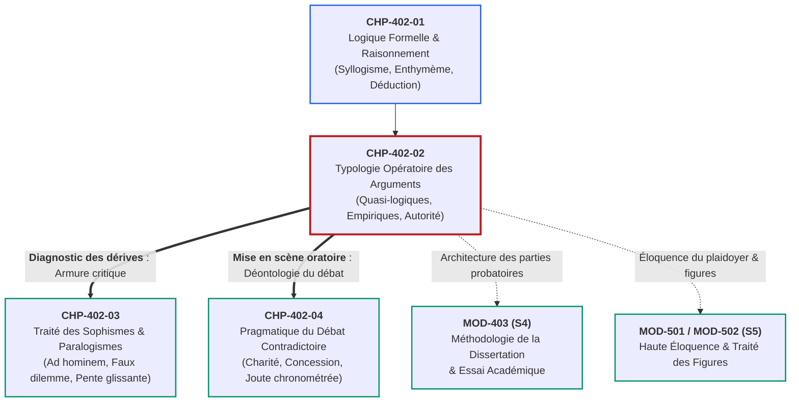

# Chapitre 2 — Typologie Opératoire des Arguments et Techniques Probatoires : Arguments Quasi-Logiques, Empiriques et d'Autorité

> **Identifiant du chapitre** : `CHP-402-02`  
> **Module de rattachement** : [`MOD-402` — Rhétorique Argumentative : Thèses, Réfutation et Détection des Sophismes](file:///f:/Formation/world-class-french/03-curriculum/year-2/semester-4/mod-402-rhetorique-argumentation-refutation-sophismes.md)  
> **Semestre** : Année 2 — Semestre 4 (S4)  
> **Volume horaire estimé** : 5 à 6 heures d'apprentissage autonome délibéré et d'ateliers d'application (Phase 1 Étude : 1 h 30 | Phase 2 Pratique : 1 h 30 | Phase 3 Correction : 1 h 00 | Phase 4 Évaluation : 1 h 00)  
> **Statut** : [STATUT : VALIDÉ]  
> **Compétences associées** : [`FR-ARGUM-001`](file:///f:/Formation/world-class-french/02-competency-framework/competency-framework.md#fr-argum-001-rigueur-démonstrative-réfutation-et-détection-des-sophismes) (L3 Autonomie), [`FR-LEXIC-001`](file:///f:/Formation/world-class-french/02-competency-framework/competency-framework.md#fr-lexic-001-précision-sémantique-nuances-synonymiques-et-collocations) (L3 Autonomie), [`FR-INT-005`](file:///f:/Formation/world-class-french/02-competency-framework/competency-framework.md#fr-int-005-présenter-oralement-un-raisonnement-structuré-et-éloquent) (L3 Autonomie)  
> **Sources scientifiques de référence** : `SRC-RHET-03` (Olivier Reboul, 1991, chap. 4), `SRC-RHET-01` (Pierre Fontanier, 1821/2009, partie III), `SRC-RHET-02` (Georges Molinié, 1992), `SRC-GRAM-02` (Riegel, Pellat & Rioul, 2016/2021, chap. 21), `SRC-NORM-03` (Ministère de l'Éducation nationale, 2020, p. 14-16), `SRC-TYPO-01` (Imprimerie nationale, 2002/2014)

---

## 1. Titre et Place dans le Cursus

### 1.1 Intitulé Officiel
**Chapitre 2 : Typologie Opératoire des Arguments et Techniques Probatoires : Arguments Quasi-Logiques, Empiriques et d'Autorité** (`CHP-402-02`).

### 1.2 Insertion Architecturale dans le Cursus
Au sein du module **MOD-402**, le présent chapitre constitue le pivot technique entre l'armature formelle du raisonnement pur et l'arène de la confrontation oratoire. Alors que le chapitre précédent (`CHP-402-01`) a fixé les lois de la déduction canonique (syllogisme, validité des termes, enthymème et formes d'inférence), `CHP-402-02` arme l'apprenant d'une **typologie opératoire des arguments probatoires**. 

Dans la communication réelle, académique, juridique ou politique, le locuteur ne se contente pas d'aligner des syllogismes formels abstraits : il doit choisir l'outil probatoire exactement calibré pour emporter l'assentiment d'un auditoire critique. Ce chapitre enseigne à mobiliser méthodiquement les arguments quasi-logiques (cause, conséquence, réduction à l'absurde), les arguments fondés sur la structure du réel (analogie, argument *a fortiori*, exemple probant) et les arguments d'autorité légitime fondés sur l'éthos [Réf. `SRC-RHET-03`, chap. 4 ; Réf. `SRC-GRAM-02`, chap. 21].



- **En amont** : Ce chapitre prend appui sur l'anatomie déductive assimilée en `CHP-402-01`, sur l'organisation hiérarchique du paragraphe argumenté (`MOD-203`), sur la synthèse impartiale de thèses (`MOD-304`) et sur la modalisation énonciative (`MOD-401`).
- **Au sein de MOD-402** : Il fournit la matière probatoire positive sans laquelle l'étude des sophismes (`CHP-402-03`) ne serait qu'un catalogue d'interdits, et prépare les techniques de réfutation directe nécessaires à la joute contradictoire (`CHP-402-04`).
- **En aval** : Il conditionne l'élaboration des démonstrations de la dissertation académique (`MOD-403`), alimente le plaidoyer juridique et politique (`MOD-501`), et constitue la base dialectique du Grand Oral universitaire de fin d'études (`MOD-604`).

---

## 2. Objectifs Mesurables

Au terme des 5 à 6 heures d'apprentissage autonome délibéré et d'ateliers d'application de ce chapitre, l'apprenant est capable de :

1. **Identifier et discriminer sans hésitation les six familles d'arguments probatoires** (argument causal, argument pragmatique, *reductio ad absurdum*, analogie argumentative, argument *a fortiori*, argument d'autorité légitime) au sein d'un corpus argumentatif complexe, en explicitant le lien logique sous-jacent ([`FR-ARGUM-001`](file:///f:/Formation/world-class-french/02-competency-framework/competency-framework.md#fr-argum-001-rigueur-démonstrative-réfutation-et-détection-des-sophismes), Palier L3 Autonomie).
2. **Construire et calibrer avec exactitude des arguments quasi-logiques** (remonter à la cause efficiente, évaluer les conséquences par l'argument pragmatique, démontrer la fausseté d'une antithèse par ses contradictions fatales) pour étayer une thèse académique ou sociétale ([`FR-ARGUM-001`](file:///f:/Formation/world-class-french/02-competency-framework/competency-framework.md#fr-argum-001-rigueur-démonstrative-réfutation-et-détection-des-sophismes), Palier L3 Autonomie).
3. **Structurer des raisonnements empiriques et analogiques rigoureux**, en séparant formellement le thème du phore dans la proportion analogique ($A/B = C/D$), en formulant une inférence *a fortiori* valide du plus au moins ou du moins au plus, et en distinguant méthodiquement l'exemple probant inductif de la simple illustration ornementale ([`FR-ARGUM-001`](file:///f:/Formation/world-class-french/02-competency-framework/competency-framework.md#fr-argum-001-rigueur-démonstrative-réfutation-et-détection-des-sophismes), Palier L3 Autonomie).
4. **Mobiliser le lexique savant de l'argumentation** (*inférer, postuler, rétorquer, déduire, probant, heuristique, fallacieux*) et évaluer la recevabilité dialectique d'un argument d'autorité selon les quatre critères de compétence, consensus, impartialité et domaine strict ([`FR-LEXIC-001`](file:///f:/Formation/world-class-french/02-competency-framework/competency-framework.md#fr-lexic-001-précision-sémantique-nuances-synonymiques-et-collocations), Palier L3 Autonomie).

---

## 3. Prérequis et Test de Préparation

### 3.1 Prérequis Cognitifs Minimaux
- **Logique formelle du raisonnement (`CHP-402-01`)** : Connaissance du syllogisme catégorique, distinction entre validité formelle et vérité matérielle, mécanisme de l'enthymème.
- **Organisation du paragraphe argumentatif (`MOD-203`)** : Schéma canonique Idée directrice - Argument étayé - Exemple analysé, maniement des connecteurs de cause et de conséquence.
- **Cadre pragmatique et énonciatif (`CHP-401-01`)** : Détection des modalisateurs épistémiques et axiologiques, repérage de la prise en charge du locuteur.

### 3.2 Test de Préparation (Auto-Diagnostic à 5 Questions)
Répondez aux cinq questions suivantes sans consulter vos notes avant d'ouvrir le corrigé repliable :

1. **Question 1 (Forme du raisonnement)** : Quelle différence sépare un syllogisme complet d'un enthymème dans un discours public ?
2. **Question 2 (Axe de causalité)** : Dans la phrase *« L'inflation galopante appauvrit les ménages, car l'injection monétaire massive sans contrepartie productive a déprécié la valeur de la devise »*, quel membre de phrase énonce la cause génératrice et quel membre énonce l'effet observable ?
3. **Question 3 (Statut de la preuve)** : Un raisonnement peut-il être formellement valide tout en aboutissant à une conclusion matériellement fausse ? Donnez un exemple bref.
4. **Question 4 (Généralisation et induction)** : Pourquoi l'évocation d'un fait divers isolé (*« J'ai vu un automobiliste brûler un feu rouge hier »*) est-elle insuffisante pour prouver que *« le civisme routier a totalement disparu dans le pays »* ?
5. **Question 5 (Technique de contestation)** : Pour réfuter un adversaire qui affirme une thèse $P$, en quoi consiste la démarche consistant à feindre d'accepter provisoirement $P$ pour en tirer une conséquence manifestement absurde ou contradictoire ?

<details>
<summary><strong>Corrigé détaillé et barème de l'auto-diagnostic (cliquer pour dérouler)</strong></summary>

1. **Réponse 1** : Le **syllogisme complet** énonce explicitement ses trois propositions (prémisse majeure, prémisse mineure, conclusion). L'**enthymème** est un syllogisme rhétorique tronqué dont l'une des prémisses est passée sous silence parce qu'elle est supposée connue, admise ou partagée par l'auditoire [Réf. `SRC-RHET-03`, chap. 3].
2. **Réponse 2** : 
   - **Cause génératrice (principe amont)** : *« l'injection monétaire massive sans contrepartie productive a déprécié la valeur de la devise »*.
   - **Effet observable (conséquence aval)** : *« L'inflation galopante appauvrit les ménages »*.
3. **Réponse 3** : **Oui.** La validité formelle ne dépend que de la rigueur de la déduction logique, non de la vérité des prémisses. Exemple : *« Tous les oiseaux volent ; or l'autruche est un oiseau ; donc l'autruche vole. »* Le raisonnement est formellement irréprochable (Barbara), mais sa conclusion est fausse parce que la prémisse majeure est empiriquement erronée.
4. **Réponse 4** : Parce qu'un fait singulier constitue une simple observation ponctuelle. Pour fonder une loi générale par **induction**, il faut un corpus représentatif, documenté et reproductible. Ériger un cas unique en loi universelle constitue le vice de généralisation hâtive [Réf. `SRC-GRAM-02`, chap. 21].
5. **Réponse 5** : Cette démarche s'appelle le **raisonnement par l'absurde** (*reductio ad absurdum* ou preuve apagogique). Elle consiste à démontrer la vérité d'une thèse $\neg P$ en montrant que l'hypothèse adverse $P$ engendre nécessairement une contradiction logique ou une conséquence matériellement intenable [Réf. `SRC-RHET-02`, s.v. « Absurde »].

> **Barème d'auto-évaluation** :  
> • **5 / 5** : Prérequis maîtrisés. Vous pouvez aborder directement la typologie opérationnelle.  
> • **3 ou 4 / 5** : Révision recommandée des concepts de syllogisme et d'induction (`CHP-402-01`).  
> • **$< 3 / 5$** : Consolidation indispensable des fondements logiques avant de poursuivre.
</details>

---

## 4. Situation de Départ ou Problème Concret

### 4.1 Le Catalogue Décousu des Arguments Faibles
Dans les débats universitaires, les délibérations professionnelles ou les rédactions d'essais, l'observateur constate fréquemment une défaillance commune : **l'incapacité à calibrer la nature de la preuve requise par la thèse défendue**. 

L'étudiant ou le débatteur inexpérimenté, sommé d'étayer une proposition grave (par exemple la régulation des monopoles technologiques ou la transition énergétique), commet régulièrement l'une des trois fautes suivantes :
1. **L'accumulation d'anecdotes subjectives** : *« Je connais quelqu'un qui a perdu son emploi à cause d'un logiciel, donc l'automatisation détruit systématiquement l'économie. »* Le scripteur prend une émotion singulière pour une démonstration statistique.
2. **L'analogie superficielle et décorative** : *« L'État est exactement comme une famille : un bon père ne dépense jamais plus qu'il ne gagne, donc l'État ne doit jamais emprunter. »* L'analogie confond deux réalités dont les structures macro-économiques sont radicalement hétérogènes.
3. **Le recours paresseux à une autorité incompétente** : *« Un célèbre champion de football a déclaré dans une vidéo que la politique monétaire était mauvaise, il faut donc lui faire confiance. »* La notoriété médiatique est indûment confondue avec l'expertise scientifique qualifiée.

Considérons l'extrait suivant, tiré d'une copie d'examen abordant la politique d'urbanisme :
> *« Il faut interdire les voitures au centre-ville parce que mon oncle a eu un accident la semaine dernière. De plus, une ville sans voitures est comme une forêt sans tronçonneuse : elle respire la pureté. Enfin, un grand poète du XIXe siècle disait que la nature triomphe toujours, ce qui prouve bien que notre projet est parfait. »*

Cette argumentation s'effondre d'elle-même. Le premier argument n'est qu'un fait divers anecdotique ; le second est une comparaison poétique sans valeur probatoire ; le troisième est un appel à l'autorité anachronique et hors de son champ de compétence. Aucun de ces énoncés ne fournit une raison rationnellement contraignante d'adopter la décision.

---

## 5. Explication Intuitive

### 5.1 L'Analogie du Coffre à Outils du Maître d'Œuvre
Pour comprendre l'art de l'argumentation, il convient de se représenter l'argumentateur comme un **maître d'œuvre sur un chantier de construction** :

```text
┌──────────────────────────────────────────────────────────────────────────────┐
│                  LE COFFRE À OUTILS DU MAÎTRE D'ŒUVRE                        │
├──────────────────────────────────────────────────────────────────────────────┤
│ 1. LE PIEU À ENFONCER (La Thèse) : Nécessite une masse pesante.              │
│    → Outil : L'ARGUMENT PAR LA CAUSE (L'Origine génératrice incontestable).  │
├──────────────────────────────────────────────────────────────────────────────┤
│ 2. LE TEST DE RÉSISTANCE (La Décision) : Éprouver la portée de la charge.     │
│    → Outil : L'ARGUMENT PAR LES CONSÉQUENCES (L'Utilité future mesurable).   │
├──────────────────────────────────────────────────────────────────────────────┤
│ 3. LA CLEF DE VOÛTE (Le Principe Réfractaire) : Montrer qu'ôter la clef fait│
│    s'effondrer l'édifice tout entier.                                        │
│    → Outil : LE RAISONNEMENT PAR L'ABSURDE (L'Inconsistance fatale).        │
├──────────────────────────────────────────────────────────────────────────────┤
│ 4. LE PLAN ARCHITECTURAL TRANSPOSÉ : Bâtir selon un modèle éprouvé ailleurs.  │
│    → Outil : L'ANALOGIE RATIONNELLE (La Similitude des rapports structurels).│
├──────────────────────────────────────────────────────────────────────────────┤
│ 5. L'ÉCHELLE DE GRADATION : Du sol au toit, du petit fardeau au grand.       │
│    → Outil : L'ARGUMENT A FORTIORI (Du plus au moins, du moins au plus).     │
├──────────────────────────────────────────────────────────────────────────────┤
│ 6. LE CERTIFICAT DU GÉOMÈTRE EXPERT : Validation des mesures par l'homme de  │
│    l'art agréé.                                                              │
│    → Outil : L'ARGUMENT D'AUTORITÉ LÉGITIME (Le Consensus scientifique).    │
└──────────────────────────────────────────────────────────────────────────────┘
```

On n'enfonce pas un pieu d'ancrage avec un tournevis d'horloger ; on ne rabote pas une poutre maîtresse avec une lime à ongles. De même en rhétorique : chaque type de thèse réclame une technique probatoire adaptée à sa nature. 
- Pour établir un fait physique ou sociologique, on convoque la **cause génératrice**.
- Pour justifier une loi ou un investissement public, on use de l'**argument pragmatique** (les conséquences bénéfiques).
- Pour anéantir une prétention dogmatique intenable, on emploie le **raisonnement par l'absurde**.
- Pour faire comprendre un mécanisme complexe et abstrait, on le met en relation avec un domaine familier via l'**analogie de structure**.
- Pour forcer l'assentiment d'un opposant qui a déjà cédé sur un point secondaire, on le frappe avec l'inférence ***a fortiori***.

L'arsenal probatoire n'est pas un ornement littéraire : c'est un ensemble d'instruments logiques de haute précision calibrés pour contraindre l'adhésion rationnelle de l'esprit [Réf. `SRC-RHET-03`, chap. 4].

---

## 6. Définitions Précises et Terminologie

Pour manipuler cet arsenal sans approximation sémantique, fixons la nomenclature technique des huit concepts opératoires :

1. **Argument probatoire** : Énoncé discursif formulé pour appuyer ou infirmer une thèse controversée en apportant une justification rationnelle jugée acceptable par un auditoire raisonnable. Il se distingue de la simple assertion péremptoire par la présence explicite d'un lien inférentiel [Réf. `SRC-RHET-03`, chap. 4].
2. **Argument quasi-logique** : Argument qui tire sa force persuasive de sa ressemblance formelle avec une démonstration logique ou mathématique (principe de non-contradiction, transitivité, identité, division du tout en ses parties), mais dont les prémisses et les liaisons demeurent soumises aux incertitudes du langage naturel et du réel contingent [Réf. `SRC-RHET-03`, chap. 4 ; Chaïm Perelman, 1958].
3. **Argument causal (ou par la cause)** : Raisonnement qui démontre l'existence, la légitimité ou la nécessité d'un phénomène en le rattachant à son principe générateur antécédent (la cause première, le mécanisme déterminant ou la condition nécessaire et suffisante) [Réf. `SRC-GRAM-02`, chap. 21].
4. **Argument pragmatique (ou par les conséquences)** : Raisonnement qui évalue la valeur morale, politique, financière ou pratique d'un acte, d'une règle ou d'une décision exclusivement à la lumière de ses effets positifs ou négatifs, constatés ou prévisibles [Réf. `SRC-RHET-03`, chap. 4].
5. **Raisonnement par l'absurde (*reductio ad absurdum*)** : Démarche dialectique indirecte qui consiste à poser temporairement comme vraie la thèse contradictoire de celle que l'on veut prouver, pour en déduire par étapes rigoureuses une absurdité manifeste, une contradiction logique insurmontable ou une conséquence factuellement impossible, ce qui force l'esprit à rejeter la prémisse adverse et à admettre la thèse initiale [Réf. `SRC-RHET-02`, s.v. « Absurde »].
6. **Argument par analogie** : Établissement d'une similitude structurelle entre deux couples de termes appartenant à des domaines hétérogènes ($A$ est à $B$ ce que $C$ est à $D$), permettant de transférer l'évidence reconnue du domaine source (le **phore**, $C-D$) vers le domaine cible à éclairer (le **thème**, $A-B$) [Réf. `SRC-RHET-01`, partie III ; Réf. `SRC-RHET-03`, chap. 4].
7. **Argument *a fortiori* (à plus forte raison)** : Inférence déductive établissant que si une règle, une obligation ou une propriété s'applique à un cas où les motifs d'application sont moindres, elle doit s'appliquer à plus forte raison à un cas où ces motifs sont encore plus évidents et impérieux (du moins au plus : *a minori ad majus*), ou inversement si l'impossible n'a pu être fait, le moindre ne l'est pas davantage (du plus au moins : *a majori ad minus*) [Réf. `SRC-RHET-03`, chap. 4].
8. **Argument d'autorité légitime vs sophisme *ad verecundiam*** : L'argument d'autorité est légitime lorsqu'il invoque le jugement étayé d'un expert ou d'un collège savant reconnu dans son champ propre de compétence pour asseoir une prémisse technique que l'auditoire ne peut vérifier lui-même. Il dégénère en sophisme *ad verecundiam* dès que l'autorité est convoquée hors de son domaine, n'est pas reconnue par ses pairs, est partiale ou sert à bâillonner l'examen rationnel [Réf. `SRC-RHET-03`, chap. 4].
9. **Exemple probant vs simple illustration** : L'**exemple probant** est un fait avéré, documenté et précis qui sert de fondement inductif à l'établissement ou à l'épreuve d'une règle générale. L'**illustration ornementale**, en revanche, intervient après coup pour frapper l'imagination, rendre concrète une règle déjà admise ou agrémenter le style sans apporter de preuve autonome [Réf. `SRC-RHET-03`, chap. 4].

---

## 7. Règles ou Mécanismes Fondamentaux

L'arsenal probatoire s'organise en trois grands ensembles selon la nature du lien qui unit les prémisses à la conclusion [Réf. `SRC-RHET-03`, chap. 4 ; Réf. `SRC-GRAM-02`, chap. 21] :

```text
┌─────────────────────────────────────────────────────────────────────────────┐
│                    LES TROIS FAMILLES D'ARGUMENTS                           │
├─────────────────────────────────────────────────────────────────────────────┤
│ 1. ARGUMENTS QUASI-LOGIQUES        → Cause, Conséquence, Absurde            │
│ 2. ARGUMENTS SUR LA STRUCTURE DU RÉEL → Analogie, A fortiori, Exemple probant│
│ 3. ARGUMENTS SUR L'ÉTHOS & LES NORMES → Autorité légitime, Précédent, Valeur│
└─────────────────────────────────────────────────────────────────────────────┘
```

### 7.1 Les Arguments Quasi-Logiques et Démonstratifs

Ces arguments imitent la démarche déductive des sciences exactes pour emporter une adhésion quasi contraignante.

#### 1. L'Argument par les Causes : Remonter au Principe Générateur
L'argument causal postule que tout phénomène a une raison nécessaire de son existence. Il consiste à expliquer un état de fait en découvrant sa source génératrice :
$$\text{Cause } (X) \xrightarrow{\text{Lien de nécessité}} \text{Effet } (Y)$$
- **Formule directrice** : *« Si le phénomène $Y$ se produit, c'est parce que la condition déterminante $X$ a été satisfaite. Éliminez $X$, et $Y$ cessera infailliblement. »*
- **Fonction dialectique** : Il confère au propos un caractère scientifique et indiscutable. En prouvant que $X$ engendre inévitablement $Y$, il clôt le débat sur l'origine du mal ou du bien.
- **Connecteurs privilégiés** : *parce que, puisque, étant donné que, découler de, résulter de, procéder de, trouver sa genèse dans*.

#### 2. L'Argument par les Conséquences (Argument Pragmatique)
L'argument pragmatique opère le mouvement inverse : au lieu de regarder en amont vers l'origine, il regarde en aval vers les répercussions futures. Il juge une proposition non en elle-même, mais à la valeur de ses effets :
$$\text{Décision / Acte } (A) \xrightarrow{\text{Projection temporelle}} \text{Conséquences mesurables } (C_1, C_2, \dots)$$
- **Formule directrice** : *« Adoptons la mesure $A$, car elle produira des bienfaits manifestes $C$ ; rejetons le projet $B$, car il entraînera des ruines inéluctables. »*
- **Fonction dialectique** : C'est l'argument roi de l'action politique, économique et stratégique. Il fait appel au bon sens de l'auditoire en quantifiant les gains et les pertes.
- **Conditions de validité** : Le lien de causalité entre l'acte et l'effet doit être certain ou hautement probable ; les conséquences positives doivent l'emporter sur les effets pervers.

#### 3. Le Raisonnement par l'Absurde (*Reductio ad Absurdum*)
Cette technique est l'arme de destruction massive de la rhétorique contradictoire. Pour prouver une thèse $T$, on examine ce qui adviendrait si la thèse contraire $\neg T$ était vraie :
$$\text{Posons } \neg T \text{ comme vraie} \longrightarrow \text{Déductions rigoureuses} \longrightarrow \text{Contradiction fatale ou absurdité} \implies T \text{ est nécessairement vraie}$$
- **Mécanique en trois temps** :
  1. *Concession feinte* : « Admettons un instant la proposition de mon adversaire selon laquelle... »
  2. *Développement impitoyable des conséquences* : « Si cette proposition est vraie, alors il faudrait convenir que... or cela implique nécessairement que... »
  3. *Constat de l'inconsistance* : « Mais cette conclusion est à la fois moralement révoltante, logiquement contradictoire et matériellement irréalisable. Dès lors, la prémisse adverse s'effondre et notre thèse s'impose. »
- **Fonction dialectique** : L'absurde ne se contente pas de réfuter ; il humilie intellectuellement la position adverse en montrant qu'elle se détruit elle-même.

---

### 7.2 Les Arguments Fondés sur la Structure du Réel et la Comparaison

Ces arguments tirent leur autorité des relations observées dans le monde sensible et des structures communes de l'expérience humaine.

#### 1. L'Analogie Argumentative : Le Transfert de Réflectance
L'analogie n'est pas une simple comparaison poétique : c'est une égalité rigoureuse de rapports unissant quatre termes issus de deux univers dissemblables [Réf. `SRC-RHET-01`, partie III ; Réf. `SRC-RHET-03`, chap. 4] :
$$\frac{A}{B} \text{ (Thème : le sujet controversé)} = \frac{C}{D} \text{ (Phore : la situation familière admise)}$$
- **Terminologie fondamentale** :
  - Le **Thème** ($A / B$) : Ce dont on parle, l'objet du débat que l'on veut faire admettre (ex. *le rôle du magistrat dans la cité*).
  - Le **Phore** ($C / D$) : La réalité connue, indiscutable et familière qui sert de support de comparaison (ex. *le rôle du médecin face au malade*).
- **Fonction dialectique** : L'adhésion déjà acquise au phore (« nul ne conteste que le médecin prescrit le remède selon la science et non selon le désir du patient ») est transférée mécaniquement sur le thème (« donc le magistrat doit juger selon la loi et non selon l'humeur de l'opinion publique »).

#### 2. L'Argument *A Fortiori* (À Plus Forte Raison)
Ce procédé exploite une échelle ordonnée de grandeurs ou d'obligations [Réf. `SRC-RHET-03`, chap. 4] :
- **Du moins au plus (*a minori ad majus*)** : *« Si le vol simple d'un aliment par nécessité est puni par le code pénal, à plus forte raison le détournement prémédité de milliards de fonds publics par un haut fonctionnaire doit-il être sanctionné avec la plus extrême sévérité. »*
- **Du plus au moins (*a majori ad minus*)** : *« Si notre institution a su surmonter la crise financière historique de l'an dernier sans faillir, elle est capable à plus forte raison de surmonter le léger ralentissement conjoncturel de ce trimestre. »*
- **Fonction dialectique** : Il place l'interlocuteur dans l'impossibilité de refuser la seconde proposition sans contredire le jugement qu'il a déjà porté sur la première.

#### 3. L'Exemple Probant : L'Induction Fondée
L'exemple probant tire une règle générale à partir d'une série de faits matériels attestés :
$$\text{Faits singuliers authentifiés } (F_1, F_2, F_3) \xrightarrow{\text{Induction robuste}} \text{Loi générale } (L)$$
- **Critère de validité probatoire** : L'exemple doit être historiquement ou scientifiquement authentique, représentatif et exempt de biais de sélection. Il ne sert pas à décorer la phrase : il constitue la roche dure sur laquelle repose l'induction.

---

### 7.3 Les Arguments Fondés sur la Légitimité et l'Éthos

Ces techniques s'appuient sur l'autorité morale, juridique ou scientifique des acteurs de la controverse.

#### 1. L'Argument d'Autorité Légitime (*Argumentum ad Verecundiam*)
Face à l'impossibilité matérielle pour un citoyen ou un juge de maîtriser la totalité des savoirs techniques (épidémiologie, balistique, climatologie, droit international), le recours à l'expertise extérieure est indispensable. Pour être dialectiquement recevable, l'argument d'autorité doit satisfaire **quatre critères stricts d'acceptabilité** :
1. **Compétence certifiée** : L'autorité convoquée possède des titres universitaires, des publications évaluées par les pairs ou une expérience indiscutable dans la matière en question.
2. **Champ strict de spécialité** : L'avis formulé porte strictement sur la discipline de l'expert (un grand physicien n'a aucune autorité particulière en sociologie électorale).
3. **Consensus des pairs** : L'opinion citée reflète l'état dominant de la science contemporaine ou la jurisprudence établie, et non une position marginale ou isolée.
4. **Impartialité et absence de conflits d'intérêts** : L'expert ne tire aucun avantage financier, politique ou personnel de la conclusion qu'il défend.

#### 2. L'Argument par les Valeurs et le Précédent
- **L'argument du précédent** : Mobilise une décision passée validée par l'institution (jurisprudence judiciaire ou tradition républicaine) pour imposer une décision identique aujourd'hui, au nom du principe d'équité : *« À situations identiques, traitement identique. »*
- **L'argument par les valeurs partagées** : Enracine la thèse dans un principe éthique ou civique supérieur universellement reconnu par l'auditoire (justice, liberté, égalité des chances, dignité humaine).

---

## 8. Raisonnement Détaillé (Le Pourquoi)

### 8.1 Pourquoi la « Nouvelle Rhétorique » Classe-t-elle les Arguments selon les Types de Liaisons ?
Dans leur magistral *Traité de l'argumentation* (1958), le philosophe Chaïm Perelman et la sociologue Lucie Olbrechts-Tyteca ont révolutionné la théorie du discours en démontrant que le champ de l'argumentation n'est ni celui de la vérité absolue et contraignante (les mathématiques formelles), ni celui de l'irrationnel pur (la violence ou l'arbitraire). L'argumentation est le domaine du **vraisemblable, du plausible et du raisonnable** [Réf. `SRC-RHET-03`, chap. 4].

Perelman classe les techniques probatoires selon la nature du **lien discursif** opéré dans l'esprit de l'auditeur :

1. **Les liaisons de succession (le temps et la causalité)** : 
   L'esprit humain structure le monde selon l'ordre temporel des événements. En rattachant deux faits sur cet axe, l'argumentateur crée un sentiment d'inexorabilité :
   - Vers l'amont : l'argument par les causes démontre que le présent est le produit inévitable du passé.
   - Vers l'aval : l'argument pragmatique démontre que l'avenir est l'otage de la décision présente.
2. **Les liaisons de coexistence (la personne et ses actes)** :
   Contrairement aux objets physiques inertes, l'être humain est jugé à travers ses œuvres, et inversement l'évaluation d'un acte est colorée par la réputation morale de son auteur. C'est sur cette liaison que repose toute l'efficacité de l'argument d'autorité (*éthos*) et de l'argument du précédent.
3. **Les liaisons qui fondent la structure du réel (le passage du connu à l'inconnu)** :
   L'esprit répugne à l'abstraction pure. Pour donner corps à une idée nouvelle, il doit la greffer sur des structures déjà éprouvées. L'analogie ($A/B = C/D$) et l'exemple inductif ne sont pas de simples ornements : ils constituent des ponts cognitifs indispensables permettant à la pensée de conquérir un territoire inexploré en prenant appui sur le sol ferme du réel familier [Réf. `SRC-RHET-01`, partie III].

---

## 9. Exemples Corrects Commentés

Voici le décorticage rigoureux de six arguments modèles issus des plus grands débats juridiques, scientifiques et parlementaires français :

### Exemple 1 : L'Argument Pragmatique (Robert Badinter, Discours sur l'Abolition de la Peine de Mort, Assemblée Nationale, 17 septembre 1981)
> *« Tant que la justice humaine demeure faillible — et elle le sera toujours —, la peine de mort porte en elle le risque absolu et irrémédiable de l'erreur judiciaire. Si vous exécutez un innocent, aucune révision de procès, aucune indemnisation, aucun repentir public ne pourra jamais lui restituer le souffle de la vie. »*
- **Mécanisme probatoire** : Argument par les conséquences négatives irrémédiables (argument pragmatique).
- **Analyse critique** : Badinter ne se contente pas d'un plaidoyer moral abstrait. Il démontre que l'effet matériel de la peine de mort (l'exécution corporelle) a pour conséquence fatale d'annuler toute possibilité de corriger une erreur judiciaire, ce qui vicie irrémédiablement l'acte même de juger.

### Exemple 2 : Le Raisonnement par l'Absurde (*Reductio ad Absurdum*) (Jean Jaurès, Discours pour la Paix et la République, 1910)
> *« On nous dit que pour conserver la paix en Europe, chaque nation doit sans cesse accroître ses armements, fabriquer de nouveaux canons et allonger le service militaire. Mais si chaque accroissement militaire d'un peuple justifie l'accroissement immédiat de son voisin, où s'arrêtera cette spirale ? Il faudrait alors admettre que la garantie suprême de la vie humaine réside dans l'accumulation universelle des engins de mort, et que pour éviter l'incendie, le devoir des peuples est d'entasser des barils de poudre dans chaque foyer. C'est le comble du délire logique. »*
- **Mécanisme probatoire** : Raisonnement par l'absurde couplé à une analogie réfutative.
- **Analyse critique** : Jaurès pousse la prémisse militariste (« armer pour préserver la paix ») jusqu'à son terme ultime. En révélant que cette prémisse conduit à la conclusion monstrueuse selon laquelle entasser des matières inflammables prévient l'incendie, il démontre l'inconsistance interne de la thèse adverse.

### Exemple 3 : L'Argument Causal (Louis Pasteur, Conférence à la Sorbonne sur la Réfutation de la Génération Spontanée, 7 avril 1864)
> *« Si vous prenez un liquide organique altérable, que vous le portiez à ébullition dans un ballon à col de cygne effilé et recourbé, ce liquide demeure indéfiniment pur et vierge de toute moisissure. Pourquoi ? Parce que la courbure du tube intercepte mécaniquement les poussières atmosphériques. Brisez le col, laissez tomber les poussières, et aussitôt la vie microbienne pullule. La cause exclusive de la fermentation n'est donc pas une force vitale spontanée issue du néant, mais l'introduction physique de germes vivants préexistants dans l'air. »*
- **Mécanisme probatoire** : Argument par la cause nécessaire et suffisante (méthode de différence).
- **Analyse critique** : Pasteur manipule l'antécédent ($X$ : présence de poussières) pour observer la variation du conséquent ($Y$ : prolifération microbienne). La démonstration que l'effet disparaît dès que la cause est filtrée emporte l'adhésion scientifique absolue.

### Exemple 4 : L'Analogie Argumentative (Robert Badinter, Plaidoyer aux Assises, 1977)
> *« Prétendre éradiquer la criminalité par le spectacle public de la guillotine revient très exactement à prétendre guérir une épidémie de choléra en ordonnant des sacrifices d'animaux sur la place publique. Dans les deux cas, on substitue la magie expiatoire à l'analyse rationnelle du fléau. »*
- **Mécanisme probatoire** : Analogie argumentative de structure ($A/B = C/D$).
- **Analyse critique** :
  - *Thème* ($A/B$) : La guillotine ($A$) face à la criminalité ($B$).
  - *Phore* ($C/D$) : Les sacrifices d'animaux ($C$) face au choléra ($D$).
  - Le transfert opère : puisque tout juré moderne admet l'absurdité pré-scientifique des sacrifices pour soigner une bactérie, il est contraint d'admettre la même vacuité pour la peine de mort face au crime.

### Exemple 5 : L'Argument *A Fortiori* (Victor Hugo, Discours sur la Misère, Assemblée Nationale, 9 juillet 1849)
> *« Vous venez, messieurs, avec une promptitude unanime et légitime, de voter des centaines de millions pour équiper nos armées, bâtir des forteresses et maintenir l'ordre public par le fusil. Eh bien ! Si l'État sait trouver des trésors inépuisables pour préserver l'ordre matériel contre les factions, à plus forte raison doit-il mobiliser ses ressources pour anéantir la misère qui dévore dans l'ombre des millions de nos concitoyens et mine les fondations mêmes de notre patrie ! »*
- **Mécanisme probatoire** : Argument *a fortiori* du moins au plus (*a minori ad majus*).
- **Analyse critique** : Hugo utilise l'effort militaire déjà concédé (le terme mineur) pour imposer l'effort social (le terme majeur). Si la République s'estime tenue de dépenser pour contenir les effets violents de la révolte, elle doit à plus forte raison dépenser pour en détruire la racine première qu'est le dénuement.

### Exemple 6 : L'Argument d'Autorité Légitime (Rapport Parlementaire sur les Perturbateurs Endocriniens, Débat au Sénat, 2021)
> *« En affirmant la dangerosité de ces molécules pour le développement fœtal, notre commission ne se fie pas à des impressions subjectives : nous nous appuyons sur le rapport conjoint de l'INSERM et de l'Organisation mondiale de la santé, synthèse de plus de trois cents études épidémiologiques indépendantes validées par les comités de lecture internationaux. »*
- **Mécanisme probatoire** : Argument d'autorité légitime fondé sur le consensus institutionnel.
- **Analyse critique** : Les quatre critères de validité sont réunis : compétence incontestable des organismes de recherche (INSERM, OMS), consensus fondé sur une méta-analyse de 300 études, indépendance des sources et objet strictement circonscrit à la toxicologie biologique.

---

## 10. Contre-Exemples et Erreurs Fréquentes

Examinons en détail six erreurs argumentatives récurrentes qui détruisent la force démonstrative d'un discours :

### Erreur n° 1 : Fausse Analogie Comparant des Grandeurs Incommensurables
- **Manifestation pathologique** : Assimiler deux entités dont les natures fondamentales et les règles de fonctionnement n'ont aucun rapport réel.
- **Exemple fautif** : *« Un État doit être géré exactement comme une épicerie de quartier : si l'épicier dépense plus qu'il ne rentre en caisse, il fait faillite ; par conséquent, l'État doit refuser tout déficit budgétaire sous peine de disparition immédiate. »*
- **Réfutation méthodique** : Cette analogie est fallacieuse. Un épicier ne lève pas d'impôts, n'émet pas de monnaie, n'investit pas sur des infrastructures amortissables sur un siècle et n'a pas pour mission d'assurer la cohésion sociale ou la santé publique. Les mécanismes microéconomiques d'un commerce individuel ne peuvent être transposés à la macroéconomie d'une puissance publique sans commettre un contresens systémique.

### Erreur n° 2 : Argument d'Autorité Hors de son Champ de Compétence
- **Manifestation pathologique** : Citer une personnalité éminente ou un prix Nobel pour trancher une question étrangère à sa spécialité scientifique.
- **Exemple fautif** : *« Le professeur X, lauréat du prix Nobel de physique quantique, a affirmé dans une interview que le régime végétarien était nocif pour l'équilibre hormonal de l'enfant ; nous devons donc bannir ce régime dans nos cantines scolaires. »*
- **Réfutation méthodique** : Le prestige d'un prix Nobel de physique confère une autorité immense en mécanique ondulatoire, mais une autorité strictement nulle en biochimie nutritionnelle et en pédiatrie. Le recours à son opinion constitue un transfert abusif de notoriété (*argumentum ad verecundiam*), dénué de toute valeur probatoire.

### Erreur n° 3 : Confusion entre Corrélation et Causalité (*Cum Hoc Ergo Propter Hoc*)
- **Manifestation pathologique** : Postuler qu'un lien de causalité existe entre deux variables uniquement parce qu'elles évoluent de concert dans le temps ou l'espace.
- **Exemple fautif** : *« Les statistiques démontrent que les ventes de glaces explosent au mois de juillet, période où le nombre de noyades en mer augmente dramatiquement. Il est donc évident que la consommation de glaces provoque les noyades. »*
- **Réfutation méthodique** : L'argument oublie l'existence d'une variable confondante cachée : la chaleur estivale. C'est l'élévation des températures qui incite à la fois à consommer des crèmes glacées et à se baigner. Corrélation n'est jamais synonyme de causalité [Réf. `SRC-GRAM-02`, chap. 21].

### Erreur n° 4 : Exemple Anecdotique Érigé en Preuve Universelle (Généralisation Hâtive)
- **Manifestation pathologique** : Se fonder sur une expérience individuelle ou un récit singulier pour énoncer une loi générale péremptoire.
- **Exemple fautif** : *« Le nouveau vaccin est totalement inefficace : mon voisin de palier a reçu deux doses et il a contracté une forte fièvre dès le lendemain. Cette expérience vécue prouve bien que la médecine se trompe. »*
- **Réfutation méthodique** : Un fait isolé ne possède aucune représentativité statistique. L'efficacité vaccinale se mesure sur des cohortes randomisées en double aveugle de dizaines de milliers d'individus. Un cas particulier peut tout au plus illustrer une exception ou un effet secondaire connu, jamais infirmer une loi épidémiologique globale.

### Erreur n° 5 : Argument Pragmatique Oubliant la Morale du Principe (Utilitarisme Aveugle)
- **Manifestation pathologique** : Justifier une décision au seul motif qu'elle engendre des gains financiers ou pratiques immédiats, en piétinant les droits inaliénables de la personne humaine.
- **Exemple fautif** : *« La légalisation du travail forcé des prisonniers de droit commun permettrait de réduire de 40 % le budget pénitentiaire de l'État et de relancer nos travaux publics ; c'est donc une mesure économique excellente qu'il faut voter sans retard. »*
- **Réfutation méthodique** : L'argument pragmatique ne saurait s'exercer dans un vide éthique. Tout calcul de rentabilité ou d'utilité matérielle trouve sa limite infranchissable dans les principes constitutionnels fondamentaux et la dignité de la personne. La fin pratique ne justifie pas des moyens moralement inacceptables.

### Erreur n° 6 : Raisonnement par l'Absurde s'Appuyant sur une Fausse Dichotomie
- **Manifestation pathologique** : Prétendre démontrer une thèse en réduisant arbitrairement le champ des possibles à deux issues caricaturales, dont l'une est jugée absurde.
- **Exemple fautif** : *« Soit nous interdisons immédiatement toute utilisation des téléphones portables dans les écoles, soit nous acceptons que nos enfants deviennent des analphabètes complets incapables de lire une phrase. Comme personne ne souhaite l'analphabétisme, l'interdiction totale est la seule voie possible. »*
- **Réfutation méthodique** : Le raisonnement feint d'employer l'absurde, mais il repose sur une bifurcation artificielle. Il existe une infinité de voies médianes : régulation pédagogique, limitation des créneaux, éducation aux médias numériques. Réfuter une caricature n'équivaut nullement à prouver sa propre solution.

---

## 11. Cas Particuliers et Limites

### 11.1 L'Argument du Dilemme : Enfermer le Contradicteur dans une Tenaille Logique
Le dilemme est une technique argumentative redoutable qui consiste à diviser une situation en deux branches exhaustives et à démontrer que chacune d'elles aboutit au même échec pour l'adversaire :
- **Exemple canonique (Le dilemme d'Aristote sur la philosophie)** : *« Soit il faut philosopher, soit il ne faut pas philosopher. Si l'on doit philosopher, le devoir est clair. Si l'on ne doit pas philosopher, il faut encore philosopher pour justifier cette interdiction. Donc, dans tous les cas, il faut philosopher. »*
- **Limite et riposte dialectique** : Pour briser un dilemme, l'opposant doit :
  - *Passer entre les cornes du dilemme* : prouver que l'alternative n'est pas exhaustive et qu'il existe une troisième voie ;
  - *Saisir l'une des cornes* : montrer que l'une des deux branches n'a pas les conséquences négatives affirmées ;
  - *Rétorquer un contre-dilemme* : fabriquer une tenaille inverse (comme dans le célèbre procès entre Protagoras et son élève Évathlos).

### 11.2 La Pente Glissante : Quand Devient-elle un Argument Probatoire Légitime ?
Dans le chapitre suivant (`CHP-402-03`), nous étudierons la *pente glissante* (*slippery slope*) comme un sophisme de dramatisation abusive. Toutefois, la prédiction d'un enchaînement de causalités en chaîne n'est pas toujours fallacieuse :
- **Critère de validité probatoire** : L'argument de la pente devient **légitime et probatoire** dès lors que chaque maillon intermédiaire de la chaîne causale est étayé par des mécanismes sociologiques, juridiques ou empiriques documentés.
- **Exemple probant** : *« Si le législateur autorise une exception non contrôlée au secret des correspondances numériques, cette brèche technique obligera les éditeurs à créer des portes dérobées ; or ces portes seront inévitablement découvertes et exploitées par des cybercriminels, ce qui ruinera à terme la sécurité bancaire de l'ensemble du pays. »* Ici, chaque étape découle de vulnérabilités cryptographiques avérées : l'argument est recevable.

---

## 12. Approfondissement Adapté au Niveau

### 12.1 La Notion d'« Auditoire Universel » chez Chaïm Perelman
L'un des apports majeurs de la *Nouvelle Rhétorique* [Réf. `SRC-RHET-03`, chap. 4] réside dans la distinction entre **auditoire particulier** et **auditoire universel** :
- **L'auditoire particulier** : C'est le public concret, situé dans le temps et l'espace, avec ses passions, ses préjugés sociaux, ses intérêts de classe ou ses croyances locales. Pour lui plaire, l'orateur a souvent recours à la flatterie, aux arguments *ad hominem* ou à la manipulation émotionnelle (*persuader*).
- **L'auditoire universel** : C'est une construction mentale régulatrice de l'orateur, composée de tout être humain raisonnable, compétent et impartial, capable d'apprécier la valeur objective des preuves (*convaincre*).

```text
┌─────────────────────────────────────────────────────────────────────────────┐
│                 L'AUDITOIRE UNIVERSEL COMME GARANT DE RATIONNALITÉ          │
├─────────────────────────────────────────────────────────────────────────────┤
│ • AUDITOIRE PARTICULIER : Vise l'efficacité immédiate, flatte les passions, │
│   relève de la PERSUASION subjective.                                       │
│ • AUDITOIRE UNIVERSEL   : Vise la vérité rationnelle, exige des preuves     │
│   valables pour tout esprit critique, relève de la CONVICTION universelle.  │
└─────────────────────────────────────────────────────────────────────────────┘
```

> **Conséquence didactique** : Un argument probatoire de haut niveau n'est pas un argument qui réussit simplement à séduire une foule un soir de meeting : c'est un argument qui résiste à l'examen critique de l'auditoire universel, c'est-à-dire de n'importe quel esprit libre et éclairé examinant les faits avec rigueur.

---

## 13. Comparaisons Différentielles

Fixons définitivement les frontières notionnelles entre les concepts souvent confondus :

### Tableau 1 : Argument Causal vs Argument Pragmatique (par les conséquences)

| Critère d'opposition | Argument Causal (par les causes) | Argument Pragmatique (par les conséquences) |
| :--- | :--- | :--- |
| **Orientation temporelle** | Tourné vers **l'amont** (origine, genèse, passé). | Tourné vers **l'aval** (effets, répercussions, futur). |
| **Question nodale** | *« D'où vient ce phénomène ? Pourquoi s'est-il produit ? »* | *« Où cette décision va-t-elle nous mener ? Quels en seront les gains ? »* |
| **Domaine de prédilection** | Sciences fondamentales, histoire, enquête policière, diagnostic médical. | Politique publique, stratégie économique, délibération d'entreprise, morale. |
| **Risque de dérive** | Confondre consécution et causalité (*post hoc*). | Sacrifier les principes éthiques sur l'autel de la rentabilité. |

### Tableau 2 : Analogie Argumentative vs Métaphore Poétique / Ornementale

| Critère d'opposition | Analogie Argumentative ($A/B = C/D$) | Métaphore Poétique / Ornementale |
| :--- | :--- | :--- |
| **Finalité discursive** | Démontrer, prouver, transférer une adhésion rationnelle. | Émouvoir, embellir, susciter une image sensorielle ou un affect. |
| **Structure logique** | Système proportionnel complet à 4 termes explicites ou implicites. | Fusion d'un comparé et d'un comparant en une formule condensée. |
| **Exigence critique** | La similitude des rapports structurels doit être exacte et vérifiable. | La force de suggestion prime sur la vérité factuelle. |
| **Exemple type** | *Le pilote commande au navire ce que le chef d'État commande à la nation.* | *« Cet homme est un roc battu par la tempête. »* |

### Tableau 3 : Argument d'Autorité Légitime vs Sophisme d'Autorité (*Ad Verecundiam*)

| Critère d'évaluation | Autorité Légitime (Probatoire) | Sophisme d'Autorité (Fallacieux) |
| :--- | :--- | :--- |
| **Champ de compétence** | Respect absolu de la spécialité reconnue de l'expert. | Invocation de la notoriété en dehors de la discipline concernée. |
| **Consensus savant** | Fondé sur l'état général des publications relues par les pairs. | Prise d'appui sur une voix isolée, marginale ou contestée. |
| **Intérêt matériel** | Neutralité méthodologique et absence de conflit d'intérêts. | Rémunération directe ou liens partisans avec le promoteur de la thèse. |
| **Rôle dans le débat** | Fournit une prémisse technique au service de la discussion. | Sert d'intimidation pour clore autoritairement la discussion. |

### Tableau 4 : Exemple Probant vs Simple Illustration

| Critère de distinction | Exemple Probant (Inductif) | Simple Illustration (Décorative) |
| :--- | :--- | :--- |
| **Position dans le texte** | Précède ou fonde directement la loi générale induite. | Succède à une règle déjà démontrée pour la concrétiser. |
| **Force démonstrative** | Constitue la preuve matérielle de l'assertion. | Ne prouve rien par elle-même ; facilite la compréhension visuelle. |
| **Nature du fait** | Fait historique, statistique ou scientifique scrupuleusement vérifié. | Évocation imagée, fable, anecdote ou cas de fiction. |

---

## 14. Exercices Progressifs

### Niveau 1 : Identification et Qualification de la Famille Argumentative (12 Textes Courts)

Pour chacun des douze énoncés suivants, identifiez la famille argumentative précise :
- **A** : Argument causal (par les causes) ;
- **B** : Argument pragmatique (par les conséquences) ;
- **C** : Raisonnement par l'absurde (*reductio ad absurdum*) ;
- **D** : Analogie argumentative ;
- **E** : Argument *a fortiori* ;
- **F** : Argument d'autorité légitime.

1. *« Si vous refusez la vaccination obligatoire, alors il faut aussi cesser d'exiger le respect des feux tricolores, laisser chacun rouler à contresens sur l'autoroute et décréter que toute loi sanitaire est une intolérable tyrannie. »*
2. *« Les analyses spectroscopiques conduites par les astrophysiciens de l'Observatoire européen austral confirment sans équivoque la présence d'eau liquide sous la surface de ce satellite. »*
3. *« Si une commune rurale aux ressources dérisoires est parvenue à isoler thermiquement l'ensemble de ses bâtiments publics, une métropole opulente comme la nôtre se doit de réaliser cet objectif en moins de trois ans. »*
4. *« Si la biodiversité s'effondre dans ce biome forestier, c'est parce que l'usage massif de néonicotinoïdes a décimé les colonies de pollinisateurs sauvages en amont de la chaîne trophique. »*
5. *« Le système judiciaire est au corps social ce que le système immunitaire est à l'organisme : si vous le paralyser, le moindre virus d'injustice dégénère en infection mortelle pour la démocratie. »*
6. *« L'instauration de cette prime à la rénovation a généré dès la première année la création de quarante mille emplois qualifiés et diminué de 12 % la facture énergétique des ménages les plus modestes. »*
7. *« Admettre que l'accusé a commis ce vol à Lyon à 14 heures reviendrait à supposer qu'il a voyagé à la vitesse de mille kilomètres par heure, puisqu'il a été filmé par la police municipale de Marseille à 14 heures 15. »*
8. *« Comme l'a établi l'Académie nationale de médecine dans son avis collégial rendu à l'unanimité le mois dernier, les effets neurotoxiques de cette substance sur le fœtus sont scientifiquement avérés. »*
9. *« Si la justice a condamné avec sévérité un jeune stagiaire pour une négligence documentaire vénielle, à plus forte raison doit-elle infliger la destitution au directeur général qui a organisé la falsification délibérée des comptes. »*
10. *« La hausse spectaculaire des loyers dans cette métropole découle directement de la raréfaction des permis de construire délivrés par la préfecture au cours des cinq dernières années. »*
11. *« Ce traité commercial doit être rejeté sans hésiter, car il entraînera la ruine irrémédiable de notre filière maraîchère locale et provoquera le licenciement de plusieurs milliers de paysans. »*
12. *« Former un jeune médecin uniquement dans les bibliothèques sans jamais le confronter au lit du malade équivaudrait à vouloir former un pilote de ligne exclusivement dans des manuels sans lui faire toucher les commandes d'un appareil. »*

<details>
<summary><strong>Corrigé officiel et justification du Niveau 1 (cliquer pour dérouler)</strong></summary>

1. **C : Raisonnement par l'absurde** (on pousse l'antithèse jusqu'à assimiler le refus de la règle sanitaire à l'anarchie routière).
2. **F : Argument d'autorité légitime** (astrophysiciens d'un observatoire officiel sur leur champ propre).
3. **E : Argument *a fortiori*** (du moins au plus : de la petite commune démunie à la métropole riche).
4. **A : Argument causal** (remonte au principe générateur antécédent : les néonicotinoïdes).
5. **D : Analogie argumentative** (justice / société = système immunitaire / organisme).
6. **B : Argument pragmatique** (évaluation de la prime à ses retombées économiques et énergétiques positives).
7. **C : Raisonnement par l'absurde** (l'hypothèse adverse impliquerait une vitesse physique impossible de 1000 km/h).
8. **F : Argument d'autorité légitime** (avis collégial de l'Académie nationale de médecine).
9. **E : Argument *a fortiori*** (du moins au plus : de la faute vénielle du subordonné à la forfaiture du chef).
10. **A : Argument causal** (origine du mal : la raréfaction des permis de construire).
11. **B : Argument pragmatique** (décision jugée à ses conséquences désastreuses sur l'emploi paysan).
12. **D : Analogie argumentative** (médecine sans pratique = pilotage sans avion).
</details>

---

### Niveau 2 : Production Dirigée de 4 Arguments Distincts sur une Controverse

**Sujet de controverse** :  
*« Faut-il interdire totalement le déploiement d'armes létales autonomes (robots militaires pilotés par des algorithmes sans intervention humaine directe) ? »*

**Consigne** :  
Rédigez un paragraphe cohérent pour chacun des quatre types d'arguments imposés en faveur de l'interdiction totale :
1. **Un argument par les causes (causal)** ;
2. **Un argument par les conséquences (pragmatique)** ;
3. **Une analogie argumentative rigoureuse ($A/B = C/D$)** ;
4. **Un raisonnement par l'absurde (*reductio ad absurdum*)**.

<details>
<summary><strong>Modèle de corrigé rédigé du Niveau 2 (cliquer pour dérouler)</strong></summary>

1. **Argument causal (par les causes)** :  
   *« Il est impératif d'interdire ces systèmes dès aujourd'hui parce qu'un algorithme militaire, programmé pour optimiser des taux de létalité à partir de données probabilistes, est par nature structurellement dépourvu de toute conscience éthique et de tout discernement subjectif. L'acte de donner la mort procédant dès lors d'une simple équation statistique aveugle, il engendre inévitablement des exécutions contraires au droit international humanitaire. »*
2. **Argument pragmatique (par les conséquences)** :  
   *« Si nous laissons proliférer les armes autonomes, le seuil de déclenchement des guerres sera dramatiquement abaissé, car les gouvernements n'auront plus à redouter le rapatriement des cercueils de leurs propres soldats ; en outre, la prolifération inévitable de ces engins à bas coût auprès de milices terroristes incontrôlables plongera les populations civiles dans une terreur permanente et asymétrique. »*
3. **Analogie argumentative** :  
   *« Confier la décision de tir létal à un algorithme prédictif sous prétexte d'efficacité balistique est à la justice humaine ce que confier la roulette russe à une machine automatisée est à la prudence : dans les deux cas, on délègue le sort de vies innocentes à un pur mécanisme aveugle qui finit par détruire celui-là même qui l'a enclenché. »*
4. **Raisonnement par l'absurde (*reductio ad absurdum*)** :  
   *« Prétendre qu'un robot de combat peut respecter les conventions de Genève sans supervision humaine relève de l'illusion pure. Admettons un instant cette thèse : si la machine commet un crime de guerre abominable en bombardant un hôpital civil, qui en portera la responsabilité pénale ? Condamnera-t-on le processeur de silicium aux travaux forcés ? Enverra-t-on les lignes de code en prison ? Face à l'impossibilité juridique absolue d'assigner une culpabilité morale à du métal, la thèse adverse sombre dans le ridicule, ce qui prouve la nécessité d'une interdiction inconditionnelle. »*
</details>

---

### Niveau 3 : Analyse Argumentative Complète d'un Plaidoyer Certifié de 50 Mots Exacts

Soit le texte suivant, calibré à **exactement 50 mots** selon les règles officielles de l'Imprimerie nationale (`SRC-TYPO-01`) :

> *« Si nous refusons d'investir dans l'école, l'ignorance détruira notre avenir national. Prétendre enrichir un peuple sans instruire sa jeunesse reviendrait à vouloir récolter sans semer. Si des nations pauvres soutiennent leurs universités, à plus forte raison notre République doit préserver ce sanctuaire pour garantir une prospérité pérenne. »*

#### Décompte Certifié Mot à Mot (1 à 50) :
1. *Si* | 2. *nous* | 3. *refusons* | 4. *d'* | 5. *investir* | 6. *dans* | 7. *l'* | 8. *école,* | 9. *l'* | 10. *ignorance* | 11. *détruira* | 12. *notre* | 13. *avenir* | 14. *national.* | 15. *Prétendre* | 16. *enrichir* | 17. *un* | 18. *peuple* | 19. *sans* | 20. *instruire* | 21. *sa* | 22. *jeunesse* | 23. *reviendrait* | 24. *à* | 25. *vouloir* | 26. *récolter* | 27. *sans* | 28. *semer.* | 29. *Si* | 30. *des* | 31. *nations* | 32. *pauvres* | 33. *soutiennent* | 34. *leurs* | 35. *universités,* | 36. *à* | 37. *plus* | 38. *forte* | 39. *raison* | 40. *notre* | 41. *République* | 42. *doit* | 43. *préserver* | 44. *ce* | 45. *sanctuaire* | 46. *pour* | 47. *garantir* | 48. *une* | 49. *prospérité* | 50. *pérenne.*

#### Consigne de l'Épreuve :
Dressez la grille d'analyse rhétorique et dialectique intégrale de ce plaidoyer :
1. Isolez les trois techniques probatoires mobilisées en précisant l'emprise textuelle de chaque argument ;
2. Décomposez l'analogie réfutative contenue dans la deuxième phrase en identifiant rigoureusement le thème et le phore ;
3. Qualifiez la nature de l'inférence *a fortiori* de la troisième phrase et explicitez pourquoi elle emporte l'assentiment.

<details>
<summary><strong>Corrigé détaillé et analyse critique du Niveau 3 (cliquer pour dérouler)</strong></summary>

#### 1. Identification et Emprise des Trois Techniques Probatoires :
- **Argument n° 1 (Mots 1 à 14)** : **Argument pragmatique (par les conséquences néfastes)**. L'auteur évalue la décision de désinvestissement scolaire à l'aune de son effet destructeur inéluctable (*l'ignorance détruira notre avenir national*).
- **Argument n° 2 (Mots 15 à 28)** : **Raisonnement par l'absurde fondé sur une analogie agricole**. La prétention adverse est ramenée à une contradiction matérielle évidente.
- **Argument n° 3 (Mots 29 à 50)** : **Argument *a fortiori* du moins au plus (*a minori ad majus*)**. L'effort financier consenti par les nations vulnérables sert d'étalon contraignant pour la puissance républicaine.

#### 2. Décomposition de la Proportion Analogique :
$$\frac{\text{Enrichir un peuple } (A)}{\text{Instruire sa jeunesse } (B)} = \frac{\text{Récolter le grain } (C)}{\text{Semer les graines } (D)}$$
- **Le Thème** ($A / B$) : L'économie et l'instruction publique (domaine politique controversé).
- **Le Phore** ($C / D$) : La récolte et les semailles (loi agronomique naturelle incontestable).
- **Portée critique** : De même qu'il est physiquement impossible de moissonner un champ que l'on n'a pas ensemencé, il est intellectuellement absurde d'espérer la prospérité sans financer l'école.

#### 3. Mécanique de l'Inférence *A Fortiori* :
- La proposition pose un terme mineur avéré : des nations démunies (*nations pauvres*) parviennent à financer l'enseignement supérieur en dépit de leur budget exsangue.
- Elle en déduit que le terme majeur (*notre République*, dotée d'une richesse incomparable) a une obligation morale et matérielle encore plus impérieuse de préserver son sanctuaire éducatif. Refuser cet investissement reviendrait à prétendre que la République riche possède moins d'ambition civique que les pays les plus modestes, ce qui est inacceptable.
</details>

---

## 15. Activité de Correction Raisonnée

Considérez le manifeste d'opinion suivant, rédigé par un essayiste polémiste. Ce texte est semé de **huit faiblesses argumentatives et confusions probatoires majeures** :

### Texte Fautif Soumis à l'Expertise
> *« Notre nation traverse une crise économique sans précédent parce que le gouvernement a adopté la loi sur le numérique le mois dernier. Pour redresser le pays, l'État doit fonctionner exactement comme une automobile : si le carburateur est encrassé, on purge le moteur sans pitié ! D'ailleurs, un célèbre champion de tennis a récemment affirmé sur un plateau de télévision que les impôts bloquaient la croissance. J'ai d'ailleurs rencontré hier un boucher qui a fermé boutique : cela démontre que tout le commerce de détail est définitivement mort. Soit nous supprimons immédiatement toutes les taxes, soit nous acceptons la ruine totale de notre civilisation. La fermeture des hôpitaux ruraux rapportera deux cents millions d'euros, ce qui en fait une mesure indiscutablement bénéfique. Si notre commune a pu goudronner une allée de jardin, à plus forte raison l'État doit-il être capable de construire un réseau ferroviaire continental en trois semaines. Enfin, les statistiques prouvent que le nombre de téléphones intelligents coïncide avec la baisse des mariages : il est temps d'interdire ces écrans qui détruisent la famille ! »*

---

### Apparat Critique et Diagnostic des 8 Faiblesses

1. **Faiblesse n° 1 (Fausse causalité temporelle — *Post hoc ergo propter hoc*)** : *« Notre nation traverse une crise économique sans précédent parce que le gouvernement a adopté la loi sur le numérique le mois dernier. »*  
   L'auteur postule un lien de cause à effet direct entre une crise macroéconomique globale et l'adoption récente d'un texte législatif, sans apporter la moindre preuve de corrélation fonctionnelle.
2. **Faiblesse n° 2 (Fausse analogie mécanique réductrice)** : *« l'État doit fonctionner exactement comme une automobile : si le carburateur est encrassé, on purge le moteur sans pitié ! »*  
   Assimilation fallacieuse d'une société humaine complexe régie par le droit à une machine thermique. Les citoyens ne sont pas des pièces interchangeables qu'on élimine d'un coup de clé à molette.
3. **Faiblesse n° 3 (Argument d'autorité incompétente — Sophisme *ad verecundiam*)** : *« un célèbre champion de tennis a récemment affirmé sur un plateau de télévision que les impôts bloquaient la croissance. »*  
   La renommée sportive ne confère aucune autorité scientifique en matière de finances publiques et de théorie de l'impôt.
4. **Faiblesse n° 4 (Généralisation hâtive à partir d'une anecdote unique)** : *« J'ai d'ailleurs rencontré hier un boucher qui a fermé boutique : cela démontre que tout le commerce de détail est définitivement mort. »*  
   Ériger le cas d'un commerçant singulier en preuve absolue de la faillite d'une filière économique nationale tout entière.
5. **Faiblesse n° 5 (Faux dilemme caricatural)** : *« Soit nous supprimons immédiatement toutes les taxes, soit nous acceptons la ruine totale de notre civilisation. »*  
   Bifurcation artificielle éliminant tout compromis fiscal raisonnable (baisse ciblée, justice fiscale, réallocation des dépenses).
6. **Faiblesse n° 6 (Argument pragmatique utilitariste bafouant un droit fondamental)** : *« La fermeture des hôpitaux ruraux rapportera deux cents millions d'euros, ce qui en fait une mesure indiscutablement bénéfique. »*  
   Évaluation purement comptable ignorant l'obligation constitutionnelle de continuité territoriale et le droit d'accès aux soins d'urgence.
7. **Faiblesse n° 7 (Argument *a fortiori* absurde comparant des ordres incommensurables)** : *« Si notre commune a pu goudronner une allée de jardin, à plus forte raison l'État doit-il être capable de construire un réseau ferroviaire continental en trois semaines. »*  
   Inversion des contraintes techniques et logistiques. Les contraintes d'un réseau ferroviaire lourd ne sont pas l'amplification homothétique d'une allée municipale.
8. **Faiblesse n° 8 (Confusion entre corrélation fortuite et causalité)** : *« les statistiques prouvent que le nombre de téléphones intelligents coïncide avec la baisse des mariages : il est temps d'interdire ces écrans qui détruisent la famille ! »*  
   Concomitance temporelle entre deux évolutions sociologiques indépendantes indûment érigée en lien de cause à effet destructeur.

---

### Texte Entièrement Corrigé et Consolidé
Voici le plaidoyer réécrit dans une haute tenue dialectique et académique :
> *« Notre pays affronte une récession structurelle dont la genèse réside dans la perte de compétitivité industrielle et la hausse mondiale des cours de l'énergie. Pour redresser la situation, la puissance publique doit agir avec méthode, à l'instar d'un stratège ordonnant les investissements selon leur rentabilité sociale à long terme. Comme l'ont démontré les travaux collégiaux de l'Insee, un allègement ciblé des charges sur l'artisanat préserve le tissu marchand local, alors que les faillites récentes menacent l'animation de nos bourgs. Loin de toute posture démagogique qui prétendrait abolir l'impôt au risque d'anéantir nos services essentiels, il convient d'optimiser la gestion publique sans sacrifier nos hôpitaux de proximité, garants de la santé de nos concitoyens. Si des nations comparables réussissent leur transition logistique, à plus forte raison notre pays peut-il moderniser ses transports sans renoncer à sa cohésion républicaine. »*

---

## 16. Mise en Pratique dans une Production Réelle

### Consigne et Cahier des Charges de la Production
Vous êtes conseiller économique auprès du Premier ministre. Vous devez rédiger une **note de plaidoyer économique** calibrée à **exactement 60 mots** (selon les normes de décompte de l'Imprimerie nationale `SRC-TYPO-01`).

#### Contraintes Normatives Obligatoires :
1. **Un argument par les conséquences (pragmatique)** explicitant les retombées économiques ;
2. **Un raisonnement par l'absurde (*reductio ad absurdum*)** démontrant une inconsistance fatale ;
3. **Un argument *a fortiori*** renforçant l'urgence d'agir ;
4. **Décompte certifié mot à mot de 1 à 60** (chaque mot élidé comptant pour une unité autonome selon `SRC-TYPO-01`).

---

### Texte du Modèle de Référence (60 Mots Exacts)

> *« Si nous négligeons nos voies ferrées, la dégradation du réseau paralysera bientôt l'activité commerciale du pays. Prétendre dynamiser les échanges sans moderniser les transports reviendrait à exiger qu'un moteur fonctionne sans carburant. Si les États voisins financent leurs corridors marchands, à plus forte raison notre nation doit impérativement consolider ses liaisons stratégiques pour préserver sa compétitivité industrielle mondiale. »*

---

### Décompte Certifié Mot à Mot (1 à 60) :
1. *Si* | 2. *nous* | 3. *négligeons* | 4. *nos* | 5. *voies* | 6. *ferrées,* | 7. *la* | 8. *dégradation* | 9. *du* | 10. *réseau* | 11. *paralysera* | 12. *bientôt* | 13. *l'* | 14. *activité* | 15. *commerciale* | 16. *du* | 17. *pays.* | 18. *Prétendre* | 19. *dynamiser* | 20. *les* | 21. *échanges* | 22. *sans* | 23. *moderniser* | 24. *les* | 25. *transports* | 26. *reviendrait* | 27. *à* | 28. *exiger* | 29. *qu'* | 30. *un* | 31. *moteur* | 32. *fonctionne* | 33. *sans* | 34. *carburant.* | 35. *Si* | 36. *les* | 37. *États* | 38. *voisins* | 39. *financent* | 40. *leurs* | 41. *corridors* | 42. *marchands,* | 43. *à* | 44. *plus* | 45. *forte* | 46. *raison* | 47. *notre* | 48. *nation* | 49. *doit* | 50. *impérativement* | 51. *consolider* | 52. *ses* | 53. *liaisons* | 54. *stratégiques* | 55. *pour* | 56. *préserver* | 57. *sa* | 58. *compétitivité* | 59. *industrielle* | 60. *mondiale.*

---

### Grille d'Audit et de Conformité aux Contraintes

| N° Contrainte | Nature de la Contrainte | Éléments Conformes Identifiés dans le Texte | Statut |
| :---: | :--- | :--- | :---: |
| **1** | **Argument par les conséquences** | *« la dégradation du réseau paralysera bientôt l'activité commerciale du pays »* (mots 7 à 17). | **CONFORME** |
| **2** | **Raisonnement par l'absurde** | *« Prétendre dynamiser les échanges sans moderniser les transports reviendrait à exiger qu'un moteur fonctionne sans carburant »* (mots 18 à 34). | **CONFORME** |
| **3** | **Argument *a fortiori*** | *« Si les États voisins financent leurs corridors marchands, à plus forte raison notre nation doit impérativement consolider... »* (mots 35 à 60). | **CONFORME** |
| **4** | **Calibrage arithmétique** | Décompte exact de 1 à 60 mots attesté selon `SRC-TYPO-01` (*l'activité* = 2 mots, *qu'un* = 2 mots). | **CONFORME (60 mots)** |

---

## 17. Résumé Structuré

### L'Arsenal Probatoire : Grand Tableau Synoptique des Arguments

| Famille d'Arguments | Mécanisme d'Inférence Logique | Connecteurs et Formules Types | Condition Critique de Validité |
| :--- | :--- | :--- | :--- |
| **Argument Causal** | Remonte de l'effet constaté à sa cause déterminante amont. | *découle de, résulte de, a pour principe générateur, parce que* | Lien de causalité nécessaire vérifié empiriquement ; absence de cause cachée. |
| **Argument Pragmatique** | Évalue un acte ou une loi d'après la valeur de ses conséquences aval. | *entraînera, aura pour effet de, provoquera, permettra de* | Effets hautement prévisibles et absence d'effets pervers supérieurs aux gains. |
| **Raisonnement par l'Absurde** | Démontre une thèse en prouvant que la thèse contraire engendre l'impossible. | *admettons que... or cela impliquerait... ce qui est contradictoire* | Déductions intermédiaires irréprochables ; conclusion véritablement intenable. |
| **Analogie Argumentative** | Transfère l'assentiment d'un phore familier ($C/D$) à un thème ($A/B$). | *de même que... de même, il en va de $A$ comme de $C$, à l'image de* | Similitude véridique des rapports structurels et non simple reflet superficiel. |
| **Argument *A Fortiori*** | Inférence du plus au moins (*a majori*) ou du moins au plus (*a minori*). | *à plus forte raison, d'autant plus que, si le moindre... que dire du grand* | Échelle de valeur incontestée entre le cas mineur et le cas majeur. |
| **Autorité Légitime** | Fait appel à un collège d'experts qualifiés pour asseoir une prémisse technique. | *selon les conclusions de, comme l'atteste l'avis collégial de* | Respect des 4 critères : compétence, consensus des pairs, impartialité, champ strict. |

---

## 18. Questions de Rappel Actif (*Active Recall*)

Testez votre rétention conceptuelle sans consulter le cours avant d'ouvrir les réponses repliables :

1. **Question 1** : Dans la proportion analogique $\frac{A}{B} = \frac{C}{D}$, comment nomme-t-on le domaine déjà connu de l'auditoire et le domaine controversé que l'on veut faire accepter ?
2. **Question 2** : Citez les quatre critères indispensables qui distinguent un argument d'autorité légitime du sophisme *ad verecundiam*.
3. **Question 3** : Quelle différence de direction logique sépare l'argument par la cause de l'argument pragmatique ?
4. **Question 4** : Décrivez les trois temps successifs de la mécanique du raisonnement par l'absurde (*reductio ad absurdum*).
5. **Question 5** : Donnez la formule générale d'un argument *a fortiori* allant du moins au plus (*a minori ad majus*).
6. **Question 6** : Pourquoi la théorie de Chaïm Perelman oppose-t-elle l'auditoire particulier à l'auditoire universel ?

<details>
<summary><strong>Réponses détaillées aux questions de rappel actif (cliquer pour dérouler)</strong></summary>

1. **Réponse 1** : Le domaine connu qui sert de support évident s'appelle le **phore** ($C / D$). Le domaine controversé ou nouveau que l'on éclaire s'appelle le **thème** ($A / B$) [Réf. `SRC-RHET-03`, chap. 4].
2. **Réponse 2** : Les quatre critères sont :  
   - 1. **Compétence certifiée** de l'expert dans sa discipline ;  
   - 2. **Champ strict** d'application (l'avis ne déborde pas de sa spécialité) ;  
   - 3. **Consensus des pairs** (l'opinion reflète l'état général de la science) ;  
   - 4. **Impartialité absolue** (absence de conflits d'intérêts financiers ou partisans).
3. **Réponse 3** : L'argument causal regarde vers **l'amont** pour trouver le principe générateur de l'état présent ($X \to Y$). L'argument pragmatique regarde vers **l'aval** pour apprécier une décision à la valeur de ses conséquences futures ($A \to C$).
4. **Réponse 4** :  
   - 1. *Concession feinte* : Poser provisoirement la thèse adverse comme vraie ;  
   - 2. *Déduction rigoureuse* : Développer pas à pas les conséquences nécessaires de cette prémisse ;  
   - 3. *Constat de l'inconsistance* : Mettre en lumière la contradiction logique ou l'impossibilité matérielle qui oblige à rejeter la prémisse adverse.
5. **Réponse 5** : *« Si le cas le moins évident ($X$) est déjà soumis à cette règle ou à cette sanction, à plus forte raison le cas le plus flagrant ($Y$) doit-il l'être nécessairement. »*
6. **Réponse 6** : L'auditoire particulier est un auditoire réel contingent mû par ses intérêts et passions (domaine de la **persuasion**). L'auditoire universel est une norme rationnelle idéale composée de tout être de raison impartial (domaine de la **conviction** par des arguments universellement recevables).
</details>

---

## 19. Mini-Évaluation Sommative

Cette épreuve de 30 minutes, notée sur 20 points, sanctionne la maîtrise des techniques probatoires du palier **L3 (Autonomie)**.

> **Règle barémique stricte** :  
> Toute confusion entre un argument causal et une analogie, ou entre une autorité légitime et un sophisme, entraîne une **pénalité forfaitaire de -3 points**.  
> **Seuil d'admissibilité éliminatoire** : Note minimale de **14 / 20** exigée.

---

### Énoncé de l'Épreuve

#### Partie I : Discrimination et Qualification Technique (6 points — 1 pt par item)
Identifiez le procédé probatoire à l'œuvre dans chacun des énoncés suivants (Argument causal, Argument pragmatique, Raisonnement par l'absurde, Analogie, Argument a fortiori, Argument d'autorité légitime) :
1. *« Prétendre supprimer les contrôles aux frontières sans harmoniser les fiscalités reviendrait à percer la coque d'un navire tout en s'étonnant qu'il prenne l'eau. »*
2. *« Si le délit d'initié commis par un subalterne est sanctionné de trois ans d'emprisonnement, à plus forte raison le ministre coupable de malversation d'État doit-il être frappé d'inéligibilité définitive. »*
3. *« Comme l'attestent les rapports climatologiques du GIEC validés par les académies des sciences de cent quatre-vingts pays, la hausse des températures globales découle de la concentration atmosphérique des gaz à effet de serre. »*
4. *« Adopter cette semaine la dématérialisation intégrale des démarches administratives permettra de réduire de 30 % les délais de traitement des dossiers et d'économiser quarante millions d'euros par an. »*
5. *« Si l'accusé était véritablement l'auteur du crime commis à minuit à Strasbourg, il faudrait convenir qu'il a pu se trouver simultanément à Bordeaux à minuit dix où sa carte bancaire a été utilisée au guichet de la gare. »*
6. *« L'assèchement précoce de cette nappe phréatique a pour cause directe les forages industriels intensifs autorisés l'été dernier en amont du bassin versant. »*

#### Partie II : Diagnostic Critique et Correction de Vices Probatoires (6 points — 2 pts par cas)
Pour chacun des deux passages fautifs ci-dessous, nommez le vice argumentatif commis, réfutez-le en une phrase rigoureuse et reformulez un argument probatoire valide :
1. *« Le projet de loi sur l'intelligence artificielle est désastreux : un célèbre chanteur de variété a prévenu ses fans sur les réseaux sociaux que les robots allaient voler nos âmes. »*
2. *« Un automobiliste étranger a provoqué un grave accident sur la rocade lundi soir : cela prouve indubitablement que les conducteurs étrangers ne savent pas tenir un volant et doivent être interdits sur nos routes. »*

#### Partie III : Analyse d'un Réquisitoire Parlementaire (8 points)
Soit l'extrait suivant prononcé lors d'un débat constitutionnel :
> *« Si nous accordons au pouvoir exécutif le droit discrétionnaire de suspendre les libertés publiques sans vote préalable du Parlement, nous signons l'arrêt de mort de l'État de droit. Si même en temps de guerre totale la République a maintenu la réunion de la représentation nationale, à plus forte raison notre assemblée doit-elle siéger sans discontinuer au cœur d'une simple crise sanitaire. Prétendre sauver la démocratie en bâillonnant le Parlement équivaudrait à vouloir soigner un malade en arrêtant son cœur. »*

1. **Relevé des techniques probatoires (3 points)** : Identifiez les trois arguments distincts déployés dans ce texte en précisant les propositions correspondantes.
2. **Décorticage de l'analogie (2 points)** : Formulez la proportion analogique exacte (Thème $A/B$ et Phore $C/D$) de la dernière phrase et dégagez sa force persuasive.
3. **Analyse du raisonnement *a fortiori* (3 points)** : Démontez l'architecture de la comparaison temporelle (temps de guerre vs crise sanitaire) et justifiez sa validité dialectique.

---

### Corrigé Détaillé et Barème de Notation

<details>
<summary><strong>Corrigé officiel de la mini-évaluation (cliquer pour dérouler)</strong></summary>

#### Partie I : Discrimination et Qualification Technique (6 points)
1. **Analogie argumentative** (frontières/fiscalité = coque/eau) (1 pt).
2. **Argument *a fortiori* du moins au plus** (subalterne $\to$ ministre) (1 pt).
3. **Argument d'autorité légitime** (GIEC et consensus mondial) (1 pt).
4. **Argument pragmatique** (décision évaluée à ses gains chiffrés) (1 pt).
5. **Raisonnement par l'absurde** (l'ubiquité physique est impossible) (1 pt).
6. **Argument causal** (remonte à la source : les forages industriels) (1 pt).

#### Partie II : Diagnostic Critique et Correction (6 points — 2 pts par cas)
1. **Cas n° 1 (3 points)** :  
   - *Vice* : **Argument d'autorité incompétente** (*ad verecundiam*) (1 pt). Un chanteur de variété n'a aucune légitimité en éthique algorithmique.  
   - *Reformulation probante* : *« Selon le collège d'experts en éthique du numérique de la Commission européenne, ce projet de loi présente des failles béantes dans la protection des données biométriques des citoyens. »* (1 pt).
2. **Cas n° 2 (3 points)** :  
   - *Vice* : **Généralisation hâtive à partir d'un fait divers isolé** (1 pt).  
   - *Reformulation probante* : *« Les études comparatives de la sécurité routière démontrent que l'absence de réciprocité des sanctions douanières affaiblit la vigilance de certains usagers transfrontaliers, ce qui justifie un renforcement des accords bilatéraux de contrôle. »* (1 pt).

#### Partie III : Analyse du Réquisitoire Parlementaire (8 points)
1. **Trois techniques probatoires (3 points)** :  
   - Phrase 1 : **Argument pragmatique** (conséquence fatale : la destruction de l'État de droit) (1 pt).  
   - Phrase 2 : **Argument *a fortiori* du plus au moins** (si même sous la guerre totale le Parlement siégeait, il le doit à plus forte raison en temps de crise sanitaire) (1 pt).  
   - Phrase 3 : **Analogie réfutative** (sauver la démocratie en taisant le Parlement = soigner un malade en stoppant son cœur) (1 pt).
2. **Proportion analogique (2 points)** :  
   $$\frac{\text{Sauver la démocratie } (A)}{\text{Suspendre le Parlement } (B)} = \frac{\text{Soigner le malade } (C)}{\text{Arrêter le cœur } (D)}$$
   Le Parlement étant l'organe vital qui fait battre la démocratie, suspendre ses séances sous prétexte de protection équivaut à un suicide institutionnel (2 pts).
3. **Inférence *a fortiori* (3 points)** :  
   Le terme majeur est la *guerre totale* (péril existentiel suprême où la survie de la nation est menacée par les bombes). Si même face à cette menace extrême la République a refusé d'ajourner la chambre, elle ne saurait tolérer cette suspension pour une simple crise sanitaire (péril conjoncturel). La proportion est valide et contraignante (3 pts).
</details>

---

## 20. Critères Observables de Maîtrise (Palier L3 Autonomie)

La validation de ce chapitre atteste l'acquisition opérationnelle du palier **L3 (Autonomie)** pour les compétences du référentiel World-Class French :

| Code Indicateur | Compétence Associée | Comportement Observable Attendu | Seuil de Validation Exigé |
| :---: | :---: | :--- | :---: |
| **IND-01** | [`FR-ARGUM-001`](file:///f:/Formation/world-class-french/02-competency-framework/competency-framework.md#fr-argum-001-rigueur-démonstrative-réfutation-et-détection-des-sophismes) (**L3**) | **Discrimination typologique des arguments** : L'apprenant identifie sans confusion les 6 familles d'arguments dans un corpus contradictoire complexe. | $\ge 90\ \%$ d'assignations exactes (Zéro confusion analogie/cause) |
| **IND-02** | [`FR-ARGUM-001`](file:///f:/Formation/world-class-french/02-competency-framework/competency-framework.md#fr-argum-001-rigueur-démonstrative-réfutation-et-détection-des-sophismes) (**L3**) | **Construction d'arguments quasi-logiques et réfutatifs** : Capacité à formaliser un raisonnement par l'absurde et un argument *a fortiori* sans faute de logique formelle. | **100 % de validité déductive** sur production dirigée |
| **IND-03** | [`FR-LEXIC-001`](file:///f:/Formation/world-class-french/02-competency-framework/competency-framework.md#fr-lexic-001-précision-sémantique-nuances-synonymiques-et-collocations) (**L3**) | **Précision lexicale des opérateurs probatoires** : Mobilisation rigoureuse des termes techniques (*thème, phore, causalité, a fortiori, pragmatique, ad verecundiam*). | **Zéro contresens notionnel** toléré |
| **IND-04** | [`FR-INT-005`](file:///f:/Formation/world-class-french/02-competency-framework/competency-framework.md#fr-int-005-présenter-oralement-un-raisonnement-structuré-et-éloquent) (**L3**) | **Calibrage rédactionnel sous contraintes** : Production d'un plaidoyer normé intégrant les trois techniques probatoires imposées avec décompte mot à mot certifié. | **Conformité intégrale** du cahier des charges (60 mots exacts) |

---

## 21. Sources et Lectures Complémentaires

Conformément à la politique d'intégrité bibliographique du cursus World-Class French ([`07-resources/source-registry.md`](file:///f:/Formation/world-class-french/07-resources/source-registry.md)), l'ensemble des notions de ce chapitre s'appuie exclusivement sur les références scientifiques réelles suivantes :

1. **[`SRC-RHET-03`] Reboul, Olivier (1991)**. *Introduction à la rhétorique*. Paris : Presses Universitaires de France (PUF), coll. « Premier Cycle ».
   - **Chapitre 4 (*Les arguments*)** : Typologie exhaustive des arguments rhétoriques : arguments quasi-logiques (cause, conséquence, absurde), arguments fondés sur la structure du réel (liens de succession et de coexistence, analogie, autorité, exemple et illustration).
2. **[`SRC-RHET-01`] Fontanier, Pierre (1821/2009)**. *Les Figures du discours*. Paris : Flammarion, coll. « Champs ».
   - **Partie III (*Les figures d'argumentation et de raisonnement*)** : Traité classique des figures de pensée liées à la démonstration, à l'analogie et à la réfutation oratoire.
3. **[`SRC-RHET-02`] Molinié, Georges (1992)**. *Dictionnaire de rhétorique*. Paris : Le Livre de Poche, coll. « Les Usuels ».
   - **Entrées techniques** : *Argument, Analogie, Absurde, Cause, Exemple, Induction, Enthymème, Réfutation*.
4. **[`SRC-GRAM-02`] Riegel, Martin, Pellat, Jean-Christophe & Rioul, René (2016/2021)**. *Grammaire méthodique du français*. Paris : Presses Universitaires de France (PUF), coll. « Quadrige ».
   - **Chapitre 21 (*L'argumentation et les relations logiques*)** : Analyse linguistique des connecteurs d'inférence, de cause, de conséquence et d'opposition ; structures syntaxiques de l'argumentation.
5. **[`SRC-NORM-03`] Ministère de l'Éducation nationale (2020)**. *Terminologie grammaticale*. Paris : Réseau Canopé / Éduscol.
   - **Pages 14-16 (*Les relations logiques et l'organisation du discours*)** : Cadre terminologique officiel pour l'enseignement des relations logiques fondamentales.
6. **[`SRC-TYPO-01`] Imprimerie nationale (2002/2014)**. *Lexique des règles typographiques en usage à l'Imprimerie nationale*. Paris : Imprimerie nationale.
   - **Article « Ponctuation et élision »** : Décompte officiel des mots typographiques (toute forme élidée séparée par une apostrophe compte pour un mot distinct : *d'investir* = 2 mots, *l'école* = 2 mots, *qu'un* = 2 mots).

---

## Annexe : Classification Pédagogique et Traçabilité du Contenu

Conformément au guide de rédaction académique ([`00-governance/chapter-writing-guidelines.md`](file:///f:/Formation/world-class-french/00-governance/chapter-writing-guidelines.md)), le tableau ci-dessous explicite la ventilation didactique des notions abordées dans ce chapitre :

| Étiquette didactique | Contenu rhétorique / Technique probatoire | Justification didactique & Destination précise |
| :---: | :--- | :--- |
| **CORE-NOW** | • Typologie des arguments quasi-logiques : cause, conséquence (pragmatique), raisonnement par l'absurde (*reductio ad absurdum*).<br/>• Arguments fondés sur la structure du réel : analogie ($A/B = C/D$), argument *a fortiori* (du plus au moins, du moins au plus), exemple probant inductif.<br/>• Argument d'autorité légitime et ses 4 critères d'habilitation.<br/>• Distinction rigoureuse exemple probant vs simple illustration narrative. | Cœur opérationnel du chapitre `CHP-402-02`. Dote l'apprenant de l'arsenal probatoire positif indispensable avant d'aborder les dérives fallacieuses. |
| **INTRODUCTION-NOW** | • La théorie de la proportion analogique (thème vs phore).<br/>• L'argument du dilemme et de la pente glissante documentée.<br/>• L'autorité du précédent institutionnel et des valeurs partagées. | Éveille la vigilance critique face aux discours juridiques et politiques contemporains. |
| **DEFER** | • Le catalogue exhaustif des sophismes et paralogismes (*ad hominem, épouvantail / strawman, faux dilemme, pétition de principe, pente glissante abusive, ad populum*). | **Reporté à [`CHP-402-03`](file:///f:/Formation/world-class-french/03-curriculum/year-2/semester-4/mod-402-rhetorique-argumentation-refutation-sophismes.md#chapitre-3--traité-complet-des-sophismes-et-paralogismes-2-h-30)**. |
| **DEFER** | • La pragmatique de la joute contradictoire orale : principe de charité interprétative, écoute active, art de la concession en 3 temps (*certes... toutefois... néanmoins*). | **Reporté à [`CHP-402-04`](file:///f:/Formation/world-class-french/03-curriculum/year-2/semester-4/mod-402-rhetorique-argumentation-refutation-sophismes.md#chapitre-4--pragmatique-du-débat-contradictoire-concession-et-déontologie-2-h-30)**. |
| **MOVE** | • L'application de l'arsenal probatoire à la composition d'une dissertation académique tripartite (thèse, antithèse, synthèse / dépassement dialectique). | **Rattaché à [`MOD-403`](file:///f:/Formation/world-class-french/03-curriculum/year-2/semester-4/mod-403-methodologie-dissertation-essai-academique.md)** (*Méthodologie de la Dissertation et de l'Essai Académique*). |
| **OPTIONAL-ADVANCED** | • La théorie de l'« auditoire universel » de Chaïm Perelman et Lucie Olbrechts-Tyteca (*Traité de l'argumentation*) et l'épistémologie du raisonnable. | Section 12 du chapitre, destinée aux étudiants préparant les concours d'excellence (ENS, CAPES, Agrégation, magistrature). |
| **REMOVE** | • Les formalismes de logique symbolique modale et polyvalente (logique intuitionniste, calcul des prédicats du second ordre). | Écarté du cursus pour préserver la nature dialectique, oratoire et humaine de la rhétorique française. |
