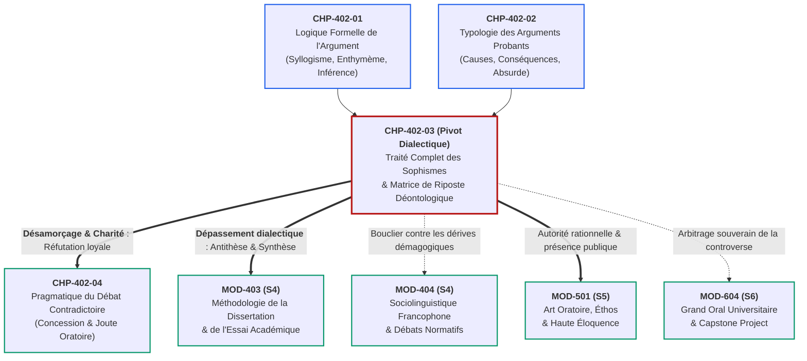

# Chapitre 3 — Traité Complet des Sophismes et Paralogismes : Typologie des Réfutations et Matrice de Riposte Déontologique

> **Identifiant du chapitre** : `CHP-402-03`  
> **Module de rattachement** : [`MOD-402` — Rhétorique Argumentative : Thèses, Réfutation et Détection des Sophismes](file:///f:/Formation/world-class-french/03-curriculum/year-2/semester-4/mod-402-rhetorique-argumentation-refutation-sophismes.md)  
> **Semestre** : Année 2 — Semestre 4 (S4)  
> **Volume horaire canonique** : 5 à 6 heures d'apprentissage autonome délibéré et d'ateliers d'application (Phase 1 Étude : 1 h 30 | Phase 2 Pratique : 1 h 30 | Phase 3 Correction : 1 h 00 | Phase 4 Évaluation : 1 h 00)  
> **Statut** : [STATUT : VALIDÉ]  
> **Compétences associées** : [`FR-ARGUM-001`](file:///f:/Formation/world-class-french/02-competency-framework/competency-framework.md#fr-argum-001-rigueur-démonstrative-réfutation-et-détection-des-sophismes) (L3 Autonomie), [`FR-LEXIC-001`](file:///f:/Formation/world-class-french/02-competency-framework/competency-framework.md#fr-lexic-001-précision-sémantique-nuances-synonymiques-et-collocations) (L3 Autonomie), [`FR-INT-004`](file:///f:/Formation/world-class-french/02-competency-framework/competency-framework.md#fr-int-004-adapter-instantanément-son-registre-de-langue-au-contexte) (L3 Autonomie)  
> **Sources scientifiques de référence** : `SRC-RHET-03` (Olivier Reboul, 1991, chap. 4), `SRC-RHET-01` (Pierre Fontanier, 1977/2009), `SRC-RHET-02` (Georges Molinié, 1992), `SRC-GRAM-02` (Riegel, Pellat & Rioul, 2016/2021, chap. 21), `SRC-NORM-03` (Ministère de l'Éducation nationale, 2020), `SRC-TYPO-01` (Imprimerie nationale, 2002/2014)

---

## 1. Titre et Place dans le Cursus

### 1.1 Intitulé Officiel
**Chapitre 3 : Traité Complet des Sophismes et Paralogismes : Typologie des Réfutations et Matrice de Riposte Déontologique** (`CHP-402-03`).

### 1.2 Insertion Architecturale dans le Cursus
Le présent chapitre constitue le sommet dialectique et critique du module `MOD-402`. Après avoir étudié la mécanique formelle du raisonnement démonstratif (`CHP-402-01` : syllogisme, enthymème, induction et déduction) et forgé l'armature des arguments probants (`CHP-402-02` : arguments par les causes, par les conséquences, par analogie et par autorité légitime), l'apprenant aborde ici le versant défensif et chirurgical de la dialectique : **la détection, la nomination savante et le désamorçage méthodique des pièges discursifs, paralogismes et sophismes** [Réf. `SRC-RHET-03`, chap. 4].

Dans l'arène publique, judiciaire ou académique, la vérité démonstrative ne triomphe pas d'elle-même : elle est constamment assiégée par des manœuvres déloyales d'intimidation, de caricature ou de diversion. `CHP-402-03` transmet à l'apprenant le bouclier intellectuel indispensable pour préserver la rationalité du débat sans jamais verser dans l'invective.



- **En amont** : Ce chapitre requiert la parfaite assimilation de la validité formelle et du moyen terme (`CHP-402-01`), ainsi que des critères d'admissibilité de la causalité et de l'analogie (`CHP-402-02`).
- **Au sein de MOD-402** : Il permet le déploiement direct de `CHP-402-04` (*Pragmatique du débat contradictoire, concession et déontologie*), où la théorie de la réfutation est mise à l'épreuve dans la joute oratoire chronométrée.
- **En aval** : Il arme immédiatement l'exercice de la dissertation universitaire (`MOD-403`), où l'antithèse exige de réfuter les objections sans homme de paille, et prépare le Grand Oral de sortie de cursus (`MOD-604`).

---

## 2. Objectifs Mesurables

Au terme des 5 à 6 heures d'apprentissage autonome délibéré et d'ateliers d'application de ce chapitre, l'apprenant est capable de :

1. **Discriminer formellement et classifier sans hésitation** la triade conceptuelle *erreur factuelle*, *paralogisme* (faute de bonne foi) et *sophisme* (arme délibérée de manipulation) sur n'importe quel corpus argumentatif écrit ou oral ([`FR-ARGUM-001`](file:///f:/Formation/world-class-french/02-competency-framework/competency-framework.md#fr-argum-001-rigueur-démonstrative-réfutation-et-détection-des-sophismes), Palier L3 Autonomie).
2. **Identifier et nommer avec la nomenclature savante exacte** les huit sophismes cardinaux (*ad hominem* abusif/circonstanciel/*tu quoque*, homme de paille / *strawman*, faux dilemme, pétition de principe / *petitio principii*, fausse causalité / *post hoc ergo propter hoc*, pente glissante / *slippery slope*, appel à l'ignorance / *ad ignorantiam*, argument de foule / *ad populum*) en explicitant leur rupture d'inférence sous-jacente ([`FR-ARGUM-001`](file:///f:/Formation/world-class-french/02-competency-framework/competency-framework.md#fr-argum-001-rigueur-démonstrative-réfutation-et-détection-des-sophismes), Palier L3 Autonomie).
3. **Appliquer en temps réel la Matrice de Riposte Déontologique en 3 temps** (Nommer calmement $\rightarrow$ Démontrer le saut logique $\rightarrow$ Rétablir le débat sur les faits et principes) face à des interlocuteurs de mauvaise foi, sans manifester d'agressivité lexicale ni de rupture de bienséance ([`FR-INT-004`](file:///f:/Formation/world-class-french/02-competency-framework/competency-framework.md#fr-int-004-adapter-instantanément-son-registre-de-langue-au-contexte), Palier L3 Autonomie).
4. **Mobiliser un lexique dialectique et épistémologique de haute précision** (*inférer, postuler, prémisse fallacieuse, pétition de principe, corrélation contingente, causalité efficiente, tiers exclu, bifurcation spécieuse*) dans des réfutations écrites et orales de niveau académique ([`FR-LEXIC-001`](file:///f:/Formation/world-class-french/02-competency-framework/competency-framework.md#fr-lexic-001-précision-sémantique-nuances-synonymiques-et-collocations), Palier L3 Autonomie).

---

## 3. Prérequis et Test de Préparation

### 3.1 Prérequis Cognitifs Minimaux
- **Logique du syllogisme (`CHP-402-01`)** : Connaissance de la structure ternaire (prémisse majeure, prémisse mineure, conclusion) et distinction cardinale entre validité syntaxique formelle et vérité matérielle empirique.
- **Mécanique de l'enthymème (`CHP-402-01`)** : Capacité à expliciter la prémisse masquée d'un raisonnement tronqué.
- **Typologie des arguments probants (`CHP-402-02`)** : Maniement des arguments par les causes, par les conséquences et distinction entre fait statistique et anecdote singulière.

### 3.2 Test de Préparation (Auto-Diagnostic à 5 Questions)
Répondez aux cinq questions suivantes sans consulter de documentation avant d'ouvrir le corrigé repliable :

1. **Question 1 (Validité formelle vs Vérité empirique)** : Soit le raisonnement : *« Toutes les villes côtières sont vulnérables aux tempêtes ; or Cotonou est une ville côtière ; donc Cotonou est vulnérable aux tempêtes »*. Ce raisonnement est-il formellement valide ? Est-il matériellement vrai ?
2. **Question 2 (Moyen terme)** : Dans le syllogisme suivant, quel est le vice de forme qui invalide la déduction : *« Certains magistrats sont sévères ; or certains universitaires sont sévères ; donc certains universitaires sont magistrats »* ?
3. **Question 3 (Raisonnement par l'absurde)** : Quel est le principe fondamental de la démonstration par *reductio ad absurdum* ?
4. **Question 4 (Argument vs Attaque personnelle)** : Pourquoi la réplique *« Vous soutenez cette réforme fiscale parce que vous êtes vous-même propriétaire terrien ! »* ne constitue-t-elle pas une réfutation logique de la réforme ?
5. **Question 5 (Chronologie et Causalité)** : Deux événements $A$ et $B$ surviennent l'un après l'autre ($A$ à 8 heures, $B$ à 9 heures). Peut-on en déduire logiquement que $A$ est la cause de $B$ ? Quelle formule latine désigne cette erreur ?

<details>
<summary><strong>Corrigé détaillé et barème de l'auto-diagnostic (cliquer pour dérouler)</strong></summary>

1. **Réponse 1** : **Oui aux deux aspects.** Le raisonnement est formellement valide (syllogisme déductif irréprochable de type *Barbara*) et matériellement vrai (les prémisses décrivent un fait géographique avéré).
2. **Réponse 2** : Il s'agit du vice du **moyen terme non distribué** : le terme commun (*sévères*) n'est pris universellement dans aucune des deux prémisses (il s'agit à chaque fois de *certains* individus sévères). Deux ensembles particuliers partageant une qualité ne se recoupent pas nécessairement.
3. **Réponse 3** : Le raisonnement par l'absurde consiste à **poser provisoirement la thèse opposée à celle que l'on veut prouver**, puis à démontrer que ses conséquences logiques mènent inévitablement à une contradiction insoluble ou à une impossibilité manifeste, établissant par contrecoup la vérité de la thèse initiale.
4. **Réponse 4** : Parce qu'elle déplace le débat de la valeur intrinsèque de la loi (ses paramètres budgétaires et son équité) vers **l'intérêt personnel présumé de l'orateur**. Même si l'orateur a un intérêt personnel, la réforme peut être économiquement saine ; contester le messager ne réfute pas le message.
5. **Réponse 5** : **Non, absolument pas.** La consécution chronologique ne prouve en rien le lien causal nécessaire (confusion entre antécédent temporel et cause génératrice). La formule latine canonique est : ***Post hoc ergo propter hoc*** (« À la suite de cela, donc à cause de cela »).

> **Barème diagnostique** :  
> • **5 / 5** : Prérequis remarquablement maîtrisés, abordez sereinement la section 4.  
> • **3 ou 4 / 5** : Notions logiques acquises, vigilance requise sur la rigueur des inférences formelles.  
> • **$< 3 / 5$** : Révision impérative de `CHP-402-01` avant d'engager le présent chapitre.
</details>

---

## 4. Situation de Départ ou Problème Concret

### 4.1 L'Empoisonnement du Débat Public par la Fraude Discursive
Considérons la scène suivante, extraite d'un débat télévisé d'actualité économique entre un économiste universitaire et un polémiste aguerri :

> **L'Économiste** : *« Pour juguler l'inflation qui pèse sur les ménages les plus modestes, il serait opportun d'encadrer temporairement les marges de la grande distribution sur un panier ciblé de vingt produits de première nécessité. »*  
> **Le Polémiste** : *« Nous y voilà ! Monsieur le Professeur rêve d'instaurer les cartes de rationnement et de rééditer les désastres de l'Union soviétique ! Vous voulez détruire le commerce de proximité et nous plonger dans la misère noire. Mais venant d'un fonctionnaire grassement payé par les impôts des Français, qui n'a jamais géré une entreprise de sa vie, cette haine de la liberté ne me surprend guère. Soit nous défendons la libre entreprise, soit nous finissons au goulag ! »*

Face à cette avalanche verbale, que constate-t-on ? L'auditeur non averti est impressionné par l'énergie du polémiste. L'économiste, lui, est frappé de **sidération** : son raisonnement modéré a été balayé en dix secondes. Pourquoi ?

Parce que le polémiste n'a opposé **aucun contre-argument rationnel** ; il a injecté dans le débat une batterie de toxines rhétoriques :
1. **L'épouvantail (homme de paille)** : Transformer un encadrement temporaire de vingt marges en *« instauration des cartes de rationnement soviétiques »*.
2. **L'attaque *ad hominem* circonstancielle et injurieuse** : Décrédibiliser la proposition non par des chiffres, mais en attaquant le statut de fonctionnaire de l'économiste (*« grassement payé [...] n'a jamais géré une entreprise »*).
3. **Le faux dilemme** : Enfermer l'auditoire dans une fausse alternative terrorisante (*« Soit la libre entreprise absolue, soit le goulag »*).

### 4.2 La Triple Paralysie du Répondant Naïf
Face à une telle manipulation, l'interlocuteur commet généralement l'une de ces trois erreurs fatales :
1. **La contre-attaque émotionnelle et l'invective** : L'économiste s'indigne, hausse le ton, traite son adversaire de démagogue ou d'ignorant. Résultat : le débat dégénère en pugilat d'égo, l'auditoire renvoie les deux parties dos à dos, et le polémiste a triomphé en sabotant la rationalité.
2. **Le piège de la justification défensive** : L'économiste perd son temps à se disculper (*« Non, je ne suis pas soviétique, je n'aime pas le goulag, je respecte les entreprises... »*). Il valide ainsi le terrain d'affrontement fixé par l'adversaire et abandonne sa proposition initiale.
3. **Le mutisme accablé** : Dégoûté par tant de mauvaise foi, l'orateur se tait. L'auditoire interprète ce silence comme un aveu d'impuissance.

Pour briser ce cercle vicieux, il est indispensable d'acquérir une **armure méthodologique** : savoir identifier le stratagème, le nommer chirurgicalement devant l'auditoire et rétablir le débat sur son axe rationnel avec une sérénité inébranlable [Réf. `SRC-RHET-03`, chap. 4].

---

## 5. Explication Intuitive : Le Judoka Intellectuel et le Démineur

Pour comprendre comment neutraliser un sophisme sans s'épuiser ni s'abaisser à l'agressivité, articulons deux analogies complémentaires :

```text
┌──────────────────────────────────────────────────────────────────────────────────┐
│                   LA DOUBLE ANALOGIE DU DÉMINEUR ET DU JUDOKA                    │
├────────────────────────────────────────┬─────────────────────────────────────────┤
│ LA POSTURE DU DÉMINEUR (Mécanique)     │ LA POSTURE DU JUDOKA (Dynamique)        │
├────────────────────────────────────────┼─────────────────────────────────────────┤
│ • Le sophisme est un colis piégé :     │ • L'adversaire arrive avec une charge   │
│   apparence soignée, mais circuit faux.│   émotionnelle violente et précipitée.  │
│ • Le démineur ne hurle pas contre la   │ • Le judoka ne bloque pas la force brute│
│   bombe et ne la frappe pas du poing.  │   par sa propre force brute.            │
│ • Il approche avec un calme absolu.    │ • Il pivote (esquive), saisit l'élan de │
│ • Il ouvre le boîtier devant l'auditoire│  l'adversaire et utilise son déséquilibre│
│ • Il montre le détonateur frelaté :    │  pour le faire chuter sur son propre    │
│   « Regardez, ce fil n'est relié à rien».│ élan logique disproportionné.          │
│ • La bombe est neutralisée sans bruit. │ • Victoire nette, élégante, sans haine. │
└────────────────────────────────────────┴─────────────────────────────────────────┘
```

1. **Le sophisme comme mécanisme piégé** : Un sophisme fonctionne toujours selon une mécanique de prestidigitation : il attire l'attention de l'auditoire sur une étincelle émotionnelle spectaculaire (une insulte voilée, une peur ancestrale, une caricature bouffonne) pour masquer un **vide d'inférence logique**. Votre tâche d'orateur n'est pas de contester l'émotion produite, mais de montrer à l'auditoire le trucage du magicien.
2. **Le déminage déontologique** : Devant un public, l'arbitre souverain n'est pas le contradicteur de mauvaise foi — qui ne changera jamais d'avis au cours de la joute —, mais **l'auditoire qui écoute**. Lorsque vous criez contre le sophiste, l'auditoire ne voit que deux hommes en colère. Lorsque vous débranchez froidement le mécanisme défectueux sous les yeux du public, vous offrez à l'auditoire le plaisir intellectuel de la lucidité retrouvée. Le sophiste est désarmé non par votre rancœur, mais par sa propre vacuité exposée au grand jour.

---

## 6. Définitions Précises et Terminologie

Conformément à la nomenclature universitaire de la rhétorique classique et de l'épistémologie critique [Réf. `SRC-RHET-03`, chap. 4 ; Réf. `SRC-RHET-02` ; Réf. `SRC-NORM-03`], les termes techniques du domaine sont définis avec la plus haute rigueur :

### 6.1 La Faute de Raisonnement : Genre et Espèces
- **Fallacie (ou argument fallacieux)** : Du latin *fallacia* (tromperie, ruse, artifice). Terme générique désignant tout raisonnement qui présente les dehors de la validité ou de la force probante, mais qui recèle en réalité une infraction aux lois de la logique formelle ou de l'argumentation empirique légitime.
- **Paralogisme** : Du grec *para* (à côté) et *logismos* (raisonnement). Raisonnement non valide produit de **bonne foi** par un locuteur victime de sa propre distraction, de la complexité des faits ou d'une mauvaise maîtrise syntaxique, sans aucune volonté délibérée de tromper autrui [Réf. `SRC-RHET-03`, chap. 4].
- **Sophisme** : Du grec *sophisma* (habileté, ruse de métier). Raisonnement invalide, trompeur ou biaisé formulé avec l'**intention délibérée** d'induire en erreur, de masquer la faiblesse de sa thèse ou d'emporter l'adhésion de l'auditoire par des moyens déloyaux [Réf. `SRC-RHET-03`, chap. 4].

### 6.2 Les Sophismes Cardinaux d'Attaque et de Diversion
- **Argument *ad hominem*** : Du latin *ad hominem* (vers l'homme). Stratagème consistant à réfuter une thèse non en examinant sa validité interne ou ses preuves factuelles, mais en attaquant la personnalité, les mœurs, les origines, la profession ou les intérêts supposés du locuteur qui la soutient.
  - *Ad hominem abusif (ou attaque personnelle)* : Invective directe visant à salir l'honneur de la personne.
  - *Ad hominem circonstanciel* : Allégation d'un conflit d'intérêts ou d'une contradiction entre la thèse défendue et la situation personnelle de l'orateur.
  - *Tu quoque (« toi aussi »)* : Rétorquer à un reproche légitime que l'accusateur commet ou a commis la même faute (*« De quel droit critiquez-vous la dette publique alors que votre gouvernement l'a creusée il y a dix ans ? »*).
- **Épouvantail (ou Homme de paille / *Strawman*)** : Procédé consistant à substituer subrepticeusement à la thèse réelle de son contradicteur une version déformée, outrancièrement simplifiée, affaiblie ou ridicule, afin de triompher facilement en démolissant cette caricature imaginaire.

### 6.3 Les Sophismes de Structure Logique Défaillante
- **Faux dilemme (ou fausse dichotomie / bifurcation spécieuse)** : Réduction artificielle du champ des possibles à deux alternatives extrêmes et mutuellement exclusives (*« Soit A, soit B »*), en occultant délibérément les voies médianes, les solutions mixtes ou les alternatives tierces pourtant concevables.
- **Pétition de principe (*petitio principii* / raisonnement circulaire)** : Erreur de structure consistant à tenir pour acquise dans les prémisses de la démonstration la vérité de la conclusion même qu'il s'agit d'établir.
- **Fausse causalité (*post hoc ergo propter hoc*)** : Illusion consistant à déduire qu'un événement $B$ a été causé par un événement $A$ pour l'unique motif que $B$ s'est produit chronologiquement après $A$.

### 6.4 Les Sophismes d'Extrapolation et d'Intimidation
- **Pente glissante (ou pente savonneuse / *slippery slope*)** : Affirmer sans démonstration probante qu'une première décision modérée ou concession mineure entraînera inéluctablement une suite d'événements catastrophiques incontrôlables menant au pire des désastres.
- **Appel à l'ignorance (*argumentum ad ignorantiam*)** : Prétendre qu'une affirmation est nécessairement vraie sous prétexte que l'on n'a pas encore prouvé sa fausseté, ou réciproquement qu'elle est fausse au motif qu'elle n'a pas été rigoureusement prouvée.
- **Argument *ad populum* (ou appel à la foule / à la masse)** : Prétendre qu'une idée, une mesure ou une doctrine est intrinsèquement juste, bonne ou vraie au seul motif qu'un très grand nombre de personnes y adhère ou la pratique.

---

## 7. Règles ou Mécanismes Fondamentaux

Pour organiser l'apprentissage sans saturer l'esprit de l'apprenant, les règles du traité sont réparties en cinq paliers digestes de haute rigueur.

### 7.1 La Distinction Tripartite Cardinale : Fait vs Paralogisme vs Sophisme
Toute intervention critique doit d'abord déterminer à quel étage de dysfonctionnement se situe l'erreur observée dans le discours [Réf. `SRC-RHET-03`, chap. 4] :

```text
┌──────────────────────────────────────────────────────────────────────────────────┐
│                   LA TYPOLOGIE DE L'ERREUR DISCURSIVE                            │
├──────────────────────┬──────────────────────────┬────────────────────────────────┤
│ 1. ERREUR FACTUELLE  │ 2. PARALOGISME           │ 3. SOPHISME                    │
├──────────────────────┼──────────────────────────┼────────────────────────────────┤
│ • Porte sur le réel  │ • Porte sur l'inférence  │ • Porte sur la stratégie       │
│ • Ignorance d'une    │ • Erreur de calcul de    │ • Volonté délibérée de tromper │
│   donnée empirique.  │   bonne foi.             │   ou de manipuler l'auditoire. │
│ • Rectification par  │ • Déduction invalide     │ • Artifice rhétorique visant la│
│   l'apport de faits. │   involontaire.          │   victoire éristique déloyale. │
│                      │                          │                                │
│ Ex : « Dakar est au  │ Ex : « Tout oiseau vole ;│ Ex : « Vous refusez mon projet │
│ Cameroun »           │ l'autruche est un oiseau;│ parce que vous détestez les    │
│ (Faute de géographie)│ donc elle vole ».        │ pauvres et êtes incompétent ! »│
└──────────────────────┴──────────────────────────┴────────────────────────────────┘
```

1. **L'erreur factuelle** relève de l'exactitude matérielle : elle se corrige simplement en produisant la source de référence, la statistique officielle ou le texte de loi omis.
2. **Le paralogisme** relève de la logique cognitive : son auteur est lui-même victime d'une illusion d'optique intellectuelle (syllogisme mal formé, généralisation hâtive par naïveté). On le redresse par la pédagogie démonstrative.
3. **Le sophisme** relève de l'éthique de la communication : son auteur utilise sciemment une arme déloyale pour remporter l'adhésion d'un tiers. On ne le traite pas comme une simple erreur : on doit le **désamorcer publiquement**.

---

### 7.2 Les Sophismes d'Attaque et de Diversion

Ces stratagèmes visent à faire dévier l'attention de l'auditoire hors du sujet en débat (*mutatio controversiae*).

#### A. Le Sophisme *ad hominem*
L'argumentation *ad rem* examine les faits et les principes ; l'argumentation *ad hominem* rabaisse l'enjeu au niveau de la personne qui parle.

$$\text{Structure fautive} : \quad \frac{\text{La personne } P \text{ possède le défaut } D \text{ (ou l'intérêt } I\text{)}}{\text{Donc la thèse } T \text{ soutenue par } P \text{ est fausse.}}$$

- **Ad hominem abusif** : Insulter le contradicteur ou salir son honneur (*« Comment accorder du crédit aux thèses économiques d'un repris de justice ou d'un alcoolique ? »*).
- **Ad hominem circonstanciel** : Alléguer un conflit d'intérêts pour disqualifier un raisonnement sans en examiner la valeur (*« Vous défendez la construction de cette autoroute uniquement parce que votre cabinet d'architecte espère en remporter le marché »*).
- **Tu quoque** : Fuir le reproche en accusant le contradicteur d'incohérence pratique (*« Vous me reprochez de rouler trop vite, mais vous avez vous-même perdu vos points l'an dernier ! »*). L'infraction personnelle du messager ne rend pas légitime l'excès de vitesse.

#### B. L'Épouvantail ou Homme de Paille (*Strawman*)
Le sophiste refuse de combattre le titan que représente la thèse adverse dans sa formulation forte. Il fabrique un mannequin de paille grotesque à l'effigie de cette thèse, y met le feu sous les yeux du public, et prétend avoir terrassé son adversaire [Réf. `SRC-RHET-03`, chap. 4].

$$\text{Mécanisme} : \quad \text{Thèse réelle } A \quad \xrightarrow{\text{Caricature / Amplification}} \quad \text{Thèse affaiblie } A' \quad \xrightarrow{\text{Réfutation facile de } A'} \quad \text{Prétention d'avoir réfuté } A$$

- *Exemple* :  
  - *Thèse réelle* : « Il convient d'introduire des zones piétonnes au centre de la cité pour abaisser la pollution sonore et atmosphérique. »  
  - *Épouvantail* : « Mon contradicteur veut interdire immédiatement toute automobile, supprimer la liberté fondamentale de circuler et nous forcer à marcher quarante kilomètres par jour sous la pluie. »

---

### 7.3 Les Sophismes de Structure Logique Viciée

Ces stratagèmes exploitent une violation des règles de l'inférence valide.

#### A. Le Faux Dilemme (Bifurcation Artificielle)
Ce sophisme repose sur une instrumentalisation abusive du principe logique du tiers exclu. Alors que le tiers exclu ne s'applique qu'aux propositions contradictoires pures ($A$ ou $\text{non-}A$), le faux dilemme l'applique à des contraires arbitraires.

$$\text{Structure viciée} : \quad \text{Soit } A \text{ (l'option extrême du sophiste)}, \text{ soit } B \text{ (le désastre absolu)} ; \quad \text{Or } B \text{ est inacceptable} ; \quad \text{Donc } A \text{ est obligatoire.}$$

- *Exemple* : « Soit vous votez sans réserve l'augmentation immédiate des effectifs de police, soit vous êtes complice des criminels et vous souhaitez le démantèlement de l'État républicain. »  
- *Faille logique* : Il existe une infinité d'options intermédiaires (optimisation des moyens judiciaires, prévention de proximité, travail de renseignement, modernisation des équipements).

#### B. La Pétition de Principe (*Petitio Principii*)
C'est le chef-d'œuvre de l'argumentation tautologique : la conclusion découle prétendument des prémisses, mais la prémisse ne fait que reformuler la conclusion en changeant de vocabulaire [Réf. `SRC-RHET-03`, chap. 4].

$$\text{Structure circulaire} : \quad A \text{ est vrai parce que } B \text{ est vrai} ; \quad \text{or } B \text{ est vrai parce que } A \text{ est vrai.}$$

- *Exemple* : « Il faut interdire sans délai les manifestations syndicales parce qu'elles troublent la tranquillité publique ; et nous savons avec certitude qu'elles troublent la tranquillité publique puisqu'elles sont intrinsèquement séditieuses et doivent être interdites. »  
- *Faille logique* : Aucune preuve externe n'est apportée ; l'affirmation tourne sur elle-même comme un serpent qui se mord la queue.

#### C. La Fausse Causalité (*Post hoc ergo propter hoc*)
L'esprit humain tend spontanément à transformer la consécution chronologique en lien de causalité nécessaire [Réf. `SRC-GRAM-02`, chap. 21].

$$\text{Formule fautive} : \quad t_1 : \text{Événement } A \quad \longrightarrow \quad t_2 : \text{Événement } B \quad \Longrightarrow \quad A \text{ est la cause de } B.$$

- *Exemple* : « Depuis que ce nouveau recteur d'académie a pris ses fonctions, les résultats au baccalauréat ont fléchi de trois pour cent ; il est donc personnellement responsable de l'abaissement du niveau des élèves. »  
- *Faille logique* : La simultanéité ou la succession ne prouvent rien. D'autres variables exogènes (changement d'épreuves, crise sanitaire, réformes de programmes antérieures de trois ans) expliquent le phénomène.

---

### 7.4 Les Sophismes d'Extrapolation et d'Intimidation Psychologique

#### A. La Pente Glissante (*Slippery Slope*)
Ce procédé joue sur la peur de l'irréversible : il affirme qu'en acceptant une mesure $A$ (souvent raisonnable), on enclenche un engrenage fatal qui conduira obligatoirement à la catastrophe $Z$, sans jamais démontrer la nécessité causale de chaque maillon intermédiaire.

$$\text{Engrenage imaginaire} : \quad A \quad \xrightarrow{\text{sans preuve}} \quad B \quad \xrightarrow{\text{sans preuve}} \quad C \quad \xrightarrow{\text{sans preuve}} \quad \dots \quad \xrightarrow{\text{sans preuve}} \quad Z \text{ (l'abîme)}.$$

- *Exemple* : « Si nous autorisons les étudiants à utiliser une calculatrice basique lors des examens de gestion, demain ils ne sauront plus faire une addition mentale, après-demain ils perdront toute capacité de concentration, et dans dix ans nos ingénieurs construiront des ponts qui s'effondreront ! »

#### B. L'Appel à l'Ignorance (*Argumentum ad Ignorantiam*)
Ce sophisme renverse illégitimement la charge de la preuve (*onus probandi*). C'est à celui qui affirme l'existence d'une chose ou la vérité d'une thèse d'en apporter la démonstration positive.

$$\text{Formulation spécieuse} : \quad \frac{\text{Vous n'avez pas prouvé que } X \text{ n'existe pas}}{\text{Donc } X \text{ existe nécessairement.}}$$

- *Exemple* : « La science contemporaine n'a jamais réussi à prouver formellement que la télépathie était impossible ; il est donc parfaitement raisonnable et scientifique d'y croire. »

#### C. L'Argument *ad populum* (Appel à la Masse)
Ce sophisme confond le consensus numérique ou la popularité démographique avec la validité démonstrative.

$$\text{Illusion grégaire} : \quad \frac{\text{Quatre-vingts pour cent des citoyens croient que } P}{\text{Donc la proposition } P \text{ est vraie.}}$$

- *Exemple* : « Des millions de personnes achètent chaque matin leur horoscope dans les journaux ; il est donc absurde de prétendre que l'astrologie est une chimère sans valeur. »  
- *Faille logique* : La majorité peut unanimement partager une illusion d'optique ou une fausse croyance (pendant des siècles, l'humanité a cru unanimement que le soleil tournait autour de la terre).

---

### 7.5 La Matrice de Riposte Déontologique en 3 Temps

Pour désarmer n'importe lequel de ces sophismes lors d'un échange contradictoire, le dialecticien applique systématiquement le protocole des **Trois Temps de la Riposte Déontologique** :

```text
┌──────────────────────────────────────────────────────────────────────────────────┐
│              LA MATRICE DE RIPOSTE DÉONTOLOGIQUE EN TROIS TEMPS                  │
├──────────────────────────────────────────────────────────────────────────────────┤
│ TEMPS 1 : NOMMER CALMEMENT LE SOPHISME PAR SON CONCEPT SAVANT                    │
│ • Poser la voix, adopter un registre de courtoisie exemplaire.                  │
│ • Identifier publiquement le nom de la manœuvre sans agressivité.                │
│ • Formule type : « Mon contradicteur recourt ici à un sophisme bien connu :      │
│   l'homme de paille (ou le faux dilemme, etc.). »                                │
├──────────────────────────────────────────────────────────────────────────────────┤
│ TEMPS 2 : DÉMONTRER LE SAUT LOGIQUE FAUTIF DEVANT L'AUDITOIRE                    │
│ • Ouvrir le mécanisme sous les yeux du public.                                   │
│ • Séparer la thèse réelle de la caricature, ou la corrélation de la cause.       │
│ • Formule type : « Ce stratagème consiste à faire croire qu'en régulant X,      │
│   nous détruisons Y. Or, il n'existe aucun lien de nécessité entre ces deux faits »│
├──────────────────────────────────────────────────────────────────────────────────┤
│ TEMPS 3 : RÉTABLIR LE DÉBAT SUR LE TERRAIN DES FAITS ET DES PRINCIPES            │
│ • Refuser de s'attarder sur la polémique stérile.                                │
│ • Reprendre immédiatement l'initiative sur l'axe rationnel initial.              │
│ • Formule type : « Revenons donc aux faits démontrables et aux paramètres        │
│   réels de la question qui nous réunit ce soir. »                                │
└──────────────────────────────────────────────────────────────────────────────────┘
```

---

## 8. Raisonnement Détaillé : Pourquoi les Sophismes Séduisent-ils l'Esprit Humain ?

Si les sophismes sont si massivement employés dans les campagnes électorales, les prétoires et les réseaux de communication, c'est parce qu'ils exploitent avec un redoutable cynisme les faiblesses structurelles de la cognition humaine.

### 8.1 La Loi de Moindre Effort et les Heuristiques de Jugement
Le raisonnement logique rigoureux (déduction syllogistique, contrôle d'adéquation empirique, pesée scrupuleuse des contre-exemples) est une activité cérébrale coûteuse en temps et en énergie métabolique. La psychologie cognitive contemporaine a mis en lumière que le cerveau humain utilise en permanence des **heuristiques rapides** :
- Le faux dilemme offre la simplicité d'un univers binaire : il dispense de penser la complexité des degrés intermédiaires.
- L'argument *ad hominem* substitue l'émotion primaire immédiate (la sympathie ou le dégoût envers une personne) à l'effort aride d'analyser un bilan financier ou un texte législatif.
- L'argument *ad populum* flatte le besoin grégaire d'appartenance à la meute : il est toujours rassurant de penser comme le plus grand nombre.

### 8.2 Le Biais de Confirmation et le Biais de Causalité
L'être humain est une machine à traquer du sens et des coupables. Face à un désordre imprévu, notre esprit refuse le hasard ou l'enchevêtrement complexe de facteurs anonymes : il cherche immédiatement une cause unique et intentionnelle.
- Le sophisme *post hoc ergo propter hoc* procure l'illusion gratifiante d'avoir trouvé l'explication : *« L'événement B a eu lieu juste après A, donc A est le coupable ! »*.
- La pente glissante exploite quant à elle l'instinct de survie face au danger : en brandissant le spectre de l'anéantissement final, l'orateur court-circuite la réflexion critique par la terreur sacrée.

Le dialecticien émancipé comprend que le combat contre le sophisme n'est pas seulement une joute d'orateurs : c'est un **acte civique d'assainissement de la pensée**.

---

## 9. Exemples Corrects Commentés

Voici le décorticage analytique de **huit répliques célèbres** par lesquelles de grands orateurs de l'histoire parlementaire, judiciaire et littéraire ont désamorcé des sophismes avec une maestria souveraine :

### Exemple 1 : Victor HUGO (1849) — Désamorçage de l'épouvantail socialiste et de la fausse fatalité
- **Contexte** : Devant l'Assemblée législative conservatrice, les partisans du *statu quo* accusent tout réformateur de vouloir détruire la propriété et d'attenter à l'ordre providentiel en prétendant éradiquer la souffrance.
- **Réplique magistrale** :
  > *« Je ne suis pas, messieurs, de ceux qui croient qu'on peut supprimer la souffrance en ce monde ; la souffrance est une loi divine ; mais je suis de ceux qui pensent et qui affirment qu'on peut détruire la misère. Remarquez-le bien, messieurs, je ne dis pas diminuer, amoindrir, limiter, circonscrire, je dis détruire. [...] La misère est une maladie du corps social comme la lèpre était une maladie du corps humain. »*
- **Anatomie de la riposte** : Hugo désamorce préventivement l'**homme de paille** en concédant la dimension métaphysique de la souffrance pour mieux isoler chirurgicalement la *misère*, problème matériel et politique curable.

### Exemple 2 : Robert BADINTER (1981) — Démontage de la fausse causalité dissuasive de la peine de mort
- **Contexte** : Les partisans de la guillotine affirment que l'échafaud protège la société et que son abolition provoquera l'explosion immédiate des assassinats.
- **Réplique magistrale** :
  > *« On a cherché à faire croire que la peine de mort était dissuasive. Mais la vérité scientifique contemporaine a démontré qu'il n'en était rien. Partout où la peine de mort a été abolie, le nombre des crimes de sang n'a pas augmenté ; partout où elle a été rétablie, il n'a pas diminué. Il n'y a aucune corrélation entre la présence ou l'absence de la guillotine et la courbe de la criminalité sanglante. Dès lors, cet argument utilitaire s'effondre. »*
- **Anatomie de la riposte** : Badinter oppose aux croyances intuitives (*post hoc* et *ad populum*) l'analyse statistique internationale comparée, pulvérisant la prétendue causalité criminologique.

### Exemple 3 : Georges CLEMENCEAU (1885) — Réfutation de l'ad populum et du sophisme civilisateur de Jules Ferry
- **Contexte** : Jules Ferry affirme à la Chambre que « les races supérieures ont le devoir de civiliser les races inférieures », justifiant l'expansion coloniale par le consensus des nations européennes.
- **Réplique magistrale** :
  > *« Les races supérieures ont sur les races inférieures un droit ! C'est bientôt dit ! Pour ma part, j'en rabats singulièrement depuis que j'ai vu des savants allemands démontrer scientifiquement que la France devait être vaincue dans la guerre franco-allemande, parce que le Français est d'une race inférieure à l'Allemand. [...] Non, il n'y a pas de droit des nations dites supérieures sur les nations inférieures. [...] La conquête que vous préconisez, c'est l'abus pur et simple de la force que donne la civilisation scientifique sur les civilisations primitives. »*
- **Anatomie de la riposte** : Clemenceau retourne le raisonnement contre son auteur par une réduction par l'absurde éclatante, montrant que le critère de la « race supérieure » mène à la justification de l'écrasement de la France par l'Allemagne.

### Exemple 4 : Jean JAURÈS (1910) — Neutralisation de la pente glissante contre les retraites ouvrières
- **Contexte** : Les conservateurs affirment que verser une pension de retraite aux vieux ouvriers détruira l'esprit d'épargne, incitera à la paresse et mènera l'économie nationale à la banqueroute.
- **Réplique magistrale** :
  > *« Vous prétendez que garantir le pain de la vieillesse au travailleur usé, c'est détruire en lui la prévoyance et l'énergie morale. Quelle dérision ! Comme si la certitude de ne point mourir de faim au coin d'un fossé dispensait l'homme d'agir, de lutter et de vivre ! Loin d'éteindre l'énergie, la sécurité sociale élémentaire donne à l'homme la dignité qui commence l'effort. »*
- **Anatomie de la riposte** : Jaurès brise l'extrapolation imaginaire (la pente glissante vers la paresse universelle) en rappelant la réalité psychologique fondamentale : la dignité matérielle stimule l'effort au lieu de l'anéantir.

### Exemple 5 : Simone VEIL (1974) — Démontage du faux dilemme lors des débats sur l'IVG
- **Contexte** : Les opposants au projet de loi enferment les partisans du texte dans une alternative fallacieuse : ou bien vous défendez la morale et la vie, ou bien vous encouragez l'avortement de masse de convenance.
- **Réplique magistrale** :
  > *« Je le dis avec toute ma force : l'avortement doit rester l'exception, l'ultime recours pour des situations sans issue. Mais comment le tolérer sans qu'il perde ce caractère de désordre ? C'est ce que nous devons examiner. Aucune femme ne recourt de gaieté de cœur à l'avortement. Il suffit d'écouter les femmes. C'est toujours un drame, cela restera toujours un drame. »*
- **Anatomie de la riposte** : Simone Veil refuse de se laisser acculer dans le faux dilemme : elle récuse d'emblée l'éloge de l'avortement pour poser le problème sur le terrain tragique de la réalité clandestine vécue.

### Exemple 6 : Émile ZOLA (1898) — Réfutation de la pétition de principe dans l'Affaire Dreyfus
- **Contexte** : Dans *J'accuse... !*, Zola dénonce l'état-major militaire qui refuse de réexaminer la culpabilité d'Alfred Dreyfus sous prétexte que l'armée ne peut se tromper et que le tribunal militaire a déjà tranché.
- **Réplique magistrale** :
  > *« On nous dit : la justice a été rendue, la chose jugée est sacrée, un conseil de guerre ne peut avoir failli. Mais prétendre que Dreyfus est coupable parce que le tribunal l'a condamné, alors que nous apportons la preuve éclatante que les pièces étaient fausses et le dossier vide, ce n'est pas rendre la justice : c'est enfermer le crime dans le secret pour sauver l'orgueil d'une corporation ! »*
- **Anatomie de la riposte** : Zola dénonce la parfaite **pétition de principe** de l'institution militaire, qui déduit la culpabilité de la condamnation elle-même au lieu de se fonder sur les pièces matérielles.

### Exemple 7 : Aimé CÉSAIRE (1950) — Démontage du sophisme d'équivalence civilisatrice
- **Contexte** : Dans son *Discours sur le colonialisme*, Aimé Césaire combat la rhétorique colonialiste prétendant que la colonisation équivaut à la mise en contact bénéfique des cultures et au progrès médical.
- **Réplique magistrale** :
  > *« La colonisation égale christianisation ? Non : la colonisation n'est pas évangélisation. La colonisation égale philantrophie ? Non : la colonisation n'est pas entreprise philanthropique. [...] Mais parlons de ceux qui ont été détruits, des cultures étouffées, des terres confisquées, des religions bafouées, des magnificences anéanties. [...] Entre colonisateur et colonisé, il n'y a de place que pour la corvée, l'intimidation, la pression, la police, l'impôt, le vol, le viol, les plantations obligatoires, le mépris, la méfiance, la morgue, la suffisance, la muflerie. »*
- **Anatomie de la riposte** : Césaire pulvérise l'amalgame fallacieux en opposant aux abstractions idéalisées la liste clinique et matérielle des violences réelles du système colonial.

### Exemple 8 : François MITTERRAND (1988) — Désamorçage d'une provocation ad hominem
- **Contexte** : Débat télévisé du second tour de l'élection présidentielle de 1988. Jacques Chirac, alors Premier ministre, tente de déstabiliser le président sortant en affirmant : *« Ce soir, il n'y a pas de président de la République et de Premier ministre, il n'y a que deux candidats à égalité : vous me permettrez donc de vous appeler Monsieur Mitterrand. »*
- **Réplique magistrale** :
  > *« Mais vous avez parfaitement raison, Monsieur le Premier ministre. »*
- **Anatomie de la riposte** : Une leçon d'économie dialectique absolue. En acceptant formellement l'égalité feinte tout en réappliquant immédiatement le titre officiel de *« Monsieur le Premier ministre »*, François Mitterrand rétablit instantanément la hiérarchie institutionnelle d'État sans proférer une seule parole agressive.

---

## 10. Contre-Exemples et Erreurs Fréquentes

Voici l'analyse clinique de **six erreurs récurrentes d'interprétation et de diagnostic dialectique** observées chez les praticiens du débat contradictoire :

### Erreur n° 1 : Crier au sophisme ad hominem face à une critique légitime de la compétence requise
- **Diagnostic de l'erreur** : L'apprenant croit que toute mise en cause d'une personne constitue automatiquement un sophisme *ad hominem*.
- **Réfutation scientifique** : Si une discussion porte sur un diagnostic médical ou une expertise comptable assermentée, souligner que l'intervenant n'a aucune formation médicale ou n'a jamais exercé en comptabilité n'est pas un sophisme : c'est un **examen légitime de la recevabilité de l'argument d'autorité**. L'attaque n'est fallacieuse que si elle vise la moralité ou la vie privée sur un sujet qui ne dépend pas de ces critères [Réf. `SRC-RHET-03`, chap. 4].

### Erreur n° 2 : Confondre homme de paille et résumé synthétique
- **Diagnostic de l'erreur** : Accuser de mauvaise foi un contradicteur qui se contente de résumer fidèlement la substantifique moelle d'une intervention verbeuse.
- **Réfutation scientifique** : La concision n'est pas la caricature. Pour qu'il y ait véritablement homme de paille (*strawman*), il faut que le résumé **altère le sens**, omette des nuances indispensables pour rendre la thèse indéfendable ou lui attribue des intentions grotesques. Si la reformulation conserve la logique essentielle de l'orateur, le grief d'homme de paille est sans objet.

### Erreur n° 3 : Traiter tout dilemme réel de faux dilemme
- **Diagnostic de l'erreur** : Réfuter une alternative binaire en invoquant mécaniquement le sophisme du faux dilemme, alors que la réalité matérielle impose une exclusion stricte.
- **Réfutation scientifique** : En matière d'action publique ou de gestion budgétaire à somme nulle, certaines situations ne comportent objectivement que deux issues possibles (ex. : *« Soit nous votons le budget avant minuit selon la constitution, soit l'État cesse légalement ses paiements demain matin »*). Traiter un dilemme matériellement incontournable de faux dilemme relève de la fuite intellectuelle devant la décision.

### Erreur n° 4 : Insulter à son tour le contradicteur sophiste au lieu de désamorcer
- **Diagnostic de l'erreur** : Répondre à un sophisme par un autre sophisme (invective symétrique ou sarcasme blessant).
- **Réfutation scientifique** : Dès lors que vous injuriez l'adversaire en réponse à son *ad hominem*, vous perdez instantanément votre éthos de rationalité auprès de l'auditoire. L'assistance ne perçoit plus qui a commis la première faute : elle constate simplement un pugilat stérile. La seule riposte victorieuse est le **sang-froid déontologique** et l'exposition chirurgicale de la faille [Réf. `SRC-RHET-01`, partie IV].

### Erreur n° 5 : Confondre pétition de principe et tautologie stylistique
- **Diagnostic de l'erreur** : Accuser de pétition de principe une simple définition lexicale ou un pléonasme oratoire d'insistance.
- **Réfutation scientifique** : Une définition nominale (*« Un célibataire est un homme non marié »*) ou une anaphore rhétorique expressive ne prétendent pas démontrer une vérité nouvelle. La pétition de principe n'existe que lorsqu'un locuteur **prétend prouver une thèse empirique ou contestée** en glissant sournoisement cette même thèse dans son appareil démonstratif.

### Erreur n° 6 : Voir une pente glissante dans une mise en garde causale étayée
- **Diagnostic de l'erreur** : Balayer toute mise en garde prospective sérieuse d'un revers de main en criant à la pente glissante.
- **Réfutation scientifique** : Si un économiste ou un médecin démontre, preuves statistiques et mécanismes biologiques à l'appui, que la prise répétée d'une substance $X$ entraîne une accoutumance mesurée menant à des lésions hépatiques, il s'agit d'une **démonstration étiologique par les conséquences**, non d'une pente glissante. La pente glissante ne commence que lorsque le lien entre les étapes est purement imaginaire, rhétorique et invérifiable.

---

## 11. Cas Particuliers et Limites

### 11.1 L'Argument *ad hominem* Légitime en Matière Testimoniale
En droit processuel et dans les tribunaux judiciaires, l'argument *ad hominem* cesse d'être un sophisme lorsqu'il s'applique à un **témoignage humain sous serment** :
- Si un témoin affirme avoir vu l'accusé sur les lieux d'un cambriolage à minuit, il est parfaitement loyal, légal et rigoureux pour la défense de prouver :
  1. Que le témoin a des antécédents prouvés de faux témoignage ;
  2. Qu'il a des liens d'animosité personnels ou un intérêt financier direct à la condamnation de l'accusé ;
  3. Que son acuité visuelle nocturne est défaillante.
- *Justification épistémologique* : Dans un témoignage direct, la force probante de la proposition repose exclusivement sur la crédibilité morale et sensorielle du témoin. Éprouver le témoin, c'est éprouver la preuve elle-même.

### 11.2 Les Véritables Dilemmes Moraux et Tragédies de Choix Public
Il existe des conjectures où deux impératifs catégoriques et éthiques s'excluent mutuellement sans qu'aucune troisième voie ne soit concevable :
- Le dilemme cornélien classique (choisir entre l'honneur familial et l'amour) ou le tri médical en temps de catastrophe absolue (ressources de réanimation inférieures au nombre de blessés en détresse vitale) constituent des dilemmes tragiques authentiques.
- Dans ces cas limites, chercher une « voie médiane » factice constitue une lâcheté décisionnelle. L'éthique consiste à assumer lucidement le sacrifice inhérent à l'alternative sans prétendre la dissoudre par un sophisme de confort.

---

## 12. Approfondissement Adapté au Niveau : L'Éristique de Schopenhauer et sa Subversion

Pour les étudiants préparant les concours de la haute fonction publique, l'agrégation ou le barreau, l'étude de l'ouvrage posthume d'Arthur Schopenhauer, *L'Art d'avoir toujours raison* (*Eristische Dialektik*, 1830), offre une radiographie fascinante de la mauvaise foi organisée.

### 12.1 La Dialectique Éristique : La Victoire aux Dépens de la Vérité
Schopenhauer y opère une distinction cruelle entre :
- **La logique pure** : Quête de la vérité objective (*veritas*), indifférente aux passions humaines.
- **La dialectique éristique** : Art de débattre de manière à toujours avoir raison aux yeux du public, *per fas et nefas* (par des moyens licites ou illicites), en exploitant la vanité naturelle de l'esprit humain.

Schopenhauer recense **38 stratagèmes**, parmi lesquels :
- *L'extension démesurée (Stratagème 1)* : Élargir la thèse de l'adversaire au-delà de ses limites naturelles pour la rendre vulnérable.
- *L'utilisation de prémisses fausses mais admises par l'adversaire (Stratagème 5)* : Raisonner à partir des préjugés de son contradicteur.
- *L'argument ad auditores (Stratagème 28)* : Lancer une objection invalide mais qui fait rire le public non initié ; l'adversaire devrait déployer une longue explication technique pour répondre, ce qui ennuiera l'assistance.
- *L'argument ultime : l'injure pure (Stratagème 38)* : Lorsque l'on s'aperçoit que l'adversaire l'emporte sur le fond, l'attaquer personnellement de la façon la plus grossière possible.

### 12.2 La Subversion Déontologique
Le grand dialecticien contemporain n'étudie pas Schopenhauer pour devenir un faussaire du verbe, mais pour acquérir une **immunité dialectique absolue**. Connaître par cœur les 38 stratagèmes permet de voir arriver le coup à dix mètres, de sourire avec courtoisie, d'énoncer le numéro du stratagème avec l'ironie tranquille du maître, et de ramener l'adversaire honteux au centre du tapis de combat.

---

## 13. Comparaisons Différentielles

Les quatre tableaux synoptiques ci-dessous fixent les frontières conceptuelles infranchissables entre notions trop souvent confondues :

### Tableau 1 : Sophisme vs Paralogisme vs Erreur Factuelle
| Paramètre d'analyse | Erreur Factuelle | Paralogisme | Sophisme |
| :--- | :--- | :--- | :--- |
| **Siège du défaut** | Réalité empirique extérieure | Inférence formelle / Déduction | Stratégie discursive globale |
| **Intentionnalité** | Involontaire (méconnaissance) | Involontaire (distraction logique) | **Délibérée (ruse / manipulation)** |
| **Statut moral** | Neutre (ignorance) | Neutre (erreur de bonne foi) | Fautif (déloyauté intellectuelle) |
| **Méthode de résolution** | Apport de la preuve matérielle | Démonstration pédagogique du calcul | **Désamorçage public déontologique** |

### Tableau 2 : Ad Hominem Fallacieux vs Critique de Compétence Légitime
| Critère discriminant | Sophisme *Ad Hominem* | Critique de Compétence Légitime |
| :--- | :--- | :--- |
| **Objet de l'attaque** | Mœurs, vie privée, ethnicité, passé personnel | Qualifications techniques, formation, mandat direct |
| **Lien avec la thèse** | **Nul ou purement émotionnel** | **Direct et fonctionnel** |
| **Exemple typique** | « Vous avez divorcé deux fois, vous ne pouvez comprendre l'économie ! » | « Vous n'avez jamais étudié la fiscalité, vous ne pouvez certifier ces comptes. » |
| **Impact sur l'éthos** | Disqualification injuste et toxique | Évaluation rigoureuse de la solidité testimoniale |

### Tableau 3 : Faux Dilemme vs Dilemme Réel
| Paramètre | Faux Dilemme (Sophisme) | Dilemme Réel (Incontournable) |
| :--- | :--- | :--- |
| **Nature de l'alternative** | Choix artificiellement binaire | Exclusion matérielle ou juridique stricte |
| **Voies intermédiaires** | **Multiples, masquées par mauvaise foi** | **Objectivement inexistantes** |
| **Principe logique** | Confusion contraires / contradictoires | Application stricte du tiers exclu ($A \lor \neg A$) |
| **Riposte adéquate** | Nommer les options tierces oubliées | Peser scrupuleusement les coûts du choix |

### Tableau 4 : Fausse Causalité (*Post hoc*) vs Causalité Authentique Étayée
| Caractéristique | Fausse Causalité (*Post hoc*) | Causalité Authentique Étayée |
| :--- | :--- | :--- |
| **Fondement unique** | Simple succession temporelle ($t_1 \to t_2$) | Mécanisme étiologique explicité et vérifié |
| **Contrôle des variables** | Variables exogènes ignorées ou dissimulées | Variables parasites isolées ou neutralisées |
| **Corrélation vs Causalité** | Confond coïncidence et cause nécessaire | Établit la reproductibilité de l'effet produit |
| **Énonciation** | Péremptoire et précipitée | Scientifique, mesurée et documentée |

---

## 14. Exercices Progressifs

### Niveau 1 : Reconnaissance et Dénomination de 15 Sophismes en Contexte
Identifiez et nommez avec la terminologie savante exacte le sophisme ou paralogisme présent dans chacun des 15 énoncés suivants :

1. *« Mon adversaire propose de réaménager les horaires de la bibliothèque municipale ; il souhaite donc manifestement priver nos enfants de toute culture et fermer nos écoles. »*
2. *« Depuis que nous avons changé la couleur de la moquette dans la salle du conseil, notre chiffre d'affaires a progressé de quinze pour cent ; cette teinte stimule donc les affaires ! »*
3. *« Vous affirmez qu'il faut réduire notre empreinte carbone, mais vous prenez l'avion pour vos vacances d'été : votre discours environnemental est nul et non avenu. »*
4. *« Soit nous acceptons sans broncher la baisse des salaires, soit l'usine ferme définitivement ses portes dès lundi matin. »*
5. *« Les extraterrestres visitent régulièrement notre planète : aucun astronome n'a jamais été capable de prouver de façon irréfutable le contraire. »*
6. *« Cette loi est juste et légitime parce qu'elle est conforme au droit républicain, et le droit républicain est par nature juste et légitime parce qu'il s'incarne dans cette loi. »*
7. *« Plus de soixante-dix pour cent des automobilistes dépassent la vitesse autorisée sur cette rocade : il est donc évident que cette limitation est mauvaise et qu'il faut la supprimer. »*
8. *« Si vous autorisez un assouplissement de dix minutes sur l'heure d'arrivée le matin, demain les employés viendront à midi, après-demain ils déserteront les bureaux et notre entreprise fera faillite. »*
9. *« Que peut bien savoir de la politique de santé ce médecin généraliste, lui dont le père a fait faillite il y a vingt ans ? »*
10. *« Vous prétendez qu'il faut diversifier notre approvisionnement énergétique ; vous voulez donc la disparition immédiate de l'électricité et le retour aux chandelles ! »*
11. *« J'ai porté cette amulette traditionnelle lors de mon entretien d'embauche et j'ai été recruté le jour même : son pouvoir protecteur est incontestable. »*
12. *« Ce roman est un chef-d'œuvre immortel puisqu'il suscite l'admiration universelle, et nous savons qu'il suscite l'admiration universelle parce qu'il constitue un chef-d'œuvre immortel. »*
13. *« Soit vous souscrivez à notre contrat d'assurance premium, soit vous acceptez de voir votre famille ruinée au premier imprévu. »*
14. *« Vous me reprochez d'arriver en retard à la séance plénière, mais vous n'étiez pas là du tout lors de la commission préparatoire d'hier matin ! »*
15. *« Aucune étude n'a démontré de manière mathématique l'absence totale d'effets secondaires de cette tisane ; elle est donc dangereuse pour la santé publique. »*

<details>
<summary><strong>Corrigé détaillé du Niveau 1 (cliquer pour dérouler)</strong></summary>

1. **Épouvantail (Homme de paille / *Strawman*)** : Caricature outrancière d'un simple aménagement horaire en fermeture d'écoles et privation de culture.
2. **Fausse causalité (*Post hoc ergo propter hoc*)** : Assimilation d'une simple coïncidence chronologique (changement de moquette) à une cause commerciale efficiente.
3. **Sophisme *ad hominem* (sous-catégorie *Tu quoque*)** : Réfutation d'une thèse écologique par le comportement privé du contradicteur.
4. **Faux dilemme (Bifurcation spécieuse)** : Réduction artificielle des solutions managériales à deux extrêmes en éliminant les négociations intermédiaires.
5. **Appel à l'ignorance (*Argumentum ad ignorantiam*)** : Déduction de l'existence des extraterrestres de l'impossibilité d'apporter la preuve contraire.
6. **Pétition de principe (*Petitio principii* / raisonnement circulaire)** : La conclusion est tenue pour acquise dans la prémisse sous une autre formulation.
7. **Argument *ad populum*** : Confusion entre infraction massivement partagée et justice intrinsèque d'une règle.
8. **Pente glissante (*Slippery slope*)** : Extrapolation dramatisée et imaginaire sans lien causal nécessaire.
9. **Sophisme *ad hominem* abusif** : Disqualification d'un médecin sur des considérations familiales et patrimoniales dénuées de lien avec la santé publique.
10. **Épouvantail (Homme de paille)** : Déformation grotesque de la diversification énergétique en retour à l'obscurantisme.
11. **Fausse causalité (*Post hoc ergo propter hoc*)** : Confusion classique entre consécution temporelle et causalité magique.
12. **Pétition de principe (*Petitio principii*)** : Tautologie circulaire posant le jugement esthétique comme sa propre preuve.
13. **Faux dilemme** : Chantage affectif réduisant le choix à une assurance coûteuse ou à la ruine absolue.
14. **Sophisme *ad hominem* (*Tu quoque*)** : Esquive d'un manquement personnel par l'allégation d'une faute d'autrui.
15. **Appel à l'ignorance (*Argumentum ad ignorantiam*)** : Inférence abusive de la toxicité d'un produit tirée de l'absence de preuve absolue d'innocuité.
</details>

---

### Niveau 2 : Rédaction de la Riposte Déontologique en 3 Temps (8 Scénarios)
Pour chacun des 8 scénarios suivants, rédigez la réplique exacte du dialecticien en appliquant rigoureusement la **Matrice en 3 temps** (Nommer calmement $\rightarrow$ Démontrer le saut logique $\rightarrow$ Rétablir sur les faits et principes) :

1. *Scénario 1 (Ad hominem circonstanciel)* : Face à votre rapport préconisant le développement du rail, un élu déclare : *« Vous êtes ingénieur dans les travaux ferroviaires, votre avis ne vaut rien car vous ne cherchez qu'à remplir votre carnet de commandes ! »*
2. *Scénario 2 (Faux dilemme)* : Lors d'un débat universitaire : *« Soit nous interdisons tout usage de l'intelligence artificielle chez les étudiants, soit nous acceptons l'effondrement complet du niveau intellectuel et la triche généralisée ! »*
3. *Scénario 3 (Homme de paille)* : Face à votre proposition d'instaurer un contrôle continu partiel : *« Vous proposez donc d'accorder le diplôme à tous les paresseux sans aucune épreuve sérieuse et d'abolir l'effort académique ! »*
4. *Scénario 4 (Post hoc ergo propter hoc)* : Dans une réunion d'entreprise : *« Depuis que nous avons mis en place le télétravail partiel le vendredi, deux dossiers administratifs ont pris du retard ; le télétravail est donc la cause exclusive de notre désorganisation. »*
5. *Scénario 5 (Pente glissante)* : Lors d'un débat civique : *« Si nous accordons le droit de vote aux résidents étrangers pour les élections municipales, demain ils exigeront la réécriture de la Constitution, après-demain ils prendront le contrôle de l'État et notre souveraineté sera anéantie ! »*
6. *Scénario 6 (Pétition de principe)* : Un contradicteur affirme : *« Les décrets de notre conseil sont parfaits parce qu'ils émanent d'une assemblée infaillible, et nous savons que notre assemblée est infaillible puisque ses décrets ne comportent aucune erreur. »*
7. *Scénario 7 (Tu quoque)* : Alors que vous signalez une erreur de calcul comptable dans un bilan : *« De quel droit osez-vous critiquer mes chiffres, alors que vous avez vous-même égaré une facture le mois dernier ? »*
8. *Scénario 8 (Ad populum)* : Un promoteur immobilier justifie un projet controversé : *« Tout le monde dans le quartier réclame ce centre commercial et applaudit à l'idée ; il est donc indéniable qu'il est bénéfique pour l'écosystème local. »*

<details>
<summary><strong>Corrigé détaillé et modélisation des ripostes du Niveau 2 (cliquer pour dérouler)</strong></summary>

1. **Riposte au Scénario 1** :  
   > *« Mon contradicteur utilise un sophisme ad hominem circonstanciel, cherchant à disqualifier des données d'ingénierie par mon appartenance professionnelle. Cette attaque évite le débat de fond : les coûts d'infrastructure et le bilan carbone du rail sont des métriques objectives calculées par des modèles normés. Rétablissons l'échange sur les bilans comparés du fret ferroviaire et routier plutôt que sur ma situation personnelle. »*
2. **Riposte au Scénario 2** :  
   > *« Vous enfermez notre assemblée dans un faux dilemme, réduisant la politique universitaire à une prohibition impossible ou à une capitulation pédagogique. Cette alternative masque le continuum d'initiatives constructives : l'apprentissage raisonné de l'esprit critique et l'intégration d'épreuves orales surveillées. Revenons à l'élaboration de protocoles pédagogiques équilibrés au lieu de céder aux paniques technologiques. »*
3. **Riposte au Scénario 3** :  
   > *« Vous recourez ici à l'homme de paille classique, en caricaturant un rééquilibrage de l'évaluation continue en démission pédagogique. Mon projet ne supprime aucunement l'exigence : il la répartit sur l'ensemble de l'année pour mesurer le travail régulier plutôt que le bachotage de dernière heure. Examinons les modalités de contrôle continu proposées au lieu d'en détruire une caricature grotesque. »*
4. **Riposte au Scénario 4** :  
   > *« Vous commettez le paralogisme post hoc ergo propter hoc, déduisant un lien de cause à effet d'une simple consécution de dates. Deux retards ponctuels peuvent s'expliquer par des pannes de serveurs ou des ruptures de chaînes logistiques extérieures au télétravail. Auditons l'ensemble des facteurs de production avant d'imputer arbitrairement ces dysfonctionnements à l'organisation du travail. »*
5. **Riposte au Scénario 5** :  
   > *« Votre raisonnement relève de la pente glissante, prophétisant sans l'ombre d'une preuve qu'une mesure municipale locale conduira à la dissolution de la souveraineté nationale. Aucun des maillons de cette chaîne imaginaire n'est démontré. Débattons sereinement de la participation civique des résidents aux décisions de leur commune sans brandir des spectres apocalyptiques. »*
6. **Riposte au Scénario 6** :  
   > *« Votre argumentation constitue une parfaite pétition de principe : vous posez dans votre prémisse de départ ce qu'il s'agit précisément de démontrer. L'infaillibilité d'un décret ne peut se prouver par l'infaillibilité proclamée de son auteur. Examinons la conformité juridique objective de ce texte aux normes constitutionnelles supérieures. »*
7. **Riposte au Scénario 7** :  
   > *« Vous esquivez la vérification comptable par une manœuvre tu quoque. Une maladresse administrative passée ne transforme pas une soustraction fausse en résultat exact. La rigueur des comptes de notre institution n'est pas une querelle d'égos : reprenons la colonne de calcul ligne à ligne. »*
8. **Riposte au Scénario 8** :  
   > *« Vous mobilisez un argument ad populum : la popularité immédiate d'un aménagement n'en valide nullement l'innocuité écologique. L'histoire urbaine abonde de projets jadis applaudis qui ont dégradé les nappes phréatiques et saturé les voies d'accès. Examinons l'étude d'impact environnemental et la réalité hydrogéologique du sol plutôt que le baromètre des sondages d'opinion. »*
</details>

---

### Niveau 3 : Analyse Critique Intégrale d'un Tract de Propagande de 50 Mots

Soit le texte suivant issu d'un tract de propagande électorale, calibré à **exactement 50 mots** selon les normes de décompte de l'Imprimerie nationale (`SRC-TYPO-01`) :

> *« Nos adversaires veulent détruire notre économie nationale. Ce sont des incompétents notoires qui méprisent le peuple. Chacun sait que leur projet ruinera nos familles. Soit vous votez pour nous, soit notre patrie sombrera dans le chaos. Rejoignez la majorité des citoyens lucides afin d'assurer le salut de la nation. »*

#### Décompte Certifié Mot à Mot (1 à 50) :
1. *Nos* | 2. *adversaires* | 3. *veulent* | 4. *détruire* | 5. *notre* | 6. *économie* | 7. *nationale.* | 8. *Ce* | 9. *sont* | 10. *des* | 11. *incompétents* | 12. *notoires* | 13. *qui* | 14. *méprisent* | 15. *le* | 16. *peuple.* | 17. *Chacun* | 18. *sait* | 19. *que* | 20. *leur* | 21. *projet* | 22. *ruinera* | 23. *nos* | 24. *familles.* | 25. *Soit* | 26. *vous* | 27. *votez* | 28. *pour* | 29. *nous,* | 30. *soit* | 31. *notre* | 32. *patrie* | 33. *sombrera* | 34. *dans* | 35. *le* | 36. *chaos.* | 37. *Rejoignez* | 38. *la* | 39. *majorité* | 40. *des* | 41. *citoyens* | 42. *lucides* | 43. *afin* | 44. *d'* | 45. *assurer* | 46. *le* | 47. *salut* | 48. *de* | 49. *la* | 50. *nation.*

#### Consigne de l'Épreuve :
Dressez la grille complète d'autopsie critique de ce texte en renseignant :
1. L'identification et la citation textuelle exacte de chacun des sophismes imbriqués ;
2. La qualification savante du type de manipulation logique et psychologique mobilisé ;
3. La rédaction d'une mise au point déontologique globale neutralisant l'ensemble du tract.

<details>
<summary><strong>Corrigé détaillé et autopsie critique du Niveau 3 (cliquer pour dérouler)</strong></summary>

#### 1. Identification et Citation Textuelle des Sophismes :
- **Sophisme 1 (Homme de paille / Procès d'intention)** : *« Nos adversaires veulent détruire notre économie nationale »* (mots 1 à 7). Attribution arbitraire d'une intention de malveillance destructrice pour masquer le débat programmatique.
- **Sophisme 2 (*Ad hominem* abusif)** : *« Ce sont des incompétents notoires qui méprisent le peuple »* (mots 8 à 16). Invective directe disqualifiant moralement et professionnellement les personnes.
- **Sophisme 3 (*Ad populum* et Consensus feint)** : *« Chacun sait que leur projet ruinera nos familles »* (mots 17 à 24). Appel à une évidence populaire universelle non prouvée (*« Chacun sait »*).
- **Sophisme 4 (Faux dilemme apocalyptique)** : *« Soit vous votez pour nous, soit notre patrie sombrera dans le chaos »* (mots 25 à 36). Réduction terrorisante du choix démocratique à une fausse dichotomie existentielle.
- **Sophisme 5 (Intimidation grégaire / Flatteuse pétition *ad populum*)** : *« Rejoignez la majorité des citoyens lucides afin d'assurer le salut de la nation »* (mots 37 à 50). Sommation de se ranger derrière une prétendue majorité qualifiée flatteusement de *« lucide »*.

#### 2. Synthèse Dialectique et Réfutation Rédigée :
> *« Ce tract concentre l'ensemble des pathologies du discours manipulateur : procès d'intention méprisant, attaque injurieuse sur les personnes, faux dilemme terrorisant et appel grégaire à une majorité fantasmée. Aucune mesure concrète n'y est débattue. Le devoir républicain impose de rejeter ces amalgames outranciers pour exiger des chiffres vérifiés, des comparaisons programmatiques objectives et le respect absolu de la dignité démocratique des citoyens. »*
</details>

---

## 15. Activité de Correction Raisonnée

### Contexte de l'Épreuve
L'apprenant agit en qualité d'**analyste du discours et médiateur déontologique**. Le texte suivant est la transcription brute d'un débat télévisé de 250 mots entre un représentant ministériel et un polémiste corporatiste. Ce dialogue contient **exactement 8 sophismes retors** dissimulés sous des allures d'assurance oratoire.

### Texte Témoin à Examiner (250 mots)
> **Le Polémiste** : *« Monsieur le Directeur, votre politique énergétique est criminelle. [1] Chacun sait que les partisans de la transition écologique ne sont que des bourgeois nostalgiques qui veulent nous forcer à vivre sans électricité dans des grottes. [2] D'ailleurs, comment pouvez-vous parler d'énergie, vous qui êtes incapable de gérer les finances de votre propre direction ? [3] Soit nous maintenons les subventions massives aux carburants fossiles, soit l'économie nationale s'effondre avant l'hiver. [4] La preuve que ces subventions sont efficaces, c'est que les commerces fonctionnent aujourd'hui grâce à ces aides qui garantissent leur fonctionnement. »*  
> **Le Directeur** : *« [5] Vous m'accusez d'incompétence financière, mais vous avez vous-même été condamné pour fraude fiscale il y a dix ans ! [6] De plus, depuis que le gouvernement a lancé ce plan de subventions l'an dernier, le chômage a reculé de deux pour cent : cette mesure est donc la cause unique de notre embellie sociale. [7] Si nous écoutons vos récriminations et que nous cédons d'un centime, demain les transporteurs bloqueront les routes, après-demain le ravitaillement sera interrompu et le pays sombrera dans l'émeute. [8] Enfin, aucun scientifique n'a prouvé que notre dispositif n'était pas le plus parfait possible : il est donc incontestable que nous avons raison. »*

---

### Apparat Critique et Fiches de Désamorçage des Huit Sophismes

| Réf. | Locuteur | Extrait textuel exact du sophisme | Qualification savante du sophisme | Analyse critique du vice d'inférence | Stratégie de désamorçage déontologique |
| :---: | :---: | :--- | :--- | :--- | :--- |
| **[1]** | Polémiste | *« les partisans de la transition [...] ne sont que des bourgeois nostalgiques qui veulent nous forcer à vivre sans électricité dans des grottes. »* | **Homme de paille (*Strawman*)** | Caricature grotesque et primitive d'un programme d'efficacité énergétique pour le rendre indéfendable. | Rétablir les termes réels du plan énergétique (décarbonation progressive, sobriété) sans se justifier sur l'absurdité des « grottes ». |
| **[2]** | Polémiste | *« vous qui êtes incapable de gérer les finances de votre propre direction »* | **Ad hominem abusif / circonstanciel** | Déplacement du débat énergétique vers une mise en cause personnelle administrative non documentée. | Rappeler que la gestion des deniers obéit à la Cour des comptes et ramener à l'arbitrage énergétique. |
| **[3]** | Polémiste | *« Soit nous maintenons les subventions massives [...], soit l'économie nationale s'effondre avant l'hiver. »* | **Faux dilemme** | Binarisme terrorisant occultant les politiques mixtes (tarification progressive, aides ciblées). | Démontrer l'existence des voies médianes de transition sans céder au chantage du collapsus immédiat. |
| **[4]** | Polémiste | *« ces subventions sont efficaces, c'est que les commerces fonctionnent [...] grâce à ces aides qui garantissent leur fonctionnement. »* | **Pétition de principe (*Petitio principii*)** | Circularité pure : l'efficacité des aides est prouvée par leur propre fonctionnement postulé. | Exiger des métriques d'impact économique indépendantes et briser la tautologie. |
| **[5]** | Directeur | *« vous avez vous-même été condamné pour fraude fiscale il y a dix ans ! »* | **Ad hominem (*Tu quoque*)** | Réponse à une attaque par une contre-attaque sur le passé judiciaire de l'interlocuteur. | Fautes symétriques : le directeur perd son autorité d'État en descendant dans l'arène de l'invective personnelle. |
| **[6]** | Directeur | *« depuis que le gouvernement a lancé ce plan [...], le chômage a reculé [...] cause unique de notre embellie »* | **Fausse causalité (*Post hoc ergo propter hoc*)** | Assimilation abusive de la baisse du chômage à l'unique variable des subventions de carburant. | Isoler les variables macroéconomiques globales (conjoncture internationale, créations d'emplois saisonniers). |
| **[7]** | Directeur | *« Si nous cédons d'un centime, demain les transporteurs bloqueront les routes [...] le pays sombrera dans l'émeute. »* | **Pente glissante (*Slippery slope*)** | Extrapolation apocalyptique injustifiée reliant une concession budgétaire à l'insurrection civile. | Démontrer que la négociation sectorielle encadrée prévient précisément le désordre social au lieu de le causer. |
| **[8]** | Directeur | *« aucun scientifique n'a prouvé que notre dispositif n'était pas le plus parfait possible : donc [...] nous avons raison. »* | **Appel à l'ignorance (*Ad ignorantiam*)** | Renversement illégitime de la charge de la preuve étatique sur l'absence de réfutation absolue. | Rappeler qu'il incombe à l'exécutif de démontrer l'efficience d'un plan public, et non à la science d'en prouver la perfection. |

---

## 16. Mise en Pratique dans une Production Réelle

### Consigne et Cahier des Charges de la Production
Vous agissez en qualité de **conseiller à la médiation et porte-parole institutionnel**. Vous devez rédiger une mise au point déontologique officielle calibrée à **exactement 60 mots** (selon le décompte officiel de l'Imprimerie nationale `SRC-TYPO-01`).

#### Contraintes Normatives Obligatoires :
1. **Désamorçage méthodique sans animosité** de trois sophismes précis : un homme de paille, un faux dilemme et une fausse causalité ;
2. **Respect d'un registre de langue soutenu et posé** ([`FR-INT-004`](file:///f:/Formation/world-class-french/02-competency-framework/competency-framework.md#fr-int-004-adapter-instantanément-son-registre-de-langue-au-contexte)) ;
3. **Usage exact de la terminologie logique** ([`FR-LEXIC-001`](file:///f:/Formation/world-class-french/02-competency-framework/competency-framework.md#fr-lexic-001-précision-sémantique-nuances-synonymiques-et-collocations)) ;
4. **Décompte certifié mot par mot de 1 à 60** (chaque mot élidé compte pour un mot distinct selon `SRC-TYPO-01` : *qu'il* = 2 mots, *l'immobilisme* = 2 mots, *d'une* = 2 mots).

---

### Texte du Modèle de Référence (60 Mots Exacts)

> *« Mon contradicteur affirme que notre réforme détruira le service public. Cette caricature déforme notre projet, qui vise uniquement sa modernisation. Prétendre qu'il faut choisir entre l'immobilisme et la ruine constitue un faux dilemme. Enfin, attribuer les déficits passés aux seules mesures récentes relève d'une fausse causalité. Examinons désormais les faits avec rigueur pour éclairer le débat démocratique. »*

---

### Décompte Certifié Mot à Mot (1 à 60) :
1. *Mon* | 2. *contradicteur* | 3. *affirme* | 4. *que* | 5. *notre* | 6. *réforme* | 7. *détruira* | 8. *le* | 9. *service* | 10. *public.* | 11. *Cette* | 12. *caricature* | 13. *déforme* | 14. *notre* | 15. *projet,* | 16. *qui* | 17. *vise* | 18. *uniquement* | 19. *sa* | 20. *modernisation.* | 21. *Prétendre* | 22. *qu'* | 23. *il* | 24. *faut* | 25. *choisir* | 26. *entre* | 27. *l'* | 28. *immobilisme* | 29. *et* | 30. *la* | 31. *ruine* | 32. *constitue* | 33. *un* | 34. *faux* | 35. *dilemme.* | 36. *Enfin,* | 37. *attribuer* | 38. *les* | 39. *déficits* | 40. *passés* | 41. *aux* | 42. *seules* | 43. *mesures* | 44. *récentes* | 45. *relève* | 46. *d'* | 47. *une* | 48. *fausse* | 49. *causalité.* | 50. *Examinons* | 51. *désormais* | 52. *les* | 53. *faits* | 54. *avec* | 55. *rigueur* | 56. *pour* | 57. *éclairer* | 58. *le* | 59. *débat* | 60. *démocratique.*

---

### Grille d'Audit et de Conformité aux Contraintes :

| N° | Contrainte Académique | Éléments Conformes Identifiés dans le Texte | Statut |
| :---: | :--- | :--- | :---: |
| **1** | **Désamorçage de l'homme de paille** | Dénonciation explicite de la caricature (*« détruira le service public »*) et rétablissement de l'objectif réel (*« vise uniquement sa modernisation »*) (mots 1 à 20). | **CONFORME** |
| **2** | **Désamorçage du faux dilemme** | Qualification exacte et récusation de l'alternative binaire (*« choisir entre l'immobilisme et la ruine constitue un faux dilemme »*) (mots 21 à 35). | **CONFORME** |
| **3** | **Désamorçage de la fausse causalité** | Dénonciation du lien fallacieux entre dates et causes (*« attribuer les déficits passés aux seules mesures récentes relève d'une fausse causalité »*) (mots 36 à 49). | **CONFORME** |
| **4** | **Rétablissement déontologique** | Clôture par un appel à la rigueur des faits et à la probité civique (*« Examinons désormais les faits avec rigueur pour éclairer le débat démocratique »*) (mots 50 à 60). | **CONFORME** |
| **5** | **Calibrage arithmétique rigoureux** | Décompte scrupuleux de 1 à 60 mots selon la norme `SRC-TYPO-01` (unités élidées autonomes : *qu'*, *l'*, *d'* comptant chacune pour un mot). | **CONFORME (60 mots)** |

---

## 17. Résumé Structuré

### Le Bouclier Anti-Sophismes : Matrice Opérationnelle des Huit Sophismes Cardinaux

```text
┌────────────────────────────────────────────────────────────────────────────────────────┐
│                              LE BOUCLIER ANTI-SOPHISMES                                │
├──────────────────────┬──────────────────────────────┬──────────────────────────────────┤
│ SOPHISME CARDINAL    │ QUESTION-TEST DE DÉTECTION   │ RIPOSTE DÉONTOLOGIQUE IMMÉDIATE  │
├──────────────────────┼──────────────────────────────┼──────────────────────────────────┤
│ 1. AD HOMINEM        │ « L'objection attaque-t-elle │ « Ne jugez pas mon identité :    │
│    (Abusif / Tu quoque)│ la thèse ou la personne ? » │ examinez mes faits et preuves. » │
├──────────────────────┼──────────────────────────────┼──────────────────────────────────┤
│ 2. HOMME DE PAILLE   │ « Mon propos a-t-il été      │ « Vous réfutez votre caricature, │
│    (Strawman)        │ grossi ou dénaturé ? »       │ non ma proposition réelle. »     │
├──────────────────────┼──────────────────────────────┼──────────────────────────────────┤
│ 3. FAUX DILEMME      │ « Y a-t-il une troisième     │ « Vous masquez les voies médianes│
│    (Bifurcation)     │ voie réaliste possible ? »   │ qui existent entre ces extrêmes. »│
├──────────────────────┼──────────────────────────────┼──────────────────────────────────┤
│ 4. PÉTITION          │ « La conclusion est-elle     │ « Votre argument tourne en rond :│
│    DE PRINCIPE       │ déjà dans la prémisse ? »    │ apportez une preuve externe. »   │
├──────────────────────┼──────────────────────────────┼──────────────────────────────────┤
│ 5. FAUSSE CAUSALITÉ  │ « La succession dans le      │ « Succession n'est pas cause :   │
│    (Post hoc)        │ temps prouve-t-elle l'effet ?»│ quelles sont vos preuves ? »     │
├──────────────────────┼──────────────────────────────┼──────────────────────────────────┤
│ 6. PENTE GLISSANTE   │ « Chaque étape intermédiaire │ « Où est le lien de causalité    │
│    (Slippery slope)  │ est-elle démontrée ? »       │ nécessaire vers ce désastre ? »  │
├──────────────────────┼──────────────────────────────┼──────────────────────────────────┤
│ 7. AD IGNORANTIAM    │ « L'absence de preuve        │ « C'est à vous de prouver ce que │
│    (Appel ignorance) │ équivaut-elle à une preuve ? »│ vous avancez (onus probandi). »  │
├──────────────────────┼──────────────────────────────┼──────────────────────────────────┤
│ 8. AD POPULUM        │ « La popularité d'une idée   │ « La masse a souvent partagé des │
│    (Appel foule)     │ garantit-elle sa vérité ? »  │ erreurs : voyons la méthode. »   │
└──────────────────────┴──────────────────────────────┴──────────────────────────────────┘
```

---

## 18. Questions de Rappel Actif (Active Recall)

Répondez mentalement ou par écrit aux six questions suivantes avant de dérouler les réponses de haute rétention :

1. **Question 1** : Quelle est la différence conceptuelle et morale fondamentale entre un *paralogisme* et un *sophisme* ?
2. **Question 2** : Pourquoi l'argument du *tu quoque* (« toi aussi ») est-il formellement invalide, même si l'accusation portée contre le contradicteur est factuellement exacte ?
3. **Question 3** : Dans quelle circonstance précise et institutionnelle l'attaque *ad hominem* devient-elle recevable et légitime dans le débat judiciaire ?
4. **Question 4** : Quel principe logique fondamental le sophisme du *faux dilemme* viole-t-il lorsqu'il applique artificiellement l'alternative binaire à des contraires ?
5. **Question 5** : Quelles sont les trois étapes incontournables de la Matrice de Riposte Déontologique ?
6. **Question 6** : Pourquoi la réfutation d'un sophisme devant public ne doit-elle jamais se transformer en invective symétrique contre le sophiste ?

<details>
<summary><strong>Réponses détaillées de rappel actif (cliquer pour dérouler)</strong></summary>

1. **Réponse 1** : Le critère distinctif cardinal est **l'intentionnalité** : le paralogisme est une erreur de bonne foi commise par distraction ou faiblesse d'analyse logique, sans intention de tromper ; le sophisme est un stratagème élaboré délibérément pour manipuler l'auditoire ou triompher de façon déloyale [Réf. `SRC-RHET-03`, chap. 4].
2. **Réponse 2** : Parce que la rectitude d'une règle ou la vérité d'une proposition ne dépend pas de l'exemplarité comportementale du messager. Si un fumeur affirme que le tabac est nocif, le fait qu'il fume n'annule en rien la vérité médicale de sa proposition.
3. **Réponse 3** : En matière de **témoignage humain sous serment** au prétoire. Lorsque la valeur d'une preuve repose exclusivement sur la sincérité ou l'acuité d'un témoin oculaire, mettre en cause son acuité visuelle nocturne, ses antécédents de faux témoignage ou son conflit d'intérêts direct constitue un examen critique légitime de la source testimoniale.
4. **Réponse 4** : Il viole les conditions d'application du **principe du tiers exclu**. Le tiers exclu ne s'applique qu'à des contradictoires stricts ($A$ ou $\text{non-}A$). Le faux dilemme l'applique abusivement à deux contraires choisis arbitrairement, en dissimulant toutes les voies moyennes et options tierces concevables.
5. **Réponse 5** :  
   - Étape 1 : **Nommer calmement le sophisme** par son concept savant exact ;  
   - Étape 2 : **Démontrer le saut logique fautif** devant l'auditoire (ouvrir le mécanisme) ;  
   - Étape 3 : **Rétablir immédiatement le débat** sur le terrain des faits prouvés et des principes.
6. **Réponse 6** : Parce que l'arbitre d'une joute contradictoire est **l'auditoire** et non le sophiste. En injuriant l'adversaire, l'orateur détruit son propre éthos de mesure et de rationalité, ramenant le débat à une querelle d'égos où la vérité s'efface au profit du spectacle de la colère.
</details>

---

## 19. Mini-Évaluation Sommative Notée sur 20 Points

> **Format de l'épreuve** : Épreuve individuelle sur table en temps limité (30 minutes).  
> **Barème d'exclusion** : Barème pénal strict : toute confusion conceptuelle majeure entre deux familles de sophismes entraîne un malus officiel de **-3 points**.  
> **Seuil éliminatoire** : Note minimale exigée pour la validation au palier L3 Autonomie : **$\ge 14 / 20$**.

---

### Sujet de l'Évaluation

#### Partie I : Discrimination et Typologie Formelle (6 points — 1 pt par item)
Identifiez le sophisme exact à l'œuvre dans les six propositions suivantes :
1. *« Vous prétendez que ce médicament est inoffensif, mais vous n'avez jamais réussi à démontrer qu'il ne provoquerait aucun effet secondaire dans cinquante ans. »*
2. *« Soit nous acceptons la surveillance biométrique générale dans nos rues, soit nous capitulons face aux réseaux terroristes internationaux. »*
3. *« Monsieur le député combat notre projet de loi sur l'agriculture biologique : il souhaite donc affamer nos campagnes et empoisonner nos concitoyens par des pesticides mortels. »*
4. *« Depuis que cette nouvelle équipe municipale a été installée, le nombre de cambriolages a augmenté de huit pour cent : leur laxisme en est la preuve indiscutable. »*
5. *« Ce traité philosophique dit la vérité intégrale car il a été rédigé par un penseur illuminé par la sagesse, et nous savons qu'il a été illuminé par la sagesse car son traité dit la vérité intégrale. »*
6. *« Des millions de téléspectateurs regardent cette émission chaque soir : il est donc évident qu'elle est d'une remarquable qualité intellectuelle et morale. »*

#### Partie II : Désamorçage Déontologique en 3 Temps (6 points — 3 pts par riposte)
Rédigez la riposte déontologique complète (Nommer $\rightarrow$ Démontrer $\rightarrow$ Rétablir) aux deux provocations suivantes :
1. *Provocation A* : *« Vous critiquez notre gestion du budget de la commune, mais vous avez vous-même voté une rallonge budgétaire il y a six ans lorsque vous siégiez dans la commission des fêtes ! »*
2. *Provocation B* : *« Si nous autorisons les salariés à choisir librement leurs jours de repos hebdomadaires, plus personne ne viendra travailler le lundi, les chaînes de production seront paralysées et l'industrie française disparaîtra ! »*

#### Partie III : Analyse Critique Approfondie d'un Réquisitoire Fallacieux (8 points)
Soit la déclaration suivante prononcée lors d'un conseil d'administration :
> *« Notre entreprise doit refuser immédiatement tout partenariat avec cette start-up technologique. D'abord, son jeune directeur est un prétentieux arrogant issu d'une famille d'affairistes douteux. Ensuite, chacun sait que ces nouvelles technologies ne mènent qu'à des désillusions. Soit nous restons fidèles à nos méthodes ancestrales qui ont fait notre gloire, soit nous nous jetons dans le gouffre de la faillite programmée. D'ailleurs, depuis que nous avons simplement auditionné leurs ingénieurs mardi dernier, nos ventes ont fléchi de trois pour cent. »*

1. **Identification et autopsie des sophismes (4 points)** : Relevez et qualifiez avec rigueur les quatre sophismes imbriqués dans cette intervention.
2. **Rédaction de la motion de cadrage déontologique (4 points)** : En tant que directeur général présidant la séance, rédigez une réponse de 4 phrases fermes et courtoises neutralisant l'ensemble de ces attaques et replaçant l'arbitrage sur l'analyse technique et financière du partenariat.

---

### Corrigé Officiel et Barème Détaillé

<details>
<summary><strong>Corrigé officiel de la mini-évaluation (cliquer pour dérouler)</strong></summary>

#### Partie I : Discrimination et Typologie Formelle (6 points)
1. **Appel à l'ignorance (*Argumentum ad ignorantiam*)** (1 pt). *(Pénalité de -3 pts si confondu avec un faux dilemme).*
2. **Faux dilemme (Fausse dichotomie)** (1 pt). *(Pénalité de -3 pts si confondu avec une pente glissante).*
3. **Homme de paille (*Strawman* / Épouvantail)** (1 pt). *(Pénalité de -3 pts si qualifié de simple ad hominem).*
4. **Fausse causalité (*Post hoc ergo propter hoc*)** (1 pt).
5. **Pétition de principe (*Petitio principii* / Circularité)** (1 pt).
6. **Argument *ad populum* (Appel à la masse)** (1 pt).

#### Partie II : Désamorçage Déontologique en 3 Temps (6 points)
1. **Riposte à la Provocation A (3 points)** :  
   - *Temps 1 : Nommer* : Qualification du sophisme *ad hominem* dans sa variante *tu quoque* (1 pt).  
   - *Temps 2 : Démontrer* : Démonstration que l'historique d'un vote sur les fêtes n'atteste en rien la sincérité du bilan financier actuel (1 pt).  
   - *Temps 3 : Rétablir* : Recentrage sur l'audit de la dette actuelle de la commune (1 pt).
2. **Riposte à la Provocation B (3 points)** :  
   - *Temps 1 : Nommer* : Qualification de la pente glissante (*slippery slope*) (1 pt).  
   - *Temps 2 : Démontrer* : Démonstration de l'absence de nécessité logique reliant une flexibilité d'horaires à la mort de l'industrie nationale (1 pt).  
   - *Temps 3 : Rétablir* : Rétablissement du débat sur les modalités d'organisation contractuelle des plannings d'équipes (1 pt).

#### Partie III : Analyse Critique Approfondie d'un Réquisitoire (8 points)
1. **Autopsie des quatre sophismes (4 points — 1 pt par identification)** :  
   - *Sophisme 1* : **Ad hominem abusif** (*« jeune directeur [...] prétentieux arrogant issu d'une famille douteuse »*) ;  
   - *Sophisme 2* : **Ad populum / Généralisation hâtive** (*« chacun sait que ces nouvelles technologies ne mènent qu'à des désillusions »*) ;  
   - *Sophisme 3* : **Faux dilemme** (*« soit fidèles à nos méthodes ancestrales, soit le gouffre de la faillite »*) ;  
   - *Sophisme 4* : **Fausse causalité (*Post hoc*)** (*« depuis que nous avons auditionné [...] mardi dernier, nos ventes ont fléchi »*).
2. **Rédaction de la motion de cadrage déontologique (4 points)** :  
   - Modèle attendu :  
     > *« Chers collègues, notre conseil ne saurait fonder ses arbitrages stratégiques sur des attaques visant les personnes, des caricatures binaires ou des corrélations de calendrier fantaisistes. L'origine familiale du dirigeant d'une start-up ou une variation hebdomadaire des ventes n'ont aucun rapport avec la viabilité d'une solution logicielle. Un conseil d'administration responsable évalue les actifs technologiques réels, les garanties de cybersécurité et le retour sur investissement prévu. J'invite donc notre direction financière et nos ingénieurs à nous présenter le rapport d'audit technique indépendant sans plus de diversion. »*
</details>

---

## 20. Critères Observables de Maîtrise (Palier L3 Autonomie)

La validation de ce chapitre atteste l'acquisition opérationnelle du palier **L3 (Autonomie)** pour les compétences du référentiel World-Class French :

| Code Indicateur | Compétence Associée | Comportement Observable Attendu | Seuil de Validation Exigé |
| :---: | :---: | :--- | :---: |
| **IND-01** | [`FR-ARGUM-001`](file:///f:/Formation/world-class-french/02-competency-framework/competency-framework.md#fr-argum-001-rigueur-démonstrative-réfutation-et-détection-des-sophismes) (**L3**) | **Discrimination formelle et taxonomie des sophismes** : L'apprenant identifie et nomme sans erreur les huit sophismes cardinaux sur corpus oral ou écrit en temps réel. | **Score $\ge 90\ \%$** sans confusion conceptuelle (-3 pts par confusion) |
| **IND-02** | [`FR-INT-004`](file:///f:/Formation/world-class-french/02-competency-framework/competency-framework.md#fr-int-004-adapter-instantanément-son-registre-de-langue-au-contexte) (**L3**) | **Déploiement de la Matrice de Riposte Déontologique** : L'apprenant neutralise une agression verbale ou un sophisme retors selon le triptyque (Nommer $\rightarrow$ Démontrer $\rightarrow$ Rétablir) avec un sang-froid absolu. | **Zéro marque d'agressivité** lexicale ou d'invective symétrique |
| **IND-03** | [`FR-LEXIC-001`](file:///f:/Formation/world-class-french/02-competency-framework/competency-framework.md#fr-lexic-001-précision-sémantique-nuances-synonymiques-et-collocations) (**L3**) | **Précision du métalangage logique et dialectique** : Mobilisation exacte des termes opératoires (*inférer, prémisse fallacieuse, pétition de principe, corrélation, tiers exclu, bifurcation*). | **100 % d'exactitude terminologique** dans les productions |
| **IND-04** | [`FR-ARGUM-001`](file:///f:/Formation/world-class-french/02-competency-framework/competency-framework.md#fr-argum-001-rigueur-démonstrative-réfutation-et-détection-des-sophismes) (**L3**) | **Production d'une mise au point normée sous contraintes** : L'apprenant rédige une mise au point de 60 mots exacts désamorçant trois sophismes distincts avec tableau de conformité. | **Conformité arithmétique intégrale** (60 mots certifiés `SRC-TYPO-01`) |

---

## 21. Sources et Lectures Complémentaires

Conformément à la politique d'intégrité bibliographique du cursus World-Class French ([`07-resources/source-registry.md`](file:///f:/Formation/world-class-french/07-resources/source-registry.md)), l'ensemble des notions de ce chapitre s'appuie exclusivement sur les références scientifiques réelles et vérifiées suivantes :

1. **[`SRC-RHET-03`] Reboul, Olivier (1991)**. *Introduction à la rhétorique*. Paris : Presses Universitaires de France (PUF), coll. « Premier Cycle ».
   - **Chapitre 4 (*Les arguments fallacieux*)** : Théorie fondamentale des sophismes et paralogismes, taxonomie des arguments trompeurs (*ad hominem*, *petitio principii*, *post hoc ergo propter hoc*, *ad populum*), et distinction rigoureuse entre persuadeur de bonne foi et manipulateur éristique.
2. **[`SRC-RHET-01`] Fontanier, Pierre (1977/2009)**. *Les Figures du discours*. Paris : Flammarion, coll. « Champs ».
   - **Partie II et IV (*Des figures autres que les tropes*)** : Analyse des figures de pensée et de raisonnement (concession, prétérition, antithèse), de leur détournement artificieux et des mécanismes d'ironie dans la polémique.
3. **[`SRC-RHET-02`] Molinié, Georges (1992)**. *Dictionnaire de rhétorique*. Paris : Le Livre de Poche, coll. « Les Usuels ».
   - **Entrées spécialisées** : Articles *Argumentation*, *Ad hominem*, *Dilemme*, *Pétition de principe*, *Réfutation*, *Sophisme* et *Tautologie*. Définitions techniques et repères d'analyse stylistique des procédés d'éloquence.
4. **[`SRC-GRAM-02`] Riegel, Martin, Pellat, Jean-Christophe & Rioul, René (2016/2021)**. *Grammaire méthodique du français*. Paris : Presses Universitaires de France (PUF), coll. « Quadrige ».
   - **Chapitre 21 (*Les relations logiques et argumentatives*)** : Analyse linguistique de la relation de cause et conséquence, de la coordination adversative et des connecteurs argumentatifs régissant les inférences textuelles.
5. **[`SRC-NORM-03`] Ministère de l'Éducation nationale (2020)**. *Terminologie grammaticale*. Paris : Réseau Canopé / Éduscol.
   - **Nomenclature officielle de l'argumentation** : Définition institutionnelle de la thèse, de l'argument, de l'objection et des relations logiques d'inférence et d'opposition.
6. **[`SRC-TYPO-01`] Imprimerie nationale (2002/2014)**. *Lexique des règles typographiques en usage à l'Imprimerie nationale*. Paris : Imprimerie nationale.
   - **Article « Ponctuation et élision »** : Règles officielles de comptage des mots typographiques (les unités séparées par une apostrophe comptent chacune comme un mot autonome : *qu'il* = 2 mots, *l'ensemble* = 2 mots, *d'une* = 2 mots).

---

## Annexe : Classification Pédagogique et Traçabilité du Contenu

Conformément au guide de rédaction académique ([`00-governance/chapter-writing-guidelines.md`](file:///f:/Formation/world-class-french/00-governance/chapter-writing-guidelines.md)), le tableau ci-dessous explicite la ventilation didactique des notions abordées dans ce chapitre :

| Étiquette didactique | Contenu dialectique / Notion logique | Justification didactique & Destination précise |
| :---: | :--- | :--- |
| **CORE-NOW** | • Distinction tripartite : Erreur factuelle vs Paralogisme (involontaire) vs Sophisme (délibéré).<br/>• Typologie des 8 sophismes cardinaux (*ad hominem*, homme de paille, faux dilemme, pétition de principe, fausse causalité, pente glissante, *ad ignorantiam*, *ad populum*).<br/>• Matrice de Riposte Déontologique en 3 temps (Nommer $\rightarrow$ Démontrer $\rightarrow$ Rétablir).<br/>• Les 4 tableaux comparatifs différentiels. | Cœur opérationnel absolu du chapitre `CHP-402-03`. Fournit le bouclier intellectuel et critique indispensable à l'exercice autonome de la parole publique et de l'analyse textuelle. |
| **INTRODUCTION-NOW** | • Les heuristiques de jugement en psychologie cognitive et la séduction du moindre effort intellectuel.<br/>• L'analyse critique des tracts électoraux et des plateaux de controverse télévisée contemporains. | Éveille la vigilance critique de l'apprenant face à la désinformation et aux dérives démagogiques du débat public. |
| **DEFER** | • La pratique de la joute oratoire contradictoire chronométrée de 15 minutes en direct face à un contradicteur pugnace.<br/>• La technique avancée du *steelmanning* (« homme d'acier » ou principe de charité poussé à son paroxysme).<br/>• L'alchimie tripartite de la concession rhétorique (*certes... toutefois... néanmoins*). | **Reporté à [`CHP-402-04`](file:///f:/Formation/world-class-french/03-curriculum/year-2/semester-4/mod-402-rhetorique-argumentation-refutation-sophismes.md#chapitre-4--pragmatique-du-débat-contradictoire-concession-et-déontologie-2-h-00)**. |
| **DEFER** | • L'architecture de la réfutation dans la dissertation académique tripartite (antithèse, discussion des thèses adverses et dépassement dialectique). | **Reporté à [`MOD-403`](file:///f:/Formation/world-class-french/03-curriculum/year-2/semester-4/mod-403-methodologie-dissertation-essai-academique.md)** (*Méthodologie de la Dissertation et de l'Essai Académique*). |
| **MOVE** | • L'analyse stylistique des figures de tropes polémiques (hyperbole satirique, prétérition, ironie polyphonique). | **Rattaché à [`MOD-401`](file:///f:/Formation/world-class-french/03-curriculum/year-2/semester-4/mod-401-pragmatique-accords-limites-rectifications-1990.md)** (`CHP-401-02` Polyphonie énonciative) et à [`MOD-502`](file:///f:/Formation/world-class-french/01-architecture/academic-structure.md) (*Traité complet des figures de rhétorique*). |
| **OPTIONAL-ADVANCED** | • La déconstruction systématique des 38 stratagèmes de la dialectique éristique d'Arthur Schopenhauer (*Eristische Dialektik*). | Section 12 du chapitre, réservée aux étudiants préparant les concours de haut niveau (Barreau, Magistrature, Grand Oral, CAPES, Agrégation). |
| **REMOVE** | • Le formalisme algorithmique et le calcul des propositions en logique mathématique pure (tables de vérité booléennes, algèbre de Boole, calcul des prédicats du premier ordre). | Écarté du cursus linguistique pour préserver une didactique rhétorique incarnée, humaine et directement applicable au débat d'idées. |
