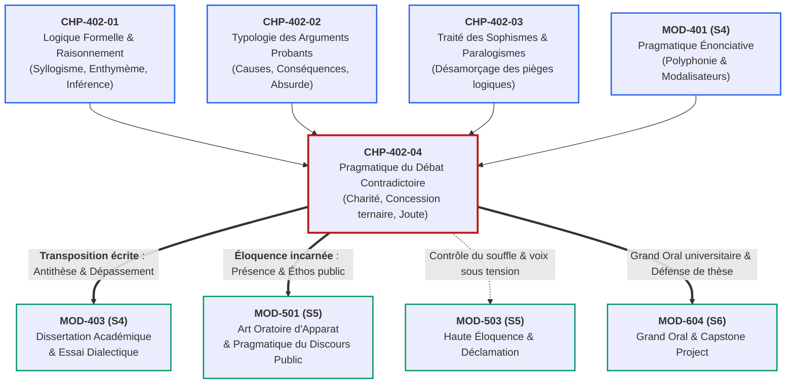
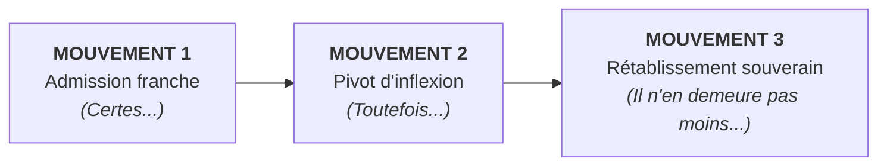

# Chapitre 4 — Pragmatique du Débat Contradictoire, Concession et Déontologie : Principe de Charité, Concession Ternaire et Joute Oratoire

> **Identifiant du chapitre** : `CHP-402-04`  
> **Module de rattachement** : [`MOD-402` — Rhétorique Argumentative : Thèses, Réfutation et Détection des Sophismes](file:///f:/Formation/world-class-french/03-curriculum/year-2/semester-4/mod-402-rhetorique-argumentation-refutation-sophismes.md)  
> **Semestre** : Année 2 — Semestre 4 (S4)  
> **Volume horaire estimé** : 5 à 6 heures d'apprentissage autonome délibéré et d'ateliers d'application (Phase 1 Étude : 1 h 30 | Phase 2 Pratique : 1 h 30 | Phase 3 Correction : 1 h 00 | Phase 4 Évaluation : 1 h 00)  
> **Statut** : [STATUT : VALIDÉ]  
> **Compétences associées** : [`FR-ARGUM-001`](file:///f:/Formation/world-class-french/02-competency-framework/competency-framework.md#fr-argum-001-rigueur-démonstrative-réfutation-et-détection-des-sophismes) (L3 Autonomie), [`FR-INT-005`](file:///f:/Formation/world-class-french/02-competency-framework/competency-framework.md#fr-int-005-présenter-oralement-un-raisonnement-structuré-et-éloquent) (L3 Autonomie), [`FR-INT-004`](file:///f:/Formation/world-class-french/02-competency-framework/competency-framework.md#fr-int-004-adapter-instantanément-son-registre-de-langue-au-contexte) (L3 Autonomie), [`FR-STYLE-001`](file:///f:/Formation/world-class-french/02-competency-framework/competency-framework.md#fr-style-001-maîtrise-des-figures-de-rhétorique-et-commentaire-stylistique) (L3 Autonomie)  
> **Sources scientifiques de référence** : `SRC-RHET-03` (Olivier Reboul, 1991, chap. 4), `SRC-RHET-01` (Pierre Fontanier, 1977/2009, partie IV), `SRC-GRAM-02` (Martin Riegel, Jean-Christophe Pellat, René Rioul, 2016/2021, chap. 20-21), `SRC-NORM-03` (Ministère de l'Éducation nationale, 2020), `SRC-TYPO-01` (Imprimerie nationale, 2002/2014)

---

## 1. Titre et Place dans le Cursus

### 1.1 Intitulé Officiel
**Chapitre 4 : Pragmatique du Débat Contradictoire, Concession et Déontologie : Principe de Charité, Concession Ternaire et Joute Oratoire** (`CHP-402-04`).

### 1.2 Insertion Architecturale dans le Cursus
Le présent chapitre constitue le couronnement terminal du module `MOD-402` (*Rhétorique Argumentative : Thèses, Réfutation et Détection des Sophismes*). 

Après avoir disséqué les fondations formelles de l'inférence logique (`CHP-402-01`), répertorié les grands types d'arguments probants (`CHP-402-02`) et érigé un bouclier intellectuel contre les ruses sophistiques (`CHP-402-03`), l'apprenant quitte l'analyse solitaire du texte pour pénétrer dans l'arène vivante du **débat contradictoire réglé**, de la *disputatio* universitaire et de la controverse publique [Réf. `SRC-RHET-03`, chap. 4].



- **En amont** : Ce chapitre rassemble et dynamise l'ensemble des acquis conceptuels de `MOD-402` ainsi que les outils énonciatifs de `MOD-401` (modalisation épistémique et polyphonie de Ducrot). La réfutation cesse d'être un exercice théorique sur table pour devenir un acte de parole interactif, minuté et incarné.
- **Au sein de MOD-402** : Il clôt le module en transformant la posture de l'apprenant : d'analyste critique traquant les paralogismes, il devient un débatteur déontologique capable d'affronter des thèses contradictoires sans verser dans l'invective.
- **En aval** : 
  - Il fournit la clé méthodologique de `MOD-403` (*Dissertation académique et essai tripartite*), où la rédaction de la partie antithétique et du dépassement dialectique exige précisément le maniement souverain de la concession ternaire [Réf. `SRC-GRAM-02`, chap. 20-21].
  - Il prépare directement l'art oratoire public (`MOD-501`) et l'entraînement à la haute éloquence (`MOD-503`), avant de servir d'étalon d'arbitrage lors du Grand Oral de sortie (`MOD-604`).

---

## 2. Objectifs Mesurables

Au terme des 5 à 6 heures d'apprentissage autonome délibéré et d'ateliers d'application de ce chapitre, l'apprenant est capable de :

1. **Reconstruire et verbaliser la thèse d'un contradicteur selon le principe de charité interprétative (*steelmanning*)** : Produire, en moins de deux minutes et sans consultation de documents, une reformulation préalable rigoureuse, loyale et intellectuellement fortifiée de la position adverse sans omission ni distorsion caricaturale avant d'engager toute critique ([`FR-ARGUM-001`](file:///f:/Formation/world-class-french/02-competency-framework/competency-framework.md#fr-argum-001-rigueur-démonstrative-réfutation-et-détection-des-sophismes), Palier L3 Autonomie).
2. **Déployer à l'oral et à l'écrit l'art de la concession rhétorique en trois mouvements canoniques** : Articuler sans rupture syntaxique le triptyque *admission franche de la part de vérité adverse* $\to$ *pivot d'inflexion adversatif* $\to$ *rétablissement souverain de la thèse prépondérante*, en mobilisant les connecteurs logiques appropriés selon le degré d'intensité dialectique ([`FR-ARGUM-001`](file:///f:/Formation/world-class-french/02-competency-framework/competency-framework.md#fr-argum-001-rigueur-démonstrative-réfutation-et-détection-des-sophismes), [`FR-STYLE-001`](file:///f:/Formation/world-class-french/02-competency-framework/competency-framework.md#fr-style-001-maîtrise-des-figures-de-rhétorique-et-commentaire-stylistique), Palier L3 Autonomie).
3. **Mener une joute oratoire contradictoire de 15 minutes dans le respect absolu de la déontologie du débat** : Gérer rigoureusement son temps de parole, pratiquer l'écoute active, réguler son débit respiratoire et vocal, et bannir l'interruption intempestive ainsi que toute agressivité verbale ou sophisme d'attaque ([`FR-INT-005`](file:///f:/Formation/world-class-french/02-competency-framework/competency-framework.md#fr-int-005-présenter-oralement-un-raisonnement-structuré-et-éloquent), Palier L3 Autonomie).
4. **Maintenir un registre de langue soutenu et une bienséance situationnelle sous la pression polémique** : Neutraliser les attaques affectives adverses par une élégance stylistique impassible, en substituant aux réactions épidermiques des formules de courtoisie dialectique et des arguments rationnels irréprochables ([`FR-INT-004`](file:///f:/Formation/world-class-french/02-competency-framework/competency-framework.md#fr-int-004-adapter-instantanément-son-registre-de-langue-au-contexte), Palier L3 Autonomie).

---

## 3. Prérequis et Test de Préparation

### 3.1 Prérequis Cognitifs Minimaux
- **Logique syllogistique et enthymème (`CHP-402-01`)** : Savoir décomposer un argument en prémisses et conclusion, et repérer les présupposés implicites.
- **Typologie des arguments probants (`CHP-402-02`)** : Manier les arguments par les causes, par les conséquences, par analogie et l'argument par l'absurde.
- **Détection des sophismes cardinaux (`CHP-402-03`)** : Identifier l'attaque *ad hominem*, l'épouvantail (*strawman*), le faux dilemme et la pétition de principe.
- **Pragmatique énonciative (`MOD-401`)** : Maîtriser les modalisateurs d'opinion, la distance énonciative et la polyphonie des voix discursives.

### 3.2 Test de Préparation (Auto-Diagnostic à 5 Questions)
Répondez aux cinq questions suivantes sans consulter de document avant d'ouvrir le corrigé repliable :

1. **Question 1 (Stratégie discursive)** : En quoi le procédé de l'« Homme d'Acier » (*steelmanning*) est-il l'exact antonyme du sophisme de l'« Homme de Paille » (*strawman*) ?
2. **Question 2 (Syntaxe et connecteurs)** : Quelle est la nuance syntaxique et argumentative essentielle entre une phrase d'opposition simple (*« Cette mesure est coûteuse, mais elle est efficace »*) et une structure de concession ternaire formelle ?
3. **Question 3 (Théorie rhétorique)** : Pourquoi, selon Aristote et Olivier Reboul, le sang-froid et la modération oratoire renforcent-ils l'autorité (*éthos*) de l'orateur bien plus que l'indignation passionnée (*pathos*) face à une objection inattendue ?
4. **Question 4 (Mécanique de la concession)** : Pourquoi la concession rhétorique authentique ne constitue-t-elle jamais un aveu de faiblesse ni une capitulation logique sur la thèse défendue ?
5. **Question 5 (Déontologie de l'échange)** : Dans une confrontation contradictoire publique, quel est l'effet produit sur l'auditoire par un locuteur qui coupe systématiquement la parole à son contradicteur ?

<details>
<summary><strong>Corrigé détaillé et barème de l'auto-diagnostic (cliquer pour dérouler)</strong></summary>

1. **Réponse 1** : L'« Homme de Paille » consiste à caricaturer et affaiblir la thèse adverse pour la réfuter sans effort ; à l'inverse, l'« Homme d'Acier » (*steelmanning*) consiste à **reconstruire la position du contradicteur dans sa version la plus forte, la plus intelligente et la plus persuasive possible** avant d'engager la critique [Réf. `SRC-RHET-03`, chap. 4].
2. **Réponse 2** : L'opposition simple juxtapose deux faits contradictoires sans hiérarchisation formelle explicite. La concession ternaire déploie une **stratégie argumentative graduée en trois temps distincts** : elle valide expressément une part de vérité adverse (*Certes...*), introduit une charnière de rupture (*toutefois...*), puis rétablit avec autorité la prépondérance de la thèse nodale (*il n'en demeure pas moins que...*) [Réf. `SRC-GRAM-02`, chap. 20].
3. **Réponse 3** : Parce que l'auditoire juge l'orateur à sa capacité de maîtrise de soi. La colère trahit l'insécurité intellectuelle et l'absence d'arguments rationnels, tandis que le calme impassible et la courtoisie attestent la solidité de la cause (*logos*) et la vertu morale du sujet parlant (*éthos*) [Réf. `SRC-RHET-03`, chap. 2].
4. **Réponse 4** : Parce que la concession ne porte que sur un **point périphérique, secondaire ou d'application pratique**, tout en sanctuarisant le cœur de la thèse principale. En accordant ce que l'adversaire a de plus incontestable, l'orateur prive son contradicteur de toute accusation de mauvaise foi.
5. **Réponse 5** : L'interruption intempestive détruit l'éthos de son auteur : elle donne à l'auditoire l'impression que le locuteur redoute les arguments adverses et cherche à les étouffer par la force brute, suscitant ainsi l'empathie du public pour le contradicteur interrompu.

> **Barème diagnostique** :  
> • **5 / 5** : Prérequis maîtrisés avec excellence. Abordez sereinement l'étude du chapitre.  
> • **3 ou 4 / 5** : Acquis solides, mais révision recommandée de la typologie des sophismes (`CHP-402-03`) et des connecteurs concessifs (`MOD-203`).  
> • **$< 3 / 5$** : Relecture impérative des chapitres 1 à 3 de `MOD-402` avant de poursuivre.
</details>

---

## 4. Situation de Départ ou Problème Concret

### 4.1 Le Naufrage du Pugilat Verbal
Dans l'espace public contemporain — qu'il s'agisse des plateaux audiovisuels, des assemblées représentatives, des prétoires judiciaires ou des colloques universitaires —, le débat contradictoire dégénère fréquemment en un spectacle stérile que la rhétorique classique nomme une **éristique sauvage** ou un **pugilat verbal**.

Considérons la transcription brute d'un échange survenu lors d'un débat universitaire portant sur les politiques énergétiques :

> **Locuteur A** : *« Votre projet de transition immédiate est une folie économique totale ! Vous voulez renvoyer notre pays au Moyen Âge et ruiner des milliers de familles laborieuses avec vos taxes écologiques punitives ! »*  
> **Locuteur B** *(interrompant bruyamment)* : *« C'est faux ! Vous mentez effrontément ! Vous êtes à la solde des lobbies pétroliers ! Vous vous fichez éperdument de l'avenir de nos enfants ! Vous refusez de voir la catastrophe qui arrive ! »*  
> **Locuteur A** *(haussant la voix)* : *« Laissez-moi parler ! Vous refusez le débat ! Vous n'avez aucun chiffre, aucune compétence ! Vous ne savez que vociférer ! »*

### 4.2 Anatomie d'une Faillite Rhétorique
Cet échange constitue un désastre dialectique absolu pour les deux parties :
1. **Destruction mutuelle de l'éthos** : En quelques secondes, les deux orateurs ont perdu toute crédibilité aux yeux de l'auditoire. L'invective, l'accusation d'incompétence et le procès d'intention (*ad hominem*) discréditent irrémédiablement ceux qui les profèrent [Réf. `SRC-RHET-03`, chap. 4].
2. **Refus de la moindre concession** : Le locuteur A adopte une posture de blocage total (*« folie économique totale »*) ; le locuteur B répond par la négation aveugle (*« C'est faux ! »*). Aucun des deux ne concède le moindre fait tangible (la réalité de l'urgence climatique pour l'un, le coût social de la transition pour l'autre).
3. **Recours systématique à l'homme de paille** : Le locuteur A réduit la thèse adverse à une volonté de *« renvoyer le pays au Moyen Âge »* ; le locuteur B réduit la position adverse à la corruption par des lobbies.
4. **Oubli de la véritable cible du débat** : Les deux protagonistes s'enferment dans un duel narcissique stérile. Ils oublient la règle d'or de toute dispute publique : **on ne débat jamais pour convertir son adversaire direct, mais pour emporter l'adhésion rationnelle de l'auditoire tiers qui écoute et arbitre** [Réf. `SRC-RHET-01`, partie IV].

Pour s'élever au rang d'orateur déontologique et souverain, l'apprenant doit rompre avec cette barbarie discursive en adoptant les techniques supérieures de la **charité interprétative** et de la **concession en trois mouvements**.

---

## 5. Explication Intuitive : L'Aïkido Verbal et la Porte Blindée

Pour concevoir la dynamique du débat contradictoire, recourons à une analogie martiale et mécanique opposant la résistance brutale à la maîtrise dialectique :

```text
┌──────────────────────────────────────────────────────────────────────────────────┐
│                   L'ANALOGIE DE LA PORTE BLINDÉE ET DE L'AÏKIDO                  │
├────────────────────────────────────────┬─────────────────────────────────────────┤
│ LA PORTE BLINDÉE (Le Pugilat Éristique)│ L'AÏKIDO VERBAL (La Concession Souveraine)│
├────────────────────────────────────────┼─────────────────────────────────────────┤
│ • Réaction : Opposition frontale brute.│ • Réaction : Accueil de la force adverse.│
│ • Mécanique : L'invective heurte un    │ • Mécanique : L'orateur absorbe l'élan  │
│   mur de dénégation (« C'est faux »).  │   du contradicteur par la charité.     │
│ • Dynamique : Heurt d'égos, escalade   │ • Dynamique : Pivotement fluide         │
│   sonore, interruption et rancœur.     │   (concession) et rééquilibrage.        │
│ • Effet sur l'auditoire : Malaise,     │ • Effet sur l'auditoire : Impression de │
│   rejet des deux parties dos à dos.    │   sagesse, de sérénité et d'autorité.   │
│                                        │                                         │
│ Résultat : Fracture du dialogue.       │ Résultat : L'adversaire bascule seul.    │
└────────────────────────────────────────┴─────────────────────────────────────────┘
```

Dans l'aïkido, le combattant ne bloque pas le coup de poing qui arrive sur lui : il s'efface d'un millimètre, saisit le poignet de l'assaillant dans le sens même de son mouvement, et utilise l'énergie cinétique de l'adversaire pour le faire basculer au sol avec un minimum d'effort musculaire.

En rhétorique contradictoire, la **concession ternaire** et la **charité intellectuelle** fonctionnent exactement comme cet art martial :
- Lorsque le contradicteur assène un fait incontestable ou exprime une crainte légitime, l'orateur habile ne s'épuise pas à le contester. 
- Il l'accueille à bras ouverts (*« Vous avez parfaitement raison de souligner ce point... »*) : le contradicteur, s'attendant à un mur, frappe dans le vide et perd son agressivité.
- L'orateur pivote immédiatement sur son axe (*« Toutefois... »*) et redirige cette vérité admise vers sa propre conclusion souveraine (*« ...c'est précisément pour cette raison que notre thèse s'impose »*). L'adversaire est désarmé par sa propre force.

---

## 6. Définitions Précises et Terminologie

Les neuf concepts suivants forment le lexique technique fondamental de la pragmatique du débat contradictoire et de la déontologie oratoire :

### 6.1 Déontologie du Débat Contradictoire
Ensemble des devoirs éthiques, des règles procédurales et des obligations de courtoisie régissant la confrontation ordonnée de deux thèses opposées au sein d'une communauté rationnelle de parole [Réf. `SRC-RHET-03`, chap. 4]. Elle impose l'égalité des temps d'intervention, le respect de la personne physique du contradicteur et la recherche loyale de la vérité (*logos*) par-delà les rivalités d'amour-propre.

### 6.2 Écoute Active Oratoire
Discipline psychologique et comportementale par laquelle l'orateur suspend tout jugement prématuré pendant l'intervention de son contradicteur, note scrupuleusement les prémisses et les arguments énoncés, observe le langage non verbal et maintient un contact visuel respectueux sans manifester d'impatience ni de moue dédaigneuse.

### 6.3 Principe de Charité Interprétative (*Steelmanning* ou « Homme d'Acier »)
Règle herméneutique et dialectique formulée par les philosophes du langage (W.V.O. Quine, Donald Davidson, Daniel Dennett) stipulant qu'avant d'examiner ou de critiquer une position adverse, le débatteur doit **reconstruire cette pensée sous sa forme la plus intelligente, la plus cohérente, la plus rationnelle et la plus solide possible** [Réf. `SRC-RHET-03`, chap. 4]. Réfuter un « Homme d'Acier » confère une autorité démonstrative absolue, tandis que détruire un « Homme de Paille » ne trompe aucun auditoire instruit.

### 6.4 Reformulation Préalable Fidèle
Protocole verbal obligatoire par lequel l'orateur résume publiquement la position de son contradicteur en termes clairs et objectifs, et sollicite explicitement sa validation (*« Si je vous entends bien, votre démonstration repose sur le constat que... Est-ce bien là votre position ? »*) avant de formuler la moindre objection.

### 6.5 Concession Rhétorique (*Concessio*)
Figure de pensée et démarche argumentative consistant à accorder de bon gré à l'adversaire un point secondaire, un fait incontestable ou une objection partielle, pour mieux consolider et sanctuariser la thèse principale [Réf. `SRC-RHET-01`, partie IV ; Réf. `SRC-GRAM-02`, chap. 20].

### 6.6 Triptyque Concessif Canonique
Structure séquentielle rigide articulée en trois temps dialectiques indissociables :
1. **L'Admission franche** : Reconnaissance explicite de la part de vérité de l'objection (*Certes... Il est indéniable que...*).
2. **Le Pivot d'inflexion** : Marqueur adversatif signalant la rupture ou le changement d'échelle (*Cependant... Toutefois... Néanmoins...*).
3. **Le Rétablissement souverain** : Réaffirmation de la thèse nodale démontrant pourquoi elle prévaut sur le point concédé (*Il n'en demeure pas moins que... La priorité absolue exige que...*).

### 6.7 Éthos Oratoire Délibératif
Composante de la persuasion classique liée à l'image morale et intellectuelle que l'orateur projette de lui-même à travers son discours [Réf. `SRC-RHET-03`, chap. 2]. Selon Aristote, l'éthos délibératif repose sur une triade fondamentale :
- La **phronèsis** (prudence, compétence, rigueur factuelle) ;
- L'**arétê** (vertu, équité, probité intellectuelle, honnêteté dans les concessions) ;
- L'**eunoia** (bienveillance envers l'auditoire et respect civilisé du contradicteur).

### 6.8 Posture Délibérative
Attitude intellectuelle et physique orientée non vers l'écrasement ou l'humiliation de l'interlocuteur, mais vers la délibération collective, l'examen méthodique des solutions possibles et la pesée impartiale des avantages et des inconvénients d'une décision commune.

### 6.9 Économie du Temps de Parole
Gestion stratégique et chronométrée de l'intervention orale, garantissant que chaque phase du raisonnement (exorde, concession, réfutation, conclusion) s'inscrit rigoureusement dans l'enveloppe temporelle assignée par l'arbitre ou le protocole de joute, sans débordement ni précipitation anxieuse.

---

## 7. Règles ou Mécanismes Fondamentaux

```text
┌──────────────────────────────────────────────────────────────────────────────────┐
│                   LES CINQ PILIERS DE LA JOUTE CONTRADICTOIRE                    │
├──────────────────────────────────────────────────────────────────────────────────┤
│ 1. DÉONTOLOGIE & SANG-FROID (Éthique habermassienne, zéro invective)             │
│ 2. CHARITÉ INTERPRÉTATIVE (L'Homme d'Acier : fortifier la thèse adverse)         │
│ 3. REFORMULATION PRÉALABLE (Faire valider le résumé avant d'attaquer)            │
│ 4. CONCESSION TERNAIRE (Admission -> Pivot adversatif -> Rétablissement)         │
│ 5. TEMPORALITÉ RIGOURISTE (Chronométrage strict des phases de parole)            │
└──────────────────────────────────────────────────────────────────────────────────┘
```

### 7.1 La Déontologie de la Dispute et l'Éthique de la Communication Rationnelle
L'argumentation contradictoire n'est pas une guerre d'éradication, mais une coopération dialectique orientée vers la vérité ou la meilleure décision politique et académique [Réf. `SRC-RHET-03`, chap. 4]. 

Elle obéit à quatre règles cardinales issues de l'éthique de la communication rationnelle (Jürgen Habermas) :
1. **La proscription absolue de l'invective et de l'atteinte à la personne** : Aucune divergence d'opinion ne justifie l'injure, l'ironie blessante, le sarcasme ou la mise en cause des motivations morales de l'interlocuteur. L'attaque doit cibler exclusivement les énoncés (*logos*), jamais l'énonciateur (*ad hominem*).
2. **L'interdiction des interruptions intempestives** : Couper la parole est une agression sonore qui disqualifie instantanément son auteur. L'orateur déontologique laisse son contradicteur achever l'ensemble de son développement sans intervenir autrement que par une prise de notes silencieuse.
3. **La maîtrise du sang-froid et de la physiologie oratoire** : Face à une provocation ou un sophisme adverse, l'orateur discipline ses réactions neuro-végétatives. Il régule sa fréquence respiratoire par de lentes inspirations diaphragmatiques, maintient son regard ancré sur l'assemblée ou sur le contradicteur avec bienveillance, et refuse tout affolement du débit vocal.
4. **Le maintien souverain du registre soutenu** : Plus l'adversaire s'abîme dans la familiarité ou l'agressivité, plus l'orateur rehausse le niveau de langue de sa réplique. Ce contraste de tenue verbale subjugue l'auditoire.

### 7.2 Le Principe de Charité Interprétative : La Stratégie de l'« Homme d'Acier »
La médiocrité dialectique se nourrit de l'Homme de Paille : déformer une pensée complexe en une caricature grotesque pour triompher à bon compte devant des ignorants [Réf. `SRC-RHET-03`, chap. 4]. L'excellence universitaire et républicaine exige le chemin inverse : **le principe de charité interprétative**, théorisé en rhétorique contemporaine sous le terme de **steelmanning** (*construire un Homme d'Acier*).

Le principe se décompose en trois exigences intellectuelles :
1. **Rechercher la meilleure interprétation possible** : Si les propos de l'adversaire souffrent d'une ambiguïté lexicale ou d'une maladresse de formulation, l'orateur charitable retient délibérément l'interprétation la plus forte, la plus cohérente et la plus favorable au contradicteur.
2. **Suppléer les prémisses manquantes** : L'orateur complète de lui-même les lacunes de l'argumentation adverse en explicitant les fondements les plus nobles de la thèse concurrente (*« Votre argument puise sa source dans le principe légitime de justice distributive... »*).
3. **Le triomphe dialectique incontestable** : Terrasser une thèse affaiblie ne prouve rien ; réfuter une thèse adverse élevée à son apogée logique et philosophique démontre une maîtrise intellectuelle souveraine et emporte définitivement l'estime de l'auditoire.

### 7.3 La Technique de la Reformulation Préalable Fidèle
Avant de décocher la moindre flèche argumentative, l'orateur doit ériger un pont de confiance avec son auditoire et son contradicteur en pratiquant la reformulation préalable.

Le protocole s'exécute selon une formule rituelle éprouvée :
```text
┌──────────────────────────────────────────────────────────────────────────────────┐
│                   LA MATRICE DE REFORMULATION PRÉALABLE                          │
├──────────────────────────────────────────────────────────────────────────────────┤
│ 1. Formule d'écoute : « Si je vous ai bien entendu, Monsieur / Madame... »       │
│ 2. Synthèse objective : « ...votre position repose sur deux constats majeurs :   │
│    d'une part [Argument A], d'autre part [Argument B]. »                         │
│ 3. Clause de verrouillage : « Est-ce là un résumé fidèle et loyal de votre thèse │
│    ou ai-je omis un aspect essentiel de votre pensée ? »                         │
└──────────────────────────────────────────────────────────────────────────────────┘
```

Ce verrouillage produit deux effets stratégiques majeurs :
- Si le contradicteur répond par l'affirmative (*« C'est exactement cela »*), il s'enferme dans son cadre : il lui sera désormais impossible d'accuser l'orateur de n'avoir rien compris ou d'avoir travesti ses propos.
- Si le contradicteur rectifie un détail, l'orateur intègre immédiatement la nuance, prouvant sa parfaite loyauté intellectuelle.

### 7.4 L'Art de la Concession Rhétorique en Trois Mouvements
La concession (*concessio*) est la reine des figures de pensée dialectiques [Réf. `SRC-RHET-01`, partie IV]. Elle consiste à abandonner une tranchée secondaire pour rendre la citadelle principale imprenable.

La concession formelle s'articule obligatoirement selon la **mécanique ternaire canonique** [Réf. `SRC-GRAM-02`, chap. 20] :



#### Mouvement 1 : L'Admission Franche de la Part de Vérité Adverse
L'orateur concède avec générosité et solennité la réalité d'un fait, la légitimité d'une inquiétude ou la valeur d'une objection partielle.  
*Palette des amorces d'admission* :
- *« Certes... »*
- *« Il est parfaitement indéniable que... »*
- *« Je vous concède bien volontiers que... »*
- *« On ne saurait contester un seul instant la gravité de... »*

#### Mouvement 2 : Le Pivot d'Inflexion Adversatif
C'est le point de bascule de la période oratoire. L'orateur introduit le connecteur d'opposition qui suspend l'accord et prépare le changement d'échelle ou de hiérarchie des valeurs [Réf. `SRC-GRAM-02`, chap. 21].  
*Palette des connecteurs pivots* :
- *« Toutefois... »*
- *« Cependant... »*
- *« Néanmoins... »*
- *« Mais en vérité... »*

#### Mouvement 3 : Le Rétablissement Souverain de la Thèse Prépondérante
L'orateur réinstalle sa thèse nodale en démontrant pourquoi le point concédé au Mouvement 1, bien que réel, est subordonné à un principe supérieur, à une conséquence à plus long terme ou à un impératif d'ordre plus élevé.  
*Palette des formules de rétablissement* :
- *« ...il n'en demeure pas moins que l'intérêt collectif commande de... »*
- *« ...il convient d'observer que cette difficulté passagère ne saurait occulter... »*
- *« ...la priorité cardinale demeure sans conteste la préservation de... »*

### 7.5 Le Protocole de la Joute Oratoire Contradictoire de 15 Minutes
Dans le cadre des exercices académiques et des concours d'éloquence, la joute contradictoire de 15 minutes obéit à un cadran temporel strict que nul ne saurait enfreindre sans pénalité éliminatoire :

| Phase | Intitulé de la Séquence | Durée Allouée | Objectif Opérationnel & Rôle Rhétorique |
| :---: | :--- | :---: | :--- |
| **Phase 1** | **Exposé des Thèses Initiales** | **6 min**<br/>*(2 x 3 min)* | • Orateur A (3 min) : Exorde, position de la thèse, 2 arguments probants majeurs.<br/>• Orateur B (3 min) : Exorde contrasté, position de l'antithèse, 2 arguments probants majeurs.<br/>*Interdiction totale d'interruption.* |
| **Phase 2** | **Réfutations Croisées & Concessions** | **6 min**<br/>*(dialogue réglé)* | • Échanges bilatéraux sous l'autorité du modérateur.<br/>• Obligation pour chaque orateur d'exécuter au moins une reformulation charitable et deux concessions ternaires complètes avant de poser une question ciblée. |
| **Phase 3** | **Conclusions Souveraines & Synthèse** | **3 min**<br/>*(2 x 1,5 min)* | • Orateur B (1,5 min) : Péroraison, bilan des concessions accordées, rappel de l'enjeu souverain.<br/>• Orateur A (1,5 min) : Péroraison finale, synthèse pacificatrice, clôture de la thèse devant l'auditoire. |

---

## 8. Raisonnement Détaillé : Pourquoi la Concession Désarme l'Adversaire

Pour comprendre la puissance irrésistible de la concession ternaire, il convient d'en démonter les ressorts psychologiques, sociologiques et logiques devant un auditoire :

### 8.1 La Privation de l'Angle d'Attaque Victimisante
Lorsqu'un débatteur refuse avec obstination d'admettre une évidence soulevée par son contradicteur, il offre sur un plateau à ce dernier l'arme suprême de la **victimisation discursive** (*« Vous voyez bien, Mesdames et Messieurs, mon contradicteur nie le réel ! Il refuse d'admettre les souffrances des citoyens ! Il est aveugle ou dogmatique ! »*).

Dès l'instant où l'orateur pratique l'admission franche (*« Oui, vous avez mille fois raison d'évoquer ces difficultés, et nous partageons pleinement votre émotion à ce sujet »*), il désamorce instantanément ce piège :
- Le contradicteur se trouve privé de son argument d'indignation morale.
- L'auditoire constate que l'orateur est lucide, courageux et sensible aux mêmes réalités que son adversaire.
- L'accusation de mauvaise foi s'effondre d'elle-même.

### 8.2 La Conquête de l'Auditoire Tiers par l'Impartialité Démontrée
Dans tout débat d'éloquence ou examen universitaire, l'interlocuteur direct n'est jamais le véritable juge : **le destinataire réel est l'auditoire indécis ou le jury d'examen** [Réf. `SRC-RHET-03`, chap. 1].

Or, le public accorde instinctivement sa confiance à celui qui fait preuve d'impartialité :
- L'orateur dogmatique qui refuse toute concession ressemble à un avocat fanatique plaidant aveuglément pour son clan.
- L'orateur qui concède avec noblesse des points solides à son adversaire endosse la posture vénérable du **juge impartial et du sage délibérant**. 
- Son assentiment sur les points secondaires donne une force décuplée à son refus sur l'essentiel : lorsque cet orateur affirme ensuite *« toutefois, sur le fondement de la loi, nous ne pouvons céder »*, le public sait que ce refus n'est pas un caprice d'ego, mais une nécessité rationnelle incontournable.

---

## 9. Exemples Corrects Commentés

### Exemple 1 : Débat sur la Régulation de l'Intelligence Artificielle à l'Université
Soit la réplique d'un orateur universitaire opposé à l'interdiction aveugle des générateurs de texte dans les cursus académiques, répondant à un doyen partisan d'une prohibition totale :

> *« Monsieur le Doyen, si je résume fidèlement votre vive préoccupation, vous redoutez que l'usage effréné de ces outils algorithmiques n'atrophie l'effort intellectuel des étudiants, ne favorise une fraude indécelable et ne conduise à terme à la mort de la dissertation originale. Est-ce bien là le cœur de votre inquiétude ?*  
> *(Validation du doyen).*  
> *Je tiens à vous le dire sans détour : **il est parfaitement incontestable** que ces dérives existent dès à présent et qu'une génération entière d'apprenants risque de perdre le goût de la lente élaboration scripturale si nous n'y prenons garde.*  
> ***Toutefois***, *croire qu'une interdiction policière résoudra ce bouleversement technologique relève d'une illusion anachronique : les étudiants contourneront chaque barrière par mille ruses informatiques.*  
> ***Il n'en demeure pas moins que*** *la seule riposte digne de l'Université républicaine consiste à réinventer nos épreuves en exigeant des restitutions orales impromptues et des rédactions surveillées sur table, sanctifiant ainsi l'esprit critique plutôt que le réflexe stérile de la censure. »*

#### Commentaire Critique et Anatomie de l'Exemple 1 :
1. **Reformulation préalable et charité** : L'orateur ne commence pas par attaquer. Il formule avec une gravité solennelle les inquiétudes légitimes du Doyen (*« atrophie de l'effort intellectuel »*, *« mort de la dissertation originale »*), conférant à la thèse adverse une noblesse supérieure.
2. **Admission franche (Mouvement 1)** : Introduite par la locution modale *« il est parfaitement incontestable que »*, l'admission prend acte de la dérive sans minimisation mesquine.
3. **Pivot d'inflexion (Mouvement 2)** : Articulé sur l'adverbe *« Toutefois »*, le pivot qualifie l'interdiction d'*« illusion anachronique »* en montrant l'inefficacité pratique de la prohibition.
4. **Rétablissement souverain (Mouvement 3)** : Introduit par *« Il n'en demeure pas moins que »*, le rétablissement élargit le débat en proposant une réforme pédagogique ambitieuse (restitutions orales, présence physique) qui intègre la crainte du Doyen tout en triomphant sur le plan programmatique.

---

### Exemple 2 : Débat sur la Décentralisation Sanitaire (Contexte Cotonou / Sous-Région)
Soit la réplique d'une administratrice de la santé publique défendant la création de pôles hospitaliers régionaux autonomes (à Parakou et Natitingou) face à un délégué syndical exigeant la concentration exclusive des crédits sur le Centre Hospitalier Universitaire de Cotonou :

> *« Cher collègue, vous plaidez avec une grande constance pour que le plateau technique de notre métropole côtière demeure au niveau des plus hauts standards internationaux, afin d'éviter la fuite de nos spécialistes et de garantir les actes chirurgicaux de pointe. Votre combat pour l'excellence hospitalière honore notre corporation.*  
> ***Certes***, *il est indéniable que disperser prématurément nos ressources financières restreintes dans des structures secondaires mal équipées risquerait de créer des coquilles vides et de fragiliser notre fleuron national.*  
> ***Cependant***, *nous ne pouvons ignorer plus longtemps la tragédie quotidienne de nos compatriotes du Septentrion, contraints de parcourir six cents kilomètres sur des pistes dégradées au péril de leur vie pour une simple urgence obstétrique.*  
> ***C'est pourquoi il demeure impératif*** *d'engager sans délai une décentralisation concertée de nos équipements vitaux, car la véritable excellence d'une République ne se mesure pas au prestige isolé de sa capitale, mais à sa capacité d'offrir le secours médical au citoyen le plus éloigné. »*

#### Commentaire Critique et Anatomie de l'Exemple 2 :
1. **Élévation de l'adversaire (éthos)** : L'oratrice salue la noblesse du combat du syndicaliste (*« Votre combat pour l'excellence hospitalière honore notre corporation »*). Le débat s'installe au sommet des valeurs républicaines.
2. **Le triptyque concessif** :
   - *Certes* (Mouvement 1) : Validation du risque réel de dispersion budgétaire et de création de « coquilles vides ».
   - *Cependant* (Mouvement 2) : Rupture introduisant l'argument d'humanité et la réalité géographique concrète (600 km de pistes, urgences vitales).
   - *C'est pourquoi il demeure impératif* (Mouvement 3) : Affirmation d'un principe philosophique supérieur (la justice territoriale et l'universalité républicaine du soin).

---

## 10. Contre-Exemples et Erreurs Fréquentes

L'observation des joutes oratoires universitaires révèle six pathologies discursives récurrentes qu'il convient de proscrire impérativement :

```text
┌──────────────────────────────────────────────────────────────────────────────────┐
│              CATALOGUE CLINIQUE DES SIX ERREURS DE DÉBAT CONTRADICTOIRE          │
├──────────────────────────────────────────────────────────────────────────────────┤
│ • Erreur n° 1 : Concession excessive capitulant sur l'essentiel                  │
│ • Erreur n° 2 : Fausse concession sarcastique détruisant l'éthos                 │
│ • Erreur n° 3 : Omission du pivot adversatif laissant la thèse adverse triompher │
│ • Erreur n° 4 : Reformulation déformante retombant dans l'homme de paille        │
│ • Erreur n° 5 : Emportement vocal et accélération anxieuse du débit              │
│ • Erreur n° 6 : Non-respect du temps de parole imparti                           │
└──────────────────────────────────────────────────────────────────────────────────┘
```

### Erreur n° 1 : Concession excessive capitulant sur l'essentiel
- **Description du piège** : Par timidité intellectuelle ou désir maladroit de plaire à son contradicteur, l'orateur concède le cœur même de sa thèse au lieu de concéder une simple objection périphérique.
- **Exemple fautif** : *« Je défends la rigueur budgétaire, mais vous avez raison : les caisses sont vides, les impôts sont insupportables et aucun plan de redressement n'a jamais fonctionné. Mais enfin, essayons quand même... »*
- **Réfutation & Correction** : L'orateur s'est sabordé lui-même. La concession ne doit jamais porter sur la faisabilité ou la légitimité du but fondamental, mais sur un coût prévisible ou une contrainte logistique :  
  *« **Certes**, le redressement budgétaire impose des sacrifices immédiats aux contribuables ; **néanmoins**, refuser cet effort courageux précipiterait notre nation dans une banqueroute qui ruinerait définitivement les plus démunis. »*

### Erreur n° 2 : Fausse concession sarcastique détruisant l'éthos
- **Description du piège** : Simuler une concession par une antiphrase méprisante ou un persiflage ironique qui blesse inutilement l'interlocuteur.
- **Exemple fautif** : *« Certes, si l'on écoute vos charmantes rêveries d'enfant poète, tout le monde vivra d'amour et d'eau fraîche, mais dans le monde réel des adultes responsables... »*
- **Réfutation & Correction** : L'ironie condescendante trahit la morgue sociale et ruine l'éthos de bienveillance (*eunoia*). Le public se range immédiatement aux côtés de la victime humiliée. Remplacer l'insulte par une reconnaissance digne :  
  *« **Il est vrai** que l'idéal de gratuité universelle que vous dessinez suscite une généreuse espérance ; **toutefois**, l'analyse comptable des finances publiques nous rappelle à la contrainte incontournable de l'équilibre fiscal. »*

### Erreur n° 3 : Omission du pivot adversatif laissant la thèse adverse triompher
- **Description du piège** : Développer si longuement et si brillamment l'admission franche (Mouvement 1) que l'auditoire oublie le pivot (Mouvement 2) et le rétablissement (Mouvement 3). L'orateur a plaidé pour son contradicteur sans refermer le piège dialectique.
- **Exemple fautif** : *« Certes, le télétravail isole les salariés, favorise la dépression, détruit la cohésion d'équipe et complique la formation des jeunes recrues... Voilà ce qu'il fallait dire. »*
- **Réfutation & Correction** : L'orateur s'est arrêté au milieu du gué. La règle canonique impose que le volume oratoire du rétablissement souverain soit **au moins égal ou supérieur** au volume de l'admission :  
  *« ...**toutefois**, ces écueils organisationnels s'effacent dès lors que le management instaure un rythme hybride maîtrisé, lequel garantit un gain de productivité et une qualité de vie familiale dont aucun travailleur moderne ne saurait être privé. »*

### Erreur n° 4 : Reformulation déformante retombant dans l'homme de paille
- **Description du piège** : Prétendre appliquer la reformulation préalable tout en injectant insidieusement des termes péjoratifs ou en caricaturant l'argument adverse.
- **Exemple fautif** : *« Si je vous résume bien, votre lubie consiste à fermer tous les lycées professionnels pour obliger tous nos jeunes à faire du grec ancien, n'est-ce pas ? »*
- **Réfutation & Correction** : Cette caricature grossière détruit la prétention à la charité et suscite l'indignation immédiate de l'interlocuteur (*« Je n'ai jamais dit cela ! »*). L'orateur passe pour un manipulateur de mauvaise foi. Pratiquer la neutralité la plus stricte :  
  *« Si je saisis bien la portée de votre projet, vous souhaitez réintroduire les humanités classiques au cœur des filières professionnelles afin d'offrir une formation générale commune à l'ensemble des bacheliers. Est-ce bien votre démarche ? »*

### Erreur n° 5 : Emportement vocal et accélération anxieuse du débit
- **Description du piège** : Face à une réplique cinglante, l'orateur perd le contrôle de sa prosodie : sa voix monte dans les aigus, son débit passe de 130 mots/minute à plus de 200 mots/minute, sa respiration devient courte et saccadée, signalant une panique intérieure.
- **Réfutation & Correction** : L'accélération vocale est le symptôme physique de la défaite psychologique. Dès qu'une objection surgit :
  1. Poser un silence oratoire complet de trois secondes avant de prononcer le premier mot.
  2. Prendre une inspiration abdominale profonde.
  3. Répondre sur un ton volontairement plus grave et plus posé que d'ordinaire : la lenteur royale du verbe témoigne d'une certitude inébranlable.

### Erreur n° 6 : Non-respect du temps de parole imparti
- **Description du piège** : S'enliser dans une réfutation de détail et se faire couper le micro par le président de séance ou le jury au moment précis où l'on devait prononcer sa péroraison finale.
- **Réfutation & Correction** : Un débordement temporel traduit un manque de rigueur architecturale et un mépris de l'adversaire (qui attend son tour). Décompter mentalement ses séquences : 45 secondes pour l'exorde et la reformulation, 60 secondes pour la concession et la réfutation, 30 secondes impératives pour la conclusion souveraine.

---

## 11. Cas Particuliers et Limites

### 11.1 L'Interlocuteur de Mauvaise Foi Absolue ou le Provocateur Méthodique
Le principe de charité interprétative et la courtoisie déontologique trouvent-ils leur limite face à un contradicteur de mauvaise foi avérée, un militant fanatique refusant tout fait vérifiable ou un provocateur cherchant délibérément l'esclandre ?

Face à ce profil, la dispute rationnelle classique devient impossible. L'orateur déontologique doit alors appliquer le **protocole de rappel au cadre républicain et académique** :
1. **Ne jamais répondre sur le terrain de la provocation** : Refuser l'insulte en retour, car s'abaisser au niveau du provocateur, c'est lui accorder la victoire sur le plan de l'image.
2. **Nommer publiquement le stratagème à destination de l'auditoire** : Sans colère, désigner calmement le paralogisme ou l'attitude déloyale :  
   *« Chacun aura observé que mon interlocuteur élude systématiquement les chiffres officiels de la Cour des comptes pour tenter de déplacer notre débat sur le terrain de l'invective personnelle. Je refuse de m'y associer et je ramène notre assemblée à l'unique question qui importe : le financement réel de ce projet. »*
3. **Prendre à témoin l'autorité d'arbitrage** : Si l'obstruction persiste (cris, interruptions continues), se tourner vers le modérateur de séance ou le président du jury pour faire respecter le règlement intérieur sans s'engager soi-même dans un bras de fer physique.

### 11.2 Débat Académique devant Jury vs Débat Public Citoyen
Le dosage entre *logos*, *éthos* et *pathos* varie considérablement selon la nature de l'auditoire :

| Critère de Variation | Joute Contradictoire devant Jury Universitaire | Débat Public devant une Assemblée Citoyenne |
| :--- | :--- | :--- |
| **Profil de l'auditoire** | Pairs savants, professeurs, magistrats, experts de la discipline. | Citoyens d'horizons variés, électeurs, usagers d'un service public. |
| **Attente dominante** | **Logos absolu & Rigueur déontologique**. Le jury évalue la validité formelle des inférences, la précision terminologique et la probité dans la concession. | **Éthos de proximité & Pathos bienveillant**. Le public juge l'écoute humaine, la clarté pédagogique et la capacité d'incarnation morale des solutions. |
| **Maniement de la concession** | Doit être hyper-technique : concéder un chiffre précis, un cas particulier jurisprudentiel ou une limite méthodologique de l'étude. | Doit être humaine et sensible : concéder la douleur concrète des ménages, la complexité administrative ou l'angoisse de l'avenir. |
| **Ton de la conclusion** | Démonstratif, sobre, ouvert sur les prolongements de la recherche scientifique. | Rassembleur, visionnaire, fraternel et porteur d'espérance collective. |

---

## 12. Approfondissement Adapté au Niveau : L'Éthique de la Discussion de Jürgen Habermas

Pour hisser la pratique de la joute oratoire à son plus haut fondement philosophique, l'apprenant de niveau L3 doit s'approprier les concepts majeurs de la **théorie de l'agir communicationnel** et de l'**éthique de la discussion** (*Diskursethik*) développées par le philosophe et sociologue Jürgen Habermas.

### 12.1 Les Quatre Prétentions Universelles à la Validité (*Geltungsansprüche*)
Selon Habermas, tout acte de parole visant l'entente rationnelle entre êtres humains implique de la part du locuteur l'affirmation implicite de quatre prétentions fondamentales :
1. **La prétention à l'intelligibilité (*Verständlichkeit*)** : Le locuteur s'engage à formuler ses énoncés dans une langue claire, conforme aux règles grammaticales et syntaxiques partagées, de sorte que l'allocutaire puisse en comprendre le sens sans équivoque.
2. **La prétention à la vérité (*Wahrheit*)** : L'énoncé porte sur des faits vérifiables du monde objectif. Le locuteur garantit la réalité empirique et logique de ce qu'il asserte.
3. **La prétention à la justesse normative (*Richtigkeit*)** : L'acte de parole s'inscrit légitimement dans le contexte moral, juridique et institutionnel partagé par les participants.
4. **La prétention à la sincérité (*Wahrhaftigkeit*)** : Le locuteur exprime sans duplicité ses croyances et ses intentions réelles, excluant le mensonge délibéré ou la manipulation stratégique.

### 12.2 La « Situation Idéale de Parole » (*Ideale Sprechsituation*)
Habermas forge le concept régulateur de **situation idéale de parole**, qui définit les conditions contrefactuelles d'un débat parfaitement démocratique et rationnel :
- **Égalité symétrique des droits de parole** : Tout participant capable de parler et d'agir a le droit d'introduire n'importe quelle proposition dans le discours et d'émettre des doutes sur n'importe quelle affirmation.
- **Exclusion de toute contrainte extérieure** : Ni la richesse économique, ni le rang social, ni la violence physique, ni la position institutionnelle d'autorité ne doivent peser sur l'issue de l'échange.
- **La souveraineté unique du « meilleur argument »** : Dans la situation idéale, seule la force non contraignante de l'argument le plus solide (*der zwanglose Zwang des besseren Arguments*) détermine l'adhésion des esprits.

Dans cette perspective, la concession rhétorique et la charité herméneutique ne sont pas de simples artifices de comédiens : elles sont les **instruments pratiques par lesquels les orateurs civilisés rapprochent le débat réel de la situation idéale de parole**.

---

## 13. Comparaisons Différentielles

Les trois tableaux synoptiques ci-dessous permettent de discriminer définitivement les postures authentiques de leurs contrefaçons dégradées :

### Tableau 1 : Concession Authentique vs Capitulation
| Critère d'Analyse | Concession Rhétorique Authentique (*Concessio*) | Capitulation Démissionnaire |
| :--- | :--- | :--- |
| **Objet de l'accord** | Un fait incontestable, une objection périphérique ou un coût secondaire. | Le principe fondateur ou la conclusion nodale de la thèse défendue. |
| **Structure séquentielle** | **Ternaire obligatoire** : Admission $\to$ Pivot adversatif $\to$ Rétablissement souverain. | **Binaire tronquée** : Admission d'impuissance sans pivot ni contre-offensive. |
| **Impact sur la thèse** | **Sanctification** : La thèse ressort renforcée, purgée de ses aspects vulnérables. | **Anéantissement** : La thèse s'effondre, l'orateur se range à l'avis adverse. |
| **Effet sur l'éthos** | Démontre l'autorité, la lucidité et la magnanimité intellectuelle du sujet parlant. | Révèle la faiblesse conceptuelle, la versatilité et l'absence de conviction. |

---

### Tableau 2 : Homme d'Acier (*Steelman*) vs Homme de Paille (*Strawman*)
| Dimension de Comparaison | Homme d'Acier (*Principe de Charité*) | Homme de Paille (*Sophisme de Caricature*) |
| :--- | :--- | :--- |
| **Traitement de la pensée adverse** | Reconstruite dans sa version la plus brillante, rationnelle et solide. | Mutilée, simplifiée à l'extrême, déformée jusqu'au ridicule grotesque. |
| **Attitude herméneutique** | Suppléer avec générosité les prémisses manquantes et les intentions nobles. | Exploiter un lapsus, une maladresse syntaxique ou un détail hors contexte. |
| **Portée de la réfutation** | **Démonstration irréfutable** : Détruire la version forte invalide définitivement la thèse. | **Victoire illusoire** : Détruire une caricature ne convainc que les partisans aveugles. |
| **Statut moral et intellectuel** | Élévation philosophique du débat ; respect de la dignité du contradicteur. | Mesquinerie polémique ; violation de la déontologie républicaine de la dispute. |

---

### Tableau 3 : Débat Contradictoire Déontologique vs Querelle Polémique
| Paramètre Opératoire | Débat Contradictoire Déontologique | Querelle Polémique (*Pugilat*) |
| :--- | :--- | :--- |
| **Finalité poursuivie** | Éclairer l'auditoire tiers et faire triompher le meilleur argument (*logos*). | Écraser, humilier et anéantir narcissiquement son rival direct. |
| **Gestion du temps & de la voix** | Respect scrupuleux des temps ; silences posés ; écoute active silencieuse. | Interruptions constantes ; cacophonie sonore ; accélération anxieuse du débit. |
| **Cible privilégiée** | Les énoncés, les prémisses et les conclusions propositionnelles. | La personne physique, les motivations cachées, l'incompétence supposée. |
| **Registre de langue** | Soutenu, précis, courtois, exempt de toute vulgarité lexicale. | Relâché, agressif, ironique, truffé de sarcasmes et d'adverbes assassins. |

---

## 14. Exercices Progressifs

### Niveau 1 : Rédaction de 10 Concessions Ternaires sous Contrainte d'Objection (Guidé)
À partir de chacune des 10 objections suivantes formulées par un contradicteur, rédigez une réplique articulée impérativement selon le triptyque canonique : **[Mouvement 1 : Admission franche]** $\to$ **[Mouvement 2 : Pivot adversatif]** $\to$ **[Mouvement 3 : Rétablissement souverain]**.

1. *Objection sur la justice pénale* : « La prison coûte des milliards à l'État et produit de la récidive. »
2. *Objection sur le patrimoine littéraire* : « L'étude des auteurs classiques du XVIIe siècle ennuie profondément les élèves contemporains. »
3. *Objection sur la transition numérique* : « La numérisation intégrale des services publics abandonne des personnes âgées sans connexion. »
4. *Objection sur l'apprentissage des langues* : « L'anglais domine le commerce mondial ; à quoi bon exiger une maîtrise approfondie du français soutenu ? »
5. *Objection sur la gratuité des transports* : « La gratuité des transports en commun creuse un déficit budgétaire abyssal pour les métropoles. »
6. *Objection sur l'intelligence artificielle* : « Les modèles de langage génèrent des hallucinations factuelles grossières et des erreurs logiques. »
7. *Objection sur les diplômes académiques* : « De nombreux créateurs d'entreprise autodidactes réussissent magnifiquement sans aucun diplôme supérieur. »
8. *Objection sur l'énergie nucléaire* : « Les centrales atomiques engendrent des déchets radioactifs dangereux pendant des millénaires. »
9. *Objection sur la sélection universitaire* : « La sélection à l'entrée de l'université brise les rêves de milliers de bacheliers méritants. »
10. *Objection sur l'orthographe normative* : « Les règles d'accord du participe passé sont inutilement complexes et n'empêchent pas la communication. »

<details>
<summary><strong>Corrigé rédigé des 10 concessions ternaires (cliquer pour dérouler)</strong></summary>

1. **Justice pénale** : **Certes**, il est indéniable que la surpopulation carcérale engendre des coûts financiers considérables et ne prévient pas toujours la récidive ; **toutefois**, renoncer à la détention pour les crimes les plus graves priverait la société de son indispensable bouclier protecteur ; **il n'en demeure pas moins que** la privation de liberté reste l'ultime garant de l'ordre public républicain.
2. **Patrimoine littéraire** : **Je vous concède bien volontiers que** la langue classique de Corneille ou de Racine exige un effort de déchiffrage qui peut déconcerter au premier abord la jeunesse ; **néanmoins**, réduire l'enseignement littéraire à la facilité immédiate priverait les élèves de la découverte des passions humaines universelles ; **c'est pourquoi** la mission sacrée de l'école républicaine consiste à élever les esprits vers ces chefs-d'œuvre plutôt que de s'aligner sur la distraction éphémère.
3. **Transition numérique** : **Il est parfaitement exact que** la dématérialisation brutale des démarches administratives suscite une détresse légitime chez nos aînés frappés par l'illectronisme ; **cependant**, moderniser l'appareil d'État demeure une condition vitale d'efficacité économique et de rapidité de traitement pour des millions de concitoyens ; **la priorité absolue commande donc** de maintenir des guichets d'accueil humains dédiés dans chaque commune sans renoncer au progrès technologique.
4. **Apprentissage des langues** : **Certes**, la langue anglaise s'est imposée comme le vecteur véhiculaire des échanges commerciaux internationaux ; **toutefois**, confondre une simple langue de transaction mercantile avec la haute précision diplomatique, philosophique et juridique du français relève d'une myopie funeste ; **il demeure donc indispensable** de cultiver l'excellence de notre idiome pour préserver la pluralité de la pensée humaine.
5. **Gratuité des transports** : **Il est incontestable que** supprimer le titre de transport prive la régie métropolitaine de recettes tarifaires substantielles ; **néanmoins**, les externalités positives sur la réduction de la pollution automobile, le désenclavement des banlieues et le pouvoir d'achat des travailleurs compensent largement cette charge ; **dès lors**, financer les mobilités douces par la solidarité fiscale collective constitue un investissement écologique pérenne.
6. **Intelligence artificielle** : **Je vous accorde sans réserve que** les algorithmes génératifs produisent encore des affabulations déconcertantes qui imposent une vigilance critique constante ; **toutefois**, se focaliser sur ces imperfections d'enfance pour rejeter cette révolution cognitive équivaudrait à condamner l'imprimerie au prétexte qu'elle publiait des pamphlets erronés ; **la responsabilité universitaire exige donc** d'enseigner la maîtrise critique de ces outils plutôt que de s'enfermer dans un refus stérile.
7. **Diplômes académiques** : **On ne saurait contester la réalité de** parcours exceptionnels d'autodidactes de génie dont l'audace a enrichi le tissu industriel ; **cependant**, ériger quelques exceptions éclatantes en modèle universel masquerait le fait que la possession d'un titre universitaire demeure statistiquement le plus puissant rempart contre le chômage de masse ; **la République doit donc persévérer** dans la démocratisation de ses cursus supérieurs d'excellence.
8. **Énergie nucléaire** : **Certes**, la gestion à long terme des résidus radioactifs pose un défi éthique et technologique dont personne ne songe à minimiser la gravité ; **toutefois**, l'énergie nucléaire offre l'unique source de production électrique continue décarbonée capable d'alimenter nos industries sans aggraver le réchauffement planétaire ; **il est donc impératif** de sanctuariser ce mix énergétique tout en intensifiant la recherche sur le recyclage des combustibles.
9. **Sélection universitaire** : **Il est indéniable que** voir sa candidature refusée dans la filière convoitée représente une douloureuse déception pour un jeune bachelier et sa famille ; **néanmoins**, l'illusion démagogique de l'accès inconditionnel à des amphithéâtres saturés n'engendre que l'échec massif au terme de la première année ; **l'honnêteté républicaine exige donc** d'orienter les étudiants vers les filières correspondant à leurs aptitudes réelles pour leur garantir une réussite authentique.
10. **Orthographe normative** : **Je vous concède volontiers que** les subtilités d'accord des participes passés avec l'auxiliaire avoir constituent une gymnastique morphologique exigeante ; **cependant**, dissoudre ces normes sous prétexte de simplification ouvrirait la voie à une anarchie graphique qui creuserait les fractures sociales ; **il n'en demeure pas moins que** la maîtrise scrupuleuse de ces accords reste l'insigne d'une probité intellectuelle et d'une rigueur que l'écrit formel ne saurait abdiquer.
</details>

---

### Niveau 2 : Reformulation Charitable de 6 Thèses Adverses Radicales (Semi-Autonome)
Appliquez le principe de l'**Homme d'Acier** (*steelmanning*) aux 6 thèses polémiques suivantes : sublimez l'argumentation adverse en explicitant ses fondements éthiques ou logiques les plus respectables, sans aucune moquerie ni caricature, en concluant par une formule de validation courtoise.

1. *Thèse radicale 1* : « Il faut interdire complètement la voiture individuelle dans toutes les agglomérations urbaines. »
2. *Thèse radicale 2* : « Il faut abolir les notes chiffrées à l'école pour ne conserver qu'une évaluation bienveillante sans classement. »
3. *Thèse radicale 3* : « L'État devrait nationaliser l'ensemble des laboratoires pharmaceutiques pour garantir la santé publique. »
4. *Thèse radicale 4* : « Il faut instaurer un salaire maximum au-delà duquel tout revenu serait confisqué à 100 %. »
5. *Thèse radicale 5* : « Le vote aux élections politiques devrait être rendu strictement obligatoire sous peine de déchéance civique. »
6. *Thèse radicale 6* : « La lecture des livres papier est obsolète et devrait être intégralement remplacée par les liseuses numériques dans les collèges. »

<details>
<summary><strong>Corrigé rédigé des 6 reformulations charitables (cliquer pour dérouler)</strong></summary>

1. **Interdiction de la voiture** : *« Si je restitue avec loyauté l'essence de votre pensée, votre plaidoyer s'enracine dans la noble volonté de sanctuariser la santé respiratoire des citadins et de pacifier l'espace public en restituant les boulevards aux piétons, aux mobilités douces et à la végétation, face au défi climatique urgent. Est-ce bien là l'esprit de votre engagement civique ? »*
2. **Abolition des notes** : *« Votre position puise, si je vous entends fidèlement, à une exigence didactique profonde : vous souhaitez délivrer les élèves de l'angoisse paralysante de la stigmatisation chiffrée, afin de restaurer le plaisir gratuit de l'apprentissage et de valoriser les progrès individuels plutôt que la compétition destructrice. Partagez-vous cette formulation de votre idéal pédagogique ? »*
3. **Nationalisation des laboratoires** : *« Votre démonstration repose, me semble-t-il, sur le postulat éthique supérieur que le médicament n'est pas une marchandise soumise aux lois de la rentabilité financière, mais un bien commun de l'humanité dont l'approvisionnement et le coût doivent être placés sous la souveraineté exclusive de la nation. Ai-je fidèlement capté le principe directeur de votre démarche ? »*
4. **Plafonnement des revenus** : *« Vous soutenez avec rigueur que la cohésion d'une République ne saurait tolérer des écarts de fortune indécents qui fracturent le pacte civique, et que la dignité démocratique impose de borner l'accumulation de capital pour préserver une justice distributive effective au sein de la communauté. Est-ce bien là la philosophie de votre projet de solidarité nationale ? »*
5. **Vote obligatoire** : *« Votre plaidoyer s'appuie sur la conviction civique élevée que la liberté démocratique est indissociable du devoir électoral, et que face à l'abstention galopante qui menace la légitimité de nos institutions, l'obligation légale constitue le sursaut nécessaire pour réengager l'ensemble du corps civique dans le destin de la cité. Ai-je traduit exactement votre vision institutionnelle ? »*
6. **Liseuses à l'école** : *« Votre proposition vise, si je saisis bien votre souci de modernité, à alléger le fardeau physique des cartables de nos enfants tout en leur offrant, au creux d'un instrument unique et accessible, l'ensemble des bibliothèques du monde et des fonctionnalités d'interactivité linguistique adaptées à notre siècle. Est-ce là l'horizon éducatif que vous défendez ? »*
</details>

---

### Niveau 3 : Analyse Pragmatique Complète d'une Joute Oratoire (Autonome)
Soit la transcription certifiée exacte de la joute oratoire contradictoire suivante, totalisant **exactement 50 mots** selon les règles de décompte de l'Imprimerie nationale (`SRC-TYPO-01`) :

> *« L'abstention fragilise notre démocratie. Dès lors, rendre le vote juridiquement obligatoire demeure l'unique remède pour restaurer la pleine légitimité de nos institutions républicaines. Vous craignez avec raison la désertion civique. Certes, le devoir moral existe ; toutefois, contraindre pénalement le citoyen dénature la liberté fondamentale de son suffrage républicain. »*

#### Décompte certifié mot à mot (1 à 50) :
1. *L'* | 2. *abstention* | 3. *fragilise* | 4. *notre* | 5. *démocratie.* | 6. *Dès* | 7. *lors,* | 8. *rendre* | 9. *le* | 10. *vote* | 11. *juridiquement* | 12. *obligatoire* | 13. *demeure* | 14. *l'* | 15. *unique* | 16. *remède* | 17. *pour* | 18. *restaurer* | 19. *la* | 20. *pleine* | 21. *légitimité* | 22. *de* | 23. *nos* | 24. *institutions* | 25. *républicaines.* | 26. *Vous* | 27. *craignez* | 28. *avec* | 29. *raison* | 30. *la* | 31. *désertion* | 32. *civique.* | 33. *Certes,* | 34. *le* | 35. *devoir* | 36. *moral* | 37. *existe ;* | 38. *toutefois,* | 39. *contraindre* | 40. *pénalement* | 41. *le* | 42. *citoyen* | 43. *dénature* | 44. *la* | 45. *liberté* | 46. *fondamentale* | 47. *de* | 48. *son* | 49. *suffrage* | 50. *républicain.*

#### Consignes de l'Analyse :
1. Délimitez les répliques des deux orateurs (Orateur A et Orateur B) et indiquez le nombre exact de mots attribué à chacun.
2. Identifiez la trace linguistique de la **reformulation charitable** chez l'Orateur B.
3. Découpez minutieusement le **triptyque concessif** de l'Orateur B (Mouvement 1, Mouvement 2, Mouvement 3).
4. Évaluez l'impact de cette réplique sur l'**éthos** de l'Orateur B par rapport à une dénégation brutale.

<details>
<summary><strong>Corrigé de l'analyse pragmatique du Niveau 3 (cliquer pour dérouler)</strong></summary>

1. **Délimitation et répartition des rôles** :  
   - **Orateur A (mots 1 à 25 = 25 mots)** : *« L'abstention fragilise notre démocratie. Dès lors, rendre le vote juridiquement obligatoire demeure l'unique remède pour restaurer la pleine légitimité de nos institutions républicaines. »* (Exposé de thèse déductif : constat du mal démocratique $\to$ solution obligatoire souveraine).  
   - **Orateur B (mots 26 à 50 = 25 mots)** : *« Vous craignez avec raison la désertion civique. Certes, le devoir moral existe ; toutefois, contraindre pénalement le citoyen dénature la liberté fondamentale de son suffrage républicain. »* (Réplique dialectique charitable et concessive).
2. **Trace de la reformulation charitable** :  
   - Localisée aux mots 26 à 32 : *« Vous craignez avec raison la désertion civique »*. L'Orateur B commence par valider la noblesse de la motivation de son adversaire (*« avec raison »*) : il ne le traite pas d'autoritaire borné, mais de défenseur lucide de la participation civique.
3. **Découpage du triptyque concessif canonique** :  
   - **Mouvement 1 (Admission franche)** : *« Certes, le devoir moral existe »* (mots 33-37). Accord sincère sur la nature morale du vote.  
   - **Mouvement 2 (Pivot d'inflexion)** : *« toutefois »* (mot 38). Marqueur adversatif signalant la démarcation entre morale et contrainte judiciaire.  
   - **Mouvement 3 (Rétablissement souverain)** : *« contraindre pénalement le citoyen dénature la liberté fondamentale de son suffrage républicain »* (mots 39-50). Affirmation d'un principe démocratique supérieur : le vote forcé est une contradiction dans les termes qui viole la liberté politique.
4. **Impact sur l'éthos** :  
   - Par cette structure en 25 mots, l'Orateur B refuse le pugilat. Il démontre à l'auditoire qu'il n'est pas favorable à l'abstention, mais qu'il place la liberté républicaine au-dessus de l'artifice statistique. Son autorité morale est maximale car il a absorbé la préoccupation de son adversaire avant de terrasser sa solution pénale.
</details>

---

## 15. Activité de Correction Raisonnée

### Transcription d'un Échange Défaillant en Atelier d'Éloquence
Le dialogue ci-dessous a été prononcé lors d'un atelier préparatoire de joute oratoire sur le thème de l'allocation universelle d'existence. Il comporte **huit fautes déontologiques et stratégiques majeures** réparties entre les deux intervenants.

> **Locuteur A (1)** : *« Bon, votre revenu universel, c'est du grand n'importe quoi. C'est une prime monumentale à la paresse pour tous les flemmards qui ne veulent rien foutre de leurs journées ! »*  
> **Locuteur B (2)** : *« Vous mentez effrontément ! Vous êtes le laquais cynique des ultrariches ! Vous n'avez pas honte de cracher sur les pauvres qui crèvent de faim ? »*  
> **Locuteur A (3)** *(coupant la parole avec agressivité)* : *« Taisez-vous et laissez-moi terminer ! De toute façon, votre plan coûte six cents milliards, ce qui détruira la France en six mois ! »*  
> **Locuteur B (4)** : *« Mais non, mais vous comprenez rien aux théories monétaires modernes ! »*  
> **Locuteur A (5)** : *« Si je résume votre délire d'illuminé, vous voulez distribuer des millions d'euros par hélicoptère pour transformer notre pays en Union soviétique tropicale ! »*  
> **Locuteur B (6)** : *« Ah oui, c'est ça, moquez-vous ! Mais enfin, le travail disparaît avec les robots, c'est prouvé scientifiquement, alors arrêtez de dire des bêtises ! »*  
> **Locuteur A (7)** : *« Certes, il y a de la misère... mais votre truc ne marchera jamais, un point c'est tout ! »*  
> **Locuteur B (8)** *(parlant à toute vitesse pendant deux minutes sans s'arrêter et ignorant les sonneries du chronométreur)* : *« Et puis d'abord l'argent magique existe, les banques centrales fabriquent des liquidités, et puis la précarité explose, et puis les jeunes ne s'en sortent plus, et puis vous n'avez aucun cœur, et puis... »*

---

### Apparat Critique et Tableau d'Audit des 8 Fautes

| N° Faute | Locuteur & Réplique | Nature de l'Erreur Rhétorique / Déontologique | Règle ou Mécanisme Violé | Version Assainie & Déontologique |
| :---: | :---: | :--- | :--- | :--- |
| **1** | **Loc. A**<br/>(Rép. 1) | **Invective vulgaire & Sophisme de l'épouvantail** (*« grand n'importe quoi »*, *« flemmards »*, *« rien foutre »*). | Violation de l'obligation de registre soutenu et de l'interdiction de mépris. Éthos anéanti dès l'ouverture. | *« L'instauration d'un revenu universel inconditionnel suscite une interrogation légitime quant à son impact sur la valeur travail et l'incitation à l'emploi. »* |
| **2** | **Loc. B**<br/>(Rép. 2) | **Attaque *ad hominem* violente & Procès d'intention** (*« mentez »*, *« laquais cynique »*, *« cracher sur les pauvres »*). | Violation de la déontologie habermassienne : attaque ciblant la personne morale et non la thèse économique. | *« Votre objection néglige toutefois le fait que ce revenu constitue un filet de sécurité émancipateur face à la précarité croissante. »* |
| **3** | **Loc. A**<br/>(Rép. 3) | **Interruption intempestive & Agressivité verbale** (*« Taisez-vous »*, ton comminatoire). | Violation de l'interdiction formelle d'interruption et perte absolue de sang-froid devant l'auditoire. | *(Écoute silencieuse et prise de notes jusqu'à la fin de la réplique adverse, puis prise de parole posée).* |
| **4** | **Loc. B**<br/>(Rép. 4) | **Disqualification arrogante sans argument** (*« vous comprenez rien »*, registre familier *« Mais non »*). | Faute de démonstration (*logos*) : substitue l'arrogance d'autorité au déploiement d'une preuve rationnelle. | *« Les modélisations macroéconomiques récentes démontrent au contraire qu'un tel dispositif soutient la demande globale. »* |
| **5** | **Loc. A**<br/>(Rép. 5) | **Caricature outrancière sous couvert de reformulation** (*« délire d'illuminé »*, *« soviétique tropicale »*). | Violation du principe de charité (*steelmanning*) : réactivation grossière du sophisme de l'Homme de Paille. | *« Si je reformule fidèlement votre proposition, vous envisagez une garantie de subsistance universelle financée par une refonte globale de notre fiscalité. »* |
| **6** | **Loc. B**<br/>(Rép. 6) | **Ironie blessante & Argument d'autorité vague** (*« prouvé scientifiquement »*, *« dire des bêtises »*). | Emploi d'un argument d'autorité non étayé (*ad verecundiam*) couplé à un langage relâché dévalorisant. | *« Les enquêtes prospectives sur l'automatisation soulignent en effet une raréfaction tendancielle des emplois intermédiaires. »* |
| **7** | **Loc. A**<br/>(Rép. 7) | **Concession méprisante sans rétablissement argumenté** (*« Certes... mais votre truc ne marchera jamais »*). | Fausse concession : omission du pivot adversatif étayé et affirmation péremptoire sans démonstration logique. | *« **Certes**, la pauvreté exige une réponse urgente ; **toutefois**, une telle dépense déséquilibrerait notre budget ; **il convient donc** de cibler les aides vers les ménages les plus fragiles. »* |
| **8** | **Loc. B**<br/>(Rép. 8) | **Fuite en avant verbale & Non-respect du chronomètre** (débit précipité, refus des alertes de l'arbitre). | Violation de l'économie du temps de parole et perte totale de maîtrise prosodique (panique respiratoire). | *(Formulation d'une péroraison de 45 secondes, posée, synthétisant la vision de justice sociale avant de s'arrêter au gong).* |

---

## 16. Mise en Pratique dans une Production Réelle

### Consigne de Composition Académique
Vous participez à une joute oratoire contradictoire sur le thème : **« La transition écologique doit-elle primer sur les impératifs industriels immédiats ? »**  
En qualité d'orateur déontologique favorable à une planification écologique ambitieuse, rédigez votre intervention contradictoire en respectant scrupuleusement les cinq contraintes suivantes :

1. **Volume arithmétique calibré** : Le plaidoyer doit compter **exactement 60 mots** selon la norme typographique officielle (`SRC-TYPO-01`), chaque mot élidé comptant comme une unité autonome (*d'*, *l'*, *qu'*).
2. **Une reformulation préalable charitable explicite** : Intégrer en ouverture une reconstruction loyale et noble de la préoccupation de votre adversaire (défense de l'emploi et des travailleurs).
3. **Une concession rhétorique ternaire intégrale** : Déployer sans omission :
   - *Mouvement 1* : Admission franche de la lourdeur des investissements de reconversion (*Certes...*) ;
   - *Mouvement 2* : Pivot d'inflexion adversatif (*néanmoins...*) ;
   - *Mouvement 3* : Rétablissement de la thèse écologique impérieuse.
4. **Une clausule d'affirmation souveraine sans animosité** : Conclure par une formule rassembleuse unissant justice sociale et sauvegarde environnementale.
5. **Niveau de langue** : Registre soutenu irréprochable, zéro trace d'agressivité personnelle.

---

### Plaidoyer Modèle de 60 Mots Exacts :
> *« Vous défendez avec noblesse la protection des travailleurs face aux mutations industrielles brutales. Certes, les coûts de reconversion sont considérables ; néanmoins, refuser l'adaptation écologique condamnerait notre économie à une ruine certaine. Dès lors, notre devoir commun exige d'unir la justice sociale et la rigueur environnementale dans un pacte national solidaire, afin de garantir ensemble la prospérité des générations. »*

---

### Décompte Certifié Mot à Mot (1 à 60) :
1. *Vous* | 2. *défendez* | 3. *avec* | 4. *noblesse* | 5. *la* | 6. *protection* | 7. *des* | 8. *travailleurs* | 9. *face* | 10. *aux* | 11. *mutations* | 12. *industrielles* | 13. *brutales.* | 14. *Certes,* | 15. *les* | 16. *coûts* | 17. *de* | 18. *reconversion* | 19. *sont* | 20. *considérables ;* | 21. *néanmoins,* | 22. *refuser* | 23. *l'* | 24. *adaptation* | 25. *écologique* | 26. *condamnerait* | 27. *notre* | 28. *économie* | 29. *à* | 30. *une* | 31. *ruine* | 32. *certaine.* | 33. *Dès* | 34. *lors,* | 35. *notre* | 36. *devoir* | 37. *commun* | 38. *exige* | 39. *d'* | 40. *unir* | 41. *la* | 42. *justice* | 43. *sociale* | 44. *et* | 45. *la* | 46. *rigueur* | 47. *environnementale* | 48. *dans* | 49. *un* | 50. *pacte* | 51. *national* | 52. *solidaire,* | 53. *afin* | 54. *de* | 55. *garantir* | 56. *ensemble* | 57. *la* | 58. *prospérité* | 59. *des* | 60. *générations.*

---

### Grille d'Audit et de Conformité aux Critères Déontologiques :

| N° Exigence | Contrainte du Cahier des Charges | Éléments Conformes Identifiés dans le Texte | Statut Déontologique |
| :---: | :--- | :--- | :---: |
| **1** | **Reformulation charitable explicite** | • Mots 1 à 13 : *« Vous défendez avec noblesse la protection des travailleurs face aux mutations industrielles brutales »*.<br/>Valorisation immédiate de l'idéal éthique de l'adversaire (*« avec noblesse »*). | **CONFORME** |
| **2** | **Concession ternaire complète** | • *Mouvement 1 (Admission)* : Mots 14 à 20 (*« Certes, les coûts de reconversion sont considérables ; »*)<br/>• *Mouvement 2 (Pivot)* : Mot 21 (*« néanmoins, »*)<br/>• *Mouvement 3 (Rétablissement)* : Mots 22 à 32 (*« refuser l'adaptation écologique condamnerait notre économie à une ruine certaine »*). | **CONFORME** |
| **3** | **Clausule souveraine unificatrice** | • Mots 33 à 60 : *« Dès lors, notre devoir commun exige d'unir la justice sociale et la rigueur environnementale dans un pacte national solidaire, afin de garantir ensemble la prospérité des générations »*.<br/>Dépassement dialectique sans triomphalisme écrasant. | **CONFORME** |
| **4** | **Calibrage arithmétique rigoureux** | • Décompte certifié de 1 à 60 selon la norme `SRC-TYPO-01` (comptage autonome des unités élidées *l'* [mot 23] et *d'* [mot 39]). | **CONFORME (60 mots)** |
| **5** | **Tenue stylistique & Éthos** | • Registre soutenu constant (*mutations*, *reconversion*, *condamnerait*, *pacte solidaire*, *prospérité*). Absence totale d'invective ou de condescendance. | **CONFORME** |

---

## 17. Résumé Structuré

### Le Protocole du Débat Civilisé : Logigramme d'Intervention

```text
┌──────────────────────────────────────────────────────────────────────────────────┐
│                   LOGIGRAMME OPÉRATOIRE DU DÉBAT CIVILISÉ                        │
├──────────────────────────────────────────────────────────────────────────────────┤
│ 1. RÉCEPTION SILENCIEUSE (Pendant la parole adverse)                             │
│    • Écoute active sans grimace ni hochement négatif.                            │
│    • Prise de notes synthétique : repérer la prémisse maîtresse.                 │
│    • Régulation du souffle abdominal, ancrage du regard bienveillant.            │
├──────────────────────────────────────────────────────────────────────────────────┤
│ 2. SUSPENSION ORATOIRE (Au signal du modérateur)                                 │
│    • Silence solennel de 3 secondes avant l'attaque vocale.                      │
│    • Choix d'un registre vocal médium ou grave, tempo posé (130 mots/min).       │
├──────────────────────────────────────────────────────────────────────────────────┤
│ 3. REFORMULATION CHARITABLE (L'Homme d'Acier)                                    │
│    • Restituer la pensée adverse sous sa forme la plus noble et rationnelle.     │
│    • Clause de validation : « Est-ce bien là votre position ? »                  │
├──────────────────────────────────────────────────────────────────────────────────┤
│ 4. DÉPLOIEMENT DU TRIPTYQUE CONCESSIF                                            │
│    • [Mouvement 1] : Certes / Il est indéniable que... (Accorder le secondaire). │
│    • [Mouvement 2] : Toutefois / Cependant / Néanmoins... (Pivot d'inflexion).  │
│    • [Mouvement 3] : Il n'en demeure pas moins que... (Sanctifier le principal). │
├──────────────────────────────────────────────────────────────────────────────────┤
│ 5. CONCLUSION SOUVERAINE & PÉBISCITE DE L'AUDITOIRE                              │
│    • Élargissement vers le bien commun républicain.                              │
│    • Arrêt net au terme du temps imparti, sans débordement d'ego.                │
└──────────────────────────────────────────────────────────────────────────────────┘
```

---

### Matrice des Ligatures Concessives et Adversatives selon l'Intensité

| Degré de Rupture | Mouvement 1 : Admission Franche | Mouvement 2 : Pivot d'Inflexion | Mouvement 3 : Rétablissement Souverain |
| :---: | :--- | :--- | :--- |
| **Nuance Mesurée** | • *Il est vrai que...*<br/>• *On peut admettre que...*<br/>• *Sans doute...* | • *mais...*<br/>• *toutefois...*<br/>• *en contrepartie...* | • *il convient de remarquer que...*<br/>• *l'équilibre commande de...*<br/>• *la mesure impose de...* |
| **Concession Formelle** | • *Certes...*<br/>• *Il est indéniable que...*<br/>• *Je vous concède volontiers que...* | • *cependant...*<br/>• *néanmoins...*<br/>• *pourtant...* | • *il n'en demeure pas moins que...*<br/>• *la priorité cardinale reste...*<br/>• *le devoir républicain exige...* |
| **Contraste Majeur** | • *Fût-il incontestable que...*<br/>• *Quoiqu'il soit indubitable que...*<br/>• *Si légitime que paraisse...* | • *en vérité...*<br/>• *il n'en reste pas moins vrai que...*<br/>• *à l'inverse...* | • *la réalité fondamentale démontre que...*<br/>• *l'impératif catégorique commande de...*<br/>• *l'histoire nous enseigne que...* |

---

## 18. Questions de Rappel Actif (*Active Recall*)

Testez votre assimilation conceptuelle sans relire le cours avant d'ouvrir les réponses repliables :

1. **Question 1** : Quels sont les trois mouvements obligatoires de la concession rhétorique formelle et quelle est la fonction argumentative respective de chacun ?
2. **Question 2** : Pourquoi la technique de l'« Homme d'Acier » (*steelmanning*) confère-t-elle à l'orateur une autorité morale et démonstrative supérieure à celle de l'Homme de Paille ?
3. **Question 3** : Dans la théorie habermassienne de la discussion, quelles sont les quatre prétentions universelles à la validité qu'engage tout locuteur rationnel ?
4. **Question 4** : Quelles sont les trois vertus composant l'éthos oratoire délibératif selon Aristote et comment se manifestent-elles dans le débat contradictoire ?
5. **Question 5** : Face à une interruption sonore agressive de son contradicteur, quelle réaction physique et verbale l'orateur déontologique doit-il adopter ?
6. **Question 6** : Pourquoi est-il méthodologiquement fatal de ne pas clore une concession par un rétablissement souverain (Erreur n° 3) ?

<details>
<summary><strong>Réponses détaillées aux questions de rappel actif (cliquer pour dérouler)</strong></summary>

1. **Réponse 1** :  
   - **Mouvement 1 (Admission franche)** : Accorder généreusement une objection secondaire ou un fait réel pour désarmer l'adversaire et prouver son impartialité.  
   - **Mouvement 2 (Pivot d'inflexion)** : Introduire une rupture adversative (*toutefois, néanmoins*) préparant le changement d'échelle ou de hiérarchie des valeurs.  
   - **Mouvement 3 (Rétablissement souverain)** : Réaffirmer la thèse centrale en montrant qu'elle prévaut sur le point concédé grâce à un principe d'ordre supérieur.
2. **Réponse 2** : Parce que réfuter la version la plus solide et intelligente de la thèse adverse prouve que l'on a compris le problème dans toute sa complexité, et que notre propre thèse résiste aux objections les plus redoutables. L'Homme de Paille ne convainc au contraire que les esprits crédules et détruit l'éthos devant un jury savant.
3. **Réponse 3** : L'**intelligibilité** (clarté syntaxique et lexicale de l'énoncé), la **vérité** (adéquation de la proposition avec le monde objectif empirique), la **justesse normative** (légitimité de l'acte dans le cadre moral et institutionnel) et la **sincérité** (absence de duplicité ou de manipulation subjective).
4. **Réponse 4** :  
   - La **phronèsis** (prudence et compétence factuelle démontrées dans l'argumentation) ;  
   - L'**arétê** (vertu morale et probité manifestées par la loyauté des concessions) ;  
   - L'**eunoia** (bienveillance envers l'auditoire et courtoisie envers le rival).
5. **Réponse 5** : Il garde le silence absolu sans crier ni s'agiter, maintient un contact visuel posé, attend que le contradicteur se taise ou soit rappelé à l'ordre par le modérateur, puis marque un silence de trois secondes avant de reprendre d'une voix volontairement plus grave et lente, illustrant son empire sur lui-même.
6. **Réponse 6** : Parce qu'une concession privée de rétablissement se transforme en capitulation : l'orateur donne l'impression d'avoir rallié la thèse adverse et d'avoir abandonné son propre camp sans contrepartie logique, désorientant l'auditoire.
</details>

---

## 19. Mini-Évaluation Sommative Notée sur 20 Points

- **Durée indicative** : 30 minutes (sans aucun document d'appui).
- **Seuil d'autonomie L3** : **14 / 20** (note éliminatoire si $< 14/20$).
- **Barème pénal officiel** : Toute rupture de charité (caricature délibérée), toute insulte voilée ou toute interruption sonore dans la réplique entraîne le retrait automatique de **4 points** sur la note globale.

---

### Sujet de l'Épreuve

#### Partie I : Discrimination Déontologique et Diagnostic Critique (6 points — 2 pts par cas)
Analysez les trois extraits suivants issus de joutes oratoires. Indiquez pour chacun s'il relève de la déontologie oratoire ou d'une dérive polémique, et nommez précisément le procédé ou l'erreur à l'œuvre :

1. *« Vous affirmez vouloir protéger le climat, mais quand on voit votre train de vie et vos déplacements en berline de fonction, on comprend que vous n'êtes qu'un tartuffe écologiste ! »*
2. *« Il est parfaitement vrai que la mise en œuvre de cette réforme exigera un effort d'adaptation considérable de la part de nos greffiers ; néanmoins, la modernisation numérique de nos cours d'assises demeure la condition sine qua non de la réduction des délais judiciaires. »*
3. *« Votre thèse revient tout simplement à dire qu'il faut supprimer les hôpitaux de campagne pour faire des économies de bouts de chandelle sur le dos des mourants ! »*

#### Partie II : Rédaction d'une Concession Ternaire sous Contrainte (6 points)
À partir de la thèse suivante défendue par votre contradicteur :  
*« L'apprentissage obligatoire d'un instrument de musique à l'école primaire est une lubie coûteuse qui surcharge des écoliers maîtrisant déjà mal la lecture et le calcul. »*

Rédigez une réplique en **trois phrases distinctes** :
1. Une phrase de reformulation charitable (*steelmanning*).
2. Une phrase d'admission franche avec connecteur idoine.
3. Une phrase articulant le pivot adversatif et le rétablissement souverain démontrant la valeur cognitive supérieure de la pratique musicale.

#### Partie III : Simulation Orale de Réplique Contradictoire (8 points)
Vous êtes interrogé lors d'un grand oral universitaire par un examinateur incisif qui vous assène :  
*« Votre dossier sur la francophonie diplomatique est naïf. Tout le monde sait que le français a perdu la bataille internationale au profit exclusif de l'anglais des affaires et des algorithmes. Pourquoi s'acharner ? »*

Rédigez le texte intégral de votre réponse (80 à 100 mots) en intégrant :
- Une amorce de sang-froid et courtoisie envers l'examinateur ;
- Une concession franche sur l'hégémonie de l'anglais véhiculaire ;
- Un pivot adversatif soutenu ;
- Un rétablissement souverain fondé sur la spécificité juridique et philosophique du français dans les traités internationaux ;
- Une conclusion solennelle sans animosité.

---

### Corrigé Détaillé et Barème de Notation

<details>
<summary><strong>Corrigé officiel de la mini-évaluation (cliquer pour dérouler)</strong></summary>

#### Partie I : Discrimination Déontologique (6 points — 2 pts par item)
1. **Dérive polémique majeure (Sophisme *ad hominem* circonstanciel / tu quoque)** (2 pts).  
   L'orateur attaque le mode de vie personnel de son adversaire (*« berline de fonction »*, *« tartuffe »*) au lieu de réfuter la validité rationnelle des mesures climatiques proposées. Éthos détruit.
2. **Déontologie exemplaire (Concession ternaire canonique)** (2 pts).  
   L'orateur commence par une admission franche de la contrainte réelle des greffiers (*« Il est parfaitement vrai que... »*), pivote sur l'adverbe adversatif (*« néanmoins »*), et rétablit la priorité supérieure de la justice républicaine (*« condition sine qua non de la réduction des délais »*).
3. **Dérive polémique majeure (Sophisme de l'Homme de Paille / *strawman*)** (2 pts).  
   L'orateur caricature la thèse de réorganisation hospitalière en une volonté sadique de *« faire des économies sur le dos des mourants »*. Violation caractérisée du principe de charité.

#### Partie II : Rédaction d'une Concession Ternaire sous Contrainte (6 points)
*Proposition de corrigé conforme :*
1. **Reformulation charitable (2 pts)** : *« Vous rappelez avec une grande justesse que la mission primordiale de l'école républicaine consiste à sanctuariser l'apprentissage des savoirs fondamentaux que sont la lecture, l'écriture et le calcul. »*
2. **Admission franche (2 pts)** : *« Certes, l'achat d'instruments et la rémunération d'intervenants musicaux qualifiés représentent une dépense budgétaire substantielle pour nos collectivités locales. »*
3. **Pivot & Rétablissement souverain (2 pts)** : *« Toutefois, les découvertes neuroscientifiques contemporaines prouvent que la pratique instrumentale précoce structure les réseaux neuronaux de l'attention et accélère précisément l'apprentissage des mathématiques et du langage ; il n'en demeure pas moins que loin de concurrencer les savoirs de base, la musique en constitue l'auxiliaire le plus puissant. »*

#### Partie III : Simulation Orale de Réplique Diplomatique (8 points)
*Exemple de production modèle (92 mots) :*
> *« Monsieur le Président, votre remarque a le mérite salutaire de nous confronter sans complaisance à la réalité géopolitique contemporaine.*  
> ***Il est parfaitement indéniable que*** *l'anglais s'est imposé comme l'idiome véhiculaire prépondérant des transactions commerciales instantanées et du codage technologique.*  
> ***Cependant***, *réduire la diplomatie internationale à une simple transmission comptable serait une erreur fatale : la rédaction des traités de paix et des conventions multilatérales exige la précision conceptuelle et la rigueur sémantique du droit continental.*  
> ***Il n'en demeure pas moins que*** *la langue française demeure irremplaçable pour penser la souveraineté des peuples et préserver la polyphonie culturelle de notre humanité. »*

*Barème d'attribution des 8 points :*
- *Amorce de courtoisie & éthos* : 2 pts.
- *Admission franche (Mouvement 1)* : 1,5 pt.
- *Pivot adversatif (Mouvement 2)* : 1,5 pt.
- *Rétablissement sur la précision juridique (Mouvement 3)* : 2 pts.
- *Tenue du registre soutenu & respect du calibrage* : 1 pt.  
*(Pénalité de -4 pts si mépris ou insulte voilée de l'examinateur).*
</details>

---

## 20. Critères Observables de Maîtrise (Palier L3 Autonomie)

La validation définitive de ce chapitre atteste l'acquisition opérationnelle du palier **L3 (Autonomie)** pour les compétences du référentiel World-Class French :

| Code Indicateur | Compétence Associée | Comportement Observable Attendu | Seuil de Validation Exigé |
| :---: | :---: | :--- | :---: |
| **IND-01** | [`FR-ARGUM-001`](file:///f:/Formation/world-class-french/02-competency-framework/competency-framework.md#fr-argum-001-rigueur-démonstrative-réfutation-et-détection-des-sophismes) (**L3**) | **Maniement du principe de charité (*steelmanning*)** : Face à une objection adverse radicale, l'apprenant reformule la position sous sa forme la plus forte et rationnelle sans caricature ni omission. | **100 % de loyauté herméneutique** constatée par jury |
| **IND-02** | [`FR-ARGUM-001`](file:///f:/Formation/world-class-french/02-competency-framework/competency-framework.md#fr-argum-001-rigueur-démonstrative-réfutation-et-détection-des-sophismes) (**L3**) | **Architecture du triptyque concessif** : L'apprenant déploie à l'oral comme à l'écrit les trois mouvements indissociables (Admission $\to$ Pivot $\to$ Rétablissement) sans capituler sur la thèse nodale. | $\ge 90\ \%$ de structures canoniques parfaites |
| **IND-03** | [`FR-INT-005`](file:///f:/Formation/world-class-french/02-competency-framework/competency-framework.md#fr-int-005-présenter-oralement-un-raisonnement-structuré-et-éloquent) (**L3**) | **Discipline déontologique de la joute oratoire** : Lors d'un débat contradictoire de 15 minutes, l'apprenant respecte les temps impartis, ne coupe jamais la parole et régule son débit vocal avec sang-froid. | **Zéro interruption** tolérée & écart temps $\le \pm 10\text{ s}$ |
| **IND-04** | [`FR-INT-004`](file:///f:/Formation/world-class-french/02-competency-framework/competency-framework.md#fr-int-004-adapter-instantanément-son-registre-de-langue-au-contexte) (**L3**) | **Maintien du registre soutenu sous la contradiction** : Face à une agression polémique, l'apprenant neutralise l'invective par une courtoisie oratoire exemplaire et une haute tenue de langue. | **Zéro marque d'agressivité** lexicale (-4 pts par écart) |

---

## 21. Sources et Lectures Complémentaires

Conformément à la politique d'intégrité bibliographique du cursus World-Class French ([`07-resources/source-registry.md`](file:///f:/Formation/world-class-french/07-resources/source-registry.md)), l'ensemble des concepts didactiques et rhétoriques de ce chapitre s'appuie sur les ouvrages de référence réels suivants :

1. **[`SRC-RHET-03`] Reboul, Olivier (1991)**. *Introduction à la rhétorique*. Paris : Presses Universitaires de France (PUF), coll. « Premier Cycle ».
   - **Chapitre 4 (*La réfutation et les sophismes*)** : Théorie classique de la dispute, réfutation dialectique, déontologie de l'accord préalable et mécanique de la concession oratoire.
   - **Chapitre 2 (*L'éthos, le pathos et le logos*)** : L'autorité morale du sang-froid et la construction de l'éthos délibératif dans le face-à-face polémique.
2. **[`SRC-RHET-01`] Fontanier, Pierre (1977/2009)**. *Les Figures du discours*. Paris : Flammarion, coll. « Champs ».
   - **Partie IV (*Les figures de pensée par développement : la concession*)** : Définition classique de la *concessio*, statut de la figure de pensée et effets d'évidence sur l'auditoire.
3. **[`SRC-GRAM-02`] Riegel, Martin, Pellat, Jean-Christophe & Rioul, René (2016/2021)**. *Grammaire méthodique du français*. Paris : Presses Universitaires de France (PUF), coll. « Quadrige ».
   - **Chapitres 20 et 21 (*Les relations logico-sémantiques : opposition et concession*)** : Étude syntaxique approfondie des connecteurs d'opposition (*mais, toutefois, cependant, néanmoins*) et de concession (*certes, bien que, quoique*), hiérarchie propositionnelle et valeur argumentative.
4. **[`SRC-NORM-03`] Ministère de l'Éducation nationale (2020)**. *Terminologie grammaticale*. Paris : Réseau Canopé / Éduscol.
   - **Nomenclature officielle des connecteurs argumentatifs** : Définitions institutionnelles des relations d'opposition, de concession et d'inflexion discursive.
5. **[`SRC-TYPO-01`] Imprimerie nationale (2002/2014)**. *Lexique des règles typographiques en usage à l'Imprimerie nationale*. Paris : Imprimerie nationale.
   - **Article « Ponctuation et élision »** : Règles officielles de comptage des mots typographiques (les unités élidées séparées par une apostrophe comptent pour des mots autonomes : *d'une* = 2 mots, *l'adversaire* = 2 mots, *qu'il* = 2 mots).

---

## Annexe : Classification Pédagogique et Traçabilité du Contenu

Conformément aux normes didactiques du cursus ([`00-governance/chapter-writing-guidelines.md`](file:///f:/Formation/world-class-french/00-governance/chapter-writing-guidelines.md)), la ventilation pédagogique des notions abordées s'établit comme suit :

| Étiquette didactique | Contenu rhétorique / Notion argumentative | Justification didactique & Destination précise |
| :---: | :--- | :--- |
| **CORE-NOW** | • Déontologie du débat contradictoire et proscription de l'invective.<br/>• Principe de charité interprétative (*steelmanning* ou Homme d'Acier).<br/>• Technique de la reformulation préalable fidèle avec clause de validation.<br/>• Triptyque de la concession rhétorique canonique : Admission $\to$ Pivot $\to$ Rétablissement.<br/>• Protocole temporel et architectural de la joute contradictoire de 15 minutes. | Cœur opérationnel du chapitre `CHP-402-04`. Conclut la formation rhétorique fondamentale de `MOD-402`. |
| **INTRODUCTION-NOW** | • Prétentions universelles à la validité de Jürgen Habermas (intelligibilité, vérité, justesse, sincérité).<br/>• Concept régulateur de « situation idéale de parole ».<br/>• Typologie des postures devant jury d'examen vs assemblée citoyenne. | Éveille l'apprenant aux enjeux démocratiques et philosophiques de la communication rationnelle. |
| **DEFER** | • La rédaction formelle de l'antithèse et du dépassement dialectique dans la dissertation académique tripartite. | **Reporté à [`MOD-403`](file:///f:/Formation/world-class-french/03-curriculum/year-2/semester-4/mod-403-methodologie-dissertation-essai-academique.md)** (*Méthodologie de la Dissertation et de l'Essai Académique*). |
| **DEFER** | • La déclamation solennelle, la gestuelle d'apparat, le placement de la voix et la grande présence scénique. | **Reporté à [`MOD-501`](file:///f:/Formation/world-class-french/03-curriculum/year-2/semester-4/mod-402-rhetorique-argumentation-refutation-sophismes.md#relations-amont--aval)** et **`MOD-503`** (*Haute Éloquence, Présence Physique et Souffle*). |
| **MOVE** | • L'analyse syntaxique détaillée des subordonnées circonstancielles d'opposition et de concession (régimes modaux indicatif / subjonctif). | Traité dans sa dimension grammaticale au sein de `MOD-301` et consolidé dans `MOD-401`. |
| **OPTIONAL-ADVANCED** | • La pragmatique transcendantale de Karl-Otto Apel et la controverse philosophique sur la fondation ultime de l'éthique de la discussion. | Section 12 du chapitre, réservée aux étudiants préparant les concours de l'École Normale Supérieure, de l'Agrégation ou de l'École Nationale de la Magistrature. |
| **REMOVE** | • Les techniques de manipulation psychologique déloyale (PNL agressive, provocation par le regard, déstabilisation par le mépris physique). | Écarté définitivement du cursus : l'objectif est de former des orateurs humanistes, rigoureux et républicains, non des sophistes cyniques. |
