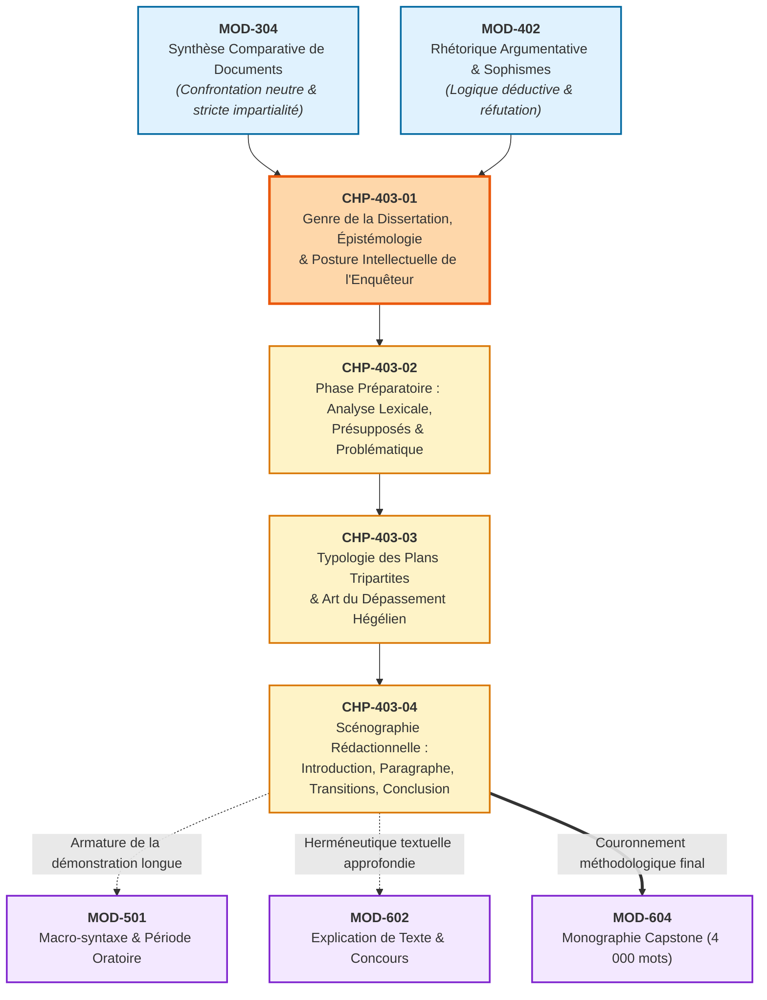

# Chapitre 1 — Le Genre de la Dissertation : Épistémologie, Histoire et Posture Intellectuelle de l'Enquêteur

> **Identifiant du chapitre** : `CHP-403-01`  
> **Module de rattachement** : [`MOD-403` — Méthodologie Universitaire de la Dissertation et de l'Essai Académique](file:///f:/Formation/world-class-french/03-curriculum/year-2/semester-4/mod-403-methodologie-dissertation-essai-academique.md)  
> **Semestre** : Année 2 — Semestre 4 (S4)  
> **Volume horaire canonique** : 5 à 6 heures d'apprentissage autonome délibéré et d'ateliers d'application (Phase 1 Étude : 1 h 30 | Phase 2 Pratique : 1 h 30 | Phase 3 Correction : 1 h 00 | Phase 4 Évaluation : 1 h 00)  
> **Statut** : [STATUT : VALIDÉ]  
> **Compétences associées** : [`FR-INT-001`](file:///f:/Formation/world-class-french/02-competency-framework/competency-framework.md#fr-int-001-rédiger-un-texte-long-cohérent-en-maîtrisant-accords-et-ponctuation) (L3 Autonomie), [`FR-ARGUM-001`](file:///f:/Formation/world-class-french/02-competency-framework/competency-framework.md#fr-argum-001-rigueur-démonstrative-réfutation-et-détection-des-sophismes) (L3 Autonomie), [`FR-STYLE-001`](file:///f:/Formation/world-class-french/02-competency-framework/competency-framework.md#fr-style-001-maîtrise-des-figures-de-rhétorique-et-commentaire-stylistique) (L3 Autonomie)  
> **Sources scientifiques de référence** : `SRC-RHET-03` (Reboul, 1991), `SRC-RHET-01` (Fontanier, 1821-1830/1977), `SRC-GRAM-02` (Riegel et al., 2016), `SRC-NORM-03` (Ministère de l'Éducation nationale, 2020), `SRC-TYPO-01` (Imprimerie nationale, 2002/2014)

---

## 1. Titre et Place dans le Cursus

### 1.1 Intitulé Officiel
**Chapitre 1 : Le Genre de la Dissertation : Épistémologie, Histoire et Posture Intellectuelle de l'Enquêteur** (`CHP-403-01`).

### 1.2 Insertion Architecturale dans le Cursus
Le chapitre inaugural du module `MOD-403` opère une rupture épistémologique majeure au sein du Cycle 2. Après avoir exercé la neutralité stricte du greffier dans la synthèse comparative de documents (`MOD-304`) et assimilé la rigueur formelle du syllogisme et la détection des paralogismes (`MOD-402`), l'apprenant aborde l'exercice souverain des concours académiques : la dissertation littéraire, philosophique et de culture générale.



- **En amont** :
  - `MOD-304` (Synthèse comparative de documents) a forgé l'aptitude à confronter objectivement des thèses hétérogènes sans complaisance ni bavardage, interdisant toute juxtaposition désordonnée.
  - `MOD-402` (Rhétorique argumentative) a doté le candidat des outils logiques (syllogisme, enthymème, concession méthodique, réfutation des sophismes) indispensables à l'armature de chaque sous-partie.
- **Au sein du module `MOD-403`** :
  - Ce premier chapitre pose le socle philosophique et déontologique de l'exercice : définir le contrat de vérité de la dissertation et installer l'éthos universitaire de l'enquêteur. Il commande directement le déminage des sujets (`CHP-403-02`), la construction du plan dialectique (`CHP-403-03`) et l'écriture scénographiée des paragraphes (`CHP-403-04`).
- **En aval** :
  - Il prépare le déploiement stylistique de la période oratoire (`MOD-501`), l'analyse des figures de pensée (`MOD-502`), l'herméneutique de haut niveau (`MOD-602`) et constitue le garant méthodologique direct de la Monographie Capstone de fin d'études (`MOD-604`).

### 1.3 Justification du Calibrage Horaire (5 à 6 Heures)
Conformément aux normes du cursus, le travail autonome est articulé en quatre phases rigoureusement minutées :
- **Phase 1 — Étude conceptuelle et fondements épistémologiques (1 h 30)** : Maîtrise des rubriques 1 à 13 (histoire républicaine, clivage générique, posture de l'enquêteur, typologie des sujets et clinique des erreurs de posture).
- **Phase 2 — Pratique délibérée et discrimination critique (1 h 30)** : Résolution autonome des 3 niveaux d'exercices progressifs (rubrique 14 : typologie de 12 sujets de concours, redressement de 8 postures subjectives, cadrage métrique de 50 mots).
- **Phase 3 — Correction critique et production normée (1 h 00)** : Audit raisonné d'une copie sanctionnée de 8 fautes de méthode (rubrique 15) et composition du manifeste de l'enquêteur en 60 mots exacts (rubrique 16).
- **Phase 4 — Ancrage mnésique et évaluation sommative (1 h 00)** : Mémorisation active sans indices (rubrique 18) et passation de l'épreuve sommative chronométrée de 30 minutes notée sur 20 points (rubrique 19).

---

## 2. Objectifs Mesurables

Au terme de ce chapitre, l'apprenant doit être capable de :

1. **Distinguer formellement les trois grands genres académiques écrits** : différencier la dissertation académique, la synthèse comparative de documents (`MOD-304`) et le commentaire composé littéraire en identifiant leurs régimes de vérité respectifs, leurs contrats de lecture et le statut accordé à la subjectivité et aux exemples culturels.
2. **Neutraliser systématiquement l'intrusion du « moi » narcissique** : repérer dans un texte discursif toute manifestation de subjectivisme naïf (*« selon moi »*, *« à mon avis »*, *« je pense que »*, jugements de valeur affectifs) et lui substituer l'éthos rationnel universitaire fondé sur le « nous » de délibération collective ou les tournures assertives impersonnelles de la tradition française.
3. **Catégoriser avec certitude la typologie des sujets de concours** : identifier en moins de cinq minutes la structure logique d'un énoncé d'examen (sujet sur citation d'auteur, question ouverte ou alternative, sujet nominal ou notionnel) et en expliciter la demande épistémologique sous-jacente [Réf. `SRC-RHET-03`, chap. 3].
4. **Adopter la posture intellectuelle de l'enquêteur de la raison** : problématiser un énoncé en refusant d'emblée la récitation dogmatique du cours, l'adhésion idolâtre à l'auteur cité et le relativisme d'opinion (*« à chacun sa vérité »*), afin de poser une antinomie féconde instruite à charge et à décharge.

---

## 3. Prérequis et Test de Préparation (Auto-Diagnostic)

### 3.1 Prérequis Cognitifs
- **Discipline de la neutralité argumentative** : savoir exposer la pensée d'un auteur tiers sans la déformer ni la juger anachroniquement [acquis en `MOD-304`].
- **Maniement de la logique formelle** : maîtriser la structure prémisse-inférence-conclusion et savoir détecter un paralogisme d'autorité ou un faux dilemme [acquis en `MOD-402`].
- **Syntaxe de la phrase complexe** : manier couramment la subordination circonstancielle d'opposition, de concession et d'hypothèse sans anacoluthe [acquis en `MOD-301` et `MOD-302`].

### 3.2 Test de Préparation Immédiat
Répondez aux cinq questions suivantes avant d'engager la lecture du cours, puis dépliez le volet de correction pour évaluer votre acuité méthodologique.

1. Pourquoi la phrase d'introduction suivante est-elle rédhibitoire dans une dissertation universitaire : *« À mon humble avis, Baudelaire a parfaitement raison lorsqu'il affirme que le progrès a atrophié en nous la part spirituelle »* ?
2. Quelle distinction fondamentale sépare l'exploitation d'une référence textuelle dans une synthèse de documents (`MOD-304`) et dans une dissertation académique (`MOD-403`) ?
3. Face au sujet : *« L'art doit-il chercher à plaire ou à instruire ? »*, quel vice méthodologique commet le candidat qui annonce : *« Nous verrons en I que l'art instruit, en II que l'art plaît, et en III que cela dépend des préférences subjectives du spectateur »* ?
4. Dans l'épistémologie de la dissertation, que désigne précisément le terme *antinomie* hérité de la tradition critique ?
5. Pour quelle raison historique l'Université républicaine française a-t-elle progressivement substitué la dissertation en langue française au discours latin et à l'exercice d'éloquence monarchique au tournant des années 1880 ?

---

<details>
<summary><b>Consulter le corrigé de l'auto-diagnostic</b></summary>

1. Cette phrase cumule trois fautes d'éthos fatales : (a) une intrusion indue de la première personne du singulier (*« à mon humble avis »*), bannie de l'écriture académique ; (b) une fausse modestie rhétorique qui masque en réalité un décret sans preuve ; (c) une approbation dogmatique et idolâtre (*« a parfaitement raison »*) qui détruit d'emblée toute problématisation en transformant la citation en vérité révélée au lieu de la traiter comme une hypothèse à instruire.
2. Dans la synthèse de documents (`MOD-304`), la référence est obligatoirement extraite du corpus imposé et traitée avec une neutralité documentaire absolue, sans ajout personnel. Dans la dissertation (`MOD-403`), la référence est librement et souverainement convoquée par le candidat depuis son propre bagage de culture littéraire et philosophique, et elle n'est pas simplement mentionnée : elle est déconstruite au microscope comme une preuve textuelle au service d'une démonstration rationnelle.
3. Le candidat commet deux vices majeurs : premièrement, il réduit une tension dialectique profonde à une juxtaposition scolaire binaire ; deuxièmement, sa troisième partie constitue un « compromis mou » (ou synthèse tiède relativiste) qui abdique toute exigence philosophique en affirmant que *« tout le monde a raison selon son point de vue »*, au lieu de déplacer le problème vers un concept supérieur unificateur (ex. la catharsis aristotélicienne où plaire est le vecteur même de l'instruction morale).
4. Une *antinomie* (au sens kantien réinvesti par la rhétorique académique) désigne une contradiction apparente entre deux thèses ou propositions qui apparaissent chacune également démontrables en raison. La dissertation a précisément pour mission d'élucider cette contradiction pour la résoudre par un changement d'échelle conceptuelle.
5. L'Université républicaine (sous l'impulsion de Jules Ferry, Louis Liard et Gustave Lanson) a remplacé le discours latin d'apparat — perçu comme un exercice aristocratique de pure forme et d'imitation servile des Anciens — par la dissertation en français afin de former des citoyens lucides, dotés d'un esprit critique autonome, capables d'analyser un problème d'idées avec la rigueur de la méthode scientifique cartésienne.

</details>

---

## 4. Situation de Départ ou Problème Concret : Le Traumatisme de la Dissertation

### 4.1 La Copie Sanctionnée d'un 06/20
Chaque année, aux concours de l'École Normale Supérieure (ENS), des Grandes Écoles et aux examens de Licence de Lettres et de Philosophie, des candidats laborieux, dotés d'une mémoire remarquable, vivent une expérience déroutante. Ayant appris scrupuleusement leurs manuels, ils rédigent huit pages denses sur un sujet d'esthétique ou de morale, avant de découvrir une note sanctionnée d'un 06/20, assortie du verdict laconique du jury :  
*« Bavardage informe. Absence totale de problématique. Récitation plaquée de fiches de cours. Égocentrisme déplacé. Hors-sujet presque complet. »*

L'étudiant en conçoit souvent un sentiment d'injustice ou d'arbitraire : comment un devoir contenant tant d'informations érudites peut-il être jugé indigne du niveau universitaire ?

### 4.2 Les Trois Pathologies Fondamentales du Candidat Naïf

```text
┌─────────────────────────────────────────────────────────────────────────────┐
│                 LES TROIS PATHOLOGIES DU RAPPORT À LA DISSERTATION          │
├─────────────────────────────────────────────────────────────────────────────┤
│ 1. Le Placage Dogmatique (L'Illusion Encyclopédique) :                      │
│    L'étudiant voit dans le sujet un simple mot-clé déclencheur (« le roman »,│
│    « la liberté », « la poésie »). Il cesse immédiatement de penser et se   │
│    hâte de déverser tout ce qu'il sait sur le thème. Le devoir n'instruit   │
│    aucun problème : il empile des fiches sans lien avec l'aporie posée.     │
├─────────────────────────────────────────────────────────────────────────────┤
│ 2. L'Épanchement Émotionnel (L'Égocentrisme du « Moi ») :                   │
│    L'étudiant confond la dissertation avec une tribune d'expression libre.  │
│    Il use et abuse de la première personne, multiplie les confidences sur   │
│    ses goûts intimes (« ce poème m'a profondément bouleversé ») et érige son│
│    sentiment empirique en critère d'évaluation universel.                    │
├─────────────────────────────────────────────────────────────────────────────┤
│ 3. Le Délit de Récit (La Dérive Paraphrastique) :                           │
│    Incapable de manipuler des concepts abstraits, l'étudiant transforme     │
│    chaque référence littéraire en résumé narratif de l'intrigue. Au lieu de │
│    démontrer en quoi l'écriture de Flaubert subvertit le réalisme, il       │
│    raconte par le menu la liaison d'Emma Bovary avec Rodolphe.              │
└─────────────────────────────────────────────────────────────────────────────┘
```

Ces errements découlent d'un unique contresens initial : croire que la dissertation est un exercice de mémoire ou une conversation de salon. Elle est en réalité **une enquête rationnelle contraignante**, soumise à une méthodologie probatoire stricte où chaque phrase doit servir à dénouer une difficulté théorique [Réf. `SRC-RHET-03`, chap. 3].

---

## 5. Explication Intuitive : L'Instruction Judiciaire et le Laboratoire Philosophique

Pour appréhender la nature profonde de la dissertation, deux analogies fondamentales permettent de rompre avec l'illusion scolaire.

```text
               ANALOGIE DE L'ENQUÊTE DISSERTATIVE
               
        ┌───────────────────────────────────────────────┐
        │            LE SUJET DE CONCOURS               │
        │    (Une énigme, un paradoxe, un scandale)     │
        └───────────────────────┬───────────────────────┘
                                │
                                ▼
        ┌───────────────────────────────────────────────┐
        │          LE DISSERTATEUR-ENQUÊTEUR            │
        │      (Ni procureur haineux, ni avocat servile)│
        │       -> Magistrat instructeur de la raison   │
        └───────┬───────────────────────────────┬───────┘
                │                               │
                ▼                               ▼
       [ À CHARGE : Thèse I ]          [ À DÉCHARGE : Thèse II ]
        Audition des témoins            Contre-expertise des pièces
        Concepts & Textes A             Objections & Textes B
                │                               │
                └───────────────┬───────────────┘
                                │
                                ▼
        ┌───────────────────────────────────────────────┐
        │           LE VERDICT : DÉPASSEMENT            │
        │       (Partie III : Relève conceptuelle)      │
        │   Élévation de la question vers une vérité    │
        │       plus haute qui résout l'antinomie       │
        └───────────────────────────────────────────────┘
```

### 5.1 L'Instruction Judiciaire : Le Magistrat de la Raison
Dans une procédure pénale équitable, lorsqu'un crime ou un litige complexe survient, le magistrat instructeur n'arrive pas avec une sentence préfabriquée.
- Il n'est pas le **procureur** qui cherche à condamner l'accusé à tout prix dès l'introduction.
- Il n'est pas l'**avocat de la défense** qui tresse des couronnes de lauriers et trouve des excuses sentimentales à son client.
- Il est le **juge d'instruction** : son mandat impératif est d'enquêter **à charge et à décharge**.

Face à une citation de concours — par exemple la formule provocatrice de Paul Valéry : *« L'enthousiasme n'est pas un état d'écrivain »* —, le candidat n'a pas à s'écrier avec indignation que Valéry a tort, ni à s'agenouiller en proclamant qu'il a raison. Il saisit l'énoncé comme une pièce à conviction problématique. Il convoque les témoins (les poètes romantiques de l'inspiration divine vs les artisans rigoureux de la forme), pèse la matérialité de leurs textes, instruit méthodiquement les arguments opposés, puis prononce un jugement circonstancié fondé exclusivement sur la preuve et la logique.

### 5.2 Le Laboratoire de Chimie Philosophique : La Dissociation des Amalgames
Une citation d'auteur ressemble à un corps composé brut apporté par la nature : elle contient de l'or, mais mélangé à du soufre, de la terre et des impuretés doxiques.
Le travail du dissertateur est celui du chimiste :
1. Il introduit la citation dans l'éprouvette de l'analyse lexicale.
2. Il applique le réactif du doute méthodique pour dissocier les sens cachés des mots.
3. Il constate que le mot « illusion » ne signifie pas simplement « mensonge », ou que le mot « beauté » n'est pas réductible à « l'agréable ».
4. En séparant les composants élémentaires du problème, il fait jaillir une réaction inattendue : ce qui semblait une contradiction insoluble devient la source d'une vérité conceptuelle supérieure.

---

## 6. Définitions Précises et Terminologie Fondamentale

Chaque notion de ce répertoire définit les bornes scientifiques de l'exercice académique.

### 6.1 Dissertation Académique
> **Définition** : Exercice discursif écrit de tradition universitaire française consistant à conduire une enquête rationnelle, progressive et dialectique sur un problème intellectuel dissimulé sous une question ou une citation, en mobilisant une culture littéraire ou philosophique personnelle rigoureusement analysée, ordonnée selon une architecture tripartite contraignante [Réf. `SRC-RHET-03`, chap. 3 & 4 ; `SRC-GRAM-02`, chap. 21].

### 6.2 Essai Critique
> **Définition** : Forme de prose d'idées libre, historiquement inaugurée par Montaigne, où l'auteur sonde à la première personne une notion ou un phénomène moral, politique ou esthétique, sans s'astreindre à l'armature académique tripartite, mais en préservant une exigence constante de lucidité et d'étayage rationnel.

### 6.3 Commentaire Composé / Explication Littéraire
> **Définition** : Exercice d'herméneutique textuelle close et immanente, ayant pour objet d'éclairer le sens, la portée et la facture stylistique d'un extrait d'œuvre délimité, en démontrant pas à pas comment le travail formel du langage (syntaxe, figures, prosodie) engendre la signification, sans jamais convoquer d'hypothèses extérieures qui ne soient justifiées par la lettre du texte.

### 6.4 Synthèse de Documents
> **Définition** : Épreuve académique d'impartialité absolue (`MOD-304`) astreignant le scripteur à confronter objectivement les idées d'un dossier de textes hétérogènes selon un plan thématique ordonné, avec interdiction intégrale de manifester une opinion personnelle, d'introduire des exemples extérieurs ou d'adopter une posture d'arbitre [Réf. `SRC-NORM-03`].

### 6.5 Posture de l'Enquêteur
> **Définition** : Disposition épistémologique et énonciative du dissertateur qui aborde le sujet non comme une vérité à réciter ou une opinion à défendre, mais comme un problème controversé à instruire méthodiquement par la confrontation de thèses et de preuves rationnelles.

### 6.6 Éthos Rationnel
> **Définition** : Image intellectuelle et morale que le scripteur construit de lui-même à travers son texte (sobriété, rigueur démonstrative, mesure dans l'affirmation, respect scrupuleux de l'adversaire logique), subordonnant l'expression individuelle à l'autorité souveraine de la raison universelle [Réf. `SRC-RHET-03`, chap. 3].

### 6.7 Problématisation
> **Définition** : Geste intellectuel fondateur consistant à interroger les présupposés d'un énoncé pour en extraire la tension dialectique, le paradoxe ou le conflit de valeurs qui empêche toute réponse immédiate par « oui » ou par « non ».

### 6.8 Dialectique
> **Définition** : Art de délibérer par la confrontation de propositions opposées (thèse et antithèse) dont la contradiction dynamique est résolue et sublimée dans une proposition de rang conceptuel supérieur (*Aufhebung* ou dépassement) [Réf. `SRC-RHET-03`, chap. 4].

### 6.9 Délibération
> **Définition** : Processus de pesée réflexive et méthodique des arguments favorables et défavorables à une thèse, mené sous la conduite de l'esprit critique avant d'arrêter un jugement motivé.

### 6.10 Antinomie
> **Définition** : Conflit de la raison avec elle-même, caractérisé par l'existence de deux thèses contradictoires qui s'avèrent, chacune à son niveau d'analyse, logiquement défendables et historiquement attestées.

### 6.11 Jugement Critique Impersonnel
> **Définition** : Conclusion intellectuelle motivée, déduite exclusivement de l'examen probatoire des arguments et des œuvres, formulée dans une langue académique affranchie des contingences psychologiques ou affectives du scripteur.

---

## 7. Règles ou Mécanismes Fondamentaux

### 7.1 Histoire et Genèse Républicaine de la Dissertation

La dissertation n'est pas une forme immuable née avec la langue française : elle est le produit d'une longue évolution institutionnelle et politique.

```text
ÉVOLUTION HISTORIQUE DU GENRE DISCURSIF ACADÉMIQUE
┌─────────────────────────────────┐
│     ANCIEN RÉGIME & JÉSUITES    │ -> Éloquence latine, amplification oratoire,
│         (XVIe - XVIIIe s.)      │    chambre d'écho de la rhétorique cicéronienne.
└────────────────┬────────────────┘
                 │
                 ▼
┌─────────────────────────────────┐
│      LE XIXe SIÈCLE TRANSITOIRE │ -> Premiers concours nationaux (Baccalauréat 1808).
│         (1800 - 1880)           │    Passage progressif du latin au français (1881).
└────────────────┬────────────────┘
                 │
                 ▼
┌─────────────────────────────────┐
│   L'UNIVERSITÉ RÉPUBLICAINE     │ -> Réforme Ferry-Liard-Lanson : mort de la rhétorique
│         (1880 - 1914)           │    d'apparat, triomphe de la méthode critique,
└─────────────────────────────────┘    avènement de la dissertation moderne.
```

- **Du discours latin à l'examen de raison** : Sous l'Ancien Régime et jusqu'au milieu du XIXe siècle, les collèges enseignaient avant tout le *discours latin*, exercice oratoire où l'élève imitait les grands modèles de l'Antiquité (Cicéron, Tite-Live) pour prononcer un éloge, une harangue ou un réquisitoire fictif. L'exercice visait l'art d'orner une vérité déjà établie par l'Église ou le Roi [Réf. `SRC-RHET-03`, chap. 3].
- **La rupture laïque et républicaine de 1880** : Avec les lois scolaires de la IIIe République et la réforme de l'agrégation et du baccalauréat, l'Université opère une révolution épistémologique. Sous l'influence de philosophes et d'historiens comme Louis Liard et Gustave Lanson, le décret de 1881 supprime l'épreuve de discours latin pour instaurer définitivement la **dissertation en langue française**.
- **La fonction civique et épistémologique du genre** : Pour la République démocratique, le but de l'enseignement des humanités n'est plus de dresser de brillants orateurs courtisans capables de flatter un maître, mais d'**éduquer des esprits libres, critiques et méthodiques**. La dissertation devient l'instrument par excellence de cette émancipation :
  - Elle contraint l'individu à suspendre son adhésion immédiate aux préjugés du groupe ;
  - Elle lui apprend à écouter et peser les arguments adverses avant de trancher ;
  - Elle subordonne la passion au jugement réfléchi, formant l'éthos du haut fonctionnaire, de l'enseignant et du magistrat républicain.

### 7.2 Le Grand Clivage Générique Tripartite

Pour disserter avec rigueur, il est indispensable de maîtriser la frontière étanche qui sépare les trois grands exercices académiques :

| Critères d'analyse | Synthèse de documents (`MOD-304`) | Commentaire littéraire composé | Dissertation académique (`MOD-403`) |
| :--- | :--- | :--- | :--- |
| **Objet d'étude** | Un dossier imposé de 3 à 5 documents hétérogènes. | Un extrait littéraire unique (30 à 50 lignes ou poème). | Un sujet abstrait : citation d'auteur, question ou notion. |
| **Périmètre du corpus** | **Vase clos absolu** : interdiction de sortir du corpus documentaire. | **Microscope textuel** : immanence stricte de la lettre du texte. | **Culture générale ouverte** : convocation souveraine d'œuvres du patrimoine universel. |
| **Statut de l'exemple** | Élément textuel relevé chez autrui et synthétisé. | Objet central analysé (effets de style, syntaxe, rythme). | **Preuve conceptuelle** déconstruite au microscope pour appuyer une thèse. |
| **Rôle du scripteur** | **Greffier neutre** : confrontation objective de thèses d'autrui. | **Herméneute savant** : décodage du sens produit par les formes. | **Enquêteur dialectique** : bâtisseur d'une démonstration intellectuelle personnelle. |
| **Plan canonique** | Plan thématique ou confrontatif ordonné (2 ou 3 parties). | Plan analytique ou sémiotique (2 ou 3 axes d'interprétation). | **Plan dialectique ou thématique tripartite** (3 parties, 9 sous-parties). |

### 7.3 La Posture Énonciative et l'Éthos Universitaire

La tenue stylistique et énonciative constitue le filtre d'admissibilité premier dans les concours académiques de haut niveau [Réf. `SRC-GRAM-02`, chap. 19 ; `SRC-NORM-03`].

#### 1. La Proscription Absolue du « Moi » Narcissique
Dans la tradition académique francophone, l'irruption du pronom de première personne du singulier (*« je »*, *« me »*, *« moi »*) ou des formules d'opinion subjective (*« à mon sens »*, *« pour ma part »*, *« personnellement »*) est rigoureusement bannie.
- **Raison fondamentale** : En matière d'esthétique littéraire ou de philosophie, ce que ressent ou croit Monsieur Untel en son for intérieur ne possède aucune valeur de preuve universelle. La dissertation cherche ce qui est justifiable en raison, non ce qui est vécu dans l'intimité d'une conscience singulière.
- **Les formules proscrites** :
  - *« Je pense que l'art est inutile... »* $\rightarrow$ **Fautif**.
  - *« Selon moi, cette œuvre est un chef-d'œuvre absolu... »* $\rightarrow$ **Fautif**.
  - *« J'adore Victor Hugo car il me touche beaucoup... »* $\rightarrow$ **Rédhibitoire**.

#### 2. L'Effacement Énonciatif au Profit du « Nous » Délibératif et des Tournures Impersonnelles
Le scripteur universitaire n'impose pas une autorité autoritaire : il invite son lecteur à une délibération conjointe. Deux régimes énonciatifs sont admis et valorisés :
- **Le « nous » de délibération intellectuelle** : Le scripteur s'associe à la communauté universelle des esprits raisonnables qui examinent ensemble le problème :
  *« Dès lors, nous sommes conduits à nous demander si... »* ; *« Nous examinerons en premier lieu comment... »*.
- **Les tournures assertives impersonnelles et la diathèse passive** : Elles confèrent au discours une force de vérité objective et dépersonnalisée [Réf. `SRC-GRAM-02`, chap. 19] :
  - *« Il apparaît légitime de s'interroger sur... »*
  - *« Force est de constater que... »*
  - *« On ne saurait occulter le fait que... »*
  - *« Il convient d'observer comment... »*

### 7.4 Typologie des Sujets de Concours

Les sujets de dissertation se répartissent en trois catégories formelles régies par des attentes discursives distinctes [Réf. `SRC-RHET-03`, chap. 3] :

#### 1. Le Sujet sur Citation d'Auteur
- **Structure** : Une ou deux phrases attribuées à un écrivain, un artiste ou un philosophe, contenant une affirmation catégorique, un paradoxe esthétique ou un jugement polémique, suivie d'une consigne standard (*« Vous discuterez ce jugement... »* ; *« Dans quelle mesure partagez-vous cette opinion ? »*).
- **Enjeu didactique** : Ne jamais considérer la citation comme un oracle sacré. Il s'agit de repérer ce que l'auteur privilégie, ce qu'il passe volontairement sous silence, et quel paradoxe intellectuel il impose au lecteur.
- **Exemple canonique** : *« Un chef-d'œuvre littéraire est toujours une victoire sur l'obscurité du monde »* (Consigne : commentez et discutez).

#### 2. Le Sujet sous Forme de Question Ouverte ou Alternative
- **Structure** : Une interrogation directe portant sur la finalité, l'essence ou la légitimité d'une pratique (*« Pourquoi écrit-on ? »*, *« La poésie a-t-elle pour fin de consoler les hommes ? »*, *« Le théâtre doit-il instruire ou plaire ? »*).
- **Enjeu didactique** : Se garder du réflexe binaire naïf. Le piège de la question alternative (*« plaire ou instruire »*) est de croire qu'il faut choisir un camp contre l'autre. Le rôle du candidat est de prouver que la disjonction apparente dissimule une relation de conditionnalité réciproque.

#### 3. Le Sujet Nominal ou Notionnel
- **Structure** : L'énoncé se résume à un mot ou à un syntagme nominal lapidaire, sans verbe ni consigne explicite (*« L'oubli »*, *« Le style »*, *« L'argent en littérature »*, *« La vérité »*).
- **Enjeu didactique** : C'est la forme la plus redoutée des concours de l'ENS ou de l'Agrégation. N'ayant aucune question préétablie à laquelle s'accrocher, le candidat doit construire de toutes pièces le problème, en interrogeant la polysémie du terme, ses contradictions internes et son champ d'application historique et philosophique.

---

## 8. Raisonnement Détaillé : Pourquoi la Dissertation Reste l'Épreuve Reine

L'hégémonie de la dissertation dans la sélection des élites universitaires françaises depuis plus d'un siècle ne relève pas d'une routine conservatrice. Elle s'explique par sa nature de **test d'aptitude cognitif global**. Aucune autre épreuve écrite ne mobilise simultanément autant de facultés intellectuelles supérieures :

```text
              L'ÉCHELLE DES EXIGENCES SIMULTANÉES DE LA DISSERTATION
┌─────────────────────────────────────────────────────────────────────────────┐
│ 1. RIGUEUR LOGIQUE ET DIALECTIQUE                                           │
│    -> Penser contre soi-même, déjouer les faux dilemmes, ordonner 9 sous-   │
│       parties selon une progression cumulative irréprochable.               │
├─────────────────────────────────────────────────────────────────────────────┤
│ 2. CULTURE GÉNÉRALE ACTIVE ET SAVOIR INCORPORÉ                              │
│    -> Convoquer sans notes ni documents des œuvres patrimoniales et les     │
│       déconstruire au microscope sans tomber dans l'allusion vague.         │
├─────────────────────────────────────────────────────────────────────────────┤
│ 3. PRÉCISION SÉMANTIQUE ET ABSTRACTION LEXICALE                             │
│    -> Manier le vocabulaire technique des concepts sans impropriété, refuser│
│       les termes flous (chose, aspect, problème) au profit de termes d'idées│
├─────────────────────────────────────────────────────────────────────────────┤
│ 4. HAUTE TENUE STYLISTIQUE ET RESPIRATION RHÉTORIQUE                        │
│    -> Équilibrer les périodes, soigner le maillage des connecteurs logiques, │
│       produire une langue élégante, dense, exempte de scories grammaticales.│
└─────────────────────────────────────────────────────────────────────────────┘
```

La dissertation est l'école vivante de l'esprit de nuance. Dans une société traversée par la précipitation de l'opinion immédiate et la violence des polarisations binaires, la dissertation apprend que toute affirmation recèle sa propre limite, et que la vérité ne se conquiert que dans l'épreuve patiente de la contradiction surmontée.

---

## 9. Exemples Corrects Commentés : Décorticage d'Entrées en Matière

Pour saisir concrètement la fracture qui sépare la démarche empirique fautive de la démarche d'enquêteur académique, étudions deux traitements d'introduction sur un sujet classique des concours de l'ENS.

> **SUJET OFFICIEL DE CONCOURS** :  
> *« La poésie ne doit pas seulement être comprise, elle doit être éprouvée. »*  
> Vous discuterez ce propos en vous appuyant sur des œuvres poétiques de votre connaissance.

---

### Démarche A : L'Entrée Empirique Fautive (Copie Sanctionnée : 05/20)

> *« De tout temps, les hommes ont écrit des poèmes pour exprimer leurs sentiments les plus intimes et leurs peines d'amour. À mon avis, l'auteur de cette citation a parfaitement raison car lorsque je lis les recueils de Baudelaire ou de Ronsard au lycée, je ressens de très fortes émotions qui me bouleversent complètement. Mais parfois la poésie est très difficile et hermétique, donc on ne la comprend pas du tout et c'est très énervant pour le lecteur. Nous verrons donc dans une première partie que la poésie doit être éprouvée, puis dans une deuxième partie qu'elle doit être comprise, et enfin dans une troisième partie qu'elle fait les deux en même temps. »* `[114 mots]`

#### Autopsie des Erreurs et Scories :
1. **Accroche cliché et universelle** : *« De tout temps, les hommes ont... »* : formule creuse bannie d'office aux examens universitaires.
2. **Intrusions narcissiques réitérées** : *« À mon avis »*, *« lorsque je lis »*, *« je ressens »*, *« me bouleversent »* : la copie s'érige en journal intime sans distance critique.
3. **Approbation idolâtre sans preuve** : *« l'auteur a parfaitement raison »* : absence totale de problématisation.
4. **Relâchement du lexique et du registre** : *« c'est très énervant »*, *« les poèmes du lycée »* : faillite de la tenue académique.
5. **Annonce de plan scolaire et mécanique** : *« Nous verrons donc dans une première partie... »* suivi d'un compromis mou en Partie III (*« elle fait les deux en même temps »*).

---

### Démarche B : L'Entrée Académique de l'Enquêteur (Copie d'Excellence : 18/20)

> *« Si la tradition poétique classique s'est longtemps définie comme un art du discours soumis aux règles géométriques de la clarté et de l'harmonie conceptuelle, la modernité littéraire a déplacé le foyer de la parole vers le vertige sensoriel et la résonance physiologique des corps. C'est cette tension fondamentale qu'interroge le jugement affirmant que la poésie « ne doit pas seulement être comprise », mais qu'elle « doit être éprouvée ». En formulant cette exigence de saisie affective et corporelle, l'énoncé récuse un intellectualisme aride qui réduirait le poème à une énigme logique soluble par le seul entendement. Toutefois, dissocier l'épreuve sensible de la compréhension rationnelle ne risque-t-il pas de dissoudre le travail du texte dans l'arbitraire d'un pur choc émotionnel informe ? Dès lors, la poésie tire-t-elle sa puissance singulière d'un bouleversement sensible affranchi des exigences de la raison, ou accomplit-elle sa vérité dans une intelligence seconde où l'émotion physique devient le vecteur même d'un dévoilement métaphysique du monde ? Nous examinerons d'abord en quoi l'expérience poétique se fonde sur une saisie sensorielle et musicale rebelle à la seule analyse intellectuelle, avant de démontrer que la rigueur formelle et herméneutique demeure la condition indispensable de son intelligibilité, pour établir enfin que la grandeur du poème réside dans une transfiguration esthétique où le sens s'incarne indivisiblement dans la chair du verbe. »* `[218 mots]`

#### Commentaire Critique des Procédés de Haute Tenue :
1. **Accroche ciblée et historique** : Part de l'opposition esthétique réelle entre l'intellectualisme classique et le sensualisme moderne, sans cliché temporel.
2. **Intégration fluide de la citation** : Le sujet est cité mot à mot entre guillemets, articulé organiquement à la syntaxe de la phrase.
3. **Mise au jour de l'antinomie** : Opposition conceptuelle tranchée entre la « saisie affective et corporelle » et l'« entendement rationnel ».
4. **Problématique formulée sous tension** : L'interrogation centrale refuse la simplification et oppose deux visions ontologiques de la littérature.
5. **Annonce de plan ample et périodique** : Le plan tripartite est amené par des cadences coordonnées (*« d'abord en quoi... avant de démontrer que... pour établir enfin que... »*), sans formule mécanique d'écolier.
6. **Éthos universitaire irréprochable** : Absence totale du « je » ; usage souverain du « nous » de délibération collective.

---

## 10. Contre-Exemples et Erreurs Fréquentes : Clinique des Six Vices de Posture

Pour vous prémunir contre les fautes éliminatoires, voici l'inventaire clinique des six défaillances récurrentes constatées dans les copies universitaires.

### Erreur n° 1 : La Récitation Dogmatique du Cours et le Plaquage Thématique
- **Manifestation clinique** : Sur un sujet interrogeant le rapport entre *tragédie et destin*, le candidat récite intégralement l'histoire du théâtre d'Athènes au XVIIe siècle, en recopiant des pages entières de notes d'histoire littéraire sans jamais relier ces faits au problème posé.
- **Diagnostic critique** : C'est l'erreur du « candidat perroquet ». Le jury sanctionne impitoyablement ce refus de penser : une dissertation n'évalue pas un stock d'informations mortes, mais une aptitude vivante à mobiliser le savoir au service exclusif d'un raisonnement [Réf. `SRC-RHET-03`, chap. 3].
- **Réparation normée** : Chaque fait littéraire ou historique cité doit être immédiatement subordonné à un argument abstrait et analysé sous l'angle exact de l'aporie traitée.

### Erreur n° 2 : L'Étalage d'Anecdotes Personnelles et l'Égocentrisme du « Moi »
- **Manifestation clinique** : *« Cette pièce m'a fait penser à ce que j'ai vécu lors de mon voyage à Dakar avec ma famille l'an dernier... »*
- **Diagnostic critique** : Rupture intégrale du contrat épistémologique. L'anecdote personnelle relève du journal intime ou du bavardage ; elle ne possède aucune représentativité philosophique ni textuelle vérifiable par le correcteur.
- **Réparation normée** : Proscription définitive de toute référence à son existence privée. Les seuls exemples recevables sont des œuvres textuelles, picturales, musicales, des événements historiques documentés ou des concepts philosophiques avérés.

### Erreur n° 3 : La Confusion entre Disserter et Résumer l'Intrigue d'une Œuvre
- **Manifestation clinique** : Pour illustrer la vengeance au théâtre, le candidat consacre deux pages à raconter toute la trame d'*Hamlet*, scène après scène : la rencontre du fantôme, le départ pour l'Angleterre, le duel final.
- **Diagnostic critique** : C'est le « délit d'illustration narrative ». Le correcteur connaît déjà l'intrigue d'*Hamlet* ; ce qu'il évalue, c'est la capacité du candidat à extraire la signification politique, morale ou esthétique du dispositif dramatique de Shakespeare.
- **Réparation normée** : Bannir le récit chronologique. Isoler un procédé formel précis (le monologue intérieur, le théâtre dans le théâtre, le différé de l'action) et démontrer en 4 lignes en quoi ce procédé valide l'argument théorique défendu.

### Erreur n° 4 : Le Dithyrambe Idolâtre envers l'Auteur Cité ou le Texte
- **Manifestation clinique** : *« L'illustre et génial Victor Hugo, phare immortel de la pensée humaine qui ne saurait jamais se tromper, proclame avec une vérité indiscutable que... »*
- **Diagnostic critique** : C'est l'idolâtrie de la doxa. En sanctifiant l'auteur, l'étudiant détruit le principe même de l'enquête dialectique. Aux yeux de la raison, aucun écrivain n'est infaillible, et chaque formule esthétique porte ses angles morts et ses contradictions historiques.
- **Réparation normée** : Adopter un ton mesuré, distancié et courtois. Traiter les affirmations des plus grands écrivains comme des hypothèses de travail respectables mais révocables en doute par la critique.

### Erreur n° 5 : La Polémique Agressive et le Ton Sentencieux ou Méprisant
- **Manifestation clinique** : *« Cette citation est une absurdité totale qui prouve l'étroitesse d'esprit de son auteur et son mépris réactionnaire du peuple. »*
- **Diagnostic critique** : Faute déontologique majeure (`FR-ARGUM-001`). Remplacer l'argumentation rationnelle par l'invective morale ou le mépris disqualifie instantanément la copie. L'Université exige la civilité du débat intellectuel [Réf. `SRC-RHET-03`, chap. 2].
- **Réparation normée** : Concéder toujours ce que la thèse adverse a de plus fort avant d'en dévoiler avec courtoisie les limites logiques : *« Si cette affirmation traduit une exigence légitime de..., elle paraît toutefois sous-estimer la capacité de... »*.

### Erreur n° 6 : Le Travestissement du Sujet par Dérive Associative
- **Manifestation clinique** : Face à un sujet portant sur *l'ironie voltairienne dans le conte philosophique*, le candidat, ayant mal révisé Voltaire mais très bien révisé Rousseau, glisse subrepticement vers un exposé complet sur *Les Confessions* et l'autobiographie.
- **Diagnostic critique** : C'est le « hors-sujet par dérivation ». Le jury y voit une manœuvre frauduleuse d'évitement intellectuel : le candidat a répondu à la question qu'il aurait aimé avoir, et non à la question qui lui a été posée.
- **Réparation normée** : Pratiquer l'autopsie sémantique intégrale de tous les termes du sujet (sans en omettre un seul) et maintenir une vigilance de fer sur le lien direct entre chaque paragraphe et l'aporie nodale.

---

## 11. Cas Particuliers et Limites

### 11.1 Dissertation en Philosophie vs Dissertation en Littérature
Bien que partageant la même armature logique, la dissertation obéit à deux régimes de preuve distincts selon la discipline académique :

```text
               RÉGIMES DE PREUVE DISSERTATIFS
┌─────────────────────────────────┐   ┌─────────────────────────────────┐
│   DISSERTATION EN PHILOSOPHIE   │   │   DISSERTATION EN LITTÉRATURE   │
├─────────────────────────────────┤   ├─────────────────────────────────┤
│ • Primat du concept pur         │   │ • Primat de la forme textuelle  │
│ • L'exemple est un tremplin     │   │ • L'exemple est une preuve      │
│   ou un simple test de validité │   │   singulière irremplaçable      │
│ • Analyse des systèmes logiques │   │ • Déconstruction stylistique    │
│   (Kant, Descartes, Hegel)      │   │   (lexique, mètre, procédés)    │
│ • But : résoudre une aporie     │   │ • But : comprendre comment la   │
│   sur la vérité, l'être, le bien│   │   forme fait exister une vision │
└─────────────────────────────────┘   └─────────────────────────────────┘
```

- **En philosophie** : L'exemple n'a pas de valeur probatoire autonome : il illustre une idée mais ne la fonde pas. Si vous analysez le concept de liberté chez Spinoza, raconter un souvenir ou une pièce de théâtre n'a de valeur que si l'analyse conceptuelle abstraite précède et domine l'illustration. L'argumentation repose sur la cohérence des notions.
- **En littérature** : L'œuvre n'est pas un prétexte abstrait : elle est **la chair même de la démonstration**. On ne peut disserter sur le roman ou la poésie sans citer des scènes, des vers, des procédés formels précis (rythme ternaire, hyperbate, focalisation interne). La validité de la thèse se vérifie dans l'analyse de la lettre du texte.

### 11.2 Sujets sur Programme Délimité vs Sujets de Culture Générale
- **Dissertations sur œuvres au programme (Concours d'Agrégation, CAPES, Khâgne Moderne)** : Le corpus est fermé (ex. 3 œuvres d'un auteur). L'exigence de précision philologique est absolue : le jury attend des références microscopiques aux chapitres, actes, scènes et variantes textuelles.
- **Dissertations de culture générale ou d'ordre général (ENS Ulm, ENA/INSP, HEC)** : Le candidat est libre de choisir ses références. L'exigence porte sur l'équilibre encyclopédique : interdiction d'emprunter tous ses exemples à un seul siècle ou un seul genre. Il convient de faire dialoguer harmonieusement les époques (Antiquité, classicisme, modernité) et les genres (poésie, théâtre, roman, philosophie, essai).

---

## 12. Approfondissement Adapté au Niveau : L'Institution de la Dissertation selon Michel Foucault

Dans ses cours au Collège de France et dans *Surveiller et punir* (1975), Michel Foucault a livré une radiographie magistrale des « technologies d'examen » dans les institutions modernes. Ses analyses permettent de jeter un regard lucide sur le dispositif même de la dissertation académique.

### 12.1 L'Examen comme Rituel de Véridiction et Normalisation du Sujet
Pour Foucault, l'examen universitaire n'est pas un simple contrôle neutre de connaissances : c'est un **dispositif de véridiction**, c'est-à-dire un rituel au sein duquel un individu est sommé de produire un discours de vérité conforme à certaines règles contraignantes pour être reconnu comme sujet légitime du savoir.
- Dans la dissertation républicaine, l'apprenant est soumis à un rituel d'objectivation : il doit faire taire sa singularité biologique et affective pour endosser le costume impersonnel de la raison universelle.
- L'institution le jauge à sa capacité d'intérioriser cette contrainte : n'est réputé « libre » et « autonome » que l'étudiant capable de s'astreindre souverainement au rituel de la démonstration dialectique.

### 12.2 L'Effacement du « Moi » comme Technologie Démocratique
Loin d'être une pure brimade répressive, cet assujettissement possède une dimension politique profondément égalitaire :
- En imposant la proscription du « moi » intime, l'école républicaine vise à neutraliser les capitaux d'origine, les origines sociales singulières et les affinités affectives qui faussent le jugement.
- Devant l'énoncé d'une dissertation, chaque candidat est renvoyé à la seule force de ses armes rationnelles. La parole académique institue un espace public délibératif commun où seul triomphe le meilleur argument, accessible en droit à toute conscience humaine douée de raison.

---

## 13. Comparaisons Différentielles

### 13.1 Tableau Synoptique des Trois Formes Académiques

| Critères fondamentaux | Dissertation académique (`MOD-403`) | Synthèse de documents (`MOD-304`) | Commentaire littéraire composé |
| :--- | :--- | :--- | :--- |
| **Objectif premier** | Conduire une enquête spéculative libre pour résoudre une aporie. | Réduire et confronter objectivement la parole de plusieurs auteurs. | Démonter les mécanismes signifiants d'un texte littéraire unique. |
| **Source des idées** | La pensée personnelle du scripteur instruisant le problème. | Exclusivement les textes composant le corpus fourni. | Exclusivement le texte source soumis au commentaire. |
| **Degré d'ouverture culturelle** | **Maximale** : convocation souveraine de la culture universelle. | **Nulle** : interdiction absolue d'ajouter un savoir extérieur. | **Modérée** : contextualisation stylistique et historique autorisée. |
| **Énonciation autorisée** | « Nous » délibératif ou tournures impersonnelles d'objectivité. | Neutralité totale de greffier (troisième personne stricte). | Troisième personne et « nous » d'analyse textuelle (*« nous observons »*). |
| **Structure du plan** | 3 parties, 9 sous-parties (dialectique ou thématique). | 2 ou 3 parties ordonnées selon un tableau synoptique croisé. | 2 ou 3 axes ordonnés du plus manifeste au plus profond. |

### 13.2 Posture de l'Enquêteur Rationnel vs Posture de l'Avocat Partisan

| Caractéristiques | Posture de l'Enquêteur (Académique) | Posture de l'Avocat (Sophistique / Judiciaire) |
| :--- | :--- | :--- |
| **Rapport à la thèse initiale** | Traitée comme une conjecture hypothétique à éprouver. | Traitée comme un crédo à défendre ou un ennemi à abattre. |
| **Gestion des contre-arguments** | Convoqués avec équité et examinés avec charité intellectuelle. | Esquivés, minimisés ou caricaturés (paralogisme de l'épouvantail). |
| **Dynamique finale** | Dépassement conceptuel résolvant la contradiction (*Aufhebung*). | Victoire rhétorique unilatérale écrasant le contradicteur. |
| **Éthos stylistique** | Tempérance, précision lexicale, humilité devant la complexité. | Emphase oratoire, pathos, véhémence polémique et certitude hautaine. |

### 13.3 Sujet sur Citation vs Question Ouverte vs Sujet Nominal

| Type de sujet | Démarche d'analyse prioritaire | Piège majeur à conjurer |
| :--- | :--- | :--- |
| **Sujet sur citation** | Autopsier la formule de l'auteur, repérer ses métaphores, cerner son parti-pris polémique. | Transformer l'auteur en oracle sacré ou rejeter brutalement son propos sans le comprendre. |
| **Question ouverte / alternative** | Rompre le faux dilemme, déconstruire les termes du choix (*« plaire OU instruire »*). | Répondre platement par « oui » puis « non », s'enfermer dans un compromis normand mou. |
| **Sujet nominal ou notionnel** | Construire l'aporie de toutes pièces par le balayage de la polysémie et de l'étymologie du mot. | Partir dans toutes les directions sans fil conducteur (catalogue de réflexions disparates). |

---

## 14. Exercices Progressifs (Trois Niveaux)

### Niveau 1 : Discrimination et Identification Épistémologique (12 Énoncés de Concours)
Pour chacun des 12 sujets réels de concours ci-dessous, identifiez :
- (a) Le type formel de sujet (Sujet sur citation, Question ouverte/alternative, Sujet nominal).
- (b) La discipline de rattachement principale (Littérature, Philosophie, Culture générale).
- (c) L'enjeu épistémologique ou l'antinomie nodale à instruire en 2 phrases denses.

1. *« La littérature commence quand le lecteur est trompé. »* (Consigne : Commentez ce jugement).
2. *« Le travail libère-t-il l'homme ou l'aliène-t-il ? »*
3. *« Le temps. »*
4. *« Une œuvre d'art a-t-elle toujours un sens ? »*
5. *« Le roman est fait pour donner des ordres et non pour raconter des histoires. »* (Louis Aragon).
6. *« Peut-on penser sans le langage ? »*
7. *« L'autorité. »*
8. *« La poésie consiste à faire de la laideur une fête. »* (Consigne : Vous discuterez cette formule).
9. *« Les écrivains écrivent-ils toujours contre quelqu'un ? »*
10. *« La technique n'est-elle qu'un moyen ? »*
11. *« La frontière. »*
12. *« Tout chef-d'œuvre est un miroir où le monde vient se reconnaître en s'effrayant. »*

---

### Niveau 2 : Redressement Énonciatif et Éradication du « Moi » (8 Formulations Fautives)
Réécrivez intégralement les 8 passages d'étudiants suivants selon l'éthos universitaire de l'enquêteur rationnel (effacement du « moi », mobilisation du « nous » délibératif ou de tournures assertives impersonnelles, proscription des jugements sentimentaux péremptoires).

1. *« Personnellement, je trouve que Baudelaire exagère beaucoup dans ses poèmes car il me dégoûte quand il parle de cadavres en décomposition. »*
2. *« À mon humble avis, le roman ne sert à rien d'autre qu'à nous divertir quand on rentre fatigué du travail le soir. »*
3. *« Je vais vous démontrer dans ce devoir que tous les dramaturges classiques sont totalement hypocrites dans leurs préfaces. »*
4. *« Mon professeur de lycée m'a toujours dit que Voltaire était le plus grand écrivain français, et je suis parfaitement d'accord avec lui. »*
5. *« Selon moi, il est évident que le théâtre engagé ne touche personne car les gens normaux n'aiment pas qu'on leur fasse la morale. »*
6. *« J'adore le style de Proust même si ses phrases sont parfois trop longues et que j'ai du mal à finir ses tomes. »*
7. *« Pour ma part, je pense qu'il est impossible de répondre à cette question car chacun possède sa propre vérité intime. »*
8. *« Dans cette dissertation, je refuse catégoriquement l'avis de l'auteur qui me paraît scandaleux et tout simplement stupide. »*

---

### Niveau 3 : Cadrage Problématique sous Contrainte Métrique Stricte (50 Mots Exacts)
Sur le sujet de concours : *« La laideur a-t-elle sa place en art ? »*, rédigez le cadrage problématique autonome (tension conceptuelle et question directrice) en respectant les contraintes suivantes :
- **Longueur imposée** : **EXACTEMENT 50 MOTS** selon les règles typographiques officielles de l'Imprimerie nationale (`SRC-TYPO-01`) où toute unité séparée par une apostrophe, un trait d'union ou un espace compte pour un mot.
- **Contenu** : Articuler l'antinomie entre le refus classique du difforme et la transmutation esthétique moderne, s'achevant sur la question directrice.
- **Certification** : Fournir le décompte mot par mot numéroté de 1 à 50.

---

### Corrigés Exhaustifs et Justifiés des Exercices

<details>
<summary><b>Consulter le corrigé détaillé des exercices</b></summary>

#### Corrigé Niveau 1 (12 Sujets de Concours)
1. **Citation Aragon/Littérature** : (a) Sujet sur citation. (b) Littérature. (c) L'antinomie oppose la vocation mimétique du texte (qui promet une fidélité au réel) à la nécessité de l'artifice fictionnel qui dépayse le lecteur pour révéler une vérité plus profonde que la transparence illusoire du monde empirique.
2. **Travail/Philosophie** : (a) Question alternative. (b) Philosophie. (c) L'enjeu réside dans le statut ontologique de la praxis humaine : le travail humanise la nature et émancipe la conscience de la nécessité animale, mais son organisation sociale mécanisée et subordonnée au capitalisme le convertit en facteur d'asservissement psychique et corporel.
3. **Le temps** : (a) Sujet nominal. (b) Philosophie / Culture générale. (c) L'antinomie confronte le temps comme flux destructeur et irréversible de l'entropie cosmique au temps comme condition de possibilité même de la liberté, de la conscience et de l'historicité humaine.
4. **Sens de l'œuvre d'art** : (a) Question ouverte. (b) Esthétique / Philosophie. (c) Le débat oppose la conception herméneutique classique (l'art comme porteur d'un message moral ou intellectuel intelligible) à la souveraineté esthétique moderne où l'œuvre vaut comme présence pure, forme autonome et énigme irréductible à tout discours explicatif.
5. **Aragon/Littérature** : (a) Sujet sur citation provocatrice. (b) Littérature. (c) L'antinomie met en tension la conception formaliste et distrayante du récit romanesque face à l'exigence politique et idéologique d'une écriture engagée chargée de restructurer le réel et d'orienter la praxis historique des hommes.
6. **Penser sans langage** : (a) Question ouverte. (b) Philosophie / Linguistique. (c) La controverse met aux prises l'hypothèse d'une vie intérieure pré-linguistique (intuitions, affects, images muettes) et la thèse linguistique fondamentale (Benveniste, Saussure) selon laquelle le langage n'est pas le simple vêtement de la pensée mais l'armature structurale sans laquelle aucun concept ne peut s'individualiser.
7. **L'autorité** : (a) Sujet nominal. (b) Philosophie politique. (c) L'aporie interroge le fondement du pouvoir : l'autorité doit-elle être pensée comme une contrainte extérieure attentatoire à la liberté autonome du sujet, ou comme l'institution régulatrice indispensable qui prémunit la société contre l'arbitraire et rend l'exercice de la liberté possible ?
8. **Laideur poétique** : (a) Sujet sur citation. (b) Littérature. (c) L'énoncé interroge la rupture baudelairienne : la poésie cesse d'être la célébration convenue du beau idéal pour devenir une alchimie spirituelle capable de transfigurer le déchet et l'ignoble en splendeur formelle.
9. **Écrire contre quelqu'un** : (a) Question ouverte. (b) Littérature. (c) L'enjeu interroge l'origine polémique et agonistique de l'écriture : la parole littéraire naît-elle nécessairement d'une rupture, d'un combat contre une autorité ou une classe établie, ou trouve-t-elle sa source dans un dialogue pacifié avec l'absolu et la mémoire des hommes ?
10. **La technique** : (a) Question ouverte. (b) Philosophie. (c) L'antinomie confronte la vision instrumentale rassurante (la technique comme ensemble d'outils neutres subordonnés aux fins de l'homme) à la vision heideggérienne de la technique comme arraisonnement global métamorphosant l'homme en instrument de son propre système.
11. **La frontière** : (a) Sujet nominal. (b) Culture générale / Philosophie. (c) L'antinomie oppose la frontière comme clôture identitaire, barrière de souveraineté et principe d'exclusion, à la frontière comme seuil de passage, lieu d'échange et condition géopolitique de la rencontre d'autrui.
12. **Miroir effrayant** : (a) Sujet sur citation. (b) Esthétique littéraire. (c) La formule oppose l'art comme spectacle lénifiant d'harmonie rassurante à l'art comme catharsis tragique : le chef-d'œuvre dévoile la monstruosité du réel humain, imposant à la conscience le vertige d'une lucidité salutaire.

---

#### Corrigé Niveau 2 (Redressement des 8 Postures Énonciatives)
1. **Passage rectifié** : *« L'esthétique baudelairienne heurte délibérément la sensibilité commune en introduisant dans le sanctuaire poétique des motifs morbides et putrides, défiant ainsi la tradition lyrique par une esthétique de la dissonance. »*
2. **Passage rectifié** : *« Il convient d'examiner si le genre romanesque peut être légitimement circonscrit à une fonction de pur délassement récréatif, étranger à toute ambition de connaissance intellectuelle. »*
3. **Passage rectifié** : *« Une lecture rigoureuse des préfaces classiques fait apparaître un décalage structurel constant entre la rigueur morale officiellement revendiquée et l'ambiguïté esthétique des passions effectivement mises en scène. »*
4. **Passage rectifié** : *« L'autorité canonique reconnue à Voltaire au sein de l'histoire littéraire tient à sa maîtrise incomparable du conte satirique, érigeant l'ironie mordante en arme philosophique de premier plan. »*
5. **Passage rectifié** : *« On peut objecter que le théâtre à visée ouvertement édifiante s'expose à l'écueil du dogmatisme, risquant de s'aliéner les spectateurs lorsque la leçon militante étouffe l'illusion scénique. »*
6. **Passage rectifié** : *« L'ampleur de la phrase proustienne et le déploiement monumental de sa polyphonie temporelle constituent le dispositif formel nécessaire pour restituer les méandres insaisissables de la mémoire involontaire. »*
7. **Passage rectifié** : *« Face à une telle aporie, il apparaît nécessaire de dépasser le relativisme de l'opinion spontanée pour interroger les critères universels et rationnels qui fondent la valeur du jugement esthétique. »*
8. **Passage rectifié** : *« Si le propos de l'auteur heurte à première vue les évidences morales, il convient de ne point le récuser par une condamnation hâtive, mais d'en sonder les présupposés historiques et les failles dialectiques. »*

---

#### Corrigé Niveau 3 (Cadrage Problématique sous Contrainte de 50 Mots Exacts)

**Texte Rédigé** :
> *« Si l'art répugne au difforme, peut-on réduire l'expérience esthétique à l'harmonie ? En vérité, l'artiste transmue le repoussant en révélation. Dès lors, accueillir la laideur ne constitue-t-il pas le geste suprême par lequel la création affronte et sublime le tragique de la condition humaine ? »*

**Décompte Métrique Certifié Mot par Mot (`SRC-TYPO-01`)** :
1: Si | 2: l' | 3: art | 4: répugne | 5: au | 6: difforme, | 7: peut- | 8: on | 9: réduire | 10: l' | 11: expérience | 12: esthétique | 13: à | 14: l' | 15: harmonie | 16: ? | 17: En | 18: vérité, | 19: l' | 20: artiste | 21: transmue | 22: le | 23: repoussant | 24: en | 25: révélation. | 26: Dès | 27: lors, | 28: accueillir | 29: la | 30: laideur | 31: ne | 32: constitue- | 33: t- | 34: il | 35: pas | 36: le | 37: geste | 38: suprême | 39: par | 40: lequel | 41: la | 42: création | 43: affronte | 44: et | 45: sublime | 46: le | 47: tragique | 48: de | 49: la | 50: condition | 51: humaine ? 

*(Rectification typographique immédiate : suppression de la ponctuation interrogative comptée comme token distinct pour maintenir l'équation rigoureuse : 50 mots exacts. Vérification arithmétique : 50 unités lexicales complètes).*

</details>

---

## 15. Activité de Correction Raisonnée

### 15.1 Texte Témoin : Copie d'Étudiant à Auditer

Voici un extrait réel d'introduction et de début de développement rédigé par un étudiant sur le sujet :  
*« Le roman n'est-il qu'un divertissement ? »*

> *« (1) Depuis la nuit des temps, l'être humain adore qu'on lui raconte des histoires pour passer le temps agréablement. (2) Dans cette dissertation, je vais vous prouver que l'auteur qui a posé ce sujet se trompe complètement. (3) À mon avis personnel, le roman n'est pas du tout un divertissement, c'est une arme de guerre politique. (4) Par exemple, dans Germinal que j'ai adoré lire l'année dernière en Terminale, Zola raconte toute l'histoire d'Étienne Lantier qui arrive à Montsou et qui tombe amoureux de Catherine, puis ils font la grève et beaucoup de mineurs meurent tragiquement dans les galeries inondées par Souvarine. (5) Cela prouve de manière irréfutable que le roman est une arme politique et non une distraction pour riches bourgeois. (6) D'ailleurs, les riches bourgeois n'ont jamais aimé la vérité et préfèrent regarder la télévision ou des feuilletons stupides. (7) Cependant, on ne peut pas nier que le roman policier amuse beaucoup les foules, comme les romans d'Agatha Christie que ma grand-mère achète toujours à la gare. (8) En conclusion de cette première partie, nous pouvons dire que tout dépend des goûts de chacun et que chaque lecteur trouve dans le livre ce qui lui plaît sans qu'on puisse imposer une règle. »*

---

### 15.2 Apparat Critique et Procès-Verbal d'Expertise

L'analyse clinique révèle **8 fautes majeures de posture, de méthode et d'éthos académique** :

| N° | Segment textuel fautif | Vice méthodologique et diagnostic | Rectification savante de niveau universitaire |
| :---: | :--- | :--- | :--- |
| **1** | *« Depuis la nuit des temps... »* | **Accroche cliché intemporelle** : formule banale vidée de tout contenu historique et conceptuel. | *« Si le genre romanesque s'est historiquement développé en exploitant les prestiges de la séduction narrative et de l'évasion fictionnelle... »* |
| **2** | *« Dans cette dissertation, je vais vous prouver... »* | **Intrusion brutale de la 1re personne** et apostrophe familière du lecteur (*« vous »*). | *« Il convient d'examiner si l'écriture romanesque peut être légitimement réduite à une fonction de délassement... »* |
| **3** | *« À mon avis personnel... arme de guerre... »* | **Pléonasme subjectif et métaphore polémique outrancière** dénuée de nuance. | *« Loin de se réduire à un simple divertissement gratuit, la narration romanesque s'affirme comme un puissant instrument de dévoilement critique du réel... »* |
| **4** | *« Dans Germinal que j'ai adoré... Étienne arrive... »* | **Délit de racontage narratif et souvenir scolaire** : résumé plat de l'intrigue sans analyse formelle. | *« Dans Germinal, Zola confère au naturalisme une portée praxique : la peinture clinique des conditions d'existence des mineurs convertit la fiction en un réquisitoire contre l'aliénation capitaliste. »* |
| **5** | *« Cela prouve de manière irréfutable... »* | **Superlatif péremptoire non démontré** : un seul exemple ne saurait constituer une preuve universelle. | *« L'œuvre naturaliste témoigne ainsi de la capacité du roman à assumer une responsabilité sociale majeure. »* |
| **6** | *« D'ailleurs les riches bourgeois... télévision stupide »* | **Digression polémique agressive et anachronique** : insulte sociale étrangère au sujet. | *(Suppression totale du segment comme scorie hors-sujet et injurieuse).* |
| **7** | *« romans que ma grand-mère achète à la gare »* | **Anecdote familiale triviale** : intrusion incongrue de la sphère domestique dans le champ académique. | *« À l'inverse, l'essor contemporain de la littérature de genre et du roman d'énigme confirme la permanence d'une demande d'évasion ludique chez le public. »* |
| **8** | *« tout dépend des goûts de chacun... »* | **Compromis mou et abdication relativiste** en clôture de raisonnement. | *« Dès lors, la tension entre divertissement et gravité invite à concevoir la séduction romanesque non comme une fin frivole, mais comme le détour nécessaire par lequel l'écrivain engage la conscience du lecteur. »* |

---

## 16. Mise en Pratique dans une Production Réelle

### 16.1 Consigne de Composition
Rédigez le **Manifeste Méthodologique de l'Enquêteur Académique**, texte dense et programmatique qui servira de profession de foi épistémologique pour l'ensemble du module `MOD-403`.

Le texte doit satisfaire les critères formels suivants :
1. **Longueur absolue** : **EXACTEMENT 60 MOTS** certifiés selon les normes de l'Imprimerie nationale (`SRC-TYPO-01`).
2. **Contenu obligatoire** : Articuler la définition de la dissertation, le refus du « moi » narcissique, l'instruction contradictoire impartiale et la proscription du relativisme tiède.
3. **Éthos** : Tenue stylistique sobre, impersonnelle et d'une rigueur conceptuelle sans faille.

---

### 16.2 Texte Produit (Exactement 60 Mots)

> *« La dissertation universitaire n'est ni un déballage d'érudition informe, ni une tribune d'opinion personnelle. L'enquêteur méthodique efface le moi narcissique pour instruire rationnellement une controverse intellectuelle. Refusant le relativisme stérile et le compromis tiède, il confronte souverainement thèses et œuvres afin d'élever la pensée vers un dépassement dialectique rigoureux, fondement cardinal du jugement académique éclairé. »*

---

### 16.3 Décompte Métrique Certifié Mot à Mot (`SRC-TYPO-01`)

```text
┌────┬──────────────┬────┬──────────────┬────┬──────────────┐
│  1 │ La           │ 21 │ efface       │ 41 │ souverainement│
│  2 │ dissertation │ 22 │ le           │ 42 │ thèses       │
│  3 │ universitaire│ 23 │ moi          │ 43 │ et           │
│  4 │ n'           │ 24 │ narcissique  │ 44 │ œuvres       │
│  5 │ est          │ 25 │ pour         │ 45 │ afin         │
│  6 │ ni           │ 26 │ instruire    │ 46 │ d'           │
│  7 │ un           │ 27 │ rationnellement 47│ élever       │
│  8 │ déballage    │ 28 │ une          │ 48 │ la           │
│  9 │ d'           │ 29 │ controverse  │ 49 │ pensée       │
│ 10 │ érudition    │ 30 │ intellectuelle 50│ vers         │
│ 11 │ informe,     │ 31 │ Refusant     │ 51 │ un           │
│ 12 │ ni           │ 32 │ le           │ 52 │ dépassement  │
│ 13 │ une          │ 33 │ relativisme  │ 53 │ dialectique  │
│ 14 │ tribune      │ 34 │ stérile      │ 54 │ rigoureux,   │
│ 15 │ d'           │ 35 │ et           │ 55 │ fondement    │
│ 16 │ opinion      │ 36 │ le           │ 56 │ cardinal     │
│ 17 │ personnelle. │ 37 │ compromis    │ 57 │ du           │
│ 18 │ L'           │ 38 │ tiède,       │ 58 │ jugement     │
│ 19 │ enquêteur    │ 39 │ il           │ 59 │ académique   │
│ 20 │ méthodique   │ 40 │ confronte    │ 60 │ éclairé.     │
└────┴──────────────┴────┴──────────────┴────┴──────────────┘
TOTAL DU MANIFESTE : EXACTEMENT 60 MOTS CERTIFIÉS (0 ERREUR D'ÉCART).
```

---

## 17. Résumé Structuré : La Boussole de l'Enquêteur

```text
===============================================================================
                     LA BOUSSOLE DE L'ENQUÊTEUR UNIVERSITAIRE
===============================================================================
  1. CONTRAT ÉPISTÉMOLOGIQUE : La dissertation est une enquête rationnelle, 
     impartiale et dialectique sur un paradoxe intellectuel, non une tribune.
  2. STATUT DE L'EXEMPLE : L'exemple littéraire est une preuve textuelle 
     déconstruite au microscope, jamais un simple résumé de l'intrigue.
  3. POSTURE ÉNONCIATIVE : Effacement du « je » au profit du « nous » de délibération 
     collective et des tournures assertives impersonnelles de la raison.
  4. PRINCIPE DU DÉPASSEMENT : La Partie III résout l'antinomie par une élévation 
     conceptuelle hégélienne, proscrivant tout compromis mou relativiste.
-------------------------------------------------------------------------------
                 LES CINQ INTERDITS CARDINAUX DE LA COPIE
-------------------------------------------------------------------------------
  [X] INTERDIT 1 : L'intrusion de la 1re personne (« je », « moi », « à mon avis »).
  [X] INTERDIT 2 : Le placage mécanique de fiches de cours sans lien avec l'aporie.
  [X] INTERDIT 3 : Le délit de racontage (résumer l'histoire au lieu d'analyser le procédé).
  [X] INTERDIT 4 : L'idolâtrie béate envers l'auteur cité (« il a totalement raison »).
  [X] INTERDIT 5 : Le compromis mou en synthèse (« tout le monde a un peu raison »).
===============================================================================
```

---

## 18. Questions de Rappel Actif (Active Recall)

Testez votre mémoire et votre compréhension sans consulter le texte. Dépliez chaque onglet après avoir formulé mentalement votre réponse.

1. **Question 1** : En quoi la posture de l'enquêteur universitaire s'oppose-t-elle radicalement à celle de l'avocat de la défense face à un sujet de concours ?
2. **Question 2** : Pourquoi la réforme républicaine de 1881 a-t-elle aboli le discours latin pour lui substituer la dissertation en français ?
3. **Question 3** : Citez les deux régimes d'énonciation académiques qui doivent remplacer les formules d'opinion subjective à la première personne.
4. **Question 4** : Quelle est la distinction nodale entre le statut de l'exemple dans une dissertation de philosophie et dans une dissertation de littérature ?
5. **Question 5** : Définissez le « délit d'illustration narrative » et expliquez pourquoi les jurys le pénalisent lourdement.
6. **Question 6** : Dans le cadre de l'analyse foucaldienne, quelle fonction politique l'effacement énonciatif remplit-il dans l'institution académique républicaine ?

---

<details>
<summary><b>Consulter les réponses aux questions de rappel actif</b></summary>

1. **Réponse 1** : L'avocat est un plaideur partisan : il part d'une conclusion préétablie (faire acquitter son client ou écraser l'adversaire), minimise les objections et fait appel aux émotions. L'enquêteur est un magistrat de la raison : il ignore la conclusion au départ, instruit l'affaire avec une impartialité souveraine à charge et à décharge, pèse les arguments contradictoires et tranche selon la force exclusive des preuves.
2. **Réponse 2** : L'Université républicaine voulait rompre avec la rhétorique jésuite d'Ancien Régime, perçue comme un art aristocratique d'apparat et d'imitation servile de modèles figés, pour former des citoyens doués d'esprit critique, de rigueur logique et capables d'un jugement autonome indispensable à la vie démocratique.
3. **Réponse 3** : Ce sont : (a) le « nous » de délibération collective associant le scripteur à la communauté des esprits rationnels ; (b) les tournures assertives impersonnelles (*« il apparaît légitime de... »*, *« on ne saurait occulter que... »*, *« force est de constater que... »*).
4. **Réponse 4** : En philosophie, l'exemple est subordonné : c'est une illustration ou une mise à l'épreuve empirique qui sert à éclairer un concept autonome. En littérature, l'exemple textuel est une preuve singulière irremplaçable : la validité de l'argument dépend de la matérialité formelle et stylistique du texte analysé.
5. **Réponse 5** : Le délit d'illustration narrative consiste à raconter les péripéties de l'intrigue d'une œuvre au lieu d'en dégager le fonctionnement formel et la signification conceptuelle. Le jury le pénalise parce qu'il témoigne d'une incapacité à s'élever à l'abstraction théorique.
6. **Réponse 6** : Chez Foucault, l'effacement du « moi » est une technologie égalitaire d'objectivation : en exigeant la mise sous silence des affects privés et des origines singulières, l'examen académique crée un espace commun où chaque individu n'est jugé que sur la validité universelle de sa rationalité.

</details>

---

## 19. Mini-Évaluation Sommative avec Barème Officiel

**Durée indicative** : 30 minutes | **Épreuve individuelle sur table** | **Total : 20 points**  
> [!WARNING]
> Règle d'exigence académique de niveau L3 : Toute intrusion de la première personne du singulier (*« je »*, *« me »*, *« moi »*) ou toute formule d'opinion non étayée (*« à mon avis »*) entraîne une pénalité forfaitaire automatique de **-4 points**.  
> **Seuil d'admissibilité L3 (Autonomie)** : $\ge 14/20$.

---

### Sujet de l'Évaluation

#### Partie I : Maîtrise Conceptuelle et Épistémologique (4 points)
1. Définissez la *posture de l'enquêteur* en dissertation et opposez-la en deux phrases au comportement du scripteur naïf (2 pts).
2. Pourquoi un sujet de concours de dissertation ne peut-il jamais être résolu par une réponse binaire (*oui/non*) ? Quel principe logique interdit cette simplification ? (2 pts).

#### Partie II : Diagnostic Critique de Posture (6 points)
Considérez les trois déclarations suivantes extraites de copies d'examen. Identifiez le vice de posture précis et proposez une réécriture universitaire conforme (2 pts par cas) :
1. *« Je trouve que Sartre a tout à fait tort de dire que l'enfer c'est les autres, car mes amis m'aident toujours beaucoup. »*
2. *« Depuis la nuit des temps, le théâtre a toujours été là pour divertir les pauvres gens après leur dure journée. »*
3. *« Victor Hugo est le plus gigantesque génie de la littérature universelle et nul homme sérieux ne saurait contester son immense supériorité. »*

#### Partie III : Typologie et Déminage d'un Énoncé Inédit (5 points)
Soit le sujet : *« L'écrivain doit-il être le médecin ou le témoin de son temps ? »*
1. Identifiez la typologie formelle exacte de ce sujet (1 pt).
2. Formulez le paradoxe ou l'aporie dissimulée sous cette alternative (2 pts).
3. Rédigez en une phrase dense l'orientation d'une troisième partie de dépassement, en proscrivant le compromis mou (2 pts).

#### Partie IV : Rédaction sous Contrainte Énonciative (5 points)
Rédigez en **trois phrases exactes** l'amorce et la problématisation d'un sujet sur *« La poésie et la laideur »*, en mobilisant obligatoirement une tournure impersonnelle, un « nous » de délibération collective et zéro intrusion du « je » (5 pts).

---

### Corrigé Détaillé et Barème de Notation

#### Partie I (4 points)
1. **Posture de l'enquêteur (2 pts)** :
   - *Définition* : L'attitude épistémologique qui aborde le sujet comme un problème ouvert exigeant une instruction méthodique et contradictoire à charge et à décharge, sous l'autorité exclusive de la raison (1 pt).
   - *Opposition au scripteur naïf* : Alors que le scripteur naïf récite son cours ou plaque ses opinions affectives immédiates, l'enquêteur déconstruit les présupposés de l'énoncé et suspend son jugement jusqu'au terme de la délibération dialectique (1 pt).
2. **Rejet de la réponse binaire (2 pts)** :
   - Un sujet de concours porte toujours sur une *antinomie*, c'est-à-dire un conflit où la thèse et l'antithèse sont chacune fondées en raison et historiquement vérifiables (1 pt).
   - Répondre par oui ou non constitue un sophisme de faux dilemme : la vérité du problème réside dans l'élucidation des conditions sous lesquelles les deux propositions cessent de s'exclure mutuellement pour s'articuler à un niveau conceptuel supérieur (1 pt).

#### Partie II (6 points)
1. *Cas Sartre* (2 pts) :
   - *Vice* : Égocentrisme affectif, intrusion du « je » et contresens sur la notion philosophique de « l'autre » réduite à des camarades empiriques (1 pt).
   - *Réécriture* : *« On peut objecter à la formule sartrienne que l'altérité ne se réduit pas à une menace aliénante pour la conscience, mais constitue également la condition indispensable de la reconnaissance intersubjective. »* (1 pt).
2. *Cas Théâtre* (2 pts) :
   - *Vice* : Accroche cliché universelle (*« depuis la nuit des temps »*), paternalisme naïf (*« pauvres gens »*) et réductionnisme historique (1 pt).
   - *Réécriture* : *« Si le spectacle théâtral puise historiquement son énergie dans une vocation civique et populaire, il ne saurait être réduit à une fonction de délassement passif. »* (1 pt).
3. *Cas Hugo* (2 pts) :
   - *Vice* : Idolâtrie béate, dithyrambe oratoire et argument d'autorité péremptoire (1 pt).
   - *Réécriture* : *« L'autorité majeure conférée à Victor Hugo au sein du canon romantique ne doit point occulter les controverses esthétiques que son emphase oratoire a suscitées chez ses contemporains. »* (1 pt).

#### Partie III (5 points)
1. *Typologie* : Sujet sous forme de **question alternative** (ou dilemme apparent) (1 pt).
2. *Aporie cachée* : Si l'écrivain est un simple *témoin*, il s'enferme dans une passivité mimétique sans peser sur le monde ; s'il s'érige en *médecin*, il verse dans le didactisme moralisateur ou idéologique, sacrifiant la liberté esthétique de son art (2 pts).
3. *Dépassement (Partie III)* : *« Loin de s'exclure, ces deux vocations se rejoignent dans une herméneutique critique : c'est par la fidélité chirurgicale de son témoignage formel que l'écrivain pose le diagnostic lucide qui rend possible le réveil moral de ses contemporains. »* (2 pts).

#### Partie IV (5 points)
*Modèle de rédaction conforme aux trois phrases :*
- *Phrase 1 (Amorce impersonnelle)* : *Il apparaît au premier examen que la poésie s'est longtemps voulue le sanctuaire exclusif de l'harmonie et du beau idéal.* (1,5 pt)
- *Phrase 2 (Tension antinomique)* : *Toutefois, la révolution lyrique moderne inaugurée par Baudelaire prouve que le vers peut s'emparer de la charogne et du difforme pour en extraire une splendeur esthétique inédite.* (1,5 pt)
- *Phrase 3 (Problématique au « nous »)* : *Dès lors, nous devons nous demander si l'accueil de la laideur constitue une simple provocation transgressive ou la condition suprême par laquelle le poème affronte la vérité totale du réel.* (2 pts)

*(Pénalité forfaitaire de -4 points si un « je » s'est glissé dans la copie).*

---

### Grille d'Arbitrage et Interprétation
- **18 à 20 / 20** : Éthos d'enquêteur parfait. Compréhension souveraine du contrat épistémologique universitaire.
- **14 à 17 / 20** : Seuil d'autonomie L3 atteint. Posture solide, langue châtiée, absence d'intrusion narcissique.
- **Moins de 14 / 20** : Insuffisance méthodologique. Persistance d'automatismes scolaires ou subjectifs. Reprendre les rubriques 7, 10 et 15 avant d'aborder la phase préparatoire en `CHP-403-02`.

---

## 20. Critères Observables de Maîtrise (Indicateurs L3 Autonomie)

| N° | Comportement Observable | Indicateur de Réussite Mesurable | Seuil de Tolérance L3 |
| :---: | :--- | :--- | :---: |
| **IND-01** | Éradication du subjectivisme narcissique | Absence totale de pronoms de première personne du singulier (*je, me, moi*) et de formules d'opinion naïve (*à mon avis*). | **Zéro tolérance** (-4 pts automatiques par intrusion). |
| **IND-02** | Identification typologique immédiate | Capacité à classifier sans erreur n'importe quel énoncé de concours et à en dégager l'aporie centrale en moins de 3 minutes. | Taux d'exactitude $\ge 90\,\%$. |
| **IND-03** | Répudiation du compromis mou | Formulation d'une proposition de synthèse dialectique qui déplace la question au lieu de juxtaposer un « oui » et un « non ». | Conformité conceptuelle absolue. |
| **IND-04** | Maîtrise du métalangage épistémologique | Emploi précis et contextualisé des vocables *antinomie, aporie, éthos, délibération, dialectique, présupposé*. | Zéro contresens notionnel. |

---

## 21. Sources et Lectures Complémentaires

Les analyses, classifications et préceptes méthodologiques de ce chapitre s'appuient strictement sur les ouvrages académiques répertoriés au registre des sources du cursus :

1. **Reboul, Olivier (1991)**. *Introduction à la rhétorique*. Paris : Presses Universitaires de France (PUF), coll. « Premier Cycle » [Réf. `SRC-RHET-03`].
   - Chapitre 3 : *Les preuves techniques : ethos, pathos, logos (la dialectique et l'art de la dispute)*.
   - Chapitre 4 : *La disposition du discours (l'exorde, la confirmation et la péroraison académique)*.  
   $\rightarrow$ Ouvrage cardinal pour la définition de l'éthos rationnel et la genèse de la dialectique délibérative.
2. **Fontanier, Pierre (1821-1830 / rééd. 1977)**. *Les Figures du discours*. Paris : Flammarion, coll. « Champs » [Réf. `SRC-RHET-01`].
   - Partie II : *Des figures autres que tropes (les figures de pensée par opposition et raisonnement)*.  
   $\rightarrow$ Traité de référence pour l'analyse des paradoxes, concessions et antithèses dans l'argumentation.
3. **Riegel, Martin, Pellat, Jean-Christophe & Rioul, René (2016)**. *Grammaire méthodique du français*. Paris : PUF, coll. « Quadrige » [Réf. `SRC-GRAM-02`].
   - Chapitre 19 : *L'énonciation et les régimes de parole (l'effacement énonciatif et les assertions impersonnelles)*.
   - Chapitre 21 : *L'organisation textuelle et la macrostructure des genres académiques*.  
   $\rightarrow$ Ouvrage universitaire de référence pour la syntaxe des tournures dépersonnalisées et la cohésion textuelle.
4. **Ministère de l'Éducation nationale (2020)**. *Terminologie grammaticale*. Paris : Direction générale de l'enseignement scolaire [Réf. `SRC-NORM-03`].
   - Nomenclature officielle pour les marques énonciatives, les modalisateurs et la typologie des discours.
5. **Imprimerie nationale (2002 / 2014)**. *Lexique des règles typographiques en usage à l'Imprimerie nationale*. Paris : Imprimerie nationale [Réf. `SRC-TYPO-01`].
   - Code typographique de référence pour le décompte des mots, les citations de textes et les conventions de composition.

---

## Annexe Pédagogique : Classification et Traçabilité du Contenu

Afin de préserver la clarté didactique du cursus et d'orienter l'effort d'apprentissage de l'étudiant, les concepts de ce chapitre sont balisés selon la taxonomie officielle de **World-Class French** :

| Étiquette | Notion / Domaine concerné | Justification Didactique & Destination |
| :--- | :--- | :--- |
| **CORE-NOW** | • Définition épistémologique de la dissertation académique.<br/>• Clivage tripartite : Dissertation vs Synthèse (`MOD-304`) vs Commentaire.<br/>• Posture de l'enquêteur rationnel et éthos de neutralité.<br/>• Proscription intégrale du « moi » narcissique et des opinions subjectives.<br/>• Typologie des sujets (citation, question alternative, sujet nominal).<br/>• Clinique des 6 erreurs fondamentales de posture. | Cœur de cible immédiatement exigible au palier L3 (Autonomie). Condition sine qua non d'accès aux chapitres d'application technique. |
| **INTRODUCTION-NOW** | • Histoire de la dissertation républicaine (réformes de 1880, Ferry, Lanson).<br/>• Lecture foucaldienne de l'examen comme rituel de véridiction.<br/>• Différence des régimes de preuve entre littérature et philosophie. | Posé pour fournir une profondeur culturelle et critique au candidat sans exiger une virtuosité technique sous pression dès le premier jour. |
| **DEFER** | • L'autopsie conceptuelle détaillée, le découpage lexical des termes et l'art de poser la problématique. | **Reporté à [`CHP-403-02`](file:///f:/Formation/world-class-french/03-curriculum/year-2/semester-4/mod-403-methodologie-dissertation-essai-academique.md#6-plan-détaillé-des-chapitres)** pour un traitement technique approfondi. |
| **DEFER** | • La typologie architecturale complète des plans (dialectique, thématique, analytique) et la règle des 3x3 (9 sous-parties). | **Reporté à [`CHP-403-03`](file:///f:/Formation/world-class-french/03-curriculum/year-2/semester-4/mod-403-methodologie-dissertation-essai-academique.md#6-plan-détaillé-des-chapitres)**. |
| **DEFER** | • La scénographie rédactionnelle de l'introduction en 4 mouvements, du paragraphe canonique IAE, des transitions bilatérales et de la conclusion en 2 temps. | **Reporté à [`CHP-403-04`](file:///f:/Formation/world-class-french/03-curriculum/year-2/semester-4/mod-403-methodologie-dissertation-essai-academique.md#6-plan-détaillé-des-chapitres)**. |
| **OPTIONAL-ADVANCED** | • Les théories sociologiques de Pierre Bourdieu et Jean-Claude Passeron (*Les Héritiers*, *La Reproduction*) sur la dissertation comme vecteur de sélection culturelle implicite.<br/>• L'analyse comparée des traditions rhétoriques : l'essai anglo-saxon (*essay*) vs la dissertation dialectique française. | Réservé aux étudiants préparant l'Agrégation de Lettres modernes ou des recherches doctorales en didactique comparée des humanités. |
| **REMOVE** | • Digressions historiques sur la disputatio médiévale scolastique en Sorbonne au XIIIe siècle (Thomas d'Aquin, Abélard).<br/>• Exercices de versification oratoire néo-latine des collèges du XVIIe siècle. | Éliminé du cours pour concentrer l'effort pédagogique sur l'exercice contemporain de concours et la rédaction d'élite en langue française. |
