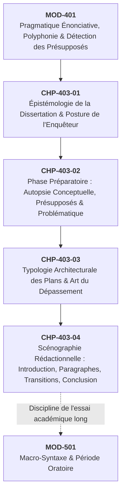

# Chapitre 2 — La Phase Préparatoire : Analyse Conceptuelle du Sujet, Détection des Présupposés et Formulation de la Problématique

> **Identifiant du chapitre** : `CHP-403-02`  
> **Module de rattachement** : [`MOD-403` — Méthodologie Universitaire de la Dissertation et de l'Essai Académique](file:///f:/Formation/world-class-french/03-curriculum/year-2/semester-4/mod-403-methodologie-dissertation-essai-academique.md)  
> **Semestre** : Année 2 — Semestre 4 (S4)  
> **Volume horaire estimé** : 5 à 6 heures d'apprentissage autonome délibéré et d'ateliers d'application (Phase 1 Étude : 1 h 30 | Phase 2 Pratique : 1 h 30 | Phase 3 Correction : 1 h 00 | Phase 4 Évaluation : 1 h 00)  
> **Statut** : [STATUT : VALIDÉ]  
> **Compétences associées** : [`FR-INT-001`](file:///f:/Formation/world-class-french/02-competency-framework/competency-framework.md#fr-int-001-rédiger-un-texte-long-cohérent-en-maîtrisant-accords-et-ponctuation) (L3 Autonomie), [`FR-ARGUM-001`](file:///f:/Formation/world-class-french/02-competency-framework/competency-framework.md#fr-argum-001-rigueur-démonstrative-réfutation-et-détection-des-sophismes) (L3 Autonomie), [`FR-LEXIC-001`](file:///f:/Formation/world-class-french/02-competency-framework/competency-framework.md#fr-lexic-001-précision-sémantique-nuances-synonymiques-et-collocations) (L3 Autonomie)  
> **Sources scientifiques de référence** : `SRC-RHET-03` (Reboul, 1991), `SRC-RHET-01` (Fontanier, 1827/1977), `SRC-GRAM-02` (Riegel et al., 2016), `SRC-LEX-04` (Le Grand Robert), `SRC-NORM-03` (Ministère de l'Éducation nationale, 2020), `SRC-TYPO-01` (Imprimerie nationale, 2002/2014)

---

## 1. Titre et Place dans le Cursus

### 1.1 Intitulé Officiel
**Chapitre 2 : La Phase Préparatoire : Analyse Conceptuelle du Sujet, Détection des Présupposés et Formulation de la Problématique** (`CHP-403-02`).

### 1.2 Insertion Architecturale dans le Cursus
Au sein du module [`MOD-403`](file:///f:/Formation/world-class-french/03-curriculum/year-2/semester-4/mod-403-methodologie-dissertation-essai-academique.md), ce chapitre constitue le sas méthodologique décisif. Si le chapitre inaugural (`CHP-403-01`) a défini l'épistémologie de la dissertation universitaire et la posture éthique de l'enquêteur impartial (affranchi de tout narcissisme énonciatif), le présent chapitre outille concrètement l'étudiant pour affronter la matérialité textuelle du sujet. Il transforme une citation opaque ou une question apparemment univoque en un champ de forces dialectique, condition préalable indispensable à toute architecture de plan (`CHP-403-03`) et à toute scénographie rédactionnelle (`CHP-403-04`).



- **En amont** : Ce chapitre réinvestit directement les acquis de `MOD-401` relatifs à la polyphonie et à la linguistique énonciative (théorie ducrotienne des présupposés et des sous-entendus), ainsi que la détection des failles logiques acquise en `MOD-402`.
- **Au sein du module `MOD-403`** : Il conditionne l'intégralité du travail ultérieur. Une problématique erronée, inconsistante ou simplement paraphrastique condamne inévitablement le plan (`CHP-403-03`) à la récitation plate et l'introduction (`CHP-403-04`) à la platitude rhétorique.
- **En aval dans le cursus** : La capacité à problématiser un énoncé complexe sans céder aux stéréotypes de pensée est le prérequis cardinal pour aborder les épreuves de commentaire stylistique de concours (`MOD-502`), l'herméneutique littéraire et philosophique (`MOD-602`) et la rédaction de la Monographie Capstone de recherche (`MOD-604`).

---

## 2. Objectifs Mesurables

Au terme des 5 à 6 heures d'apprentissage autonome et d'ateliers pratiques de ce chapitre, l'apprenant doit être capable de :

1. **Pratiquer l'autopsie conceptuelle exhaustive d'un sujet en 15 minutes** : délimiter chaque unité lexicale (substantifs, adjectifs, verbes, modalisateurs, conjonctions logiques), distinguer la dénotation première de ses connotations esthétiques ou idéologiques, et interroger la polysémie ainsi que les racines étymologiques révélatrices [Réf. `SRC-LEX-04` ; `FR-LEXIC-001`, L3 Autonomie].
2. **Expliciter les présupposés masqués et la cible polémique de l'énoncé** : formuler en deux propositions claires ce que l'auteur admet comme allant de soi sans démonstration, et identifier la conception dominante, le lieu commun ou l'adversaire théorique contre lequel la citation s'inscrit en faux [Réf. `SRC-RHET-03`, chap. 3 ; `FR-ARGUM-001`, L3 Autonomie].
3. **Mettre au jour l'antinomie fondatrice ou le scandale logique** : dégager la contradiction interne ou le conflit irréductible entre deux exigences légitimes qui fracture l'énoncé et interdit toute réponse manichéenne [Réf. `SRC-RHET-03`, chap. 3 ; `FR-ARGUM-001`, L3 Autonomie].
4. **Formuler une problématique directrice unificatrice sous forme d'interrogation complexe** : énoncer le problème intellectuel nodal sans jamais paraphraser les termes de la citation, en articulant une question directrice universelle qui commande rigoureusement les trois temps du futur développement [Réf. `SRC-GRAM-02`, chap. 21 ; `FR-INT-001`, L3 Autonomie].

---

## 3. Prérequis et Test de Préparation (Auto-Diagnostic)

### 3.1 Prérequis Cognitifs
- Distinction rigoureuse entre fait empirique, jugement de valeur et concept théorique (acquis validé en `MOD-304`).
- Identification des modalisateurs épistémiques (*peut-être, certes, sans doute*) et des connecteurs argumentatifs d'opposition et de concession (*mais, or, cependant, néanmoins*) [validé en `MOD-401` et `MOD-402`].
- Refus du discours subjectif impressionniste au profit d'une analyse distanciée et conceptuelle [validé en `CHP-403-01`].

### 3.2 Test de Préparation Immédiat
Répondez aux cinq questions suivantes avant d'engager la lecture du cours, puis déployez le volet de correction pour évaluer votre acuité analytique initiale.

1. Dans la proposition : *« Pourquoi l'auteur dit-il que la poésie est inutile ? »*, pourquoi cette phrase ne constitue-t-elle en aucun cas une problématique universitaire ?
2. Quelle différence sémantique fondamentale existe-t-il entre le verbe *refléter* le réel et le verbe *réfracter* le réel lorsqu'on analyse le fonctionnement d'un roman ?
3. Dans la citation : *« La poésie ne doit pas seulement consoler, elle doit inquiéter »*, quel est le mot pivot qui organise l'ensemble de la tension argumentative, et quelle valeur logique porte-t-il ?
4. Pourquoi affirmer que *« l'art est subjectif »* constitue-t-il un écueil rédhibitoire au seuil d'une dissertation littéraire ou philosophique ?
5. Qu'est-ce qu'un *présupposé* au sens linguistique défini par Oswald Ducrot, par opposition à une *affirmation explicite* ?

---

<details>
<summary><b>Consulter le corrigé de l'auto-diagnostic</b></summary>

1. Cette phrase est une **demande d'explication scolaire**, et non une problématique. Elle prend la thèse pour un fait acquis et invite à une paraphrase passive de la pensée de l'auteur, au lieu d'interroger la validité conceptuelle, les limites et les paradoxes de l'affirmation.
2. *Refléter* (du latin *reflectere*) suppose une reproduction spéculaire passive et fidèle, où l'œuvre fonctionne comme un miroir neutre du monde ; *réfracter* (du latin *refringere*, briser) implique une déviation active de la lumière : le réel traverse la subjectivité esthétique et les formes du texte, ressortant transformé, infléchi et réordonné.
3. Le pivot est la locution restrictive et modalisatrice **« ne... pas seulement »**, coordonnée à **« mais / elle doit »**. Elle indique que l'auteur ne nie pas la fonction consolatrice de la poésie (qu'il admet comme prémisse minimale), mais qu'il refuse d'y cantonner l'art poétique, érigeant le trouble (*inquiéter*) en exigence esthétique supérieure.
4. L'assertion *« l'art est subjectif »* est un lieu commun paresseux qui dissout d'emblée tout problème : si tout n'est qu'affaire de goût personnel arbitraire, toute enquête rationnelle, toute analyse formelle et toute évaluation dialectique deviennent impossibles. La dissertation exige au contraire de rechercher les critères partagés de signification et de valeur esthétique.
5. Une **affirmation explicite** est posée ouvertement par le locuteur et peut être directement contredite (*« Pierre a cessé de fumer »* pose qu'il ne fume plus aujourd'hui) ; un **présupposé** est une information tenue pour acquise, inscrite dans la structure même de l'énoncé, qui demeure vraie même si l'on nie la phrase (*« Pierre a cessé de fumer »* présuppose qu'il fumait auparavant).

</details>

---

## 4. Situation de Départ ou Problème Concret : Le Piège Mortel du Placage de Cours

### 4.1 L'Illusion du Mot-Clé
Dans les concours universitaires (Grandes Écoles, CAPES, Agrégation), le rapport du jury consacre immanquablement plusieurs pages à ce qu'il nomme le « massacre méthodologique de la première heure ». 

Considérons la situation clinique suivante :
Un sujet de concours est distribué :
> *« En littérature, le beau est toujours bizarre. »* (Charles Baudelaire, *Curiosités esthétiques*, 1855).

L'étudiant candide lit l'énoncé en diagonale. Ses yeux accrochent deux vocables familiers : *« beau »* et *« Baudelaire »*. Aussitôt, une réaction réflexe de panique rassurée se déclenche : *« C'est un sujet sur le romantisme et les Fleurs du Mal ! »*. Sans prendre le temps d'ausculter la phrase, il noircit fébrilement son brouillon avec toutes les fiches mémorisées durant l'année : la biographie du poète, la théorie des correspondances, le spleen et l'idéal, la modernité poétique.

Son introduction s'ouvre sur une généralité banale (*« De tout temps, les artistes ont cherché la beauté... »*), sa problématique se borne à demander : *« En quoi Baudelaire montre-t-il que le beau est bizarre ? »*, et son plan aligne trois tiroirs descriptifs :
- I. Baudelaire recherche la beauté classique.
- II. Mais il peint la laideur de la ville moderne.
- III. Ainsi naît une nouvelle forme de beauté bizarre.

### 4.2 Le Verdict Sanctionnateur
La copie est sanctionnée par une note éliminatoire (05/20). Le commentaire du correcteur est lapidaire :  
> *« Hors-sujet complet par thématisme aveugle. Le candidat récite son cours sur Baudelaire sans jamais affronter le problème posé par le sujet. Qu'est-ce que la « bizarrerie » ? Pourquoi ce modalisateur absolu « toujours » ? En quoi cette affirmation constitue-t-elle une déclaration de guerre contre le canon classique de l'harmonie universelle ? Le sujet n'a même pas été effleuré. »*

Cette catastrophe intellectuelle provient d'une méprise radicale sur la nature de l'exercice : **un sujet de dissertation n'est pas un prétexte pour réciter des connaissances ; il est une énigme logique singulière qu'il faut disséquer chirurgicalement avant d'écrire la moindre ligne de dissertation**.

---

## 5. Explication Intuitive : L'Autopsie Chirurgicale et la Fissure dans le Barrage

Pour comprendre la nature du travail préparatoire, deux analogies structurelles s'imposent :

```
             ÉNONCÉ DU SUJET : FAÇADE LISSE ET UNIE
  ┌────────────────────────────────────────────────────────┐
  │ "En littérature, le beau est toujours bizarre."        │
  └────────────────────────────────────────────────────────┘
                             │
     [SCALPEL CONCEPTUEL]    │    [INTERROGATION DES MODALISATEURS]
                             ▼
  ┌────────────────────────────────────────────────────────┐
  │ FISSURE GÉOLOGIQUE : L'ANTINOMIE FONDATRICE            │
  │ • Beauté canonique : ordre, proportion, universalité  │
  │                     VERSUS                             │
  │ • Bizarrerie : accident, étrangeté, dissonance locale  │
  └────────────────────────────────────────────────────────┘
                             │
                             ▼
  ┌────────────────────────────────────────────────────────┐
  │ JAILLISSEMENT DE LA PROBLÉMATIQUE UNIFICATRICE         │
  └────────────────────────────────────────────────────────┘
```

### 5.1 L'Analogie de l'Autopsie Chirurgicale
Un sujet de dissertation ressemble au corps d'un patient apparemment endormi. L'analyste ne se contente pas de le contempler de loin en décrivant sa posture générale. Il saisit le scalpel conceptuel et procède à une incision réglée :
- Il ouvre les termes substantifs pour en examiner les viscères étymologiques et conceptuels ;
- Il isole les petits vaisseaux (les conjonctions, les adverbes, les négations) qui irriguent secrètement la phrase et en déterminent la trajectoire vitale ;
- Il découvre sous la peau du discours les lésions cachées, c'est-à-dire les apories que l'auteur a tenté de suturer par une formule brillante.

### 5.2 L'Analogie de la Fissure dans le Barrage
Un énoncé de sujet se présente sous la forme d'un mur massif de certitude : *« L'art est ceci »*, *« La poésie ne sert à rien »*, *« Le roman est un miroir »*. Si l'on accepte cette façade sans broncher, on ne peut que hocher la tête ou paraphraser l'affirmation. 

Le travail de préparation consiste à repérer la **fissure géologique** dans le béton de l'énoncé. Pourquoi l'auteur a-t-il éprouvé le besoin d'asséner cette formule ? Quelle force d'objection refoulée pousse derrière le barrage ? Dès que l'on enfonce le coin de l'analyse dans la contradiction interne (ici : le *beau*, qui relève traditionnellement de l'harmonie et du partage universel, se voit accouplé au *bizarre*, qui relève du monstrueux, de l'atypique et du déconcertant), le barrage cède : l'eau vive du problème jaillit. Vous tenez votre problématique.

---

## 6. Définitions Précises et Terminologie

Pour mener la phase préparatoire avec une précision scientifique, il est impératif de manier une terminologie conceptuelle exacte [Réf. `SRC-NORM-03` ; `SRC-RHET-03`, chap. 3] :

- **Phase préparatoire** : Protocole méthodologique rigoureux, d'une durée normative de 45 minutes sur table de concours, précédant impérativement la rédaction. Elle comprend l'autopsie lexicale du sujet, l'explicitation des présupposés, la mise au jour de l'antinomie nodale, la construction de la problématique directrice et l'armature du plan détaillé.
- **Analyse conceptuelle** : Opération intellectuelle déconstructive consistant à extraire la substance philosophique et esthétique des termes d'un sujet, en dépassant leur acception courante pour atteindre leurs acceptions techniques, historiques et polyphoniques.
- **Découpage lexical** : Segmentation grammaticale et sémantique minutieuse de chaque élément constitutif de l'énoncé (sujet grammatical, syntagme verbal, prédicat, modalisateurs, connecteurs logiques, ponctuation expressive).
- **Dénotation** : Noyau sémantique fondamental, stable et objectif d'une unité lexicale, tel qu'enregistré par la définition lexicographique première [Réf. `SRC-LEX-04`].
- **Connotation** : Ensemble des valeurs sémantiques secondes, affectives, idéologiques, historiques ou culturelles qui s'agrègent au mot dans un contexte discursif déterminé.
- **Polysémie** : Propriété d'un terme qui possède plusieurs significations distinctes mais reliées historiquement ou logiquement (ex. le mot *« règle »* désigne le canon géométrique, la norme morale ou la convention d'un genre poétique).
- **Présupposé** : Proposition implicite nécessairement tenue pour vraie pour que l'énoncé conserve un sens, mais que l'auteur n'énonce pas explicitement ni ne prend la peine de démontrer [Réf. `SRC-GRAM-02`, chap. 21].
- **Antinomie fondatrice** : Conflit logique insoluble ou contradiction apparente entre deux lois ou deux propositions rationnelles également défendables (ex. l'art doit imiter la nature / l'art doit inventer un ordre autonome supérieur).
- **Paradoxe** : Proposition qui heurte l'opinion commune (*doxa*) ou qui défie la logique apparente, obligeant l'esprit à dépasser les évidences pour penser plus profondément.
- **Problématisation** : Processus dialectique continu par lequel le scripteur transforme un énoncé assertif univoque en un champ d'interrogations dynamiques, articulant les thèses rivales et identifiant les enjeux fondamentaux du débat.
- **Problématique unificatrice** : Formulation finale, sous la forme d'une question conceptuelle complexe, du problème central qui sous-tend le sujet et qui gouverne la progression tripartite du devoir.
- **Question nodale** : Interrogation charnière qui touche au nœud même de l'aporie, sans laquelle l'énoncé s'effondrerait dans la trivialité.

---

## 7. Règles ou Mécanismes Fondamentaux

La conduite souveraine de la phase préparatoire repose sur quatre mécanismes discursifs fondamentaux [Réf. `SRC-RHET-03`, chap. 3 ; `SRC-GRAM-02`, chap. 21].

```
┌────────────────────────────────────────────────────────────────────────┐
│                   LES QUATRE PILIERS DE LA PRÉPARATION                 │
├────────────────────┬────────────────────┬──────────────────────────────┤
│ 7.1 L'Autopsie     │ Découpage des mots,│ Ne jamais négliger les petits│
│     Conceptuelle   │ polysémie, racines │ mots (adverbes, négations).  │
├────────────────────┼────────────────────┼──────────────────────────────┤
│ 7.2 L'Extraction   │ Cible polémique    │ Ce que le texte refuse       │
│     des Présupposés│ invisible          │ de prouver.                  │
├────────────────────┼────────────────────┼──────────────────────────────┤
│ 7.3 Le Scandale    │ Antinomie          │ Conflit entre deux vérités   │
│     Logique        │ fondatrice         │ également nécessaires.       │
├────────────────────┼────────────────────┼──────────────────────────────┤
│ 7.4 La Problématique│ Question directrice│ Proscription absolue de la  │
│     Unificatrice   │ universelle        │ paraphrase interrogative.    │
└────────────────────┴────────────────────┴──────────────────────────────┘
```

### 7.1 Le Protocole Rigoureux de l'Autopsie Conceptuelle
Face à la citation ou à la question posée, le scripteur applique un triple protocole de dissection lexicale :

1. **Délimiter chaque terme substantif, adjectival et verbal** :  
   Il convient d'inscrire chaque mot fort au centre d'une feuille de brouillon et de décliner ses synonymes savants, ses antonymes exacts et son champ sémantique.
2. **Interroger la polysémie et l'étymologie révélatrice** :  
   Les mots fondamentaux de la culture ont une épaisseur historique qu'il faut mobiliser.  
   - Exemple : Dans le sujet *« L'auteur dramatique doit-il faire illusion ? »*, le substantif *illusion* vient du latin *illudere* (se jouer de, railler). L'illusion n'est pas une simple méprise sensorielle (*erreur*) : elle est un jeu consenti où la conscience accepte de se laisser séduire tout en sachant qu'elle assiste à une fiction [Réf. `SRC-LEX-04`].
3. **Traquer impérativement les « petits mots » (modalisateurs, conjonctions, restrictions)** :  
   Les étudiants négligent couramment les unités grammaticales courtes, qui portent pourtant l'essentiel de la charge modale et argumentative [Réf. `SRC-GRAM-02`, chap. 21] :
   - *Les adverbes et modalisateurs* : *toujours*, *jamais*, *peut-être*, *seulement*, *précisément*, *expressément*. Un sujet disant *« La poésie est toujours subversive »* appelle une contestation immédiate de l'absolu temporel *toujours* ;
   - *Les conjonctions de coordination et de subordination* : *mais*, *or*, *si*, *parce que*, *puisque*. Un *mais* inséré au milieu d'une citation marque une rupture et fait basculer le centre de gravité vers la seconde proposition ;
   - *Les tournures restrictives et corrélatives* : *ne... que*, *moins... que*, *c'est... qui*. Une restriction n'est pas une négation complète : dire *« L'écrivain ne peint que lui-même »* admet que l'écriture peint quelque chose, mais verrouille son objet sur la sphère intime.

### 7.2 La Mise au Jour des Présupposés Cachés
Toute affirmation littéraire ou philosophique est un acte de positionnement polémique au sein d'une histoire des formes et des idées. Déceler les présupposés implique de poser deux questions directrices :

1. **Qu'est-ce que l'auteur tient pour une évidence indiscutable ?**  
   Si Jean-Paul Sartre écrit : *« La parole est action »*, il présuppose sans le démontrer que le langage n'est pas un système clos de signes abstraits, mais une force matérielle intervenant directement dans le tissu socio-politique.
2. **À quelle conception reçue ou adversaire invisible l'auteur s'oppose-t-il ?**  
   Aucun auteur ne formule une maxime pour enfoncer une porte ouverte. S'il éprouve le besoin d'affirmer avec force que *« le beau est bizarre »*, c'est parce qu'il engage un combat frontal contre la doxa néoclassique et bourgeoise pour laquelle le beau est régulier, harmonieux, apaisant et moral. Identifier l'adversaire invisible, c'est trouver la première partie de son futur devoir.

### 7.3 L'Identification de l'Antinomie ou du Scandale Logique
Une dissertation universitaire n'a de raison d'exister que si l'esprit se heurte à une contradiction féconde. Il ne s'agit pas de savoir si l'auteur « a raison » ou « a tort » (jugement scolaire infantile), mais de découvrir l'aporie fondamentale qui rend l'affirmation à la fois nécessaire et contestable.

L'antinomie se présente toujours sous la forme d'un conflit entre deux exigences légitimes :
- *Exigence A* : L'art doit témoigner fidèlement des déchirements de l'histoire et dénoncer l'injustice (exigence éthique et politique) ;
- *Exigence B* : L'art doit obéir à ses lois formelles propres sous peine de dégénérer en propagande éphémère (exigence esthétique et ontologique).
Le « scandale logique » naît de l'impossibilité de sacrifier l'un des deux pôles sans mutiler l'essence même de l'objet étudié.

### 7.4 L'Art de Formuler la Problématique Directrice
La problématique unificatrice est la clef de voûte de toute la construction intellectuelle. Sa formulation est soumise à trois règles impératives :

- **Règle n° 1 — Proscription absolue de la paraphrase interrogative** :  
  Il est rigoureusement interdit de transformer la citation en question en lui adjoignant une béquille syntaxique du type : *« En quoi l'auteur a-t-il raison d'affirmer que... ? »* ou *« Dans quelle mesure peut-on dire que... ? »*. Ces formules creuses ne problématisent rien : elles répètent l'énoncé sans en extraire le concept.
- **Règle n° 2 — Construction d'une question complexe mettant en tension deux vérités antagonistes** :  
  La problématique doit mettre en scène la contradiction mise au jour. Elle utilise souvent des structures corrélatives ou concessives :  
  *« Si la création littéraire semble indissociable de... dans quelle mesure ne trouve-t-elle pas son accomplissement supérieur en... ? »*
- **Règle n° 3 — Universalité conceptuelle et rôle directeur sur le plan tripartite** :  
  La problématique doit s'élever au-dessus de la personne singulière de l'auteur de la citation. Même si le sujet cite Flaubert ou Gracq, la question posée doit engager la littérature ou l'art en général. Elle doit être calibrée de telle sorte que la Partie I réponde au premier versant du problème, la Partie II explore le versant opposé, et la Partie III apporte la résolution ou le dépassement conceptuel.

---

## 8. Raisonnement Détaillé (Le Pourquoi) : Pourquoi la Note Finale Dépend à 80 % de la Problématique

Dans les jurys de concours, les correcteurs s'accordent sur un constat empirique sans appel : la lecture des deux premières pages d'une copie (introduction et amorce de la première partie) permet de déterminer avec une marge d'erreur inférieure à deux points la note globale attribuée au devoir.

```
                  LA SPIRALE DESCENDANTE D'UNE PROBLÉMATIQUE FAIBLE
  ┌────────────────────────────────────────────────────────────────────────┐
  │ FAUSSE PROBLÉMATIQUE (Paraphrase ou Question Fermée Oui/Non)          │
  └────────────────────────────────────────────────────────────────────────┘
                                      │
                                      ▼
  ┌────────────────────────────────────────────────────────────────────────┐
  │ PLAN CATALISTE : Juxtaposition d'exemples sans nécessité logique       │
  └────────────────────────────────────────────────────────────────────────┘
                                      │
                                      ▼
  ┌────────────────────────────────────────────────────────────────────────┐
  │ ÉCRITURE PARAPHRASTIQUE : Récitation plate de cours, bavardage vague   │
  └────────────────────────────────────────────────────────────────────────┘
                                      │
                                      ▼
  ┌────────────────────────────────────────────────────────────────────────┐
  │ NOTE SANCTION : 04/20 à 08/20 (Échec d'admissibilité)                  │
  └────────────────────────────────────────────────────────────────────────┘
```

Pourquoi cette causalité descendante est-elle si implacable ?

1. **La problématique est la force motrice de l'enquête** :  
   Si la question nodale est absente ou triviale, le devoir n'a rien à démontrer. L'étudiant se retrouve condamné à empiler des exemples comme on enfile des perles sur un fil sans consistance. À l'inverse, dès lors qu'un problème intellectuel vertigineux est posé, chaque paragraphe devient une tentative raisonnée d'élucidation. Le devoir prend l'allure d'une démonstration scientifique haletante.
2. **La problématique commande la pertinence des arguments et des exemples** :  
   Un exemple n'a pas de valeur en soi ; il ne devient probant que par rapport au problème qu'il éclaire. Avec une mauvaise problématique, l'étudiant cite *L'Étranger* de Camus pour raconter la mort de l'Arabe ; avec une problématique rigoureuse sur la transitivité du langage, l'étudiant décortique le style blanc et la parataxe camusienne pour prouver comment l'amputation des connecteurs logiques traduit formellement l'absurdité ontologique du monde.
3. **La problématique garantit la dynamique dialectique de la Partie III** :  
   C'est la qualité du problème posé qui détermine si la troisième partie sera un compromis tiède et mou (*« Cela dépend des points de vue »*, sanction immédiate) ou un véritable dépassement hégélien (*Aufhebung*) qui refonde les termes du débat sur un plan supérieur.

---

## 9. Exemples Corrects Commentés

Voici l'application pas-à-pas du protocole préparatoire à deux sujets d'anthologie issus des concours des Grandes Écoles et de l'Agrégation.

### Exemple n° 1 : Décorticage du Sujet d'André Gide (ENS Lyon / Agrégation)
> **Sujet** :  
> *« C'est avec les beaux sentiments qu'on fait de la mauvaise littérature. »* (André Gide, *Incidences*, 1924).

#### Étape 1 : Découpage Lexical & Autopsie des Termes
- *« C'est... que »* : Tournure présentative et clivée à valeur d'insistance polémique. Gide pose son jugement non comme une hypothèse prudente, mais comme une loi catégorique incontournable.
- *« Beaux sentiments »* : Substantif moral valorisant accouplé à un adjectif laudatif. Sens premier : sentiments généreux, vertueux, conformes à la morale chrétienne ou républicaine (dévouement, charité, patriotisme, amour pur). Sens second péjoratif : fadeur, bons sentiments convenus, angélisme complaisant, moralisme hypocrite et absence de rugosité humaine.
- *« Mauvaise littérature »* : Jugement esthétique négatif. Sens propre : écriture stéréotypée, prévisible, plate, sans force stylistique ni complexité psychologique. L'œuvre « mauvaise » est celle qui abdique son exigence artistique au profit de la prédication édifiante.
- *« Fait »* : Verbe de fabrication matérielle (*facere*). La littérature est désignée comme un artisanat formel et non comme une effusion de l'âme.

#### Étape 2 : Détection des Présupposés et Cible Polémique
- *Présupposé mis au jour* : Gide présuppose qu'il existe une hostilité fondamentale entre la rectitude morale et la puissance esthétique. Il pose comme allant de soi que l'art littéraire exige l'exploration du mal, du trouble, des pulsions refoulées et des zones d'ombre de la conscience.
- *Cible polémique invisible* : Gide pourfend le roman édifiant, le moralisme académique bourgeois du XIXe siècle (les romans à thèses de Paul Bourget, la littérature de patronage) et l'injonction séculaire héritée de l'abbé Batteux selon laquelle l'art doit offrir des modèles de vertu pour élever les âmes.

#### Étape 3 : Identification de l'Antinomie Fondatrice
- *D'un côté* : L'art exige la vérité humaine intégrale, laquelle est faite de failles, de désirs inavouables et de culpabilité (Dostoïevski, Proust, Baudelaire). Réduire la littérature aux « beaux sentiments », c'est la condamner au mensonge de l'idéalisation niaise.
- *D'un autre côté* : La grande littérature ne saurait être une apologie complaisante de la bassesse ou du nihilisme. Les plus grands chefs-d'œuvre (la tragédie grecque, *Les Misérables* de Hugo, l'œuvre de Camus) tirent précisément leur grandeur d'une aspiration éperdue vers la justice, la compassion et la dignité humaine.
- *Le scandale logique* : L'art se nourrit du mal moral pour produire du bien esthétique, mais s'il s'enferme dans la complaisance perverse, il détruit son universalité.

#### Étape 4 : Formulation de la Problématique Directrice Unificatrice
> *Si la création littéraire ne peut atteindre sa souveraine lucidité qu'en bravant les convenances morales et en sondant la part obscure de la condition humaine, est-elle pour autant condamnée à n'être que la complice esthétique du négatif, ou puise-t-elle sa valeur suprême dans sa capacité à transfigurer cette noirceur en un appel exigeant vers la grandeur et la responsabilité d'autrui ?*

---

### Exemple n° 2 : Décorticage du Sujet de Julien Gracq (ENS Ulm / CAPES)
> **Sujet** :  
> *« Une œuvre littéraire n'est pas un monument qu'on contemple, c'est une arme de jet qui vous atteint. »* (Julien Gracq, *En lisant en écrivant*, 1980).

#### Étape 1 : Découpage Lexical & Autopsie des Termes
- *« N'est pas... c'est... »* : Structure antithétique binaire exclusive. Gracq récuse une définition établie pour lui substituer une conception conflictuelle de l'objet littéraire.
- *« Monument »* : Du latin *monumentum* (édifice destiné à perpétuer le souvenir, de *monere*, avertir, faire souvenir). Image architecturale de la statuaire publique : objet lourd, figé dans la pierre, immortalisé dans un musée ou une bibliothèque, respecté mais mort.
- *« Contemple »* : Regard distancié, passif, désintéressé, purement esthétisant. Le spectateur reste extérieur et invulnérable.
- *« Arme de jet »* : Métaphore balistique et guerrière (flèche, javelot, projectile). L'œuvre est projetée avec violence dans l'espace ; elle possède une trajectoire balistique imprévisible ; elle a pour finalité de frapper, de blesser, d'entrer par effraction.
- *« Vous atteint »* : Effet d'impact intime et physique. Le pronom de seconde personne *vous* universalise le choc de la lecture. L'expérience littéraire est un événement vulnérant qui modifie irréversiblement celui qui la reçoit.

#### Étape 2 : Détection des Présupposés et Cible Polémique
- *Présupposé mis au jour* : Gracq présuppose que la valeur d'un texte ne réside pas dans sa pérennité formelle muséale ou académique, mais dans son efficacité émotionnelle et perturbatrice directe sur la conscience du lecteur.
- *Cible polémique invisible* : L'histoire littéraire patrimoniale, la sacralisation universitaire des « classiques » momifiés sous les notes de bas de page, et la posture snob du critique qui goûte la forme sans jamais risquer son existence au contact du verbe.

#### Étape 3 : Identification de l'Antinomie Fondatrice
- *D'un côté* : La littérature est un choc existentiel intolérable ; lire, c'est être blessé par la parole poétique ou subversive (Rimbaud, Kafka : *« Un livre doit être la hache qui fend la mer gelée en nous »*).
- *D'un autre côté* : Si l'œuvre n'était qu'un projectile instantané, elle s'épuiserait dans le moment éphémère de son impact. Pourquoi lisons-nous encore Montaigne, Racine ou Chateaubriand des siècles après leur mort, si ce n'est précisément parce que leur perfection formelle s'est érigée en « monument » indestructible capable de traverser le temps ?
- *Le paradoxe* : Comment l'œuvre peut-elle concilier la violence vive de l'événement intime et la permanence architecturale de la forme monumentale ?

#### Étape 4 : Formulation de la Problématique Directrice Unificatrice
> *En refusant de réduire le chef-d'œuvre à la passivité d'un patrimoine statique pour exalter sa virulence existentielle et son pouvoir de commotion immédiat, ne risque-t-on pas d'occulter la pérennité architecturale de la forme qui seule confère au projectile littéraire sa portée universelle à travers les âges ? Dès lors, la puissance d'ébranlement de l'œuvre ne tient-elle pas précisément à ce que son armature monumentale concentre une énergie poétique inaltérable toujours prête à frapper à nouveau chaque conscience ?*

---

## 10. Contre-Exemples et Erreurs Fréquentes

L'observation clinique des copies de concours révèle **six erreurs récurrentes** commises lors de la phase préparatoire :

### Erreur n° 1 : Réduction du Sujet à un Mot-Clé Unique (Thématisme Aveugle)
- **Manifestation clinique** : Sur le sujet de Baudelaire (*« Le beau est toujours bizarre »*), l'étudiant isole le mot *beau* et rédige une dissertation encyclopédique sur l'évolution de la beauté de l'Antiquité au XXe siècle.
- **Diagnostic critique** : Cette pathologie, baptisée « thématisme aveugle », substitue un mot vague à la proposition logique singulière formulée par l'auteur. Le candidat ne traite pas le sujet ; il déverse le chapitre générique de son manuel.
- **Rectification académique normée** : Un sujet n'est jamais un mot, mais une **relation syntaxique entre plusieurs concepts**. Il est obligatoire de traiter l'articulation entre le substantif, son prédicat et son modalisateur (*beau* + *toujours* + *bizarre*).

### Erreur n° 2 : Oubli des Modalisateurs et des Conjonctions Restrictives
- **Manifestation clinique** : Face à la maxime de Boileau : *« Ce que l'on conçoit bien s'énonce clairement, / Et les mots pour le dire arrivent aisément »*, l'étudiant supprime mentalement l'adverbe *aisément* et l'adverbe *bien*, pour disserter sur *« les difficultés de l'écriture littéraire »*.
- **Diagnostic critique** : L'oubli du modalisateur vide la thèse de son tranchant polémique. Boileau ne nie pas qu'il soit difficile d'écrire ; il pose que la fluidité verbale est la récompense nécessaire d'une clarification préalable de la pensée.
- **Rectification académique normée** : Entourer d'un trait rouge au brouillon chaque adverbe en *-ment*, chaque modalisateur temporel ou logique (*toujours, jamais, peut-être, seulement*), et rédiger un paragraphe explicite analysant ce qui se passerait si le modalisateur était supprimé ou remplacé par son contraire.

### Erreur n° 3 : Fausse Problématique par Reformulation Tautologique de la Citation
- **Manifestation clinique** : Sur le sujet : *« Le roman est la seule forme d'art qui nous donne l'illusion de connaître autrui du dedans »*, l'étudiant formule pour problématique : *« Nous nous demanderons donc comment le roman nous permet de connaître autrui du dedans par le biais de l'illusion esthétique. »*
- **Diagnostic critique** : L'étudiant a simplement plaqué une formule interrogative (*« comment... »*) sur la phrase d'origine en interchangeant trois synonymes. Il n'a identifié aucun enjeu, soulevé aucune aporie, formulé aucun doute intellectuel. Le devoir qui suit sera purement descriptif et servile.
- **Rectification académique normée** : Appliquer la règle d'interdiction formelle du mimétisme lexical. La problématique doit être formulée dans le vocabulaire conceptuel de l'étudiant, en faisant apparaître le conflit entre les illusions de l'introspection romanesque et l'opacité fondamentale du réel humain.

### Erreur n° 4 : Occultation des Présupposés Esthétiques et Idéologiques de l'Auteur
- **Manifestation clinique** : Traiter la formule de Victor Hugo dans la préface de *Cromwell* (*« Le laid y a mille types, le beau n'en a qu'un »*) comme une vérité objective et atemporelle sur la nature de l'art, sans voir qu'il s'agit d'un manifeste romantique engagé contre le néoclassicisme.
- **Diagnostic critique** : Prise au pied de la lettre, l'affirmation de Hugo est fausse (la beauté possède d'infinies déclinaisons historiques). L'ignorer condamne le devoir à un académisme stérile.
- **Rectification académique normée** : Toujours historiciser le cadre conceptuel de la citation : qui parle ? en quel siècle ? contre quelle hégémonie théorique ? Quel intérêt l'auteur avait-il à forcer le trait de cette proposition ?

### Erreur n° 5 : Anachronisme Interprétatif et Projection Idéologique Rétrospective
- **Manifestation clinique** : Analyser une citation de Montaigne ou de Pascal sur *« l'imagination maîtresse d'erreur et de fausseté »* en mobilisant les théories de l'inconscient de Freud ou les algorithmes des intelligences artificielles contemporaines dès la première partie.
- **Diagnostic critique** : L'anachronisme conceptuel dénature le sens des textes classiques et témoigne d'un manque criant de culture historique et philologique.
- **Rectification académique normée** : Respecter le périmètre épistémologique du texte dans les deux premières parties du devoir ; ne réserver d'éventuels élargissements contemporains raisonnés qu'à l'ultime mouvement de la synthèse (Partie III) ou à l'ouverture spéculative de la conclusion.

### Erreur n° 6 : Formulation d'une Fausse Question Fermée Appelant un Simple « Oui » ou « Non »
- **Manifestation clinique** : Proposer en problématique : *« L'art doit-il être utile ? »* ou *« La poésie engagée est-elle supérieure à la poésie lyrique ? »*.
- **Diagnostic critique** : Une question fermée réduit l'investigation intellectuelle à un vote de référendum ou à un dilemme d'opinion. L'étudiant s'enferme dans un plan binaire suicidaire : Partie I = Oui, Partie II = Non (ou inversement), avec l'impossibilité absolue de bâtir une troisième partie sans tomber dans un compromis mou ridicule (*« Un peu des deux »*).
- **Rectification académique normée** : Bannir l'interrogation totale fermée. Construire une interrogation partielle complexe qui interroge la nature, les conditions de possibilité et les limites du phénomène étudié à l'aide de formules médiatrices (*dans quelle mesure, par quel mystère formel, à quelles conditions*).

---

## 11. Cas Particuliers et Limites

La démarche préparatoire doit adapter son outillage face à trois typologies singulières de sujets universitaires :

### 11.1 Les Sujets à Citations Doubles Opposant Deux Thèses Antagonistes
Il arrive fréquemment que les commissions de concours juxtaposent deux citations contradictoires :
> **Exemple** :  
> Texte A : *« Ce que l'on conçoit bien s'énonce clairement. »* (Boileau, *Art poétique*, 1674).  
> Texte B : *« Il y a des choses qui ne peuvent être dites que d'une façon obscure. »* (Paul Valéry, *Tel Quel*, 1941).

- **Le piège à éviter** : Attribuer la première citation à la Partie I et la seconde à la Partie II. Ce procédé mécanique débouche sur un affrontement stérile où la seconde moitié du devoir détruit la première sans dialogue réel.
- **Le protocole rigoureux** :  
  1. Identifier le terrain commun sur lequel les deux auteurs s'affrontent (ici : la relation entre la lucidité intellectuelle et la transparence du langage poétique) ;
  2. Mettre en évidence les définitions divergentes accordées au même mot (Boileau parle de la pensée rationnelle et discursive ; Valéry parle de la saisie poétique des états de conscience subtils et non réductibles au syllogisme) ;
  3. Formuler une problématique unificatrice qui interroge la légitimité respective de ces deux régimes d'énonciation.

### 11.2 Les Sujets Métaphoriques ou Énigmatiques
Certains énoncés s'appuient sur une image poétique dense :
> **Exemple** :  
> *« Le roman est un carrefour où se croisent tous les chemins. »* (Julien Gracq).

- **Le piège à éviter** : Se perdre dans une glose poétisante vague, commenter indéfiniment la métaphore du carrefour, des routes et des voyageurs sans jamais nommer les concepts sous-jacents.
- **Le protocole rigoureux** :  
  Traduire immédiatement la métaphore en concepts opératoires :
  - *Carrefour* $\rightarrow$ hétérogénéité générique, porosité discursive, espace d'hybridation des voix (polyphonie bakhtinienne) ;
  - *Chemins qui se croisent* $\rightarrow$ le documentaire historique, l'analyse psychologique, le lyrisme poétique, la réflexion philosophique.
  La problématique devient : *« Le genre romanesque tire-t-il sa suprématie moderne de sa capacité à absorber et subvertir toutes les autres formes du discours littéraire, ou cette plasticité infinie ne menace-t-elle pas de dissoudre son identité formelle ? »*

### 11.3 Les Sujets sous Forme de Question Ouverte Nue (Sans Citation d'Auteur)
Certains énoncés posent une question directe et dépouillée :
> **Exemple** :  
> *« Peut-on écrire sans trahir ? »*

- **Le piège à éviter** : Considérer que le travail préparatoire est allégé parce qu'il n'y a pas de texte d'appui. L'absence de citation rend le risque de dispersion et de bavardage beaucoup plus élevé.
- **Le protocole rigoureux** :  
  L'effort d'autopsie conceptuelle doit porter au carré sur les polysémies :
  - *Écrire* : acte transitif (témoigner, transmettre le réel) ou réflexif (forger un style, créer un monde autonome) ;
  - *Trahir* : trahir qui ou quoi ? Trahir la vérité brute du référent ? Trahir son camp social ou politique ? Trahir le lecteur par l'artifice fictionnel ? Ou trahir la pureté de la pensée silencieuse par les imperfections du langage ?
  Le paradoxe doit être dégagé de la double postulation de l'écriture, qui ne peut révéler qu'en déformant.

---

## 12. Approfondissement Adapté au Niveau : L'Aporie Socratique et la Problématisation Bachelardienne

L'exigence universitaire de problématisation ne constitue pas un caprice formaliste de l'institution académique française ; elle plonge ses racines dans les deux moments fondateurs de la philosophie occidentale et de l'épistémologie moderne [Réf. `SRC-RHET-03`, chap. 3] :

### 12.1 L'Aporie Socratique comme Condition Préalable du Savoir
Dans les dialogues platoniciens dits de jeunesse (*Euthyphron*, *Ménon*, *Théétète*), l'investigation socratique commence invariablement par la mise en déroute de l'interlocuteur confiant. Ce dernier croit savoir ce qu'est la piété, la vertu ou le courage, parce qu'il vit dans l'évidence non interrogée de la coutume et du langage commun (*doxa*).

Socrate injecte alors l'ironie maïeutique : en soumettant les définitions spontanées de son interlocuteur à des contre-épreuves logiques, il le conduit à **l'aporie** (du grec *a-poros*, chemin impraticable, impasse sans issue). L'aporie n'est pas un échec stérile ; elle est le moment salvateur de la rupture avec l'opinion reçue. Tant que l'esprit ne ressent pas le vertige de la contradiction interne, il n'est pas prêt à chercher la vérité. 

> *Transposition à la dissertation* : La phase préparatoire est le moment socratique de l'étudiant. Il doit refuser toute évidence immédiate et placer l'énoncé en état d'aporie délibérée.

### 12.2 La Problématisation selon Gaston Bachelard
Dans *La Formation de l'esprit scientifique* (1938), Gaston Bachelard établit le principe épistémologique fondamental qui disqualifie à jamais le simple recueil passif de faits :

> *« Et quoi qu'on dise, dans la vie scientifique, les problèmes ne se posent pas d'eux-mêmes. C'est précisément ce sens du problème qui donne la marque du véritable esprit scientifique. Pour un esprit scientifique, toute connaissance est une réponse à une question. S'il n'y a pas eu de question, il ne peut y avoir de connaissance scientifique. Rien ne va de soi. Rien n'est donné. Tout est construit. »* (Gaston Bachelard, *La Formation de l'esprit scientifique*, Paris, Vrin, 1938, chap. 1).

Appliqué à la méthodologie académique de la dissertation, le principe bachelardien signifie qu'un sujet n'est pas un « donné » qu'il suffirait d'enregistrer et de gloser, mais une **construction de l'esprit**. Le bon devoir universitaire ne se reconnaît pas à la quantité de faits ou de citations qu'il empile, mais à la netteté et à la hauteur de vue de la question qu'il a su forger pour réordonner le champ du savoir.

---

## 13. Comparaisons Différentielles

Les trois tableaux synoptiques ci-dessous fixent les critères discriminants permettant d'évaluer la qualité de la phase préparatoire au niveau L3 (Autonomie) :

### Tableau 1 : Analyse Lexicale Superficielle vs Autopsie Conceptuelle Approfondie
| Critère d'évaluation | Analyse Lexicale Superficielle (Niveau Débutant) | Autopsie Conceptuelle Approfondie (Palier L3 Autonomie) |
| :--- | :--- | :--- |
| **Périmètre d'investigation** | Ne prend en compte que les 2 ou 3 mots-clés thématiques les plus évidents. | Dissèque chaque substantif, adjectif, verbe, modalisateur adverbial et conjonction. |
| **Traitement du sens** | Se borne à la dénotation commune et au sens usuel du dictionnaire courant. | Explore la polysémie, les acceptions historiques, les racines étymologiques et le champ notionnel. |
| **Statut des modalisateurs** | Ignore totalement les adverbes (*toujours, peut-être, seulement*). | Considère le modalisateur comme le pivot stratégique déterminant la portée épistémique du sujet. |
| **Rapport à l'énoncé** | Voit une certitude close à répéter ou illustrer fidèlement. | Voit une structure polyphonique tendue masquant un présupposé et une cible polémique. |

### Tableau 2 : Fausse Question Fermée vs Problématique Universitaire
| Critère d'évaluation | Fausse Question Fermée (Rejet Universitaire) | Problématique Universitaire (Excellence Concours) |
| :--- | :--- | :--- |
| **Structure syntaxique** | Question totale fermée appelant une réponse par « oui » ou par « non » (*Est-ce que... ?*). | Question complexe, souvent articulée sur une tension corrélative (*Si..., dans quelle mesure... ou... ?*). |
| **Portée intellectuelle** | Réduit l'enquête à une prise de parti manichéenne et subjective. | Met en balance deux exigences rationnelles ou esthétiques également légitimes. |
| **Impact sur le plan** | Condamne le devoir à un plan binaire stérile (I. Oui / II. Non / III. Compromis mou tiède). | Commande organiquement une dialectique en 3 actes progressifs vers un dépassement supérieur. |
| **Champ conceptuel** | Reste enfermé dans l'anecdote ou l'opinion particulière de l'auteur. | S'élève au niveau universel de la théorie des formes, de la philosophie de l'art et du sens humain. |

### Tableau 3 : Paraphrase du Sujet vs Problématisation Dialectique
| Critère d'évaluation | Paraphrase du Sujet (Sanction Éliminatoire) | Problématisation Dialectique (Validation Académique) |
| :--- | :--- | :--- |
| **Vocabulaire employé** | Réutilise servilement les mots mêmes de la citation sans les reformuler. | Traduit les termes imagés ou intuitifs de l'auteur en concepts opératoires rigoureux. |
| **Posture intellectuelle** | Posture de répétiteur passif : l'étudiant marche dans les pas de l'auteur sans distance. | Posture d'enquêteur autonome : l'étudiant questionne les fondements et les limites de la thèse. |
| **Révélation de l'aporie** | Aucune aporie dégagée : le sujet est considéré comme limpide et univoque. | L'antinomie est nettement formalisée sous la forme d'un scandale logique à résoudre. |
| **Effet sur le correcteur** | Impression d'ennui, de platitude scolaire et d'absence de pensée vivante. | Démonstration éclatante d'esprit critique, de maturité épistémologique et de rigueur formelle. |

---

## 14. Exercices Progressifs (3 Niveaux)

### 14.1 Niveau 1 : Analyse Conceptuelle et Détection des Présupposés (10 Citations Courtes)
Pour chacune des 10 citations issues de la littérature et de la pensée francophone, accomplissez deux opérations sur votre feuille d'exercice :
- **Opération A** : Délimitez le terme charnière et explicitez son double sens ou sa valeur modale ;
- **Opération B** : Formulez en une phrase exacte le présupposé implicite de la thèse.

1. **Gustave Flaubert (1852)** : *« Ce qui me semble beau, ce que je voudrais faire, c'est un livre sur rien, un livre sans attache extérieure, qui se tiendrait de lui-même par la force interne de son style. »*
2. **Charles Baudelaire (1857)** : *« Tu m'as donné ta boue et j'en ai fait de l'or. »*
3. **Victor Hugo (1827)** : *« Le laid y a mille types, le beau n'en a qu'un. »*
4. **Jean-Paul Sartre (1948)** : *« L'écrivain engagé sait que la parole est action. »*
5. **Roland Barthes (1968)** : *« La naissance du lecteur doit se payer de la mort de l'Auteur. »*
6. **Julien Gracq (1950)** : *« La littérature aujourd'hui me paraît ressembler à ces jeux dont les règles sont devenues trop compliquées pour les spectateurs. »*
7. **Marcel Proust (1927)** : *« La vraie vie, la vie enfin découverte et éclaircie, la seule vie par conséquent pleinement vécue, c'est la littérature. »*
8. **Aimé Césaire (1956)** : *« Ma bouche sera la bouche des malheurs qui n'ont point de bouche, ma voix, la liberté de celles qui s'affaissent au cachot du désespoir. »*
9. **Léopold Sédar Senghor (1964)** : *« L'émotion est nègre, comme la raison hellène. »*
10. **Albert Camus (1957)** : *« L'art n'est pas à mes yeux une réjouissance solitaire. Il est un moyen d'émouvoir le plus grand nombre d'hommes en leur offrant une image privilégiée des souffrances et des joies communes. »*

---

#### Corrigé Détaillé du Niveau 1

1. **Flaubert** :
   - *Terme charnière* : *« Livre sur rien »*. Le mot *rien* ne désigne pas le vide insignifiant, mais l'absence de référent narratif ou anecdotique lourd : l'autonomie absolue du signifiant stylistique libéré de la sujétion mimétique.
   - *Présupposé* : Flaubert présuppose que le sujet d'une œuvre est un fardeau parasite et que la valeur esthétique réside exclusivement dans la souveraineté intemporelle de la forme pure.
2. **Baudelaire** :
   - *Terme charnière* : Métaphore alchimique *« boue / or »*. La *boue* (laideur morale, déchéance urbaine, trivialité du réel) devient la matière première indispensable de l'*or* (la quintessence poétique).
   - *Présupposé* : Présuppose que la beauté poétique n'est pas tributaire de la noblesse préexistante de ses objets, mais relève d'une opération transfiguratrice du regard artistique.
3. **Hugo** :
   - *Terme charnière* : L'antithèse quantitative *« mille types / un seul »*. Le *beau* classique est unique, immuable et abstrait ; le *laid* grotesque est infini, singulier, vivant et moderne.
   - *Présupposé* : Hugo présuppose que l'idéal esthétique hérité de l'Antiquité souffre d'une pauvreté monotone et que seule l'introduction de la dissonance permet au drame de peindre la totalité du réel.
4. **Sartre** :
   - *Terme charnière* : La copule prédicative *« est action »*. Le mot *parole* quitte le domaine du logos contemplatif ou esthétique pour être assimilé à une intervention politique et praxique immédiate.
   - *Présupposé* : Présuppose que toute écriture en prose est nécessairement transitive et dévoilante, déniant à l'écrivain le droit à la neutralité ou au retrait désengagé.
5. **Barthes** :
   - *Terme charnière* : La formule sacrificielle *« se payer de la mort »*. L'*Auteur* avec majuscule désigne l'autorité démiurgique et biographique extérieure imposant un sens unique et clôturé au texte.
   - *Présupposé* : Barthes présuppose que le sens d'un texte n'est pas fixé par une intention originaire, mais s'engendre perpétuellement dans l'acte souverain et émancipateur de la lecture.
6. **Gracq** :
   - *Terme charnière* : L'adverbe intensif *« trop »* accouplé à *« règles compliquées »*. Le jeu littéraire est menacé par un formalisme autoréférentiel excessif qui rompt le pacte d'immersion avec le public.
   - *Présupposé* : Présuppose qu'il existe une frontière critique au-delà de laquelle la sophistication théorique et technique de la modernité détruit le plaisir élémentaire et la puissance d'émerveillement de la fiction.
7. **Proust** :
   - *Terme charnière* : La cascade de modalisateurs absolus *« la vraie vie... la seule vie pleinement vécue »*. Le substantif *vie* subit une conversion ontologique : l'existence quotidienne biologique est aveugle et dispersée ; l'art seul l'amène à la conscience d'elle-même.
   - *Présupposé* : Présuppose que la réalité sensible immédiate n'a pas de pleine consistance spirituelle tant qu'elle n'est pas réfractée et sauvée par le prisme de la recréation littéraire.
8. **Césaire** :
   - *Terme charnière* : L'image corporelle et collective *« la bouche des malheurs qui n'ont point de bouche »*. Le poète n'exprime pas une intériorité nombriliste, mais prête son organe phonique à la multitude opprimée par le joug colonial.
   - *Présupposé* : Présuppose que la fonction oratoire de la poésie noire est foncièrement vicariante, prophétique et collective, indissociable de la libération politique des peuples aliénés.
9. **Senghor** :
   - *Terme charnière* : Le parallélisme binaire *« émotion / raison »*. L'*émotion* n'est pas une débilité réflexive, mais une adhésion intuitive, rythmique et ontologique cosmique au monde, opposée à la raison analytique et instrumentale occidentale.
   - *Présupposé* : Présuppose l'existence d'épistémologies culturelles complémentaires, affirmant la spécificité irréductible de la sensibilité africaine au sein de la civilisation universelle de l'universel.
10. **Camus** :
    - *Terme charnière* : L'adjectif *« réjouissance solitaire »* précédé de la négation absolue. L'art ne peut être un solipsisme narcissique ou un jeu gratuit pour esthètes privilégiés.
    - *Présupposé* : Présuppose que le fondement éthique de l'artiste réside dans la solidarité indéfectible avec la souffrance commune et dans le refus de tout privilège castal ou hautain.

---

### 14.2 Niveau 2 : Formulation de la Problématique Directrice sur 6 Sujets Épineux
Pour chacun des 6 sujets ci-dessous, appliquez l'interdiction absolue de la paraphrase interrogative et rédigez une problématique directrice complète sous forme de question complexe équilibrée, mettant en tension les deux nécessités contraires.

1. *« La littérature doit-elle peindre les vices pour en dégoûter, ou célébrer les vertus pour en instruire ? »*
2. *« Écrire, est-ce nécessairement résister ? »*
3. *« Le roman n'est-il qu'un miroir promené le long d'une grande route ? »*
4. *« Toute poésie est-elle un attentat contre le langage ordinaire ? »*
5. *« Le théâtre comique instruit-il plus efficacement que la tragédie ? »*
6. *« L'écrivain francophone écrit-il pour sa terre natale ou pour la République universelle des lettres ? »*

---

#### Corrigé Détaillé du Niveau 2

1. **Sujet n° 1 (Vices vs Vertus)** :  
   *« Si la vocation morale assignée traditionnellement à la fiction littéraire oscille entre la pédagogie édifiante de la vertu et la dénonciation thérapeutique des tares humaines, ce dilemme moralisateur ne méconnaît-il pas la souveraineté propre de l'art ? Dès lors, la puissance émancipatrice du texte ne réside-t-elle pas plutôt dans son refus de trancher dogmatiquement, afin d'exposer la conscience du lecteur aux vertiges indécidables de sa propre liberté ? »*
2. **Sujet n° 2 (Écrire et Résister)** :  
   *« Si le geste créateur paraît indissociable d'un refus actif de l'injustice historique et de l'oppression politique, ne risque-t-on pas de subordonner l'acte d'écrire à une finalité militante circonstancielle qui en compromettrait la portée universelle ? En quoi la résistance littéraire authentique consiste-t-elle moins dans l'adhésion à des combats discursifs extérieurs que dans une insurrection formelle contre l'usure, la simplification et l'arraisonnement idéologique de la langue elle-même ? »*
3. **Sujet n° 3 (Le Miroir Stendhalien)** :  
   *« En assimilant la création narrative à la passivité d'un miroir reflétant mécaniquement les spectacles de la route, la théorie réaliste ne dissimule-t-elle pas la part souveraine d'artifice, de composition sélective et de réfraction subjective inhérente à toute écriture ? Dès lors, la fidélité supérieure du roman ne tient-elle pas précisément à ce que la métamorphose imaginaire du réel constitue l'unique moyen de dévoiler les vérités invisibles de l'existence que le miroir empirique laisse échapper ? »*
4. **Sujet n° 4 (Poésie et Attentat Linguistique)** :  
   *« Si le chant poétique procède d'une subversion violente des conventions syntaxiques et lexicales de l'échange quotidien, cette rupture radicale n'expose-t-elle pas la parole au danger de l'obscurité solipsiste et de l'incommunicabilité ? Dès lors, l'attentat poétique vise-t-il la destruction nihiliste du verbe commun ou, au contraire, sa régénération lumineuse par la réactivation de sa puissance originaire de nomination et de chant ? »*
5. **Sujet n° 5 (Comédie vs Tragédie)** :  
   *« Alors que la terreur et la pitié tragiques prétendent purger l'âme par le spectacle sublimé de son irrémédiable destin, le rire comique ne possède-t-il pas une force critique supérieure en dévoilant l'incongruité ridicule des hypocrisies sociales en acte ? En quoi l'instruction comique, loin de n'être qu'un divertissement vulgaire, opère-t-elle un dégrisement politique plus corrosif et émancipateur que la sidération sacrée du drame funeste ? »*
6. **Sujet n° 6 (Terre Natale vs Universalité)** :  
   *« L'écrivain francophone issu des espaces postcoloniaux est-il voué à s'enfermer dans le témoignage identitaire d'un terroir singulier, ou doit-il dissoudre ses attaches d'origine pour accéder aux canons abstraits d'une littérature désincarnée ? Dès lors, la fécondité de son verbe ne consiste-t-elle pas à universaliser l'expérience intime de sa terre matricielle par l'effraction d'un imaginaire neuf qui vient féconder et décentrer la langue française elle-même ? »*

---

### 14.3 Niveau 3 : Fiche Préparatoire Intégrale d'un Sujet Complexe Calibrée à 50 Mots Exacts
- **Sujet d'étude** :  
  *« La grande littérature n'exprime pas la vie ; elle la corrige. »*
- **Consigne** :  
  Rédigez la formulation canonique condensée de la tension dialectique et de la problématique directrice en **exactement 50 mots**, selon la règle de décompte de l'Imprimerie nationale (`SRC-TYPO-01`). Chaque mot élidé compte pour une unité autonome. Fournissez ensuite le décompte certifié mot à mot de 1 à 50.

---

#### Texte Conforme Calibré à 50 Mots Exacts
> *« Disséquant le verbe corriger, l'enquêteur dévoile l'antinomie : si la fiction s'écarte du réel pour le rectifier moralement, ne risque-t-elle pas de trahir la vérité ? Dès lors, l'œuvre doit-elle ordonner idéalement le monde ou restituer la douloureuse complexité de l'existence humaine dans sa nudité sans fard ? »*

#### Décompte Certifié Mot à Mot (1 à 50) :
1. *Disséquant* | 2. *le* | 3. *verbe* | 4. *corriger,* | 5. *l'* | 6. *enquêteur* | 7. *dévoile* | 8. *l'* | 9. *antinomie :* | 10. *si* | 11. *la* | 12. *fiction* | 13. *s'* | 14. *écarte* | 15. *du* | 16. *réel* | 17. *pour* | 18. *le* | 19. *rectifier* | 20. *moralement,* | 21. *ne* | 22. *risque-t-elle* | 23. *pas* | 24. *de* | 25. *trahir* | 26. *la* | 27. *vérité ?* | 28. *Dès* | 29. *lors,* | 30. *l'* | 31. *œuvre* | 32. *doit-elle* | 33. *ordonner* | 34. *idéalement* | 35. *le* | 36. *monde* | 37. *ou* | 38. *restituer* | 39. *la* | 40. *douloureuse* | 41. *complexité* | 42. *de* | 43. *l'* | 44. *existence* | 45. *humaine* | 46. *dans* | 47. *sa* | 48. *nudité* | 49. *sans* | 50. *fard ?*

#### Tableau de Validation Normative :
| Paramètre audité | Valeur mesurée | Statut de conformité |
| :--- | :---: | :---: |
| **Volume de mots** | 50 mots exacts (norme `SRC-TYPO-01`) | **CONFORME** |
| **Unités élidées autonomes** | 4 occurrences (*l'* [mots 5, 8, 30, 43], *s'* [mot 13]) | **CONFORME** |
| **Présence de l'antinomie** | Écart moralisateur vs fidélité à la nudité du réel | **CONFORME** |
| **Formulation interrogative** | Double interrogation conceptuelle complexe | **CONFORME** |

---

## 15. Activité de Correction Raisonnée

### 15.1 Corpus d'Étude : Brouillon Fautif d'un Étudiant
Soit le sujet suivant proposé lors d'un entraînement aux concours d'entrée aux Écoles normales supérieures :
> *« Un poème ne meurt jamais pour avoir servi ; il est fait expressément pour ne servir à rien. »* (Paul Valéry).

Voici la transcription littérale du brouillon préparatoire rédigé par un étudiant en 45 minutes :

> **Brouillon de l'étudiant** :
> 1. *Thème* : Le poème et les sentiments. Valéry dit que la poésie est inutile et que c'est une perte de temps. [Erreur 1 & Erreur 2]
> 2. *Analyse des mots* : Le verbe *servir* veut dire être un esclave, se soumettre à la société capitaliste ou faire le valet. Valéry veut dire que le poète refuse d'obéir aux patrons. [Erreur 3]
> 3. *Modalisateurs* : J'ignore le mot *expressément* car c'est un adverbe lourd qui n'apporte rien à la phrase. [Erreur 4]
> 4. *Présupposés* : L'auteur présuppose que tout travail doit rapporter de l'argent et produire un bien de consommation vendable. [Erreur 5]
> 5. *Problématique proposée* : *En quoi Paul Valéry a-t-il raison d'affirmer qu'un poème ne meurt jamais pour avoir servi et qu'il est fait expressément pour ne servir à rien ?* [Erreur 6]
> 6. *Projet de plan* :
>    - I. Oui, la poésie ne sert à rien car elle n'aide pas à faire la cuisine ni à voter. [Erreur 7]
>    - II. Mais parfois la poésie sert à séduire les femmes ou à protester dans les manifs. [Erreur 8]
>    - III. Donc en fait, la poésie sert un peu tout en ne servant à rien, selon les moments. [Erreur 9 - Compromis mou]

---

### 15.2 Apparat Critique et Rectification Savante des 8 Anomalies Majeures

| N° | Anomalie Relevée | Diagnostic Critique et Fondement Théorique | Réécriture Académique Conforme |
| :---: | :--- | :--- | :--- |
| **1** | **Contresens sur l'objet poétique** (*« Le poème et les sentiments »*) | Réduction du poème au lyrisme émotif sentimental. Pour Valéry, théoricien de la poétique pure, le poème est une architecture verbale rigoureuse et non une confidence intime. | Définir le poème comme un artefact formel dont le langage est organisé selon des contraintes de rythme, de sonorité et de syntaxe autonomes. |
| **2** | **Jugement dépréciatif trivial** (*« Perte de temps »*) | Assimilation béotienne de l'inutilité esthétique à une futilité temporelle méprisable. Contresens majeur sur l'esthétique kantienne et valéryenne du désintéressement. | Rétablir le concept d'inutilité souveraine : ce qui ne sert à rien d'extérieur possède sa fin en soi-même (*finalité sans fin*). |
| **3** | **Contresens sémantique sur le verbe « servir »** (*« Esclavage social »*) | Confusion entre la servitude politique ou salariale et l'usage instrumental du langage. Valéry vise la transitivité communicative ordinaire du discours (*langage-outil*). | *Servir* signifie être subordonné à une fin pratique immédiate (transmettre une consigne, convaincre dans un plaidoyer, consoler dans un deuil). |
| **4** | **Omission délibérée de l'adverbe « expressément »** | L'amputation de l'adverbe annule l'intentionnalité formelle. Le poème n'est pas inutile par hasard ou par impuissance ; sa gratuité est programmée par son créateur. | Analyser *expressément* comme l'affirmation d'un dessein architectural conscient : le poète organise méticuleusement le langage pour le soustraire à l'usage transitif. |
| **5** | **Présupposé utilitariste plaqué abusivement** | L'étudiant attribue à Valéry une idéologie marchande grossière qui est précisément celle que le poète récuse de tout son être intellectuel. | Expliciter le véritable présupposé valéryen : le langage ordinaire s'annihile dès qu'il a transmis son message ; seul le poème survit parce que sa forme retient l'attention. |
| **6** | **Problématique tautologique et mimétique** | Recours mécanique au syntagme scolaire proscrit *« En quoi l'auteur a-t-il raison d'affirmer que... »*. Zéro problématisation, zéro conceptualisation. | Transformer en question conceptuelle : *« En quoi la gratuité formelle du poème constitue-t-elle le garant paradoxal de son immortalité spirituelle ? »* |
| **7** | **Trivialité grotesque des arguments** (*« Faire la cuisine, séduire »*) | Abaissement du niveau de la dispute universitaire au registre de la vie domestique anecdotique. | Convoquer la pragmatique linguistique : opposer la fonction référentielle et communicative à la fonction poétique autoréflexive (Jakobson). |
| **8** | **Faux dilemme sans dépassement dialectique** | Opposition manichéenne entre utilité pragmatique et inutilité décorative, aboutissant au naufrage de la synthèse tiède en Partie III. | Bâtir un dépassement dialectique : en refusant de servir les urgences éphémères du siècle, le poème sert souverainement la préservation de la langue et de l'esprit. |

---

## 16. Mise en Pratique dans une Production Réelle

### 16.1 Sujet de Composition
> **Sujet** (André Malraux, *La Voie royale* / *La Métamorphose des dieux*) :  
> *« Le plus grand mystère n'est pas que nous soyons jetés au hasard entre la profusion de la matière et celle des astres ; c'est que, dans cette prison, nous tirions de nous-mêmes des images assez puissantes pour nier notre néant. »*

### 16.2 Consigne Opérationnelle
Rédigez la formulation canonique condensée articulant l'autopsie du terme clé, la mise au jour de l'antinomie fondatrice et la problématique directrice sous forme d'interrogation complexe, en **exactement 60 mots**, selon la norme de l'Imprimerie nationale (`SRC-TYPO-01`). Chaque particule élidée (*l'*, *d'*, *au*) compte pour un mot distinct.

---

### 16.3 Production Modèle de 60 Mots Exacts
> *« En analysant la métaphore carcérale de la condition humaine, l'herméneute met au jour une antinomie : si l'art forge des mythes pour défier le néant, ne verse-t-il point dans l'illusion ? Dès lors, la création esthétique constitue-t-elle une vaine dénégation magique de notre finitude ou l'acte héroïque par lequel la conscience instaure sa propre souveraineté face au tragique ? »*

---

### 16.4 Décompte Certifié Mot à Mot (1 à 60) :
1. *En* | 2. *analysant* | 3. *la* | 4. *métaphore* | 5. *carcérale* | 6. *de* | 7. *la* | 8. *condition* | 9. *humaine,* | 10. *l'* | 11. *herméneute* | 12. *met* | 13. *au* | 14. *jour* | 15. *une* | 16. *antinomie :* | 17. *si* | 18. *l'* | 19. *art* | 20. *forge* | 21. *des* | 22. *mythes* | 23. *pour* | 24. *défier* | 25. *le* | 26. *néant,* | 27. *ne* | 28. *verse-t-il* | 29. *point* | 30. *dans* | 31. *l'* | 32. *illusion ?* | 33. *Dès* | 34. *lors,* | 35. *la* | 36. *création* | 37. *esthétique* | 38. *constitue-t-elle* | 39. *une* | 40. *vaine* | 41. *dénégation* | 42. *magique* | 43. *de* | 44. *notre* | 45. *finitude* | 46. *ou* | 47. *l'* | 48. *acte* | 49. *héroïque* | 50. *par* | 51. *lequel* | 52. *la* | 53. *conscience* | 54. *instaure* | 55. *sa* | 56. *propre* | 57. *souveraineté* | 58. *face* | 59. *au* | 60. *tragique ?*

---

### 16.5 Grille de Justification et d'Arbitrage Académique

| Critère d'évaluation | Éléments observés dans le texte | Statut |
| :--- | :--- | :---: |
| **Calibrage arithmétique rigoureux** | Décompte scrupuleux de 1 à 60 selon `SRC-TYPO-01` avec unités élidées (*l'* [mots 10, 18, 31, 47]). | **CONFORME (60 mots)** |
| **Autopsie de la métaphore clé** | Conceptualisation de la métaphore de la *prison* spatiale en *condition humaine* tragique et finitude. | **CONFORME** |
| **Explicitation de l'antinomie** | Tension entre la tentation du mensonge consolateur (*illusion, vaine dénégation*) et l'acte de révolte ontologique (*souveraineté*). | **CONFORME** |
| **Syntaxe périodique noble** | Enchaînement démonstratif d'une protase conditionnelle (*si...*) puis d'une apodose interrogative balancée (*Dès lors, ... ou... ?*). | **CONFORME** |
| **Tenue lexicale universitaire** | Emploi exclusif d'un lexique philosophique soutenu (*herméneute, finitude, dénégation, souveraineté, tragique*). | **CONFORME** |

---

## 17. Résumé Structuré : Le Protocole des 45 Minutes de Brouillon

Pour transformer la phase préparatoire en une mécanique de succès reproductible le jour du concours, l'étudiant applique la gestion temporelle suivante :

```
┌────────────────────────────────────────────────────────────────────────┐
│              LE PROTOCOLE CHRONOMÉTRÉ DES 45 MINUTES (L3)              │
├───────────────┬────────────────────────────────────────────────────────┤
│ 00 - 12 min   │ ÉTAPE 1 : AUTOPSIE LEXICALE & DÉCOUPAGE GRAMMATICAL    │
│               │ • Recopier le sujet au centre d'une feuille vierge.    │
│               │ • Délimiter chaque substantif, adjectif, verbe.        │
│               │ • Encadrer les petits mots : modalisateurs, restrictions│
│               │ • Décliner les antonymes et les racines étymologiques. │
├───────────────┼────────────────────────────────────────────────────────┤
│ 12 - 22 min   │ ÉTAPE 2 : EXCITATION DES PRÉSUPPOSÉS & NON-DITS       │
│               │ • Formuler l'évidence non démontrée par l'auteur.      │
│               │ • Démasquer la cible polémique invisible (la doxa).    │
│               │ • Contextualiser l'horizon historique et esthétique.   │
├───────────────┼────────────────────────────────────────────────────────┤
│ 22 - 33 min   │ ÉTAPE 3 : MISE AU JOUR DU SCANDALE LOGIQUE (ANTINOMIE)  │
│               │ • Dégager la contradiction apparente entre deux vérités│
│               │ • Remplir le tableau bilatéral : Thèse A vs Thèse B.   │
│               │ • Vérifier que le sujet ne permet aucun compromis mou. │
├───────────────┼────────────────────────────────────────────────────────┤
│ 33 - 45 min   │ ÉTAPE 4 : FORGEAGE DE LA PROBLÉMATIQUE DIRECTRICE      │
│               │ • Éliminer toute formulation en « Pourquoi/Comment ».  │
│               │ • Rédiger une question complexe embrassant l'aporie.   │
│               │ • Tester la question sur les 3 parties du futur plan.  │
└───────────────┴────────────────────────────────────────────────────────┘
```

---

## 18. Questions de Rappel Actif (Active Recall)

Testez votre mémoire procédurale et votre rigueur conceptuelle sans consulter le cours :

1. Pourquoi le mot *illusion* ne doit-il jamais être confondu avec le mot *erreur* lors de l'autopsie d'un sujet sur le roman ou le théâtre ?
2. Quels sont les trois types de « petits mots » qui portent l'essentiel de la charge logique d'un sujet et qu'il est criminel d'ignorer ?
3. Citez la formule canonique d'interdiction qui disqualifie immédiatement une problématique aux concours universitaires.
4. Quelle différence fondamentale existe-t-il entre dénoncer une thèse par un contre-exemple anecdotique et mettre au jour son antinomie fondatrice ?
5. Que signifie le principe de Bachelard : *« Rien ne va de soi. Rien n'est donné. Tout est construit »* appliqué à la lecture du sujet ?
6. Comment l'étymologie du mot *monument* (*monere*) éclaire-t-elle l'antithèse formulée par Julien Gracq face à l'*arme de jet* ?

---

<details>
<summary><b>Consulter les réponses aux questions de rappel actif</b></summary>

1. L'*erreur* est une fausse croyance involontaire subie par l'esprit ; l'*illusion* (du latin *illudere*, se jouer de) est une fascination où la conscience consent au jeu de la représentation tout en sachant qu'elle n'est pas la réalité brute (le spectateur sait qu'il est au théâtre).
2. Ce sont : 1) Les **modalisateurs et adverbes d'intensité ou de temps** (*toujours, jamais, peut-être, seulement*) ; 2) Les **conjonctions de coordination ou de subordination** (*mais, or, si, puisque*) ; 3) Les **tournures restrictives ou corrélatives** (*ne... que, c'est... qui, moins... que*).
3. La formule proscrite est : **« En quoi l'auteur a-t-il raison de dire que... ? »** ou toute reformulation interrogative servile reprenant les termes de la citation sans conceptualisation critique.
4. Un contre-exemple anecdotique juxtapose simplement un fait divergent (*« Oui mais tel auteur fait autrement »*), ce qui relève de la discussion stérile ; l'antinomie fondatrice démontre que le sujet met en conflit **deux nécessités rationnelles internes** à la création littéraire, rendant impossible l'élimination de l'une au profit de l'autre.
5. Cela signifie qu'un sujet de concours n'est pas un texte clos dont il faudrait répéter le message, mais une matière brute à partir de laquelle le scripteur doit **construire le problème intellectuel** qui le rend fécond.
6. Du latin *monumentum* (édifice du souvenir, de *monere*, avertir/rappeler), le *monument* renvoie au passé, à la mémoire figée, à l'immobilité de la pierre patrimoniale ; l'*arme de jet* projette au contraire l'œuvre dans le présent vif de l'impact, faisant de la lecture un événement physique et vulnérant.

</details>

---

## 19. Mini-Évaluation Sommative avec Barème Officiel

**Durée indicative** : 30 minutes | **Épreuve individuelle sur table** | **Total : 20 points**  
> [!WARNING]
> Règle d'exigence académique de niveau L3 : Toute problématique formulée sous la forme d'une question fermée (« oui/non ») ou d'une paraphrase tautologique du sujet entraîne une **pénalité forfaitaire automatique de -5 points**.  
> **Seuil d'admissibilité L3 (Autonomie)** : $\ge 14/20$.

---

### Sujet de l'Évaluation
Considérez la citation suivante de Jean Cocteau (*Le Secret professionnel*, 1922) :
> *« La poésie est indispensable, mais je voudrais bien savoir à quoi. »*

#### Partie I : Autopsie Lexicale et Découpage Grammatical (5 points)
1. Analysez le terme *« indispensable »* en précisant sa valeur sémantique exacte et son étymologie (2 pts).
2. Quelle est la fonction logique de la conjonction *« mais »* dans cette phrase ? En quoi fracture-t-elle l'assertion inaugurale ? (2 pts).
3. Quel est l'effet de registre et de ton produit par l'incise modalisatrice familière *« je voudrais bien savoir »* ? (1 pt).

#### Partie II : Détection des Présupposés et Cible Polémique (5 points)
1. Quel est le présupposé admis par Cocteau dans la première proposition de la citation ? (2,5 pts).
2. À quelle idéologie utilitariste ou bourgeoise Cocteau s'attaque-t-il dans la seconde proposition ? (2,5 pts).

#### Partie III : Formalisation de l'Antinomie Fondatrice (5 points)
Explicitez en 4 à 5 lignes la contradiction interne fondamentale mise en scène par la boutade de Cocteau (5 pts).

#### Partie IV : Formulation de la Problématique Directrice (5 points)
Rédigez la problématique directrice du sujet sous forme d'une question conceptuelle complexe, universelle et équilibrée, ne comportant aucun mot familier et commandant les trois parties d'un plan dialectique (5 pts).

---

### Corrigé Détaillé et Barème de Notation

#### Partie I (5 points)
1. **Indispensable (2 pts)** : Du préfixe négatif *in-* et du latin médiéval *dispensare* (distribuer, dispenser, exempter). Ce dont on ne peut se dispenser, ce qui est absolument nécessaire à la survie ou à la perfection de l'être. Ce n'est pas un simple agrément décoratif, mais un besoin vital fondamental.
2. **Conjonction « mais » (2 pts)** : Conjonction d'opposition créant une rupture radicale. Elle juxtapose une affirmation solennelle d'absolue nécessité et l'aveu d'une ignorance totale quant à sa finalité opératoire, annulant toute définition utilitaire de la poésie.
3. **Incise modalisatrice (1 pt)** : Tournure de la conversation orale feignant la naïveté (ironie socratique). Elle dégonfle la gravité pompeuse du discours poétique académique pour introduire un trouble provocateur.

#### Partie II (5 points)
1. **Présupposé de la première proposition (2,5 pts)** : Cocteau tient pour acquis, sans même envisager de le démontrer, que l'humanité ne peut vivre sans poésie. L'art poétique est posé comme une constante anthropologique universelle et indestructible.
2. **Cible polémique (2,5 pts)** : Il s'en prend au pragmatisme bourgeois et positiviste qui exige que toute activité humaine réponde à une rentabilité mesurable, serve à produire un résultat matériel immédiat ou transmette une morale édifiante.

#### Partie III (5 points)
- **Antinomie fondatrice (5 pts)** :  
  L'antinomie réside dans le paradoxe d'une **nécessité sans fin déterminée** : la poésie est reconnue comme indispensable à l'existence spirituelle de l'homme, et pourtant, dès qu'on cherche à l'assigner à une utilité concrète (enseigner, consoler, militer, divertir), on la dénature et on la détruit. La poésie n'est souverainement indispensable qu'à la stricte condition de demeurer rigoureusement inutilisable pour les besognes du monde.

#### Partie IV (5 points)
- **Exemple de problématique conforme (5 pts)** :  
  *« Si la parole poétique s'impose comme une exigence vitale inhérente à la conscience humaine, par quel mystère son efficacité suprême réside-t-elle précisément dans son refus d'obéir à toute rentabilité pratique ou instrumentale ? Dès lors, la poésie ne tire-t-elle pas sa véritable nécessité de sa capacité à délivrer l'homme de la tyrannie de l'utile, en lui ouvrant l'horizon gratuit de sa propre transcendance formelle ? »*  
  *(Pénalité automatique de -5 pts si formule en « En quoi Cocteau... » ou question fermée).*

---

### Grille d'Arbitrage et Sanctions
- **18 à 20 / 20** : Maîtrise méthodologique parfaite. Scalpel chirurgical, vocabulaire conceptuel dense, problématique d'admissibilité aux concours d'élite.
- **14 à 17 / 20** : Palier L3 (Autonomie) validé. Le problème est compris, les présupposés sont identifiés, la problématique est exempte de paraphrase.
- **Moins de 14 / 20** : Insuffisance méthodologique. Risque élevé de récitation de cours et de hors-sujet. Reprendre les rubriques 7, 9 et 10 avant d'aborder la construction des plans en `CHP-403-03`.

---

## 20. Critères Observables de Maîtrise (Indicateurs L3 Autonomie)

L'évaluation de l'autonomie académique au terme de ce chapitre s'appuie sur quatre indicateurs comportementaux vérifiables lors de la remise d'un brouillon d'entraînement :

| N° | Comportement Observable | Indicateur de Réussite Mesurable | Seuil de Tolérance L3 |
| :---: | :--- | :--- | :---: |
| **IND-01** | **Vitesse et précision de l'autopsie lexicale** | Capacité à extraire et définir tous les termes, y compris modalisateurs et restrictions, sur n'importe quel sujet de concours en moins de 15 minutes. | Zéro modalisateur omis. |
| **IND-02** | **Détection des présupposés et de la cible** | Formulation explicite de la thèse masquée tenue pour évidente par l'auteur et nomination de la doxa adverse réfutée. | 100 % d'exactitude conceptuelle. |
| **IND-03** | **Formalisation de l'antinomie fondatrice** | Rédaction d'un encadré au brouillon formalisant la contradiction sous forme d'un dilemme entre deux exigences nécessaires. | Tolérance zéro pour le compromis mou. |
| **IND-04** | **Indépendance lexicale de la problématique** | Rédaction d'une problématique directrice ne réutilisant aucun des termes bruts du sujet et refusant tout tour interrogatif fermé. | Zéro paraphrase, zéro question en « oui/non ». |

---

## 21. Sources et Lectures Complémentaires

Les orientations herméneutiques et les préceptes méthodologiques de ce chapitre reposent exclusivement sur les ouvrages universitaires et dictionnaires répertoriés au registre institutionnel du cursus :

1. **Reboul, Olivier (1991)**. *Introduction à la rhétorique*. Paris : Presses Universitaires de France (PUF), coll. « Premier Cycle » [Réf. `SRC-RHET-03`].
   - Chapitre 3 : *Les preuves techniques : le logos, l'art de l'interrogation et le traitement des lieux communs*.  
   $\rightarrow$ Ouvrage de référence pour la théorie de la problématisation et le statut du paradoxe rhétorique.
2. **Fontanier, Pierre (1827 / rééd. 1977)**. *Les Figures du discours*. Paris : Flammarion, coll. « Champs » [Réf. `SRC-RHET-01`].
   - Deuxième partie : *Des tropes et des figures de pensée par opposition (l'antithèse et l'oxymore)*.  
   $\rightarrow$ Traité fondamental pour l'analyse des figures de tension au sein des citations d'auteurs.
3. **Riegel, Martin, Pellat, Jean-Christophe & Rioul, René (2016)**. *Grammaire méthodique du français*. Paris : PUF, coll. « Quadrige » [Réf. `SRC-GRAM-02`].
   - Chapitre 21 : *L'expression des relations logiques, des modalisateurs épistémiques et de la subordination circonstancielle* (pp. 845-912).  
   $\rightarrow$ Fondement scientifique pour le découpage grammatical des présupposés et des restrictions.
4. **Robert, Paul & Rey, Alain (dir.)**. *Le Grand Robert de la langue française*. Paris : Dictionnaires Le Robert (dernière édition numérique) [Réf. `SRC-LEX-04`].
   - Articles : *Aporie*, *Antinomie*, *Concept*, *Illusion*, *Monument*, *Paradoxe*, *Problème*.  
   $\rightarrow$ Référence lexicologique pour l'exploration de la polysémie et des réseaux synonymiques.
5. **Ministère de l'Éducation nationale (2020)**. *Terminologie grammaticale*. Paris : MENJ [Réf. `SRC-NORM-03`].
   - Nomenclature officielle sur l'analyse énonciative, les actes de parole et la modalisation.
6. **Imprimerie nationale (2002 / 2014)**. *Lexique des règles typographiques en usage à l'Imprimerie nationale*. Paris : Imprimerie nationale [Réf. `SRC-TYPO-01`].
   - Règles officielles de ponctuation pour les propositions interrogatives directes et indirectes, guillemets et décomptes d'unités lexicales.

---

## Annexe Pédagogique : Classification et Traçabilité du Contenu

Afin de préserver l'intégrité didactique du cursus et de clarifier le statut pédagogique de chaque notion, les contenus de ce chapitre sont balisés selon la nomenclature normative de **World-Class French** :

| Étiquette | Notion / Domaine concerné | Justification Didactique & Destination |
| :--- | :--- | :--- |
| **CORE-NOW** | • Protocole d'autopsie conceptuelle et lexicale en 4 mouvements.<br/>• Repérage des modalisateurs, des conjonctions et des restrictions.<br/>• Méthode d'explicitation des présupposés et de la cible polémique.<br/>• Mise au jour de l'antinomie fondatrice et refus du manichéisme.<br/>• Règle d'or de la problématique directrice sans paraphrase. | Cœur de cible immédiatement exigible au palier L3 (Autonomie). Condition sine qua non d'admissibilité aux épreuves écrites. |
| **INTRODUCTION-NOW** | • Distinction épistémologique entre aporie socratique et problématisation bachelardienne.<br/>• Traduction conceptuelle des métaphores poétiques d'un énoncé.<br/>• Traitement des sujets à double citation contradictoire. | Notions introduites pour structurer la culture méthodologique et philosophique de l'étudiant. |
| **DEFER** | • Typologie architecturale des plans tripartites (dialectique, thématique, analytique) et mécanique de l'Aufhebung hégélienne. | **Reporté à `CHP-403-03`** (Typologie des plans et art du dépassement). |
| **DEFER** | • Rédaction de l'introduction canonique en 4 temps (accroche, citation du sujet, problématisation, annonce de plan). | **Reporté à `CHP-403-04`** (Scénographie rédactionnelle). |
| **DEFER** | • Micro-architecture du paragraphe de dissertation et déconstruction microscopique des exemples littéraires. | **Reporté à `CHP-403-04`**. |
| **OPTIONAL-ADVANCED** | • La problématologie formelle de Michel Meyer (*De la problématologie*, 1986) : analyse propositionnelle du questionnement philosophique.<br/>• Déconstruction derridienne du logocentrisme dans les énoncés canoniques. | Réservé aux étudiants préparant l'ENS Ulm ou l'Agrégation de philosophie et de lettres modernes. |
| **REMOVE** | • Listes de problématiques passe-partout préfabriquées ou plans types interchangeables pour « tous les sujets sur le roman ».<br/>• Dissertations entières rédigées sans méthode d'investigation préalable. | Formellement banni : la dissertation d'élite est un exercice d'intelligence singulière, incompatible avec le prêt-à-penser. |
