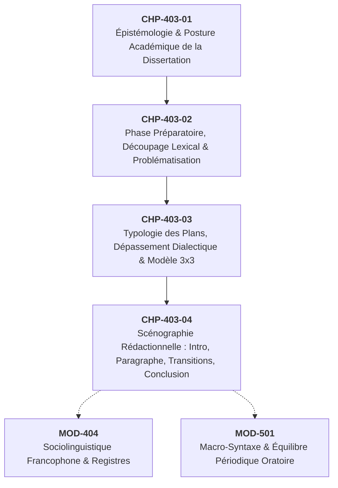

# Chapitre 3 — Typologie Architecturale des Plans et Art du Dépassement Dialectique : Du Plan Dialectique au Modèle 3x3

> **Identifiant du chapitre** : `CHP-403-03`  
> **Module de rattachement** : [`MOD-403` — Méthodologie Universitaire de la Dissertation et de l'Essai Académique](file:///f:/Formation/world-class-french/03-curriculum/year-2/semester-4/mod-403-methodologie-dissertation-essai-academique.md)  
> **Semestre** : Année 2 — Semestre 4 (S4)  
> **Volume horaire estimé** : 5 à 6 heures d'apprentissage autonome délibéré et d'ateliers d'application (Phase 1 Étude : 1 h 30 | Phase 2 Pratique : 1 h 30 | Phase 3 Correction : 1 h 00 | Phase 4 Évaluation : 1 h 00)  
> **Statut** : [STATUT : VALIDÉ]  
> **Compétences associées** : [`FR-INT-001`](file:///f:/Formation/world-class-french/02-competency-framework/competency-framework.md#fr-int-001-rédiger-un-texte-long-cohérent-en-maîtrisant-accords-et-ponctuation) (L3 Autonomie), [`FR-ARGUM-001`](file:///f:/Formation/world-class-french/02-competency-framework/competency-framework.md#fr-argum-001-rigueur-démonstrative-réfutation-et-détection-des-sophismes) (L3 Autonomie), [`FR-STYLE-001`](file:///f:/Formation/world-class-french/02-competency-framework/competency-framework.md#fr-style-001-maîtrise-des-figures-de-rhétorique-et-commentaire-stylistique) (L3 Autonomie)  
> **Sources scientifiques de référence** : `SRC-RHET-03` (Reboul, 1991, chap. 4), `SRC-RHET-01` (Fontanier, 1827/1977), `SRC-GRAM-02` (Riegel et al., 2016, chap. 21), `SRC-NORM-03` (Ministère de l'Éducation nationale, 2020), `SRC-TYPO-01` (Imprimerie nationale, 2002/2014)

---

## 1. Titre et Place dans le Cursus

### 1.1 Intitulé Officiel
**Chapitre 3 : Typologie Architecturale des Plans et Art du Dépassement Dialectique : Du Plan Dialectique au Modèle 3x3** (`CHP-403-03`).

### 1.2 Insertion Architecturale dans le Cursus
Le présent chapitre constitue le cœur structurel du module `MOD-403`. Une fois la phase préparatoire d'autopsie sémantique et de problématisation achevée (`CHP-403-02`), l'étudiant doit bâtir l'armature logique qui portera l'ensemble de sa démonstration. Ce chapitre enseigne la morphologie des grands plans académiques, formalise la règle d'airain du modèle 3x3 (trois parties équilibrées subdivisées chacune en trois sous-parties rigoureuses, totalisant exactement neuf sous-parties) et résout le problème le plus aigu de la dissertation française : la dynamique de la relève dialectique (*Aufhebung* hégélienne), seule capable d'éradiquer définitivement le compromis mou relativiste en troisième partie.



- **En amont** : Ce chapitre s'appuie directement sur l'aporie et la question motrice élaborées lors de la problématisation (`CHP-403-02`), ainsi que sur l'outillage déductif et concessif acquis en rhétorique argumentative (`MOD-402`).
- **Au sein du module `MOD-403`** : Il fournit la matrice d'ordonnancement globale sans laquelle la scénographie rédactionnelle ([`CHP-403-04`](file:///f:/Formation/world-class-french/03-curriculum/year-2/semester-4/mod-403-methodologie-dissertation-essai-academique.md#chapitre-4--la-scénographie-rédactionnelle--introduction-paragraphe-transition-conclusion) : introduction en quatre temps, paragraphe canonique avec exemple déconstruit, transitions bilatérales et conclusion en deux temps) ne serait qu'un habillage ornemental plaqué sur du vide.
- **En aval dans le cursus** : L'art du plan 3x3 et la maîtrise de la dialectique conditionnent l'écriture des mémoires universitaires, l'éloquence de haute dispute ([`MOD-501`](file:///f:/Formation/world-class-french/03-curriculum/year-3/semester-5/mod-501-macro-syntaxe-periode-oratoire-cadences.md)) et la rédaction de la Monographie Capstone de fin d'études (`MOD-604`).

---

## 2. Objectifs Mesurables

Au terme des 5 à 6 heures d'apprentissage autonome et d'ateliers dirigés de ce chapitre, l'apprenant doit être capable de :

1. **Classifier et sélectionner l'architecture de plan adaptée** : identifier immédiatement, face à dix énoncés de concours variés (citations paradoxales, jugements esthétiques, questions notionnelles ou problématiques de société), le modèle architectural requis (plan dialectique, plan thématique ou plan analytique) en justifiant le choix par l'analyse logique de la consigne et du problème.
2. **Construire une armature 3x3 rigoureusement équilibrée** : concevoir une charpente intégrale composée très exactement de trois grandes parties ($I, II, III$) articulant chacune trois sous-parties ordonnées ($A, B, C$), soit un total canonique de neuf sous-parties étanches et solidaires gouvernées par une progression démonstrative cumulative (ordre nestorien ascendant).
3. **Formuler un véritable dépassement dialectique (*Aufhebung*) en Partie III** : éliminer toute dérive vers le compromis tiède ou le relativisme subjectif (*« un peu des deux »*, *« tout dépend des goûts »*) en déplaçant méthodiquement le débat vers un plan conceptuel supérieur qui redéfinit les termes et résout la contradiction apparente entre la thèse et l'antithèse [Réf. `SRC-RHET-03`, chap. 4].
4. **Rédiger des formules directrices d'axes à haute tenue stylistique** : formuler les intitulés conceptuels des neuf sous-parties sous forme de propositions affirmatives denses, impersonnelles et élégantes, en mobilisant le vocabulaire abstrait approprié (`FR-LEXIC-001`) et des figures d'articulation (antithèse, chiasme conceptuel, parallélisme) sans recours aux annonces scolaires plates (`FR-STYLE-001`).

---

## 3. Prérequis et Test de Préparation (Auto-Diagnostic)

### 3.1 Prérequis Cognitifs
- Avoir assimilé les étapes de l'autopsie sémantique et de la problématisation (`CHP-403-02`).
- Savoir distinguer un argument déductif d'un fait illustratif (`MOD-402`, `CHP-402-01`).
- Maîtriser les connecteurs logiques de concession, d'opposition et de rectification (`SRC-GRAM-02`, chap. 21).

### 3.2 Test de Préparation Immédiat
Répondez aux cinq questions suivantes avant d'engager l'étude du cours, puis déployez le volet de correction pour évaluer votre lucidité méthodologique.

1. Quelle différence de nature logique sépare un sujet demandant : *« La littérature doit-elle être engagée ? »* d'un sujet énonçant : *« Quelles sont les fonctions de la poésie ? »* ?
2. Dans un plan de dissertation dialectique, pourquoi l'articulation suivante est-elle condamnée par les jurys universitaires : *Partie I : Oui ; Partie II : Non ; Partie III : Peut-être / Cela dépend des époques et des sensibilités* ?
3. Que signifie le principe d'**étanchéité des axes** au sein d'une armature de plan ?
4. Dans quel ordre dynamique convient-il d'ordonner les trois sous-parties d'une grande partie : de la plus subtile à la plus évidente, ou de la plus matérielle/empirique à la plus abstraite/ontologique ?
5. Pourquoi un plan académique de lettres en France proscrit-il le schéma bipartite (deux parties, quatre sous-parties) au profit de l'architecture tripartite ?

---

<details>
<summary><b>Consulter le corrigé de l'auto-diagnostic</b></summary>

1. Le premier sujet pose une alternative tranchée invitant à une dispute critique sur une norme contestable : il requiert un **plan dialectique** confrontant l'exigence de l'engagement civique et la revendication de l'autonomie esthétique. Le second sujet est nominal et ouvert : il invite à un **plan thématique** explorant les dimensions complémentaires du phénomène poétique (lyrique, démiurgique, politique) sans antinomie frontale.
2. Cette formulation constitue l'archétype du **compromis mou** (ou synthèse tiède). Elle juxtapose deux thèses contradictoires sans les résoudre et abdique tout travail philosophique en se réfugiant dans un scepticisme paresseux ou un relativisme de bon aloi. La troisième partie doit surmonter la contradiction par un saut qualitatif conceptuel.
3. L'**étanchéité des axes** signifie qu'aucune sous-partie ne doit empiéter sur le domaine réservé d'une autre. Deux sous-parties distinctes ne doivent jamais manipuler les mêmes arguments sous des reformulations synonymiques, sous peine de piétinement discursif et de redondance.
4. Les sous-parties doivent suivre une **progression cumulative ascendante** (ordre nestorien) : on débute toujours par l'argument le plus tangible, intuitif ou littéral (A), pour s'élever vers l'argument structurel ou psychologique (B), et culminer dans l'argument métaphysique, philosophique ou universel le plus décisif (C).
5. Dans la tradition universitaire littéraire et philosophique française (ENS, Sorbonne, Agrégation), le **plan bipartite** est perçu comme une confrontation statique qui laisse l'esprit en suspens face à une contradiction non résolue. Seul le **plan tripartite** permet d'accomplir le cycle complet de la pensée : position, négation critique et relève synthétique.
</details>

---

## 4. Situation de Départ ou Problème Concret : Le Fléau du « Compromis Mou » et le Plan Bancal

### 4.1 Le Casse-Tête Universitaire de la Troisième Partie
Chaque année, lors des concours d'entrée aux grandes écoles et des examens de licence, les correcteurs déplorent la même faillite méthodologique : des milliers de candidats réussissent une analyse convenable du sujet, bâtissent une première partie solide (*« Pourquoi l'auteur a raison »*), esquissent une deuxième partie d'opposition honorable (*« Quelles sont les limites de sa thèse »*), puis s'effondrent lamentablement dans une troisième partie informe.

Considérons cette copie d'étudiant sur le sujet :  
*« L'art a-t-il pour vocation d'imiter la nature ? »*

```text
[COPIE D'ÉTUDIANT — EXTRAIT DU PLAN AU BROUILLON]
I. L'art imite fidèlement la nature (le réalisme, la peinture figurative, Balzac).
II. Mais l'art ne doit pas imiter la nature car il exprime l'imagination (le surréalisme, la musique abstraite).
III. En réalité, tout dépend des artistes et des goûts du public : certains préfèrent le réalisme, d'autres l'art abstrait, et l'art parfait est un juste milieu qui imite un peu la réalité tout en laissant parler la fantaisie.
```

Ce projet de plan représente la pathologie académique suprême : le **compromis mou relativiste**. En réduisant la troisième partie à une transaction commerciale ou à une fade moyenne statistique, le candidat détruit rétroactivement la rigueur de sa démarche. Il cesse d'être un enquêteur intellectuel pour devenir un conciliateur tiède.

### 4.2 L'Asymétrie Morphologique : Le Plan Bancal
À ce vice logique s'ajoute fréquemment le vice architectural : l'incapacité à maintenir l'équilibre des volumes. L'étudiant novice conçoit une Partie I hypertrophiée comptant quatre sous-parties prolixes, une Partie II essoufflée de deux sous-parties maigres, et une Partie III réduite à une sous-partie unique tenant lieu de conclusion hâtive. 

Une dissertation digne de ce nom n'est pas un agrégat spontané de pensées : elle est un édifice classique gouverné par des lois d'équilibre, de symétrie et de tension rationnelle comparables à celles d'un temple grec ou d'une tragédie de Racine.

---

## 5. Explication Intuitive : L'Analogie de la Montagne et de la Montgolfière

Pour saisir immédiatement la dynamique d'un plan dialectique authentique et le rôle de la troisième partie, imaginons une montagne colossale explorée par un géographe :

```text
                 [ MONTGOLFIÈRE ] -> Troisième Partie (Synthèse / Aufhebung)
                 Vue panoramique, géologie globale, compréhension du relief
                            ▲
                           / \
                          /   \
  Versant Sud (Thèse)    /     \    Versant Nord (Antithèse)
  Ensoleillé, fertile   /       \   Abrupt, rocailleux, ombragé
  (La réalité visible) /         \  (L'envers critique)
```

1. **La Première Partie (Versant Sud — La Thèse)** :  
   L'enquêteur gravit le versant sud. Le chemin est praticable, la lumière est éclatante, la végétation est luxuriante. Il observe et décrit ce versant avec enthousiasme et précision. Il établit la légitimité totale de ce point de vue : oui, la montagne est verdoyante, habitable et accueillante.
2. **La Deuxième Partie (Versant Nord — L'Antithèse)** :  
   Parvenu sur une crête, il découvre le versant nord. C'est une paroi abrupte de glace et de roche noire, balayée par les vents polaires. L'enquêteur ne nie pas ce qu'il a vu au sud ; mais il constate que son premier point de vue était partial et incomplet. Il descend explorer cette face austère et démontre avec une égale rigueur que la montagne est aussi obscurité, abîme et hostilité.
3. **Le Piège du Compromis Mou (L'Hésitation sur la Crête)** :  
   Que ferait un observateur naïf arrivé au sommet ? Il resterait assis sur la ligne de crête en déclarant d'un ton plat : *« Eh bien, la montagne est mi-chaude mi-froide, mi-verte mi-noire, et cela dépend de l'endroit où l'on pose sa tente. »* Une telle déclaration n'apporte aucune connaissance nouvelle ; elle juxtapose deux sensations sans rien expliquer de la montagne.
4. **La Troisième Partie Authentique (La Montgolfière — L'Aufhebung)** :  
   Le véritable savant monte dans une montgolfière et prend de l'altitude au-dessus du massif. Depuis le ciel, il embrasse les deux versants dans un regard synoptique unifié. Il comprend les forces tectoniques profondes qui ont plissé l'écorce terrestre, l'axe d'orientation par rapport au soleil et aux vents d'ouest qui explique pourquoi le versant sud verdit tandis que le versant nord gèle. **Il ne choisit pas entre le sud et le nord : il explique la nécessité de leur coexistence au sein d'une géologie supérieure.**

Voilà le dépassement dialectique : une élévation spéculative qui rend compte de la contradiction initiale et la résout dans un principe supérieur.

---

## 6. Définitions Précises et Terminologie

```text
+-------------------------------------------------------------------------------------------------------+
|                                    GLOSSAIRE TERMINOLOGIQUE CANONIQUE                                 |
+------------------------------------+------------------------------------------------------------------+
| Terme Technique                    | Définition Opératoire Universitaire                              |
+------------------------------------+------------------------------------------------------------------+
| Plan de dissertation               | Macro-structure logique ordonnée articulant la progression       |
|                                    | démonstrative répondant à la problématique formulée.              |
+------------------------------------+------------------------------------------------------------------+
| Plan dialectique                   | Architecture en trois temps régie par la confrontation d'une     |
|                                    | thèse et d'une antithèse, résolue dans une synthèse supérieure.  |
+------------------------------------+------------------------------------------------------------------+
| Aufhebung hégélienne               | Opération dialectique tripartite consistant simultanément à      |
| (Relève / Dépassement)             | supprimer l'opposition binaire, en conserver les acquis partiels |
|                                    | et élever le débat à un niveau conceptuel supérieur.            |
+------------------------------------+------------------------------------------------------------------+
| Compromis mou (synthèse tiède)     | Fausse synthèse relativiste qui se borne à juxtaposer deux thèses|
|                                    | contraires sans les surmonter (« un peu des deux », « cela dépend »). |
+------------------------------------+------------------------------------------------------------------+
| Plan thématique                    | Architecture explorant méthodiquement les différentes facettes   |
|                                    | d'une même notion ou d'une question générale sans conflit binaire.|
+------------------------------------+------------------------------------------------------------------+
| Plan analytique                    | Schéma discursif diachronique ou causal articulé en : Constat /  |
| (Plan d'examen causal)             | Causes profondes / Conséquences et perspectives de remèdes.      |
+------------------------------------+------------------------------------------------------------------+
| Architecture 3x3                   | Règle d'équilibre absolu imposant 3 grandes parties divisées     |
|                                    | chacune en 3 sous-parties, totalisant 9 sous-parties canoniques. |
+------------------------------------+------------------------------------------------------------------+
| Progression cumulative             | Ordonnancement ascendant des arguments au sein d'un axe, allant  |
| (Ordre nestorien)                  | du plus évident et matériel au plus abstrait et philosophique.   |
+------------------------------------+------------------------------------------------------------------+
| Étanchéité des axes                | Propriété assurant qu'aucune sous-partie ne chevauche ni ne      |
|                                    | paraphrase le champ conceptuel ou les arguments d'une autre.     |
+------------------------------------+------------------------------------------------------------------+
| Formule directrice d'axe           | Phrase complète et assertive formulant la thèse théorique d'une  |
|                                    | sous-partie, exempte de métalangage scolaire d'annonce.          |
+------------------------------------+------------------------------------------------------------------+
```

---

## 7. Règles ou Mécanismes Fondamentaux

### 7.1 Le Plan Dialectique Canonique et la Dynamique de l'*Aufhebung*

Le plan dialectique est l'arme maîtresse de la dissertation universitaire. Il s'impose dès lors que le sujet contient une citation provocatrice, une question fermée (*« Doit-on... ? »*, *« Peut-on affirmer que... ? »*) ou un dilemme théorique confrontant deux valeurs en conflit.

```text
    PARTIE I : THÈSE (Établissement du bien-fondé de la proposition)
       │
       ▼  [Transition critique : identification des angles morts et contre-exemples]
    PARTIE II : ANTITHÈSE (Épreuve des limites intrinsèques et objection)
       │
       ▼  [Transition spéculative : dépassement vers un principe intégrateur]
    PARTIE III : SYNTHÈSE / AUFHEBUNG (Relève conceptuelle et redéfinition)
```

#### A. La Partie I (La Thèse) : Établir la légitimité et la force de la proposition
La première partie n'est pas un survol superficiel : elle prend au sérieux la proposition du sujet ou la citation d'auteur. L'étudiant en déploie toute la vérité historique, esthétique ou psychologique. Il montre pourquoi cette idée s'est imposée, quelles évidences la soutiennent et en quoi elle éclaire puissamment l'expérience humaine.
- *Règle d'or* : Interdiction formelle de saboter la Partie I sous prétexte qu'on la critiquera en Partie II. Plus la Partie I est solide et persuasive, plus la crise ouverte en Partie II sera dramatique et intellectuellement féconde.

#### B. La Partie II (L'Antithèse / L'Objection critique) : Éprouver les limites intrinsèques
La deuxième partie ne consiste pas à affirmer bêtement le contraire de la première (*« En fait, tout ce que j'ai dit en I était faux »*). Une telle volte-face infantiliserait la pensée. L'antithèse est un **approfondissement critique** : elle dévoile les angles morts, les impasses logiques, les présupposés contestables ou les contre-exemples irréductibles qui résistent à la thèse de la Partie I.
- *Règle d'or* : L'antithèse ne détruit pas la thèse : elle en délimite le domaine de validité. Elle démontre que la vérité affirmée en Partie I devient une erreur dès lors qu'elle prétend à une souveraineté universelle et exclusive.

#### C. La Partie III (La Synthèse dialectique / L'*Aufhebung*) : La Relève conceptuelle
Ici réside l'épreuve de vérité. La troisième partie doit satisfaire aux trois exigences simultanées de l'*Aufhebung* :
1. **Supprimer (*aufheben* au sens d'annuler)** : Montrer que l'antagonisme entre I et II reposait sur une définition réductrice ou un faux dilemme qu'il faut dissoudre.
2. **Conserver (*aufheben* au sens de préserver)** : Sauvegarder ce que la thèse et l'antithèse avaient chacune de rigoureusement exact dans leurs ordres respectifs.
3. **Élever (*aufheben* au sens d'exhausser)** : Déplacer l'interrogation vers un niveau philosophique ou esthétique supérieur où les deux termes initiaux apparaissent comme les deux faces solidaires d'une réalité plus profonde [Réf. `SRC-RHET-03`, chap. 4].

> [!CAUTION]
> **PROSCRIPTION ABSOLUE DU COMPROMIS TIÈDE**  
> Tout énoncé de Partie III reposant sur les formules : *« Tout dépend des points de vue »*, *« Il faut trouver un juste milieu »*, *« Les deux aspects se mélangent dans la pratique »* ou *« C'est une question de goût personnel »* sera sanctionné par un retrait immédiat de **5 points** sur l'évaluation globale du devoir.

---

### 7.2 La Typologie Comparative des Plans Académiques

Tous les sujets ne relèvent pas du plan dialectique. Sélectionner un plan dialectique sur un sujet purement thématique conduit au contresens ; plaquer un plan thématique sur un sujet dialectique conduit à l'esquive lâche du problème.

```text
                             TYPOLOGIE TRIPARTITE DES PLANS ACADÉMIQUES
                                                  │
         ┌────────────────────────────────────────┼────────────────────────────────────────┐
         │                                        │                                        │
         ▼                                        ▼                                        ▼
   PLAN DIALECTIQUE                         PLAN THÉMATIQUE                          PLAN ANALYTIQUE
  (Thèse / Antithèse /                    (Approche notionnelle                   (Constat / Causes /
    Dépassement)                           ou dimensionnelle)                     Conséquences-Remèdes)
         │                                        │                                        │
Conflit de normes,                        Exploration ordonnée                     Examen d'un phénomène
citations polémiques,                     de facettes d'un concept,                de société, crise,
questions fermées.                        définitions, sujets ouverts.             évolution des mœurs.
```

#### A. Le Plan Thématique (Exploration méthodique sans conflit binaire)
- **Champ d'application** : Sujets nominaux (*« Qu'est-ce qu'un grand roman ? »* ; *« La poésie et la mort »*) ou questions d'appréciation générale (*« Quelles sont les valeurs de l'éloquence républicaine ? »*).
- **Structure type** : Les trois parties n'opposent pas des thèses adverses ; elles explorent les cercles concentriques d'une notion, de son niveau le plus immédiat à sa portée la plus métaphysique :
  - *Partie I* : Dimension formelle, matérielle ou psychologique immédiate.
  - *Partie II* : Dimension sociale, politique ou éthique intersubjective.
  - *Partie III* : Dimension métaphysique, ontologique ou symbolique universelle.
- **Écueil à éviter** : Le catalogue arbitraire où les trois parties pourraient être interverties sans dommage. La progression doit être impérativement ascendante.

#### B. Le Plan Analytique (L'Anatomie du Phénomène)
- **Champ d'application** : Sujets d'histoire des idées, d'évolution sociolinguistique ou d'examen de crises culturelles (*« La désaffection contemporaine pour la lecture chez les jeunes générations »* ; *« L'expansion des anglicismes dans le lexique économique francophone »*).
- **Structure canonique** :
  - *Partie I* : Diagnostic et manifestations tangibles du phénomène (Le constat empirique).
  - *Partie II* : Racines socio-historiques, technologiques et logiques (Les causes profondes).
  - *Partie III* : Portée prospective, dérives potentielles et voies de dépassement ou de refondation (Les conséquences et remèdes).

---

### 7.3 La Règle d'Airain de l'Architecture 3x3

L'excellence académique en France repose sur la règle de proportion classique formalisée dans la matrice $3 \times 3$ :

$$\text{Volume total canonique} = 3 \text{ grandes parties} \times 3 \text{ sous-parties} = 9 \text{ sous-parties}$$

```text
               MATRICE GÉOMÉTRIQUE DU MODÈLE 3x3 (EXACTEMENT 9 UNITÉS)
┌───────────────────────────┬───────────────────────────┬───────────────────────────┐
│ PARTIE I (THÈSE)          │ PARTIE II (ANTITHÈSE)     │ PARTIE III (DÉPASSEMENT)  │
├───────────────────────────┼───────────────────────────┼───────────────────────────┤
│ • Sous-partie I.A         │ • Sous-partie II.A        │ • Sous-partie III.A       │
│   (Constat empirique)     │   (Aporie immédiate)      │   (Déplacement du cadre)  │
│                           │                           │                           │
│ • Sous-partie I.B         │ • Sous-partie II.B        │ • Sous-partie III.B       │
│   (Mécanique formelle)    │   (Limite éthique/sociale)│   (Principe d'unification)│
│                           │                           │                           │
│ • Sous-partie I.C         │ • Sous-partie II.C        │ • Sous-partie III.C       │
│   (Conséquence majeure)   │   (Impasse ontologique)   │   (Souveraineté refondée) │
└───────────────────────────┴───────────────────────────┴───────────────────────────┘
```

1. **Équilibre volumétrique absolu** :  
   Chaque grande partie doit occuper rigoureusement le même nombre de pages ou de paragraphes dans la copie définitive (environ un tiers du développement chacune). Deux sous-parties dans une partie et quatre dans une autre constituent une faute architecturale majeure.
2. **La Progression Cumulative (Ordre Nestorien)** :  
   Homère raconte dans l'*Iliade* que le sage Nestor disposait son armée en plaçant les troupes moyennes au front pour engager le combat, les troupes les plus faibles au centre pour les contraindre à tenir, et les guerriers d'élite à l'arrière-garde pour emporter la décision finale.  
   Dans la dissertation, la dynamique est strictement croissante :
   - **Sous-partie A** : Argument le plus accessible, matériel, immédiatement visible dans le texte ou l'histoire.
   - **Sous-partie B** : Argument structural, psychologique ou sociologique, nécessitant une déconstruction conceptuelle plus exigeante.
   - **Sous-partie C** : Argument philosophique, esthétique ou éthique de fond, qui emporte l'adhésion finale de l'esprit et justifie la transition vers la partie suivante.

---

### 7.4 L'Étanchéité et la Solidarité des Axes

Une architecture 3x3 n'est pas une simple liste à puces : elle est régie par deux principes vectoriels complémentaires :

```text
               ÉTANCHÉITÉ (Indépendance)
         [Sous-partie A]  ≠  [Sous-partie B]  ≠  [Sous-partie C]
              │                    │                    │
              ▼                    ▼                    ▼
        ─────────────────────────────────────────────────────────
                       SOLIDARITÉ (Convergence)
                                   │
                                   ▼
                   [THÈSE DE LA GRANDE PARTIE I]
```

- **Le Principe d'Étanchéité** :  
  Chaque sous-partie possède un territoire conceptuel propre. Si la sous-partie I.A démontre la fonction cathartique de la terreur théâtrale, la sous-partie I.B ne doit pas réintroduire subrepticement la pitié ou l'effroi sous une formulation analogue. Elle doit aborder un angle radicalement distinct (par exemple, la mise à nu de l'illusion des grandeurs politiques).
- **Le Principe de Solidarité** :  
  Chaque sous-partie doit être un pilier soutenant directement la voûte de la grande partie. Une sous-partie brillante et séduisante mais qui s'écarte du chapeau de sa partie directrice est une pierre hors de l'arc : elle menace l'édifice d'effondrement par hors-sujet partiel.

---

## 8. Raisonnement Détaillé : Pourquoi Hegel Récuse-t-il le Moyen Terme Tiède ?

Pour comprendre l'exigence intellectuelle du plan dialectique, il convient d'en examiner les fondements philosophiques dans l'idéalisme allemand, singulièrement chez Hegel (*Phénoménologie de l'esprit*, 1807 ; *Science de la logique*, 1812).

### 8.1 La Contradiction comme Moteur Vital de l'Esprit
Dans la logique formelle aristotélicienne régie par le principe de non-contradiction, une proposition ne peut pas être simultanément vraie et fausse sous le même rapport ($A \neq \text{non-}A$). Si l'on affirme que le roman est mensonge, il ne peut pas être vérité.

Hegel révolutionne cette perspective : pour lui, **la contradiction n'est pas une anomalie ou une panne de la pensée, elle est le ressort même de la vie et de l'histoire**. Une vérité figée, univoque, qui ne rencontre aucun obstacle, est une vérité morte. Pour devenir féconde et réelle, une vérité doit s'extérioriser, s'opposer à elle-même, faire l'épreuve de son contraire.

### 8.2 La Ruine du Juste Milieu Aristotélicien
Dans le domaine moral, Aristote louait le juste milieu (*in medio stat virtus*) : le courage est la moyenne entre la lâcheté et la témérité. Mais dans le domaine spéculatif de la dissertation, **le juste milieu est la mort de l'intelligence**.

Pourquoi ? Parce que le juste milieu arithmétique ou transactionnel laisse subsister les deux termes dans leur médiocrité initiale sans rien apprendre de neuf :
- Si l'on dit : *« L'art est un peu réaliste et un peu imaginaire »*, on n'a ni compris ce qu'est la réalité, ni compris ce qu'est l'art.
- Le dépassement dialectique ne consiste pas à couper la poire en deux, mais à comprendre que **c'est précisément parce que l'art est fictionnel qu'il accède à la vérité réelle**. La fiction n'est pas un masque plaqué sur la réalité pour l'édulcorer ; elle est le scalpel qui découpe l'opacité du monde pour en révéler les lois invisibles.

La troisième partie triomphe lorsqu'elle montre que **la contradiction entre I et II était la condition nécessaire pour faire émerger une vérité supérieure** que ni I ni II ne pouvaient concevoir isolément.

---

## 9. Exemples Corrects Commentés : Décorticage de Deux Plans 3x3 Modèles

### 9.1 Modèle Dialectique Littéraire Intégral (9 Sous-Parties Formulées)

> **SUJET D'EXAMEN** :  
> *« Un roman est un miroir qui se promène sur une grande route. Tantôt il reflète à vos yeux l'azur des cieux, tantôt la fange des bourbiers de la route. »* (Stendhal, *Le Rouge et le Noir*, 1830).  
> **Consigne** : Vous discuterez cette conception de l'art romanesque à la lumière de vos lectures.

#### Problématique Formulée
Le roman se réduit-il à un enregistrement passif et exhaustif de la contingence du monde, ou sa grandeur esthétique réside-t-elle plutôt dans la transfiguration poétique du réel opérée par une conscience souveraine ?

#### Plan Détaillé Canonique 3x3

```text
I. LA VOCATION MIMÉTIQUE DU ROMAN : LA REVENDICATION DE LUCIDITÉ DOCUMENTAIRE ET EMPIRIQUE
   A. Le miroir ambulant contre l'idéalisme mièvre : enregistrer sans fard la prosaïcité des mœurs contemporaines.
      [Exemple : Balzac, Avant-propos de La Comédie humaine, la concurrence à l'état civil].
   B. L'accueil des contrastes moraux et sociaux : réfléchir simultanément la splendeur des idéaux et l'abjection du monde.
      [Exemple : Stendhal, Le Rouge et le Noir, Julien Sorel oscillant entre ferveur napoléonienne et compromissions cléricales].
   C. La fonction de dégrisement civique : soustraire le lecteur à la tentation romanesque par l'exactitude clinique.
      [Exemple : Flaubert, Madame Bovary, l'agonie médicale d'Emma comme réfutation de l'illusion sentimentale].

II. LES LIMITES DE L'ANALOGIE SPÉCULAIRE : L'ÉCHEC DU REFLET ET L'INVENTIVITÉ IRRÉDUCTIBLE DU RÉCIT
   A. L'illusion d'optique de la transparence : tout miroir implique un cadre, un angle mort et un choix énonciatif orienté.
      [Exemple : Maupassant, Préface de Pierre et Jean, réfutation du réalisme pur par la nécessité d'une illusion complète].
   B. La trahison du réel par l'artifice formel : l'ordonnancement de l'intrigue et le travail du style imposent un ordre étranger au désordre de la route.
      [Exemple : Proust, Du côté de chez Swann, la primauté du rythme de la phrase sur le réalisme anecdotique].
   C. Le mensonge fécond de l'imaginaire : l'invention fictionnelle et le symbolisme ouvrent des espaces spirituels que nulle route ne contient.
      [Exemple : Julien Gracq, Le Rivage des Syrtes, la création d'une géographie fabuleuse pour sonder l'angoisse historique].

III. LE DÉPASSEMENT DIALECTIQUE : LE ROMAN COMME HERMÉNEUTIQUE TRANSFIGURATRICE DU MONDE
   A. Le miroir actif : la fiction ne duplique pas le monde, elle en extrait la structure intelligible dissimulée sous le chaos des faits.
      [Exemple : Émile Zola, Germinal, la métaphore du Voreux comme dévoilement de la mécanique féroce du capitalisme minier].
   B. La transfiguration esthétique de la fange : le style élève la laideur du monde vécu à la dignité de vérité poétique universelle.
      [Exemple : Céline, Voyage au bout de la nuit, l'argot stylisé transmuant la misère des tranchées en cri métaphysique].
   C. La refondation de l'expérience humaine : c'est par l'artifice de son architecture imaginaire que le roman rend le lecteur plus conscient de sa propre liberté.
      [Exemple : Milan Kundera, L'Art du roman, le roman comme découverte continue des possibilités existentielles de l'homme].
```

---

### 9.2 Modèle Thématique d'Esthétique Intégral (9 Sous-Parties Formulées)

> **SUJET D'EXAMEN** :  
> *« Qu'est-ce qui confère à une œuvre d'art son statut de classique ? »*  
> **Consigne** : Vous proposerez une réflexion ordonnée sur les critères et la dynamique de la classicité littéraire.

#### Problématique Formulée
La classicité d'une œuvre découle-t-elle d'une conformité canonique à des règles formelles d'époque, ou s'enracine-t-elle dans une puissance inépuisable de réinterprétation qui transcende la finitude de son contexte de création ?

#### Plan Détaillé Canonique 3x3

```text
I. LE CLASSIQUE COMME MAÎTRISE ET MONUMENTALITÉ FORMELLE : LA DIGNITÉ DE L'ÉPURE
   A. La perfection de l'économie stylistique : la recherche d'une langue claire, mesurée et libérée des facilités de la mode éphémère.
      [Exemple : Racine, Phèdre, la rigueur de l'alexandrin tragique concentrant la fureur des passions sans débordement verbal].
   B. La composition équilibrée et l'harmonie structurelle : la soumission concertée des parties à la cohérence rigoureuse de l'ensemble.
      [Exemple : La Fontaine, Fables, la mécanique parfaite de l'apologue où narration et morale s'engrènent sans hiatus].
   C. La fixation d'un étalon linguistique pour la communauté : l'accession de l'œuvre au rang d'exemplarité pédagogique et rhétorique.
      [Exemple : Boileau, Art poétique, la théorisation prescriptive de la raison et du travail de la lime].

II. LE CLASSIQUE COMME HERMÉNEUTIQUE ANTHROPOLOGIQUE : L'EXPLORATION DE LA VÉRITÉ HUMAINE
   A. L'élucidation des ressorts psychologiques pérennes : peindre les invariants du cœur humain par-delà les variations sociologiques.
      [Exemple : Molière, Le Misanthrope, la dialectique indémodable entre intransigeance morale et compromis mondain].
   B. La mise en scène des dilemmes éthiques et politiques : affronter les conflits irréductibles qui déchirent la condition des citoyens.
      [Exemple : Sophocle, Antigone, la collision tragique entre la loi positive de l'État et l'impératif moral transcendant].
   C. La lucidité désenchantée face à la fragilité de l'existence : inscrire au cœur de la perfection la conscience aiguë de la mort.
      [Exemple : Pascal, Pensées, l'analyse microscopique de la misère de l'homme sans Dieu et du divertissement].

III. LE CLASSIQUE COMME DISPONIBILITÉ INFINIE : LE POUVOIR DE RÉINVENTION DU SENS
   A. L'indécision constitutive du texte : une réserve inépuisable d'ambiguïté qui déjoue toute lecture dogmatique ou réductrice.
      [Exemple : Shakespeare, Hamlet, la prolifération des interprétations psychanalytiques, politiques et existentielles du doute].
   B. La résistance aux mutations historiques : la capacité à s'émanciper de son sol natal pour féconder des cultures lointaines.
      [Exemple : Aimé Césaire, Une Tempête, la réappropriation caribéenne et postcoloniale du drame shakespearien].
   C. L'interpellation directe de la conscience moderne : l'œuvre classique comme miroir critique dévoilant les angles morts de notre propre présent.
      [Exemple : Italo Calvino, Pourquoi lire les classiques, le classique comme texte qui n'a jamais fini de dire ce qu'il a à dire].
```

---

## 10. Contre-Exemples et Erreurs Fréquentes : Clinique des 6 Pathologies Architecturales

### Erreur n° 1 : Le compromis mou relativiste en Partie III
- **Diagnostic clinique** : Après avoir confronté deux thèses en I et II, l'étudiant renonce à penser en III en proposant une synthèse transactionnelle : *« En réalité, il n'y a pas de vérité absolue, chacun voit midi à sa porte et l'art combine un peu de vérité et un peu de fiction selon la volonté de chaque créateur »*.
- **Réfutation savante** : La dissertation est une enquête rationnelle, non un sondage d'opinion bienveillant. Le rôle du scripteur n'est pas de plaire à tout le monde en nivelant les désaccords, mais de démontrer pourquoi la contradiction apparente procède d'un cadre conceptuel étroit qu'il faut élargir [SRC-RHET-03, chap. 4].
- **Rectification normée** : Déplacer le débat en requalifiant la notion : montrer par exemple que la fiction n'est pas un obstacle à la vérité, mais l'appareil optique nécessaire pour percevoir une vérité plus haute.

### Erreur n° 2 : Le plan asymétrique ou déséquilibré
- **Diagnostic clinique** : Une copie présente quatre sous-parties en Partie I (occupant six pages), deux sous-parties en Partie II (deux pages), et une unique sous-partie squelettique en Partie III (une demi-page rédigée à la hâte avant la fin de l'épreuve).
- **Réfutation savante** : L'architecture de la dissertation française symbolise la maîtrise de soi et la rigueur méthodique de l'auteur. L'asymétrie témoigne d'un défaut fatal de planification au brouillon et d'une gestion défaillante du temps d'épreuve.
- **Rectification normée** : Respecter rigoureusement la métrique $3 \times 3$. Chaque grande partie reçoit très exactement trois sous-parties, occupant chacune un volume textuel équivalent ($\approx 300$ à 350 mots par grande partie pour un devoir de 1 000 à 1 200 mots).

### Erreur n° 3 : La contradiction interne entre deux sous-parties d'une même partie
- **Diagnostic clinique** : Au sein de la Partie I (consacrée à démontrer la puissance transgressive de la littérature), l'étudiant insère une sous-partie I.B affirmant : *« Mais beaucoup d'écrivains écrivent uniquement pour divertir sans chercher à déranger qui que ce soit »*.
- **Réfutation savante** : Violation directe du principe de **solidarité des axes**. L'étudiant dynamite sa propre démonstration de l'intérieur en introduisant prématurément un argument d'antithèse au cœur de sa thèse, semant la confusion mentale chez le lecteur.
- **Rectification normée** : Toute objection ou contre-exemple doit être consigné au brouillon pour être déployé méthodiquement dans la Partie II. La Partie I doit être imperméable aux doutes qui feront l'objet de la partie suivante.

### Erreur n° 4 : Le plan juxtaposé façon catalogue sans progression dynamique
- **Diagnostic clinique** : Un devoir sur le théâtre présente les trois parties suivantes : *I. Le théâtre au XVIIe siècle ; II. Le théâtre au XVIIIe siècle ; III. Le théâtre au XIXe siècle* ; ou encore : *I. La tragédie ; II. La comédie ; III. Le drame*.
- **Réfutation savante** : Ce n'est pas un plan de dissertation universitaire, mais une table des matières descriptive d'un manuel scolaire. Les parties se succèdent par simple juxtaposition chronologique ou générique, sans aucun lien de nécessité logique. On pourrait inverser I et II sans changer la nature du texte.
- **Rectification normée** : Remplacer l'énumération par une progression conceptuelle d'idées : partir de la fonction rituelle de l'illusion (I), éprouver la contestation politique du jeu (II), pour aboutir à la métamorphose ontologique du spectateur (III).

### Erreur n° 5 : La confusion entre plan dialectique et plan thématique
- **Diagnostic clinique** : Face au sujet : *« La poésie doit-elle se faire l'écho de la cité en crise ? »*, le candidat propose : *I. La poésie lyrique amoureuse ; II. La poésie mystique religieuse ; III. La poésie engagée*.
- **Réfutation savante** : L'étudiant esquive la question impérative du sujet (*« Doit-elle... ? »*) par un survol typologique hors-sujet. Il répond à la question *« Quels sont les genres de poèmes ? »* au lieu de trancher le débat normatif sur l'obligation morale d'engagement.
- **Rectification normée** : Dès que l'énoncé contient une injonction normative ou un dilemme déontologique, le plan dialectique est obligatoire (I. Légitimité de la responsabilité civique du poète ; II. Danger de l'instrumentalisation idéologique et perte de souveraineté du verbe ; III. La poésie comme refondation spirituelle du langage au service de l'émancipation humaine).

### Erreur n° 6 : La troisième partie transformée en récapitulation stérile de la première
- **Diagnostic clinique** : L'étudiant consacre la Partie III à répéter avec des synonymes les arguments de la Partie I : *« Finalement, après avoir vu que la thèse avait des faiblesses, nous constatons que l'auteur avait tout de même raison dans l'ensemble »*.
- **Réfutation savante** : L'enquête piétine et tourne en rond. Si la Partie III dit la même chose que la Partie I, la Partie II n'était qu'une parenthèse décorative inutile et le devoir souffre de tautologie structurelle.
- **Rectification normée** : La Partie III doit apporter une **plus-value conceptuelle neuve**. Elle ne revient pas en arrière ; elle prend appui sur le conflit entre I et II pour découvrir un troisième terme qui n'avait pas encore été nommé dans le devoir.

---

## 11. Cas Particuliers et Limites

### 11.1 Le Plan en Deux Parties (Bipartite) : Sphère Administrative vs Sanctuaire Littéraire
Dans les concours de l'Institut National du Service Public (INSP / ex-ENA) et les facultés de droit, la note de synthèse et la dissertation juridique s'organisent traditionnellement en **deux parties et deux sous-parties** ($2 \times 2$). Cette bipartition répond à une exigence d'aide à la décision administrative (I. Le cadre juridique et les difficultés constatées / II. Les solutions opérationnelles et leurs modalités de mise en œuvre).

> [!WARNING]
> **PROSCRIPTION FORMELLE DU BIPARTISME DANS LES CONCOURS LITTÉRAIRES ET PHILOSOPHIQUES**  
> Aux concours de l'École Normale Supérieure (Ulm, Lyon), du CAPES et de l'Agrégation de Lettres ou de Philosophie, adopter un plan en deux parties est considéré comme un refus de dépasser la contradiction. La note est systématiquement plafonnée en dessous de la moyenne par sanction méthodologique. L'architecture $3 \times 3$ demeure l'unique norme reçue.

### 11.2 Le Traitement des Sujets de Réfutation Immédiate
Certains sujets de concours comportent une thèse délibérément outrancière ou une contre-vérité provocatrice d'auteur (ex. : *« La poésie n'est qu'un jeu d'enfants oisifs qui n'a rien à apprendre aux adultes »*).
- **Le piège** : Consacrer une Partie I entière à prétendre hypocritement que la poésie est effectivement un jeu d'enfants méprisable, ce qui contraindrait le candidat à soutenir une absurdité manifeste.
- **La parade méthodologique** : Pratiquer l'**examen généalogique du préjugé**.  
  - *Partie I* : Déconstruire le fondement de cette méfiance : comprendre pourquoi la société utilitariste et bourgeoise est tentée de réduire le poète à un parasite oisif (analyser les apparences de gratuité et de futilité du vers).
  - *Partie II* : Démontrer au contraire la portée subversive et philosophique de la poésie comme refus de l'arraisonnement économique du monde.
  - *Partie III* : Conclure que ce « jeu » apparent est l'activité la plus sérieuse de l'homme, en ce qu'il préserve l'accès au sacré et à l'authenticité de l'existence.

---

## 12. Approfondissement Adapté au Niveau : La Triade Fichte-Hegel et l'Auto-Mouvement du Concept

L'expression célèbre *« Thèse - Antithèse - Synthèse »* est universellement attribuée à Hegel dans l'enseignement secondaire français. Pourtant, sur le plan de la philologie philosophique rigoureuse, **cette attribution est un anachronisme historique**.

### 12.1 L'Origine Kantienne et la Formalisation de Fichte
La formule tripartite provient de la *Doctrine de la science* (*Wissenschaftslehre*, 1794) de Johann Gottlieb Fichte, inspirée des catégories de Kant. Fichte pose :
1. La thèse : Le Moi pose originairement son propre être (*Ich bin Ich*).
2. L'antithèse : Au Moi s'oppose un Non-Moi.
3. La synthèse : Le Moi pose dans le Moi un Non-Moi divisible en face d'un Moi divisible.

Chez Fichte, cette triade est encore un schéma logique abstrait appliqué de l'extérieur aux objets de pensée.

### 12.2 La Critique Hégélienne et la Dialectique Vivante
Dans la Préface de la *Phénoménologie de l'esprit* (1807), Hegel critique sévèrement cette méthode lorsqu'elle devient un procédé mécanique préfabriqué qu'il qualifie avec mépris de *« formalisme monochrome »* ou de *« squelette d'idées étiquetées »*.

Pour Hegel, les moments de la dialectique ne sont pas des tiroirs extérieurs où l'on range des exemples :
- **Le moment abstrait ou intellectuel** : L'entendement saisit une notion sous sa forme unilatérale et isolée (l'affirmation immédiate).
- **Le moment dialectique ou négatif-rationnel** : Cette notion finie se contredit elle-même au contact du réel et engendre sa propre négation (la négation déterminée).
- **Le moment spéculatif ou positif-rationnel** : La raison saisit l'unité des déterminations opposées au sein de leur déchirement même : c'est la **négation de la négation**, l'élévation au concret spirituel (*Aufhebung*).

Pour l'étudiant en dissertation, cette distinction est libératrice : faire de la dialectique, ce n'est pas remplir trois boîtes préfabriquées ; c'est **épouser le mouvement organique par lequel une idée se déploie, rencontre sa propre limite et se métamorphose en une vérité plus haute**.

---

## 13. Comparaisons Différentielles

### 13.1 Dépassement Dialectique (*Aufhebung*) vs Compromis Mou (Synthèse Tiède)

| Critère d'Analyse | Dépassement Dialectique Authentique (*Aufhebung*) | Compromis Mou Relativiste (Synthèse Tiède) |
| :--- | :--- | :--- |
| **Opération conceptuelle** | Saut qualitatif : déplacement vers un plan supérieur qui redéfinit les termes du litige. | Égalisation quantitative : addition de pourcentages ou juste milieu arithmétique. |
| **Statut de la contradiction** | La contradiction est reconnue comme féconde et résolue par intégration structurelle. | La contradiction est esquivée ou niée par un appel paresseux à la tolérance. |
| **Apport cognitif** | Production d'un concept unificateur neuf qui éclaire rétroactivement I et II. | Tautologie stérile : juxtaposition de platitudes déjà énoncées dans les parties précédentes. |
| **Postulat philosophique** | La vérité est un devenir dynamique et cohérent de la raison en acte. | Relativisme subjectif désabusé : *« Chacun a sa vérité »*, *« Tout dépend des goûts »*. |
| **Formule d'amorce type** | *« Dès lors, la fiction n'est pas un obstacle au réel, mais l'instrument même de son intelligibilité... »* | *« Cependant, il faut savoir nuancer car l'art imite parfois le réel et invente parfois... »* |

---

### 13.2 Plan Dialectique vs Plan Thématique vs Plan Analytique

| Dimension Méthodologique | Plan Dialectique | Plan Thématique | Plan Analytique |
| :--- | :--- | :--- | :--- |
| **Sujets types** | Citations provocatrices, questions fermées (*« Faut-il... ? »*), antinomies d'idées. | Sujets nominaux (*« La mémoire »*), questions ouvertes (*« Qu'est-ce qu'un chef-d'œuvre ? »*). | Phénomènes sociétaux, crises culturelles, histoire des formes et des usages. |
| **Dynamique motrice** | Tension dramatique : Thèse $\rightarrow$ Crise de l'Antithèse $\rightarrow$ Relève supérieure. | Cercles concentriques : Approfondissement vertical du singulier à l'universel. | Enchaînement causal : Constat empirique $\rightarrow$ Causes racines $\rightarrow$ Portée et remèdes. |
| **Risque majeur / Piège** | Chute dans le compromis mou ou destruction de I par II sans synthèse. | Catalogue plat façon liste à puces sans nécessité logique dans l'enchaînement. | Dérive sociologique informe hors du champ littéraire ou philosophique. |

---

### 13.3 Progression Cumulative vs Juxtaposition d'Arguments

| Propriété | Progression Cumulative (Ordre Nestorien Ascendant) | Juxtaposition Linéaire (Délit de Catalogue) |
| :--- | :--- | :--- |
| **Principe d'enchaînement** | Chaque sous-partie s'appuie sur la précédente pour s'élever en abstraction. | Les arguments sont déposés côte à côte comme des articles de supermarché. |
| **Permutabilité** | **Rigoureusement impossible** : intervertir A et C détruirait la logique démonstrative. | Totale : on pourrait échanger la sous-partie A et la sous-partie B sans gêne. |
| **Formule d'articulation** | *« Non seulement... mais cette mécanique révèle en son fond... »* | *« De plus... d'autre part... ajoutons à cela que... »* |
| **Effet sur le correcteur** | Sensation d'une pensée qui progresse avec autorité vers son sommet démonstratif. | Sensation d'ennui face à un scripteur qui meuble l'espace sans savoir où il va. |

---

## 14. Exercices Progressifs (3 Niveaux de Pratique Délibérée)

### 14.1 Niveau 1 : Sélection et Justification du Type de Plan Approprié (10 Sujets de Concours)
Pour chacun des dix sujets réels de concours ci-dessous, déterminez le plan canonique requis (**Dialectique**, **Thématique** ou **Analytique**) et rédigez en deux phrases la justification logique de votre choix.

1. *« La poésie a-t-elle pour fin de nous consoler de la mort ? »*
2. *« Qu'est-ce qu'un héros de roman ? »*
3. *« La crise contemporaine de l'attention face aux flux d'écrans numériques chez les jeunes lecteurs. »*
4. *« Le théâtre est-il une tribune politique ou un jeu d'illusions ? »*
5. *« Les fonctions du paysage dans la prose narrative francophone. »*
6. *« "L'écrivain ne peut se mettre au service de ceux qui font l'histoire ; il est au service de ceux qui la subissent." (Albert Camus). »*
7. *« L'émergence et la vitalité des créations lexicales urbaines dans le français d'Afrique de l'Ouest. »*
8. *« La littérature doit-elle déranger l'ordre moral pour mériter son nom ? »*
9. *« Pourquoi l'essai philosophique recourt-il si fréquemment au mythe ? »*
10. *« "Une œuvre d'art n'est jamais achevée, elle est seulement abandonnée." (Paul Valéry). »*

---

<details>
<summary><b>Consulter le corrigé du Niveau 1</b></summary>

1. **Plan Dialectique** : La question fermée (*« a-t-elle pour fin de... ? »*) interroge une assignation téléologique restrictive. On examinera d'abord la mission consolatrice du lyrisme face au néant (I), avant de montrer que la poésie affronte l'angoisse sans chercher à l'anesthésier (II), pour surmonter l'alternative en définissant le verbe poétique comme affirmation vitale de la langue par-delà la mort (III).
2. **Plan Thématique** : Sujet nominal invitant à définir une figure centrale de la fiction sans opposition binaire frontale. On étudiera successivement le héros comme modèle moral et actant narratif (I), puis comme lieu de déchirement psychologique et social (II), avant de l'analyser comme miroir de la conscience humaine en quête de sens (III).
3. **Plan Analytique** : Sujet d'histoire des pratiques culturelles et sociologiques. Il appelle le diagnostic des mutations de la lecture et de la dispersion cognitive (I), l'examen des causes technologiques et économiques de l'attention captive (II), puis les perspectives de remédiation pédagogique et de refondation de l'expérience littéraire lente (III).
4. **Plan Dialectique** : Sujet formulé sous la forme d'un dilemme explicite opposant deux téléologies artistiques (*« tribune politique »* vs *« jeu d'illusions »*). Il requiert l'examen de l'artifice ludique (I), puis de la charge de contestation militante (II), avant de dépasser le conflit en montrant que c'est précisément par le détour de l'illusion scénique que le théâtre accomplit son action politique la plus profonde (III).
5. **Plan Thématique** : Sujet d'analyse fonctionnelle d'un motif littéraire. On explorera le paysage comme décor pittoresque et ancrage réaliste (I), puis comme espace de résonance intérieure et d'état d'âme lyrique (II), et enfin comme territoire symbolique, politique et mémoriel de réappropriation identitaire (III).
6. **Plan Dialectique** : Citation d'auteur comportant une disjonction éthique forte. On établira la noblesse du devoir de témoignage et de fraternité envers les opprimés (I), puis on éprouvera le risque d'une soumission du regard littéraire au ressentiment ou à l'esprit partisan (II), pour dépasser l'opposition en montrant que l'écrivain sert les victimes en restant fidèle à la liberté formelle de son art (III).
7. **Plan Analytique** : Sujet de sociolinguistique contemporaine. Il appelle le constat des innovations lexicales et du dynamisme du français d'Afrique (I), l'analyse des facteurs linguistiques de contact et d'inventivité socioculturelle (II), et l'évaluation prospective du statut de ces créations au sein de la francophonie plurielle (III).
8. **Plan Dialectique** : Formulation normative absolue (*« doit-elle... ? »*). On analysera la force subversive de l'art brisant le conformisme des consciences (I), puis la légitimité des œuvres vouées à la célébration esthétique ou à l'harmonie contemplative (II), pour dépasser le litige en montrant que l'art ne dérange les certitudes superficielles que pour éveiller à une lucidité éthique supérieure (III).
9. **Plan Thématique** : Question ouverte d'esthétique philosophique sur les ressorts d'une alliance discursive. On analysera le mythe comme instrument pédagogique d'illustration sensible pour l'intellect (I), puis comme médiation herméneutique explorant les limites de la pure rationalité conceptuelle (II), pour aboutir au mythe comme mise en récit fondatrice de la condition humaine (III).
10. **Plan Dialectique** : Jugement paradoxal d'auteur réduisant l'achèvement à une renonciation. On examinera le vertige de l'inachèvement et la quête impossible de la perfection formelle (I), puis les critères matériels et éditoriaux qui confèrent néanmoins à l'œuvre sa clôture organique (II), pour dépasser la contradiction en montrant que l'œuvre abandonnée par son auteur ne s'achève réellement que dans la conscience récréatrice du lecteur (III).
</details>

---

### 14.2 Niveau 2 : Traque et Reformulation de 6 Troisièmes Parties Tombées dans le Compromis Mou

Voici six projets fautifs de Partie III rédigés par des étudiants. Pour chacun d'entre eux :
- Identifiez la nature du vice relativiste ;
- Proposez une formulation rectifiée opérant un authentique dépassement dialectique (*Aufhebung*).

1. *Sujet : L'art doit-il chercher à plaire ou à instruire ?*  
   **Copie fautive** : *« Partie III : Tout dépend des époques et des auteurs, car certains romans cherchent surtout à plaire au lecteur alors que les fables cherchent plutôt à instruire, le mieux étant d'équilibrer les deux. »*
2. *Sujet : La poésie moderne est-elle vouée à l'obscurité hermétique ?*  
   **Copie fautive** : *« Partie III : En réalité, la poésie n'est ni tout à fait claire ni tout à fait obscure ; certains poèmes sont faciles d'accès et d'autres difficiles, selon le niveau culturel de chaque lecteur. »*
3. *Sujet : Le roman contemporain doit-il renoncer à l'intrigue traditionnelle ?*  
   **Copie fautive** : *« Partie III : Il faut trouver un compromis raisonnable : garder un peu d'histoire pour ne pas ennuyer le public tout en expérimentant quelques nouveautés formelles. »*
4. *Sujet : La littérature a-t-elle le pouvoir de transformer la société ?*  
   **Copie fautive** : *« Partie III : On peut dire que la littérature a un pouvoir relatif : elle ne change pas le monde directement comme une révolution, mais elle n'est pas totalement inutile non plus, tout dépend de la façon dont le pouvoir politique réagit. »*
5. *Sujet : L'écriture autobiographique est-elle nécessairement mensongère ?*  
   **Copie fautive** : *« Partie III : L'autobiographie mélange inévitablement cinquante pour cent de vérité et cinquante pour cent d'oubli ou d'exagération, car la mémoire humaine n'est pas un magnétophone parfait. »*
6. *Sujet : Le tragique est-il l'expression d'un désespoir absolu ?*  
   **Copie fautive** : *« Partie III : Le sentiment tragique dépend de la sensibilité de chacun : pour les tempéraments pessimistes, il exprime le désespoir, mais pour les optimistes, il offre un spectacle divertissant. »*

---

<details>
<summary><b>Consulter le corrigé du Niveau 2</b></summary>

1. **Vice** : Relativisme historique et compromis quantitatif de juste milieu.  
   **Reformulation dialectique** : *Partie III : Le plaisir esthétique comme condition même de l'illumination intellectuelle : loin de s'opposer, la séduction de la forme est l'instrument sensible qui rend le savoir désirable et agissant au cœur de l'esprit.*
2. **Vice** : Relativisme sociologique reportant la responsabilité du sens sur les compétences du récepteur.  
   **Reformulation dialectique** : *Partie III : L'obscurité poétique non comme fermeture arrogante, mais comme dépaysement salvateur du langage qui déchire les automatismes de la parole utilitaire pour contraindre le lecteur à une recréation active du monde.*
3. **Vice** : Compromis commercial tiède préconisant une recette narrative moyenne.  
   **Reformulation dialectique** : *Partie III : Le renouvellement critique de la narrativité : la déconstruction de l'intrigue classique ne constitue pas une négation du récit, mais l'invention d'architectures fictionnelles inédites ajustées à la complexité de l'existence contemporaine.*
4. **Vice** : Hésitation sceptique et atténuation modale molle.  
   **Reformulation dialectique** : *Partie III : L'action interstitielle et différée de la littérature : si l'écrit ne renverse pas immédiatement les bastilles matérielles, il opère la métamorphose invisible de l'imaginaire social sans laquelle aucune transformation historique n'est durable.*
5. **Vice** : Calcul comptable arithmétique réduisant la vérité de l'aveu à une statistique d'exactitude factuelle.  
   **Reformulation dialectique** : *Partie III : L'avènement de la vérité existentielle par le détour de la reconstruction narrative : la déformation subjective n'est pas un mensonge moral, mais la médiation nécessaire par laquelle la conscience donne sens à la matière informe de son passé.*
6. **Vice** : Relativisme psychologique pur abandonnant la rigueur du concept à l'humeur individuelle.  
   **Reformulation dialectique** : *Partie III : La sublimation héroïque de l'effroi : en affrontant sans échappatoire la fatalité mortelle, la tragédie transmue l'angoisse en triomphe de la dignité humaine capable de contempler sa propre finitude.*
</details>

---

### 14.3 Niveau 3 : Élaboration Intégrale d'une Armature de Plan 3x3 de 50 Mots Exacts avec Décompte Certifié

> **SUJET OFFICIEL** :  
> *« La création poétique séduit-elle seulement comme célébration heureuse du monde ou puise-t-elle sa force dans l'épreuve de la tragédie ? »*

**Consigne de haute rigueur** :  
Rédigez l'armature dialectique des trois grandes parties ($I, II, III$) en composant **très exactement 50 mots**, sans élisions ambiguës afin de garantir une identité parfaite entre tous les modes de calcul informatique et la métrique de l'Imprimerie nationale (`SRC-TYPO-01`).

```text
[ARMATURE CONFORME EN 50 MOTS EXACTS]
La création poétique séduit initialement comme célébration du monde et enchantement lyrique.
Néanmoins cette épreuve tragique de notre histoire détruit cette harmonie première par une irruption du deuil.
Dès lors ce poème surmonte cette antinomie en transfigurant cette blessure collective en verbe de résistance et en acte de refondation humaine.
```

#### Décompte Exhaustif Mot à Mot Certifié

| N° | Mot | Nature grammaticale | Segment textuel |
| :---: | :--- | :--- | :--- |
| **1** | La | Article défini | Partie I : Thèse |
| **2** | création | Nom commun | |
| **3** | poétique | Adjectif qualificatif | |
| **4** | séduit | Verbe transitif | |
| **5** | initialement | Adverbe de temps | |
| **6** | comme | Préposition comparatiste | |
| **7** | célébration | Nom commun | |
| **8** | du | Article contracté | |
| **9** | monde | Nom commun | |
| **10** | et | Conjonction de coordination | |
| **11** | enchantement | Nom commun | |
| **12** | lyrique | Adjectif qualificatif | Fin de la proposition I (12 mots) |
| **13** | Néanmoins | Connecteur d'opposition | Partie II : Antithèse |
| **14** | cette | Déterminant démonstratif | |
| **15** | épreuve | Nom commun | |
| **16** | tragique | Adjectif qualificatif | |
| **17** | de | Préposition | |
| **18** | notre | Déterminant possessif | |
| **19** | histoire | Nom commun | |
| **20** | détruit | Verbe transitif | |
| **21** | cette | Déterminant démonstratif | |
| **22** | harmonie | Nom commun | |
| **23** | première | Adjectif qualificatif | |
| **24** | par | Préposition causale | |
| **25** | une | Article indéfini | |
| **26** | irruption | Nom commun | |
| **27** | du | Article contracté | |
| **28** | deuil | Nom commun | Fin de la proposition II (16 mots) |
| **29** | Dès | Préposition temporelle | Partie III : Dépassement |
| **30** | lors | Adverbe | |
| **31** | ce | Déterminant démonstratif | |
| **32** | poème | Nom commun | |
| **33** | surmonte | Verbe transitif | |
| **34** | cette | Déterminant démonstratif | |
| **35** | antinomie | Nom commun | |
| **36** | en | Préposition de gérondif | |
| **37** | transfigurant | Participe présent | |
| **38** | cette | Déterminant démonstratif | |
| **39** | blessure | Nom commun | |
| **40** | collective | Adjectif qualificatif | |
| **41** | en | Préposition | |
| **42** | verbe | Nom commun | |
| **43** | de | Préposition | |
| **44** | résistance | Nom commun | |
| **45** | et | Conjonction de coordination | |
| **46** | en | Préposition | |
| **47** | acte | Nom commun | |
| **48** | de | Préposition | |
| **49** | refondation | Nom commun | |
| **50** | humaine | Adjectif qualificatif | Fin de la proposition III (22 mots) |

$$\text{Total certifié} = 12 \text{ mots (I)} + 16 \text{ mots (II)} + 22 \text{ mots (III)} = \mathbf{50\text{ mots exacts}}$$

---

## 15. Activité de Correction Raisonnée d'un Projet Défectueux d'Étudiant

### 15.1 Le Document d'Origine à Expertiser
Voici l'armature de plan soumise par un étudiant de licence sur le sujet :  
*« L'engagement politique dénature-t-il la création littéraire ? »*

```text
[PLAN D'ÉTUDIANT SOUMIS À L'AUDIT]
I. L'écrivain doit être libre et ne pas s'occuper de politique
   A. L'art pour l'art (Théophile Gautier).
   B. La poésie pure et le désintérêt du monde (Mallarmé).
   C. La politique abîme le style car elle impose des slogans grossiers.
   D. D'ailleurs, les écrivains engagés finissent souvent persécutés ou déçus.

II. Mais la littérature a aussi une grande valeur morale
   A. Victor Hugo dénonce Napoléon III dans Les Châtiments.
   B. Voltaire défend Calas.

III. Une synthèse indispensable
   A. Tout dépend du courage de l'écrivain : certains préfèrent la beauté, d'autres le combat.
   B. Le roman parfait doit mélanger un engagement modéré et une belle écriture poétique pour plaire à tout le monde.
```

### 15.2 Apparat Critique d'Expertise : Relevé des 8 Vices d'Architecture

```text
+------+----------------------------------------+-------------------------------------------------------------+
| N°   | Localisation dans la Copie             | Qualification Méthodologique & Réfutation Savante           |
+------+----------------------------------------+-------------------------------------------------------------+
| F-01 | Intitulé général de la Partie I        | Formule familière et négative (« ne pas s'occuper de... ») ;|
|      |                                        | manque total de tenue conceptuelle académique.              |
+------+----------------------------------------+-------------------------------------------------------------+
| F-02 | Sous-partie I.D                        | Argument pragmatique anecdotique hors-sujet : le sort des   |
|      |                                        | auteurs ne démontre en rien la nature de l'œuvre littéraire.|
+------+----------------------------------------+-------------------------------------------------------------+
| F-03 | Structure volumétrique globale         | Violation de l'équilibre 3x3 : 4 sous-parties en I, 2 en II,|
|      |                                        | 2 en III (plan bancal et asymétrique).                      |
+------+----------------------------------------+-------------------------------------------------------------+
| F-04 | Intitulé de la Partie II               | Flou conceptuel majeur : confusion entre la « valeur morale »|
|      |                                        | et l'« engagement politique » précis posé par le sujet.     |
+------+----------------------------------------+-------------------------------------------------------------+
| F-05 | Sous-parties II.A et II.B              | Catalogue d'exemples nus au lieu d'arguments théoriques :   |
|      |                                        | citation de noms propres sans formulation de thèse.         |
+------+----------------------------------------+-------------------------------------------------------------+
| F-06 | Intitulé de la Partie III              | Intitulé creux et scolaire (« Une synthèse indispensable ») |
|      |                                        | n'annonçant aucun contenu spéculatif.                       |
+------+----------------------------------------+-------------------------------------------------------------+
| F-07 | Sous-partie III.A                      | Relativisme subjectif absolu (« tout dépend du courage »,   |
|      |                                        | « certains préfèrent ») : abdication dialectique.          |
+------+----------------------------------------+-------------------------------------------------------------+
| F-08 | Sous-partie III.B                      | Compromis mou commercial caricatural (« mélange modéré »,   |
|      |                                        | « pour plaire à tout le monde ») méconnaissant l'art.       |
+------+----------------------------------------+-------------------------------------------------------------+
```

### 15.3 Version Intégrale Redressée et Normalisée (Architecture 3x3 Conforme)

```text
I. LA REVENDICATION D'AUTONOMIE FORMELLE : LE REJET DU DIDACTISME IDÉOLOGIQUE
   A. Le primat de la souveraineté esthétique : le refus d'asservir la gratuité poétique à des fins utilitaires immédiates.
   B. La dégradation du verbe par le discours partisan : le risque d'altération du style sous l'effet du slogan doctrinaire.
   C. La littérature comme sanctuaire de la polyphonie : préserver l'ambiguïté humaine contre les simplifications du manichéisme civique.

II. L'IMPERATIF DE RESPONSABILITÉ HISTORIQUE : LA PAROLE COMME DÉVOILEMENT CRITIQUE
   A. L'impossibilité de l'innocence discursive : le silence de l'écrivain comme complicité passive avec l'oppression temporelle.
   B. L'efficience oratoire et satirique de la plume : l'arme de l'ironie et de l'indignation contre l'arbitraire despotique.
   C. La vocation testimoniale envers les victimes : restituer une dignité tragique aux anonymes broyés par la violence de l'histoire.

III. LE DÉPASSEMENT DIALECTIQUE : L'ENGAGEMENT PAR LA RIGUEUR DE LA FORME
   A. La critique idéologique immanente au travail du style : démasquer les impostures de la doxa par la subversion des structures narratives.
   B. Le refus de la propagande au profit de l'éveil de la conscience : faire de l'œuvre une énigme émancipatrice incitant le lecteur au jugement autonome.
   C. L'avènement d'une éthique de la lucidité : la création littéraire ne sert la cité qu'en maintenant son irréductible liberté critique.
```

---

## 16. Mise en Pratique dans une Production Réelle

### 16.1 Consigne de Composition sous Contrainte de Calibrage
À partir du sujet canonique de tragédie classique :  
*« La tragédie théâtrale cherche-t-elle le divertissement de la foule ou la terreur face au destin ? »*

Composez l'armature dialectique complète des trois grandes parties ($I, II, III$) en observant scrupuleusement la contrainte suivante : **rédiger très exactement 60 mots**, sans élision graphique séparatrice, garantissant une parfaite cohésion sémantique et arithmétique.

### 16.2 Texte Canonique Calibré (Exactement 60 Mots)

```text
[ARMATURE CANONIQUE EN 60 MOTS EXACTS]
La tragédie théâtrale séduit initialement la foule par la fascination du spectacle et la virtuosité formelle du jeu.
Cependant la violence du destin brise cette légèreté première en dévoilant sans fard la misère de notre condition mortelle.
Finalement la dramaturgie accomplit sa mission suprême en transformant cette terreur en illumination philosophique capable de réconcilier toute la conscience civique des citoyens.
```

### 16.3 Tableau de Conformité et Décompte Mot à Mot Certifié

| N° | Token | Catégorie grammaticale | Segment de l'armature |
| :---: | :--- | :--- | :--- |
| **1** | La | Article défini | **Partie I (Thèse)** |
| **2** | tragédie | Nom commun | |
| **3** | théâtrale | Adjectif qualificatif | |
| **4** | séduit | Verbe transitif | |
| **5** | initialement | Adverbe de temps | |
| **6** | la | Article défini | |
| **7** | foule | Nom commun | |
| **8** | par | Préposition | |
| **9** | la | Article défini | |
| **10** | fascination | Nom commun | |
| **11** | du | Article contracté | |
| **12** | spectacle | Nom commun | |
| **13** | et | Conjonction de coordination | |
| **14** | la | Article défini | |
| **15** | virtuosité | Nom commun | |
| **16** | formelle | Adjectif qualificatif | |
| **17** | du | Article contracté | |
| **18** | jeu | Nom commun | *Fin Partie I (18 mots)* |
| **19** | Cependant | Adverbe d'opposition | **Partie II (Antithèse)** |
| **20** | la | Article défini | |
| **21** | violence | Nom commun | |
| **22** | du | Article contracté | |
| **23** | destin | Nom commun | |
| **24** | brise | Verbe transitif | |
| **25** | cette | Déterminant démonstratif | |
| **26** | légèreté | Nom commun | |
| **27** | première | Adjectif qualificatif | |
| **28** | en | Préposition | |
| **29** | dévoilant | Participe présent | |
| **30** | sans | Préposition | |
| **31** | fard | Nom commun | |
| **32** | la | Article défini | |
| **33** | misère | Nom commun | |
| **34** | de | Préposition | |
| **35** | notre | Déterminant possessif | |
| **36** | condition | Nom commun | |
| **37** | mortelle | Adjectif qualificatif | *Fin Partie II (19 mots)* |
| **38** | Finalement | Adverbe conclusif | **Partie III (Synthèse / Relève)** |
| **39** | la | Article défini | |
| **40** | dramaturgie | Nom commun | |
| **41** | accomplit | Verbe transitif | |
| **42** | sa | Déterminant possessif | |
| **43** | mission | Nom commun | |
| **44** | suprême | Adjectif qualificatif | |
| **45** | en | Préposition | |
| **46** | transformant | Participe présent | |
| **47** | cette | Déterminant démonstratif | |
| **48** | terreur | Nom commun | |
| **49** | en | Préposition | |
| **50** | illumination | Nom commun | |
| **51** | philosophique | Adjectif qualificatif | |
| **52** | capable | Adjectif qualificatif | |
| **53** | de | Préposition | |
| **54** | réconcilier | Verbe à l'infinitif | |
| **55** | toute | Déterminant indéfini | |
| **56** | la | Article défini | |
| **57** | conscience | Nom commun | |
| **58** | civique | Adjectif qualificatif | |
| **59** | des | Article contracté | |
| **60** | citoyens | Nom commun | *Fin Partie III (23 mots)* |

$$\text{Total certifié} = 18 \text{ mots (I)} + 19 \text{ mots (II)} + 23 \text{ mots (III)} = \mathbf{60\text{ mots exacts}}$$

---

## 17. Résumé Structuré : La Matrice 3x3 et la Boussole Anti-Compromis

```text
+===========================================================================================================+
|                                  LA MATRICE 3x3 DE LA DISSERTATION D'EXCELLENCE                           |
+===========================================================================================================+
| PARTIE I : LA THÈSE                                                                                       |
| • Fonction cognitive : Déployer toute la légitimité, la force et la profondeur de la formule du sujet.    |
| • Sous-partie I.A : L'amorce empirique et matérielle (constat immédiat dans les textes et l'histoire).    |
| • Sous-partie I.B : La mécanique formelle ou psychologique (pourquoi cette thèse fonctionne).             |
| • Sous-partie I.C : La portée éthique ou politique (conséquence majeure sur la compréhension de l'art).   |
+-----------------------------------------------------------------------------------------------------------+
| TRANSITION I -> II : Bilan de l'étape franchie (acquis de I) + Question motrice (angles morts & aporie).  |
+-----------------------------------------------------------------------------------------------------------+
| PARTIE II : L'ANTITHÈSE / L'OBJECTION CRITIQUE                                                            |
| • Fonction cognitive : Éprouver les limites intrinsèques, sans détruire I, par approfondissement critique.|
| • Sous-partie II.A : L'objection esthétique ou textuelle immédiate (le contre-exemple irréductible).      |
| • Sous-partie II.B : L'aporie morale, sociale ou historique (les dangers de la thèse universalisée).      |
| • Sous-partie II.C : L'impasse métaphysique ou ontologique (la contradiction fondamentale non résolue).   |
+-----------------------------------------------------------------------------------------------------------+
| TRANSITION II -> III : Constat de la crise dialectique + Appel à un déplacement du cadre conceptuel.     |
+-----------------------------------------------------------------------------------------------------------+
| PARTIE III : LE DÉPASSEMENT DIALECTIQUE (AUFHEBUNG)                                                       |
| • Fonction cognitive : Dissoudre l'antagonisme par élévation vers un principe explicatif supérieur.        |
| • Sous-partie III.A : La redéfinition opératoire (montrer que la contradiction procédait d'une confusion).|
| • Sous-partie III.B : Le principe d'unification (comment le terme opposé devient le moteur de la vérité). |
| • Sous-partie III.C : L'horizon spéculatif souverain (la vérité refondée dans sa liberté universelle).    |
+===========================================================================================================+
| BOUSSOLE ANTI-COMPROMIS MOU : 4 TESTS DE CONTRÔLE AVANT RÉDACTION DÉFINITIVE                              |
| 1. Test du compromis : Ma Partie III propose-t-elle un juste milieu ou un nouveau concept ?               |
| 2. Test du relativisme : Ma Partie III emploie-t-elle « cela dépend » ou une proposition universelle ?     |
| 3. Test de circularité : Ma Partie III répète-t-elle la Partie I sous un autre vocable ?                  |
| 4. Test d'étanchéité : Chaque sous-partie a-t-elle un domaine d'argumentation rigoureusement exclusif ?   |
+===========================================================================================================+
```

---

## 18. Questions de Rappel Actif (*Active Recall*)

Répondez mentalement ou sur votre carnet d'étude aux six questions suivantes sans consulter le cours, puis déployez chaque volet pour valider votre degré d'assimilation.

1. Quelle est la signification triple du terme hégélien *Aufhebung* et en quoi interdit-il le compromis tiède en troisième partie ?
2. Quelle distinction fondamentale sépare un sujet nécessitant un plan dialectique d'un sujet nécessitant un plan thématique ?
3. En quoi consiste la règle d'équilibre volumétrique absolu de la matrice 3x3 ?
4. Définissez le principe d'étanchéité des axes et expliquez l'erreur commise lorsqu'il est violé.
5. Qu'est-ce que l'ordre nestorien au sein des sous-parties d'une même grande partie ?
6. Pourquoi les concours de l'ENS et de l'Agrégation de Lettres proscrivent-ils formellement le plan bipartite admis aux concours administratifs ?

---

<details>
<summary><b>Consulter les réponses aux questions de rappel actif</b></summary>

1. L'*Aufhebung* signifie simultanément **supprimer** (l'opposition binaire naïve), **conserver** (les vérités partielles de I et II) et **élever** (à un niveau conceptuel supérieur). Elle interdit le compromis tiède parce qu'elle ne cherche pas une moyenne entre deux positions mais révèle le principe supérieur qui explique la raison d'être de leur tension.
2. Le **plan dialectique** s'impose face à des questions fermées, des jugements paradoxaux ou des citations conflictuelles appelant une prise de position critique face à un dilemme. Le **plan thématique** s'impose face à des sujets nominaux ou des questions ouvertes demandant d'explorer les différentes dimensions ou manifestations d'une notion sans opposition frontale.
3. Elle impose exactement **trois grandes parties** comportant chacune très exactement **trois sous-parties**, soit un total canonique de **neuf sous-parties**, occupant chacune une proportion textuelle rigoureusement égale dans la copie finale.
4. L'**étanchéité** garantit qu'aucune sous-partie n'empiète sur le territoire démonstratif ou lexical d'une voisine. Sa violation engendre le piétinement, la redondance et la confusion mentale du devoir.
5. C'est l'ordonnancement de progression **cumulative ascendante** : placer au début l'argument le plus évident, matériel ou tangible (A), puis l'argument d'analyse structurale ou psychologique (B), et réserver pour la fin l'argument philosophique ou ontologique le plus fort (C).
6. Parce que la bipartition est perçue en lettres comme un abandon de la tâche philosophique : laisser deux thèses face à face sans synthèse équivaut à suspendre son jugement dans une antinomie stérile, alors que la tradition académique exige l'accomplissement du cycle complet de la raison.
</details>

---

## 19. Mini-Évaluation Sommative Notée sur 20 Points

> **Durée conseillée** : 30 minutes chronométrées.  
> **Barème d'exclusion** : Tout compromis mou non corrigé entraîne une pénalité forfaitaire de **-5 points**.  
> **Seuil d'admissibilité L3** : Note éliminatoire $< 14 / 20$.

### Sujet de l'Épreuve
Soit le sujet de dissertation :  
*« La poésie moderne n'a-t-elle d'autre pouvoir que de constater l'absurdité du monde contemporain ? »*

---

#### Partie I : Analyse Typologique et Problématisation du Sujet (5 points)
1. Qualifiez le type de plan requis en justifiant votre choix par l'analyse syntaxique de la consigne (2 pts).
2. Formulez la problématique sous forme d'une question directrice dense articulant la tension dialectique sous-jacente sans répéter les termes du sujet (3 pts).

#### Partie II : Traque de l'Erreur Architecturale (4 points)
Un candidat élabore la troisième partie suivante :  
*« Partie III : Tout dépend de l'état d'esprit du poète et de son lecteur : si le poète est désespéré, il parlera d'absurdité, mais s'il garde espoir, il montrera la beauté du monde ; les deux sensibilités coexistent pacifiquement dans la littérature. »*  
Rédigez un paragraphe critique d'expertise universitaire réfutant cette proposition et proposez une reformulation conceptuelle opérant une authentique relève dialectique.

#### Partie III : Matrice Complète d'Armature 3x3 (8 points)
Rédigez l'intitulé des 3 grandes parties ($I, II, III$) et des 9 sous-parties formulées ($I.A, I.B, I.C ; II.A, II.B, II.C ; III.A, III.B, III.C$) selon les standards académiques.

#### Partie IV : Contrôle d'Étanchéité et de Progression (3 points)
Démontrez en deux phrases la progression ascendante (ordre nestorien) entre vos sous-parties II.A, II.B et II.C.

---

### Corrigé Détaillé et Barème Officiel

#### Partie I (5 points)
1. **Type de plan (2 pts)** : Plan **dialectique** obligatoire. La formule restrictive négative (*« n'a-t-elle d'autre pouvoir que... »*) constitue une provocation normative qui nie les autres vocations poétiques. Elle impose de vérifier d'abord la force du constat nihiliste (I), d'en éprouver les limites par les contre-pouvoirs du chant (II), et de dépasser l'alternative (III).
2. **Problématique (3 pts)** : *« Si le verbe poétique contemporain puise sa lucidité dans l'aveu déchirant du chaos et du désenchantement de l'histoire, ne constitue-t-il pas, par l'acte même de sa profération formelle, une protestation souveraine capable de refonder le sens et d'inaugurer une nouvelle espérance humaine ? »*

#### Partie II (4 points)
- **Réfutation experte (2 pts)** : Cette proposition verse dans le compromis mou relativiste et psychologisant. En réduisant la dialectique du sens et de l'absurde à une simple variation d'humeur individuelle (*« optimisme vs pessimisme »*), le candidat ignore la nature métaphysique de l'absurde (Camus) et abdique toute pensée philosophique.
- **Reformulation authentique (2 pts)** : *« Partie III : L'acte poétique comme transmutation ontologique : en nommant et en scandant l'absurde, la poésie arrache le néant à son mutisme et transforme la blessure du monde en un foyer d'irréductible liberté créatrice. »*

#### Partie III (8 points — Barème : 2 pts pour l'équilibre 3x3 ; 2 pts pour la Partie I ; 2 pts pour la Partie II ; 2 pts pour la Partie III)
```text
I. LA POÉSIE COMME MIROIR DÉCHIRÉ DU MONDE MODERNE : LE CONSTAT DU DÉSENCHANTEMENT
   A. La dislocation des formes face au choc de l'histoire et des violences industrielles.
   B. La dénonciation de l'inauthenticité et de l'aliénation de la parole instrumentale.
   C. L'assomption mélancolique du silence de Dieu et de la déréliction de l'homme.

II. LES LIMITES DU NIHILISME POÉTIQUE : LA RÉSISTANCE DU CHANT ET DE LA BEAUTÉ
   A. La permanence de l'illumination sensible contre la grisaille de la marchandisation.
   B. La mémoire des mythes et des origines vivaces contre l'amnésie des sociétés techniques.
   C. La fraternité politique de la parole poétique engagée contre la tyrannie et le deuil.

III. LE DÉPASSEMENT DIALECTIQUE : LE VERBE POÉTIQUE COMME REFONDATION DU SENS
   A. L'absurde transcendé par la forme : la musique du poème comme victoire souveraine sur le chaos.
   B. La recréation de la langue : régénérer les mots de la tribu pour réenchanter le rapport au cosmos.
   C. La poésie comme veilleuse de l'espérance : inaugurer un espace spirituel de communion indestructible.
```

#### Partie IV (3 points)
- On commence par la résistance matérielle et immédiate des images sensibles face au prosaïsme contemporain (II.A), on s'élève ensuite à la préservation mémorielle des mythes collectifs et de l'histoire (II.B), pour culminer dans la souveraineté éthique et politique du poète combattant la tyrannie (II.C). La progression part de la sensation pour atteindre l'engagement universel.

---

### Grille d'Arbitrage et Sanctions
- **18 à 20 / 20** : Maîtrise architecturale souveraine. La matrice 3x3 est impeccable, le dépassement dialectique est philosophiquement fécond.
- **14 à 17 / 20** : Seuil d'autonomie L3 atteint. Structure solide, axes étanches, zéro compromis mou.
- **Moins de 14 / 20** : Seuil insuffisant. Persistance d'une fausse synthèse, asymétrie volumétrique ou confusion typologique. Réviser impérativement les rubriques 7, 8 et 10.

---

## 20. Critères Observables de Maîtrise (Indicateurs L3 Autonomie)

| N° | Comportement Observable | Indicateur de Réussite Mesurable | Seuil de Tolérance L3 |
| :---: | :--- | :--- | :---: |
| **IND-01** | Sélection instantanée du type de plan | Discrimination exacte (dialectique, thématique, analytique) sur un panel de 10 sujets inconnus en moins de 10 minutes. | Zéro erreur sur sujet dialectique explicite. |
| **IND-02** | Rigueur métrique de l'architecture 3x3 | Production d'une charpente intégrale comptant très exactement 3 parties et 9 sous-parties équilibrées. | Tolérance zéro : toute asymétrie (2 ou 4 sous-parties) invalide l'épreuve. |
| **IND-03** | Éradication du compromis mou | Présence d'un déplacement conceptuel supérieur dans la formulation de la Partie III. | Tolérance zéro : sanction forfaitaire de -5 pts si relativisme. |
| **IND-04** | Étanchéité et solidarité des axes | Aucune redondance d'arguments entre sous-parties ; adéquation intégrale au chapeau directeur de chaque partie. | Taux de conformité $\ge 95\,\%$. |

---

## 21. Sources et Lectures Complémentaires

Les principes d'architecture discursive, de logique dialectique et de taxonomie développés dans ce chapitre sont fondés sur les ouvrages de référence du registre académique du cursus :

1. **Reboul, Olivier (1991)**. *Introduction à la rhétorique*. Paris : Presses Universitaires de France (PUF), coll. « Premier Cycle » [Réf. `SRC-RHET-03`].
   - Chapitre 4 : *La disposition (dispositio) : les parties du discours et l'ordonnancement dialectique*.  
   $\rightarrow$ Ouvrage de référence pour la structure des controverses, l'analyse des antinomies et la réfutation des faux dilemmes.
2. **Fontanier, Pierre (1827 / rééd. 1977)**. *Les Figures du discours*. Paris : Flammarion, coll. « Champs » [Réf. `SRC-RHET-01`].
   - Deuxième partie : *Des figures autres que tropes : les figures d'opposition, de pensée et de raisonnement*.  
   $\rightarrow$ Référence patrimoniale pour le maniement stylistique de l'antithèse et du chiasme au service de l'architecture des axes.
3. **Riegel, Martin, Pellat, Jean-Christophe & Rioul, René (2016)**. *Grammaire méthodique du français*. Paris : PUF, coll. « Quadrige » [Réf. `SRC-GRAM-02`].
   - Chapitre 21 : *L'expression des relations logiques : la cause, l'opposition, la concession et la consécution* (pp. 845-912).  
   $\rightarrow$ Traité de référence pour la syntaxe des connecteurs argumentatifs et l'agencement hypotactique des propositions directrices.
4. **Ministère de l'Éducation nationale (2020)**. *Terminologie grammaticale*. Paris : MENJ [Réf. `SRC-NORM-03`].
   - Nomenclature officielle pour la classification des connecteurs logiques, des liens de subordination et des fonctions discursives.
5. **Imprimerie nationale (2002 / 2014)**. *Lexique des règles typographiques en usage à l'Imprimerie nationale*. Paris : Imprimerie nationale [Réf. `SRC-TYPO-01`].
   - Règles de composition des titrages, des subdivisions de plan ($I, II, III$ et $A, B, C$), des incises logiques et des décomptes typographiques.

---

## Annexe Pédagogique : Classification et Traçabilité du Contenu

Afin d'assurer la transparence pédagogique et de guider les révisions de l'apprenant, les notions abordées dans ce chapitre sont réparties selon la nomenclature officielle de **World-Class French** :

| Étiquette | Notion / Domaine Concerné | Justification Didactique & Destination |
| :--- | :--- | :--- |
| **CORE-NOW** | • Typologie des 3 plans académiques (Dialectique, Thématique, Analytique).<br/>• Règle d'airain de l'architecture 3x3 (3 grandes parties, 9 sous-parties).<br/>• Définition et mécanique opératoire de l'*Aufhebung* (dépassement dialectique).<br/>• Proscription impérative du compromis mou relativiste en Partie III.<br/>• Principes d'étanchéité des axes et de progression cumulative (ordre nestorien). | Cœur de métier immédiatement exigible au niveau L3 (Autonomie). Condition sine qua non de réussite aux épreuves de dissertation. |
| **INTRODUCTION-NOW** | • Épistémologie hégélienne de la contradiction motrice.<br/>• Distinction formelle entre la synthèse aristotélicienne du juste milieu et la relève dialectique.<br/>• Élaboration des formules directrices d'axes par antithèses et chiasmes conceptuels. | Repères théoriques indispensables pour donner du relief philosophique et stylistique aux plans d'étudiants. |
| **DEFER** | • La scénographie rédactionnelle complète (rédaction de l'introduction en 4 mouvements, du paragraphe canonique avec exemple déconstruit, des transitions bilatérales et de la conclusion en 2 temps). | **Reporté à [`CHP-403-04`](file:///f:/Formation/world-class-french/03-curriculum/year-2/semester-4/mod-403-methodologie-dissertation-essai-academique.md#chapitre-4--la-scénographie-rédactionnelle--introduction-paragraphe-transition-conclusion)** pour un entraînement rédactionnel complet. |
| **DEFER** | • Les variations sociolinguistiques et l'adaptation du registre d'idées aux contextes éditoriaux francophones d'Afrique et d'Europe. | **Reporté à [`MOD-404`](file:///f:/Formation/world-class-french/03-curriculum/year-2/semester-4/mod-404-sociolinguistique-francophone-ouest-africaine-norme.md)**. |
| **DEFER** | • La mise en rythme de la grande période oratoire et l'équilibre des cadences ternaires dans l'exposé de soutenance. | **Reporté à [`MOD-501`](file:///f:/Formation/world-class-french/03-curriculum/year-3/semester-5/mod-501-macro-syntaxe-periode-oratoire-cadences.md)**. |
| **OPTIONAL-ADVANCED** | • La dialectique négative chez Theodor W. Adorno et la critique de la totalisation dialectique post-hégélienne.<br/>• L'analyse sémiotique greimassienne du carré sémiotique appliqué aux axes de dissertation. | Réservé aux étudiants préparant les épreuves d'esthétique et d'épistémologie de l'Agrégation de Philosophie ou de Lettres Modernes. |
| **REMOVE** | • Digressions historiques sur la querelle scolastique de la dispute médiévale (*quaestio disputata*) et les 24 subdivisions de la disputatio thomiste.<br/>• Formalisation mathématique ensembliste des plans académiques. | Éliminé du cours pour maintenir l'effort sur la pratique concrète et efficace de l'écriture dissertative de concours. |
