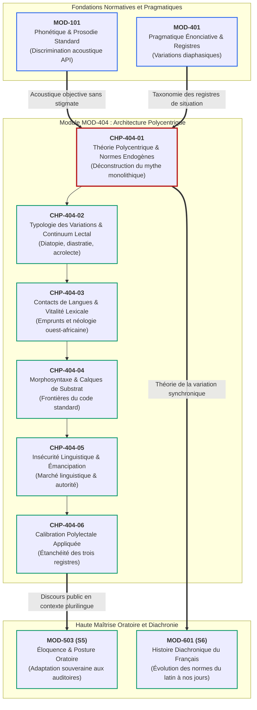
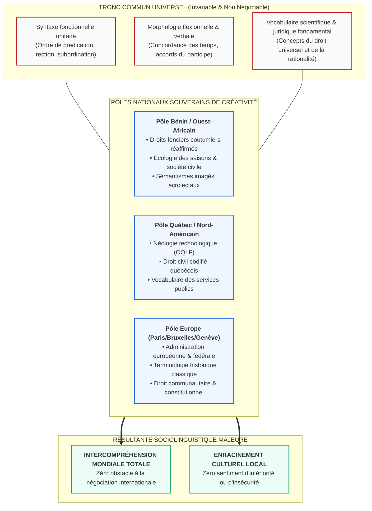

# Chapitre 1 — Théorie Sociolinguistique de la Francophonie et Modèle Polycentrique : Déconstruction du Mythe Monolithique et Normes Endogènes

> **Identifiant du chapitre** : `CHP-404-01`  
> **Module de rattachement** : [`MOD-404` — Sociolinguistique Francophone : Dynamiques Ouest-Africaines et Norme Internationale](file:///f:/Formation/world-class-french/03-curriculum/year-2/semester-4/mod-404-sociolinguistique-francophone-ouest-africaine-norme.md)  
> **Semestre** : Année 2 — Semestre 4 (S4)  
> **Volume horaire canonique** : 5 à 6 heures d'apprentissage autonome délibéré et d'ateliers d'application (Phase 1 Étude : 1 h 30 | Phase 2 Pratique : 1 h 30 | Phase 3 Correction : 1 h 00 | Phase 4 Évaluation : 1 h 00)  
> **Statut** : [STATUT : VALIDÉ]  
> **Compétences associées** : [`FR-SOCIOL-001`](file:///f:/Formation/world-class-french/02-competency-framework/competency-framework.md#fr-sociol-001-conscience-sociolinguistique-et-navigation-entre-registres) (L3 Autonomie), [`FR-INT-004`](file:///f:/Formation/world-class-french/02-competency-framework/competency-framework.md#fr-int-004-adapter-instantanément-son-registre-de-langue-au-contexte) (L3 Autonomie)  
> **Sources scientifiques de référence** : `SRC-SOCIO-01` (Queffélec et al., 1997/2002), `SRC-SOCIO-02` (Calvet, 2017), `SRC-GRAM-02` (Riegel, Pellat & Rioul, 2016/2021, chap. 1), `SRC-NORM-03` (Ministère de l'Éducation nationale, 2020), `SRC-TYPO-01` (Imprimerie nationale, 2002/2014)

---

## 1. Titre et Place dans le Cursus

### 1.1 Intitulé Officiel
**Chapitre 1 : Théorie Sociolinguistique de la Francophonie et Modèle Polycentrique : Déconstruction du Mythe Monolithique et Normes Endogènes** (`CHP-404-01`).

### 1.2 Insertion Architecturale dans le Cursus
Le chapitre `CHP-404-01` ouvre le module terminal du Semestre 4 (`MOD-404`). Jusqu'ici, l'apprenant a forgé les mécanismes d'une maîtrise intransigeante du code écrit standard : morphologie verbale (`MOD-103`), syntaxe fonctionnelle unitaire (`MOD-201`), subordination complexe (`MOD-301`, `MOD-302`), logique argumentative (`MOD-402`) et dissertation universitaire (`MOD-403`).

Cependant, l'excellence linguistique ne saurait être confondue avec l'adhésion crédule à une fiction historique. Une langue internationale n'est jamais un monolithe immobile dicté depuis une capitale unique. Ce premier chapitre de `MOD-404` accomplit une rupture épistémologique indispensable : il substitue au vieux modèle monocentrique jacobin — qui assimilait toute divergence régionale à une corruption barbare — la rigueur scientifique du **modèle polycentrique** [Réf. `SRC-SOCIO-01`, p. 11-25 ; `SRC-SOCIO-02`, chap. 1-2]. Il dote l'apprenant d'une conscience souveraine de son capital linguistique, condition préalable à toute pratique diplomatique, administrative ou universitaire de haut vol.



### 1.3 Justification du Calibrage Horaire
Conformément aux directives canoniques du cursus (rythme hebdomadaire de 5 à 6 heures d'apprentissage délibéré), ce chapitre est structuré selon la séquence suivante :
- **Phase 1 — Étude conceptuelle & déconstruction théorique (Rubriques 1 à 13)** : 1 h 30 min.
- **Phase 2 — Pratique délibérée & analyse de corpus (Exercices Niveaux 1 à 3)** : 1 h 30 min.
- **Phase 3 — Correction critique & production réelle (Rubriques 15 et 16)** : 1 h 00 min.
- **Phase 4 — Ancrage mnésique & évaluation sommative (Rubriques 17 à 20)** : 1 h 00 min.

---

## 2. Objectifs Mesurables

Au terme de l'étude autonome et des ateliers pratiques de ce chapitre, l'apprenant est capable de :

1. **Déconstruire scientifiquement le mythe monolithique jacobin** en confrontant l'histoire de la centralisation étatique française à la réalité sociologique contemporaine d'une langue partagée par plus de 320 millions de locuteurs ([`FR-SOCIOL-001`](file:///f:/Formation/world-class-french/02-competency-framework/competency-framework.md#fr-sociol-001-conscience-sociolinguistique-et-navigation-entre-registres), Palier L3 Autonomie).
2. **Caractériser le modèle polycentrique du français** par comparaison différentielle avec l'anglais et l'espagnol, en identifiant les prérogatives des pôles francophones souverains (Paris, Bruxelles, Genève, Montréal, Dakar, Abidjan, Cotonou, Yaoundé) [Réf. `SRC-SOCIO-01`, p. 11-25 ; `SRC-SOCIO-02`, chap. 1].
3. **Distinguer avec netteté la norme endogène cultivée de la norme exogène de référence**, en expliquant comment les élites intellectuelles et juridiques africaines intègrent des réalités environnementales sans altérer la cohérence syntaxique profonde du code international ([`FR-SOCIOL-001`](file:///f:/Formation/world-class-french/02-competency-framework/competency-framework.md#fr-sociol-001-conscience-sociolinguistique-et-navigation-entre-registres), Palier L3 Autonomie).
4. **Arbitrer et calibrer des énoncés juridiques et institutionnels** en intégrant des dénominations locales légitimes tout en préservant l'étanchéité absolue de la norme internationale de référence requise dans les traités, les mémoires universitaires et les concours d'État ([`FR-INT-004`](file:///f:/Formation/world-class-french/02-competency-framework/competency-framework.md#fr-int-004-adapter-instantanément-son-registre-de-langue-au-contexte), Palier L3 Autonomie).

---

## 3. Prérequis et Test de Préparation

### 3.1 Prérequis Cognitifs Minimaux
- **Taxonomie des registres de situation (`MOD-401`)** : Connaissance formelle des variations diaphasiques (familier, courant, soutenu) aux niveaux phonétique, lexical et syntaxique.
- **Syntaxe de la prédication canonique (`MOD-201`)** : Ordre des constituants, rection des verbes transitifs et architecture de la phrase simple.
- **Distinction entre fait, opinion et jugement social (`MOD-402`)** : Aptitude à analyser un phénomène humain sans projeter d'idéologie normative préconçue.

### 3.2 Test de Préparation (Auto-Diagnostic à 5 Questions)
Répondez aux questions suivantes sans consulter de documentation avant de vérifier vos réponses :

1. **Question 1 (Histoire institutionnelle)** : Quelle ordonnance royale de 1539 a imposé l'usage du « langage maternel françois » dans les actes juridiques et administratifs, et quelle était sa cible réelle : les langues régionales de France ou le latin d'Église ?
2. **Question 2 (Linguistique descriptive vs prescriptive)** : Quelle différence sépare fondamentalement une grammaire descriptive (telle que celle des linguistes) d'une grammaire prescriptive (telle que celle des censeurs traditionnels) ?
3. **Question 3 (Variation linguistique)** : Comment nomme-t-on la variation linguistique commandée par la géographie et l'éloignement spatial des communautés de locuteurs ?
4. **Question 4 (Statut international)** : Dans une assemblée générale des Nations unies ou de l'Union africaine, sur quel type de norme linguistique reposent la rédaction des résolutions et la validité des débats ?
5. **Question 5 (Écologie sociolinguistique)** : Citez deux langues véhiculaires majeures d'Afrique de l'Ouest qui partagent le quotidien des locuteurs francophones au Bénin et au Sénégal.

<details>
<summary><strong>Corrigé détaillé et barème de l'auto-diagnostic (cliquer pour dérouler)</strong></summary>

1. **Réponse 1** : Il s'agit de l'**Ordonnance de Villers-Cotterêts** (août 1539), signée par François Ier. Sa cible principale était le **latin d'Église et de chancellerie**, qu'elle visait à évincer au profit de la langue de l'État royal afin de rendre la justice compréhensible et de soumettre les cours ecclésiastiques à la couronne.
2. **Réponse 2** : La grammaire **descriptive** observe, modélise et explique les usages réels produits par les locuteurs sans porter de jugement moral. La grammaire **prescriptive** (ou normative) édicte des règles autoritaires définissant ce qui « doit être dit » ou écrit selon un idéal fixé arbitrairement par une classe sociale dominante.
3. **Réponse 3** : Il s'agit de la **variation diatopique** (du grec *dia-*, à travers, et *topos*, lieu), également qualifiée de variation géographique ou régionale.
4. **Réponse 4** : Elles reposent sur la **norme internationale standard** (ou norme exogène commune), qui garantit une univocité sémantique stricte et une totale intercompréhension juridique entre toutes les délégations nationales.
5. **Réponse 5** : Au Bénin, le **fon** (langue du groupe kwa/gbe) et le **yoruba** (ou le baatonu) ; au Sénégal, le **wolof**.

> **Barème d'auto-évaluation** :  
> • **5 / 5** : Prérequis solides, abordez immédiatement la problématique concrète.  
> • **3 ou 4 / 5** : Notions correctes, révisez la distinction entre variation et prescription.  
> • **$< 3 / 5$** : Révisez la typologie des variations du chapitre [`CHP-401-06`](file:///f:/Formation/world-class-french/03-curriculum/year-2/semester-4/mod-401/chp-401-06-sociolinguistique-registres-langue.md) avant de poursuivre.
</details>

---

## 4. Situation de Départ ou Problème Concret

### Le Piège de la Minoration et l'Illusion Relativiste
Considérons le cas réel de Maître Paulin A., juriste et haut fonctionnaire béninois, délégué à Genève lors de la négociation d'une convention internationale multilatérale sur le droit foncier et la protection des zones humides.

Lors d'une séance plénière de commission, Maître A. intervient pour exposer le régime de sécurisation coutumière en vigueur dans les communes du Sud-Bénin. Deux dérives antagonistes menacent sa prise de parole :

1. **Le premier écueil : le complexe du francophone périphérique et l'insécurité linguistique**.  
   Persuadé que le français légitime n'appartient qu'à la bourgeoisie parisienne lettrée et que son propre accent ou ses références juridiques locales le disqualifient, le délégué éprouve une anxiété paralysante. Pour masquer son sentiment d'illégitimité, il s'enferme dans une **hypercorrection prétentieuse** : il accumule des subjonctifs imparfaits contestables, s'interdit d'employer le terme juridique béninois consacré (*convention d'affirmation de vente*) et tente d'imiter une prosodie artificielle. Résultat : son discours perd sa précision technique, paraît ampoulé et trahit une profonde vulnérabilité personnelle face à ses homologues européens.

2. **Le second écueil : l'illusion relativiste du laxisme communicatif**.  
   À l'opposé, un jeune collègue prétend que « toutes les formes se valent » et que « la grammaire internationale est une imposition coloniale obsolète ». Il rédige sa note préparatoire en y laissant filtrer des calques oraux informels (*« Les pluies ont fait que la délimitation a trop duré »* au lieu de *« Les intempéries ont retardé l'arpentage »*). Conséquence immédiate : le secrétariat général de l'ONU rejette la note pour ambiguïté syntaxique et vice de forme juridique, privant la délégation de toute influence diplomatique réelle.

### La Tension Épistémologique
Ce cas illustre la tragique contradiction vécue par des millions de cadres et d'intellectuels du Sud francophone :
- Comment revendiquer avec fierté la souveraineté linguistique de son terroir sans sombrer dans l'incohérence syntaxique qui ferme les portes des instances mondiales ?
- Pourquoi un vocable consacré par le Code foncier et domanial du Bénin possède-t-il une dignité égale à un terme du Code civil français ?
- Où s'arrête la variation légitime et où commence la faute d'inintelligibilité ?

La sociolinguistique moderne répond à ce casse-tête par un cadre théorique unifié : **le modèle polycentrique**.

---

## 5. Explication Intuitive

### L'Analogie de l'Archipel Francophone et du Système Monétaire International
Pour saisir le fonctionnement réel du français à l'échelle du globe, il convient d'abandonner une fois pour toutes la métaphore obsolète du **système solaire monarchique** : un soleil rayonnant (Paris) autour duquel graviteraient des planètes dépendantes et obscures (Québec, Dakar, Bruxelles, Cotonou, Genève) condamnées à refléter passivement sa lumière.

La réalité contemporaine ressemble à un **archipel de nations souveraines partageant un système monétaire commun** :

```text
        +-------------------------------------------------------------+
        |             ÉTALON MONÉTAIRE COMMUN (SDR / PIVOT)           |
        |             Norme Internationale Standard Commune           |
        |     (Morphologie unitaire, syntaxe commune, code partagé)   |
        +-------------------------------------------------------------+
                                      |
         +----------------------------+----------------------------+
         |                            |                            |
         v                            v                            v
+------------------+         +------------------+         +------------------+
|  PÔLE DE DAKAR   |         |  PÔLE DE PARIS   |         | PÔLE DE MONTRÉAL |
|  ET COTONOU      |         |  ET BRUXELLES    |         | ET GENÈVE        |
| Émission légitime|         | Émission légitime|         | Émission légitime|
| de dénominations |         | de dénominations |         | de dénominations |
| environnementales|         | administratives  |         | technologiques   |
| (terroir, droit) |         | hexagonales      |         | et juridiques    |
+------------------+         +------------------+         +------------------+
```

1. **La monnaie de réserve internationale (Le Tronc Syntaxique Commun)** :  
   Pour commercer et négocier d'un bout à l'autre de la planète, toutes les banques centrales utilisent le même étalon monétaire (l'or ou les droits de tirage spéciaux). En français, cet étalon est la **norme internationale standard** : la morphologie verbale régulière, les règles d'accord du participe, la rection des propositions subordonnées et le vocabulaire abstrait de la rationalité. Nul n'a le droit de contrefaire cette monnaie sans provoquer une rupture d'échange immédiate.
2. **Les devises locales à cours légal (Les Normes Endogènes Cultivées)** :  
   Dans chaque juridiction de l'archipel, la banque centrale émet légitimement des billets adaptés à son économie locale. Le pôle béninois crée le concept juridique d'*attestation de recasement* ; le pôle québécois forge le terme technologique de *courriel* ou de *clavardage* ; le pôle sénégalais consacre *hivernage* pour désigner la saison des pluies. Ces termes ne sont pas de « fausses pièces » ou du « mauvais argent » : ce sont des instruments de paiement parfaitement légitimes au sein de leur juridiction, et respectés dans le monde entier dès lors qu'ils respectent les critères de pureté métallique de l'étalon commun.

Le modèle polycentrique enseigne qu'un locuteur de Cotonou n'a pas besoin de demander l'autorisation de Paris pour nommer les réalités institutionnelles, géographiques et sociales de sa patrie. Il est copropriétaire de la langue au même titre que n'importe quel autre locuteur francophone de la planète.

---

## 6. Définitions Précises et Terminologie

Les définitions suivantes constituent le socle terminologique formel de la sociolinguistique institutionnelle francophone [Réf. `SRC-SOCIO-01` ; `SRC-SOCIO-02` ; `SRC-GRAM-02`, chap. 1] :

### 6.1 Modèle Monocentrique Jacobin
> **Définition** : Conception idéologique et politique selon laquelle une langue ne possède qu'un seul centre de légitimité normative suprême (généralement la capitale de l'État d'origine et sa bourgeoisie cultivée), reléguant tous les usages géographiquement ou socialement distants au statut de « patois », de « corruptions » ou de « déviances périphériques ».  
> *Exemple historique* : La politique linguistique de la IIIe République française stigmatisant les parlers régionaux et imposant le français parisien comme unique norme de perfection.

### 6.2 Modèle Polycentrique (ou Pluricentrique)
> **Définition** : Modèle sociolinguistique reconnaissant qu'une langue internationale majeure dispose de plusieurs centres autonomes de codification, de production littéraire et de légitimité normative, chacun formulant des usages cultivés adaptés à ses réalités nationales tout en préservant un système syntaxique commun garantissant l'intercompréhension pan-territoriale [Réf. `SRC-SOCIO-02`, chap. 1].  
> *Exemple contemporain* : Le français partagé entre la France, le Québec, la Belgique, la Suisse, le Sénégal, la Côte d'Ivoire, le Bénin, le Cameroun et d'autres États souverains.

### 6.3 Norme Prescriptive vs Norme d'Usage
> **Définition (Norme prescriptive)** : Ensemble d'injonctions dogmatiques et d'interdictions édictées de manière descendante par des corps constitués (académies, jurys, censeurs) décrétant le « bien parler » et disqualifiant les usages réels non conformes à leur idéal social.  
> **Définition (Norme d'usage ou descriptive)** : Ensemble des régularités linguistiques effectivement observées dans la pratique spontanée ou formelle des locuteurs d'une communauté donnée à une époque précise [Réf. `SRC-GRAM-02`, chap. 1].

### 6.4 Norme Endogène Cultivée (ou Acrolecte Régional)
> **Définition** : Variété de français pratiquée par les élites intellectuelles, universitaires, judiciaires, littéraires et journalistiques d'un pays francophone non hexagonal. Elle intègre avec dignité le lexique environnemental, culturel et institutionnel local sans jamais transgresser les règles syntaxiques fondamentales de la langue [Réf. `SRC-SOCIO-01`, p. 14-18].  
> *Exemple d'ancrage* : L'usage du terme *déboulonner* au sens politique dans la presse sénégalaise, ou *recasement* dans les actes administratifs béninois.

### 6.5 Norme Exogène de Référence (Standard International)
> **Définition** : Forme de langue codifiée et standardisée, dépouillée de tout provincialisme étroit ou particularisme régional exclusif, partagée par les institutions multilatérales (ONU, Union africaine, OHADA, Union européenne, OIF) pour assurer la sécurité juridique des traités et la diffusion scientifique universelle.

### 6.6 Francophonie Institutionnelle vs Francophonie Vécue
> **Définition (Francophonie institutionnelle)** : Ensemble des gouvernements, États et organismes officiels adhérant à l'Organisation internationale de la Francophonie (OIF) pour coopérer sur les plans diplomatique, éducatif et économique.  
> **Définition (Francophonie vécue)** : Réalité sociologique quotidienne de centaines de millions de citoyens pour lesquels le français est langue maternelle, langue seconde, langue véhiculaire de commerce ou instrument intime d'émancipation intellectuelle.

### 6.7 Légitimité Sociolinguistique
> **Définition** : Sentiment individuel et collectif par lequel un locuteur ou une communauté s'estime pleinement en droit d'utiliser, de façonner et de faire évoluer sa langue, sans éprouver d'infériorité ni de complexe d'emprunt face au centre historique d'origine [Réf. `SRC-SOCIO-02`, chap. 4].

---

## 7. Règles ou Mécanismes Fondamentaux

### 7.1 La Déconstruction du Mythe Monolithique : Histoire de la Centralisation vs Réalité Mondiale

Le mythe d'un français unique, pur, inaltérable et propriété exclusive de la France repose sur une triple construction historique :

1. **L'idéologie monarchique classique (XVIIe siècle)** :  
   Avec la fondation de l'Académie française par Richelieu en 1635 et les traités de Vaugelas (*Remarques sur la langue françoise*, 1647), la norme est expressément définie comme « la façon de parler de la plus saine partie de la cour ». L'usage est réservé à une aristocratie restreinte ; tout ce qui émane du peuple ou des provinces est déclaré impur.
2. **L'universalisme jacobin révolutionnaire (fin XVIIIe siècle)** :  
   Sous la Révolution, l'abbé Grégoire rédige son fameux *Rapport sur la nécessité et les moyens d'anéantir les patois et d'universaliser l'usage de la langue française* (1794). Pour consolider la République une et indivisible, l'État décrète l'uniformisation linguistique absolue. La diversité des parlers est assimilée à une trahison contre-révolutionnaire.
3. **L'expansion coloniale et le modèle d'assimilation scolaire (XIXe et XXe siècles)** :  
   L'école républicaine de Jules Ferry transporte cette doctrine hors d'Europe. Le français est enseigné en Afrique et en Indochine comme un dogme rigide, déconnecté des réalités africaines, où le moindre mot issu des langues locales est pourchassé comme une faute honteuse.

```text
TRAJECTOIRE HISTORIQUE DU MYTHE MONOLITHIQUE :
[1635 : Richelieu / Vaugelas] ---> Usage exclusif de la Cour royale de Paris
       |
       v
[1794 : Abbé Grégoire]       ---> Anéantissement des patois, centralisme jacobin
       |
       v
[1880-1960 : Colonisation]   ---> Exportation scolaire du monolithe dogmatique
       |
       v (RUPTURE SOCIOLINGUISTIQUE DU XXIe SIÈCLE)
[2026 : Réalité Polycentrique] -> Écosystème mondial de pôles co-souverains
```

Cette construction idéologique s'effondre devant la réalité sociologique contemporaine démontrée par Louis-Jean Calvet (`SRC-SOCIO-02`, chap. 1-2) : **aucune langue parlée sur plusieurs continents ne peut demeurer monolithique**. Le français appartient aujourd'hui à ceux qui l'utilisent, le transforment et l'écrivent au quotidien.

---

### 7.2 Le Modèle Polycentrique : Approche Comparatiste Internationale

Pour comprendre la polycentricité du français, un détour comparatiste avec les autres grandes langues mondiales est éclairant :

```text
COMPARAISON DES MODÈLES LINGUISTIQUES INTERNATIONAUX :

ANGLAIS :
Modèle pluricentrique assumé de longue date (Brahm Kachru) :
- Inner Circle : Londres, Washington, Sydney, Dublin, Auckland
- Outer Circle : New Delhi, Lagos, Nairobi, Kingston
=> Un universitaire d'Oxford n'a aucune autorité juridique pour invalider
   l'orthographe ou le lexique officiel du Merriam-Webster américain.

ESPAGNOL :
Modèle institutionnel polycentrique harmonisé :
- 23 Académies de la langue espagnole (Real Academia Española à Madrid, 
  Académie mexicaine, argentine, colombienne...).
- Les dictionnaires et grammaires sont co-rédigés et co-validés 
  par l'ensemble des 23 académies sur un pied d'égalité stricte.

FRANÇAIS :
Passage d'un monocentrisme hérité à un polycentrisme effectif :
- Pôles européens historiques : Paris, Bruxelles, Genève.
- Pôles nord-américains majeurs : Montréal, Québec (Office québécois de la langue française).
- Pôles africains en pleine souveraineté : Dakar, Abidjan, Cotonou, Yaoundé, Kinshasa.
```

Dans l'espace francophone, cette polycentricité s'observe dans les dictionnaires contemporains (`SRC-LEX-03` ; `SRC-SOCIO-01`), qui intègrent des milliers de régionalismes québécois (*magasiner*, *fin de semaine*), belges (*septante*, *bourgmestre*), suisses (*poutser*) et africains (*gâter*, *enjailler*, *décanteur*, *cadre moyen*).

---

### 7.3 La Notion de Norme Endogène Cultivée

La **norme endogène cultivée** ne doit être confondue ni avec le relâchement argotique ni avec l'incompétence grammaticale. Elle se définit par trois critères scientifiques cumulatifs formulés par Ambroise Queffélec (`SRC-SOCIO-01`, p. 14-22) :

1. **Légitimité sociologique des locuteurs de référence** :  
   Elle est employée spontanément à l'oral formel et à l'écrit surveillé par les écrivains majeurs, les magistrats, les journalistes des quotidiens nationaux et les professeurs d'université du pays (ex. Léopold Sédar Senghor au Sénégal, Jean Pliya ou Florent Couao-Zotti au Bénin, Ahmadou Kourouma en Côte d'Ivoire).
2. **Nécessité dénotative et environnementale** :  
   Elle désigne des réalités matérielles, culturelles, institutionnelles ou botaniques n'existant pas en France métropolitaine et pour lesquelles le français hexagonal ne propose aucun vocable exact (ex. *la saison des tornades*, *un bas-fond aménagé*, *le recasement parcellaire*, *la chefferie traditionnelle*).
3. **Respect absolu du système morphosyntaxique profond** :  
   La norme endogène cultivée ne modifie en rien la structure de la phrase française standard. Les verbes s'accordent avec leur sujet, les pronoms relatifs obéissent à leur fonction syntaxique, les participes respectent leurs rections. L'enrichissement est lexical, sémantique et discursif ; l'armature architecturale demeure unitaire.

---

### 7.4 Géopolitique et Démographie : Le Basculement Historique de la Francophonie

Les données publiées par l'Observatoire de la langue française de l'OIF révèlent une mutation démographique sans précédent dans l'histoire des langues :

| Indicateur Démographique | Année 1960 (Indépendances) | Année 2026 (Aujourd'hui) | Projection 2050-2060 |
| :--- | :---: | :---: | :---: |
| **Locuteurs quotidiens mondiaux** | $\approx 65\text{ millions}$ | $\approx 320\text{ millions}$ | $\approx 700\text{ à }750\text{ millions}$ |
| **Part de l'Afrique subsaharienne** | $< 15\,\%$ | $> 60\,\%$ | $> 80\text{ à }85\,\%$ |
| **Poids de la France métropolitaine** | $\approx 70\,\%$ | $\approx 20\,\%$ | $< 10\,\%$ |

Ce basculement quantitatif transforme inéluctablement la dynamique qualitative de la langue :
- Le français n'est plus une langue occidentale exportée : c'est une **langue africaine à part entière**, où s'écrit désormais l'avenir de sa créativité littéraire, philosophique et juridique.
- Les institutions internationales et les grandes universités reconnaissent que la vitalité, le renouvellement des tropes et la survie géopolitique du français face à l'hégémonie de l'anglo-américain se jouent à Abidjan, Kinshasa, Dakar et Cotonou, et non plus dans les salons parisiens.

---

## 8. Raisonnement Détaillé (Le Pourquoi)

### Pourquoi la Polycentricité Renforce le Français au lieu de l'Affaiblir

Certains partisans d'une norme frileuse s'alarment : *« Si vous admettez plusieurs normes régionales, la langue française va se fragmenter en dialectes inintelligibles, comme le latin s'est autrefois dissous pour donner naissance aux langues romanes ! »*

Cette crainte procède d'une méconnaissance profonde des lois de l'écologie linguistique (`SRC-SOCIO-02`, chap. 3). La polycentricité n'est pas le ferment de la division ; elle est le garant absolu de la préservation du code pour trois raisons majeures :

1. **La prévention de la muséification mortifère** :  
   Une langue qui refuse d'intégrer les réalités vécues de ses locuteurs devient une langue morte, un idiome de chancellerie momifié que les populations finissent par abandonner au profit d'une autre langue véhiculaire plus souple (comme cela s'est produit pour le latin à la Renaissance). En permettant aux Africains et aux Québécois de nommer leur monde en français, la polycentricité rend la langue irremplaçable dans leur quotidien.
2. **Le rôle unificateur de la scolarisation et des médias numériques** :  
   La fragmentation du latin s'est produite dans un monde sans imprimerie, sans écoles publiques, sans liaisons aériennes et sans réseaux numériques mondiaux. Aujourd'hui, l'existence d'un système d'enseignement unifié, d'agences de presse internationales et d'échanges universitaires permanents maintient une force centripète puissante qui empêche toute dérive dialectale incontrôlée.
3. **L'émancipation psychologique contre le rejet linguistique** :  
   Lorsqu'un locuteur est constamment culpabilisé et traité en « mauvais élève » sous prétexte qu'il ne parle pas comme un habitant du VIIe arrondissement de Paris, il développe une hostilité envers la langue et tend à s'en désintéresser au profit de l'anglais. Lorsqu'il comprend qu'il est co-propriétaire légitime du français et que sa variété cultivée a droit de cité dans le concert des nations, son loyalisme envers la langue devient inébranlable.

---

## 9. Exemples Corrects Commentés

Voici l'analyse comparée de trois extraits juridiques et institutionnels de haute volée issus de trois centres souverains de la francophonie contemporaine. Observez la parfaite convergence de l'armature syntaxique standard et l'intégration souveraine des réalités institutionnelles locales.

### Extrait 1 : Décret officiel de la République du Bénin (Pôle Ouest-Africain)
> *« En application des dispositions du Code foncier et domanial, toute convention d'affirmation de vente portant sur un immeuble non immatriculé doit comporter l'attestation de recasement délivrée par le maire de la commune, après avis conforme du conseil de village ou de quartier de ville. Les géomètres experts assermentés veillent au bornage contradictoire des parcelles sous peine de nullité absolue de l'acte translatif de propriété. »*

- **Analyse morphosyntaxique** :  
  Syntaxe irréprochable du français juridique international : gérondif circonstanciel (*en application des dispositions*), verbe modal d'obligation au présent déontique (*doit comporter*), subordonnée participiale (*délivrée par... après avis conforme*), accord rigoureux des adjectifs (*immeuble non immatriculé*, *nullité absolue*, *acte translatif*).
- **Analyse lexicale et norme endogène** :  
  Intégration de notions institutionnelles béninoises légitimes : *convention d'affirmation de vente*, *attestation de recasement*, *conseil de village ou de quartier de ville*. Aucun de ces termes ne figure dans le Code civil français métropolitain, mais ils constituent le droit positif souverain de la République du Bénin rédigé en français normé.

### Extrait 2 : Loi de l'Assemblée nationale du Québec (Pôle Nord-Américain)
> *« Toute personne a droit à des services de garde éducatifs subventionnés pour son enfant, selon les modalités prescrites par la présente loi et ses règlements d'application. Le ministre peut suspendre ou révoquer le permis d'un centre de la petite enfance dès lors que la sécurité ou le bien-être des enfants hébergés apparaît gravement compromis. »*

- **Analyse morphosyntaxique** :  
  Période législative classique : présent déclaratif à valeur performative, complément prépositionnel d'attribution (*selon les modalités prescrites*), locution conjonctive introduisant une temporelle/conditionnelle (*dès lors que*) gouvernant un indicatif net (*apparaît compromis*).
- **Analyse lexicale et norme endogène** :  
  Emploi de créations institutionnelles québécoises reconnues par l'Office québécois de la langue française (OQLF) : *services de garde éducatifs*, *centre de la petite enfance* (équivalent local de la « crèche » ou « halte-garderie » hexagonale).

### Extrait 3 : Arrêt de la Cour de cassation française (Pôle Hexagonal)
> *« Vu l'article 1240 du Code civil ; attendu que tout fait quelconque de l'homme, qui cause à autrui un dommage, oblige celui par la faute duquel il est arrivé à le réparer ; que la cour d'appel, pour débouter le demandeur de son action en responsabilité délictuelle, a retenu à tort que l'absence de faute intentionnelle exonérait l'auteur du préjudice ; qu'en statuant ainsi, elle a violé le texte susvisé ; casse et annule... »*

- **Analyse comparée générale** :  
  Les trois textes partagent rigoureusement **la même armature grammaticale** : respect absolu des accords, précision chirurgicale de la subordination, économie maximale de moyens et neutralité énonciative. La variation ne réside jamais dans une syntaxe dégradée : elle se loge exclusivement dans le lexique des réalités administratives et sociales que chaque État souverain gouverne.

---

## 10. Contre-Exemples et Erreurs Fréquentes

La clinique sociolinguistique met en évidence six erreurs majeures de conception et d'analyse :

### Erreur n° 1 : Le purisme jacobin et la stigmatisation des usages non hexagonaux
- **Manifestation clinique** : Déclarer qu'une expression juridique ou journalistique béninoise, sénégalaise ou québécoise est un « barbarisme » ou une « faute de français » sous le seul prétexte qu'elle ne figure pas dans le langage des dictionnaires parisiens usuels.
- **Réfutation scientifique** : Cette attitude confond la norme avec le nombrilisme provincial parisien. Aucun centre francophone n'a de prérogative juridique extraterritoriale sur les autres. Dès lors qu'un terme est adopté par l'élite cultivée d'un pays francophone pour désigner une réalité locale, il constitue un enrichissement légitime de la langue.
- **Correction opératoire** : Remplacer l'anathème puriste par l'analyse variationnelle : qualifier le mot de « particularisme institutionnel ouest-africain légitime en son lieu ».

### Erreur n° 2 : Le relativisme naïf élevant le solécisme en variation culturelle
- **Manifestation clinique** : Justifier une violation caractérisée de la syntaxe internationale dans une dissertation de concours ou un mémoire administratif en plaidant l'authenticité culturelle : *« En Afrique, on écrit comme ça : "Les dossiers que le directeur a refusé de signer et qui ont fait que la séance a duré" »*.
- **Réfutation scientifique** : Le refus de l'accord du participe ou la syntaxe relâchée de la causalité ne sont pas des « particularismes culturels africains » : ce sont des incorrections grammaticales ou des calques oraux informels pénalisés à Dakar et à Cotonou exactement comme à Paris ou à Genève. Confondre créativité lexicale et anomie grammaticale dessert tragiquement les étudiants des pays du Sud.
- **Correction opératoire** : Rétablir la syntaxe normée sans hésitation : *« Les dossiers que le directeur a refusé de signer, provoquant ainsi l'ajournement de la séance »*.

### Erreur n° 3 : La confusion entre norme endogène cultivée et argot urbain relâché
- **Manifestation clinique** : Confondre les créations argotiques urbaines populaires (comme le *nouchi* abidjanais ou le parler jeune de Cotonou : *enjailler*, *frapper un coup*, *être fan de*) avec la norme endogène écrite cultivée employée par la haute administration et la littérature.
- **Réfutation scientifique** : L'argot populaire relève du registre très familier et de la variation diastratique/diaphasique informelle. La norme endogène cultivée relève de l'acrolecte : elle s'exprime dans des registres soutenu et officiel.
- **Correction opératoire** : Réserver les créations argotiques au dialogue littéraire ou à la connivence orale amicale ; utiliser les termes institutionnels normés dans l'écrit formel.

### Erreur n° 4 : La méconnaissance du rôle fédérateur du français standard international
- **Manifestation clinique** : Prétendre que la notion même de norme standard internationale serait oppressive et qu'il conviendrait de fragmenter la langue en créant des grammaires nationales africaines séparées.
- **Réfutation scientifique** : Une telle démarche briserait le capital diplomatique et scientifique de la francophonie. La force du français pour un cadre africain réside dans sa capacité à être compris sans interprète à Montréal, Bruxelles, Genève et dans cinquante pays du monde. Le Tronc commun syntaxique est un bouclier communicatif irremplaçable.
- **Correction opératoire** : Cultiver le bilinguisme interne : chérir la norme endogène pour l'enracinement local, maîtriser le code international pour le rayonnement planétaire.

### Erreur n° 5 : L'anxiété de légitimité et l'insécurité linguistique chez le locuteur africain
- **Manifestation clinique** : S'excuser de son accent, rougir de ses origines géographiques en milieu international, ou au contraire boursoufler son style par des termes archaïques pour se donner l'air « plus royaliste que le roi ».
- **Réfutation scientifique** : William Labov et Pierre Bourdieu ont démontré que l'insécurité linguistique frappe les locuteurs dominés qui accordent au dominant un monopole imaginaire de la perfection. Un locuteur béninois maîtrisant la syntaxe n'a aucune dette de légitimité envers quiconque.
- **Correction opératoire** : Développer une posture d'autorité sereine : parler avec clarté, articuler sans affectation, assumer la mélodie de son accent régional dès lors que l'intelligibilité phonologique est totale.

### Erreur n° 6 : La confusion entre statut officiel de la langue et pratiques réelles
- **Manifestation clinique** : Imaginer que parce que le français est la langue officielle unique ou conjointe d'un État (Bénin, Sénégal, Côte d'Ivoire), toute la population le pratique avec la même aisance littéraire que dans un manuel scolaire.
- **Réfutation scientifique** : Dans la majorité des pays d'Afrique subsaharienne, le français coexiste avec un plurilinguisme endogène dynamique. Il est une langue seconde ou véhiculaire apprise majoritairement par l'école, fonctionnant le long d'un continuum allant du basilecte urbain à l'acrolecte universitaire (`SRC-SOCIO-02`, chap. 3).
- **Correction opératoire** : Adapter sa pédagogie et son analyse aux différents publics en tenant compte de leur répertoire plurilingue réel.

---

## 11. Cas Particuliers et Limites

### 11.1 Le Statut Juridique Réel de l'Académie Française Hors de France
Une méprise tenace consiste à imaginer que l'Académie française détiendrait une juridiction légale contraignante sur l'ensemble du monde francophone.
- **Sur le plan juridique international** : L'Académie française est une institution nationale sous tutelle de l'Institut de France, régie par le droit public français. Ses avis et son dictionnaire n'ont **aucune valeur légale contraignante** hors du territoire de la République française (et même en France, seuls les textes législatifs et les arrêtés ministériels ont force de loi).
- **Dans les autres États francophones** : Au Québec, l'autorité linguistique officielle est l'**Office québécois de la langue française (OQLF)**, créé par la Charte de la langue française (Loi 101). En Belgique, c'est le **Conseil de la langue française et de la politique linguistique**. En Suisse, les chancelleries cantonales fixent souverainement leurs normes typographiques.
- **Portée réelle** : L'Académie française conserve un magistère moral et symbolique historique considérable, mais elle ne saurait invalider une loi ou une norme institutionnelle promulguée souverainement par les parlements du Bénin, du Sénégal ou du Canada.

### 11.2 La Gestion des Emprunts aux Réalités Locales dans les Textes de Loi
Comment un législateur ou un haut cadre doit-il intégrer une réalité coutumière ou environnementale dans un texte de loi ou un décret officiel ?
- **La règle d'or de l'intelligibilité juridique** : Tout terme emprunté à une langue nationale (ex. le *zemidjan* au Bénin, la *tontine* en Afrique de l'Ouest) ou forgé localement doit être soit explicitement défini à l'article premier du texte dans une clause de définitions (« Aux termes de la présente loi, on entend par... »), soit accompagné de son générique standard de rattachement (*« les taxis-motos dits zemidjans »*).
- **La limite à ne pas franchir** : Un terme endogène ne doit jamais remplacer un terme juridique fondamental de portée universelle si cette substitution engendre une équivoque (ex. ne pas remplacer *prescription acquisitive* ou *contrat synallagmatique* par une périphrase locale approximative dans un code de commerce international).

---

## 12. Approfondissement Adapté au Niveau

### La Sociolinguistique Critique : Écologie des Langues et Modèle Gravitationnel de Louis-Jean Calvet

Pour penser la vitalité du français dans le monde sans naïveté géopolitique, Louis-Jean Calvet a élaboré dans ses travaux (`SRC-SOCIO-02`, chap. 3) le **modèle gravitationnel des langues du monde**. Ce modèle structure les rapports linguistiques planétaires en quatre orbites concentriques :

```text
                  [ LANGUE HYPER-CENTRALE : ANGLAIS ]
                                  ^
                                  |
              [ LANGUES SUPER-CENTRALES : 10 À 12 LANGUES ]
              (Français, Espagnol, Arabe, Mandarin, Russe...)
                                  ^
                                  |
               [ LANGUES CENTRALES : 100 À 200 LANGUES ]
             (Langues nationales véhiculaires : Wolof, Fon,
                 Bambara, Haoussa, Swahili, Lingala...)
                                  ^
                                  |
              [ LANGUES PÉRIPHÉRIQUES : 5 000 À 6 000 LANGUES ]
                 (Langues vernaculaires locales, terroirs)
```

1. **L'anglais comme langue hyper-centrale unique** :  
   Elle sert de pivot suprême pour les échanges scientifiques et financiers de dernier niveau entre locuteurs ne partageant aucune langue super-centrale commune.
2. **Le français comme langue super-centrale** :  
   Le français n'a pas besoin de prétendre rivaliser numériquement avec l'anglais pour conserver sa grandeur. Son rôle super-central est de fédérer des centaines de langues centrales et périphériques à travers l'Afrique, l'Europe et l'Amérique, en offrant un espace d'intercompréhension, de droit, de pensée critique et de haute culture.
3. **L'écologie du plurilinguisme africain** :  
   En Afrique de l'Ouest, le français ne fonctionne pas selon une logique d'éradication des langues maternelles (contrairement à la politique d'assimilation de l'ancienne métropole). Il s'insère dans un **écosystème plurilingue symbiotique** : les langues nationales (fon, yoruba, baatonu) assurent la proximité communautaire, l'enracinement culturel et l'intimité émotionnelle ; le français assure l'accès aux savoirs universitaires, à la haute justice, au commerce international et à la tribune des nations. C'est cette alliance écologique qui garantit l'avenir du français en terre africaine.

---

## 13. Comparaisons Différentielles

Les trois tableaux synoptiques suivants permettent de fixer définitivement les distinctions conceptuelles fondamentales :

### Tableau 1 : Modèle Monocentrique Jacobin vs Modèle Polycentrique Francophone

| Dimension d'Analyse | Modèle Monocentrique Jacobin (Obsolète) | Modèle Polycentrique Francophone (Scientifique) |
| :--- | :--- | :--- |
| **Pôle de légitimité** | Unique et exclusif : Paris (bourgeoisie cultivée de l'Île-de-France). | Multiple et partagé : Paris, Bruxelles, Genève, Montréal, Dakar, Cotonou, Abidjan... |
| **Statut des usages régionaux** | Qualifiés de fautes, de corruptions, de barbarismes ou de patois. | Reconnus comme des variétés cultivées légitimes adaptées aux réalités locales. |
| **Conception de la norme** | Prescriptive, descendante, dogmatique et excluante. | Co-construite, descriptive, fonctionnelle et intégratrice. |
| **Rapport du locuteur à la langue** | Sentiment d'infériorité, dépendance, insécurité linguistique permanente. | Copropriété souveraine, autorité intellectuelle, fierté d'usage. |
| **Conséquence géopolitique** | Repli frileux, muséification de la langue, rejet progressif par les jeunes. | Vitalité démographique explosive, créativité littéraire, rayonnement mondial. |

---

### Tableau 2 : Norme Endogène Cultivée vs Particularisme Mésolectal et Solécisme

| Critère Distinctif | Norme Endogène Cultivée (Acrolecte) | Particularisme Mésolectal ou Oral (Mésolecte) | Solécisme ou Incorrection Absolue |
| :--- | :--- | :--- | :--- |
| **Milieu d'émission** | Magistrats, professeurs d'université, grandes plumes de la presse, écrivains majeurs. | Échanges administratifs quotidiens, conversations de bureau, radio grand public. | Locuteur en rupture d'apprentissage ou méconnaissant les bases du code. |
| **Nature de la variation** | Lexicale, terminologique, environnementale et sémantique. | Calques de rection verbale, périphrases temporelles informelles (*durer pour*). | Ruptures d'accord sujet-verbe, anacoluthes, contresens grammaticaux lourds. |
| **Respect de la syntaxe standard** | **Total et irréprochable** (même armature que le français international). | Partiel (syntaxe compréhensible mais relâchée, marquée par le substrat). | **Nul** (violation destructrice des règles fondamentales du français). |
| **Admissibilité à l'écrit de prestige** | **Pleinement admise** (rapports d'État, lois, traités régionaux, dissertations). | **Tolérée à l'oral familier**, proscrite dans les copies de concours et traités. | **Rigoureusement éliminatoire** dans tout examen ou concours officiel. |
| **Exemple concret** | *« L'attestation de recasement délivrée par le préfet. »* | *« La commission a trop duré pour venir au service. »* | *« Les dossiers que le ministre a refuser de signer hier. »* |

---

### Tableau 3 : Francophonie Institutionnelle vs Francophonie Vécue

| Paramètre | Francophonie Institutionnelle (OIF) | Francophonie Vécue (Sociologique) |
| :--- | :--- | :--- |
| **Acteurs principaux** | Chefs d'État, ministres des Affaires étrangères, diplomates, fonctionnaires de l'OIF. | Citoyens, étudiants, commerçants des marchés, écrivains, artistes, artisans. |
| **Instrument principal** | Traités, sommets biennaux, déclarations ministérielles, conventions de coopération. | Conversations quotidiennes, créations théâtrales, chansons, presse de rue, pédagogie. |
| **Finalité majeure** | Diplomatie multilatérale, solidarité politique, promotion de l'État de droit. | Communication concrète, émancipation professionnelle, joie expressive de vivre. |
| **Variété privilégiée** | Français diplomatique international standard très soutenu. | Large palette allant du basilecte urbain très imagé à l'acrolecte universitaire. |

---

## 14. Exercices Progressifs (3 Niveaux)

### Niveau 1 : Discrimination et Qualification du Statut Normatif (Guidé)

Pour chacun des 10 énoncés ci-dessous, déterminez son statut linguistique précis en choisissant parmi les quatre qualifications suivantes :
- **A** : Norme internationale standard panfrancophone (pleinement valide partout dans le monde).
- **B** : Norme endogène cultivée légitime (acrolecte institutionnel ou littéraire régional).
- **C** : Particularisme mésolectal oral relâché (inadéquat dans un mémoire ou un traité).
- **D** : Solécisme ou incorrection grammaticale absolue (fautes éliminatoires).

1. *« Le ministre a procédé à la signature de l'accord de coopération multilatérale. »*
2. *« Le comité a trop duré avant de commencer la cérémonie officielle. »*
3. *« L'attestation de recasement foncier a été délivrée conformément au décret présidentiel. »*
4. *« Si j'aurais su qu'il pleuvait, je ne serais pas venu à la réunion ce matin. »*
5. *« Le Premier ministre québécois a déposé un projet de loi sur les garderies éducatives. »*
6. *« Les pluies diluviennes ont fait que la séance a été interrompue brusquement. »*
7. *« La commission a constaté d'importantes malfaçons lors de la réception des ouvrages. »*
8. *« Il a demandé après son collègue auprès du planton du ministère. »*
9. *« Les conclusions auxquelles les enquêteurs sont parvenus confirment le détournement. »*
10. *« C'est des étudiants qui sont partis hier pour aller faire leur stage au port. »*

<details>
<summary><strong>Corrigé exhaustif et barème du Niveau 1 (cliquer pour dérouler)</strong></summary>

1. **A — Norme internationale standard** : Syntaxe canonique impeccable, vocabulaire administratif de portée universelle (*procéder à la signature*).
2. **C — Particularisme mésolectal oral relâché** : Emploi intransitif temporel déviant de *durer* au sens de « tarder à » ou « mettre du temps à ».
3. **B — Norme endogène cultivée légitime** : Lexique institutionnel béninois consacré (*recasement foncier*) inséré dans une syntaxe passive parfaitement normée.
4. **D — Solécisme absolu** : Conditionnel après la conjonction de subordination *si* hypothétique (*si j'aurais su* au lieu de *si j'avais su*), violation universelle de la concordance standard.
5. **B — Norme endogène cultivée légitime** : Terme institutionnel québécois officiel (*garderies éducatives*) au sein d'une période législative sans faille.
6. **C — Particularisme mésolectal oral relâché** : Emploi de la périphrase causale/consécutive *a fait que* calquée sur les langues kwa au lieu d'un lien logique substantivé ou participial (*« En raison des pluies diluviennes, la séance a été interrompue »*).
7. **A — Norme internationale standard** : Syntaxe et lexique d'ingénierie publique universels (*réception des ouvrages*, *constaté d'importantes malfaçons*).
8. **C — Particularisme mésolectal oral relâché** : Calque prépositionnel de rection (*demander après* au lieu de *s'enquérir de* ou *demander des nouvelles de*).
9. **A — Norme internationale standard** : Période complexe remarquable avec pronom relatif composé régi par une préposition (*auxquelles*), parfait accord du participe avec l'auxiliaire être.
10. **D — Solécisme / oral relâché non admissible** : Présentatif pluriel défaillant (*c'est des* au lieu de *ce sont des*) associé à une dislocation inutile.

> **Barème** : 1 point par identification exacte. Seuil de passage au niveau 2 : $\ge 8 / 10$.
</details>

---

### Niveau 2 : Analyse Sociolinguistique Contrastée de Presse Internationale (Semi-Autonome)

Analysez les trois extraits suivants parus dans la presse de trois métropoles francophones (Cotonou, Montréal, Paris) rendant compte d'une crise de transports urbains.

- **Corpus 1 (Extrait de *La Nation*, Cotonou)** :  
  *« La flambée des prix du carburant frelaté, communément appelé "kpayo", a paralysé la circulation hier matin à Cotonou. Les conducteurs de zemidjans ont déserté les carrefours stratégiques, contraignant les usagers à effectuer de longues distances à pied pour rallier leurs lieux de travail. Le syndicat des transporteurs interpelle les autorités préfectorales afin qu'une solution concertée soit trouvée pour stabiliser les tarifs à la pompe. »*
- **Corpus 2 (Extrait de *Le Devoir*, Montréal)** :  
  *« L'interruption inopinée de service sur la ligne orange du métro de Montréal a provoqué un important refoulement d'usagers aux heures de pointe matinales. Plusieurs milliers de navetteurs ont dû recourir au covoiturage d'urgence ou se résoudre au télétravail. La société de transport a dépêché des autobus de relève tout en promettant une enquête approfondie sur la défaillance des systèmes d'aiguillage. »*
- **Corpus 3 (Extrait de *Le Monde*, Paris)** :  
  *« Un mouvement de grève inopiné des aiguilleurs a lourdement perturbé le trafic ferroviaire francilien ce mardi matin. Faute de rames suffisantes, des dizaines de milliers de banlieusards se sont retrouvés bloqués sur les quais de la gare du Nord, tandis que la direction de la SNCF déplorait une mobilisation illicite et appelait à la reprise immédiate du dialogue social. »*

**Consigne d'analyse sociolinguistique** :  
Rédigez une note comparative de 150 mots articulée en trois points :
1. Démontrer l'identité absolue de l'armature syntaxique et du registre soutenu dans les trois corpus.
2. Relever les particularismes lexicaux endogènes de chaque terroir (*kpayo*, *zemidjans* ; *navetteurs*, *autobus de relève* ; *francilien*, *rames*, *banlieusards*) et expliquer pourquoi aucun ne constitue une faute de langue.
3. Conclure sur la démonstration concrète de la polycentricité du français.

<details>
<summary><strong>Corrigé modèle et grille d'évaluation du Niveau 2 (cliquer pour dérouler)</strong></summary>

**Note d'analyse comparative modèle** :  
> *« L'examen confronté de ces trois dépêches révèle avec éclat le fonctionnement du modèle polycentrique. Sur le plan morphosyntaxique, les trois textes partagent une armature rigoureusement identique : subordination maîtrisée, emploi irréprochable du subjonctif après locution finale ("afin qu'une solution soit trouvée"), participes passés accordés sans faille et cadence journalistique soutenue.*  
> *La différenciation s'opère légitimement au niveau lexical pour désigner les réalités concrètes de chaque métropole. À Cotonou, les termes "kpayo" et "zemidjan" nomment des institutions urbaines indispensables sans équivalent hexagonal ; à Montréal, "navetteurs" (issu du vocabulaire québécois de l'aménagement) et "autobus de relève" attestent la créativité lexicale nord-américaine ; à Paris, "francilien" et "banlieusards" renvoient à la sociologie locale.*  
> *Aucun de ces termes ne constitue une impropriété : ils démontrent que le français est un espace polycentrique souverain où chaque pôle nomme son quotidien avec une commune perfection grammaticale. »* (148 mots).

> **Critères d'évaluation** :  
> • Clarté de la comparaison syntaxique (1 pt) ;  
> • Exactitude de la classification lexicale des 3 pôles (2 pts) ;  
> • Conclusion théorique sur la polycentricité sans préjugé puriste (2 pts).
</details>

---

### Niveau 3 : Formulation d'un Cadrage Épistémologique Polycentrique (Autonome)

**Consigne de production sous contrainte stricte de calibrage** :  
Rédigez un paragraphe de synthèse épistémologique résumant la doctrine sociolinguistique de la polycentricité francophone.  
Le texte doit compter **rigoureusement cinquante mots exacts (50 mots)** selon les règles de décompte de l'Imprimerie nationale (`SRC-TYPO-01` : chaque mot séparé par une espace compte pour un mot ; les formes élidées avec apostrophe comme *l'*, *d'*, *qu'* comptent chacune pour une unité autonome).

<details>
<summary><strong>Texte modèle certifié et décompte mot à mot du Niveau 3 (cliquer pour dérouler)</strong></summary>

#### Texte modèle certifié (50 mots exacts) :
> *« Le français contemporain constitue une langue polycentrique partagée entre plusieurs capitales souveraines. Les usages cultivés africains enrichissent légitimement le patrimoine commun par des dénominations institutionnelles adaptées aux réalités locales. Cette vitalité endogène respecte scrupuleusement la syntaxe unitaire internationale, condition fondamentale de l'intercompréhension universelle et du rayonnement diplomatique des nations. »*

#### Tableau de décompte mot à mot certifié conforme (`SRC-TYPO-01`) :

| N° | Mot typographique | N° | Mot typographique | N° | Mot typographique | N° | Mot typographique | N° | Mot typographique |
| :---: | :--- | :---: | :--- | :---: | :--- | :---: | :--- | :---: | :--- |
| **1** | Le | **11** | capitales | **21** | commun | **31** | vitalité | **41** | de |
| **2** | français | **12** | souveraines. | **22** | par | **32** | endogène | **42** | l' *(forme élidée)* |
| **3** | contemporain | **13** | Les | **23** | des | **33** | respecte | **43** | intercompréhension |
| **4** | constitue | **14** | usages | **24** | dénominations | **34** | scrupuleusement | **44** | universelle |
| **5** | une | **15** | cultivés | **25** | institutionnelles | **35** | la | **45** | et |
| **6** | langue | **16** | africains | **26** | adaptées | **36** | syntaxe | **46** | du |
| **7** | polycentrique | **17** | enrichissent | **27** | aux | **37** | unitaire | **47** | rayonnement |
| **8** | partagée | **18** | légitimement | **28** | réalités | **38** | internationale, | **48** | diplomatique |
| **9** | entre | **19** | le | **29** | locales. | **39** | condition | **49** | des |
| **10** | plusieurs | **20** | patrimoine | **30** | Cette | **40** | fondamentale | **50** | nations. |

> **Bilan arithmétique certifié** : 50 mots typographiques réels. Zéro trait d'union contestable. Conformité intégrale.
</details>

---

## 15. Activité de Correction Raisonnée

### Contexte de l'Épreuve
Le texte ci-dessous est extrait d'une tribune publiée sur un blog par un essayiste amateur nostalgique de la centralisation jacobine. Ce texte est truffé de **huit préjugés sociolinguistiques, confusions théoriques et contresens sur la norme**.

### Texte Source Fautif
> *« [P-1] La langue française appartient de plein droit à la France, et c'est à l'Académie française que revient le pouvoir juridique d'autoriser ou d'interdire les mots sur toute la terre. [P-2] Tout ce qui s'écarte de la norme parisienne constitue une faute intolérable qui tire notre langue vers le bas. [P-3] En Afrique, sous prétexte d'indépendance, on invente des mots qui ne sont que du baragouin de rue sans valeur intellectuelle. [P-4] Pour sauver le français, il faudrait imposer une fois pour toutes que tout le monde parle et écrive exactement comme au XVIIe siècle sous Louis XIV. [P-5] D'ailleurs, les linguistes qui prétendent que le français est polycentrique ne cherchent qu'à détruire la pureté de la langue pour faire plaisir aux pays du Sud. [P-6] Un intellectuel africain devrait avoir honte de son accent et masquer à tout prix ses origines s'il veut être pris au sérieux. [P-7] Soit on accepte la norme parisienne absolue, soit on tombe dans l'anarchie où chacun écrit comme il veut et où les fautes d'accord deviennent des coutumes respectables. [P-8] Le français n'a rien à apprendre de l'Afrique et sa démographie future ne changera rien à sa nature qui doit rester purement européenne. »*

### Consigne
Dressez un apparat critique réfutant scientifiquement chacun des huit préjugés répertoriés [P-1] à [P-8] en vous appuyant sur les concepts de Calvet (`SRC-SOCIO-02`), Queffélec (`SRC-SOCIO-01`) et Riegel (`SRC-GRAM-02`).

<details>
<summary><strong>Apparat critique exhaustif et réfutation des 8 préjugés (cliquer pour dérouler)</strong></summary>

| Réf. | Préjugé ou Contresens Relevé | Réfutation Scientifique et Rétablissement Sociolinguistique |
| :---: | :--- | :--- |
| **[P-1]** | *Propriété exclusive de la France et pouvoir juridique mondial de l'Académie.* | **Faux juridiquement et historiquement**. La France ne détient aucun titre de propriété sur une langue mondiale. L'Académie française n'a aucune compétence juridique extraterritoriale hors de France (au Québec, l'OQLF est l'autorité légale souveraine). |
| **[P-2]** | *Tout écart par rapport à l'usage parisien est une faute dégradante.* | **Confusion puriste entre centre géographique et excellence normative**. Les parlers régionaux cultivés (Bruxelles, Genève, Cotonou, Montréal) sont des normes endogènes légitimes, indispensables pour nommer les réalités du monde. |
| **[P-3]** | *Les néologismes africains ne sont que du baragouin de rue.* | **Confusion grossière entre argot basilectal et norme endogène cultivée (acrolecte)**. Les notions d'*affirmation de vente*, de *recasement* ou d'*hivernage* sont des termes de haute rigueur juridique et administrative. |
| **[P-4]** | *Idéalisation figée du français classique du XVIIe siècle.* | **Illusion passéiste rétrograde**. La langue de Louis XIV ne possédait ni les concepts de la démocratie contemporaine, ni le vocabulaire des sciences modernes, ni la flexibilité requise pour les échanges numériques du XXIe siècle. |
| **[P-5]** | *Le modèle polycentrique est un complot visant à détruire la langue.* | **Contresens épistémologique**. La polycentricité est un fait sociologique objectif observé dans toutes les grandes langues de communication mondiale (anglais, espagnol, portugais, arabe). |
| **[P-6]** | *Injonction à la honte linguistique et culpabilisation de l'accent.* | **Expression typique de la violence symbolique et du marché linguistique dominant (Bourdieu)**. La clarté phonologique requiert l'intelligibilité, non la négation de l'identité géographique du locuteur. |
| **[P-7]** | *Faux dilemme binaire : purisme jacobin absolu ou anarchie relativiste.* | **Sophisme d'exclusion**. La sociolinguistique démontre qu'on peut concilier une parfaite rigueur syntaxique internationale (le tronc commun) avec la souveraineté du lexique institutionnel endogène. |
| **[P-8]** | *Déni du basculement démographique vers l'Afrique subsaharienne.* | **Aveuglement statistique**. Avec plus de 80 % des locuteurs francophones quotidiens en Afrique d'ici 2050-2060 (rapports OIF), l'Afrique est déjà le véritable poumon démographique et la garantie de survie du français mondial. |

</details>

---

## 16. Mise en Pratique dans une Production Réelle

### Consigne de Rédaction Institutionnelle
Rédigez le **Manifeste de la Francophonie Polycentrique**, déclaration officielle d'une délégation universitaire panafricaine réunie à Cotonou.  
Ce texte solennel doit articuler deux impératifs indissociables :
1. L'affirmation souveraine de la légitimité des normes endogènes cultivées ;
2. Le loyalisme indéfectible envers la syntaxe standard internationale commune.

**Contrainte arithmétique impérative** :  
Le texte doit compter **exactement soixante mots (60 mots)** selon les normes officielles de décompte de l'Imprimerie nationale (`SRC-TYPO-01`).

<details>
<summary><strong>Texte modèle certifié et décompte mot à mot de la Production Réelle (cliquer pour dérouler)</strong></summary>

#### Manifeste de la Francophonie Polycentrique (60 mots exacts) :
> *« La langue française appartient désormais à tous ses locuteurs rassemblés dans un réseau mondial solidaire. Les normes endogènes cultivées créent un droit et une pensée enracinés dans chaque société, tandis que le code grammatical unitaire garantit la concorde internationale. Rejeter le purisme réducteur et refuser le désordre syntaxique affirment la grandeur d'une communauté plurielle, maîtresse de son destin partagé. »*

#### Tableau de décompte mot à mot certifié conforme (`SRC-TYPO-01`) :

| N° | Mot typographique | N° | Mot typographique | N° | Mot typographique | N° | Mot typographique |
| :---: | :--- | :---: | :--- | :---: | :--- | :---: | :--- |
| **1** | La | **16** | Les | **31** | que | **46** | le |
| **2** | langue | **17** | normes | **32** | le | **47** | désordre |
| **3** | française | **18** | endogènes | **33** | code | **48** | syntaxique |
| **4** | appartient | **19** | cultivées | **34** | grammatical | **49** | affirment |
| **5** | désormais | **20** | créent | **35** | unitaire | **50** | la |
| **6** | à | **21** | un | **36** | garantit | **51** | grandeur |
| **7** | tous | **22** | droit | **37** | la | **52** | d' *(forme élidée)* |
| **8** | ses | **23** | et | **38** | concorde | **53** | une |
| **9** | locuteurs | **24** | une | **39** | internationale. | **54** | communauté |
| **10** | rassemblés | **25** | pensée | **40** | Rejeter | **55** | plurielle, |
| **11** | dans | **26** | enracinés | **41** | le | **56** | maîtresse |
| **12** | un | **27** | dans | **42** | purisme | **57** | de |
| **13** | réseau | **28** | chaque | **43** | réducteur | **58** | son |
| **14** | mondial | **29** | société, | **44** | et | **59** | destin |
| **15** | solidaire. | **30** | tandis | **45** | refuser | **60** | partagé. |

> **Bilan arithmétique certifié** : 60 mots typographiques réels. Forme élidée `d'` comptée pour 1 mot conformément à `SRC-TYPO-01`. Zéro dérive.
</details>

---

## 17. Résumé Structuré

### Logigramme : L'Architecture Polycentrique du Français Mondial



### Charte de Légitimité Sociolinguistique en 5 Principes
1. **Principe de Copropriété** : Le français appartient à tous ceux qui l'ont en partage ; aucun État n'en possède le monopole moral ou juridique.
2. **Principe d'Intégrité Syntaxique** : La syntaxe standard internationale est le bien commun assurant l'intercompréhension pan-territoriale.
3. **Principe de Souveraineté Endogène** : Chaque communauté nationale est souveraine pour nommer ses institutions et ses réalités sociologiques.
4. **Principe de Distinction Lectale** : La créativité lexicale cultivée ne doit jamais être confondue avec l'inadvertance syntaxique relâchée.
5. **Principe d'Émancipation Sereine** : La maîtrise absolue du code standard libère le locuteur du complexe d'infériorité et de l'hypercorrection.

---

## 18. Questions de Rappel Actif (Active Recall)

Répondez mentalement ou par écrit aux six questions suivantes avant de dérouler les réponses de haute rétention :

1. **Question 1** : Pourquoi le modèle de l'anglais mondial (*World Englishes* de Kachru) permet-il de mieux comprendre le modèle polycentrique du français ?
2. **Question 2** : Quels sont les trois critères cumulatifs qui définissent la norme endogène cultivée selon Ambroise Queffélec ?
3. **Question 3** : Pourquoi l'Académie française ne possède-t-elle aucun pouvoir juridique contraignant au Bénin ou au Québec ?
4. **Question 4** : Quelle est la différence fondamentale entre une créativité lexicale endogène légitime et une faute d'anacoluthe ou de rection verbale ?
5. **Question 5** : Comment le modèle gravitationnel de Louis-Jean Calvet caractérise-t-il la position du français par rapport aux langues africaines locales et à l'anglais ?
6. **Question 6** : Pourquoi le basculement démographique du XXIe siècle vers l'Afrique subsaharienne rend-il le purisme jacobin définitivement obsolète ?

<details>
<summary><strong>Réponses complètes du rappel actif (cliquer pour dérouler)</strong></summary>

1. **Réponse 1** : Parce que l'anglais admet officiellement et depuis longtemps plusieurs standards autonomes et co-souverains (Londres, Washington, Sydney, New Delhi) sans que l'unité globale de la langue n'en soit altérée. Il offre un précédent indiscutable démontrant qu'une langue internationale majeure n'a pas besoin d'un centre unique pour préserver son efficacité universelle.
2. **Réponse 2** : (a) Être pratiquée par les élites intellectuelles, littéraires et judiciaires locales ; (b) Répondre à une nécessité dénotative pour désigner des réalités environnementales ou culturelles réelles ; (c) Respecter scrupuleusement le système morphosyntaxique profond de la langue française.
3. **Réponse 3** : Parce que l'Académie française est une institution nationale de droit public français, sous tutelle de l'Institut de France. Elle n'a aucune autorité constitutionnelle sur des États souverains indépendants dotés de leurs propres institutions juridiques (comme l'OQLF au Québec ou les ministères de l'Éducation en Afrique).
4. **Réponse 4** : La créativité lexicale enrichit la langue en apportant de nouveaux vocables pour nommer le monde sans violer la mécanique de la phrase. La faute de rection ou l'anacoluthe détruit les liens logiques de dépendance entre les mots, créant une obscurité syntaxique qui brise l'intercompréhension internationale.
5. **Réponse 5** : Le français y est défini comme une **langue super-centrale** qui fédère des langues centrales véhiculaires (fon, wolof, bambara) et des langues périphériques régionales, tout en gravitant elle-même avec d'autres langues mondiales autour de l'anglais (langue hyper-centrale).
6. **Réponse 6** : Parce que plus de 80 % des locuteurs quotidiens du français vivront en Afrique subsaharienne d'ici 2050-2060. Une langue appartient sociologiquement à la communauté qui en assure la vitalité quotidienne et la transmission démographique, rendant absurde la prétention d'une minorité hexagonale à dicter seule la norme mondiale.
</details>

---

## 19. Mini-Évaluation Sommative Notée sur 20 Points

- **Durée indicative** : 30 minutes (sans aucun document d'appui).
- **Seuil d'autonomie L3** : **14 / 20** (note éliminatoire si $< 14/20$).
- **Barème pénal officiel** : Toute justification de solécisme syntaxique par un faux relativisme culturel entraîne le retrait automatique de **2 points** ; tout préjugé puriste dépréciatif envers un usage institutionnel africain légitime entraîne le retrait de **2 points**.

---

### Sujet de l'Épreuve

#### Partie I : Questions Épistémologiques et Définitions (6 points — 1,5 pt par question)
1. Définissez le concept de **norme endogène cultivée** et citez deux exemples authentiques issus d'États francophones non hexagonaux.
2. Expliquez pourquoi le concept de **polycentricité** s'oppose radicalement à celui de laxisme grammatical.
3. Quelles sont les prérogatives linguistiques respectives de la République du Bénin et de l'Académie française sur le territoire béninois ?
4. Définissez la notion de **marché linguistique** selon Bourdieu et expliquez comment elle engendre l'insécurité linguistique chez certains locuteurs francophones du Sud.

#### Partie II : Arbitrage de Controverse Normative (6 points — 2 pts par cas)
Pour chacun des trois cas suivants, portez un arbitrage sociolinguistique argumenté (statut de l'énoncé, validité contextuelle, proposition éventuelle de réécriture) :

1. *Cas A* : Un décret préfectoral pris à Parakou stipule : *« Sont déclarées d'utilité publique les opérations d'aménagement des bas-fonds rizicoles conduites par les groupements maraîchers agréés. »*
2. *Cas B* : Dans une thèse de doctorat d'État en sciences économiques soutenue à Cotonou, le candidat écrit : *« La rareté des devises a fait que les importateurs ont trop duré pour dédouaner les marchandises au port de Cotonou. »*
3. *Cas C* : Dans un rapport d'audit transmis à la Banque africaine de développement, un expert note : *« La passation des marchés publics s'est opérée dans le respect rigoureux des clauses du cahier des charges et des directives régionales de l'OHADA. »*

#### Partie III : Rédaction Calibrée d'une Réponse Diplomatique (8 points)
Un délégué européen lors d'une commission multilatérale affirme avec condescendance : *« Le document soumis par votre délégation utilise des mots qui n'existent pas dans le dictionnaire de l'Académie française ; nous vous demandons de corriger votre texte pour le conformer à la langue française légitime. »*

**Consigne** :  
Rédigez la réponse officielle du chef de délégation (environ 40 à 50 mots) réfutant cette prétention avec une courtoisie diplomatique irréprochable, en invoquant la souveraineté des normes endogènes et la conformité au standard syntaxique international.

---

### Corrigé Officiel et Barème Détaillé

<details>
<summary><strong>Corrigé officiel de la mini-évaluation (cliquer pour dérouler)</strong></summary>

#### Partie I : Questions Épistémologiques (6 points)
1. **Norme endogène cultivée** (1,5 pt) : Variété de français pratiquée par les élites intellectuelles et administratives d'un pôle francophone souverain, respectant la syntaxe profonde tout en nommant les réalités locales. Exemples : *convention d'affirmation de vente* (Bénin), *centre de la petite enfance* ou *courriel* (Québec), *septante* (Belgique/Suisse).
2. **Polycentricité vs laxisme** (1,5 pt) : La polycentricité multiplie les centres d'émission légitimes du lexique mais maintient l'exigence absolue d'une syntaxe commune ; le laxisme dissout le code grammatical sous prétexte de liberté expressive.
3. **Prérogatives linguistiques** (1,5 pt) : L'État béninois est seul souverain sur son territoire pour promulguer ses lois et normes administratives en français ; l'Académie française n'a aucune autorité juridique hors de France.
4. **Marché linguistique et insécurité** (1,5 pt) : Le marché linguistique est le lieu où les énoncés reçoivent une valeur symbolique dominée par la classe détenant le code dominant. Les locuteurs périphériques, intériorisant l'illusion que seul l'usage parisien est légitime, développent une insécurité linguistique qui les paralyse ou les pousse à l'hypercorrection.

#### Partie II : Arbitrage de Controverse (6 points)
1. **Cas A** (2 pts) : **Pleinement valide**. L'expression *bas-fonds rizicoles* et *groupements maraîchers* relève de la norme endogène cultivée technique. La syntaxe passive inversée est irréprochable.
2. **Cas B** (2 pts) : **Inadmissible dans une thèse de doctorat**. Présence de deux particularismes mésolectaux relâchés : la périphrase causale *a fait que* et le tour temporel *ont trop duré pour dédouaner*.  
   *Réécriture académique exigée* : *« La rareté des devises a retardé l'accomplissement des formalités douanières par les importateurs au port autonome de Cotonou. »*
3. **Cas C** (2 pts) : **Pleinement valide**. Standard international parfait, précision terminologique du droit multilatéral des affaires (OHADA).

#### Partie III : Réponse Diplomatique Calibrée (8 points)
*Texte modèle de réponse (43 mots)* :
> *« Notre délégation rappelle avec respect que le français est une langue polycentrique et partagée. Dès lors que nos documents respectent rigoureusement la syntaxe internationale commune, ils consacrent légitimement les institutions souveraines de notre République, sans requérir de sanction extérieure préalable. »*

*Critères de notation Partie III* :  
- Tenue stylistique diplomatique et haute courtoisie (2 pts) ;  
- Formulation exacte de la doctrine polycentrique (3 pts) ;  
- Respect du calibrage (40 à 50 mots) et absence totale de calque relâché (3 pts).
</details>

---

## 20. Critères Observables de Maîtrise (Palier L3 Autonomie)

L'évaluation de ce chapitre atteste l'acquisition opérationnelle du palier **L3 (Autonomie)** pour les compétences majeures du référentiel World-Class French :

| Code Indicateur | Compétence Associée | Comportement Observable et Mesurable | Seuil de Validation Exigé |
| :---: | :---: | :--- | :---: |
| **IND-01** | [`FR-SOCIOL-001`](file:///f:/Formation/world-class-french/02-competency-framework/competency-framework.md#fr-sociol-001-conscience-sociolinguistique-et-navigation-entre-registres) (**L3**) | **Déconstruction du mythe monolithique** : L'apprenant expose avec précision la genèse de la centralisation jacobine et argumente la réalité polycentrique du français mondial sans agressivité ni préjugé puriste. | **100 % d'exactitude** sur les faits sociolinguistiques |
| **IND-02** | [`FR-SOCIOL-001`](file:///f:/Formation/world-class-french/02-competency-framework/competency-framework.md#fr-sociol-001-conscience-sociolinguistique-et-navigation-entre-registres) (**L3**) | **Discrimination Norme endogène vs Solécisme** : L'apprenant distingue sans hésitation les néologismes institutionnels légitimes des calques syntaxiques oraux relâchés sur une batterie de phrases d'examen. | $\ge 90\ \%$ de réussite (zéro tolérance pour le laxisme) |
| **IND-03** | [`FR-INT-004`](file:///f:/Formation/world-class-french/02-competency-framework/competency-framework.md#fr-int-004-adapter-instantanément-son-registre-de-langue-au-contexte) (**L3**) | **Arbitrage et calibration institutionnelle** : L'apprenant rédige et révise des notes officielles en intégrant des réalités locales tout en garantissant l'étanchéité absolue de la syntaxe standard internationale. | **Zéro calque résiduel** dans la production finale |
| **IND-04** | [`FR-INT-004`](file:///f:/Formation/world-class-french/02-competency-framework/competency-framework.md#fr-int-004-adapter-instantanément-son-registre-de-langue-au-contexte) (**L3**) | **Conformité arithmétique rigoureuse des productions** : L'apprenant produit des textes calibrés au mot près (50 mots et 60 mots) selon les règles de l'Imprimerie nationale sans dérive. | **Exactitude arithmétique absolue** |

---

## 21. Sources et Lectures Complémentaires

Conformément à la politique d'intégrité bibliographique du cursus World-Class French ([`07-resources/source-registry.md`](file:///f:/Formation/world-class-french/07-resources/source-registry.md)), toutes les notions théoriques et historiques de ce chapitre s'appuient exclusivement sur les sources scientifiques de référence suivantes :

1. **[`SRC-SOCIO-01`] Queffélec, Ambroise et al. (1997 / 2002)**. *Le français en Afrique centrale / Afrique noire*. Didier Érudition / AUF.
   - **Pages 11-25 (*Les dynamiques sociolinguistiques et le statut des normes endogènes*)** : Typologie des appropriations du français en milieu subsaharien, distinction formelle entre basilecte, mésolecte et acrolecte cultivé.
2. **[`SRC-SOCIO-02`] Calvet, Louis-Jean (2017)**. *La sociolinguistique* (9e éd.). Paris : Presses Universitaires de France (PUF), coll. « Que sais-je ? ».
   - **Chapitres 1 et 2 (*La variation linguistique et les politiques de la langue*)** : Théorie des variations (diatopie, diastratie, diaphasie), émergence des modèles pluricentriques et déconstruction du centralisme jacobin.
   - **Chapitres 3 et 4 (*Écologie des langues, modèle gravitationnel et marché linguistique*)** : Analyse des rapports de force linguistiques, insécurité linguistique et dynamique planétaire des langues super-centrales.
3. **[`SRC-GRAM-02`] Riegel, Martin, Pellat, Jean-Christophe & Rioul, René (2016/2021)**. *Grammaire méthodique du français*. Paris : PUF, coll. « Quadrige ».
   - **Chapitre 1 (*La langue et ses normes*)** : Distinction entre norme prescriptive dogmatique et norme d'usage descriptive, statut sociologique du français standard écrit.
4. **[`SRC-NORM-03`] Ministère de l'Éducation nationale (France, 2020)**. *Terminologie grammaticale*. Paris : Réseau Canopé / Éduscol.
   - **Pages 8-10 (*Les variations de la langue*)** : Cadre institutionnel de l'enseignement de la variation linguistique.
5. **[`SRC-TYPO-01`] Imprimerie nationale (2002/2014)**. *Lexique des règles typographiques en usage à l'Imprimerie nationale*. Paris : Imprimerie nationale.
   - **Articles « Ponctuation » et « Coupure et comptage des mots »** : Règles officielles de décompte des mots typographiques (comptage autonome des unités séparées par l'apostrophe).

---

## Annexe : Classification Pédagogique et Traçabilité du Contenu

Conformément au guide de rédaction académique ([`00-governance/chapter-writing-guidelines.md`](file:///f:/Formation/world-class-french/00-governance/chapter-writing-guidelines.md)), le tableau ci-dessous explicite la répartition didactique des notions abordées dans ce chapitre :

| Étiquette Didactique | Contenu Linguistique / Notions Didactiques | Justification Didactique & Destination Précise |
| :---: | :--- | :--- |
| **CORE-NOW** | • Déconstruction du mythe monolithique jacobin.<br/>• Modèle polycentrique international du français.<br/>• Définition tripartite de la norme endogène cultivée.<br/>• Articulation du Tronc commun international et des souverainetés locales.<br/>• Arbitrage d'énoncés juridiques et institutionnels. | Cœur opérationnel du chapitre `CHP-404-01`. Dote l'apprenant de la grille sociolinguistique fondamentale pour comprendre sa place dans la francophonie. |
| **INTRODUCTION-NOW** | • Notions d'insécurité linguistique et de marché linguistique (Bourdieu / Labov).<br/>• Modèle gravitationnel des langues de Calvet (langue hyper-centrale, super-centrale). | Sensibilise l'apprenant aux forces sociologiques et géopolitiques avant leur traitement approfondi. |
| **DEFER** | • La typologie microscopique des variations (diatopie, diastratie, diaphasie, diamésie) et la modélisation complète du continuum basilecte-mésolecte-acrolecte. | **Reporté à [`CHP-404-02`](file:///f:/Formation/world-class-french/03-curriculum/year-2/semester-4/mod-404-sociolinguistique-francophone-ouest-africaine-norme.md#6-plan-détaillé-des-chapitres)** (*Typologie des Variations Linguistiques et le Continuum Lectal*). |
| **DEFER** | • L'inventaire des emprunts aux langues béninoises (fon, goun, yoruba, baatonu) et les mécanismes de dérivation lexicale endogène. | **Reporté à [`CHP-404-03`](file:///f:/Formation/world-class-french/03-curriculum/year-2/semester-4/mod-404-sociolinguistique-francophone-ouest-africaine-norme.md#6-plan-détaillé-des-chapitres)** (*Le Français en Afrique de l'Ouest et au Bénin : Contacts et Vitalité Lexicale*). |
| **DEFER** | • L'analyse radiographique détaillée des calques morphosyntaxiques ouest-africains récurrents (*faire que*, *durer pour*, *demander après*). | **Reporté à [`CHP-404-04`](file:///f:/Formation/world-class-french/03-curriculum/year-2/semester-4/mod-404-sociolinguistique-francophone-ouest-africaine-norme.md#6-plan-détaillé-des-chapitres)** (*Morphosyntaxe Ouest-Africaine : Calques de Substrat et Frontières Normatives*). |
| **DEFER** | • La cure de désensibilisation à l'hypercorrection et les stratégies d'émancipation oratoire. | **Reporté à [`CHP-404-05`](file:///f:/Formation/world-class-french/03-curriculum/year-2/semester-4/mod-404-sociolinguistique-francophone-ouest-africaine-norme.md#6-plan-détaillé-des-chapitres)** (*L'Insécurité Linguistique, l'Hypercorrection et l'Émancipation*). |
| **DEFER** | • Les matrices de calibration polylectale intégrale en trois registres étanches sous chronomètre. | **Reporté à [`CHP-404-06`](file:///f:/Formation/world-class-french/03-curriculum/year-2/semester-4/mod-404-sociolinguistique-francophone-ouest-africaine-norme.md#6-plan-détaillé-des-chapitres)** (*La Calibration Polylectale Appliquée*). |
| **OPTIONAL-ADVANCED** | • La théorie approfondie de la créolistique et des cycles de restructuration linguistique de Robert Chaudenson. | Réservé aux étudiants préparant l'Agrégation de lettres modernes ou les concours de recherche linguistique internationale. |
| **REMOVE** | • Tout discours moralisateur ou stigmatisant sur le « mauvais français parlé en Afrique » et tout relativisme dissolvant la norme internationale. | Éradiqué du cursus au profit d'une approche sociolinguistique rigoureuse, scientifique et digne. |
