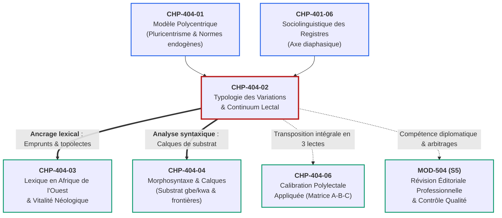
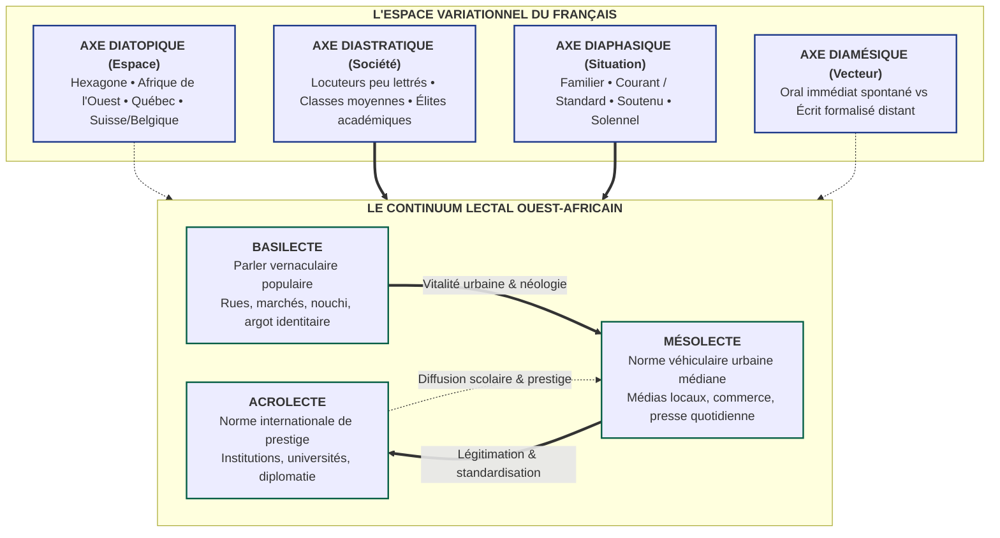

# Chapitre 2 — Typologie des Variations Linguistiques et le Continuum Lectal : Diatopie, Diastratie, Diaphasie, Diamésie et Acrolecte / Mésolecte / Basilecte

> **Identifiant du chapitre** : `CHP-404-02`  
> **Module de rattachement** : [`MOD-404` — Sociolinguistique Francophone : Dynamiques Ouest-Africaines et Norme Internationale](file:///f:/Formation/world-class-french/03-curriculum/year-2/semester-4/mod-404-sociolinguistique-francophone-ouest-africaine-norme.md)  
> **Semestre** : Année 2 — Semestre 4 (S4)  
> **Volume horaire canonique** : 5 à 6 heures d'apprentissage autonome délibéré et d'ateliers d'application (Phase 1 Étude : 1 h 30 | Phase 2 Pratique : 1 h 30 | Phase 3 Correction : 1 h 00 | Phase 4 Évaluation : 1 h 00)  
> **Statut du document** : [STATUT : VALIDÉ]  
> **Compétences associées** : [`FR-SOCIOL-001`](file:///f:/Formation/world-class-french/02-competency-framework/competency-framework.md#fr-sociol-001-conscience-sociolinguistique-et-navigation-entre-registres) (L3 Autonomie), [`FR-INT-004`](file:///f:/Formation/world-class-french/02-competency-framework/competency-framework.md#fr-int-004-adapter-instantanément-son-registre-de-langue-au-contexte) (L3 Autonomie)  
> **Sources scientifiques de référence** : `SRC-SOCIO-02` (Calvet, 2017 ; Gadet, 1989/2003), `SRC-SOCIO-01` (Queffélec et al., 1997/2002), `SRC-GRAM-02` (Riegel, Pellat & Rioul, 2016/2021, chap. 1), `SRC-NORM-03` (Ministère de l'Éducation nationale, 2020), `SRC-TYPO-01` (Imprimerie nationale, 2002/2014)

---

## 1. Titre et Place dans le Cursus

### 1.1 Intitulé Officiel
**Chapitre 2 : Typologie des Variations Linguistiques et le Continuum Lectal : Diatopie, Diastratie, Diaphasie, Diamésie et Acrolecte / Mésolecte / Basilecte** (`CHP-404-02`).

### 1.2 Insertion Architecturale dans le Cursus
Le présent chapitre constitue la clef de voûte descriptive et typologique du module **MOD-404**. Alors que le premier chapitre (`CHP-404-01`) a déconstruit le mythe du français monolithique pour établir la légitimité du modèle polycentrique, le chapitre `CHP-404-02` dote l'apprenant de l'appareil analytique complet forgé par la sociolinguistique moderne (Eugenio Coseriu, William Labov, Derek Bickerton, Robert Chaudenson, Françoise Gadet) [Réf. `SRC-SOCIO-02`, chap. 2-3 ; `SRC-GRAM-02`, chap. 1].

Loin de constituer une abstraction scolaire, la maîtrise rigoureuse des quatre dimensions variationnelles (diatopie, diastratie, diaphasie, diamésie) et du continuum lectal (acrolecte, mésolecte, basilecte) est indispensable pour neutraliser définitivement deux écueils destructeurs :
1. La stigmatisation sociolinguistique, qui confond l'origine géographique d'un locuteur avec son niveau d'instruction ou son registre d'expression ;
2. La dérive relativiste, qui confond une création dialectale populaire ou un relâchement oral avec la norme standard exigible dans les concours et les chancelleries internationales.



- **En amont** : Ce chapitre prend appui sur les principes de pluricentrisme établis dans `CHP-404-01` et intègre la classification des registres de langue étudiée dans `CHP-401-06` (diaphasie).
- **Au sein de MOD-404** : Il fournit la grille opératoire requise pour disséquer les emprunts lexicaux béninois et ouest-africains (`CHP-404-03`), diagnostiquer les calques morphosyntaxiques de substrat (`CHP-404-04`), et orchestrer la calibration polylectale en trois registres étanches (`CHP-404-06`).
- **En aval** : Il arme le futur cadre, journaliste ou diplomate pour les exercices de haute révision éditoriale et de négociation internationale (`MOD-504`).

---

## 2. Objectifs Mesurables

Au terme des 5 à 6 heures d'apprentissage autonome délibéré et d'ateliers d'application de ce chapitre, l'apprenant est capable de :

1. **Décomposer et classifier tout fait de langue observé dans un corpus francophone contemporain selon les quatre dimensions variationnelles** (diatopique, diastratique, diaphasique, diamésique), en identifiant les facteurs déterminants sans confusion méthodologique ([`FR-SOCIOL-001`](file:///f:/Formation/world-class-french/02-competency-framework/competency-framework.md#fr-sociol-001-conscience-sociolinguistique-et-navigation-entre-registres), Palier L3 Autonomie).
2. **Positionner avec certitude un énoncé ou un texte le long du continuum lectal ouest-africain** (acrolecte, mésolecte, basilecte), en s'appuyant sur des marqueurs phonétiques, lexicaux et morphosyntaxiques vérifiables ([`FR-SOCIOL-001`](file:///f:/Formation/world-class-french/02-competency-framework/competency-framework.md#fr-sociol-001-conscience-sociolinguistique-et-navigation-entre-registres), Palier L3 Autonomie).
3. **Formaliser la dynamique sociolinguistique de la mobilité lectale et de l'acrolectalisation**, en retraçant le parcours d'un vocable ou d'une structure syntaxique depuis le parler urbain vernaculaire jusqu'à son admission éventuelle dans la norme cultivée écrite ([`FR-SOCIOL-001`](file:///f:/Formation/world-class-french/02-competency-framework/competency-framework.md#fr-sociol-001-conscience-sociolinguistique-et-navigation-entre-registres), Palier L3 Autonomie).
4. **Réaliser une transposition lectale étanche d'un même fait discursif sur les trois paliers du continuum** (basilecte de rue, mésolecte journalistique/courant, acrolecte diplomatique/universitaire), sans résidu contaminatoire ni caricature stylistique ([`FR-INT-004`](file:///f:/Formation/world-class-french/02-competency-framework/competency-framework.md#fr-int-004-adapter-instantanément-son-registre-de-langue-au-contexte), Palier L3 Autonomie).

---

## 3. Prérequis et Test de Préparation

### 3.1 Prérequis Cognitifs Minimaux
- **Conscience des registres situationnels (`CHP-401-06`)** : Savoir discriminer un registre familier, courant, soutenu et solennel.
- **Notions de phonétique fondamentale (`MOD-101`)** : Connaître les symboles de l'Alphabet Phonétique International (API) et distinguer la transcription graphique `< >`, phonologique `/ /` et phonétique `[ ]`.
- **Syntaxe élémentaire de la phrase française (`MOD-201`)** : Identifier l'ordre structural SVO (Sujet-Verbe-Objet) et le fonctionnement de la rection verbale transitive directe et indirecte.

### 3.2 Test de Préparation (Auto-Diagnostic à 5 Questions)
Répondez aux cinq questions suivantes de façon autonome avant de déployer le corrigé raisonné :

1. **Question 1 (Axe situationnel vs géographique)** : Quelle est la différence conceptuelle exacte entre l'expression d'un locuteur qui emploie le mot *gosse* au lieu d'*enfant*, et celle d'un locuteur béninois qui emploie le mot *zemidjan* au lieu de *taxi-moto* ?
2. **Question 2 (Axe médial)** : Pourquoi un énoncé tel que *« L'homme que je te parle de lui »* est-il fréquemment produit à l'oral spontané, alors qu'il est immédiatement sanctionné dans un rapport de synthèse écrit ?
3. **Question 3 (Différenciation socio-spatiale)** : Un accent d'Afrique de l'Ouest (par exemple la non-différenciation des voyelles orales moyennes ouvertes et fermées) constitue-t-il intrinsèquement une marque de classe sociale populaire ? Justifiez sur le plan linguistique.
4. **Question 4 (Diglossie vs Continuum)** : Pourquoi le concept classique de diglossie binaire (variété haute $H$ vs variété basse $B$, formalisé par Charles Ferguson) se révèle-t-il insuffisant pour décrire les réalités sociolinguistiques d'Abidjan, de Dakar ou de Cotonou ?
5. **Question 5 (Repérage de calque syntaxique)** : Dans la phrase : *« La pluie a fait que je n'ai pas pu venir au service »*, relevez l'élément qui trahit un fonctionnement mésolectal ouest-africain et indiquez sa nature.

<details>
<summary><strong>Corrigé détaillé et barème de l'auto-diagnostic (cliquer pour dérouler)</strong></summary>

1. **Réponse 1** : L'emploi de *gosse* relève de la **variation diaphasique** (registre familier partagé par l'ensemble de la francophonie, opposé au standard *enfant*). En revanche, l'emploi de *zemidjan* relève de la **variation diatopique** (topolecte et emprunt lexical enraciné dans l'espace géographique béninois désignant une réalité sociologique endogène sans équivalent direct en France).
2. **Réponse 2** : Ce phénomène relève de la **variation diamésique** (opposition entre le canal phonique oral et le canal graphique écrit). À l'oral spontané, la planification cognitive en temps réel favorise la dislocation et la reprise pronominale anaphorique pléonastique (*que... de lui*) pour soulager la mémoire de travail, tandis que l'écrit surveillé exige l'emploi synthétique du pronom relatif analytique *dont* (*« L'homme dont je te parle »*).
3. **Réponse 3** : Non. Il s'agit d'un trait **diatopique** (phonétique régionale liée au système phonologique de référence des langues de contact), partagé aussi bien par un haut diplomate, un professeur d'université que par un artisan. Confondre ce timbre géographique avec une infériorité sociale relève de la confusion entre diatopie et diastratie.
4. **Réponse 4** : La diglossie f型のergusonienne postule deux codes nettement séparés et sans interpénétration. Dans les capitales ouest-africaines, la langue ne bascule pas brutalement d'un pôle à l'autre : les locuteurs naviguent sur un **continuum graduel et poreux** constitué de multiples strates intermédiaires (le mésolecte) qui combinent des éléments normés et des innovations endogènes.
5. **Réponse 5** : L'élément est la locution conjonctive causale/consécutive *« a fait que »*, calque morphosyntaxique direct des langues gbe (fon *dó... wú*) ou kwa, caractéristique de la variété mésolectale ouest-africaine, qui se substitue aux tournures synthétiques du standard (*« En raison de la pluie... »*).

> **Barème diagnostique** :  
> • **5 / 5** : Prérequis remarquablement maîtrisés. Vous pouvez aborder sereinement les modélisations théoriques.  
> • **3 ou 4 / 5** : Connaissances intuitives satisfaisantes, mais vigilance accrue requise sur la séparation formelle des axes.  
> • **$< 3 / 5$** : Révision impérative de `CHP-401-06` avant d'engager la lecture de la section 4.
</details>

---

## 4. Situation de Départ ou Problème Concret

### 4.1 La Confusion Désastreuse des Plans de Variation
Dans les entreprises internationales, les organisations multilatérales (ONU, Union africaine, CEDEAO, BAD) et les jurys universitaires de soutenance, les erreurs de diagnostic sociolinguistique engendrent des quiproquos graves, des injustices professionnelles et une insécurité linguistique destructrice [Réf. `SRC-SOCIO-02`, chap. 3].

L'observateur non averti a tendance à tout amalgamer dans un jugement moral simpliste : « bien parler » contre « mal parler ». Cette myopie intellectuelle se manifeste par deux pathologies symétriques :

#### Cas clinique n° 1 : Le préjugé du recruteur impérial (Confusion Diatopie / Diastratie)
> Lors d'un entretien d'embauche pour un poste de conseiller juridique international à Cotonou, un candidat béninois titulaire d'un doctorat s'exprime avec une diction claire, une syntaxe irréprochable et un vocabulaire d'une grande rigueur. Toutefois, sa prosodie porte l'accentuation tonale propre à l'Afrique de l'Ouest, et il réalise les voyelles d'une manière articulatoire légèrement plus fermée que la moyenne parisienne.  
> Le directeur des ressources humaines, formé superficiellement à Paris, émet un avis négatif : *« Le candidat manque de culture académique et semble issu d'un milieu social peu éduqué ; son élocution trahit un niveau insuffisant. »*

**Diagnostic d'erreur** : Le recruteur a commis une faute scientifique majeure. Il a pris un trait **diatopique légitime** (un accent géographique cultivé, propre à l'acrolecte béninois) pour une déficience **diastratique** (un prétendu manque d'instruction). Cette confusion relève de la discrimination linguistique (la glottophobie théorisée par Philippe Blanchet).

#### Cas clinique n° 2 : L'aveuglement de l'étudiant militant (Confusion Diatopie / Diaphasie-Diamésie)
> Un étudiant en master de sciences politiques rédige son mémoire de recherche sur la gouvernance urbaine en insérant de multiples tournures orales spontanées :  
> *« Quand le maire est venu là, il a vu que le projet a trop duré pour sortir de terre, ce qui fait que les jeunes voulaient s'enjailler dans la rue pour faire comprendre à l'État que les promesses sont restées cadeau. »*  
> Interpellé par le jury sur la tenue stylistique de son travail, l'étudiant rétorque vivement : *« Ce sont des expressions ouest-africaines authentiques. En me sanctionnant, vous niez notre identité africaine et vous imposez l'impérialisme hexagonal ! »*

**Diagnostic d'erreur** : L'étudiant s'égare totalement dans sa défense. Le jury ne lui reproche nullement son africanité, mais son **incapacité à gérer le canal diamésique (l'écrit universitaire formel)** et son **incompétence diaphasique (l'absence de registre soutenu)**. Des vocables comme *s'enjailler* (argotique nouchi/basilectal), *cadeau* employé comme adverbe au sens d'« inutilement » (parler populaire urbain) et des calques syntaxiques comme *trop duré pour* ou *ce qui fait que* relèvent de la sphère informelle ou du mésolecte oral quotidien. Les introduire dans un mémoire de recherche sans apparat critique constitue une rupture normative inacceptable.

### 4.2 L'Enjeu Métalinguistique de la Dissociation
Pour s'émanciper de ces pièges, l'étudiant doit acquérir une **lucidité cartographique** : savoir à tout instant sur quel axe il se déplace, quelle variété lectale il mobilise, et quel degré de formalité exige la situation d'énonciation.

---

## 5. Explication Intuitive : L'Égaliseur Audio et le Spectre Chromatique

Pour conceptualiser la variation linguistique sans recourir immédiatement à une taxonomie intimidante, recourons à deux métaphores visuelles et techniques :

### 5.1 L'Analogie de l'Égaliseur Audio à Quatre Bandes
Imaginez une console de mixage sonore professionnelle dotée de quatre curseurs coulissants indépendants. Pour obtenir un son harmonieux et adapté au lieu d'écoute, l'ingénieur du son ne règle pas tous les curseurs ensemble ; il module chaque bande de fréquences de façon autonome :

```text
┌────────────────────────────────────────────────────────────────────────┐
│             L'ÉGALISEUR QUADRIPARTITE DE LA VARIATION LINGUISTIQUE     │
├─────────────────┬──────────────────────────────────────────────────────┤
│ 1. BANDE GÉO    │ [Diatopie] : Où parle-t-on ?                         │
│                 │ Cotonou ─── Dakar ─── Bruxelles ─── Montréal ─── Paris│
├─────────────────┼──────────────────────────────────────────────────────┤
│ 2. BANDE SOCIALE│ [Diastratie] : Qui parle ? (Niveau d'instruction)    │
│                 │ Non-lettré ──────── Scripteur moyen ─────── Universitaire│
├─────────────────┼──────────────────────────────────────────────────────┤
│ 3. BANDE SITUAT.│ [Diaphasie] : À qui et dans quel cadre ? (Registre) │
│                 │ Intime / Familier ── Courant ── Soutenu ── Solennel  │
├─────────────────┼──────────────────────────────────────────────────────┤
│ 4. BANDE CANAL  │ [Diamésie] : Par quel vecteur physique ?             │
│                 │ Oral spontané ─────────────────────── Écrit surveillé│
└─────────────────┴──────────────────────────────────────────────────────┘
```

Déplacer le curseur géographique vers l'Afrique de l'Ouest (Diatopie) ne contraint nullement à abaisser le curseur du niveau d'instruction (Diastratie) ni celui de la solennité (Diaphasie). Un ambassadeur du Bénin devant l'Assemblée générale des Nations unies règle sa console au sommet de la diastratie, au sommet de la diaphasie, au sommet de l'écrit formalisé, tout en conservant son appartenance diatopique légitime.

### 5.2 L'Analogie du Spectre Chromatique et du Continuum Lectal
Dans les contextes multilingues d'Afrique francophone, la langue n'est pas enfermée dans des tiroirs hermétiques séparés par des cloisons étanches. Elle fonctionne comme un **dégradé chromatique continu** (modélisé par Derek Bickerton en linguistique créole et étendu à la francophonie par Robert Chaudenson) [Réf. `SRC-SOCIO-02`, chap. 3] :

```text
  BASILECTE                    MÉSOLECTE                     ACROLECTE
[Jaune vif : Rue] ───────── [Nuances de Vert : Quotidien] ─────── [Bleu pur : Norme]
Argot urbain (nouchi,         Français courant des médias,     Français académique,
parler populaire)             commerce, administration locale   juridique et diplomatique
```

- Entre le jaune éclatant du basilecte urbain et le bleu profond de l'acrolecte international, il existe une infinité de nuances de vert (le mésolecte).
- Le locuteur instruit possède la faculté souveraine de glisser sur ce spectre continu en fonction de son interlocuteur et de son dessein pragmatique, sans rupture involontaire.

---

## 6. Définitions Précises et Terminologie

Les définitions suivantes s'appuient sur les cadres méthodologiques de la sociolinguistique contemporaine [Réf. `SRC-SOCIO-02`, p. 45-68 ; `SRC-GRAM-02`, chap. 1 ; `SRC-NORM-03`] :

- **Linguistique variationnelle** : Branche des sciences du langage qui étudie de manière empirique et systématique les différentes formes qu'une langue historique adopte en fonction de facteurs géographiques, sociologiques, contextuels et médials, refusant le postulat d'un système linguistique absolument homogène.
- **Variation diatopique (ou spatiale / géographique)** : Différenciation d'une langue dans l'espace géographique. Elle donne naissance à des **topolectes**, à des **régionalismes** lexicaux, phonétiques ou morphologiques (ex. *septante* en Suisse et en Belgique ; *débroussailleuse* ou *zemidjan* au Bénin ; *char* pour voiture au Québec).
- **Variation diastratique (ou sociale)** : Différenciation de la langue selon la stratification sociale, la classe socio-économique, la génération ou le niveau d'instruction des locuteurs. Elle engendre des **sociolectes** (ex. le parler cultivé des classes académiques supérieures vs le vernaculaire populaire des ouvriers ou artisans peu scolarisés).
- **Variation diaphasique (ou situationnelle / stylistique)** : Modulation de la parole ou de l'écrit en fonction de la situation d'énonciation, de la relation hiérarchique entre interlocuteurs, de l'enjeu discursif et du degré de surveillance du locuteur. Elle définit les **registres ou styles de langue** (familier, courant/standard, soutenu, solennel [voir `CHP-401-06`]).
- **Variation diamésique (ou médiale)** : Différenciation commandée par le canal physique de transmission du message : canal phonique (oral) ou canal graphique (écrit). Théorisée par Peter Koch et Wulf Oesterreicher, elle distingue le médium physique (phonique vs graphique) et la conception de l'énoncé (immédiateté communicative vs distance communicative).
- **Continuum lectal** : Espace linguistique sans frontières rigides au sein duquel se déploie une gamme continue de variétés d'une même langue, allant de la forme la plus éloignée de la norme codifiée (basilecte) à la forme la plus proche de la norme institutionnelle de prestige (acrolecte).
- **Acrolecte** : Variété supérieure de prestige dans un continuum lectal. Elle respecte la norme prescriptive internationale, emploie une syntaxe complexe et un lexique abstrait, et constitue le code des traités, des lois, de l'enseignement supérieur et de la diplomatie.
- **Mésolecte** : Variété intermédiaire d'un continuum, dominant dans les communications quotidiennes, les médias audiovisuels, les échanges d'affaires locaux et l'administration déconcentrée. Elle intègre des particularismes régionaux stabilisés et des innovations sémantiques endogènes.
- **Basilecte** : Variété populaire urbaine ou vernaculaire située au pôle le plus éloigné de la norme scolaire. Elle est marquée par une simplification morphologique, une hybridation lexicale intense et une forte imprégnation syntaxique des langues de substrat locales (ex. le nouchi d'Abidjan, le français populaire de Cotonou).
- **Écologie linguistique** : Étude des relations complexes entre les langues en présence sur un même territoire géopolitique, de leurs fonctions respectives, de leurs rapports de force sociologiques et de la manière dont les locuteurs organisent leur plurilinguisme dans leur écosystème de vie [Réf. `SRC-SOCIO-02`, chap. 1].

---

## 7. Règles ou Mécanismes Fondamentaux

### 7.1 Les Quatre Axes Variationnels Fondamentaux
La modélisation de la variation repose historiquement sur les travaux d'Eugenio Coseriu (qui a formalisé la triade diatopique, diastratique, diaphasique) complétés ultérieurement par les linguistes allemands Peter Koch et Wulf Oesterreicher avec l'introduction de l'axe diamésique [Réf. `SRC-GRAM-02`, chap. 1, p. 12-15] :

```text
┌────────────────────────────────────────────────────────────────────────┐
│         LES QUATRE AXES VARIATIONNELS DU SYSTÈME DU FRANÇAIS           │
├─────────────────┬──────────────────────────────────────────────────────┤
│ 1. DIATOPIE     │ Espace géographique (Bénin, Sénégal, France, Québec)│
├─────────────────┼──────────────────────────────────────────────────────┤
│ 2. DIASTRATIE   │ Stratification sociale et niveau d'instruction      │
├─────────────────┼──────────────────────────────────────────────────────┤
│ 3. DIAPHASIE    │ Situation de communication (Registres de langue)     │
├─────────────────┼──────────────────────────────────────────────────────┤
│ 4. DIAMÉSIE     │ Canal de communication (Oral spontané vs Écrit normé)│
└─────────────────┴──────────────────────────────────────────────────────┘
```

#### A. L'axe diatopique (l'espace géographique)
- La diatopie rend compte des particularismes propres à une région ou à un pays donné. Ces particularismes ne constituent nullement des fautes, mais des **variations topolectales** reconnues.
- *Exemples attestés* :
  - En Suisse et en Belgique : *nonante* pour *quatre-vingt-dix* ; *chicon* pour *endive*.
  - Au Québec : *fin de semaine* pour *week-end* ; *courriel* (adopté internationalement) ; *magasiner* pour *faire des courses*.
  - En Afrique de l'Ouest et au Bénin : *zemidjan* ou *zem* (taxi-moto) ; *paillote* (espace de réunion traditionnel ombragé) ; *découcher* (passer la nuit hors de son domicile conjugal) ; *cabiner* (téléphoner depuis une cabine ou un point de vente cellulaire) [Réf. `SRC-SOCIO-01`, p. 34-48].

#### B. L'axe diastratique (la société et l'instruction)
- La diastratie correspond au positionnement social, générationnel et éducatif du locuteur dans l'architecture collective.
- La maîtrise du code écrit normé est étroitement corrélée au capital culturel et scolaire acquis. Les sociolectes des classes laborieuses peu scolarisées se caractérisent par des simplifications paradigmatiques (régularisation des verbes irréguliers : *« ils ont prendu »*, absence d'accord des participes passés), tandis que les sociolectes des élites cultivées déploient des structures passives, des participes présents en apposition et un vocabulaire conceptuel polysémique.

#### C. L'axe diaphasique (le contexte pragmatique et le registre)
- Cet axe régit l'ajustement du locuteur à son auditoire et aux circonstances de l'échange [Réf. `SRC-GRAM-02`, chap. 1 ; `CHP-401-06`].
- On distingue traditionnellement quatre registres cardinaux :
  1. *Familier* : relâché, réservé à la sphère privée, recours aux troncations (*le prof*, *l'aprem*), omission du morphème négatif préverbal *ne* ;
  2. *Courant / Standard neutre* : conforme à la grammaire de base, adapté à la vie professionnelle quotidienne, vocabulaire dénotatif usuel ;
  3. *Soutenu* : syntaxe élaborée, inversion complexe du sujet, subordination dense, lexique abstrait et élégant ;
  4. *Solennel* : cérémoniel, hautement ritualisé, litotes diplomatiques, figures d'amplification rhétorique.

#### D. L'axe diamésique (le canal et la conception discursive)
- La diamésie analyse l'impact du support matériel. Koch et Oesterreicher ont démontré qu'il convient de distinguer :
  - **Le médium physique** : l'oral (ondes acoustiques perçues par l'ouïe) vs l'écrit (signes graphiques perçus par la vue) ;
  - **La conception communicative** : l'immédiateté communicative (spontanéité, implicite partagé, feed-back immédiat, construction par bribes) vs la distance communicative (réflexion préalable, autonomie textuelle complète, planification syntaxique rigoureuse).
- Une faute fréquente consiste à produire à l'écrit graphique un texte conçu selon les règles de l'immédiateté orale (dislocations à gauche, ellipses du sujet, absence de connecteurs explicites).

---

### 7.2 La Théorie du Continuum Lectal en Milieu Plurilingue
Forgé initialement par Derek Bickerton dans ses recherches sur les créoles guyanophones, puis appliqué aux français d'Afrique et des Mascareignes par Robert Chaudenson et Ambroise Queffélec, le **continuum lectal** se structure en trois grands paliers interconnectés [Réf. `SRC-SOCIO-01`, chap. 1 ; `SRC-SOCIO-02`, chap. 3] :

```text
┌────────────────────────────────────────────────────────────────────────┐
│              LE CONTINUUM LECTAL OUEST-AFRICAIN                        │
├───────────────┬────────────────────────────────────────────────────────┤
│ 1. ACROLECTE  │ • Norme internationale et endogène cultivée de prestige│
│               │ • Pratiquée par les universitaires, hauts diplomates   │
│               │ • Syntaxe dense, aucun calque stigmatisé               │
├───────────────┼────────────────────────────────────────────────────────┤
│ 2. MÉSOLECTE  │ • Variété médiane véhiculaire des centres urbains      │
│               │ • Médias audiovisuels, presse locale, administration   │
│               │ • Présence de néologismes régionaux stabilisés        │
├───────────────┼────────────────────────────────────────────────────────┤
│ 3. BASILECTE  │ • Parler populaire vernaculaire de la rue et du marché │
│               │ • Français populaire de Cotonou, nouchi abidjanais     │
│               │ • Syntaxe restructurée par le substrat local (kwa/gbe) │
└───────────────┴────────────────────────────────────────────────────────┘
```

#### 1. L'Acrolecte (Pôle Supérieur de Référence)
- **Définition** : Variété de français la plus proche du standard international écrit et formel, sans rupture de construction, tout en accueillant la coloration phonétique légitime du locuteur africain instruit.
- **Locuteurs** : Hauts fonctionnaires d'État, ambassadeurs, universitaires, magistrats, écrivains de renom (Olympe Bhêly-Quenum, Jean Pliya, Florent Couao-Zotti).
- **Caractéristiques linguistiques** :
  - Syntaxe : Respect absolu des accords complexes (participe passé avec auxiliaire avoir, verbes pronominaux), maîtrise des subordonnées circonstancielles au subjonctif, rection verbale conforme aux dictionnaires de référence.
  - Lexique : Vocabulaire abstrait, précis, international, intégrant uniquement les toponymes, les réalités institutionnelles endogènes et les emprunts patrimoniaux consacrés.

#### 2. Le Mésolecte (Pôle Médian Urbain et Quotidien)
- **Définition** : Variété la plus largement partagée dans les métropoles ouest-africaines (Cotonou, Porto-Novo, Lomé, Dakar, Abidjan, Ouagadougou). C'est la langue des radios de grande écoute, des chroniques de presse quotidienne, des conversations de bureau et des transactions commerciales formelles.
- **Caractéristiques linguistiques** :
  - Syntaxe : Ordre de phrase essentiellement linéaire (SVO). Tendance à recourir à des périphrases d'insistance (*« C'est lui qui a dit que... »*), à la locution causale/consécutive *« faire que »*, et à des constructions verbales réanalysées (*demander après quelqu'un*, *durer pour venir*).
  - Lexique : Forte pénétration de régionalismes sémantiques (*deuxième bureau* pour maîtresse ; *être en haut* pour occuper une position de pouvoir ; *gâter* au sens de détériorer ou gâcher).

#### 3. Le Basilecte (Pôle Vernaculaire Populaire)
- **Définition** : Variété orale urbaine parlée par les couches sociales non scolarisées ou peu scolarisées, ainsi que par la jeunesse désireuse de créer un code cryptique identitaire de groupe (ex. le *nouchi* en Côte d'Ivoire, le *français populaire de Cotonou* ou de Porto-Novo).
- **Caractéristiques linguistiques** :
  - Phonétique : Élimination massive des consonnes finales, simplification des groupes consonantiques complexes (`[tavaj]` pour *travail*), neutralisation des oppositions vocaliques fines (`[e]` et `[ɛ]`, voyelles nasales confondues sous l'influence du substrat).
  - Morphosyntaxe : Absence de flexion verbale complexe (le radical verbal nu assure toutes les personnes : *« moi aller »*, *« lui manger »*), effacement des prépositions (*« il est allé marché »*), réduplication expressive intensive (*« vite-vite »*, *« gros-gros »*).
  - Lexique : Créolisation lexicale intense, emprunts massifs aux langues vernaculaires dominantes (fon, yoruba, baoulé, dioula), troncations et métaphores argotiques fulgurantes (*dja* pour tuer ou plaire ; *kpa* pour mourir ; *tchogan* pour chef).

---

### 7.3 Dynamique des Frontières et Porosité des Lectes : L'Acrolectalisation
Le continuum lectal n'est pas un schéma statique : il est traversé par une **dynamique sociologique permanente** d'ascension et de légitimation linguistique [Réf. `SRC-SOCIO-01`, p. 89-112] :

```text
┌────────────────────────────────────────────────────────────────────────┐
│            LE PROCESSUS D'ACROLECTALISATION D'UN FAIT DE LANGUE        │
│                                                                        │
│   BASILECTE                    MÉSOLECTE                 ACROLECTE     │
│   (Argot / Rue)              (Presse / Médias)      (Littérature / Norme)
│         │                          │                          │        │
│         └───> Vitalité urbaine ────┴──> Légitimation ─────────┴──> Entrée
│               & reprise culturelle      journalistique &           au dictionnaire
│               (Musique, théâtre)        littéraire endogène        pan-francophone
└────────────────────────────────────────────────────────────────────────┘
```

1. **Stade 1 : Création vernaculaire (Pôle basilectal)** :  
   Un mot naît dans la rue, forgé par les conducteurs de taxi-moto, les commerçantes ambulantes ou la jeunesse urbaine pour désigner une réalité immédiate ou contourner l'autorité.  
   *Exemple historique béninois* : Le mot *zemidjan* (du fon *zɛ mǐ jǐn*, littéralement « prends-moi vite/debout »).
2. **Stade 2 : Diffusion véhiculaire et vulgarisation (Pôle mésolectal)** :  
   Le terme se propage dans l'ensemble des classes de la société par commodité communicative. Les journalistes de radio, les quotidiens locaux et les fonctionnaires municipaux l'emploient couramment. Il subit souvent une troncation familière (*un zem*).
3. **Stade 3 : Consécration et acrolectalisation (Pôle acrolectal et normatif)** :  
   L'inexistence d'un équivalent exact dans la norme internationale standard (un *zemidjan* n'est ni un simple taxi, ni un coursier) contraint l'administration d'État et le législateur à officialiser le terme dans des décrets préfectoraux et des lois fiscales. Des écrivains de renom l'emploient dans des romans publiés chez de grands éditeurs. Les dictionnaires francophones de référence (*Le Petit Larousse*, *Le Petit Robert*) l'intègrent comme régionalisme béninois certifié.

Ce mécanisme prouve que la frontière entre les lectes est vivante : le basilecte alimente la vitalité lexicale de la langue, le mésolecte la stabilise, et l'acrolecte l'intègre harmonieusement dans le concert international.

---

## 8. Raisonnement Détaillé : Pourquoi la Maîtrise du Continuum est Indispensable

Pour un diplomate, un juriste international, un journaliste d'investigation ou un haut fonctionnaire exerçant en Afrique ou dans les organisations mondiales, la maîtrise des variations et du continuum lectal n'est pas une simple coquetterie académique : elle constitue une **arme d'efficacité stratégique et de souveraineté pragmatique** [Réf. `SRC-SOCIO-02`, chap. 4 ; `SRC-SOCIO-01`].

### 8.1 L'Établissement de la Connivence Discursive sans Condescendance
Le dirigeant ou le négociateur qui ignore le continuum lectal est condamné à l'échec pour deux raisons opposées :
1. **La surdité sociolinguistique et le rejet élitiste** : S'il est incapable de décoder le basilecte ou le mésolecte de ses interlocuteurs lors d'une médiation de terrain (conflit foncier rural, grève des transports, consultation communautaire), il est perçu comme un étranger arrogant ou un technocrate déconnecté. Le dialogue s'interrompt immédiatement.
2. **La parodie insultante et la démagogie de registre** : À l'inverse, s'il tente d'imiter maladroitement le basilecte de la rue pour « faire peuple » alors que son auditoire attend de lui la gravité protectrice de l'autorité étatique, il perd instantanément tout respect. Les locuteurs perçoivent cette imitation comme une condescendance méprisante.

### 8.2 Le Principe d'Adaptation Asymétrique et Étanche
La compétence suprême du locuteur souverain (`FR-SOCIOL-001` et `FR-INT-004`) réside dans sa **capacité d'adaptation asymétrique** :
- **En réception (écoute et lecture)** : Il comprend 100 % des nuances du basilecte urbain, décode les métaphores mésolectales de la presse locale et repère les calques de substrat des langues maternelles.
- **En émission (parole et écriture)** : Il choisit avec une précision chirurgicale le niveau exact requis par la situation d'énonciation :
  - Il s'adresse aux acteurs de terrain en **mésolecte soigné**, chaleureux, imagé, accessible, sans pédantisme grammatical inutile ;
  - Il rédige son rapport d'arbitrage ou négocie avec les bailleurs de fonds internationaux (Banque mondiale, FMI, Union européenne) en **acrolecte international étanche**, où aucun calque régional informel ne vient affaiblir la force juridique de son texte.

---

## 9. Exemples Corrects Commentés

Considérons un événement concret unique survenu à Cotonou :  
*Une violente surtension électrique consécutive à un orage tropical nocturne a endommagé le parc informatique de la direction générale d'une institution publique.*

Analysons comment ce même fait est verbalisé sur les trois paliers du continuum lectal, en décortiquant minutieusement les marqueurs phonétiques, lexicaux et morphosyntaxiques.

---

### 9.1 Version A : Énonciation Acrolectale (Norme Internationale / Rapport Officiel)

> *« Une surtension électrique majeure, consécutive aux intempéries orageuses d'hier soir, a provoqué de graves avaries sur les serveurs informatiques du siège, paralysant temporairement l'ordonnancement des décaissements administratifs. »*

#### Décorticage Linguistique Rigoureux :
1. **Plan phonétique et prosodique** :
   - Diction surveillée, respect des liaisons obligatoires (`/œ̃n‿ɔʁaʒ/`, `/de z‿avaʁi/`), maintien des voyelles nasales standard pleines sans dénasalisation (`/ɑ̃/`, `/ɔ̃/`, `/ɛ̃/`).
   - Aucune élision phonétique relâchée : pas de troncation du e caduc d'appui.
2. **Plan lexical** :
   - Vocabulaire abstrait, hautement technique et dénotatif : *surtension majeure*, *intempéries*, *avaries*, *ordonnancement*.
   - Absence totale de vocables régionaux ou d'argotismes.
3. **Plan morphosyntaxique** :
   - Architecture de phrase complexe : mise en apposition de l'adjectif participial détaché (*« consécutive aux intempéries... »*), proposition participiale circonstancielle de conséquence (*« paralysant temporairement... »*).
   - Rection verbale conforme à la norme internationale : *provoquer des avaries sur*, *ordonnancement de*.

---

### 9.2 Version B : Énonciation Mésolectale (Presse Quotidienne / Échange de Bureau à Cotonou)

> *« La violente coupure de courant d'hier nuit a fait que les ordinateurs du service se sont gâtés avec la pluie. C'est pourquoi le chef a instruit les techniciens pour dépanner rapidement le réseau afin que le travail ne reste pas bloqué. »*

#### Décorticage Linguistique Rigoureux :
1. **Plan phonétique et prosodique** :
   - Accentuation ouest-africaine naturelle : intonation descendante marquée en fin de syntagme, tempo syllabique égal, voyelles orales moyennes `/e/` et `/ɛ/` tendues vers la fermeture.
   - Diction claire et articulée, sans affectation parisienne ni relâchement de rue.
2. **Plan lexical** :
   - Emploi de collocations ouest-africaines stabilisées :
     - *hier nuit* : syntagme mésolectal très usité en Afrique de l'Ouest (calque temporel du substrat, là où le standard hexagonal utilise *hier soir* ou *la nuit dernière*) [Réf. `SRC-SOCIO-01`, p. 56].
     - *se sont gâtés* : emploi du verbe *se gâter* au sens de « subir une panne matérielle » ou « se détériorer » (sémantisme classique élargi très vigoureux en Afrique subsaharienne).
3. **Plan morphosyntaxique** :
   - *a fait que* : emploi de la périphrase causale/consécutive caractéristique du mésolecte ouest-africain (au lieu d'une tournure prépositionnelle synthétique).
   - *C'est pourquoi... a instruit les techniciens pour dépanner* : syntaxe coordonnée linéaire avec mise en relief par présentatif et calque de la préposition *pour* devant infinitif complétif (*instruire quelqu'un de faire quelque chose* en norme stricte).

---

### 9.3 Version C : Énonciation Basilectale (Français Populaire de Rue / Marché Dantokpa)

> *« Hier nuit là, le courant a coupé brusque cadeau ! Gros tonnerre est venu gâter toutes nos machines au bureau. Donc on est assis là seulement, y a pas travail tant que les gars n'ont pas arrangé ça. »*

#### Décorticage Linguistique Rigoureux :
1. **Plan phonétique et prosodique** :
   - Forte influence du substrat phonologique des langues gbe/kwa : suppression des consonnes finales faibles, réduction des groupes consonantiques (`[bʁisk]` pour *brusque* réalisé parfois sans consonne finale appuyée).
   - Émission des voyelles sans labialisation complexe.
2. **Plan lexical** :
   - *cadeau* : adverbe méso-basilectal ouest-africain signifiant « gratuitement », « inutilement », « sans raison » ou « pour rien » [Réf. `SRC-SOCIO-01`, s.v. *cadeau*].
   - *les gars* : terme familier générique désignant les réparateurs ou ouvriers.
   - *arranger ça* : verbe omnibus remplaçant réparer, dépanner, reconfigurer.
3. **Plan morphosyntaxique** :
   - Emploi du marqueur de thématisation et d'insistance postposé *là* (*« Hier nuit là »*, *« on est assis là seulement »*), calque direct de la particule déictique de clôture du syntagme en fongbe (*ɔ́* / *lɔ́*).
   - Absence d'article devant le sujet : *« Gros tonnerre est venu... »*, *« y a pas travail »* (ellipse de l'article partitif *du* et du morphème forclusif *ne* : *il n'y a pas de travail*).
   - Adverbe de restriction calqué *seulement* en fin d'énoncé marquant l'impuissance passive.

---

## 10. Contre-Exemples et Erreurs Fréquentes

L'audit des pratiques sociolinguistiques chez les étudiants de Licence et Master révèle six erreurs récurrentes majeures, qu'il convient de formaliser et de réfuter scientifiquement.

```text
┌────────────────────────────────────────────────────────────────────────┐
│             TYPOLOGIE CLINIQUE DES SIX ERREURS DE DIAGNOSTIC           │
├───────────────────┬────────────────────────────────────────────────────┤
│ Erreur n° 1       │ Confusion entre diatopie et diastratie             │
│ Erreur n° 2       │ Réduction réductrice du mésolecte au basilecte    │
│ Erreur n° 3       │ Ignorance du canal diamésique (oral transcrit)     │
│ Erreur n° 4       │ Stigmatisation injustifiée d'un topolecte cultivé  │
│ Erreur n° 5       │ Surévaluation d'un parler argotique hors contexte  │
│ Erreur n° 6       │ Méconnaissance de la mobilité lectale d'un sujet   │
└───────────────────┴────────────────────────────────────────────────────┘
```

### Erreur n° 1 : La confusion entre diatopie et diastratie (assimiler l'accent ou le topolecte à une déficience sociale)
- **Description du piège** : Croire qu'un accent régional ouest-africain, belge ou québécois trahit nécessairement une origine sociale défavorisée ou un manque d'instruction.
- **Réfutation scientifique** : L'accent relève de la **diatopie** (géographie phonétique). Un professeur de médecine ou un ambassadeur béninois peut avoir une élocution parfaitement acrolectale tout en conservant son timbre régional. La diastratie se mesure à la richesse syntaxique, à la rigueur des accords et à la précision conceptuelle, jamais au timbre géographique du locuteur [Réf. `SRC-SOCIO-02`, chap. 3].

### Erreur n° 2 : La réduction réductrice du mésolecte au basilecte (amalgamer français courant et parler de rue)
- **Description du piège** : Classer indistinctement tout français parlé en Afrique de l'Ouest sous l'étiquette de « français populaire » ou d'« argot », en mettant sur le même plan le français d'un présentateur de journal télévisé de l'ORTB et l'argot des gares routières.
- **Réfutation scientifique** : Le mésolecte est une variété urbaine véhiculaire élaborée, standardisée localement, dotée de ses propres règles de cohérence. Le basilecte est un code vernaculaire restreint ou un argot identitaire de groupe. Ignorer le palier mésolectal détruit la compréhension de l'écologie linguistique africaine.

### Erreur n° 3 : L'ignorance du canal diamésique (transcrire à l'écrit formel les structures de l'oral spontané)
- **Description du piège** : Écrire dans une note administrative ou une dissertation académique exactement comme on s'exprime dans une conversation orale détendue, en justifiant ces maladresses par la liberté stylistique.
- **Réfutation scientifique** : Le canal écrit normé (la distance communicative de Koch et Oesterreicher) exige une autonomie contextuelle que l'oral spontané ne possède pas. Des structures comme la dislocation à gauche (*« Ce dossier, le préfet a signé ça hier »*) sont admises à l'oral immédiat mais constituent des solécismes stylistiques à l'écrit de référence, où s'impose la forme liée : *« Le préfet a visé ce dossier hier »*.

### Erreur n° 4 : La stigmatisation injustifiée d'un topolecte cultivé (ériger l'hexagone en étalon universel unique)
- **Description du piège** : Condamner comme « barbare » ou « fautif » un mot parfaitement normé dans l'espace francophone africain sous prétexte qu'il n'est pas usité à Paris.
- **Réfutation scientifique** : Selon le modèle polycentrique (`CHP-404-01`), les vocables juridiques, institutionnels et environnementaux validés par les dictionnaires pan-francophones (ex. *la chefferie traditionnelle*, *un champ de maïs en jachère*, *les pluies diluviennes*) appartiennent de plein droit à l'acrolecte francophone international [Réf. `SRC-SOCIO-01`, p. 14].

### Erreur n° 5 : La surévaluation d'un parler argotique dans un cadre formel (légitimer le basilecte hors contexte)
- **Description du piège** : Revendiquer l'utilisation de termes basilectaux ou nouchis (*s'enjailler*, *dja*, *en haut de en haut*) dans une plaidoirie judiciaire ou une note ministérielle sous couvert de militantisme linguistique.
- **Réfutation scientifique** : Tout acte de communication est régi par un marché linguistique (Pierre Bourdieu). L'argot tire sa force expressive de sa marginalité et de sa connivence transgressive ; plaqué artificiellement dans une sphère institutionnelle solennelle, il perd sa substance subversive et disqualifie son auteur pour faute professionnelle.

### Erreur n° 6 : La méconnaissance de la mobilité lectale d'un locuteur (enfermer un sujet parlant dans un lecte unique)
- **Description du piège** : Qualifier un individu de « locuteur basilectal » ou « locuteur acrolectal » comme s'il s'agissait d'une étiquette biologique indélébile.
- **Réfutation scientifique** : Un même locuteur scolarisé se déplace continuellement sur le continuum lectal au cours d'une même journée : il use du basilecte pour plaisanter au maquis ou au marché, du mésolecte pour dialoguer avec ses collègues de bureau, et de l'acrolecte le plus rigide pour rédiger une requête auprès de la Cour constitutionnelle. C'est la **palette polylectale** qui définit la compétence réelle du locuteur.

---

## 11. Cas Particuliers et Limites

### 11.1 Le Rôle des Médias Audiovisuels dans la Standardisation Mésolectale
La radio et la télévision jouent un rôle déterminant dans la stabilisation du mésolecte :
- Les journalistes des chaînes nationales (ORTB au Bénin, RTI en Côte d'Ivoire, RTS au Sénégal) pratiquent un français intermédiaire soigné : une prononciation claire et fluide, débarrassée des particularismes de rue, mais intégrant avec aisance des expressions endogènes partagées par l'ensemble de la population (*« porter plainte contre X »*, *« la saison des pluies bat son plein »*, *« sensibiliser les populations à la base »*).
- Ce mésolecte médiatique sert de référence communicative commune pour des millions d'auditeurs de langues maternelles diverses, assurant l'intercompréhension nationale.

### 11.2 Les Emprunts Croisés et la Circulation Transnationale des Sociolectes Jeunes
À l'ère des plateformes numériques (TikTok, YouTube) et de la musique urbaine (Afrobeat, Rap ivoirien, Hip-hop), la frontière traditionnelle entre parlers jeunes hexagonaux et parlers ouest-africains s'estompe :
- Des vocables créés dans les rues d'Abidjan ou de Cotonou (*s'enjailler*, *être dans son coin*, *fresheur*) sont désormais adoptés par la jeunesse parisienne, bruxelloise ou montréalaise.
- Inversement, des termes issus du verlan ou de l'argot des banlieues françaises (*chelou*, *relou*, *seum*, *wesh*) pénètrent le basilecte des lycéens des métropoles africaines.
- *Limite didactique* : Cette hybridation accélérée ne doit pas faire oublier la règle fondamentale de la diplomatie francophone : ces vocables nomades demeurent rigoureusement confinés à la sphère privée et informelle.

### 11.3 La Frontière entre Continuum Lectal et Bilinguisme Créole
Dans les zones créolophones (Haïti, Antilles françaises, La Réunion, Maurice), la distance linguistique entre le créole à base lexicale française et le français standard est telle que de nombreux linguistes réfutent l'existence d'un simple continuum, préférant la notion de **diglossie conflictuelle** ou de **bilinguisme institutionnel**. En Afrique de l'Ouest, en revanche, les parlers populaires (nouchi, français populaire de Cotonou) restent majoritairement adossés au système structural du français, ce qui valide pleinement la modélisation en continuum lectal [Réf. `SRC-SOCIO-02`, chap. 3].

---

## 12. Approfondissement Adapté au Niveau : L'Espace Variationnel Pluridimensionnel

Pour modéliser mathématiquement et géométriquement les interactions entre les axes, la sociolinguistique universitaire s'appuie sur la formalisation de l'**espace variationnel pluridimensionnel** développée par Françoise Gadet et Ralph Ludwig (1989, 2003) [Réf. `SRC-SOCIO-02`] :

### 12.1 La Formalisation Vectorielle
Soit un énoncé discursif concret $E$. Cet énoncé ne peut être défini par un point unique sur une ligne, mais par un **vecteur de coordonnées** dans un hyperespace à quatre dimensions :

$$E = \vec{v}(\text{Diatopie}, \text{Diastratie}, \text{Diaphasie}, \text{Diamésie})$$

- $\text{Axe } X$ (Diatopique) : Mesure le degré d'enracinement géographique (d'un pôle universel pan-francophone $0$ à un pôle fortement régionalisé $+1$).
- $\text{Axe } Y$ (Diastratique) : Mesure le capital socioculturel et scolaire mobilisé (du pôle non-scolarisé $-1$ au pôle académique supérieur $+1$).
- $\text{Axe } Z$ (Diaphasique) : Mesure le degré de surveillance contextuelle et de formalité (de l'intimité informelle $0$ au cérémonial solennel $+1$).
- $\text{Axe } W$ (Diamésique) : Mesure la position entre l'immédiateté communicative orale et la distance communicative écrite.

### 12.2 La Trajectoire Variationnelle Individuelle
Cette formalisation géométrique permet de réfuter l'essentialisme social. Un individu $L$ ne possède pas un point fixe dans l'espace ; il décrit au fil de sa journée une **trajectoire continue** :

```text
Trajectoire matinale : Conversation familiale au réveil -> (Géo = Bénin, Social = Médian, Registre = Familier, Canal = Oral)
Trajectoire midi : Rédaction d'une note de synthèse ministérielle -> (Géo = Bénin, Social = Supérieur, Registre = Soutenu, Canal = Écrit)
Trajectoire soirée : Transaction avec un conducteur de zemidjan -> (Géo = Cotonou, Social = Partagé, Registre = Courant informel, Canal = Oral)
```

La maîtrise d'un cursus de haut niveau comme *World-Class French* consiste précisément à étendre l'amplitude de cette trajectoire vectorielle, permettant au locuteur de parcourir tout l'espace disponible sans jamais se retrouver bloqué dans un sous-espace contraint.

---

## 13. Comparaisons Différentielles

Les trois tableaux synoptiques suivants synthétisent les oppositions fondamentales du système variationnel :

### Tableau 1 : Comparaison des Trois Paliers du Continuum Lectal

| Paramètre d'Analyse | Acrolecte | Mésolecte | Basilecte |
| :--- | :--- | :--- | :--- |
| **Locuteurs de référence** | Cadres supérieurs, universitaires, diplomates, écrivains. | Journalistes, fonctionnaires moyens, commerçants scolarisés. | Jeunesse urbaine non scolarisée, artisans, marchands de rue. |
| **Cadre d'utilisation** | Traités, publications savantes, arrêts de cour, diplomatie. | Médias audiovisuels, presse régionale, échanges de bureau. | Rue, marchés populaires, chansons urbaines, transports. |
| **Syntaxe dominante** | Subordination complexe, accords rigoureux, constructions passives. | Syntaxe linéaire ordonnée, présentatifs, périphrases causales (*faire que*). | Syntaxe thématique, dislocation, ellipses des prépositions et articles. |
| **Lexique dominant** | Termes abstraits dénotatifs, collocations internationales normées. | Français courant teinté de régionalismes stabilisés (*hier nuit*). | Hybridation massive avec substrat local, néologismes argotiques. |
| **Canal privilégié** | Écrit surveillé et oral d'apparat préparé. | Oral courant et écrit professionnel quotidien. | Oral spontané immédiat exclusivement. |

---

### Tableau 2 : Comparaison Différentielle : Diatopie vs Diastratie

| Critère Distinctif | Variation Diatopique (Géographique) | Variation Diastratique (Sociale) |
| :--- | :--- | :--- |
| **Origine de la variation** | Lieu de socialisation, d'ancrage territorial ou national. | Niveau d'instruction, profession, milieu socio-économique. |
| **Unité d'analyse** | Le topolecte, le régionalisme, l'accent géographique. | Le sociolecte, le jargon de classe, le registre éducatif. |
| **Mobilité du trait** | Persiste généralement même lorsque l'instruction augmente (timbre vocal). | Se transforme radicalement au cours de la scolarisation et de l'ascension sociale. |
| **Jugement sociologique** | Ne devrait faire l'objet d'aucune sanction s'il est acrolectal. | Fait l'objet d'une sélection rigoureuse sur le marché du travail et aux concours. |
| **Exemple révélateur** | L'emploi légitime du mot *chicon* à Bruxelles ou *zemidjan* à Cotonou. | L'emploi erroné de *« ils ont prendu »* ou l'absence d'accord du participe passé. |

---

### Tableau 3 : Comparaison Différentielle : Axe Diamésique (Koch & Oesterreicher)

| Dimension Diamésique | Immédiateté Communicative (Pôle Oral) | Distance Communicative (Pôle Écrit) |
| :--- | :--- | :--- |
| **Conditions de production** | Échange synchrone en temps réel, face-à-face, présence physique. | Échange asynchrone différé, absence physique de l'allocutaire. |
| **Planification cognitive** | Linéaire, spontanée, corrigée en cours d'énonciation. | Réfléchie, structurée, relue et révisée avant publication. |
| **Structure syntaxique** | Dislocation, thématisation, phrases inachevées, pauses. | Hypotaxe dense, subordination hiérarchisée, ponctuation normée. |
| **Cohésion textuelle** | Assurée par la déixis, les gestes, l'intonation et l'implicite. | Assurée exclusivement par les connecteurs logiques et anaphores. |
| **Sanction en cas d'écart** | La sur-élaboration écrite à l'oral est perçue comme prétentieuse. | L'irruption de la structure orale à l'écrit est sanctionnée comme solécisme. |

---

## 14. Exercices Progressifs (3 Niveaux avec Corrigés Exhaustifs)

---

### Niveau 1 : Classification de 12 Énoncés sur la Grille des 4 Variations (Guidé)

#### Consigne :
Pour chacun des 12 énoncés suivants, identifiez la dimension variationnelle dominante : **Variation Diatopique**, **Variation Diastratique**, **Variation Diaphasique** ou **Variation Diamésique**. Justifiez brièvement votre diagnostic en identifiant le marqueur précis.

1. *« Mon cousin, il a acheté une bécane hier chez le mécano du coin. »*
2. *« Dès que le ministre est entré, tout le monde a commencé par applaudir. »*
3. *« Je kiffe trop la nouvelle caisse de mon pote, elle déchire grave ! »*
4. *« Si j'aurais su que la réunion était annulée, je serais resté chez moi. »*
5. *« Le dossier que je t'ai parlé de ça hier soir a été déposé au secrétariat. »*
6. *« À Genève, nous avons rendez-vous à onze heures et demie pour le dîner. »*
7. *« Qu'il me soit permis de présenter à Votre Excellence l'hommage de mon profond respect. »*
8. *« Ils ont croyé que la route était barrée par les forces de l'ordre. »*
9. *« Les villageois ont aménagé une paillote pour abriter les réunions du conseil communautaire. »*
10. *« Ouais, ben, t'as qu'à venir si t'en as envie, moi j'm'en fous un peu. »*
11. *« Le conférencier, sa voix, on ne comprenait rien du tout au fond de la salle. »*
12. *« Au Québec, n'oubliez pas d'attacher votre ceinture dès que vous montez dans votre char. »*

---

#### Corrigé Détaillé et Justifié du Niveau 1 :

| Énoncé | Variation Dominante | Marqueur Identifié & Justification Sociolinguistique |
| :---: | :--- | :--- |
| **1** | **Diamésique** (conception orale) | Dislocation à gauche avec reprise pronominale anaphorique (*« Mon cousin, il a... »*), typique de l'oral spontané immédiat. |
| **2** | **Diatopique** (ouest-africaine) | Périphrase *« commencer par + infinitif »* au sens de *« commencer à + infinitif »*, calque de rection fréquent en français d'Afrique subsaharienne. |
| **3** | **Diaphasique** (registre familier/argotique) | Vocabulaire familier des jeunes (*kiffer*, *caisse*, *déchire grave*), inadapté à un cadre formel. |
| **4** | **Diastratique** (sociolecte non normé) | Emploi fautif du conditionnel après la conjonction *si* (*« Si j'aurais su »*), sanctionné par la norme scolaire et caractéristique d'un déficit d'instruction grammaticale. |
| **5** | **Diamésique** (syntaxe de l'oral immédiat) | Relatif analytique pléonastique (*« que je t'ai parlé de ça »*) substitué au pronom relatif synthétique *dont*. |
| **6** | **Diatopique** (suisse/belge) | *Dîner* employé au sens de repas de midi (déjeuner en France), usage régional historique préservé. |
| **7** | **Diaphasique** (registre solennel) | Formule d'apparat diplomatique et protocolaire à l'adresse d'un haut dignitaire (*Votre Excellence*, formule de déférence). |
| **8** | **Diastratique** (sociolecte populaire) | Régularisation analogique erronée du participe passé du verbe croire (*« ont croyé »* au lieu de *ont cru*), marqueur de non-maîtrise des conjugaisons irrégulières. |
| **9** | **Diatopique** (ouest-africaine) | Vocable *paillote* désignant un espace communautaire traditionnel en Afrique francophone. |
| **10** | **Diaphasique** (registre familier/relâché) | Amuïssement du *ne* négatif, troncation phonétique (*t'as*, *t'en*, *j'm'en fous*) et interjection *ouais*. |
| **11** | **Diamésique** (oralité immédiate) | Double thématisation non liée (*« Le conférencier, sa voix, on... »*), structure typique de la mémoire de travail orale. |
| **12** | **Diatopique** (québécoise) | Vocable *char* au sens d'automobile, régionalisme lexical consacré en Amérique du Nord. |

---

### Niveau 2 : Diagnostic Lectal sur 6 Extraits Ouest-Africains Contextualisés (Semi-Autonome)

#### Consigne :
Analysez chacun des six extraits suivants issus de contextes béninois et ouest-africains. Déterminez avec précision s'il relève de l'**Acrolecte**, du **Mésolecte** ou du **Basilecte**, puis énumérez deux indices linguistiques formels probants pour chaque cas.

- **Extrait n° 1** :  
  *« Le conseil des ministres, en sa séance ordinaire de ce mercredi, a adopté le décret portant transmission à l'Assemblée nationale du projet de loi de finances rectificative. »*
- **Extrait n° 2** :  
  *« Mon cher, la réunion a trop duré pour rien. Le chef de service a fait que nous sommes restés là jusqu'à dix-neuf heures avant de libérer les gens. »*
- **Extrait n° 3** :  
  *« Petit, viens me donner l'eau glacée là ! Chauffeur de zem a failli me cogner tout à l'heure au carrefour, mon cœur bat fort-fort même. »*
- **Extrait n° 4** :  
  *« En vertu des stipulations conventionnelles régissant le présent traité multilatéral, les hautes parties contractantes s'engagent à harmoniser sans délai leurs législations douanières respectives. »*
- **Extrait n° 5** :  
  *« Hier soir, les pluies ont gâté le goudron vers le marché Dantokpa, ce qui fait que les véhicules étaient bloqués dans un gros embouteillage. »*
- **Extrait n° 6** :  
  *« Y a pas drap mon frère ! On est enjaillés de voir que le pays avance un peu, même si les jetons manquent dans les poches. »*

---

#### Corrigé Détaillé et Justifié du Niveau 2 :

1. **Extrait n° 1 : ACROLECTE**  
   - *Indice 1* : Syntaxe institutionnelle officielle hautement codifiée avec complément circonstanciel de temps détaché en tête de phrase (*« en sa séance ordinaire de ce mercredi »*).  
   - *Indice 2* : Lexique juridique et administratif impeccable et univoque (*décret portant transmission*, *loi de finances rectificative*).
2. **Extrait n° 2 : MÉSOLECTE**  
   - *Indice 1* : Emploi de la locution causale *« a fait que »* pour introduire la conséquence au lieu d'une structure synthétique.  
   - *Indice 2* : Emploi mésolectal ouest-africain de *durer* suivi de la préposition *pour* (*« a trop duré pour rien »*) pour exprimer le retard ou l'inutilité temporelle.
3. **Extrait n° 3 : BASILECTE**  
   - *Indice 1* : Présence de la particule de thématisation postposée *là* (*« l'eau glacée là »*) et de la réduplication intensive calquée du substrat kwa (*« fort-fort »*).  
   - *Indice 2* : Lexique populaire urbain direct (*chauffeur de zem*, *me cogner* au sens de me renverser/heurter) et particule finale d'insistance *même*.
4. **Extrait n° 4 : ACROLECTE**  
   - *Indice 1* : Lexique diplomatique et juridique international de prestige (*stipulations conventionnelles*, *hautes parties contractantes*).  
   - *Indice 2* : Syntaxe de l'écrit formalisé avec locution prépositive soutenue (*En vertu de*) et subordination infinitive rigoureuse (*s'engagent à harmoniser*).
5. **Extrait n° 5 : MÉSOLECTE**  
   - *Indice 1* : Emploi du verbe *gâter* au sens de dégrader/détériorer la chaussée et métonymie *le goudron* pour désigner la route bitumée.  
   - *Indice 2* : Utilisation du connecteur coordonnant relâché *« ce qui fait que »* introduisant une conséquence dans une narration de presse quotidienne.
6. **Extrait n° 6 : BASILECTE**  
   - *Indice 1* : Vocabulaire argotique nouchi/urbain caractéristique : *y a pas drap* (il n'y a pas de problème), *enjaillés* (réjouis, heureux), *les jetons* (l'argent).  
   - *Indice 2* : Absence du morphème forclusif *ne* dans l'expression négative (*« Y a pas drap »*) et syntaxe de l'oralité spontanée de rue.

---

### Niveau 3 : Analyse du Continuum d'un Discours Public (Autonome)

#### Énoncé Source (50 mots exacts) :
Le texte ci-dessous retranscrit fidèlement un extrait d'allocution publique prononcée à Cotonou par un responsable associatif lors d'une concertation municipale sur l'assainissement :

> *« Mes chers concitoyens, le ministre a trop duré pour nous écouter. Dès lors, les pluies diluviennes ont fait que nos quartiers sont inondés. Si la mairie refuse d'agir séance tenante, nous descendrons dans la rue afin d'exiger des travaux d'assainissement durables pour le bien de nos enfants. »*

#### Certification Philologique du Décompte Mot à Mot (selon `SRC-TYPO-01`) :
Conformément aux normes typographiques de l'Imprimerie nationale, tout mot délimité par des blancs typographiques ou des apostrophes forme une unité lexicale distincte :

```text
 1. Mes          2. chers         3. concitoyens    4. le            5. ministre
 6. a            7. trop          8. duré           9. pour         10. nous
11. écouter     12. Dès          13. lors          14. les          15. pluies
16. diluviennes 17. ont          18. fait          19. que          20. nos
21. quartiers   22. sont         23. inondés       24. Si           25. la
26. mairie      27. refuse       28. d'            29. agir         30. séance
31. tenante     32. nous         33. descendrons   34. dans         35. la
36. rue         37. afin         38. d'            39. exiger       40. des
41. travaux     42. d'           43. assainissement 44. durables    45. pour
46. le          47. bien         48. de            49. nos          50. enfants.
```
**Total certifié : Exactement 50 mots.**

---

#### Travail Demandé :
1. Découpez ce discours de 50 mots en identifiant précisément ses segments **mésolectaux ouest-africains** et ses segments **acrolectaux internationaux**.
2. Expliquez la stratégie sociolinguistique de l'orateur (pourquoi recourt-il à cette hybridation lectale ?).
3. Transposez l'intégralité du passage en un style **acrolectal diplomatique pur** destiné au procès-verbal de médiation de la préfecture.

---

#### Corrigé Détaillé et Justifié du Niveau 3 :

1. **Découpage Lectal Analytique** :
   - *Segments mésolectaux ouest-africains* :
     - *« a trop duré pour nous écouter »* (mots 6 à 11) : Construction mésolectale du verbe *durer* avec la préposition *pour* exprimant le reproche temporel face à l'autorité.
     - *« ont fait que nos quartiers sont inondés »* (mots 17 à 23) : Calque de conséquence mésolectal (*faire que*) au lieu d'une formulation causale nominale synthétique.
   - *Segments acrolectaux / formels partagés* :
     - *« Mes chers concitoyens »* (mots 1 à 3) : Formule d'apostrophe oratoire classique républicaine.
     - *« Dès lors »* (mots 12-13), *« pluies diluviennes »* (mots 15-16), *« séance tenante »* (mots 30-31), *« afin d'exiger des travaux d'assainissement durables »* (mots 37 à 44) : Vocabulaire soutenu, précis et institutionnel.
2. **Stratégie Sociolinguistique de l'Orateur** :  
   L'orateur pratique une **bivalence lectale délibérée**. En intégrant des tournures mésolectales (*a trop duré pour*, *a fait que*), il maintient une connivence affective et immédiate avec son auditoire communautaire local de Cotonou, démontrant qu'il partage leur vécu quotidien. Simultanément, par l'emploi de connecteurs logiques nobles (*Dès lors*), d'expressions administratives juridiques (*séance tenante*) et de vocabulaire technique (*assainissement durable*), il affirme son autorité intellectuelle face aux représentants du ministère et de la mairie, prouvant qu'il maîtrise les codes de la haute négociation étatique.
3. **Transposition Intégrale en Acrolecte Diplomatique Pur** :  
   *« Chers concitoyens, les retards persistants des autorités ministérielles à entendre nos doléances ont aggravé la vulnérabilité de nos quartiers face aux intempéries saisonnières. Si la municipalité ne prend pas immédiatement les dispositions requises, des rassemblements publics seront organisés afin d'obtenir la programmation diligente d'infrastructures pérennes d'évacuation des eaux pluviales au bénéfice des générations futures. »*

---

## 15. Activité de Correction Raisonnée

### Contexte de l'Épreuve
Vous êtes linguiste senior et tuteur de stage à l'Institut National de Linguistique Appliquée. Vous recevez le projet de rapport méthodologique rédigé par un stagiaire enquêteur chargé d'étudier les pratiques langagières à Cotonou et Porto-Novo. Ce rapport contient **huit confusions théoriques graves** entre dialecte, sociolecte, topolecte, registre et canal.

---

### Document Fautif Soumis à l'Audit :
> *(1) Lors de nos enquêtes sur le terrain au marché Dantokpa, nous avons constaté que les vendeuses parlent un dialecte très familier caractérisé par des fautes de grammaire inadmissibles. (2) Ce dialecte africain, qu'on appelle la variation diastratique, prouve que la langue française perd sa pureté originelle en milieu urbain. (3) D'ailleurs, dès qu'un ministre prend la parole à la radio ORTB, il utilise le registre diamésique pour montrer qu'il appartient à une classe sociale élevée. (4) Nous avons également remarqué que l'accent des intellectuels béninois est un sociolecte inférieur qui devrait être corrigé à l'école par des cours de diction parisienne. (5) Enfin, dans les quartiers populaires, les jeunes créent des topolectes comme le nouchi pour que leurs parents ne comprennent pas, ce qui est une variation purement géographique liée au climat. (6) À l'écrit, les journalistes de la presse locale commettent une erreur diaphasique en n'écrivant pas comme ils parlent dans la rue. (7) Il conviendrait donc d'enseigner aux populations que la variation diatopique n'existe pas en bon français et qu'il n'y a qu'une seule façon correcte de parler dans le monde. (8) Le basilecte devrait être totalement éradiqué par la police des mœurs linguistiques car il empêche les citoyens de réfléchir logiquement.*

---

### Apparat Critique et Rectification Scientifique des 8 Confusions :

```text
┌────────────────────────────────────────────────────────────────────────┐
│             GRILLE DE REDRESSEMENT ÉPISTÉMOLOGIQUE DES 8 CONFUSIONS    │
├───────────────┬────────────────────────────────────────────────────────┤
│ Confusion 1   │ Assimilation d'un parler véhiculaire à un « dialecte » │
│ Confusion 2   │ Confusion Diatopie / Diastratie & mythe de la pureté   │
│ Confusion 3   │ Confusion Diamésie / Registre de classe                │
│ Confusion 4   │ Confusion Accent (Diatopie) & Sociolecte inférieur     │
│ Confusion 5   │ Confusion Topolecte (Espace) & Argot identitaire jeune │
│ Confusion 6   │ Inversion de la règle Diamésique (exiger l'oral écrit) │
│ Confusion 7   │ Négation dogmatique de la Diatopie et du pluricentrisme│
│ Confusion 8   │ Diabolisation du Basilecte & illusion de la police     │
└───────────────────────┴────────────────────────────────────────────────┘
```

1. **Confusion n° 1 : Emploi impropre du terme « dialecte » et jugement moralisant**  
   - *Diagnostic* : Qualifier le français populaire de marché de « dialecte » caractérisé par des « fautes inadmissibles » est scientifiquement erroné. En linguistique, un dialecte est une variété régionale historique dérivée d'une langue mère (comme le picard ou le normand issus du latin).  
   - *Rectification scientifique* : Il s'agit d'une variété **méso-basilectale orale** issue d'une situation de contact de langues, obéissant à des régularités morphosyntaxiques propres et fonctionnelles dans les échanges commerciaux.
2. **Confusion n° 2 : Confusion entre variation diastratique et diatopique, et réactivation du mythe de la « pureté »**  
   - *Diagnostic* : Qualifier un trait d'« africain » tout en le définissant comme « variation diastratique » est contradictoire (la dimension géographique relève de la diatopie). De plus, invoquer la « pureté originelle » du français relève d'une illusion puriste démentie par l'histoire de la langue.  
   - *Rectification scientifique* : Le français en Afrique est un ensemble de **normes endogènes et de variétés en contact**, dont les spécificités spatiales relèvent de la **diatopie** et les variations socioprofessionnelles de la **diastratie**.
3. **Confusion n° 3 : Télescopage du canal diamésique et de la hiérarchie sociale**  
   - *Diagnostic* : Affirmer qu'un ministre utilise le « registre diamésique » pour signifier sa classe sociale confond le canal matériel (la diamésie) avec le registre situationnel (la diaphasie) ou le rang social (la diastratie).  
   - *Rectification scientifique* : Le ministre s'exprime sur le **canal phonique (diamésie)** en mobilisant un **registre soutenu ou solennel (diaphasie)** caractéristique de la pratique linguistique des élites dirigeantes (**acrolecte**).
4. **Confusion n° 4 : Traitement de l'accent diatopique comme tare socioculturelle**  
   - *Diagnostic* : Traiter l'accent d'un intellectuel d'« sociolecte inférieur » devant être éradiqué par la diction parisienne constitue une double aberration (glottophobie et confusion diatopie/diastratie).  
   - *Rectification scientifique* : L'accent relève de la **phonétique diatopique**. La prononciation soignée d'un universitaire ouest-africain constitue une composante légitime de la **norme endogène cultivée**.
5. **Confusion n° 5 : Qualification du nouchi en « topolecte lié au climat »**  
   - *Diagnostic* : Définir un argot urbain cryptique de jeunes comme un « topolecte » causé par le climat est une absurdité méthodologique.  
   - *Rectification scientifique* : Le nouchi ou les parlers jeunes urbains sont des **sociolectes générationnels et identitaires (diastratie)** nés de la créativité vernaculaire en milieu plurilingue, et non de contraintes géoclimatiques.
6. **Confusion n° 6 : Inversion complète de la contrainte diamésique**  
   - *Diagnostic* : Reprocher aux journalistes de ne pas écrire comme ils parlent dans la rue est un contresens diamésique absolu.  
   - *Rectification scientifique* : Le code journalistique exige la **distance communicative écrite (diamésie)** et le registre courant/standard (**diaphasie**). Transcrire l'oral spontané dans un article de fond constituerait une faute déontologique et stylistique grave.
7. **Confusion n° 7 : Négation dogmatique du modèle polycentrique**  
   - *Diagnostic* : Prétendre que la variation diatopique « n'existe pas en bon français » nie la réalité de la francophonie mondiale.  
   - *Rectification scientifique* : Le français est une **langue pluricentrique** (`CHP-404-01`). La variation diatopique est la preuve vivante de son universalité et de son appropriation par plus de 300 millions de locuteurs.
8. **Confusion n° 8 : Diabolisation du basilecte et fantasme d'une police linguistique répressive**  
   - *Diagnostic* : Réclamer l'éradication du basilecte au motif qu'il « empêcherait de réfléchir » repose sur un préjugé obscurantiste.  
   - *Rectification scientifique* : Toute variété linguistique naturelle est capable d'exprimer la pensée humaine dans son environnement d'usage. Le basilecte assure une fonction de cohésion sociale indispensable dans les quartiers populaires ; le rôle de l'école est d'ajouter la maîtrise de l'acrolecte au répertoire du locuteur, jamais de détruire son vernaculaire maternel.

---

## 16. Mise en Pratique dans une Production Réelle

### Consigne Opérationnelle
Rédigez la fiche d'arbitrage sociolinguistique officielle évaluant l'énoncé suivant recueilli lors d'une concertation de quartier à Cotonou :  
*« J'ai pris un zem pour venir vite-vite au bureau parce que la pluie a fait que la circulation s'est gâtée. »*

Votre fiche d'audit doit mesurer **exactement 60 mots** selon les règles de décompte de `SRC-TYPO-01`, en positionnant rigoureusement cet énoncé sur les plans mésolectal, diatopique, diastratique et diaphasique.

---

### Fiche d'Audit Sociolinguistique Calibrée (60 mots exacts) :

> *« Cet énoncé relève du mésolecte béninois. Sur le plan diatopique, la tournure causale faire que et le lexique zem traduisent un enracinement ouest-africain authentique. Sur le plan diastratique, l'expression dénote un locuteur scolarisé sans aucun pédantisme. Sur le plan diaphasique, le registre informel commande une reformulation administrative stricte pour toute communication officielle internationale exigible par les autorités diplomatiques. »*

---

### Décompte Philologique Mot à Mot Certifié (selon `SRC-TYPO-01`) :

```text
 1. Cet             2. énoncé          3. relève          4. du              5. mésolecte
 6. béninois.       7. Sur             8. le              9. plan           10. diatopique,
11. la             12. tournure       13. causale        14. faire          15. que
16. et             17. le             18. lexique        19. zem            20. traduisent
21. un             22. enracinement   23. ouest-         24. africain       25. authentique.
26. Sur            27. le             28. plan           29. diastratique,  30. l'
31. expression     32. dénote         33. un             34. locuteur       35. scolarisé
36. sans           37. aucun          38. pédantisme.    39. Sur            40. le
41. plan           42. diaphasique,   43. le             44. registre       45. informel
46. commande       47. une            48. reformulation  49. administrative 50. stricte
51. pour           52. toute          53. communication  54. officielle     55. internationale
56. exigible       57. par            58. les            59. autorités      60. diplomatiques.
```

**Total certifié : Exactement 60 mots.**

---

## 17. Résumé Structuré : Le Cube de la Variation Linguistique

Le schéma ci-dessous modélise l'espace tridimensionnel des variations auquel s'adjoint le plan médial diamésique, constituant la matrice intégrale du système de la langue :



### Matrice de Synthèse Opératoire :

$$\text{Énoncé Réel} = f(\text{Diatopie}) \times g(\text{Diastratie}) \times h(\text{Diaphasie}) \times k(\text{Diamésie})$$

1. **La Diatopie** définit *l'ancrage géographique et environnemental* (les mots du milieu).
2. **La Diastratie** définit *le niveau de structuration grammaticale acquise* (l'instruction).
3. **La Diaphasie** définit *la convenance sociale et le degré de respect rituel* (le registre).
4. **La Diamésie** définit *l'adéquation au vecteur physique et au temps de traitement* (le canal).

---

## 18. Questions de Rappel Actif (Active Recall)

Répondez mentalement ou par écrit aux six questions suivantes sans regarder le cours avant de dérouler les réponses de validation :

1. **Question 1** : Citez les quatre axes de la variation linguistique et donnez le facteur sociolinguistique gouvernant chacun d'eux.
2. **Question 2** : Quelles sont les trois strates fondamentales du continuum lectal théorisé par Derek Bickerton et Robert Chaudenson ? Définissez brièvement chacune d'elles.
3. **Question 3** : Pourquoi la phrase *« Les pluies ont fait que la route est coupée »* n'est-elle pas une faute diastratique chez un locuteur béninois scolarisé ? De quel plan relève-t-elle ?
4. **Question 4** : Décrivez le mécanisme sociologique par lequel un mot basilectal accède au statut d'acrolecte (acrolectalisation). Donnez un exemple concret.
5. **Question 5** : Quelle distinction conceptuelle majeure Peter Koch et Wulf Oesterreicher établissent-ils au sein de la variation diamésique ?
6. **Question 6** : Pourquoi est-il scientifiquement faux d'affirmer qu'un haut diplomate « ne pratique que l'acrolecte » ?

<details>
<summary><strong>Réponses détaillées de validation mnésique (cliquer pour dérouler)</strong></summary>

1. **Réponse 1** :  
   - *Axe diatopique* : l'espace géographique et territorial ;  
   - *Axe diastratique* : la stratification sociale et le niveau d'instruction ;  
   - *Axe diaphasique* : la situation de communication et le registre d'énonciation ;  
   - *Axe diamésique* : le canal physique de transmission (oral immédiat vs écrit formalisé).
2. **Réponse 2** :  
   - *Acrolecte* : variété supérieure de prestige, conforme à la norme internationale codifiée ;  
   - *Mésolecte* : variété médiane véhiculaire urbaine, accueillant des innovations et régionalismes stabilisés ;  
   - *Basilecte* : variété populaire vernaculaire la plus éloignée de la norme scolaire, influencée par le substrat linguistique local.
3. **Réponse 3** : Ce n'est pas une faute diastratique car elle ne provient pas d'un manque de scolarisation, mais relève de la **variation mésolectale ouest-africaine (diatopie)** où la périphrase causale *« faire que »* constitue un calque structural stabilisé des langues kwa/gbe.
4. **Réponse 4** : C'est le processus par lequel un terme vernaculaire né dans la rue ou au marché (basilecte) se diffuse dans la société par commodité véhiculaire (mésolecte), puis est repris par la presse, la littérature et l'administration légale avant d'intégrer les dictionnaires pan-francophones de référence (acrolecte). *Exemple* : *zemidjan* au Bénin.
5. **Réponse 5** : Ils distinguent le **médium physique** (canal phonique acoustique vs canal graphique visuel) et la **conception communicative** (immédiateté communicative orale vs distance communicative écrite).
6. **Réponse 6** : Parce qu'un individu n'est pas enfermé biologiquement dans un lecte. Le diplomate possède une **palette polylectale** : il utilise l'acrolecte dans ses traités officiels, mais emploie le mésolecte au marché ou dans sa famille, et comprend le basilecte de ses concitoyens.
</details>

---

## 19. Mini-Évaluation Sommative Notée sur 20 Points

> **Durée conseillée** : 30 minutes  
> **Barème** : 4 exercices notés sur 5 points chacun  
> **Seuil d'élimination L3** : Note strictement inférieure à **14 / 20**

---

### Exercice 1 : Discrimination Conceptuelle des Variations (5 points)
Attribuez à chacun des cinq faits de langue suivants son axe variationnel exact (**Diatopique**, **Diastratique**, **Diaphasique**, **Diamésie médiale**, **Diamésie conceptionnelle**) :
1. L'omission de la négation *ne* dans *« J'ai pas le temps »*.
2. L'emploi de *souper* pour le repas du soir au Québec et en Belgique.
3. L'emploi de *« ils ont mouru »* par un locuteur non scolarisé.
4. La transcription brute d'une hésitation orale (*« euh... ben... quoi »*) dans un procès-verbal officiel.
5. L'emploi de l'expression *« solliciter la haute bienveillance de Votre Honneur »* dans un placet juridique.

### Exercice 2 : Positionnement sur le Continuum Lectal (5 points)
Classez les cinq énoncés suivants du plus basilectal ($1$) au plus acrolectal ($5$) et justifiez brièvement :
- *a)* *« Les ruptures d'approvisionnement en carburant ont paralysé le déploiement des secours d'urgence. »*
- *b)* *« Manque d'essence là a fait que les pompiers ont duré pour arriver sur les lieux. »*
- *c)* *« Y a plus jus pour moteur, les pompiers sont calés cadeau ! »*
- *d)* *« Comme y avait pas d'essence dans la ville, les secours ont pris du temps pour venir aider les blessés. »*
- *e)* *« L'indisponibilité fortuite des hydrocarbures a différé l'acheminement des unités de premier secours. »*

### Exercice 3 : Détection Critique d'une Inadéquation Diaphasique (5 points)
Dans le texte suivant issu d'une lettre de motivation pour un stage à l'ambassade :  
*« Étant actuellement en train de préparer mon diplôme, je me permets de vous contacter parce que votre institution claque grave et que je veux trop bosser avec vos équipes pour faire bouger les choses. »*
1. Relevez les trois termes familiers inadaptés (1,5 point).
2. Expliquez la nature de la rupture sociolinguistique produite (1,5 point).
3. Rédigez une version acrolectale diplomatique irréprochable de ce passage (2 points).

### Exercice 4 : Transposition Polylectale Étanche (5 points)
Soit la phrase mésolectale ouest-africaine :  
*« Le maire a fait que les commerçantes ont quitté le marché pour aller s'installer ailleurs parce que les caniveaux étaient trop gâtés. »*  
Proposez :
1. Une transposition en **Basilecte urbain populaire** (2 points).
2. Une transposition en **Acrolecte administratif neutre international** (3 points).

---

<details>
<summary><strong>Barème officiel et corrigé de l'évaluation sommative (cliquer pour dérouler)</strong></summary>

#### Corrigé de l'Exercice 1 (5 points / 1 point par réponse exacte) :
1. *Diaphasique* (registre familier courant oral).
2. *Diatopique* (régionalisme géographique du français septentrional et d'Amérique).
3. *Diastratique* (déficit de maîtrise morphologique du verbe irrégulier mourir).
4. *Diamésie conceptionnelle* (intrusion de l'immédiateté orale dans la distance écrite).
5. *Diaphasique* (registre solennel d'apparat juridique).

#### Corrigé de l'Exercice 2 (5 points / 1 point par classement exact) :
- **Rang 1 (Pôle basilectal pur)** : *c)* *« Y a plus jus pour moteur, les pompiers sont calés cadeau ! »* (argot urbain, ellipse du verbe, lexique *jus* et *calés cadeau*).
- **Rang 2 (Mésolecte informel oralisé)** : *b)* *« Manque d'essence là a fait que les pompiers ont duré pour arriver sur les lieux. »* (*là* déictique, *a fait que*, *durer pour*).
- **Rang 3 (Mésolecte courant standardisé)** : *d)* *« Comme y avait pas d'essence dans la ville, les secours ont pris du temps pour venir aider les blessés. »* (syntaxe linéaire, omission tolérée du *ne*, registre courant).
- **Rang 4 (Acrolecte standard administratif)** : *a)* *« Les ruptures d'approvisionnement en carburant ont paralysé le déploiement des secours d'urgence. »* (vocabulaire précis, passif notionnel, clarté dénotative).
- **Rang 5 (Acrolecte soutenu de haute tenue)** : *e)* *« L'indisponibilité fortuite des hydrocarbures a différé l'acheminement des unités de premier secours. »* (vocabulaire abstrait noble, concision élégante, litote).

#### Corrigé de l'Exercice 3 (5 points) :
1. *Relevé* : *« claque grave »*, *« je veux trop »*, *« bosser »* (1,5 point).
2. *Analyse* : Il s'agit d'une rupture diaphasique flagrante (familiarité adolescente et argotique) violant l'éthos de déférence et de rigueur exigé par le cadre institutionnel d'une chancellerie diplomatique (1,5 point).
3. *Reformulation acrolectale* : *« Actuellement engagé dans la préparation de mon diplôme de master, je sollicite l'honneur d'intégrer vos services en qualité de stagiaire, vivement désireux de contribuer avec rigueur et dévouement aux missions diplomatiques conduites par votre délégation. »* (2 points).

#### Corrigé de l'Exercice 4 (5 points) :
1. *Basilecte* (2 points) : *« Maire a chassé les bonnes dames au marché là, pour les jeter loin, parce que trous d'eau là sont gâtés cadeau ! »*
2. *Acrolecte administratif* (3 points) : *« En raison de la dégradation avancée des collecteurs d'assainissement, l'autorité municipale a ordonné le transfert temporaire des commerçantes vers un site de relocalisation aménagé. »*
</details>

---

## 20. Critères Observables de Maîtrise

Pour certifier la validation du chapitre `CHP-404-02` au palier **L3 Autonomie**, l'apprenant doit démontrer les indicateurs comportementaux mesurables suivants :

| Compétence Cible | Indicateur Observable de Maîtrise | Seuil d'Acceptation Exigé |
| :--- | :--- | :--- |
| [`FR-SOCIOL-001`](file:///f:/Formation/world-class-french/02-competency-framework/competency-framework.md#fr-sociol-001-conscience-sociolinguistique-et-navigation-entre-registres) | Discrimination des quatre axes variationnels sur corpus brut inconnu. | $\ge 90\,\%$ de classifications exactes sans amalgame diatopie/diastratie. |
| [`FR-SOCIOL-001`](file:///f:/Formation/world-class-french/02-competency-framework/competency-framework.md#fr-sociol-001-conscience-sociolinguistique-et-navigation-entre-registres) | Positionnement exact sur l'échelle tripartite du continuum lectal. | Zéro confusion entre mésolecte stabilisé et basilecte argotique de rue. |
| [`FR-INT-004`](file:///f:/Formation/world-class-french/02-competency-framework/competency-framework.md#fr-int-004-adapter-instantanément-son-registre-de-langue-au-contexte) | Transposition polylectale étanche d'un énoncé sur les trois paliers. | Aucune contamination de registre résiduelle dans la version acrolectale. |
| [`FR-INT-004`](file:///f:/Formation/world-class-french/02-competency-framework/competency-framework.md#fr-int-004-adapter-instantanément-son-registre-de-langue-au-contexte) | Rédaction d'une grille d'audit sociolinguistique sous contrainte de volume. | Respect strict du décompte mot à mot certifié selon `SRC-TYPO-01`. |

---

## 21. Sources et Lectures Complémentaires

Conformément à la charte d'intégrité bibliographique [`DEC-004`](file:///f:/Formation/world-class-french/00-governance/decisions-log.md#dec-004-règle-dintégrité-bibliographique-et-rôle-de-notebooklm), l'ensemble des concepts introduits dans ce chapitre s'appuie sur les sources réelles suivantes du registre [`source-registry.md`](file:///f:/Formation/world-class-french/07-resources/source-registry.md) :

1. **`SRC-SOCIO-02` — Louis-Jean Calvet** : *La sociolinguistique*, PUF, coll. « Que sais-je ? », 9e éd., 2017 (notamment chap. 2 « Les dimensions de la variation » et chap. 3 « Écologie linguistique et marchés linguistiques »). Ouvrage de référence pour la modélisation du continuum et de la politique linguistique.
2. **`SRC-SOCIO-01` — Ambroise Queffélec et al.** : *Le français en Afrique centrale / Afrique noire*, Didier Érudition / AUF, 1997/2002. Ouvrage capital documentant les dynamiques lexicales, la morphosyntaxe mésolectale et les calques de substrat des langues d'Afrique de l'Ouest et centrale.
3. **`SRC-GRAM-02` — Martin Riegel, Jean-Christophe Pellat, René Rioul** : *Grammaire méthodique du français*, PUF, coll. « Quadrige », rééd. 2016/2021 (notamment chap. 1 « Le français dans le temps et l'espace : la variation linguistique »).
4. **`SRC-NORM-03` — Ministère de l'Éducation nationale (France)** : *Terminologie grammaticale*, 2020. Nomenclature officielle pour la dénomination unifiée des registres et des catégories syntaxiques.
5. **`SRC-TYPO-01` — Imprimerie nationale** : *Lexique des règles typographiques en usage à l'Imprimerie nationale*, dernière rééd. 2002/2014. Règle officielle pour le protocole de décompte des mots et la gestion des apostrophes.

---

## Annexe : Classification Pédagogique

Conformément aux directives de gouvernance didactique, la table suivante consigne l'état pédagogique officiel de chaque notion abordée dans le chapitre :

| Notion / Section du Chapitre | Étiquette Pédagogique | Justification Didactique et Traçabilité Architecturale |
| :--- | :---: | :--- |
| **La triade de Coseriu (Diatopie, Diastratie, Diaphasie)** | `CORE-NOW` | Socle indispensable du Semestre 4 pour comprendre les fondements de la variation linguistique. |
| **L'axe diamésique (Koch & Oesterreicher)** | `CORE-NOW` | Clé indispensable pour résoudre les confusions entre l'oral spontané et l'écrit surveillé en S4. |
| **La théorie du continuum lectal (Bickerton, Chaudenson)** | `CORE-NOW` | Modèle explicatif fondamental pour analyser les variétés de français en milieu plurilingue africain. |
| **La dynamique d'acrolectalisation des emprunts** | `CORE-NOW` | Prépare directement l'étude du lexique ouest-africain dans `CHP-404-03`. |
| **Analyse détaillée des calques de substrat (kwa/gbe)** | `INTRODUCTION-NOW` | Introduit dans `CHP-404-02` sous forme d'exemples d'ancrage ; fera l'objet d'un traitement systématique dans `CHP-404-04`. |
| **Matrice de calibration polylectale appliquée (A-B-C)** | `DEFER` | Réservé à l'atelier de rédaction intensive du chapitre de clôture du module (`CHP-404-06`). |
| **Formalisation vectorielle pluridimensionnelle (Gadet & Ludwig)** | `OPTIONAL-ADVANCED` | Approfondissement épistémologique destiné aux étudiants préparant les concours de recherche et l'agrégation. |
| **Diglossie conflictuelle haïtienne et antillaise** | `DEFER` | Reporté au cours de sociolinguistique comparée de Master (`MOD-601`). |
| **Jugements moraux de purisme sur les langues africaines** | `REMOVE` | Banni définitivement de l'enseignement au profit d'une analyse descriptive et fonctionnaliste rigoureuse. |
