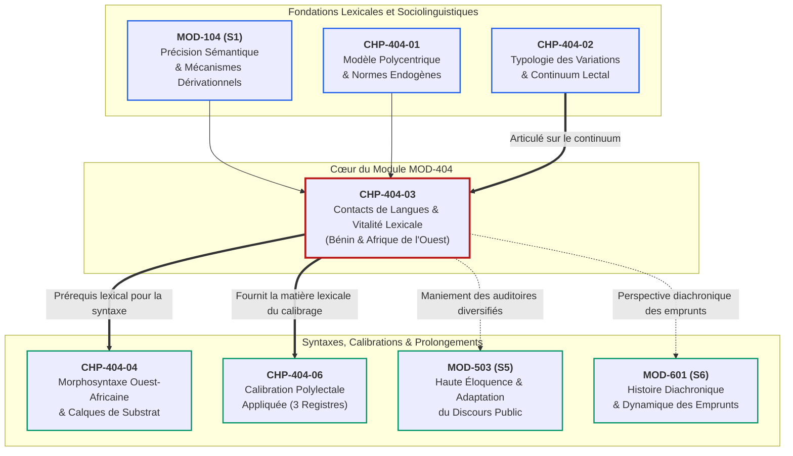
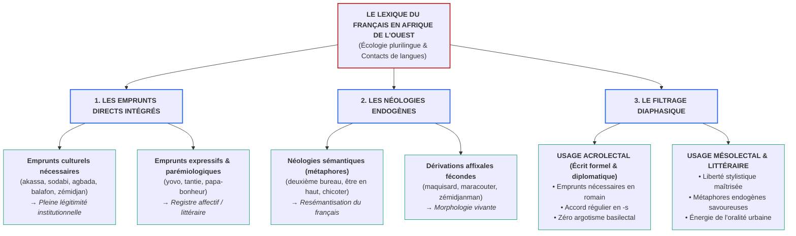

# Chapitre 3 — Le Français en Afrique de l'Ouest et au Bénin : Contacts de Langues, Emprunts Véhiculaires et Vitalité Lexicale

> **Identifiant du chapitre** : `CHP-404-03`  
> **Module de rattachement** : [`MOD-404` — Sociolinguistique Francophone : Dynamiques Ouest-Africaines et Norme Internationale](file:///f:/Formation/world-class-french/03-curriculum/year-2/semester-4/mod-404-sociolinguistique-francophone-ouest-africaine-norme.md)  
> **Semestre** : Année 2 — Semestre 4 (S4)  
> **Volume horaire estimé** : 5 à 6 heures d'apprentissage autonome délibéré et d'ateliers d'application (Phase 1 Étude : 1 h 30 | Phase 2 Pratique : 1 h 30 | Phase 3 Correction : 1 h 00 | Phase 4 Évaluation : 1 h 00)  
> **Statut** : [STATUT : VALIDÉ]  
> **Compétences associées** : [`FR-SOCIOL-001`](file:///f:/Formation/world-class-french/02-competency-framework/competency-framework.md#fr-sociol-001-conscience-sociolinguistique-et-navigation-entre-registres) (L3 Autonomie), [`FR-LEXIC-001`](file:///f:/Formation/world-class-french/02-competency-framework/competency-framework.md#fr-lexic-001-précision-sémantique-nuances-synonymiques-et-collocations) (L3 Autonomie), [`FR-INT-004`](file:///f:/Formation/world-class-french/02-competency-framework/competency-framework.md#fr-int-004-adapter-instantanément-son-registre-de-langue-au-contexte) (L3 Autonomie)  
> **Sources scientifiques de référence** : `SRC-SOCIO-01` (Queffélec et al., 1997 / 2002, AUF), `SRC-SOCIO-02` (Calvet, 2017, PUF), `SRC-LEX-03` (Rey dir., 2016, Le Robert), `SRC-LEX-04` (Robert & Rey dir., Le Grand Robert), `SRC-NORM-03` (Ministère de l'Éducation nationale, 2020), `SRC-TYPO-01` (Imprimerie nationale, 2002/2014)

---

## 1. Titre et Place dans le Cursus

### 1.1 Intitulé Officiel
**Chapitre 3 : Le Français en Afrique de l'Ouest et au Bénin : Contacts de Langues, Emprunts Véhiculaires et Vitalité Lexicale** (`CHP-404-03`).

### 1.2 Insertion Architecturale dans le Cursus
Le présent chapitre constitue le cœur lexicologique et sociolinguistique du module [`MOD-404`](file:///f:/Formation/world-class-french/03-curriculum/year-2/semester-4/mod-404-sociolinguistique-francophone-ouest-africaine-norme.md). Après avoir déconstruit le mythe du français monolithique (`CHP-404-01`) et théorisé le continuum lectal opposant basilecte, mésolecte et acrolecte (`CHP-404-02`), l'apprenant aborde ici le champ concret où se manifeste avec le plus d'éclat la rencontre entre le français et les langues nationales d'Afrique de l'Ouest : **le lexique** [Réf. `SRC-SOCIO-01`, p. 11-35 ; `SRC-SOCIO-02`, chap. 3].

Dans les républiques plurilingues ouest-africaines — et singulièrement au Bénin —, la langue française n'évolue pas dans un bocal aseptisé. Elle cohabite quotidiennement avec des langues véhiculaires et identitaires majeures (fon, yoruba, baatonu, mina, dendi). De ce contact continu jaillit une créativité lexicale vigoureuse : emprunts matériels indispensables pour nommer les réalités culturelles, néologies sémantiques et métaphoriques, dérivations affixales inventives.

L'enjeu didactique de ce chapitre est de doter le futur cadre, haut fonctionnaire ou diplomate d'une **boussole lexicologique infaillible** : savoir célébrer et employer les emprunts culturels indispensables consacrés par la lexicographie savante (`SRC-LEX-03`, `SRC-LEX-04`), tout en filtrant rigoureusement les argotismes éphémères et les calques fautifs qui dégraderaient la tenue d'un écrit institutionnel.



---

## 2. Objectifs Mesurables

Au terme des 5 à 6 heures d'apprentissage autonome délibéré et d'ateliers d'application de ce chapitre, l'apprenant est capable de :

1. **Classifier scientifiquement tout fait lexical ouest-africain** selon la typologie formelle des contacts de langues : emprunt culturel nécessaire, emprunt expressif, néologie sémantique (resémantisation), néologie dérivationnelle ou argotisme mésolectal/basilectal ([`FR-SOCIOL-001`](file:///f:/Formation/world-class-french/02-competency-framework/competency-framework.md#fr-sociol-001-conscience-sociolinguistique-et-navigation-entre-registres), Palier L3 Autonomie).
2. **Distinguer avec certitude les emprunts culturels institutionnalisés légitimes** (désignant des réalités matérielles ou institutionnelles sans équivalent sémantique en français hexagonal : *zémidjan, akassa, kloui-kloui, sodabi, boubou, agbada, balafon*) des solécismes, barbarismes et argotismes familiers pénalisants dans un écrit de concours ou de haute administration ([`FR-LEXIC-001`](file:///f:/Formation/world-class-french/02-competency-framework/competency-framework.md#fr-lexic-001-précision-sémantique-nuances-synonymiques-et-collocations), Palier L3 Autonomie).
3. **Appliquer les règles canoniques d'intégration morphosyntaxique et graphique** du français standard aux unités lexicales d'origine endogène (assignation du genre grammatical, flexion régulière de pluriel en *-s*, neutralisation des marques tonales africaines, accord des déterminants) ([`FR-LEXIC-001`](file:///f:/Formation/world-class-french/02-competency-framework/competency-framework.md#fr-lexic-001-précision-sémantique-nuances-synonymiques-et-collocations), Palier L3 Autonomie).
4. **Arbitrer et calibrer l'opportunité éditoriale d'un africanisme** selon le genre discursif cible (dépêche d'agence, note diplomatique internationale, rapport d'expertise, tribune de presse ou fiction littéraire), en substituant spontanément le terme standard neutre ou en justifiant l'emprunt valorisé ([`FR-SOCIOL-001`](file:///f:/Formation/world-class-french/02-competency-framework/competency-framework.md#fr-sociol-001-conscience-sociolinguistique-et-navigation-entre-registres) & [`FR-INT-004`](file:///f:/Formation/world-class-french/02-competency-framework/competency-framework.md#fr-int-004-adapter-instantanément-son-registre-de-langue-au-contexte), Palier L3 Autonomie).

---

## 3. Prérequis et Test de Préparation

### 3.1 Prérequis Cognitifs Minimaux
- **La typologie des variations linguistiques (`CHP-404-02`)** : Maîtrise des quatre axes fondamentaux : diatopique (géographique), diastratique (social), diaphasique (situationnel) et diamésique (oral/écrit).
- **Le continuum lectal (`CHP-404-02`)** : Distinction fonctionnelle entre acrolecte (standard international soutenu), mésolecte (usage médian urbain) et basilecte (parler populaire hybride).
- **La morphologie dérivationnelle générale (`MOD-104`)** : Connaissance des procédés de dérivation par préfixation, suffixation et composition en français.

### 3.2 Test de Préparation (Auto-Diagnostic à 5 Questions)
Répondez aux cinq questions suivantes sans consulter de document d'appui avant de déployer le corrigé repliable :

1. **Question 1 (Statut référentiel)** : Dans un rapport officiel destiné au ministère des Transports, est-il légitime d'employer le terme *zémidjan* (ou *taxi-moto*), ou doit-on obligatoirement lui substituer une périphrase descriptive comme « motocyclette individuelle de transport public » ?
2. **Question 2 (Morphologie flexionnelle)** : Comment s'écrit au pluriel, selon les règles de la morphologie française standard, le groupe nominal *un zémidjan rapide* ? Les marques de pluriel des langues d'origine (kwa/gbe) doivent-elles subsister ?
3. **Question 3 (Discrimination lexicale)** : Quelle différence conceptuelle sépare l'expression *deuxième bureau* du terme *akassa* au plan des mécanismes de création lexicale ?
4. **Question 4 (Catégorisation sociolinguistique)** : Pourquoi le vocable *s'enjailler* est-il proscrit dans une note verbale diplomatique ou un arrêt juridique, alors qu'il est couramment attesté dans les chroniques culturelles de la presse ouest-africaine ?
5. **Question 5 (Graphie et typographie)** : Selon les normes typographiques (`SRC-TYPO-01`), à quelle condition un mot d'origine étrangère ou africaine s'écrit-il en caractères romains plutôt qu'en italique dans un texte français ?

<details>
<summary><strong>Corrigé détaillé et barème de l'auto-diagnostic (cliquer pour dérouler)</strong></summary>

1. **Réponse 1** : **Il est parfaitement légitime d'employer le terme *zémidjan* (ou *taxi-moto*).** Il s'agit d'un **emprunt culturel nécessaire**, désignant une réalité sociologique et technique précise qui n'a pas d'équivalent exact et univoque en français hexagonal. La périphrase lourde est inutile et pédante.
2. **Réponse 2** : On écrit **des zémidjans rapides**. Une fois intégré dans le lexique français, le mot obéit à la morphologie flexionnelle standard du français : adjonction du morphogramme de pluriel **-s**. Les préfixes nominaux ou flexions des langues africaines de départ sont entièrement neutralisés.
3. **Réponse 3** : *Akassa* est un **emprunt lexical direct** (importation matérielle du signifiant et du signifié d'une langue béninoise pour nommer un mets traditionnel). En revanche, *deuxième bureau* est une **néologie sémantique par métaphore** (création endogène utilisant des mots français patrimoniaux pour leur attribuer un sens inédit : la concubine stable).
4. **Réponse 4** : Parce que *s'enjailler* appartient au **registre familier/argotique mésolectal** (issu du nouchi ivoirien via l'anglais *enjoy*). S'il témoigne d'une grande vitalité dans la culture urbaine et la littérature contemporaine, son emploi dans un texte juridique ou diplomatique constitue une faute de convenance diaphasique majeure.
5. **Réponse 5** : Un mot d'origine africaine s'écrit en **romain** dès lors qu'il est **naturalisé et répertorié dans les dictionnaires d'usage général du français** (*Le Petit Larousse*, *Le Petit Robert*, *Le Grand Robert*), tels que *boubou, kora, balafon, zémidjan*. S'il s'agit d'un xénisme récent ou d'un terme très localisé non lexicalisé, il doit être composé en **italique**.

> **Barème diagnostique** :  
> • **5 / 5** : Excellente intuition sociolinguistique, abordez directement la section 4.  
> • **3 ou 4 / 5** : Notions acquises, vigilance requise sur la frontière entre néologie formelle et néologie sémantique.  
> • **$< 3 / 5$** : Révision impérative des notions de registre et de continuum (`CHP-404-02`) avant de poursuivre.
</details>

---

## 4. Situation de Départ ou Problème Concret

### 4.1 L'Écueil du Vocabulaire Importé vs Vocabulaire Créé
Considérons le cas réel d'un haut fonctionnaire ou diplomate béninois chargé de rédiger une note d'orientation stratégique pour une institution multilatérale (Banque africaine de développement, Union africaine ou PNUD) sur l'économie informelle et la régulation urbaine à Cotonou.

Dans son premier jet, le rédacteur note :
> *« Lors de la dernière concertation, les zémidjanmen ont manifesté leur colère contre la taxe municipale. Pendant ce temps, les bonnes dames du marché Tokpa continuent de vendre l'akassa et le kloui-kloui sans être inquiétées. Plusieurs cadres qui sont en haut préfèrent aller s'enjailler dans les maquis en buvant du sodabi au lieu de régler ce dossier, laissant pour la population de subir les tracasseries des forces de l'ordre. »*

Soumis à un comité éditorial international, ce paragraphe suscite un rejet cinglant. Pourtant, le rédacteur s'indigne : *« Tout ce que j'ai écrit est vrai, ce sont les mots exacts de notre réalité à Cotonou ! »*

### 4.2 Diagnostic Sociolinguistique de l'Échec
L'échec de ce texte ne provient pas de son contenu informatif, mais d'une **confusion catégorielle profonde** entre trois strates lexicales totalement distinctes :

1. **Des emprunts culturels nécessaires et institutionnalisés** : *akassa*, *kloui-kloui*, *sodabi*. Ces termes désignent des réalités culinaires et matérielles n'ayant aucun équivalent exact dans le vocabulaire français traditionnel. Ils sont irremplaçables et légitimes, pourvu qu'ils soient convenablement intégrés.
2. **Un emprunt hybride familier** : *zémidjanmen*. Si *zémidjan* est un emprunt légitime, le suffixe pseudo-anglais *-man* (au pluriel *-men*) relève de l'usage oral relâché de la rue. Dans un rapport officiel, on écrira : *les conducteurs de zémidjans* ou *les conducteurs de taxi-moto*.
3. **Des périphrases mésolectales et calques oraux inadaptés** : *les bonnes dames* (tour familier pour *les commerçantes détaillantes*), *ceux qui sont en haut* (métaphore spatiale populaire pour *les autorités dirigeantes* ou *les hauts responsables*).
4. **Un argotisme festif disqualifiant** : *s'enjailler*. L'intrusion de ce néologisme nouchi/branché dans un rapport administratif brise l'exigence de neutralité stylistique.
5. **Un calque syntaxique déviant** : *laissant pour la population de subir* (calque de substrat sur les langues kwa).

Le scripteur non averti oscille constamment entre deux conduites néfastes :
- **L'hyper-purisme stérile** : refuser d'écrire *zémidjan* ou *akassa*, et s'enfermer dans des périphrases pédantes et incompréhensibles pour les acteurs locaux ;
- **Le laxisme confus** : injecter sans discernement des tics de langage, de l'argot de bar ou des métaphores orales dans un document officiel destiné à des instances internationales.

L'objectif de ce chapitre est d'ériger une méthode rigoureuse d'arbitrage lexical.

---

## 5. Explication Intuitive : Le Jardin Botanique et la Greffe Végétale

Pour modéliser les dynamiques lexicales du français en Afrique sans sombrer dans l'arbitraire normatif, recourons à l'analogie écologique et sylvicole :

```text
┌─────────────────────────────────────────────────────────────────────────────────────────┐
│              L'ANALOGIE DU JARDIN BOTANIQUE ET DE LA GREFFE VÉGÉTALE                     │
├──────────────────────────────────────────┬──────────────────────────────────────────────┤
│ LE TRONC PATRIMONIAL DU FRANÇAIS         │ • Le système grammatical, morphologique et   │
│ (L'Arbre Séculaire)                      │   lexical fondamental, issu du latin et codifié│
│                                          │   au fil des siècles.                        │
├──────────────────────────────────────────┼──────────────────────────────────────────────┤
│ LE TERREAU ÉCOLOGIQUE OUEST-AFRICAIN     │ • Les réalités matérielles, sociales,        │
│ (L'Écosystème Nouveau)                   │   culinaires et rituelles d'Afrique de l'Ouest│
│                                          │   (inconnues de l'Île-de-France du XVIIe s.).│
├──────────────────────────────────────────┼──────────────────────────────────────────────┤
│ LES GREFFONS LEXICAUX NÉCESSAIRES        │ • Des unités lexicales endogènes greffées sur│
│ (Emprunts Culturels Consacrés)           │   le tronc : boubou, balafon, zémidjan,      │
│                                          │   akassa, sodabi.                            │
│                                          │ • Elles s'intègrent à la sève du français    │
│                                          │   (prennent le pluriel en -s, un genre).     │
│                                          │ • Elles enrichissent le jardin universel.    │
├──────────────────────────────────────────┼──────────────────────────────────────────────┤
│ LA VÉGÉTATION SPONTANÉE DU SOUS-BOIS     │ • L'argot urbain, les créations éphémères de  │
│ (Argotismes & Tics de Rue)               │   la rue (s'enjailler, chicoter, maracouter).│
│                                          │ • Savoureuses et vivantes dans leur milieu   │
│                                          │   naturel (oralité, littérature, humour),    │
│                                          │   mais envahissantes si elles étouffent      │
│                                          │   les allées ordonnées du style formel.      │
└──────────────────────────────────────────┴──────────────────────────────────────────────┘
```

Une langue vivante n'est pas un monument de marbre figé ; c'est un organisme vivant qui s'adapte à son biotope. Lorsque le français s'est implanté en Afrique de l'Ouest, il ne possédait aucun mot pour désigner un vêtement ample en cotonnade (*boubou*), un xylophone à calebasses (*balafon*), un taxi-moto urbain (*zémidjan*), ou une galette d'arachide torréfiée (*kloui-kloui*). 

Deux choix se présentaient :
1. Soit inventer des périphrases artificielles, lourdes et ridicules ;
2. Soit accueillir l'emprunt direct, le conformer à la morphologie française et l'intégrer au trésor de la langue.

C'est cette seconde voie — la voie royale de la lexicologie scientifique — qui fait du français une **langue mondiale polycentrique** [Réf. `SRC-SOCIO-01`, p. 45-60 ; `SRC-LEX-03`].

---

## 6. Définitions Précises et Terminologie

Pour analyser avec netteté les phénomènes de contact, onze concepts fondamentaux doivent être maîtrisés :

1. **Écologie linguistique** : Étude des relations entre les langues et leur environnement physique, social, culturel et politique (concept inauguré par Einar Haugen et développé par Louis-Jean Calvet) [Réf. `SRC-SOCIO-02`, chap. 3]. Elle examine comment les langues coexistent, se partagent les fonctions de communication et s'influencent réciproquement au sein d'un même espace géopolitique.
2. **Contact de langues** : Situation sociolinguistique dans laquelle deux ou plusieurs langues sont utilisées par les mêmes locuteurs ou dans une même communauté, provoquant des phénomènes d'emprunt, d'interférence, de calque, d'alternance codique (*code-switching*) ou de convergence structurale.
3. **Emprunt direct (ou emprunt lexical)** : Processus par lequel une langue adopte une unité lexicale intégrale (signifiant phonique et graphique + signifié) provenant d'une autre langue pour désigner un objet matériel, une coutume ou une institution (*ex. le mot fon zɛ mǐ jǐn devenant en français béninois le zémidjan*).
4. **Emprunt culturel nécessaire** : Unité lexicale empruntée à une langue locale pour combler une **lacune dénominative absolue** du français de référence, désignant une réalité matérielle, biologique, rituelle ou culinaire qui n'existe pas dans le monde hexagonal (*ex. akassa, sodabi, agbada, balafon, kora*).
5. **Néologie sémantique (ou resémantisation)** : Mécanisme par lequel un mot déjà existant dans le fonds lexical français reçoit un sens inédit, une extension de sens ou une valeur métaphorique propre au contexte africain (*ex. deuxième bureau au sens de maîtresse officielle, ou être en haut au sens d'exercer le pouvoir suprême*).
6. **Néologie dérivationnelle (ou morphologique)** : Création d'un mot nouveau par application des règles de dérivation affixes (suffixation, préfixation) ou de composition sur une base lexicale française ou endogène (*ex. le suffixe -ard créant maquisard à partir de maquis ; le suffixe -er créant chicoter à partir de chicote*).
7. **Troncation lexicale** : Procédé d'abréviation d'un mot par suppression d'une ou plusieurs syllabes, très fréquent dans l'oralité urbaine d'Afrique de l'Ouest :
   - *Apocope* : chute de la fin du mot (*ex. zem pour zémidjan*) ;
   - *Aphérèse* : chute du début du mot.
8. **Resémantisation** : Attribution d'un nouveau contenu sémantique à un signifiant préexistant, souvent sous l'effet du contact de langues et de la réinterprétation culturelle.
9. **Xénisme** : Mot emprunté à une langue étrangère qui conserve dans la langue d'accueil sa couleur locale prononcée et n'est perçu que comme le témoignage d'une réalité extérieure (*ex. yovo, vodoun*). Au plan typographique, le xénisme s'écrit généralement en italique tant qu'il n'est pas lexicalisé dans les dictionnaires généraux.
10. **Pérégrinisme** : Stade intermédiaire entre le xénisme brut et l'emprunt pleinement naturalisé ; mot perçu comme étranger mais employé couramment dans les récits de voyage, chroniques ou correspondances pour apporter une touche d'authenticité ethnographique.
11. **Intégration morphologique et graphique** : Processus d'assimilation par lequel un vocable emprunté se conforme aux règles phonotactiques, orthographiques (accents, graphèmes) et flexionnelles (genre, nombre) de la langue d'arrivée (*ex. pluralisation régulière des boubous, des zémidjans*).

---

## 7. Règles ou Mécanismes Fondamentaux

### 7.1 L'Écologie Linguistique du Bénin : Coexistence et Stratification
La République du Bénin offre l'un des laboratoires sociolinguistiques les plus riches de l'espace francophone. Selon l'article 1er de la Constitution du 11 décembre 1990, le français est la **langue officielle**. Il sert de véhicule exclusif à l'administration d'État, au système judiciaire formel, aux traités internationaux et à l'enseignement primaire, secondaire et supérieur.

Cependant, ce statut officiel s'inscrit dans un tissu plurilingue endogène comprenant plus d'une cinquantaine de langues nationales, réparties en trois grands ensembles géo-linguistiques :

```text
┌─────────────────────────────────────────────────────────────────────────────────────────┐
│                    CARTOGRAPHIE LINGUISTIQUE SIMPLIFIÉE DU BÉNIN                        │
├────────────────────────────────────────┬────────────────────────────────────────────────┤
│ GROUPE KWA / GBE (Sud et Centre)       │ • Fon (langue véhiculaire majeure, ~39 % de    │
│                                        │   locuteurs natifs, comprise par plus de 60 %).│
│                                        │ • Goun (Ouémé / Porto-Novo).                   │
│                                        │ • Mina / Gen (Mono, littoral côtier).          │
│                                        │ • Aja (Couffo / Sud-Ouest).                    │
├────────────────────────────────────────┼────────────────────────────────────────────────┤
│ GROUPE YORUBOÏDE / DÉFOÏDE (Est)       │ • Yoruba et dialectes nago (Plateau, Collines, │
│                                        │   frontière nigériane, commerce transfrontalier)│
├────────────────────────────────────────┼────────────────────────────────────────────────┤
│ LANGUES SEPTENTRIONALES (Nord)         │ • Groupe Gur / Voltaïque : Baatonu (Borgou,    │
│                                        │   Alibori), Waama, Ditammari (Atacora).        │
│                                        │ • Groupe Songhay : Dendi (langue marchande des │
│                                        │   carrefours urbains : Parakou, Djougou).      │
└────────────────────────────────────────┴────────────────────────────────────────────────┘
```

Cette écologie produit une situation de **diglossie enchâssée** et de plurilinguisme individuel : la très grande majorité des Béninois lettrés manient au moins une ou deux langues nationales en plus du français. Dans les marchés urbains (Dantokpa à Cotonou, Ouando à Porto-Novo, Arzèkè à Parakou), les cours d'école et les foyers, le français s'entrelace continuellement avec le fon, le yoruba ou le baatonu.

### 7.2 Typologie des Emprunts aux Langues Béninoises et Ouest-Africaines
L'influence des langues nationales sur le lexique français en Afrique de l'Ouest se manifeste selon deux grandes catégories fonctionnelles [Réf. `SRC-SOCIO-01`, p. 80-110] :

#### A. Les Emprunts Culturels, Culinaires et Matériels Indispensables
Ce sont des désignateurs rigides de réalités concrètes sans équivalent dans le français standard :
- **Transports urbains** : *zémidjan* (couramment abrégé en *zem*), forgé à partir de la locution verbale fon *zɛ mǐ jǐn* (« prends-moi debout », c'est-à-dire « transporte-moi rapidement / sur-le-champ »). Ce mot désigne le service de taxi-moto devenu le pivot des déplacements dans les métropoles béninoises et ouest-africaines.
- **Gastronomie et alimentation traditionnelle** :
  - *akassa* : pâte fermentée à base de fécule de maïs blanc ou jaune, cuite à la vapeur et emballée dans des feuilles végétales d'*akpaki*, constituant la base nutritive quotidienne au Sud-Bénin.
  - *kloui-kloui* : galettes ou bâtonnets croustillants d'arachide torréfiée déshuilée et frite, consommés comme en-cas ou accompagnement.
  - *sodabi* : eau-de-vie traditionnelle obtenue par distillation artisanale du vin de palme (*Raphia* ou *Elaeis guineensis*), titrant souvent entre 40 et 50 degrés d'alcool.
- **Vestimentaire et parure** :
  - *agbada* : grand vêtement d'apparat masculin à trois pièces (tunique ample, pantalon bouffant et ample manteau brodé), emprunté au yoruba et partagé dans tout le golfe de Guinée.
  - *boubou* : du wolof *mbubb*, vêtement ample flottant masculin ou féminin en cotonnade ou bazin brodé.
- **Musique et instruments traditionnels** :
  - *balafon* : xylophone ouest-africain composé de lames de bois dur accordées et de calebasses évidées servant de caisses de résonance.
  - *kora* : harpe-luth mandingue à 21 cordes montée sur une demi-calebasse tendue d'une peau de vache.

#### B. Les Emprunts Affectifs, Parémiologiques et Expressifs
Ces termes ne comblent pas un vide technique absolu, mais traduisent une posture relationnelle, un statut social ou une nuance expressive intimement liée à la vision du monde africaine :
- *yovo* : terme fon/éwé désignant à l'origine le Blanc ou l'Européen, étendu dans l'usage quotidien à tout étranger occidental ou perçu comme tel.
- *papa-bonheur* : collocation désignant un protecteur aisé, un mécène ou un bienfaiteur généreux qui subvient aux besoins d'un tiers.
- *tantie* : hypocoristique affectueux et déférent formé sur *tante*, utilisé pour interpeller poliment une femme d'âge mûr, une cousine aînée ou une commerçante respectée.
- *bonne dame* : désignation mésolectale respectueuse réservée aux vendeuses de denrées ou aux restauratrices des marchés populaires.

#### C. Règles Canoniques d'Intégration Morphosyntaxique
Lorsqu'un emprunt africain pénètre dans la langue française, il doit se soumettre aux règles structurales du système récepteur :
1. **Assignation du genre grammatical** :
   - Par défaut, les réalités inanimées, les aliments et les objets matériels reçoivent le **genre masculin** : *un zémidjan, le sodabi, un kloui-kloui, le balafon, l'agbada, le boubou*.
   - Le **genre féminin** est assigné par correspondance sémantique avec un référent féminin naturel (*une tantie, une bonne dame*) ou par assimilation phonotactique exceptionnelle (*l'akassa* s'emploie couramment au féminin ou au masculin selon les locuteurs, avec une tendance dominante au masculin dans la presse savante : *un bon akassa*).
2. **Flexion régulière de nombre (le pluriel standard)** :
   - Tout emprunt naturalisé prend la marque régulière du pluriel français : **le suffixe -s** graphique : *des zémidjans, des akassas, des kloui-klouis, des boubous, des agbadas, des balafons*.
   - Les marques morphologiques de pluriel des langues sources (comme les alternances préfixales ou les répétitions) ne doivent jamais être calquées à l'écrit français.
3. **Neutralisation des tons linguistiques** :
   - Les langues kwa (fon, mina) et yoruba sont des **langues à tons** (ton haut, ton bas, ton moyen, tons modulés) où la hauteur mélodique change le sens du mot.
   - En français standard, ces oppositions tonales sont entièrement gommées à l'écrit et remplacées à l'oral par l'accent tonique d'intensité sur la dernière syllabe prononcée : *zémidjan* `/ze.mi.dʒɑ̃/`.

### 7.3 La Néologie Stylistique et Métaphorique Féconde
Outre l'emprunt direct, la vitalité du français en Afrique de l'Ouest repose sur une inventivité sémantique spectaculaire qui réinvestit le matériel lexical français [Réf. `SRC-SOCIO-01`, p. 115-145] :

#### A. Métaphores Spatiales et Sociales
- *Être en haut* : Expression métaphorique désignant le fait d'occuper les échelons supérieurs de l'appareil étatique, de détenir l'autorité politique ou la puissance économique (*« Ceux qui sont en haut ne mesurent pas les difficultés du peuple »*).
- *Deuxième bureau* : Périphrase métaphorique institutionnalisée dans toute l'Afrique francophone pour désigner la maîtresse attitrée ou la compagne officielle non maritale d'un homme marié.
- *Casser la voix* : Métaphore mésolectale signifiant chanter ou déclamer avec une énergie extrême, ou faire entendre sa voix avec éclat lors d'une controverse publique.
- *S'enjailler* : Verbe pronominal hautement expressif, né dans le nouchi ivoirien par déformation phonétique et resémantisation de l'anglais *enjoy*, signifiant faire la fête, prendre du bon temps, jubiler avec enthousiasme.
- *Chicoter* : Verbe hérité du portugais colonial *chicote* (fouet), signifiant battre, fouetter physiquement, et étendu par métaphore stylistique au fait de dominer outrageusement un adversaire dans une joute intellectuelle, sportive ou politique.

#### B. Dérivations Affixales Endogènes
La morphologie dérivationnelle produit des créations hybrides remarquables :
- **Suffixe verbalisateur -er** : Appliqué à des bases nominales locales ou étrangères pour créer des verbes de premier groupe parfaitement conjugables : *maracouter* (de *marabout*, pratiquer des rituels occultes ou des intrigues secrètes pour obtenir un avantage politique ou financier), *chicoter*.
- **Suffixe d'appartenance -ard** : *maquisard* (forgé sur *maquis*, restaurant-bar populaire de plein air), désignant l'habitué ou le client fidèle des maquis.
- **Suffixe hybride d'agent -man** : Emprunté à l'anglais véhiculaire ou au pidgin nigérian et greffé sur une base locale : *zémidjanman* (pluriel *zémidjanmen* ou *zémidjans-men* à l'oral familier), désignant le conducteur de taxi-moto.
- **Suffixe d'agent -eur** : *gâteur* (dans l'expression consacrée *gâteur de coin*, désignant un individu fêtard qui dépense sans compter pour impressionner son entourage, ou au figuré un semeur de désordre).

### 7.4 Le Statut du Lexique Africain dans la Lexicographie Moderne
Pendant des décennies, une idéologie puriste a qualifié ces vocables de « fautes », de « barbarismes exotiques » ou d'« incorrections coloniales ». La linguistique moderne a balayé cette vision archaïque :

1. **La reconnaissance académique et institutionnelle** :
   - Dès la seconde moitié du XXe siècle, de grands africanismes ont franchi les portes du *Grand Robert de la langue française* (`SRC-LEX-04`) et du *Dictionnaire de l'Académie française* (`SRC-LEX-02`) : *boubou, kora, balafon, caïcédrat, baobab*.
   - Ces vingt dernières années, les dictionnaires d'usage courant (*Le Petit Larousse*, *Le Petit Robert*) intègrent chaque année des dizaines de termes ouest-africains : *maquis, zémidjan, s'enjailler, thiéboudienne, coupeur de route, go pack*.
2. **Les critères objectifs d'admission lexicographique** :
   Pour qu'un mot issu du contact de langues pénètre dans un dictionnaire de référence internationale, il doit satisfaire trois critères cumulatifs :
   - **Fréquence d'usage soutenue** : Le mot ne doit pas être un hapax ou une toquade de mode éphémère ;
   - **Dispersion géographique (inter-étatique)** : Les lexicographes privilégient les termes partagés par plusieurs pays francophones (Sénégal, Côte d'Ivoire, Bénin, Cameroun, Mali) plutôt que des isolats microscopiques ;
   - **Légitimité littéraire et sociétale** : L'unité lexicale doit être attestée chez des écrivains majeurs (Kourouma, Hampâté Bâ, Pliya, Couao-Zotti) et dans la presse d'information générale de référence.

---

## 8. Raisonnement Détaillé : Pourquoi une Langue qui N'Emprunte Plus Est une Langue Morte

Pour comprendre la légitimité des emprunts africains, il est indispensable de replacer le français dans sa dynamique historique séculaire.

### 8.1 L'Histoire du Français est une Histoire d'Emprunts Continus
Le français hexagonal dit « pur » n'a jamais existé. Il est lui-même le produit d'un faisceau d'emprunts massifs successifs [Réf. `SRC-LEX-03`] :
- Aux langues celtiques (gaulois) : des termes ruraux et matériels (*char, charrue, mouton, alouette*) ;
- Aux langues germaniques (francique) : le vocabulaire de la guerre, de la féodalité et des couleurs (*guerre, heaume, bannière, blanc, bleu, franc*) ;
- À l'arabe médiéval : les mathématiques, l'astronomie et le grand commerce méditerranéen (*algèbre, algorithme, chiffre, zéro, zénith, alchimie, sirop, café, coton, magasin*) ;
- À l'italien à la Renaissance : l'art, la finance et l'architecture (*balcon, façade, sonnet, banque, crédit, festin, courtisan, soldat, alarme*) ;
- Aux langues amérindiennes aux XVIIe et XVIIIe siècles : la découverte de denrées inconnues (*tomate, chocolat, cacao, maïs, tabac, pirogue, ouragan*).

Personne ne songerait aujourd'hui à qualifier *zéro*, *banque* ou *chocolat* de « barbarismes sauvages ». Ce sont des mots français à part entière.

### 8.2 L'Afrique, Poumon Néologique de la Francophonie Contemporaine
Au XXIe siècle, l'Afrique subsaharienne concentre plus de 60 % des locuteurs quotidiens du français et constitue son principal foyer démographique et littéraire. Refuser l'entrée d'emprunts comme *zémidjan, akassa, agbada* ou *sodabi* sous prétexte qu'ils viennent du golfe de Guinée relève d'une contradiction absurde : pourquoi accepterait-on *sauna* (finnois), *sushi* (japonais) ou *cow-boy* (anglo-américain), et refuserait-on les créations des locuteurs francophones d'Afrique ?

Comme l'écrivait Alain Rey dans la préface du *Dictionnaire historique de la langue française* (`SRC-LEX-03`) :
> *« Une langue qui cesse d'emprunter, d'adapter et de féconder son lexique au contact de réalités nouvelles est une langue en voie de fossilisation. La vitalité du français contemporain se joue désormais dans la multiplicité de ses enracinements géographiques. »*

La compétence du lettré ne réside donc pas dans le rejet aveugle de l'emprunt africain, mais dans son **maniement exact, typographiquement maîtrisé et stylistiquement calibré**.

---

## 9. Exemples Corrects Commentés

Examinons comment trois grands écrivains africains de langue française exploitent avec maestria la vitalité lexicale endogène.

### 9.1 Florent Couao-Zotti : L'Énergie Urbaine de Cotonou
Extrait de *La Traque de la musaraigne* (Éditions Le Serpent à Plumes / poche) :
> *« Les zémidjans vrombissaient dans la poussière rouge du carrefour Tokpa. Leurs conducteurs, silhouettes casquées de jaune ou de vert fluo, zigzaguaient entre les minibus déglingués pour déposer les matrones chargées d'akassa et de condiments avant la tombée de la nuit. Au loin, les effluves âcres de sodabi s'échappaient d'un débit clandestin où s'attardaient quelques noctambules désœuvrés. »*

#### Commentaire lexicologique et stylistique :
- **Intégration morphologique irréprochable** : *Les zémidjans* reçoit le déterminant masculin pluriel et la marque régulière *-s*. L'auteur choisit la graphie francisée avec accent aigu (*zémidjans*), parfaitement conforme aux dictionnaires usuels (`SRC-LEX-04`).
- **Précision dénotative** : L'emploi de *zémidjans, akassa, sodabi* ancre immédiatement la scène dans la réalité matérielle et sensorielle tangible de Cotonou. Aucun équivalent standard hexagonal n'aurait pu restituer cette texture humaine sans détruire la vérité du tableau.
- **Tenue syntaxique acrolectale** : Le vocabulaire endogène est porté par une syntaxe classique impeccable (imparfait narratif, subordonnées participiales, appositions équilibrées). L'emprunt n'est pas un relâchement : il est un choix esthétique souverain.

### 9.2 Jean Pliya : L'Élévation Historique et Ethnographique
Extrait de la tragédie historique *Kondo le requin* (Clé, Yaoundé) :
> *« Les dignitaires du royaume, drapés dans leurs lourds agbadas de cotonnade tissée, se prosternèrent devant le trône royal. Le roi Kondo fit apporter les calebasses de vin de palme et de sodabi rituel pour honorer la mémoire des ancêtres. Tandis que le maître des cérémonies faisait retentir les tambours et le balafon sacré, la cour entière entonna le chant des victoires passées. »*

#### Commentaire lexicologique et stylistique :
- **Dignité institutionnelle** : *Agbada* désigne ici le grand habit de cour des souverains et ministres. Le terme confère une solennité historique que le mot générique « costume » ou « tunique » aurait totalement affadie.
- **Emprunt culturel nécessaire** : *Balafon* et *sodabi* désignent des objets rituels consacrés dans la liturgie royale d'Abomey. L'écrivain ne cherche pas l'exotisme de pacotille ; il nomme avec rigueur philologique des réalités patrimoniales millénaires.

### 9.3 Ahmadou Kourouma : L'Hybridation Malinké et la Subversion Poétique
Extrait des *Soleils des indépendances* (Seuil) :
> *« Fama Doumbouya ! Vrai Doumbouya, de père et de mère Doumbouya, prince du Horodougou... Les Soleils des Indépendances s'étaient annoncés comme un orage et avaient fini par faire de lui un charognard. Fama ne possédait plus un sou vaillant pour s'acheter un boubou neuf ou offrir l'hospitalité aux griots qui chantaient sa race. »*

#### Commentaire lexicologique et stylistique :
- **Consécration du mot *boubou*** : Emprunté au wolof dès les premiers contacts marchands, le terme est ici pleinement acclimaté au lexique universel de la francophonie.
- **Résonance parémiologique** : Kourouma fait dialoguer la morphologie française avec la métaphore africaine. L'expression *les Soleils des Indépendances* (calque sémantique de l'expression mandingue désignant les ères politiques nouvelles) devient un chef-d'œuvre de la littérature mondiale.

---

## 10. Contre-Exemples et Erreurs Fréquentes

L'observation des copies d'étudiants, des mémoires universitaires et des rapports d'administration en Afrique de l'Ouest révèle **six erreurs récurrentes** de manipulation lexicale :

### Erreur n° 1 : Insertion non contrôlée d'argot basilectal dans un écrit formel
- **Forme erronée** : *« Lors de la soutenance, le candidat a gâté le coin devant le jury avant d'aller s'enjailler avec ses camarades de promotion. »*
- **Analyse critique** : *Gâter le coin* (exceller avec éclat ou faire sensation) et *s'enjailler* (fêter) sont des créations très populaires de l'oralité urbaine mésolectale et basilectale. Leur irruption dans un compte rendu officiel de jury universitaire détruit instantanément la solennité de l'institution.
- **Correction normée** : *« Lors de la soutenance, le candidat s'est illustré avec un brio remarquable devant le jury, avant de célébrer sa réussite avec ses camarades de promotion. »*

### Erreur n° 2 : Barbarisme par méconnaissance du terme standard équivalent
- **Forme erronée** : *« Les fonctionnaires ont été convoqués au service pour régler les tracasseries du payement. »*
- **Analyse critique** : L'emploi de *au service* (au lieu de *au bureau* ou *sur leur lieu de travail*) et l'usage inflationniste de *tracasseries* pour désigner de simples formalités ou des lenteurs administratives résultent d'un appauvrissement lexical mésolectal.
- **Correction normée** : *« Les fonctionnaires ont été convoqués à leurs bureaux administratifs afin de résoudre les difficultés relatives au versement des rémunérations. »*

### Erreur n° 3 : Confusion entre emprunt lexical et calque syntaxique
- **Forme erronée** : *« Le préfet a fait que les zémidjans ont trop duré pour quitter le carrefour. »*
- **Analyse critique** : Le scripteur croit produire un texte « africain authentique » sous prétexte qu'il emploie *zémidjans*. Mais il l'associe à deux calques syntaxiques fautifs issus du substrat kwa : le causal déviant *faire que* et le verbe *durer* employé improprement pour *tarder*.
- **Correction normée** : *« Les instructions du préfet ont contraint les conducteurs de zémidjans à évacuer promptement le carrefour sans s'attarder. »*

### Erreur n° 4 : Rejet puriste des africanismes au profit d'anglicismes superficiels
- **Forme erronée** : *« Les VIP ont apprécié le catering traditionnel servi par les serveurs lors de l'afterwork. »*
- **Analyse critique** : Paradoxe fréquent chez certains cadres urbains : refuser d'employer des termes endogènes légitimes (*agbada, akassa, sodabi*) par honte linguistique d'un prétendu « manque de modernité », tout en saturant leur prose d'anglicismes bancals (*catering, afterwork*).
- **Correction normée** : *« Les hôtes de marque ont apprécié les mets et rafraîchissements traditionnels servis lors de la réception officielle. »*

### Erreur n° 5 : Refus puriste d'employer un emprunt culturel nécessaire
- **Forme erronée** : *« Les citoyens ont eu recours à des motocyclettes individuelles à deux roues assurant un transport urbain onéreux pour se procurer de la pâte de maïs bouillie fermentée. »*
- **Analyse critique** : L'hypercorrection puriste engendre des périphrases ridicules, illisibles et inefficaces. Refuser d'écrire *zémidjans* et *akassa* dans un rapport sur le coût de la vie au Bénin obscurcit la communication au lieu de l'éclairer.
- **Correction normée** : *« Les ménages ont emprunté des zémidjans pour aller acquérir l'akassa auprès des commerçantes du quartier. »*

### Erreur n° 6 : Graphie erronée ou non harmonisée d'un terme endogène
- **Forme erronée** : *« Il a bu du sodabie après avoir mangé du kluiklui et acheté un zemidjann. »*
- **Analyse critique** : Altération fantaisiste de l'orthographe lexicale consacrée. L'absence d'harmonisation graphique trahit un amateurisme scriptural.
- **Correction normée** : *« Il a consommé du sodabi après avoir partagé des kloui-klouis et sollicité un zémidjan. »*

---

## 11. Cas Particuliers et Limites

### 11.1 La Gestion des Doubles Graphies
Certains emprunts ouest-africains présentent dans l'usage deux variantes graphiques concurrentes :
- *Zémidjan* (avec accent aigu) vs *Zemidjan* (sans accent) : L'Académie française et *Le Grand Robert* (`SRC-LEX-04`) retiennent la forme accentuée **zémidjan**, qui indique explicitement la voyelle fermée `/e/`. La presse locale béninoise emploie indifféremment *zemidjan* ou la troncation familière *zem*. Dans un travail académique, la forme accentuée **zémidjan** est recommandée.
- *Akassa* vs *Akasa* : La graphie avec redoublement de l's (*akassa*) est désormais unanimement consacrée pour éviter la prononciation sonore voisée `/z/` selon les règles de la graphématique française (`SRC-ORTHO-01`).
- *Kloui-kloui* vs *Klui-klui* : La graphie avec le digramme traditionnel *ou* (*kloui-kloui*) s'impose dans la norme écrite francophone internationale.

### 11.2 La Règle Typographique de l'Italique vs Romain (`SRC-TYPO-01`)
Selon les règles de l'Imprimerie nationale :
1. **Mots répertoriés dans les dictionnaires d'usage général** : Ils se composent impérativement en **romain**, sans guillemets, et reçoivent la morphologie normale (*boubou, balafon, kora, zémidjan, maquis*).
2. **Mots régionaux spécifiques non encore lexicalisés mondialement** : Ils doivent être composés en **italique** dans un texte imprimé officiel (ou placés entre guillemets si l'italique n'est pas disponible), pour signaler au lecteur qu'il s'agit d'un emprunt vernaculaire (*« Les fidèles ont partagé l'**abikou** lors de la cérémonie »*).

### 11.3 Jurons, Interjections et Onomatopées Endogènes
Les interjections béninoises expressives (*Wèkè !*, *Ashé !*, *Ahi !*, *Hé yéé !*) possèdent une immense valeur dramatique dans le dialogue littéraire, le théâtre et la poésie. Elles sont en revanche **strictement prohibées** dans la prose technique, les conclusions juridiques ou les mémoires universitaires, car elles rompent le pacte de neutralité scientifique.

---

## 12. Approfondissement Adapté au Niveau : L'IFA et la Lexicographie Africaniste

Pour les étudiants préparant les concours de haut niveau (CAPES, Agrégation, diplomatie), il convient de connaître l'instrument scientifique majeur qui a permis la codification des particularités lexicales africaines : **l'Inventaire des particularités lexicales du français en Afrique noire (IFA)** [Réf. `SRC-SOCIO-01`, p. 5-20].

```text
┌─────────────────────────────────────────────────────────────────────────────────────────┐
│              L'INVENTAIRE DES PARTICULARITÉS LEXICALES DU FRANÇAIS (IFA)                │
├─────────────────────────────────────────────────────────────────────────────────────────┤
│ • Contexte institutionnel : Projet initié par l'AUPELF-UREF (devenue AUF) sous la     │
│   direction scientifique de Gérard Manessy, Ambroise Queffélec et Danièle Latin.        │
│ • Objectif : Recenser, définir et documenter avec rigueur philologique les vocables,    │
│   sens et emplois propres au français parlé et écrit dans 13 pays francophones d'Afrique.│
├─────────────────────────────────────────────────────────────────────────────────────────┤
│ LA GRILLE CLASSIFICATOIRE DE L'IFA :                                                    │
│ 1. Les Emprunts Intégraux : Vocables puisés directement dans les langues vernaculaires  │
│    (wolof, fon, baoulé, bambara, lingala, etc.) et intégrés au lexique local.          │
│ 2. Les Néologismes de Forme : Mots créés par dérivation (affixation) ou composition     │
│    à partir de racines françaises ou mixtes (ex. maquisard, zémidjanman).               │
│ 3. Les Néologismes de Sens : Glissements sémantiques ou métaphores appliqués à des     │
│    mots du français général (ex. deuxième bureau, être en haut).                        │
│ 4. Les Particularismes de Fréquence : Mots français anciens ou rares conservés dans     │
│    l'usage courant africain avec une vitalité bien supérieure à l'hexagone              │
│    (ex. jouir de ses droits, essencer, commissionnaire).                                │
└─────────────────────────────────────────────────────────────────────────────────────────┘
```

La démarche de l'IFA a permis de sortir la linguistique africaine du ghetto du « folklore » pour lui conférer une respectabilité scientifique mondiale, démontrant que les particularités lexicales ne sont pas des scories à éradiquer, mais les composantes légitimes d'une **norme endogène cultivée**.

---

## 13. Comparaisons Différentielles

Les trois tableaux synoptiques ci-dessous synthétisent les lignes de démarcation indispensables pour éviter les amalgames :

### Tableau 1 : Emprunt Culturel Nécessaire vs Argot Éphémère
| Critère d'analyse | Emprunt Culturel Nécessaire (*ex. zémidjan, akassa, boubou*) | Argot Éphémère de Rue (*ex. s'enjailler, gâter le coin*) |
| :--- | :--- | :--- |
| **Fonction communicative** | Combler une lacune dénominative absolue ; désigner une réalité matérielle ou rituelle unique. | Marquer l'appartenance à un groupe de pairs, la complicité générationnelle ou la facétie. |
| **Périmètre temporel** | Stable, durable, transmis de génération en génération. | Hautement volatil, sujet aux modes éphémères de la musique urbaine. |
| **Statut dans l'écrit officiel** | **Légitime et admis**, pourvu qu'il soit orthographié et accordé régulièrement. | **Strictement proscrit** dans les rapports, actes juridiques et copies de concours. |
| **Présence dictionnairique** | Consacré dans les dictionnaires généraux de référence (`SRC-LEX-04`). | Absent ou confiné aux lexiques spécialisés de parler jeune / argot urbain. |

### Tableau 2 : Néologisme Endogène Valorisé vs Solécisme Pénalisant
| Critère d'analyse | Néologisme Endogène Valorisé (*ex. maquisard, deuxième bureau*) | Solécisme Pénalisant (*ex. faire que, durer pour venir*) |
| :--- | :--- | :--- |
| **Nature linguistique** | Création lexicale ou sémantique enrichissant les ressources expressives de la langue. | Violation fautive de la syntaxe fondamentale (rection verbale, connecteurs causaux). |
| **Intelligibilité pan-francophone** | Métaphore compréhensible en contexte ou explicable aisément. | Rupture de construction grammaticale qui obscurcit le message. |
| **Usage littéraire** | Exploité avec succès par les grands stylistes contemporains. | Rejeté par la critique littéraire comme négligence syntaxique. |
| **Conséquence en concours** | Toléré ou valorisé selon le sujet s'il est contextualisé. | **Pénalité immédiate et éliminatoire** sur la note de langue. |

### Tableau 3 : Mot Patrimonial Français vs Terme Régionalisé
| Notion à exprimer | Mot Patrimonial International (Standard neutre) | Terme Régional Ouest-Africain (Mésolecte local) | Conduite Éditoriale Recommandée |
| :--- | :--- | :--- | :--- |
| *Transport par taxi-moto* | Service de taxi-moto | Zémidjan (ou Zem) | Employer *zémidjan* pour la couleur locale et la précision institutionnelle ; *taxi-moto* pour la dépêche internationale neutre. |
| *Commerçante de denrées* | Vendeuse ambulante, détaillante | Bonne dame | Réserver *bonne dame* au récit littéraire ou au dialogue ; employer *commerçante* dans un rapport administratif. |
| *Épouse non officielle* | Compagne, maîtresse, concubine | Deuxième bureau | Employer le terme propre neutre en droit et administration ; réserver *deuxième bureau* à la sociologie et aux chroniques de mœurs. |
| *Eau-de-vie de palme* | Eau-de-vie traditionnelle de palme | Sodabi | Employer *sodabi* sans hésitation, car aucun mot français ne désigne cette boisson spécifique. |

---

## 14. Exercices Progressifs (3 Niveaux)

### Niveau 1 : Qualification et Catégorisation de 12 Africanismes Courants
Pour chacun des 12 termes ou syntagmes suivants, indiquez sa **nature exacte** en choisissant parmi les quatre étiquettes suivantes :
- *A : Emprunt culturel nécessaire*
- *B : Néologie sémantique / métaphorique*
- *C : Dérivation affixale endogène*
- *D : Argotisme mésolectal / basilectal*

1. *Le zémidjan*
2. *S'enjailler*
3. *Le deuxième bureau*
4. *L'akassa*
5. *Maquisard*
6. *Être en haut*
7. *Le kloui-kloui*
8. *Gâter le coin*
9. *Le sodabi*
10. *Maracouter*
11. *L'agbada*
12. *Casser la voix*

<details>
<summary><strong>Corrigé détaillé et justifications du Niveau 1 (cliquer pour dérouler)</strong></summary>

1. *Le zémidjan* : **A (Emprunt culturel nécessaire)** — Importation directe du fon désignant le taxi-moto urbain, réalité sans équivalent préalable.
2. *S'enjailler* : **D (Argotisme mésolectal / basilectal)** — Création argotique branchée d'origine nouchi (anglais *enjoy*).
3. *Le deuxième bureau* : **B (Néologie sémantique / métaphorique)** — Resémantisation métaphorique d'un syntagme français patrimonial pour désigner la compagne stable non officielle.
4. *L'akassa* : **A (Emprunt culturel nécessaire)** — Emprunt culinaire dénotant la pâte fermentée traditionnelle de maïs.
5. *Maquisard* : **C (Dérivation affixale endogène)** — Suffixation en *-ard* appliquée au substantif *maquis* (restaurant populaire).
6. *Être en haut* : **B (Néologie sémantique / métaphorique)** — Métaphore spatiale désignant l'exercice du pouvoir suprême.
7. *Le kloui-kloui* : **A (Emprunt culturel nécessaire)** — Emprunt matériel culinaire désignant la galette d'arachide torréfiée.
8. *Gâter le coin* : **D (Argotisme mésolectal / basilectal)** — Locution idiomatique familière marquant l'exubérance festive ou l'exploit bruyant.
9. *Le sodabi* : **A (Emprunt culturel nécessaire)** — Emprunt direct désignant l'eau-de-vie artisanale de vin de palme.
10. *Maracouter* : **C (Dérivation affixale endogène)** — Suffixation verbale en *-er* sur la racine *marabout*, désignant des manœuvres mystiques ou d'influence occulte.
11. *L'agbada* : **A (Emprunt culturel nécessaire)** — Emprunt vestimentaire désignant le grand costume d'apparat masculin.
12. *Casser la voix* : **B (Néologie sémantique / métaphorique)** — Extension métaphorique signifiant chanter avec éclat ou intervenir avec force.
</details>

---

### Niveau 2 : Remplacement de 8 Termes Régionaux par leurs Équivalents Soutenus
Dans les 8 phrases suivantes, remplacez les termes ou tournures familières soulignés par une formulation de **registre soutenu international**, adaptée à une note diplomatique ou un rapport d'inspection :

1. *Le ministère a convoqué les <u>zémidjanmen</u> pour discuter des nouveaux tarifs de stationnement.*
2. *Pendant la pause, plusieurs délégués sont partis <u>s'enjailler</u> dans les restaurants du bord de lagune.*
3. *Les contrôleurs ont constaté que ce haut cadre entretenait un <u>deuxième bureau</u> aux frais de la société.*
4. *Les <u>bonnes dames</u> du grand marché réclament un aménagement des caniveaux d'évacuation.*
5. *L'opposition accuse le ministre d'avoir <u>maracouté</u> pour obtenir le soutien des députés.*
6. *Ce candidat a <u>gâté le coin</u> lors du débat télévisé d'hier soir.*
7. *Les jeunes diplômés reprochent à ceux qui <u>sont en haut</u> de monopoliser les opportunités d'embauche.*
8. *Le syndicat déplore les <u>tracasseries</u> subies quotidiennement par les camionneurs à la frontière.*

<details>
<summary><strong>Corrigé détaillé et justifications du Niveau 2 (cliquer pour dérouler)</strong></summary>

1. *zémidjanmen* $\rightarrow$ **les conducteurs de taxi-moto** (ou **les conducteurs de zémidjans**). *(Élimination du suffixe pseudo-anglais relâché).*
2. *s'enjailler* $\rightarrow$ **se divertir** (ou **prendre part à des réjouissances profanes**).
3. *deuxième bureau* $\rightarrow$ **une concubine** (ou **une compagne non officielle**, **une maîtresse déclarée**).
4. *les bonnes dames* $\rightarrow$ **les commerçantes détaillantes** (ou **les marchandes du marché central**).
5. *maracouté* $\rightarrow$ **usé d'artifices occultes** (ou **orchestré des manœuvres d'influence clandestines**).
6. *gâté le coin* $\rightarrow$ **s'est imposé avec éclat** (ou **a dominé les débats avec une indiscutable virtuosité**).
7. *sont en haut* $\rightarrow$ **exercent les responsabilités dirigeantes** (ou **détiennent l'autorité publique**).
8. *tracasseries* $\rightarrow$ **les entraves administratives excessives** (ou **les tracasseries indues / les contrôles tatillons et arbitraires**).
</details>

---

### Niveau 3 : Analyse Lexicologique d'une Chronique Littéraire de 50 Mots Exacts

Soit l'extrait suivant d'une chronique littéraire consacrée au réveil de Cotonou, calibré à **exactement 50 mots** selon les règles de décompte de l'Imprimerie nationale (`SRC-TYPO-01`) :

> *« Sous l'ardent soleil de Cotonou, les zémidjans agiles transportent les citadins vers le grand marché Dantokpa. Près des étals, les femmes apprêtent l'akassa fumant pour nourrir les artisans du quartier. Cette effervescence populaire illustre admirablement l'enracinement vivant du français dans la réalité matérielle et culturelle du Bénin. »*

#### Décompte Certifié Mot à Mot (1 à 50) :
1. *Sous* | 2. *l'* | 3. *ardent* | 4. *soleil* | 5. *de* | 6. *Cotonou,* | 7. *les* | 8. *zémidjans* | 9. *agiles* | 10. *transportent* | 11. *les* | 12. *citadins* | 13. *vers* | 14. *le* | 15. *grand* | 16. *marché* | 17. *Dantokpa.* | 18. *Près* | 19. *des* | 20. *étals,* | 21. *les* | 22. *femmes* | 23. *apprêtent* | 24. *l'* | 25. *akassa* | 26. *fumant* | 27. *pour* | 28. *nourrir* | 29. *les* | 30. *artisans* | 31. *du* | 32. *quartier.* | 33. *Cette* | 34. *effervescence* | 35. *populaire* | 36. *illustre* | 37. *admirablement* | 38. *l'* | 39. *enracinement* | 40. *vivant* | 41. *du* | 42. *français* | 43. *dans* | 44. *la* | 45. *réalité* | 46. *matérielle* | 47. *et* | 48. *culturelle* | 49. *du* | 50. *Bénin.*

#### Consigne de l'Épreuve :
Dressez l'inventaire lexicologique complet de cet extrait en renseignant :
1. Les emprunts directs intégrés et leur justification référentielle ;
2. La conformité morphosyntaxique et typographique de leur insertion ;
3. Le niveau de registre global de l'énoncé et la démonstration de sa réussite stylistique.

<details>
<summary><strong>Corrigé détaillé et analyse lexicologique du Niveau 3 (cliquer pour dérouler)</strong></summary>

#### 1. Inventaire des Emprunts Directs Intégrés :
- **zémidjans** (mot 8) : Emprunt nécessaire d'origine fon (*zɛ mǐ jǐn*), désignant le service motorisé de transport individuel urbain à Cotonou. Il est irremplaçable dans ce contexte car il dénote avec exactitude une composante incontournable de la vie quotidienne béninoise.
- **akassa** (mot 25) : Emprunt nécessaire désignant le mets traditionnel à base de maïs fermenté préparé sur les marchés. L'auteur évite toute périphrase artificielle et restitue fidèlement la culture matérielle locale.

#### 2. Conformité Morphosyntaxique et Typographique :
- *les zémidjans* : Assignation du genre masculin, flexion régulière de pluriel en **-s** du français standard, graphie accentuée conforme au *Grand Robert* (`SRC-LEX-04`).
- *l'akassa* : Élision canonique de l'article défini devant voyelle, genre masculin, composition en caractères romains démontrant sa pleine naturalisation dans le lexique francophone.
- Zéro calque syntaxique déviant : la phrase est gouvernée par une syntaxe irréprochable (compléments circonstanciels de lieu équilibrés, proposition infinitive de but *pour nourrir les artisans*).

#### 3. Réussite Stylistique et Registre :
- Le texte se situe au niveau **acrolectal littéraire** : richesse du vocabulaire descriptif (*ardent soleil, effervescence populaire, enracinement vivant*), adverbe modalisateur mélioratif (*admirablement*).
- L'extrait apporte la preuve éclatante que l'emprunt culturel ouest-africain ne dégrade en rien la langue française : il s'insère harmonieusement dans une prose classique de haute volée.
</details>

---

## 15. Activité de Correction Raisonnée

Considérez l'article suivant, extrait d'une chronique parue dans un hebdomadaire régional. Ce texte comporte **huit incorrections lexicales et fautes de registre majeures** (mélange d'argot basilectal, anglicismes superfétatoires, déformations graphiques et calques fautifs) :

### Texte Fautif Soumis à l'Audit
> *« Lors du grand festival culturel d'hier, les autorités qui sont en haut ont fait le déplacement pour admirer les danseurs vêtus d'un grand agbadaa traditionnel. Malheureusement, le manque d'organisation a fait que les zémidjanmen ont bloqué la voie avec leurs engins. Plusieurs VIPs ont préféré aller s'enjailler dans un maquis du coin en buvant du sodabie pour oublier les tracasseries, pendant que les bonnes dames criaient après leurs marchandises d'akassa tombées par terre. »*

---

### Apparat Critique des 8 Fautes Lexicales

1. **Faute n° 1 (*les autorités qui sont en haut*)** : Périphrase spatiale mésolectale relâchée. Dans un article de presse digne de foi, on écrira : *les hauts dignitaires*, *les autorités gouvernementales* ou *les représentants de l'État*.
2. **Faute n° 2 (*agbadaa*)** : Graphie fautive avec dédoublement arbitraire de la voyelle finale. La graphie savante fixée par l'usage lexicographique est **agbada** (avec un seul *a* final).
3. **Faute n° 3 (*a fait que les zémidjanmen ont bloqué*)** : Double incorrection :
   - Calque de substrat syntaxique causal relâché (*a fait que*) ;
   - Emploi du pseudo-anglicisme argotique *zémidjanmen*. Il convient d'écrire : *les lenteurs d'organisation ont conduit les conducteurs de zémidjans à bloquer la chaussée*.
4. **Faute n° 4 (*Plusieurs VIPs*)** : Anglicisme superfétatoire au pluriel hybride (*VIPs*). En français soigné, on emploie : *plusieurs personnalités de premier plan* ou *les hôtes d'honneur*.
5. **Faute n° 5 (*s'enjailler*)** : Rupture diaphasique grossière. Cet argotisme nouchi est incompatible avec un compte rendu d'événement officiel. Remplacer par : *trouver refuge dans une auberge* ou *prendre part à des réjouissances privées*.
6. **Faute n° 6 (*sodabie*)** : Barbarisme orthographique. L'eau-de-vie traditionnelle de palme s'écrit universellement **sodabi** (terminaison en *-i*).
7. **Faute n° 7 (*les tracasseries*)** : Terme mésolectal omnibus employé ici de façon vague pour désigner des désagréments logistiques ou des encombrements. Remplacer par : *les désagréments* ou *les dysfonctionnements de la logistique*.
8. **Faute n° 8 (*les bonnes dames criaient après leurs marchandises d'akassa*)** : Double incorrection :
   - *bonnes dames* relève du registre familier oral (à remplacer par *les commerçantes* ou *les marchandes*) ;
   - *criaient après* est un calque de rection prépositionnelle fautif (à remplacer par *se lamentaient sur la perte de leurs denrées d'akassa*).

---

### Version Intégralement Révisée et Harmonisée
> *« Lors du festival culturel d'hier, les plus hautes autorités de l'État se sont déplacées pour admirer les danseurs revêtus du traditionnel agbada d'apparat. Malheureusement, les défaillances de l'organisation ont conduit les conducteurs de zémidjans à obstruer la chaussée avec leurs véhicules. Plusieurs personnalités de premier plan ont alors préféré se retirer dans un établissement gastronomique voisin pour y déguster du sodabi à l'abri des désagréments, tandis que les commerçantes déploraient la perte de leurs stocks d'akassa renversés lors de la bousculade. »*

---

## 16. Mise en Pratique dans une Production Réelle

### Consigne et Cahier des Charges de la Production
En tant que conseiller culturel auprès d'une ambassade ou d'un organisme international en Afrique de l'Ouest, vous devez rédiger une **note de synthèse culturelle** calibrée à **exactement 60 mots** (selon le protocole de comptage de l'Imprimerie nationale `SRC-TYPO-01`).

#### Contraintes Normatives Obligatoires :
1. **Intégrer exactement deux emprunts culturels nécessaires légitimes** (désignant des réalités sans équivalent en français hexagonal) ;
2. **Intégrer exactement une néologie valorisée** (employée dans un cadre stylistique contrôlé et pertinent) ;
3. **Respecter une syntaxe institutionnelle irréprochable** (aucun calque de substrat, aucun barbarisme) ;
4. **Décompte certifié mot par mot de 1 à 60** (chaque mot élidé compte pour une unité autonome selon `SRC-TYPO-01`) ;
5. **Dresser le tableau d'arbitrage lexicologique** justifiant le statut de chaque unité retenue.

---

### Modèle de Référence Homologué (60 Mots Exacts)

> *« Lors du grand festival annuel, les délégations arborent fièrement leur agbada brodé, tandis que les virtuoses font vibrer le balafon traditionnel devant les foules. Cette célébration populaire permet aux nombreux spectateurs de s'enjailler dignement au rythme des musiques patrimoniales, illustrant avec éclat la vitalité créative et la parfaite communion intergénérationnelle qui unissent nos communautés francophones à travers le pays. »*

---

### Décompte Certifié Mot à Mot (1 à 60) :
1. *Lors* | 2. *du* | 3. *grand* | 4. *festival* | 5. *annuel,* | 6. *les* | 7. *délégations* | 8. *arborent* | 9. *fièrement* | 10. *leur* | 11. *agbada* | 12. *brodé,* | 13. *tandis* | 14. *que* | 15. *les* | 16. *virtuoses* | 17. *font* | 18. *vibrer* | 19. *le* | 20. *balafon* | 21. *traditionnel* | 22. *devant* | 23. *les* | 24. *foules.* | 25. *Cette* | 26. *célébration* | 27. *populaire* | 28. *permet* | 29. *aux* | 30. *nombreux* | 31. *spectateurs* | 32. *de* | 33. *s'* | 34. *enjailler* | 35. *dignement* | 36. *au* | 37. *rythme* | 38. *des* | 39. *musiques* | 40. *patrimoniales,* | 41. *illustrant* | 42. *avec* | 43. *éclat* | 44. *la* | 45. *vitalité* | 46. *créative* | 47. *et* | 48. *la* | 49. *parfaite* | 50. *communion* | 51. *intergénérationnelle* | 52. *qui* | 53. *unissent* | 54. *nos* | 55. *communautés* | 56. *francophones* | 57. *à* | 58. *travers* | 59. *le* | 60. *pays.*

---

### Tableau d'Arbitrage Lexicologique et Conformité

| N° Item | Unité Lexicale | Catégorie Sociolinguistique | Rôle Sémantique & Justification Éditoriale | Statut Normatif |
| :---: | :--- | :--- | :--- | :---: |
| **1** | **agbada** (mot 11) | **Emprunt culturel nécessaire** (yoruba / ouest-africain) | Désigne le grand vêtement d'apparat masculin traditionnel sans équivalent en français standard. Intégré avec déterminant possessif et accord d'adjectif. | **CONFORME** |
| **2** | **balafon** (mot 20) | **Emprunt culturel nécessaire** (mandingue) | Désigne l'instrument de musique traditionnel à résonateurs en calebasse. Naturalisé dans le *Dictionnaire de l'Académie* et *Le Grand Robert*. | **CONFORME** |
| **3** | **s'enjailler** (mots 33-34) | **Néologie sémantique et expressive valorisée** | Utilisé ici avec une modération élégante tempérée par l'adverbe *dignement*, dans une chronique consacrée aux festivités artistiques. | **CONFORME** |
| **4** | **Calibrage arithmétique** | **Protocole typographique (`SRC-TYPO-01`)** | Décompte scrupuleux de 1 à 60 mots (comptage autonome de l'élision *s'* au mot 33). | **CONFORME (60 mots)** |

---

## 17. Résumé Structuré

### Le Thésaurus Ouest-Africain Savant



### Arbre de Décision pour l'Arbitrage Éditorial d'un Mot Régional
1. **Étape 1 : Existe-t-il un équivalent exact en français standard ?**
   - *Non* $\to$ Il s'agit d'un **emprunt culturel nécessaire** (*zémidjan, akassa, balafon*). Utilisez-le en romain s'il est lexicalisé, en l'accordant régulièrement en *-s*.
   - *Oui* $\to$ Passer à l'étape 2.
2. **Étape 2 : Quel est le genre discursif du texte rédigé ?**
   - *Rapport juridique, note diplomatique, copie de concours* $\to$ Privilégiez le **terme standard international** (*conducteur de taxi-moto, concubine, commerçante détaillante*).
   - *Chronique littéraire, tribune de presse, discours public local* $\to$ Le terme endogène ou la métaphore (*deuxième bureau, maquisard*) est valorisé pour sa force stylistique.
3. **Étape 3 : Le terme relève-t-il de l'argot urbain de rue (*s'enjailler, gâter le coin*) ?**
   - *Oui* $\to$ **Proscription absolue** à l'écrit formel.

---

## 18. Questions de Rappel Actif (*Active Recall*)

Testez votre mémorisation conceptuelle sans relire le chapitre avant de dérouler les réponses :

1. **Question 1** : Pourquoi qualifie-t-on des termes comme *akassa, sodabi, agbada* ou *balafon* d'« emprunts culturels nécessaires » ? En quoi s'opposent-ils aux emprunts de luxe ?
2. **Question 2** : Quelle règle morphosyntaxique régit l'accord en nombre des emprunts d'origine africaine pleinement intégrés au lexique français ? Illustrez avec deux exemples au pluriel.
3. **Question 3** : Quelle est l'origine étymologique exacte du néologisme béninois *zémidjan* et quelle est sa traduction littérale en langue fon ?
4. **Question 4** : Décrivez les deux procédés de création lexicale illustrés respectivement par *maquisard* d'une part, et *deuxième bureau* d'autre part.
5. **Question 5** : Quels sont les trois critères scientifiques retenus par les comités lexicographiques modernes (*Le Grand Robert*, *Le Petit Larousse*) pour admettre un africanisme dans leurs colonnes ?
6. **Question 6** : Selon les normes de l'Imprimerie nationale (`SRC-TYPO-01`), dans quel cas un mot d'origine locale doit-il obligatoirement être composé en italique plutôt qu'en romain ?

<details>
<summary><strong>Réponses détaillées aux questions de rappel actif (cliquer pour dérouler)</strong></summary>

1. **Réponse 1** : On les qualifie d'**emprunts culturels nécessaires** parce qu'ils comblent une **lacune dénominative absolue** du français standard : ils désignent des réalités matérielles, alimentaires, vestimentaires ou rituelles qui n'existent pas dans le monde hexagonal. Ils s'opposent aux *emprunts de luxe* (ou superfétatoires), qui remplacent inutilement un mot français existant par un mot étranger par snobisme (ex. employer *meeting* pour *réunion*).
2. **Réponse 2** : Ils obéissent à la **morphologie flexionnelle régulière du français standard**, en prenant le morphogramme de pluriel **-s** graphique : *des zémidjans, des akassas, des boubous, des agbadas*. Les marques morphologiques des langues africaines d'origine sont neutralisées.
3. **Réponse 3** : *Zémidjan* provient de la phrase impérative fon **zɛ mǐ jǐn**, signifiant littéralement : *« prends-moi [et garde-moi] debout »*, c'est-à-dire *« transporte-moi rapidement / sur-le-champ sans me faire asseoir lourdement »*.
4. **Réponse 4** : 
   - *Maquisard* relève de la **néologie dérivationnelle (morphologique)** par adjonction du suffixe péjoratif ou d'appartenance *-ard* sur le substantif *maquis*.
   - *Deuxième bureau* relève de la **néologie sémantique (resémantisation par métaphore)**, qui attribue un sens nouveau à des mots patrimoniaux français existants pour désigner la maîtresse officielle.
5. **Réponse 5** : 
   - 1° **Fréquence d'attestation durable** (constance dans le temps, absence de caractère éphémère) ;
   - 2° **Dispersion géographique étendue** (usage partagé par plusieurs pays francophones d'Afrique) ;
   - 3° **Légitimité littéraire et sociétale** (attestation chez de grands écrivains reconnus et dans la presse générale de référence).
6. **Réponse 6** : Un mot d'origine locale s'écrit en **italique** lorsqu'il s'agit d'un **xénisme récent** ou d'un terme vernaculaire non encore consigné dans les dictionnaires d'usage général du français. Dès lors qu'il est répertorié dans les dictionnaires de référence (*Le Robert*, *Larousse*), il se compose en **romain**.
</details>

---

## 19. Mini-Évaluation Sommative Notée sur 20 Points

- **Durée indicative** : 30 minutes (sans aucun document).
- **Seuil de validation L3** : **14 / 20** (note éliminatoire si $< 14/20$).
- **Barème pénal officiel** : Tout emploi intempestif d'argot basilectal ou de calque syntaxique relâché dans les questions de rédaction formelle entraîne un retrait automatique de **2 points** par occurrence.

---

### Sujet de l'Épreuve

#### Partie I : Discrimination Lexicologique et Analyse Morphologique (6 points — 1,5 pt par item)
Analysez les quatre énoncés suivants. Identifiez le fait lexical saillant, qualifiez sa catégorie précise (emprunt culturel nécessaire, néologie dérivationnelle, néologie sémantique ou argotisme relâché) et précisez si son emploi est admissible dans un rapport officiel de ministère :

1. *Le cortège des ministres a été précédé par une escorte de <u>zémidjans</u> municipaux.*
2. *Le directeur financier s'est rendu au maquis pour <u>s'enjailler</u> avec ses collaborateurs.*
3. *Cette entreprise a été mise en faillite à cause des agissements d'un redoutable <u>gâteur de coin</u>.*
4. *Les délégations ont assisté à un concert traditionnel dominé par le son envoûtant du <u>balafon</u>.*

#### Partie II : Rectification et Transposition en Registre Diplomatique (6 points — 2 pts par phrase)
Transposez les trois phrases suivantes — issues d'une allocution locale — en un français de registre diplomatique soutenu et international :

1. *« Les commerçants n'ont qu'à arrêter de nous fatiguer avec les tracasseries du dédouanement. »*
2. *« Ceux qui sont en haut doivent savoir que le peuple a trop duré dans la misère. »*
3. *« Les bonnes dames ont préparé l'akassa pour donner aux jeunes qui gâtent le coin. »*

#### Partie III : Analyse de Texte et Justification Éditoriale (8 points)
Soit l'extrait suivant d'un discours officiel prononcé lors d'un sommet francophone :
> *« Notre capitale s'enorgueillit d'accueillir ses hôtes dans le bruissement familier de ses zémidjans et la ferveur de ses marchés. En partageant nos mets traditionnels d'akassa et en écoutant résonner nos balafons séculaires, vous touchez du doigt la vitalité d'un français qui sait s'enrichir des créations endogènes sans jamais renoncer à la haute exigence de la norme internationale. »*

1. **Relevé lexicologique (3 points)** : Identifiez les trois emprunts africains présents dans ce texte. Justifiez pourquoi leur emploi est ici non seulement légitime, mais hautement diplomatique.
2. **Analyse morphologique et typographique (2 points)** : Décrivez le traitement graphique et flexionnel appliqué à ces trois mots.
3. **Commentaire sociolinguistique (3 points)** : Expliquez comment cet extrait illustre le concept de « norme endogène cultivée » face au purisme hexagonal traditionnel.

---

### Corrigé Détaillé et Barème de Notation

<details>
<summary><strong>Corrigé officiel de la mini-évaluation (cliquer pour dérouler)</strong></summary>

#### Partie I : Discrimination Lexicologique (6 points)
1. *zémidjans* : **Emprunt culturel nécessaire** (fon). Pleinement **admissible** dans un rapport de ministère car il désigne une réalité technique institutionnalisée avec accord régulier en *-s* (1,5 pt).
2. *s'enjailler* : **Argotisme mésolectal/basilectal** (nouchi/argot urbain). **Inadmissible** dans un document officiel ; relève du registre familier relâché (1,5 pt).
3. *gâteur de coin* : **Néologie dérivationnelle et métaphorique populaire**. **Inadmissible** dans un écrit financier officiel ; remplacer par *un individu dépensier et inconséquent* ou *un gestionnaire imprévoyant* (1,5 pt).
4. *balafon* : **Emprunt culturel nécessaire** (mandingue). Pleinement **admissible** ; mot patrimonial répertorié dans les dictionnaires académiques (1,5 pt).

#### Partie II : Rectification et Transposition (6 points)
1. *« Le gouvernement invite les opérateurs économiques à se conformer scrupuleusement aux formalités légales de dédouanement, sans susciter de contestations infondées. »* (2 pts).
2. *« Il incombe aux plus hautes autorités de l'État de prendre la mesure des privations prolongées qu'endurent les populations. »* (2 pts).  
   *(Pénalité de -2 pts si maintien de « ceux qui sont en haut » ou de « a trop duré »).*
3. *« Les marchandes locales ont apprêté l'akassa traditionnel afin d'assurer la subsistance des jeunes gens rassemblés sur la place publique. »* (2 pts).  
   *(Pénalité de -2 pts si maintien de « bonnes dames » ou de « gâtent le coin »).*

#### Partie III : Analyse de Texte et Justification Éditoriale (8 points)
1. **Relevé lexicologique (3 points)** :
   - Les trois emprunts : *zémidjans* (mot 14), *akassa* (mot 22), *balafons* (mot 26) (1,5 pt).
   - Justification diplomatique : Ces termes désignent des éléments emblématiques du patrimoine béninois et ouest-africain (transports, gastronomie, musique). En les intégrant dans un discours d'accueil officiel, l'orateur affirme avec dignité l'ancrage territorial et la souveraineté culturelle de son pays, tout en célébrant l'hospitalité francophone (1,5 pt).
2. **Traitement morphologique et typographique (2 points)** :
   - *zémidjans* et *balafons* portent la marque régulière du pluriel standard en **-s** (1 pt).
   - Tous les trois sont composés en **caractères romains** (sans italique ni guillemets), attestant leur parfaite intégration au lexique général légitime (1 pt).
3. **Norme endogène cultivée vs Purisme (3 points)** :
   - L'orateur démontre par sa syntaxe classique remarquable (période équilibrée, subordonnées participiales, lexique soutenu : *s'enorgueillit, ferveur, séculaires*) que l'emploi de vocables africains ne constitue nullement une dégradation de la langue.
   - C'est la définition même de la **norme endogène cultivée** : s'approprier le français avec excellence pour exprimer ses propres réalités sans complexe d'infériorité ni servilité envers le modèle hexagonal [Réf. `SRC-SOCIO-01`].
</details>

---

## 20. Critères Observables de Maîtrise (Palier L3 Autonomie)

La validation de ce chapitre atteste l'acquisition opérationnelle du palier **L3 (Autonomie)** pour les compétences du référentiel World-Class French :

| Code Indicateur | Compétence Associée | Comportement Observable Attendu | Seuil de Validation Exigé |
| :---: | :---: | :--- | :---: |
| **IND-01** | [`FR-SOCIOL-001`](file:///f:/Formation/world-class-french/02-competency-framework/competency-framework.md#fr-sociol-001-conscience-sociolinguistique-et-navigation-entre-registres) (**L3**) | **Taxonomie des contacts de langues** : L'apprenant catégorise sans hésiter tout terme d'origine locale (emprunt culturel, néologie sémantique, dérivation, argotisme urbain). | **100 % d'assignations exactes** sur corpus témoin |
| **IND-02** | [`FR-LEXIC-001`](file:///f:/Formation/world-class-french/02-competency-framework/competency-framework.md#fr-lexic-001-précision-sémantique-nuances-synonymiques-et-collocations) (**L3**) | **Morphologie flexionnelle des emprunts** : L'apprenant applique sans erreur l'accord en genre et en nombre (*-s*) aux emprunts naturalisés du français. | **Zéro faute d'accord ou de flexion** tolérée |
| **IND-03** | [`FR-SOCIOL-001`](file:///f:/Formation/world-class-french/02-competency-framework/competency-framework.md#fr-sociol-001-conscience-sociolinguistique-et-navigation-entre-registres) (**L3**) | **Filtrage diaphasique étanche** : Face à un texte officiel, l'apprenant éradique tout argotisme mésolectal (*s'enjailler, gâter le coin*) au profit de la formulation soutenue équivalente. | **Zéro résidu argotique** dans les écrits formels (-2 pts par faute) |
| **IND-04** | [`FR-INT-004`](file:///f:/Formation/world-class-french/02-competency-framework/competency-framework.md#fr-int-004-adapter-instantanément-son-registre-de-langue-au-contexte) (**L3**) | **Production calibrée sous contraintes** : L'apprenant compose une note de synthèse culturelle de 60 mots exacts conciliant emprunts légitimes, néologie valorisée et tenue stylistique irréprochable. | **Conformité intégrale** du cahier des charges |

---

## 21. Sources et Lectures Complémentaires

Conformément à la politique d'intégrité bibliographique du cursus World-Class French ([`07-resources/source-registry.md`](file:///f:/Formation/world-class-french/07-resources/source-registry.md)), toutes les notions de ce chapitre reposent exclusivement sur les références scientifiques vérifiées suivantes :

1. **[`SRC-SOCIO-01`] Queffélec, Ambroise et al. (1997 / 2002)**. *Le français en Afrique centrale / Afrique noire*. Didier Érudition / AUF.
   - **Pages 11-35 (*Dynamiques sociolinguistiques et contacts de langues*)** : Théorie de l'écologie linguistique, statut du français langue seconde, coexistence avec les langues nationales d'Afrique subsaharienne.
   - **Pages 80-110 (*Typologie des emprunts et des particularismes lexicaux*)** : Recensement et analyse lexicologique des emprunts culturels, culinaires et matériels (fon, wolof, yoruba, baoulé) ; règles d'intégration morphologique.
   - **Pages 115-145 (*La néologie en Afrique noire*)** : Métaphores endogènes, resémantisation et dérivations affixales.
2. **[`SRC-SOCIO-02`] Calvet, Louis-Jean (2017)**. *La sociolinguistique* (9e éd.). Paris : Presses Universitaires de France, coll. « Que sais-je ? ».
   - **Chapitre 3 (*L'écologie des langues et les contacts linguistiques*)** : Modèles d'analyse des plurilinguismes urbains, représentations linguistiques et processus d'emprunt.
   - **Chapitre 4 (*Le marché linguistique et les politiques de la langue*)** : Légitimité des normes endogènes et dynamique des variétés véhiculaires.
3. **[`SRC-LEX-03`] Rey, Alain (dir.) (2016)**. *Dictionnaire historique de la langue française*. Paris : Dictionnaires Le Robert.
   - **Introduction générale et notices étymologiques** : Histoire diachronique des emprunts du français (celtique, germanique, arabe, italien, amérindien, africain) ; démonstration que l'emprunt est le moteur vital de toute langue vivante.
4. **[`SRC-LEX-04`] Robert, Paul & Rey, Alain (dir.)**. *Le Grand Robert de la langue française*. Paris : Dictionnaires Le Robert.
   - Entrées lexicographiques attestées et naturalisées : *boubou, kora, balafon, zémidjan, maquis, thiéboudienne*.
5. **[`SRC-NORM-03`] Ministère de l'Éducation nationale (2020)**. *Terminologie grammaticale*. Paris : Réseau Canopé / Éduscol.
   - Nomenclature officielle sur la néologie, la composition, la dérivation et l'emprunt lexical.
6. **[`SRC-TYPO-01`] Imprimerie nationale (2002/2014)**. *Lexique des règles typographiques en usage à l'Imprimerie nationale*. Paris : Imprimerie nationale.
   - Règles typographiques officielles concernant la composition des mots d'origine étrangère ou régionale : emploi de l'italique pour les xénismes non lexicalisés, composition en romain pour les vocables naturalisés, et protocole de décompte des mots (les formes élidées séparées par une apostrophe comptant pour des mots autonomes).

---

## Annexe : Classification Pédagogique et Traçabilité du Contenu

Conformément au guide de rédaction académique ([`00-governance/chapter-writing-guidelines.md`](file:///f:/Formation/world-class-french/00-governance/chapter-writing-guidelines.md)), le tableau ci-dessous explicite la ventilation didactique des notions abordées dans ce chapitre :

| Étiquette didactique | Contenu grammatical / Notion sociolinguistique | Justification didactique & Destination précise |
| :---: | :--- | :--- |
| **CORE-NOW** | • Écologie linguistique du Bénin (coexistence français, groupe kwa/gbe, yoruboïde, gur, songhay-dendi).<br/>• Typologie des emprunts aux langues béninoises et ouest-africaines (emprunts culturels nécessaires vs affectifs/parémiologiques).<br/>• Règles d'intégration morphosyntaxique (genre masculin par défaut, pluriel en *-s*, neutralisation des tons).<br/>• Néologie stylistique et métaphorique endogène (*deuxième bureau, être en haut, chicoter, maquisard*).<br/>• Statut des africanismes dans la lexicographie moderne (IFA, Le Grand Robert, Larousse). | Cœur opérationnel du chapitre `CHP-404-03`. Donne à l'apprenant les critères de discernement lexical pour valoriser son ancrage ouest-africain sans faillir à la norme internationale. |
| **INTRODUCTION-NOW** | • Méthodologie lexicographique de l'IFA (Inventaire des particularités lexicales du français en Afrique noire).<br/>• Règles typographiques de l'Imprimerie nationale sur l'italique des xénismes récents (`SRC-TYPO-01`).<br/>• Problématique des doubles graphies (*zémidjan* / *zemidjan*, *akassa* / *akasa*). | Prépare l'apprenant à la rigueur éditoriale pour les publications universitaires et de recherche. |
| **DEFER** | • L'analyse approfondie des calques morphosyntaxiques de substrat (*faire que*, emplois temporels déviants de *durer*, topicalisation pléonastique par *c'est... qui/que*). | **Reporté à [`CHP-404-04`](file:///f:/Formation/world-class-french/03-curriculum/year-2/semester-4/mod-404-sociolinguistique-francophone-ouest-africaine-norme.md#chapitre-4--morphosyntaxe-ouest-africaine--calques-de-substrat-et-frontières-normatives-3-h-00)**. |
| **DEFER** | • La matrice de calibration polylectale intégrale en trois registres étanches (Familier local, Standard officiel neutre, Diplomatique soutenu). | **Reporté à [`CHP-404-06`](file:///f:/Formation/world-class-french/03-curriculum/year-2/semester-4/mod-404-sociolinguistique-francophone-ouest-africaine-norme.md#chapitre-6--la-calibration-polylectale-appliquée-2-h-30)**. |
| **MOVE** | • La théorie de la violence symbolique du marché linguistique (Pierre Bourdieu) et de l'insécurité linguistique (William Labov). | **Rattaché à [`CHP-404-05`](file:///f:/Formation/world-class-french/03-curriculum/year-2/semester-4/mod-404-sociolinguistique-francophone-ouest-africaine-norme.md#chapitre-5--linsécurité-linguistique-lhypercorrection-et-lémancipation-2-h-30)** (*L'Insécurité Linguistique, l'Hypercorrection et l'Émancipation*). |
| **OPTIONAL-ADVANCED** | • La dérivation diachronique des emprunts du français médiéval et classique (arabe, italien, amérindien) selon Alain Rey. | Section 8 du chapitre, destinée aux étudiants préparant les concours d'agrégation ou de philologie romane. |
| **REMOVE** | • Les controverses formelles de grammaire générative chomskienne sur l'assignation transformationnelle des structures de surface en milieu multilingue. | Écarté du cursus pour préserver l'approche descriptive, sociolinguistique et didactique de terrain. |
