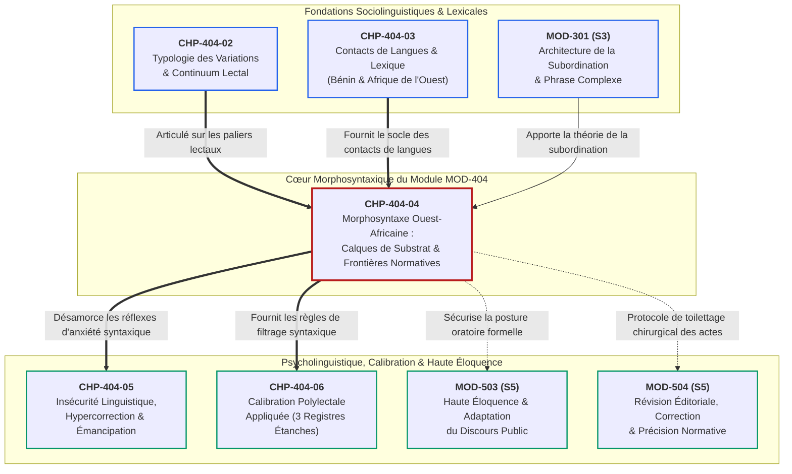

# Chapitre 4 — Morphosyntaxe Ouest-Africaine : Calques de Substrat, Rections Prépositionnelles et Frontières Normatives

> **Identifiant du chapitre** : `CHP-404-04`  
> **Module de rattachement** : [`MOD-404` — Sociolinguistique Francophone : Dynamiques Ouest-Africaines et Norme Internationale](file:///f:/Formation/world-class-french/03-curriculum/year-2/semester-4/mod-404-sociolinguistique-francophone-ouest-africaine-norme.md)  
> **Semestre** : Année 2 — Semestre 4 (S4)  
> **Volume horaire estimé** : 5 à 6 heures d'apprentissage autonome délibéré et d'ateliers d'application (Phase 1 Étude : 1 h 30 | Phase 2 Pratique : 1 h 30 | Phase 3 Correction : 1 h 00 | Phase 4 Évaluation : 1 h 00)  
> **Statut** : [STATUT : VALIDÉ]  
> **Compétences associées** : [`FR-SOCIOL-001`](file:///f:/Formation/world-class-french/02-competency-framework/competency-framework.md#fr-sociol-001-conscience-sociolinguistique-et-navigation-entre-registres) (L3 Autonomie), [`FR-LEXIC-001`](file:///f:/Formation/world-class-french/02-competency-framework/competency-framework.md#fr-lexic-001-précision-sémantique-nuances-synonymiques-et-collocations) (L3 Autonomie), [`FR-INT-004`](file:///f:/Formation/world-class-french/02-competency-framework/competency-framework.md#fr-int-004-adapter-instantanément-son-registre-de-langue-au-contexte) (L3 Autonomie)  
> **Sources scientifiques de référence** : `SRC-SOCIO-01` (Queffélec et al., 1997 / 2002, AUF), `SRC-SOCIO-02` (Calvet, 2017, PUF), `SRC-GRAM-01` (Grevisse & Goosse, 2016, De Boeck Supérieur), `SRC-GRAM-02` (Riegel, Pellat, Rioul, 2016, PUF), `SRC-NORM-03` (Ministère de l'Éducation nationale, 2020), `SRC-TYPO-01` (Imprimerie nationale, 2002/2014)

---

## 1. Titre et Place dans le Cursus

### 1.1 Intitulé Officiel
**Chapitre 4 : Morphosyntaxe Ouest-Africaine : Calques de Substrat, Rections Prépositionnelles et Frontières Normatives** (`CHP-404-04`).

### 1.2 Insertion Architecturale dans le Cursus
Le présent chapitre constitue le sommet technique et analytique du module [`MOD-404`](file:///f:/Formation/world-class-french/03-curriculum/year-2/semester-4/mod-404-sociolinguistique-francophone-ouest-africaine-norme.md). Dans les étapes antérieures, l'apprenant a déconstruit l'illusion d'un français uniforme (`CHP-404-01`), analysé le continuum lectal opposant basilecte, mésolecte et acrolecte (`CHP-404-02`), puis exploré la vitalité lexicale et les emprunts culturels indispensables (`CHP-404-03`).

Ici s'opère une bascule épistémologique majeure : **quitter le terrain du mot isolé pour investir celui de l'architecture phrastique**. Alors que le lexique accueille volontiers les réalités endogènes pour nommer le monde matériel, **la syntaxe constitue le sanctuaire de l'intercompréhension pan-francophone** [Réf. `SRC-SOCIO-01`, p. 85-110 ; `SRC-GRAM-02`, chap. 14]. 

Dans l'espace ouest-africain — et tout particulièrement au Bénin, au Togo, en Côte d'Ivoire et au Sénégal —, la syntaxe française subit la pression continue des langues maternelles premières (familles kwa, voltaïque/gur, atlantique, mandé). Cette rencontre produit des calques structuraux insidieux : connecteurs causatifs déviants (*faire que*), distorsions de la valence verbale (*durer pour...*), périphrases de décharge actancielle (*laisser pour quelqu'un*), rections prépositionnelles insolites (*demander après*, *partir à*), topicalisations redondantes et réduplications aspectuelles.

L'objectif cardinal de ce chapitre est de doter l'apprenant d'une **lucidité morphosyntaxique absolue** : comprendre la genèse linguistique de ces tournures pour ne plus les subir, identifier leur frontière d'acceptabilité (expressivité littéraire et orale vs impropriété administrative) et maîtriser leur redressement chirurgical vers la norme internationale standard.



---

## 2. Objectifs Mesurables

Au terme des 5 à 6 heures d'apprentissage autonome délibéré et d'ateliers d'application de ce chapitre, l'apprenant est capable de :

1. **Identifier et classifier scientifiquement tout calque syntaxique de substrat** dans un énoncé oral ou écrit selon sa typologie structurale : calque consécutif/causal en *faire que*, extension temporelle illégitime de *durer*, périphrase de décharge actancielle en *laisser pour*, distorsion de rection prépositionnelle, focalisation pléonastique ou réduplication aspectuelle ([`FR-SOCIOL-001`](file:///f:/Formation/world-class-french/02-competency-framework/competency-framework.md#fr-sociol-001-conscience-sociolinguistique-et-navigation-entre-registres), Palier L3 Autonomie).
2. **Rétablir chirurgicalement la syntaxe et la rection prépositionnelle du français standard international** dans tout document professionnel, administratif ou juridique altéré par des interférences de substrat, en mobilisant les nominalisations denses, les participiales et les verbes à valence exacte ([`FR-LEXIC-001`](file:///f:/Formation/world-class-french/02-competency-framework/competency-framework.md#fr-lexic-001-précision-sémantique-nuances-synonymiques-et-collocations) & [`FR-SOCIOL-001`](file:///f:/Formation/world-class-french/02-competency-framework/competency-framework.md#fr-sociol-001-conscience-sociolinguistique-et-navigation-entre-registres), Palier L3 Autonomie).
3. **Délimiter avec certitude la frontière normative étanche** entre l'usage expressif légitime d'un calque en registre informel ou en création littéraire polyphonique (Ahmadou Kourouma, Florent Couao-Zotti) et le solécisme rédhibitoire disqualifiant dans un acte juridique, une note diplomatique ou un concours administratif ([`FR-SOCIOL-001`](file:///f:/Formation/world-class-french/02-competency-framework/competency-framework.md#fr-sociol-001-conscience-sociolinguistique-et-navigation-entre-registres), Palier L3 Autonomie).
4. **Composer ou calibrer instantanément un avis juridique officiel de 60 mots exacts** exempt de tout calque de conséquence, de toute distorsion sur le verbe *durer* et de toute impropriété rectionnelle, avec décompte mot à mot certifié conforme aux règles typographiques de l'Imprimerie nationale (`SRC-TYPO-01`) ([`FR-INT-004`](file:///f:/Formation/world-class-french/02-competency-framework/competency-framework.md#fr-int-004-adapter-instantanément-son-registre-de-langue-au-contexte), Palier L3 Autonomie).

---

## 3. Prérequis et Test de Préparation

### 3.1 Prérequis Cognitifs Minimaux
- **Le continuum lectal (`CHP-404-02`)** : Distinction opératoire entre basilecte (créolisation ou hybridation populaire), mésolecte (variété véhiculaire urbaine médiane) et acrolecte (standard international soutenu).
- **La rection verbale et la transitivité (`MOD-201`)** : Notion de complément d'objet direct (sans préposition), indirect (introduit par *à*, *de*, etc.) et propriétés de valence du verbe français.
- **La syntaxe de la phrase complexe (`MOD-301`)** : Maîtrise des propositions circonstancielles de cause et de conséquence, des propositions participiales et des transformations nominales.

### 3.2 Test de Préparation (Auto-Diagnostic à 5 Questions)
Évaluez votre maîtrise préalable en répondant aux cinq questions suivantes avant de déployer le corrigé repliable :

1. **Question 1 (Syntaxe de la conséquence)** : Dans la phrase *« La coupure d'électricité a fait que le serveur est tombé en panne »*, quelle règle de la syntaxe française standard est enfreinte, et par quelle tournure nominale dense doit-on la remplacer ?
2. **Question 2 (Valence verbale)** : Pourquoi la formule *« Nous avons trop duré pour recevoir les conclusions du comité »* est-elle rejetée par les juristes internationaux ? Quel est le sémantisme exact du verbe *durer* en français standard ?
3. **Question 3 (Rection prépositionnelle)** : La phrase *« Dès son arrivée à Cotonou, le ministre a demandé après le directeur départemental »* est-elle conforme au bon usage administratif international ? Quelle est la rection normée du verbe *demander* dans ce contexte ?
4. **Question 4 (Actance et possession)** : Analysez l'anomalie morphosyntaxique contenue dans l'énoncé suivant : *« Le préfet est parti en mission, laissant pour son secrétaire de signer les autorisations »*.
5. **Question 5 (Aspect et réduplication)** : Quel est le statut morphosyntaxique et stylistique de la réduplication *matin-matin* ou *doucement-doucement* dans un rapport administratif d'inspection ?

<details>
<summary><strong>Corrigé détaillé et barème de l'auto-diagnostic (cliquer pour dérouler)</strong></summary>

1. **Réponse 1** : La locution verbale factitive *faire que* est ici employée comme un connecteur causal/consécutif relâché issu d'un calque de substrat. En français standard écrit, on recourt à une construction directe ou à une nominalisation causale : *« La coupure d'électricité a provoqué la défaillance du serveur »* ou *« En raison d'une coupure d'électricité, le serveur a cessé de fonctionner »*.
2. **Réponse 2** : En français standard, *durer* est un verbe intransitif exprimant une **étendue temporelle continue** dont le sujet est un procès ou un état (*la séance a duré deux heures*). Il n'admet jamais un sujet humain agentif suivi de la préposition *pour* et d'un infinitif pour exprimer le retard. On doit employer *tarder à* ou *mettre du temps à* : *« Le comité a tardé à nous transmettre ses conclusions »*.
3. **Réponse 3** : Non. *Demander après quelqu'un* est un calque populaire et régional issu du substrat ouest-africain. En norme internationale, si l'on cherche à entrer en contact avec une personne, la construction est transitive directe (*demander le directeur*), et si l'on s'informe de sa santé ou de sa situation, on emploie la locution *s'enquérir de quelqu'un* ou *demander des nouvelles de quelqu'un*.
4. **Réponse 4** : L'expression *laisser pour quelqu'un de [faire]* constitue une périphrase de décharge actancielle calquée sur les langues gbe/kwa. En français standard, le verbe *laisser* suivi d'un infinitif se construit avec un complément d'objet direct (*laisser son secrétaire signer*) ou l'on utilise un verbe de délégation approprié (*charger son secrétaire de*, *déléguer à son secrétaire le soin de*).
5. **Réponse 5** : La réduplication totale à valeur d'intensif ou d'itératif est un morphème régulier des langues ouest-africaines. En français, elle n'est pas grammaticalisée ; elle relève de l'expressivité orale familière et constitue une incorrection stylistique rédhibitoire dans un rapport formel d'inspection. On doit substituer l'adverbe standard univoque (*très tôt le matin, dès l'aube* ; *avec précaution, graduellement*).

> **Barème d'auto-évaluation** :  
> • **5 / 5** : Excellente intuition des frontières normatives ; abordez directement la section 4.  
> • **3 ou 4 / 5** : Connaissances solides mais perméables aux calques quotidiens ; vigilance requise sur la section 7.  
> • **$< 3 / 5$** : Risque élevé de disqualification dans les écrits académiques ; étude impérative des rubriques 7 à 10.
</details>

---

## 4. Situation de Départ ou Problème Concret

### 4.1 Le Piège Insidieux du Calque Invisible
Considérons le cas authentique d'un jeune juriste béninois brillant, major de promotion universitaire, postulant à un poste de conseiller juridique au sein d'une juridiction multilatérale (Cour commune de justice et d'arbitrage de l'OHADA ou Tribunal administratif des Nations unies).

Dans son épreuve rédactionnelle de sélection — consistant à rédiger un avis contentieux sur l'interruption d'un marché public d'adduction d'eau —, le candidat rédige le paragraphe suivant :

> *« Le retard constaté dans le décaissement des fonds a fait que l'entreprise adjudicataire a trop duré pour mobiliser ses engins sur le chantier. Le directeur général des travaux publics est venu au service pour constater les faits, mais il a laissé pour la commission de régler le problème avec l'entrepreneur. Mon ministre de tutelle là, c'est lui qui a demandé après le dossier hier matin-matin, constatant que la situation s'est gâtée sur le terrain. »*

À la lecture de cette copie, le jury international — composé d'experts canadiens, belges, sénégalais et suisses — attribue une note éliminatoire sans même statuer sur le fond juridique. Le candidat, stupéfait, proteste : *« Mon raisonnement juridique est inattaquable ! Les textes de l'OHADA sont parfaitement cités et il n'y a pas une seule faute d'orthographe d'accord ! »*

### 4.2 Anatomie d'un Naufrage Communicationnel
Le candidat a été victime de **l'illusion de transparence**. Parce que chaque mot pris individuellement figure dans le dictionnaire français (*faire, durer, laisser, pour, demander, après, service*), le rédacteur est intimement persuadé d'écrire en français standard international. 

Or, aux yeux d'un lecteur extérieur à l'aire culturelle ouest-africaine :
1. **La causalité juridique est anéantie** : *a fait que* relègue un manquement contractuel majeur à une vague fatalité circonstancielle au lieu d'établir un lien d'imputabilité de droit (*a empêché l'entreprise de*, *a entraîné la suspension des obligations*).
2. **La temporalité contractuelle est dénaturée** : *a trop duré pour mobiliser* crée une incongruité sémantique pour un magistrat international, car en français normé, un engin ne « dure » pas pour être mobilisé ; l'entreprise *a tardé à mobiliser* ou *a accusé un retard injustifiable*.
3. **La délégation de compétence devient floue** : *a laissé pour la commission de régler* est incompréhensible dans la typologie des actes administratifs. S'agit-il d'un dessaisissement, d'une subdélégation, d'une injonction ou d'un abandon de poste ?
4. **La rection et le registre brisent la solennité institutionnelle** : *venu au service* (mésolectisme local pour *s'est rendu sur le site* ou *a rejoint ses bureaux*), *demander après* (tour familier pour *s'enquérir de*), *mon ministre là, c'est lui qui* (topicalisation orale pléonastique) et *matin-matin* (réduplication de substrat) transforment un mémoire de haute cour en une conversation de couloir.

Le calque de substrat est d'autant plus dangereux qu'il est **inodore et indolore** pour celui qui le produit : bercé par la musicalité de sa langue maternelle, le locuteur ne perçoit pas qu'il viole le génie structural de la langue d'arrivée [Réf. `SRC-SOCIO-01`, p. 92 ; `SRC-SOCIO-02`, chap. 3].

---

## 5. Explication Intuitive : L'Analogie du Châssis Automobile Étranger

Pour comprendre avec netteté la mécanique du calque syntaxique, recourons à l'analogie de l'ingénierie mécanique et de l'assemblage automobile :

```text
┌─────────────────────────────────────────────────────────────────────────────────────────┐
│               L'ANALOGIE DU CHÂSSIS ÉTRANGER SOUS CARROSSERIE STANDARD                  │
├──────────────────────────────────────────┬──────────────────────────────────────────────┤
│ LA CARROSSERIE ET LA PEINTURE            │ • Les unités lexicales françaises standard   │
│ (Ce que l'œil perçoit en surface)        │   (mots du dictionnaire, orthographe,        │
│                                          │   terminologie administrative reconnue).     │
├──────────────────────────────────────────┼──────────────────────────────────────────────┤
│ LE CHÂSSIS ET L'ARBRE DE TRANSMISSION    │ • La grammaire profonde de la langue         │
│ (Ce qui transmet le mouvement)           │   maternelle première (fon, yoruba, baatonu):│
│                                          │   structures sérielles, thématisation forte, │
│                                          │   causativité périphrastique, aspectualité.  │
├──────────────────────────────────────────┼──────────────────────────────────────────────┤
│ LE RÉSULTAT MÉCANIQUE                    │ • Une carrosserie française posée de force    │
│ (Sur la route internationale)            │   sur un châssis syntaxique fon ou yoruba.   │
│                                          │ • Sur les pistes locales de l'oralité, la     │
│                                          │   voiture roule car tout le monde partage     │
│                                          │   la même géométrie mécanique cachée.        │
│                                          │ • Sur l'autoroute des traités internationaux │
│                                          │   et des cours souveraines, le moteur cale,  │
│                                          │   la boîte de vitesses refuse d'embrayer     │
│                                          │   et le véhicule est déclaré inapte.         │
└──────────────────────────────────────────┴──────────────────────────────────────────────┘
```

Dans un énoncé tel que *« La pluie a fait que je suis venu en retard »*, les pièces visibles de la carrosserie sont françaises (*la, pluie, a, fait, que, je, suis, venu, en, retard*). Mais l'arbre de transmission qui relie la cause à l'effet n'a pas été usiné selon les règles du français (qui privilégie la construction transitive *la pluie a retardé mon arrivée* ou le syntagme prépositionnel *en raison de la pluie*). Il a été forgé selon le moule de la structure causale fon **e zɔ́n bɔ** (*« cela a marché/fait et ainsi... »*) ou **dó... wú** [Réf. `SRC-SOCIO-01`, p. 95].

L'excellence académique et professionnelle consiste à **harmoniser le châssis et la carrosserie** : penser la relation logique directement dans les articulations fonctionnelles du français standard.

---

## 6. Définitions Précises et Terminologie

Pour disséquer avec rigueur les phénomènes morphosyntaxiques ouest-africains, dix concepts fondamentaux doivent être maîtrisés :

1. **Substrat linguistique** : Ensemble des structures phonétiques, lexicales ou syntaxiques d'une langue antérieure ou maternelle qui continuent d'influencer l'apprentissage et la pratique d'une langue seconde acquise ultérieurement par les mêmes locuteurs [Réf. `SRC-SOCIO-02`, chap. 3]. En Afrique de l'Ouest, les langues kwa (fon, éwé, mina, baoulé), voltaïques (baatonu, moré) ou atlantiques (wolof) constituent le substrat vivant des francophones.
2. **Adstrat linguistique** : Phénomène d'influence mutuelle entre deux langues coexistant sur un même territoire sans que l'une absorbe l'autre.
3. **Superstrat linguistique** : Influence exercée par la langue d'un groupe politique dominant ou colonisateur sur les langues autochtones d'une région.
4. **Calque syntaxique (ou structural)** : Procédé par lequel une construction grammaticale propre à la langue de substrat est transposée littéralement, mot à mot, dans la langue cible en utilisant le lexique de cette dernière [Réf. `SRC-SOCIO-01`, p. 91].
5. **Interférence grammaticale** : Déviation par rapport aux normes grammaticales de la langue cible sous l'effet inconscient des habitudes linguistiques de la langue maternelle.
6. **Rection prépositionnelle déviante (ou distorsion rectionnelle)** : Modification non standard de la préposition régie par un verbe, un nom ou un adjectif en français (ex. *demander après quelqu'un* au lieu de *demander quelqu'un* ; *partir à la pharmacie* pour signifier la quête plutôt que la simple destination) sous l'influence des postpositions ou des marqueurs spatiaux de la langue locale.
7. **Topicalisation pléonastique (ou dislocation redondante)** : Procédé discursif consistant à détacher un constituant en tête de phrase pour en faire le thème (*topic*), suivi immédiatement d'un déictique et d'un pronom de reprise anaphorique pléonastique (*« Mon frère là, c'est lui qui a pris le livre »*).
8. **Réduplication expressive et aspectuelle** : Redoublement complet ou partiel d'une base lexicale (adverbe, adjectif, verbe) pour coder une valeur grammaticale d'intensité, d'aspect itératif ou de ponctualité temporelle (*vite-vite*, *doucement-doucement*, *matin-matin*).
9. **Décharge actancielle (ou périphrase de délestage)** : Structure syntaxique hybride par laquelle le scripteur se décharge d'un complément d'objet direct ou d'une subordination transitive complexe en recourant à une périphrase possessive ou attributive lâche (*laisser pour quelqu'un de faire*).
10. **Norme endogène mésolectale vs Solécisme international** :
   - *Norme endogène mésolectale* : Tournure stabilisée et largement partagée par la communauté locale dans les communications quotidiennes ou médiatiques, témoignant de l'adaptation du français à son environnement socioculturel ;
   - *Solécisme international* : Faute de syntaxe caractérisée violant les règles fondamentales de la valence, de l'accord ou de la rection du français, inacceptable dans un document officiel ou académique destiné à l'espace francophone global [Réf. `SRC-GRAM-01`, § 12-18 ; `SRC-NORM-03`].

---

## 7. Règles ou Mécanismes Fondamentaux

### 7.1 La Notion Linguistique de Substrat et la Grammaire Profonde
Contrairement au lexique qui relève de la conscience explicite du locuteur, la syntaxe fonctionne comme un **automatisme d'encodage cognitif** [Réf. `SRC-SOCIO-02`, chap. 3]. Lorsqu'un apprenant formule une pensée complexe sous la contrainte du temps ou de l'émotion, son cerveau active préférentiellement les schèmes relationnels de sa langue première.

Les langues ouest-africaines de la famille Niger-Congo (notamment le rameau kwa et les langues voltaïques) présentent des caractéristiques structurales fondamentales qui diffèrent radicalement du français roman :
- **Absence de déclinaisons et rareté des prépositions abstraites** : ces langues utilisent massivement des postpositions concrètes dérivées de noms de parties du corps (*l'intérieur, la tête, le dos, le ventre*) ;
- **Recours aux constructions sérielles** : pour exprimer des procès complexes (causativité, déplacement, donation, instrument), plusieurs verbes se succèdent sans connecteur de subordination ;
- **Primauté de l'aspect sur le temps** : la distinction entre accompli et inaccompli, ou entre itératif et ponctuel, l'emporte sur la chronologie relative (antériorité/postériorité).

Lorsque ces structures profondes sont vêtues de mots français sans réagencement architectural, il en résulte des calques syntaxiques systématiques [Réf. `SRC-SOCIO-01`, p. 94-102].

---

### 7.2 Radiographie Anatomique des Cinq Calques Syntaxiques Majeurs

#### 1. Le Calque Consécutif et Causal « Faire que »
- **Genèse linguistique** : Dans les langues gbe (fon, éwé, mina), la causalité circonstancielle est fréquemment articulée par des verbes sériels ou des locutions verbales introductives : *dó... wú* (« faire que », « poser sur le corps de ») ou *e zɔ́n bɔ* (« cela a marché/fait et par conséquent »). Le locuteur transpose cette séquence sous la forme figée *[Sujet/Fait] + a fait que + [Proposition]*.
- **Défaillance en français standard** : En français soigné, le verbe *faire* suivi de *que* et du subjonctif exprime l'action directe d'un agent provoquant un état (*« Le vent fait que les feuilles s'envolent »*). Employer *faire que* avec l'indicatif comme connecteur logique universel appauvrit la langue, alourdit l'énoncé et dissout la rigueur démonstrative [Réf. `SRC-GRAM-02`, chap. 14].
- **Mécanisme de redressement chirurgical** :
  - *Option A (Nominalisation causale)* : Substituer une préposition dense (*en raison de, par suite de, sous l'effet de*) suivie d'un groupe nominal ;
  - *Option B (Verbe causatif précis)* : Employer un verbe transitif plein exprimant l'action exacte (*provoquer, entraîner, occasionner, retarder, compromettre*) ;
  - *Option C (Proposition participiale)* : Recourir au participe présent ou au participe passé détaché.

```text
Tournure de substrat : « La pluie a fait que nous sommes arrivés en retard. »
├── Redressement A (Nominal)      : « En raison des intempéries, notre arrivée a été retardée. »
├── Redressement B (Verbe direct) : « Les fortes pluies ont compromis notre ponctualité. »
└── Redressement C (Participial)  : « Retardée par les pluies torrentielles, la délégation est arrivée à midi. »
```

---

#### 2. Le Verbe « Durer » : Valence Temporelle vs Retard
- **Genèse linguistique** : En fon, le verbe *dɛ̃́* ou *jɛ́n* exprime indistinctement le temps qui s'écoule et l'idée de tarder ou de traîner en longueur. Le locuteur ouest-africain projette ce cumul sémantique sur le verbe français *durer*, lui attribuant un sujet animé et lui associant la préposition *pour* suivie d'un infinitif (*« Il a trop duré pour venir »*, *« Le dossier a duré avant de sortir »*).
- **Défaillance en français standard** : En français standard, *durer* est un verbe intransitif dont le sujet est obligatoirement un phénomène, un état ou une période temporelle (*la cérémonie a duré trois heures*, *son mandat a duré cinq ans*) [Réf. `SRC-GRAM-01`, § 185 ; `SRC-GRAM-02`, chap. 15]. Il ne signifie jamais « être en retard » ou « mettre un temps excessif à accomplir une action ».
- **Mécanisme de redressement chirurgical** :
  - Remplacer par **tarder à** (+ infinitif) pour marquer l'attente impatiente ;
  - Remplacer par **mettre du temps à** (+ infinitif) pour mesurer l'effort temporel ;
  - Remplacer par **accuser un retard de** (+ durée) dans un style administratif formel.

```text
Tournure de substrat : « L'imprimeur a trop duré pour livrer les bulletins. »
├── Redressement A : « L'imprimeur a tardé à livrer les bulletins de vote. »
├── Redressement B : « La livraison des bulletins par l'imprimeur a accusé un retard préjudiciable. »
└── Redressement C : « L'imprimeur a mis un temps excessif à acheminer les documents. »
```

---

#### 3. La Décharge Actancielle « Laisser pour Quelqu'un »
- **Genèse linguistique** : Dans les langues à morphologie sérielle, la délégation d'une tâche s'exprime par le verbe de délaissement *jó* (« laisser ») suivi de l'attributif *nú* (« pour ») : *« laisser à la charge de quelqu'un »*. Le calque direct produit *« laisser pour son adjoint »* ou *« laisser pour les enfants de manger »*.
- **Défaillance en français standard** : En français standard, le verbe *laisser* est transitif direct (*laisser son adjoint gérer l'intérim*) ou s'articule avec des prépositions régies spécifiques. La formule *laisser pour* crée un solécisme syntaxique doublé d'une ambiguïté juridique sur la nature exacte du mandat conféré.
- **Mécanisme de redressement chirurgical** :
  - Employer **confier la charge de... à** ;
  - Employer **charger quelqu'un de** (+ infinitif) ;
  - Employer **déléguer le soin de... à** ;
  - Employer **s'en remettre à** (+ substantif).

```text
Tournure de substrat : « Le comptable est parti en congé, laissant pour son collègue de payer les factures. »
├── Redressement A : « En partant en congé, le comptable a chargé son collègue d'honorer les factures. »
├── Redressement B : « Le comptable a délégué le règlement des créances à son adjoint pendant son absence. »
└── Redressement C : « Le comptable s'en est remis à son collègue pour le traitement des dépenses courantes. »
```

---

#### 4. Les Calques de Rections Prépositionnelles
- **Genèse linguistique** : La rection verbale (le choix de la préposition qui lie le verbe à son complément) est l'un des domaines les plus instables du contact de langues [Réf. `SRC-SOCIO-01`, p. 104-108]. Les verbes français sont réanalysés selon les schèmes des postpositions locales :
  - *Demander après quelqu'un* : calqué sur la quête orientée vers les traces d'un individu (fon *kànbyɔ́ d'è gudo*) ;
  - *Partir à [la pharmacie, l'hôpital]* : utilisation de *partir à* pour signifier l'action finalisée de s'approvisionner ou de se faire soigner, alors que le français standard distingue la translation (*aller à, se rendre à*) du départ absolu (*partir*) ;
  - *Venir au service* : emploi de *service* pour désigner métonymiquement le lieu physique du travail (le bureau, l'administration).
- **Défaillance en français standard** : Ces glissements créent des confusions sémantiques ou font basculer le texte dans le registre familier le plus relâché [Réf. `SRC-GRAM-01`, § 280-295].
- **Mécanisme de redressement chirurgical** :
  - Rétablir la transitivité directe : *demander quelqu'un* (pour lui parler) ;
  - Rétablir les locutions soutenues : *s'enquérir de la situation de quelqu'un*, *demander des nouvelles de quelqu'un* ;
  - Rétablir les prépositions de destination et les vocables administratifs : *se rendre au bureau*, *rejoindre son poste de travail*.

---

#### 5. La Topicalisation Pléonastique et la Focalisation Redondante
- **Genèse linguistique** : Les langues ouest-africaines disposent de particules énonciatives puissantes pour poser le cadre de l'énoncé (marqueur de thématisation fon *ɔ́*, yoruba *ni*, ou déictique d'insistance *là* en français populaire d'Afrique) et de clivages obligatoires pour le focus (*wɛ̀* en fon). Le locuteur reproduit ce schéma en français par une triple marque : détachement à gauche + particule *là* + clivage en *c'est... qui* + reprise pronominale (*« Mon patron là, c'est lui qui a décidé »*).
- **Défaillance en français standard** : En français écrit soutenu, la dislocation est proscrite au profit de l'ordre canonique Sujet-Verbe-Objet ou de passivations élégantes. Le clivage systématique par *c'est... qui/que* morcèle inutilement la période oratoire [Réf. `SRC-GRAM-02`, chap. 14].
- **Mécanisme de redressement chirurgical** : Éliminer la dislocation, supprimer la particule déictique *là* et réunifier le groupe sujet avec son verbe.

```text
Tournure de substrat : « Le décret présidentiel là, c'est lui qui a créé la polémique. »
├── Redressement standard direct : « Le décret présidentiel a suscité une vive controverse. »
└── Redressement passif soutenu  : « La polémique est née de la publication du décret présidentiel. »
```

---

### 7.3 La Réduplication Expressive et Aspectuelle
Dans les langues africaines, le redoublement morphologique est un mécanisme grammatical extrêmement productif codant :
- **L'intensité superlative** : *vite-vite* = « au plus vite, à bride abattue » ;
- **L'atténuation ou la précaution** : *doucement-doucement* = « avec une infinie délicatesse, pas à pas » ;
- **La précision temporelle stricte** : *matin-matin* = « dès potron-minet, à l'aube naissante » ;
- **La distribution spatiale** : *un-un* = « un par un, individuellement ».

En français standard, la réduplication totale n'est pas un procédé morphologique reconnu. Elle relève du babil enfantin ou de l'oralité la plus familière. Dans un écrit officiel ou diplomatique, son maintien constitue une infraction grave au décorum stylistique. Elle doit être systématiquement remplacée par l'adverbe modal ou le syntagme prépositionnel équivalent [Réf. `SRC-SOCIO-01`, p. 112 ; `SRC-NORM-03`].

---

### 7.4 La Frontière Normative Étanche : Créativité vs Solécisme
Le sociolinguiste ne porte aucun mépris sur les calques : ils constituent le moteur de l'évolution des langues et confèrent aux littératures francophones d'Afrique une inventivité stylistique éblouissante. Cependant, le haut fonctionnaire et l'universitaire doivent appliquer un **principe d'étanchéité diaphasique absolue** :

| Registre & Contexte Discursif | Statut des Calques de Substrat | Règle Normative Applicable |
| :--- | :--- | :--- |
| **Littérature de fiction, poésie, théâtre** | **Ressource esthétique majeure** : polyphonie, caractérisation sociologique, transgression poétique souveraine. | **Pleine liberté créative** (Ahmadou Kourouma, Sony Labou Tansi, Jean Pliya). |
| **Oral quotidien informel, échanges familiaux** | **Norme véhiculaire locale** : connivence communautaire, expressivité vivante. | **Légitimité communicative pleine**. |
| **Presse d'opinion locale, chroniques satiriques** | **Coloration régionale assumée** : proximité avec le lectorat national. | **Tolérance mesurée avec distance stylistique**. |
| **Actes administratifs, décrets, jugements de cour** | **Solécisme juridique rédhibitoire** : fragilise l'imputabilité et la validité des actes. | **Interdiction absolue — Éradication intégrale**. |
| **Diplomatie multilatérale, traités internationaux** | **Vérification de recevabilité** : risque de rejet formel de la note ou de la requête. | **Interdiction absolue — Registre soutenu univoque**. |

---

## 8. Raisonnement Détaillé : La Syntaxe, Dernier Rempart de l'Intercompréhension

Pourquoi l'Académie, les cours suprêmes et les chancelleries internationales tolèrent-elles l'emprunt lexical tout en se montrant impitoyables envers le calque syntaxique ?

La réponse réside dans la **différence de fonction sémiotique entre le lexique et la grammaire** :
- **Le lexique nomme les étants et les référents** : Lorsque le français adopte *zémidjan*, *balafon* ou *akassa*, il enrichit sa nomenclature pour désigner un objet nouveau sans altérer son fonctionnement interne. L'emprunt s'insère docilement dans la phrase française en recevant un genre grammatical et une marque de pluriel (*des zémidjans rapides*). Il ne menace en rien l'intelligibilité universelle du propos.
- **La syntaxe encode les relations logiques et l'imputabilité juridique** : La syntaxe est le squelette relationnel qui définit *qui fait quoi, sous quelle condition, avec quelle causalité et selon quelle responsabilité*. 

Si l'on écrit dans un contrat commercial international :
> *« La pénurie de ciment a fait que l'entrepreneur a duré pour couler la dalle, laissant pour la mairie de trouver la solution »*

Le contrat devient juridiquement inopérant :
1. *A fait que* ne précise pas s'il s'agit d'un cas de force majeure exonératoire ou d'une simple difficulté prévisible à la charge du débiteur ;
2. *A duré pour couler* ne permet pas de déterminer la date exacte de déchéance du terme ni le point de départ des pénalités de retard journalières ;
3. *Laissant pour la mairie* ne constitue ni une subrogation, ni une cession de créance, ni une mise en demeure conforme au droit des obligations (OHADA).

**La syntaxe unifiée est le garant de la sécurité juridique et de l'égalité des citoyens devant la loi.** Dans une communauté de plus de 320 millions de locuteurs répartis sur cinq continents, préserver la syntaxe standard n'est pas un assujettissement colonial : c'est l'instrument d'une souveraineté partagée permettant aux juristes et diplomates africains de faire prévaloir leurs droits dans les instances mondiales sans vulnérabilité formelle [Réf. `SRC-SOCIO-01`, p. 120-135 ; `SRC-GRAM-02`, chap. 1].

---

## 9. Exemples Corrects Commentés

Voici cinq énoncés administratifs réels recueillis dans la pratique institutionnelle ouest-africaine, analysés au microscope sociolinguistique et redressés selon les exigences de la norme internationale standard :

### Exemple 1 : Délibération Municipale sur l'Éclairage Public
- **Énoncé source (Mésolecte administratif local)** :  
  *« La lenteur dans le décaissement des crédits a fait que l'entreprise n'a pas pu poser les lampadaires à temps sur le boulevard. »*
- **Diagnostic linguistique** : Emploi fautif de *a fait que* articulant une proposition circonstancielle relâchée en lieu et place d'une causalité juridique ferme.
- **Redressement acrolectal international** :  
  *« Le retard survenu dans la mise à disposition des crédits budgétaires a empêché l'entreprise adjudicataire d'installer l'éclairage public dans les délais contractuels sur le boulevard. »*
- **Commentaire structural** : Remplacement de la périphrase *a fait que... n'a pas pu* par le verbe transitif direct *a empêché l'entreprise d'installer*, renforçant la densité et l'imputabilité contractuelle.

### Exemple 2 : Rapport d'Audit d'une Commission des Marchés
- **Énoncé source (Mésolecte administratif local)** :  
  *« Les membres de la commission ont trop duré pour transmettre le procès-verbal de dépouillement à l'autorité délégante. »*
- **Diagnostic linguistique** : Distorsion sémantique et rectionnelle du verbe *durer* suivi de la préposition *pour* et d'un infinitif pour exprimer le retard procédural d'un organe collégial.
- **Redressement acrolectal international** :  
  *« Les commissaires ont tardé à communiquer le procès-verbal de dépouillement à l'autorité délégante, excédant ainsi le délai réglementaire de quarante-huit heures. »*
- **Commentaire structural** : Substitution du verbe normé *tarder à* et explicitation juridique de l'infraction procédurale.

### Exemple 3 : Circulaire Ministérielle sur la Délégation de Signature
- **Énoncé source (Mésolecte administratif local)** :  
  *« Le directeur sortant a quitté la capitale hier, laissant pour son secrétaire général de signer les bordereaux financiers. »*
- **Diagnostic linguistique** : Périphrase de décharge actancielle *laissant pour [quelqu'un] de [faire]* calquée sur la structure sérielle bénédictive des langues kwa (*jó nú*).
- **Redressement acrolectal international** :  
  *« Ayant quitté la capitale, le directeur sortant a expressément délégué au secrétaire général le pouvoir de signer les ordonnancements financiers. »*
- **Commentaire structural** : Restitution d'un acte juridique formel (*a expressément délégué le pouvoir de signer*) conforme au droit public administratif.

### Exemple 4 : Procès-Verbal Disciplinaire d'un Établissement Scolaire
- **Énoncé source (Mésolecte administratif local)** :  
  *« L'inspecteur est venu au service hier matin, mais il a vainement demandé après le surveillant général toute la journée. »*
- **Diagnostic linguistique** : Double calque rectionnel : *venir au service* (mésolectisme pour *se présenter à l'établissement*) et *demander après quelqu'un* (calque prépositionnel populaire de quête).
- **Redressement acrolectal international** :  
  *« Dès son arrivée dans l'établissement hier matin, l'inspecteur général s'est enquis de la présence du surveillant général, lequel est demeuré introuvable durant toute la journée. »*
- **Commentaire structural** : Rétablissement de la locution soutenue *s'enquérir de la présence de quelqu'un* et élimination du mésolectisme spatial.

### Exemple 5 : Note de Synthèse sur l'Évaluation d'un Projet d'Infrastructure
- **Énoncé source (Mésolecte administratif local)** :  
  *« Les retards répétés là, c'est eux qui ont fait que les bailleurs de fonds ont refusé de débloquer la deuxième tranche. »*
- **Diagnostic linguistique** : Triple anomalie : thématisation pléonastique par le déictique *là*, clivage emphatique redondant *c'est eux qui*, et locution consécutive relâchée *ont fait que*.
- **Redressement acrolectal international** :  
  *« Les reports récurrents observés dans le calendrier d'exécution ont déterminé le refus des bailleurs de fonds de libérer la seconde tranche de financement. »*
- **Commentaire structural** : Rétablissement d'une structure prédicative unitaire dense, où le sujet substantival commande directement le verbe opératoire (*ont déterminé le refus*).

---

## 10. Contre-Exemples et Erreurs Fréquentes

L'analyse méthodique des copies d'étudiants, des mémoires professionnels et des rapports administratifs révèle six erreurs récurrentes majeures :

### Erreur n° 1 : L'emploi systématique de « faire que » comme connecteur passe-partout
- **Description du phénomène** : Utiliser la béquille syntaxique *a fait que* pour relier mécaniquement toute cause à son effet, appauvrissant le texte et lui donnant une allure relâchée.
- **Exemple déviant** : *« Le mauvais état de la route a fait que le camion s'est renversé. »*
- **Réfutation scientifique** : En français soigné, la causalité s'exprime par la transitivité du verbe ou par des prépositions précises exprimant la nuance exacte (cause neutre, cause défavorable, moyen) [Réf. `SRC-GRAM-02`, chap. 14].
- **Redressement normé** : *« La dégradation de la chaussée a provoqué le renversement du camion. »* ou *« En raison de la vétusté de la chaussée, le camion a basculé dans le ravin. »*

### Erreur n° 2 : La distorsion sémantique et syntaxique du verbe « durer »
- **Description du phénomène** : Assigner au verbe *durer* un sujet humain ou un objet singulier, suivi de la préposition *pour* et d'un infinitif, au sens de « mettre un temps excessif » ou « tarder ».
- **Exemple déviant** : *« L'expert a trop duré pour rendre son rapport d'évaluation. »*
- **Réfutation scientifique** : *Durer* mesure exclusivement une étendue temporelle continue passive (*la mission a duré dix jours*). L'agentivité d'un retard s'exprime par le verbe *tarder* ou par la locution verbale *mettre du temps* [Réf. `SRC-GRAM-01`, § 185].
- **Redressement normé** : *« L'expert a tardé à déposer son rapport d'évaluation. »* ou *« Le dépôt du rapport d'évaluation par l'expert a accusé un retard injustifiable. »*

### Erreur n° 3 : La périphrase de décharge actancielle « laisser pour quelqu'un »
- **Description du phénomène** : Calquer la tournure possessive/bénédictive de substrat *laisser pour* pour signifier la transmission d'une responsabilité ou l'abandon d'une charge à autrui.
- **Exemple déviant** : *« Le préfet a laissé pour le maire de régler le contentieux foncier. »*
- **Réfutation scientifique** : Cette formulation viole la valence de *laisser* et ne correspond à aucune catégorie juridique de délégation en droit administratif.
- **Redressement normé** : *« Le préfet a chargé le maire de résoudre le différend foncier. »* ou *« Le préfet s'en est remis à l'autorité municipale pour arbitrer le litige foncier. »*

### Erreur n° 4 : Le calque de rection prépositionnelle sur les verbes usuels (*demander après*, *partir à*)
- **Description du phénomène** : Interposer des prépositions parasites régies par le substrat (*demander après*, *partir à la pharmacie*, *partir au marigot*).
- **Exemple déviant** : *« L'huissier est passé demander après votre collègue. »*
- **Réfutation scientifique** : *Demander après* est une locution vieillie ou régionale populaire. En langue administrative et juridique soignée, la rection est directe ou médiatisée par le verbe *s'enquérir* [Réf. `SRC-GRAM-01`, § 288].
- **Redressement normé** : *« L'huissier de justice s'est présenté afin de s'enquérir de votre collègue. »* ou *« L'huissier de justice est venu pour demander à entendre votre collègue. »*

### Erreur n° 5 : La dislocation topicale pléonastique et la focalisation redondante (*c'est... qui*)
- **Description du phénomène** : Dissocier le thème de la phrase par une particule d'insistance (*là*) et forcer un clivage artificiel (*c'est... qui*) avec reprise pronominale redondante.
- **Exemple déviant** : *« Notre directeur là, c'est lui qui a refusé le bon de commande. »*
- **Réfutation scientifique** : Ce procédé est un décalque de l'oralité mésolectale africaine. L'écrit formel exige la cohésion syntaxique canonique Sujet-Verbe-Complément.
- **Redressement normé** : *« Le directeur a formellement rejeté le bon d'engagement de dépense. »*

### Erreur n° 6 : L'intrusion de la réduplication adverbiale et expressive dans les écrits formels
- **Description du phénomène** : Maintenir des formes redoublées (*vite-vite*, *matin-matin*, *doucement-doucement*) dans des notes administratives, des procès-verbaux ou des mémoires d'examen.
- **Exemple déviant** : *« Le secrétaire doit saisir le compte rendu vite-vite afin de l'expédier demain matin-matin. »*
- **Réfutation scientifique** : En français normé, la réduplication totale est un fait d'oralité expressive et non un procédé morphologique de dérivation adverbiale [Réf. `SRC-SOCIO-01`, p. 112].
- **Redressement normé** : *« Le secrétaire dactylographiera le compte rendu dans les meilleurs délais afin de le transmettre dès les premières heures de la matinée. »*

---

## 11. Cas Particuliers et Limites

### 11.1 L'Usage Maîtrisé du Calque chez les Grands Écrivains Africains
Il convient de dissocier radicalement le **calque subi** (résultant d'une méconnaissance involontaire de la norme chez l'étudiant) du **calque souverain** pratiqué par les grands écrivains francophones d'Afrique.

Dans *Les Soleils des indépendances* (1968), Ahmadou Kourouma subvertit délibérément la syntaxe française classique en la fécondant avec la matrice malinké :
> *« Fama avait fini de manger, de boire, de se curer les dents. Il pensa. Il pensa à quoi ? Au bâtard de bâtardise qu'était sa vie... »*

De même, l'écrivain béninois Florent Couao-Zotti, dans ses nouvelles et romans urbains de Cotonou, met en scène avec une virtuosité stupéfiante les tournures mésolectales, les réduplications et les calques de substrat pour restituer la chair, le bruit et la tragédie de la rue populaire. Chez Jean Pliya, dans la pièce historique *Kondo le requin*, les dialogues des dignitaires royaux calquent avec solennité la parémiologie et la majesté formulaire de la cour d'Abomey.

**Règle didactique fondamentale** : La liberté littéraire commence là où s'achève l'ignorance. L'écrivain transgresse le code parce qu'il le possède de part en part. L'étudiant, le magistrat ou le diplomate doit d'abord prouver sa parfaite maîtrise du code standard avant d'oser la liberté stylistique dans un contexte idoine [Réf. `SRC-SOCIO-01`, p. 140-155].

### 11.2 Le Traitement des Tournures Régionales dans la Presse Nationale
Dans la presse quotidienne béninoise ou ouest-africaine (*La Nation*, *Fraternité*, *Le Matin*), il est fréquent de lire sous la plume de journalistes chevronnés des formules telles que *« Le projet a duré avant de démarrer »* ou *« Les commerçants demandent après les indemnisations »*.

Ce phénomène relève d'une **norme endogène de connivence** : le journaliste s'adresse à un public local qui décode instantanément le message sans heurt. Néanmoins, pour les dépêches destinées aux agences internationales (AFP, Reuters) ou pour les grands quotidiens panafricains (*Jeune Afrique*), le filtre morphosyntaxique international s'applique rigoureusement pour éviter toute ambiguïté de lectorat.

---

## 12. Approfondissement Adapté au Niveau : Typologie Actancielle Comparée

Pour les apprenants du palier L3 visant l'excellence en linguistique comparée et en traduction savante, il est capital d'analyser le substrat ouest-africain à la lumière de la **typologie des constructions sérielles** [Réf. `SRC-SOCIO-01`, chap. 2 ; `SRC-GRAM-02`, chap. 14].

Dans les langues de la famille kwa/gbe (fon, éwé), la grammaire ne dispose pas de marqueurs morphologiques flexionnels (cas, désinences) pour indiquer les relations actancielles. La langue utilise des chaînes verbales où chaque verbe partage le même sujet ou le même objet, codant successivement :
1. **Le mouvement ou la translation** (ex. « marcher venir » = s'approcher) ;
2. **L'instrument ou le moyen** (ex. « prendre couteau couper viande » = couper la viande avec un couteau) ;
3. **La donation ou l'attribution** (ex. « donner argent donner lui » = lui remettre de l'argent) ;
4. **La causativité** (ex. « faire chose tomber » = faire chuter l'objet).

```text
┌─────────────────────────────────────────────────────────────────────────────────────────┐
│                 COMPARATIVE STRUCTURALE : KWA/GBE vs FRANÇAIS STANDARD                   │
├──────────────────────────────────────────┬──────────────────────────────────────────────┤
│ LANGUES À VERBES SÉRIELS (KWA / GBE)     │ GRAMMAIRE FLEXIONNELLE & RECTIONNELLE        │
├──────────────────────────────────────────┼──────────────────────────────────────────────┤
│ • Juxtaposition de prédications verbales │ • Prédication unitaire hiérarchisée          │
│   coordonnées ou enchaînées sans         │   (un verbe recteur, des satellites régis    │
│   conjonction de subordination.          │   par des prépositions ou des conjonctions). │
├──────────────────────────────────────────┼──────────────────────────────────────────────┤
│ • Faible recours aux nominalisations     │ • Forte densité des nominalisations d'action │
│   abstraites d'action.                   │   (processus métaphorique d'abstraction).    │
├──────────────────────────────────────────┼──────────────────────────────────────────────┤
│ • Marqueurs postpositionnels concrets    │ • Prépositions fonctionnelles abstraites     │
│   (corps, espace immédiat).              │   portant la rection verbale univoque.       │
└──────────────────────────────────────────┴──────────────────────────────────────────────┘
```

Comprendre cette divergence fondamentale permet à l'apprenant d'opérer non pas un simple remplacement de vocabulaire, mais une véritable **conversion architecturale** lorsqu'il transpose une idée d'un univers linguistique à l'autre.

---

## 13. Comparaisons Différentielles

Les trois tableaux synoptiques ci-dessous synthétisent les oppositions fondamentales régissant la morphosyntaxe :

### Tableau 1 : Structure de Substrat vs Formulation Standard Internationale
| Phénomène de Substrat | Formulation Régionale Mésolectale | Redressement Standard International | Justification Structurale |
| :--- | :--- | :--- | :--- |
| **Causativité / Conséquence** | *« La grève a fait que l'examen a été reporté. »* | *« En raison du mot d'ordre de grève, l'examen a été ajourné. »* | Substitution de *faire que* par un syntagme prépositionnel causal dense. |
| **Retard temporel** | *« Le rapporteur a trop duré pour venir. »* | *« Le rapporteur a tardé à nous rejoindre. »* | Restitution de la valence intransitive pure de *durer* au profit de *tarder à*. |
| **Délégation d'actant** | *« Il a laissé pour son frère de gérer la boutique. »* | *« Il a confié à son frère la gestion du commerce. »* | Remplacement de la périphrase *laisser pour* par un verbe transitif de mandat. |
| **Rection de quête** | *« Je viens demander après le directeur. »* | *« Je souhaite m'enquérir de la présence du directeur. »* | Élimination de la préposition parasite *après* sur le verbe *demander*. |
| **Topicalisation disloquée** | *« La décision-là, c'est elle qui pose problème. »* | *« Cette décision soulève d'importantes difficultés d'application. »* | Rétablissement de l'ordre canonique SVO sans particule déictique ni clivage. |

### Tableau 2 : Rections Prépositionnelles : Usages Régionaux vs Norme Internationale
| Verbe / Contexte | Rection Régionale Observée | Rection Normée Internationale | Statut Normatif |
| :--- | :--- | :--- | :--- |
| **Demander** | *Demander après quelqu'un* | *Demander quelqu'un* (transitif direct) / *S'enquérir de quelqu'un* | Solécisme en contexte écrit officiel |
| **Partir** | *Partir au service / au marché* (au sens de s'y rendre pour travailler) | *Se rendre au bureau / aller au marché* | Familier / Impropriété lexicale |
| **Durer** | *Durer pour [faire quelque chose]* | *Tarder à [faire] / Mettre du temps à [faire]* | Solécisme sévère |
| **Laisser** | *Laisser pour quelqu'un de [faire]* | *Charger quelqu'un de [faire] / Confier [la charge] à* | Solécisme sévère |
| **Profiter** | *Profiter sur quelqu'un* (abuser de sa faiblesse) | *Profiter de quelqu'un / Abuser de sa confiance* | Solécisme de rection |

### Tableau 3 : Matrice d'Admissibilité Contextuelle des Particularismes
| Tournure Morphosyntaxique | Oral Familier Quotidien | Chronique Satirique Locale | Mémoire Universitaire | Avis Juridique / Traité |
| :--- | :---: | :---: | :---: | :---: |
| *« Faire que » consécutif* | **Admis** | **Toléré** | **Proscrit** | **Interdit** |
| *« Durer pour » temporel* | **Admis** | **Toléré** | **Proscrit** | **Interdit** |
| *« Laisser pour » actanciel* | **Admis** | **Toléré** | **Proscrit** | **Interdit** |
| *Topicalisation avec « là »* | **Admis** | **Valorisé (style)** | **Interdit** | **Interdit** |
| *Réduplication (« vite-vite »)* | **Admis** | **Valorisé (style)** | **Interdit** | **Interdit** |
| *Nominalisation dense* | **Incongru (pédant)** | **Neutre** | **Exigé** | **Exigé** |

---

## 14. Exercices Progressifs (3 Niveaux)

### Niveau 1 : Repérage et Classification de 12 Calques de Substrat (Guidé)
Dans les douze phrases suivantes, identifiez le segment déviant et assignez-lui l'une des six catégories : *Causatif (« faire que »)*, *Valence de « durer »*, *Décharge actancielle*, *Rection prépositionnelle*, *Topicalisation pléonastique*, *Réduplication aspectuelle*.

1. *« La pluie torrentielle a fait que le toit du tribunal a commencé par fuir. »*
2. *« Le trésorier a trop duré pour ordonner le mandatement des indemnités de stage. »*
3. *« Le ministre est parti en mission à Genève, laissant pour son directeur de cabinet de présider le comité. »*
4. *« Lorsque le représentant de la Banque mondiale est arrivé, il a demandé après le coordonnateur du projet. »*
5. *« Le décret d'expropriation là, c'est lui qui fait pleurer les riverains depuis trois semaines. »*
6. *« L'agent comptable a rangé les dossiers doucement-doucement pour ne pas éveiller les soupçons de l'auditeur. »*
7. *« L'absence de connexion Internet a fait que la saisie des déclarations de douane a été interrompue. »*
8. *« Vous avez trop duré pour venir nous expliquer les conclusions du rapport d'expertise médicale. »*
9. *« Le magistrat a laissé pour les greffiers de rédiger la minute du jugement avant vendredi. »*
10. *« Nous devons partir à la présidence pour déposer le placet avant la fin de la séance plénière. »*
11. *« Le chef de service a instruit les secrétaires de venir matin-matin pour préparer la commission mixte. »*
12. *« Les fonds alloués par la coopération allemande là, c'est eux qui ont permis de forer les dix puits. »*

<details>
<summary><strong>Corrigé détaillé du Niveau 1 (cliquer pour dérouler)</strong></summary>

1. **Segment** : *a fait que* $\to$ **Catégorie** : Causatif (« faire que »).
2. **Segment** : *a trop duré pour ordonner* $\to$ **Catégorie** : Valence de « durer » (confusion avec *tarder à*).
3. **Segment** : *laissant pour son directeur de cabinet de présider* $\to$ **Catégorie** : Décharge actancielle.
4. **Segment** : *a demandé après* $\to$ **Catégorie** : Rection prépositionnelle déviante.
5. **Segment** : *Le décret [...] là, c'est lui qui* $\to$ **Catégorie** : Topicalisation pléonastique et dislocation.
6. **Segment** : *doucement-doucement* $\to$ **Catégorie** : Réduplication aspectuelle (atténuative/manière).
7. **Segment** : *a fait que* $\to$ **Catégorie** : Causatif (« faire que »).
8. **Segment** : *avez trop duré pour venir* $\to$ **Catégorie** : Valence de « durer ».
9. **Segment** : *a laissé pour les greffiers de rédiger* $\to$ **Catégorie** : Décharge actancielle.
10. **Segment** : *partir à la présidence* (au lieu de *se rendre à*) $\to$ **Catégorie** : Rection prépositionnelle / Impropriété lexicale.
11. **Segment** : *matin-matin* $\to$ **Catégorie** : Réduplication aspectuelle (ponctualité matinale).
12. **Segment** : *Les fonds [...] là, c'est eux qui* $\to$ **Catégorie** : Topicalisation pléonastique et clivage.
</details>

---

### Niveau 2 : Redressement Chirurgical de 8 Phrases Administratives Denses (Semi-Autonome)
Réécrivez les huit énoncés administratifs suivants en registre officiel international neutre et dense, en éliminant intégralement les calques de substrat et en mobilisant des nominalisations ou des constructions verbales normées :

1. *« La hausse imprévue du cours du carburant a fait que les transporteurs ont suspendu le trafic sur l'axe Cotonou-Parakou. »*
2. *« Le bureau d'études a trop duré pour déposer les plans architecturaux de la future cité administrative. »*
3. *« Le directeur de l'hôpital est parti en congé annuel, laissant pour le médecin-chef de signer les évacuations sanitaires. »*
4. *« Dès que le contrôleur général d'État s'est présenté au siège de l'agence, il a demandé après le livre de caisse. »*
5. *« Le retard accusé par l'entreprise adjudicataire a fait que les salles de classe n'ont pas pu ouvrir à la rentrée. »*
6. *« La commission d'arbitrage a trop duré pour statuer sur les contestations relatives aux indemnisations foncières. »*
7. *« Le préfet a quitté la commune sinistrée, laissant pour le maire de distribuer les tentes de secours aux sinistrés. »*
8. *« Le dossier de régularisation foncière là, c'est lui qui est bloqué à la direction des domaines depuis huit mois. »*

<details>
<summary><strong>Corrigé détaillé du Niveau 2 (cliquer pour dérouler)</strong></summary>

1. **Proposition de redressement normé** :  
   *« En raison de la hausse imprévue des cours du carburant, les transporteurs routiers ont suspendu la circulation sur l'axe reliant Cotonou à Parakou. »*
2. **Proposition de redressement normé** :  
   *« Le bureau d'études a tardé à remettre les plans architecturaux du futur complexe administratif, compromettant le respect de l'échéancier initial. »*
3. **Proposition de redressement normé** :  
   *« En partant en congé annuel, le directeur hospitalier a formellement habilité le médecin-chef à ordonnancer les évacuations sanitaires urgentes. »*
4. **Proposition de redressement normé** :  
   *« Dès son arrivée au siège de l'établissement public, le contrôleur général d'État a exigé la communication immédiate du livre journal de caisse. »*
5. **Proposition de redressement normé** :  
   *« Les retards imputables à l'adjudicataire des travaux ont empêché l'accueil des élèves dans les nouveaux bâtiments scolaires dès la rentrée. »*
6. **Proposition de redressement normé** :  
   *« La commission d'arbitrage a mis un temps excessif à rendre sa sentence relative aux indemnisations des propriétaires expropriés. »*
7. **Proposition de redressement normé** :  
   *« Avant de quitter la zone inondée, l'autorité préfectorale a confié à la municipalité le soin d'organiser la distribution des hébergements d'urgence. »*
8. **Proposition de redressement normé** :  
   *« Le dossier de régularisation domaniale demeure en suspens auprès de la direction générale des affaires foncières depuis huit mois consécutifs. »*
</details>

---

### Niveau 3 : Analyse Morphosyntaxique Complète d'un Procès-Verbal de 50 Mots Exacts (Autonome)

Considérons l'extrait authentique d'un procès-verbal de séance municipale, calibré à **exactement 50 mots** selon les règles de décompte de l'Imprimerie nationale (`SRC-TYPO-01`) :

> *« L'assemblée constate que la pluie a fait que les travaux ont trop duré pour débuter. Le maire a laissé pour son adjoint de gérer ce litige, mais ce dernier est parti au service sans demander après les entrepreneurs. Ces manquements répétés compromettent gravement la livraison de l'édifice public. »*

#### Décompte Certifié Mot à Mot (1 à 50) selon `SRC-TYPO-01` :
1. *L'* | 2. *assemblée* | 3. *constate* | 4. *que* | 5. *la* | 6. *pluie* | 7. *a* | 8. *fait* | 9. *que* | 10. *les* | 11. *travaux* | 12. *ont* | 13. *trop* | 14. *duré* | 15. *pour* | 16. *débuter.* | 17. *Le* | 18. *maire* | 19. *a* | 20. *laissé* | 21. *pour* | 22. *son* | 23. *adjoint* | 24. *de* | 25. *gérer* | 26. *ce* | 27. *litige,* | 28. *mais* | 29. *ce* | 30. *dernier* | 31. *est* | 32. *parti* | 33. *au* | 34. *service* | 35. *sans* | 36. *demander* | 37. *après* | 38. *les* | 39. *entrepreneurs.* | 40. *Ces* | 41. *manquements* | 42. *répétés* | 43. *compromettent* | 44. *gravement* | 45. *la* | 46. *livraison* | 47. *de* | 48. *l'* | 49. *édifice* | 50. *public.*

#### Consignes de l'Épreuve :
1. **Relevé des calques (4 points)** : Identifiez et recopiez les cinq calques morphosyntaxiques de substrat présents dans ce texte.
2. **Diagnostic sociolinguistique (4 points)** : Précisez pour chacun sa genèse en langues africaines (kwa/gbe).
3. **Réécriture intégrale normée (8 points)** : Rédigez une version acrolectale irréprochable de ce procès-verbal en respectant la concision et la solennité administrative.

<details>
<summary><strong>Corrigé officiel du Niveau 3 (cliquer pour dérouler)</strong></summary>

1. **Relevé des cinq calques** :
   - Calque 1 (mots 8-9) : *a fait que* (causatif périphrastique).
   - Calque 2 (mots 13-16) : *ont trop duré pour débuter* (distorsion sémantique et valence fautive de *durer*).
   - Calque 3 (mots 20-25) : *a laissé pour son adjoint de gérer* (décharge actancielle possessive).
   - Calque 4 (mots 32-34) : *est parti au service* (mésolectisme spatial et impropriété verbale).
   - Calque 5 (mots 36-39) : *demander après les entrepreneurs* (calque de rection prépositionnelle).

2. **Diagnostic sociolinguistique** :
   - *A fait que* décalque la construction sérielle causale fon *dó... wú* ou *e zɔ́n bɔ*.
   - *Ont trop duré pour débuter* calque le sémantisme de *dɛ̃́* (tarder, prendre du temps) avec projection indue de la préposition *pour* sur un infinitif.
   - *Laissé pour son adjoint* calque la construction bénédicitive *jó nú* (« abandonner à »).
   - *Parti au service* traduit le substantif fonctionnel en lieu matériel concret.
   - *Demander après* calque l'interrogation orientée vers la trace (*kànbyɔ́ d'è gudo*).

3. **Réécriture intégrale en Registre Administratif International Soutenu** :
   > *« Le Conseil municipal déplore que les intempéries aient retardé le démarrage du chantier de génie civil. Bien que le maire ait expressément chargé son premier adjoint de surmonter ce contentieux contractuel, ce dernier s'est abstenu d'entrer en contact avec les entreprises adjudicataires lors de sa prise de fonctions. Ces carences successives hypothèquent la réception de l'ouvrage public. »*
</details>

---

## 15. Activité de Correction Raisonnée

### Contexte Professionnel
Vous exercez les fonctions de Secrétaire général adjoint d'un organisme intergouvernemental ouest-africain (Commission de l'UEMOA à Ouagadougou). Un auditeur junior vous remet son projet de compte rendu d'inspection administrative.

### Document Source Truffé de Calques de Substrat (Texte à Auditer)
> *« Lors de notre descente sur le site du barrage hydroélectrique, nous avons constaté que l'inondation subite a fait que les turbines ont arrêté de tourner. Le coordonnateur du projet a trop duré pour nous envoyer la note technique explicative. Le préfet territorialement compétent a laissé pour la gendarmerie de veiller sur le matériel électrique sensible, mais les militaires sont partis au service sans demander après les vigiles de la société de gardiennage. L'ingénieur en chef là, c'est lui qui a dit que si les pièces de rechange n'arrivent pas vite-vite, l'usine va rester gâtée pour longtemps. »*

### Consignes de Correction et Grille d'Apparat Critique
1. Dresser un tableau d'audit exhaustif à 4 colonnes :
   - Colonne 1 : Segment fautif relevé ;
   - Colonne 2 : Nature de la déviance morphosyntaxique ;
   - Colonne 3 : Formulation redressée en français standard international ;
   - Colonne 4 : Justification grammaticale et stylistique.
2. Rédiger la version finale intégrale épurée destinée au collège des commissaires de l'institution.

<details>
<summary><strong>Corrigé officiel de l'activité de correction raisonnée (cliquer pour dérouler)</strong></summary>

#### 1. Tableau d'Arbitrage et d'Apparat Critique

| Segment Fautif Relevé | Nature de la Déviance | Formulation Redressée | Justification Grammaticale & Stylistique |
| :--- | :--- | :--- | :--- |
| *« descente sur le site »* | Mésolectisme administratif relâché | *« mission d'inspection sur le site »* | *Descente* évoque une opération policière répressive ; *mission* traduit la dignité administrative. |
| *« a fait que les turbines ont arrêté »* | Calque consécutif (« faire que ») + intransitivité fautive d'arrêter | *« a provoqué l'arrêt immédiat des turbines »* | Remplacement par un verbe transitif plein (*provoquer*) et nominalisation dense de l'action. |
| *« a trop duré pour nous envoyer »* | Distorsion de la valence de *durer* | *« a tardé à nous communiquer »* | *Durer* ne s'applique pas à l'agentivité humaine du retard ; *tarder à* rétablit la norme canonique. |
| *« a laissé pour la gendarmerie de veiller »* | Périphrase de décharge actancielle (*laisser pour*) | *« a formellement réquisitionné la gendarmerie afin d'assurer la garde »* | Précision juridique de l'acte d'autorité (*réquisitionner*) écartant le calque de substrat. |
| *« sont partis au service »* | Impropriété rectionnelle et lexicale | *« ont rejoint leur casernement »* | *Service* n'est pas un lieu matériel ; *rejoindre le cantonnement* rétablit la propriété des termes. |
| *« sans demander après les vigiles »* | Calque prépositionnel de quête | *« sans s'être concertés avec les agents »* | Éradication de la locution populaire *demander après*. |
| *« L'ingénieur en chef là, c'est lui qui »* | Dislocation topicale pléonastique (*là* + clivage) | *« Selon l'ingénieur principal »* | Suppression du déictique informel et du clivage superflu. |
| *« arriver vite-vite »* + *« rester gâtée »* | Réduplication aspectuelle + métaphore populaire | *« être livrées à bref délai [...] demeurer hors d'usage »* | Restitution de l'adverbe temporel normé et élimination de la formule populaire *gâtée*. |

#### 2. Version Finale Officielle Homologuée
> *« À l'occasion de notre mission d'inspection diligentée sur le complexe hydroélectrique, nous avons relevé que la crue subite a entraîné l'interruption du fonctionnement des turbines de production. La coordination du projet a tardé à transmettre la note technique de synthèse sollicitée par nos services. Par ailleurs, bien que le représentant de l'État ait chargé la brigade territoriale de gendarmerie de sécuriser les installations haute tension, les forces de sécurité ont regagné leur cantonnement sans établir la liaison opérationnelle prescrite avec la société de surveillance privée. Selon l'ingénieur principal d'exploitation, l'acheminement des pièces de rechange sous un délai de quarante-huit heures constitue l'unique garantie permettant d'éviter une paralysie prolongée de la centrale. »*
</details>

---

## 16. Mise en Pratique dans une Production Réelle

### Consigne de Rédaction de Haute Précision
Rédigez un **avis juridique officiel** émis par le Secrétariat général du gouvernement à l'attention d'un ministre sectoriel, relatif au retard pris dans l'exécution d'un marché public d'assainissement urbain.

### Cahier des Charges Normatif :
1. **Calibrage arithmétique rigoureux** : Le texte doit comporter **exactement 60 mots** selon les règles officielles de l'Imprimerie nationale (`SRC-TYPO-01`).
2. **Éradication morphosyntaxique totale** : Proscription absolue de toute construction en *faire que*, de tout emploi déviant de *durer*, de toute périphrase en *laisser pour*, de toute dislocation en *là* et de toute rection non standard.
3. **Apparat de vérification** : Fournir le décompte mot à mot numéroté de 1 à 60 et le tableau justificatif des choix grammaticaux.

---

### Modèle de Référence Homologué (60 Mots Exacts)

> *« Le Conseil municipal constate que les fortes intempéries ont retardé l'achèvement des infrastructures hydrauliques. Le maire charge formellement son premier adjoint de régler ce contentieux contractuel auprès des services compétents. La prompte reprise des travaux s'impose impérativement afin de garantir la sécurité des usagers et de préserver l'entière validité des engagements financiers de la collectivité territoriale concernée. »*

#### Décompte Certifié Mot à Mot (1 à 60) selon `SRC-TYPO-01` :
1. *Le* | 2. *Conseil* | 3. *municipal* | 4. *constate* | 5. *que* | 6. *les* | 7. *fortes* | 8. *intempéries* | 9. *ont* | 10. *retardé* | 11. *l'* | 12. *achèvement* | 13. *des* | 14. *infrastructures* | 15. *hydrauliques.* | 16. *Le* | 17. *maire* | 18. *charge* | 19. *formellement* | 20. *son* | 21. *premier* | 22. *adjoint* | 23. *de* | 24. *régler* | 25. *ce* | 26. *contentieux* | 27. *contractuel* | 28. *auprès* | 29. *des* | 30. *services* | 31. *compétents.* | 32. *La* | 33. *prompte* | 34. *reprise* | 35. *des* | 36. *travaux* | 37. *s'* | 38. *impose* | 39. *impérativement* | 40. *afin* | 41. *de* | 42. *garantir* | 43. *la* | 44. *sécurité* | 45. *des* | 46. *usagers* | 47. *et* | 48. *de* | 49. *préserver* | 50. *l'* | 51. *entière* | 52. *validité* | 53. *des* | 54. *engagements* | 55. *financiers* | 56. *de* | 57. *la* | 58. *collectivité* | 59. *territoriale* | 60. *concernée.*

---

### Tableau Justificatif de Conformité Morphosyntaxique

| Point de Contrôle | Règle Normative Appliquée | Réalisation Concrète dans l'Avis | Évaluation |
| :---: | :--- | :--- | :---: |
| **1** | **Éradication du calque causal (« faire que »)** | Recours au verbe transitif direct : *« ont retardé l'achèvement »* (mots 9-12). | **CONFORME** |
| **2** | **Éradication de la déviance sur « durer »** | Aucune périphrase en *durer pour* ; utilisation de la nominalisation d'action (*retardé l'achèvement*). | **CONFORME** |
| **3** | **Éradication de la décharge actancielle** | Emploi du verbe juridique normé : *« charge formellement son premier adjoint de régler »* (mots 18-24). | **CONFORME** |
| **4** | **Rection prépositionnelle exacte** | Construction rigoureuse : *« régler ce contentieux [...] auprès des services »* (mots 24-31). | **CONFORME** |
| **5** | **Calibrage arithmétique (`SRC-TYPO-01`)** | Décompte scrupuleux de 1 à 60 mots (les formes élidées *l'* aux mots 11 et 50, *s'* au mot 37 comptant chacune pour une unité). | **CONFORME (60 mots)** |

---

## 17. Résumé Structuré : Le Filtre Morphosyntaxique International

Le logigramme et la matrice ci-dessous résument l'algorithme mental que l'apprenant doit exécuter avant toute validation d'un écrit officiel ou académique :

```mermaid
flowchart TD
    A["Énoncé Brut ou Première Ébauche Rédactionnelle"] --> B{"Présence de la structure<br/>'a fait que' ?"}
    B -- OUI --> B1["Remplacer par :<br/>• Nominalisation causale (en raison de)<br/>• Verbe transitif direct (provoquer, causer)"]
    B -- NON --> C{"Présence du verbe 'durer'<br/>suivi de 'pour' ou sujet humain ?"}
    
    B1 --> C
    C -- OUI --> C1["Remplacer par :<br/>• tarder à + infinitif<br/>• accuser un retard de + durée"]
    C -- NON --> D{"Présence de la périphrase<br/>'laisser pour quelqu'un' ?"}
    
    C1 --> D
    D -- OUI --> D1["Remplacer par :<br/>• charger quelqu'un de<br/>• déléguer le soin de... à<br/>• confier la charge de... à"]
    D -- NON --> E{"Présence de rection déviante<br/>(demander après, partir à) ?"}
    
    D1 --> E
    E -- OUI --> E1["Rétablir la rection standard :<br/>• s'enquérir de quelqu'un<br/>• se rendre à / rejoindre son poste"]
    E -- NON --> F{"Présence de réduplication<br/>ou de dislocation avec 'là' ?"}
    
    E1 --> F
    F -- OUI --> F1["• Remplacer la réduplication par un adverbe univoque<br/>• Réunifier la phrase selon l'ordre canonique SVO"]
    F -- NON --> G["TEXTE VALIDÉ :<br/>Norme Internationale Standard Conforme"]
    F1 --> G

    classDef check stroke:#b91c1c,stroke-width:2px;
    classDef fix stroke:#2563eb,stroke-width:2px;
    classDef success stroke:#059669,stroke-width:3px;
    class B,C,D,E,F check;
    class B1,C1,D1,E1,F1 fix;
    class G success;
```



### La Matrice des 5 Règles d'Or Morphosyntaxiques
1. **Règle d'Or n° 1 (Transitivité Causale)** : Bannir *faire que* dans toute démonstration logique ; lui préférer la transitivité du verbe (*la pluie a détruit*) ou la préposition circonstancielle (*en raison de la pluie*).
2. **Règle d'Or n° 2 (Discipline de « Durer »)** : Ne jamais donner à *durer* un sujet agissant ni le faire suivre de *pour* ; réserver *durer* à l'étendue temporelle continue et employer *tarder à* pour exprimer le retard.
3. **Règle d'Or n° 3 (Responsabilité Actancielle)** : Proscrire *laisser pour quelqu'un* ; qualifier juridiquement la délégation (*charger de, mandater, déléguer à*).
4. **Règle d'Or n° 4 (Pureté Rectionnelle)** : Ne jamais interposer de préposition parasite devant un complément d'objet direct (*demander quelqu'un* et non *après quelqu'un*).
5. **Règle d'Or n° 5 (Cohésion Pédestre)** : Supprimer les béquilles de dislocation (*ce décret-là, c'est lui qui*) et les redoublements oraux (*vite-vite*) au profit de la sobriété du style écrit acrolectal.

---

## 18. Questions de Rappel Actif (*Active Recall*)

Vérifiez votre assimilation sans relire le chapitre avant de dérouler les solutions :

1. **Question 1** : Quel est le morphème ou la structure des langues kwa/gbe (fon, éwé) qui sous-tend l'utilisation abusive du calque *faire que* en français d'Afrique ?
2. **Question 2** : Pourquoi la phrase *« L'auditeur a trop duré pour venir »* constitue-t-elle un solécisme en français standard ? Quelle est la substitution exacte ?
3. **Question 3** : Par quel mécanisme de typologie des langues explique-t-on la production de l'expression *laisser pour son adjoint de gérer* ?
4. **Question 4** : Dans quelle circonstance précise la dislocation avec déictique (*« Mon patron là, c'est lui qui... »*) est-elle linguistiquement et esthétiquement valorisée ? Dans quelle circonstance constitue-t-elle une faute professionnelle éliminatoire ?
5. **Question 5** : Quelles valeurs sémantiques ou aspectuelles la réduplication totale (*doucement-doucement*, *matin-matin*) code-t-elle dans les langues africaines de substrat ? Pourquoi est-elle bannie du style formel français ?
6. **Question 6** : Pourquoi la morphosyntaxe standard unifiée constitue-t-elle un enjeu de sécurité juridique dans les traités internationaux et le droit des affaires (OHADA) ?

<details>
<summary><strong>Réponses détaillées aux questions de rappel actif (cliquer pour dérouler)</strong></summary>

1. **Réponse 1** : Elle découle de la construction sérielle causale **dó... wú** (« poser sur le corps de / causer ») ou de la formule de liaison consécutive **e zɔ́n bɔ** (« cela a fait et ainsi ») en langues gbe, que le locuteur traduit machinalement par *[Sujet] a fait que [Proposition]*.
2. **Réponse 2** : Parce qu'en français standard, *durer* est intransitif et exprime une étendue de temps passive dont le sujet ne peut être un être animé agissant (*la conférence a duré*). Pour indiquer qu'une personne tarde ou retarde son arrivée, on emploie obligatoirement **tarder à venir** ou **mettre du temps à venir**.
3. **Réponse 3** : Ce calque provient de la périphrase bénédictive et de dessaisissement des langues kwa (*jó nú* : « laisser à la charge de »), où la décharge d'une action passe par un verbe sériel suivi de la postposition attributive *nú* (« pour »).
4. **Réponse 4** : Elle est **esthétiquement valorisée en création littéraire et poétique** (Ahmadou Kourouma, Sony Labou Tansi) ou dans le théâtre satirique pour caractériser un personnage et faire entendre la polyphonie urbaine. En revanche, elle constitue une **faute éliminatoire dans un acte administratif, un jugement ou une note diplomatique**, car elle viole le principe de neutralité stylistique et morcèle inutilement la syntaxe.
5. **Réponse 5** : Elle code l'**intensité superlative**, l'**atténuation modale** ou la **précision temporelle stricte** (aspect itératif/ponctuel). Elle est bannie de l'écrit formel français parce que le français ne reconnaît pas la réduplication comme procédé morphologique dérivationnel, la reléguant au registre enfantin ou familier relâché.
6. **Réponse 6** : Parce que la force probante d'un contrat ou d'une loi repose sur l'**imputabilité univoque des obligations** et la **détermination exacte des délais**. Les calques de substrat introduisent des ambiguïtés insolubles sur la causalité (force majeure ou négligence ?), la responsabilité (qui est juridiquement tenu ?) et la temporalité (quel est le jour de déchéance ?).
</details>

---

## 19. Mini-Évaluation Sommative Notée sur 20 Points

- **Durée indicative** : 30 minutes (épreuve fermée, sans document).
- **Seuil de validation L3** : **14 / 20** (note éliminatoire si $< 14/20$).
- **Barème pénal officiel** : Tout calque de substrat maintenu dans les propositions de rédaction entraîne un retrait forfaitaire de **3 points** par occurrence.

---

### Sujet de l'Épreuve

#### Partie I : Diagnostic Structurale et Analyse Linguistique (6 points — 1,5 pt par question)
Pour chacun des quatre énoncés suivants, nommez précisément le calque de substrat, identifiez la règle de grammaire standard violée et donnez la catégorie du phénomène :

1. *« Le manque de pluie a fait que les récoltes de maïs ont totalement échoué. »*
2. *« Le trésorier payeur a trop duré pour solder les factures des prestataires. »*
3. *« Le gouverneur a voyagé, laissant pour son chef de cabinet d'assurer la permanence. »*
4. *« Les inspecteurs d'État sont venus demander après le registre des marchés publics. »*

#### Partie II : Rectification Chirurgicale de Haute Tenue Administrative (6 points — 2 pts par phrase)
Redressez les trois phrases suivantes en français acrolectal officiel dense :

1. *« Le refus de visa opposé par le consulat a fait que le directeur n'a pas pu assister au colloque de Dakar. »*
2. *« L'expert-comptable a trop duré pour certifier les états financiers annuels de la société d'État. »*
3. *« Le dossier d'appel d'offres là, c'est lui qui a fait que les soumissionnaires sont allés se plaindre au tribunal. »*

#### Partie III : Étude de Cas et Analyse Critique d'un Acte Juridique (8 points)
Soit l'extrait suivant d'un mémoire contentieux déposé devant une cour d'arbitrage régionale :

> *« La crise sanitaire survenue en cours d'exercice a fait que la société requérante a trop duré pour acheminer le matériel lourd sur le chantier naval. Le directeur technique est parti au service pour informer les autorités portuaires, laissant pour le chef de chantier de suspendre les travaux. Ces circonstances imprévisibles justifient pleinement la dispense des pénalités de retard. »*

1. **Relevé exhaustif (2 points)** : Identifiez les quatre calques de substrat présents dans cet extrait.
2. **Critique juridique (3 points)** : Expliquez pourquoi un tribunal arbitral international rejetterait l'argument de la force majeure sur la base de cette formulation rédactionnelle.
3. **Réécriture juridique intégrale (3 points)** : Rédigez le mémoire de remplacement (environ 40 à 50 mots) en conférant au texte une force probante inattaquable.

---

### Corrigé Détaillé et Barème de Notation

<details>
<summary><strong>Corrigé officiel de la mini-évaluation (cliquer pour dérouler)</strong></summary>

#### Partie I : Diagnostic Structural (6 points — 1,5 pt par item)
1. *a fait que* : **Calque consécutif/causal** de substrat kwa. Violation du principe de prédication directe et de transitivité causale en français standard (1,5 pt).
2. *a trop duré pour solder* : **Distorsion de valence et de sémantisme** de *durer*. Violation de l'intransitivité pure et de l'incompatibilité avec un sujet agentif humain (1,5 pt).
3. *laissant pour son chef de cabinet d'assurer* : **Périphrase de décharge actancielle**. Solécisme violant la valence du verbe *laisser* et absence de qualification juridique du mandat (1,5 pt).
4. *demander après le registre* : **Calque de rection prépositionnelle**. Impropriété caractérisée, *demander* ne se construisant pas avec *après* pour un objet matériel (1,5 pt).

#### Partie II : Rectification Chirurgicale (6 points — 2 pts par phrase)
1. *« Le refus de délivrance de visa opposé par les autorités consulaires a empêché le directeur de prendre part aux travaux du colloque de Dakar. »* (2 pts).  
   *(Pénalité de -3 pts si maintien de « a fait que »).*
2. *« L'expert-comptable a tardé à certifier les comptes annuels de l'entreprise publique, contrevenant aux prescriptions légales. »* (2 pts).  
   *(Pénalité de -3 pts si maintien de « a trop duré »).*
3. *« Les irrégularités entachant le dossier d'appel d'offres ont motivé le recours contentieux formé par les soumissionnaires devant la juridiction compétente. »* (2 pts).  
   *(Pénalité de -3 pts si maintien de la dislocation avec « là » ou de « c'est lui qui »).*

#### Partie III : Étude de Cas Juridique (8 points)
1. **Relevé des 4 calques (2 points — 0,5 pt par item)** :
   - *a fait que* ;
   - *a trop duré pour acheminer* ;
   - *est parti au service* ;
   - *laissant pour le chef de chantier de suspendre*.
2. **Critique juridique (3 points)** :
   - L'argumentation échoue car *a fait que* n'établit pas l'extériorité et l'irrésistibilité indispensables à la caractérisation de la force majeure en droit des contrats (OHADA) (1 pt).
   - L'expression *a trop duré pour acheminer* suggère une négligence ou une lenteur coupable de la société débitrice plutôt qu'une impossibilité matérielle absolue d'exécution (1 pt).
   - *Laissant pour le chef de chantier de suspendre* témoigne d'un flou managérial et de l'absence d'ordre de service écrit formel, privant l'entreprise de toute preuve probante (1 pt).
3. **Réécriture juridique certifiée (3 points)** :
   > *« La survenance de la crise sanitaire a constitué un cas de force majeure rendant matériellement impossible l'acheminement des équipements lourds sur le site naval dans les délais convenus. Le directeur technique a formellement notifié cette suspension d'activité à l'autorité portuaire, ordonnant par acte de service l'interruption conservatoire des travaux. »*
</details>

---

## 20. Critères Observables de Maîtrise (Palier L3 Autonomie)

La validation de ce chapitre atteste l'acquisition opérationnelle du palier **L3 (Autonomie)** pour les compétences du référentiel World-Class French :

| Code Indicateur | Compétence Associée | Comportement Observable Attendu | Seuil de Validation Exigé |
| :---: | :---: | :--- | :---: |
| **IND-01** | [`FR-SOCIOL-001`](file:///f:/Formation/world-class-french/02-competency-framework/competency-framework.md#fr-sociol-001-conscience-sociolinguistique-et-navigation-entre-registres) (**L3**) | **Discrimination des calques de substrat** : L'apprenant repère instantanément et catégorise sans erreur toute interférence syntaxique ouest-africaine (*faire que*, *durer pour*, *laisser pour*, rections parasites). | **100 % d'identifications exactes** sur corpus témoin |
| **IND-02** | [`FR-LEXIC-001`](file:///f:/Formation/world-class-french/02-competency-framework/competency-framework.md#fr-lexic-001-précision-sémantique-nuances-synonymiques-et-collocations) (**L3**) | **Rétablissement de la rection verbale standard** : L'apprenant applique les prépositions exactes régies par les verbes du français acrolectal et élimine tout solécisme rectionnel. | **Zéro faute de rection** tolérée dans les actes officiels |
| **IND-03** | [`FR-SOCIOL-001`](file:///f:/Formation/world-class-french/02-competency-framework/competency-framework.md#fr-sociol-001-conscience-sociolinguistique-et-navigation-entre-registres) (**L3**) | **Frontière normative étanche** : L'apprenant arbitre avec certitude l'admissibilité d'une tournure selon le genre discursif, interdisant tout calque dans les documents d'État et de haute cour. | **Zéro résidu de calque** dans les épreuves administratives (-3 pts par faute) |
| **IND-04** | [`FR-INT-004`](file:///f:/Formation/world-class-french/02-competency-framework/competency-framework.md#fr-int-004-adapter-instantanément-son-registre-de-langue-au-contexte) (**L3**) | **Production administrative calibrée** : L'apprenant rédige sous contrainte un avis officiel de 60 mots exacts conforme à `SRC-TYPO-01`, exempt de tout calque et doté d'une haute tenue juridique. | **Conformité intégrale** du calibrage et de la syntaxe |

---

## 21. Sources et Lectures Complémentaires

Conformément à la politique d'intégrité bibliographique du cursus World-Class French ([`07-resources/source-registry.md`](file:///f:/Formation/world-class-french/07-resources/source-registry.md)), toutes les notions de ce chapitre reposent exclusivement sur les références scientifiques vérifiées suivantes :

1. **[`SRC-SOCIO-01`] Queffélec, Ambroise et al. (1997 / 2002)**. *Le français en Afrique centrale / Afrique noire*. Didier Érudition / AUF.
   - **Chapitre 2 (*Les structures morphosyntaxiques et le contact de langues*)** : Typologie des calques de substrat, influence des langues kwa et bantu sur la syntaxe du français, analyse des verbes sériels et des rections prépositionnelles.
   - **Pages 85-110 (*Les particularismes syntaxiques et stylistiques*)** : Morphologie du connecteur consécutif *faire que*, sémantisme de *durer*, topicalisation pléonastique et réduplication.
2. **[`SRC-SOCIO-02`] Calvet, Louis-Jean (2017)**. *La sociolinguistique* (9e éd.). Paris : Presses Universitaires de France, coll. « Que sais-je ? ».
   - **Chapitre 3 (*L'écologie des langues et les contacts linguistiques*)** : Théorie des substrats, adstrats et superstrats ; analyse des interférences structurales dans les situations de plurilinguisme asymétrique.
   - **Chapitre 4 (*Le marché linguistique et les normes*)** : Ségrégation linguistique, capital symbolique et étanchéité des registres.
3. **[`SRC-GRAM-01`] Grevisse, Maurice & Goosse, André (2016)**. *Le Bon Usage* (16e éd.). Bruxelles : De Boeck Supérieur.
   - **Paragraphes 12 à 18 (*Les particularismes régionaux du français*)** : Analyse des variations régionales de syntaxe et frontières de la norme prescriptive internationale.
   - **Paragraphes 185 et 280-295 (*Valence verbale et rection des compléments indirects*)** : Règles canoniques de transitivité, construction intransitive de *durer*, rections prépositionnelles admises.
4. **[`SRC-GRAM-02`] Riegel, Martin, Pellat, Jean-Christophe & Rioul, René (2016)**. *Grammaire méthodique du français*. Paris : Presses Universitaires de France, coll. « Quadrige ».
   - **Chapitre 14 (*La phrase complexe : coordination et subordination*)** : Syntaxe standard des propositions circonstancielles de cause et de conséquence, proscription des subordinations redondantes à l'écrit.
   - **Chapitre 15 (*La syntaxe du verbe et ses compléments*)** : Théorie de la valence, rection prépositionnelle univoque et statut des dislocations topicales.
5. **[`SRC-NORM-03`] Ministère de l'Éducation nationale (2020)**. *Terminologie grammaticale*. Paris : Réseau Canopé / Éduscol.
   - Nomenclature officielle sur la prédication, la transitivité, la subordination circonstancielle et les constituants de la phrase complexe.
6. **[`SRC-TYPO-01`] Imprimerie nationale (2002/2014)**. *Lexique des règles typographiques en usage à l'Imprimerie nationale*. Paris : Imprimerie nationale.
   - Protocoles officiels de composition et de décompte des mots : règle d'autonomie des formes élidées séparées par une apostrophe (*l'*, *d'*, *s'* comptant chacune pour une unité de mot).

---

## Annexe : Classification Pédagogique et Traçabilité du Contenu

Conformément au guide de rédaction académique ([`00-governance/chapter-writing-guidelines.md`](file:///f:/Formation/world-class-french/00-governance/chapter-writing-guidelines.md)), le tableau ci-dessous explicite la ventilation didactique des notions abordées dans ce chapitre :

| Étiquette didactique | Contenu grammatical / Notion sociolinguistique | Justification didactique & Destination précise |
| :---: | :--- | :--- |
| **CORE-NOW** | • Notion de substrat linguistique (famille kwa/gbe, voltaïque/gur, yoruba).<br/>• Radiographie anatomique des 5 calques majeurs (*faire que*, valence de *durer*, décharge actancielle en *laisser pour*, rections prépositionnelles déviantes, topicalisation redondante).<br/>• Réduplication expressive et aspectuelle (*vite-vite, doucement-doucement, matin-matin*).<br/>• Principe de la frontière normative étanche (créativité littéraire vs solécisme administratif).<br/>• Algorithme du Filtre Morphosyntaxique International et nominalisations denses. | Cœur opérationnel du chapitre `CHP-404-04`. Éradique les calques invisibles pour garantir l'excellence rédactionnelle internationale. |
| **INTRODUCTION-NOW** | • Typologie comparée des constructions sérielles des langues kwa vs prédication unitaire du français roman (`SRC-SOCIO-01`, chap. 2).<br/>• Mécanismes d'imputabilité juridique contractuelle fragilisés par les calques syntaxiques en droit des affaires (OHADA). | Sensibilise le futur juriste et cadre dirigeant aux enjeux de force probante des actes d'État. |
| **DEFER** | • La théorie de la violence symbolique et les ressorts psychologiques de l'insécurité linguistique et de l'hypercorrection (William Labov, Pierre Bourdieu). | **Reporté à [`CHP-404-05`](file:///f:/Formation/world-class-french/03-curriculum/year-2/semester-4/mod-404-sociolinguistique-francophone-ouest-africaine-norme.md#chapitre-5--linsécurité-linguistique-lhypercorrection-et-lémancipation-2-h-30)** (*L'Insécurité Linguistique, l'Hypercorrection et l'Émancipation*). |
| **DEFER** | • L'entraînement intensif à la calibration polylectale instantanée en 3 registres étanches (Familier local, Standard officiel neutre, Diplomatique soutenu). | **Reporté à [`CHP-404-06`](file:///f:/Formation/world-class-french/03-curriculum/year-2/semester-4/mod-404-sociolinguistique-francophone-ouest-africaine-norme.md#chapitre-6--la-calibration-polylectale-appliquée-2-h-30)** (*La Calibration Polylectale Appliquée*). |
| **MOVE** | • Les variations phonétiques et les interférences d'articulation des voyelles nasales et des consonnes occlusives ouest-africaines. | **Rattaché à [`MOD-101`](file:///f:/Formation/world-class-french/03-curriculum/year-1/semester-1/mod-101-diagnostic-phonetique-alphabet.md)** (*Phonétique & Prosodie Standard*) et **[`CHP-404-02`](file:///f:/Formation/world-class-french/03-curriculum/year-2/semester-4/mod-404-sociolinguistique-francophone-ouest-africaine-norme.md#chapitre-2--typologie-des-variations-et-continuum-lectal-2-h-30)**. |
| **OPTIONAL-ADVANCED** | • Les modèles formels de syntaxe générative comparée sur le paramètre de sérialisation verbale (Baker, Lord) et l'extraction actancielle. | Section 12 du chapitre, réservée aux étudiants préparant les concours d'agrégation de grammaire ou de linguistique formelle. |
| **REMOVE** | • Les jugements de valeur puristes stigmatisant le français parlé en Afrique comme un « français corrompu » ou « dégradé ». | Proscrit sans réserve : approche sociolinguistique descriptive, rigoureuse et bienveillante conforme à `DEC-005` et `DEC-007`. |
