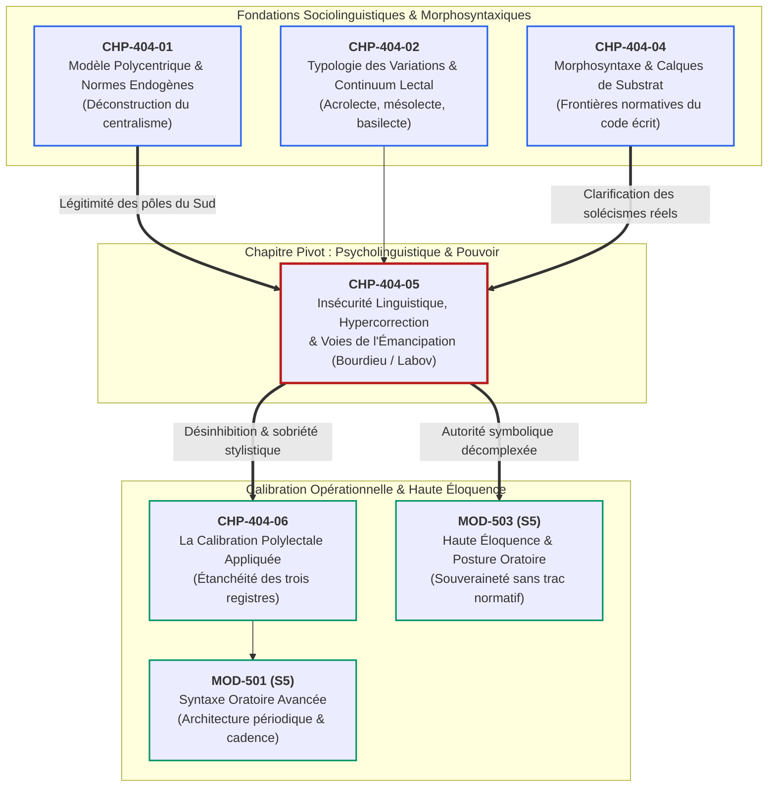
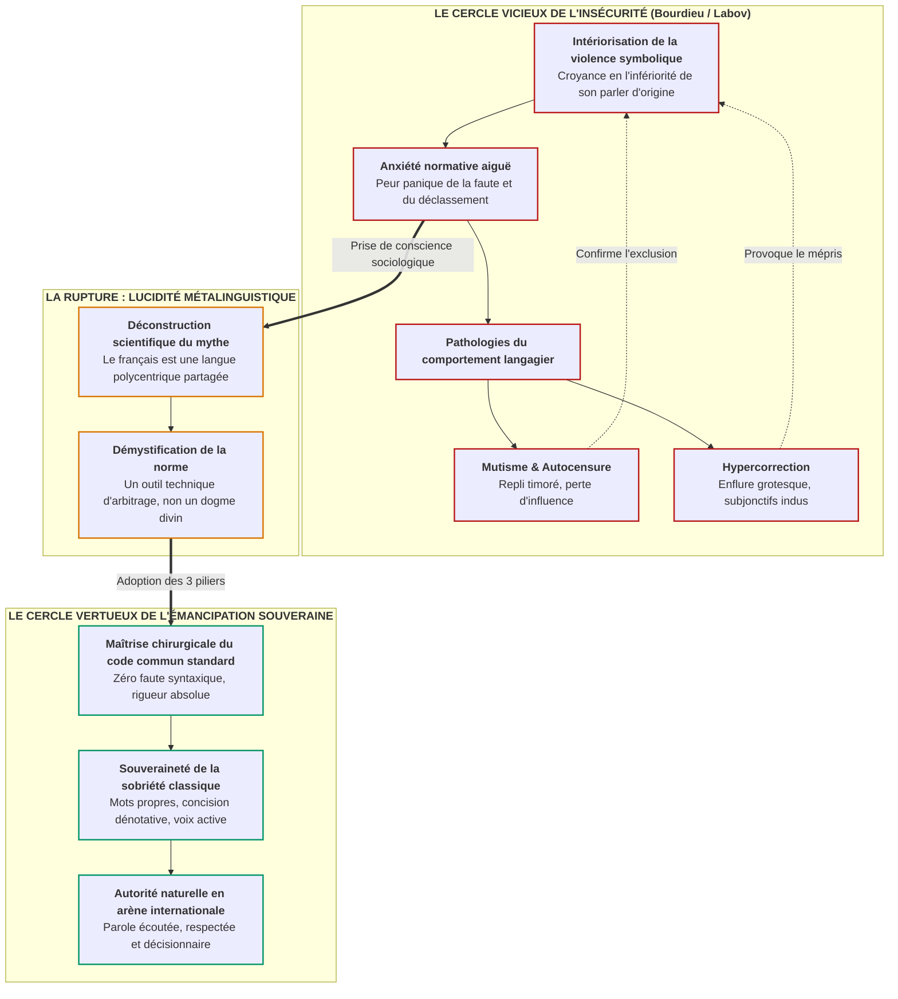

# Chapitre 5 — L'Insécurité Linguistique, l'Hypercorrection et les Voies de l'Émancipation : Bourdieu, Labov et Lucidité Métalinguistique

> **Identifiant du chapitre** : `CHP-404-05`  
> **Module de rattachement** : [`MOD-404` — Sociolinguistique Francophone : Dynamiques Ouest-Africaines et Norme Internationale](file:///f:/Formation/world-class-french/03-curriculum/year-2/semester-4/mod-404-sociolinguistique-francophone-ouest-africaine-norme.md)  
> **Semestre** : Année 2 — Semestre 4 (S4)  
> **Volume horaire canonique** : 5 à 6 heures d'apprentissage autonome délibéré et d'ateliers d'application (Phase 1 Étude : 1 h 30 | Phase 2 Pratique : 1 h 30 | Phase 3 Correction : 1 h 00 | Phase 4 Évaluation : 1 h 00)  
> **Statut** : [STATUT : VALIDÉ]  
> **Compétences associées** : [`FR-SOCIOL-001`](file:///f:/Formation/world-class-french/02-competency-framework/competency-framework.md#fr-sociol-001-conscience-sociolinguistique-et-navigation-entre-registres) (L3 Autonomie), [`FR-INT-004`](file:///f:/Formation/world-class-french/02-competency-framework/competency-framework.md#fr-int-004-adapter-instantanément-son-registre-de-langue-au-contexte) (L3 Autonomie), [`FR-STYLE-001`](file:///f:/Formation/world-class-french/02-competency-framework/competency-framework.md#fr-style-001-analyse-et-production-de-figures-stylistiques-et-rhétoriques) (L3 Autonomie)  
> **Sources scientifiques de référence** : `SRC-SOCIO-02` (Calvet, 2017), `SRC-SOCIO-01` (Queffélec et al., 1997/2002), `SRC-GRAM-01` (Grevisse & Goosse, 2016), `SRC-GRAM-02` (Riegel, Pellat & Rioul, 2016/2021), `SRC-NORM-03` (Ministère de l'Éducation nationale, 2020), `SRC-TYPO-01` (Imprimerie nationale, 2002/2014)

---

## 1. Titre et Place dans le Cursus

### 1.1 Intitulé Officiel
**Chapitre 5 : L'Insécurité Linguistique, l'Hypercorrection et les Voies de l'Émancipation : Bourdieu, Labov et Lucidité Métalinguistique** (`CHP-404-05`).

### 1.2 Insertion Architecturale dans le Cursus
Le chapitre `CHP-404-05` constitue le pivot psycholinguistique et sociologique fondamental du module `MOD-404`. Après avoir déconstruit le mythe monolithique jacobin au profit de la polycentricité (`CHP-404-01`), modélisé le continuum lectal (`CHP-404-02`), exploré la vitalité lexicale endogène (`CHP-404-03`) et balisé les frontières morphosyntaxiques des calques de substrat (`CHP-404-04`), l'apprenant doit affronter l'obstacle invisible le plus insidieux de la pratique du français : l'angoisse de la légitimité.

L'insécurité linguistique paralyse la parole ou engendre le monstre stylistique qu'est l'**hypercorrection** (boursouflure verbale, subjonctifs indus, prononciations précieuses). Ce chapitre arme l'apprenant d'une double grille théorique décisive — William Labov pour la mécanique quantitative de l'anxiété sociolinguistique, Pierre Bourdieu pour l'économie politique du marché linguistique et de la violence symbolique [Réf. `SRC-SOCIO-02`, chap. 4]. 

En désamorçant la culpabilité et en démasquant l'imposture du style pompeux, ce cours prépare directement la calibration polylectale opérationnelle (`CHP-404-06`), la grande architecture de la phrase périodique (`MOD-501`) et l'art oratoire décomplexé de haut niveau (`MOD-503`).



### 1.3 Justification du Calibrage Horaire
Conformément aux normes du cursus (rythme hebdomadaire de 5 à 6 heures d'apprentissage délibéré), ce chapitre est calibré selon la répartition suivante :
- **Phase 1 — Étude conceptuelle & déconstruction théorique (Rubriques 1 à 13)** : 1 h 30 min.
- **Phase 2 — Pratique délibérée & désamorçage de l'hypercorrection (Exercices Niveaux 1 à 3)** : 1 h 30 min.
- **Phase 3 — Correction critique & production réelle (Rubriques 15 et 16)** : 1 h 00 min.
- **Phase 4 — Ancrage mnésique & évaluation sommative (Rubriques 17 à 20)** : 1 h 00 min.

---

## 2. Objectifs Mesurables

Au terme de l'étude autonome et des ateliers pratiques de ce chapitre, l'apprenant est capable de :

1. **Analyser et diagnostiquer les ressorts sociologiques et psychologiques de l'insécurité linguistique** en mobilisant les concepts de marché linguistique, de violence symbolique (Bourdieu) et la courbe d'hypercorrection des locuteurs en situation de mobilité sociale ascendante (Labov) ([`FR-SOCIOL-001`](file:///f:/Formation/world-class-french/02-competency-framework/competency-framework.md#fr-sociol-001-conscience-sociolinguistique-et-navigation-entre-registres), Palier L3 Autonomie).
2. **Identifier et classifier chirurgicalement les trois familles d'hypercorrections** (phonétiques, morphosyntaxiques, lexicales/stylistiques) dans des discours oraux et des écrits professionnels ou académiques ([`FR-SOCIOL-001`](file:///f:/Formation/world-class-french/02-competency-framework/competency-framework.md#fr-sociol-001-conscience-sociolinguistique-et-navigation-entre-registres), [`FR-STYLE-001`](file:///f:/Formation/world-class-french/02-competency-framework/competency-framework.md#fr-style-001-analyse-et-production-de-figures-stylistiques-et-rhétoriques), Palier L3 Autonomie).
3. **Assainir et dégraisser des énoncés administratifs, diplomatiques ou universitaires boursouflés** en substituant à l'enflure verbale pseudo-savante une prose concise, vigoureuse, dénotative et souveraine, sans perte de nuance ni de courtoisie ([`FR-INT-004`](file:///f:/Formation/world-class-french/02-competency-framework/competency-framework.md#fr-int-004-adapter-instantanément-son-registre-de-langue-au-contexte), [`FR-STYLE-001`](file:///f:/Formation/world-class-french/02-competency-framework/competency-framework.md#fr-style-001-analyse-et-production-de-figures-stylistiques-et-rhétoriques), Palier L3 Autonomie).
4. **Adopter une posture d'émancipation et de lucidité métalinguistique** lors d'une prise de parole publique ou d'une négociation internationale, exempte de tout complexe d'illégitimité provinciale et de toute prétention grandiloquente ([`FR-SOCIOL-001`](file:///f:/Formation/world-class-french/02-competency-framework/competency-framework.md#fr-sociol-001-conscience-sociolinguistique-et-navigation-entre-registres), [`FR-INT-004`](file:///f:/Formation/world-class-french/02-competency-framework/competency-framework.md#fr-int-004-adapter-instantanément-son-registre-de-langue-au-contexte), Palier L3 Autonomie).

---

## 3. Prérequis et Test de Préparation

### 3.1 Prérequis Cognitifs Minimaux
- **Polycentricité et norme endogène cultivée (`CHP-404-01`)** : Compréhension du fait que le français admet plusieurs centres de légitimité et que la norme internationale standard est un code partagé, non le monopole exclusif d'un accent territorial.
- **Le continuum lectal (`CHP-404-02`)** : Distinction entre acrolecte, mésolecte et basilecte, et refus de la stigmatisation morale des parlers populaires.
- **Morphosyntaxe verbale et subordination (`MOD-103`, `MOD-301`, `MOD-302`)** : Règle d'emploi des modes après les locutions conjonctives temporelles et concordance des temps.

### 3.2 Test de Préparation (Auto-Diagnostic à 5 Questions)
Répondez aux questions suivantes sans consulter de documentation avant de vérifier vos réponses :

1. **Question 1 (Sociolinguistique labovienne)** : Dans les enquêtes de William Labov sur la stratification sociale de l'anglais à New York, quelle classe sociale manifeste le taux le plus élevé d'hypercorrection en situation d'élocution surveillée : les classes populaires, la petite bourgeoisie / classe moyenne inférieure, ou la haute bourgeoisie dominante ?
2. **Question 2 (Sociologie de Bourdieu)** : Dans *Ce que parler veut dire* (1982), comment Pierre Bourdieu qualifie-t-il le fait qu'un locuteur dominé intériorise la hiérarchie linguistique et considère sa propre variété de langue comme intrinsèquement inférieure et fautive ?
3. **Question 3 (Syntaxe modale)** : D'après les grammaires de référence (`SRC-GRAM-01`, § 1111 ; `SRC-GRAM-02`, chap. 14), quel mode verbal s'emploie traditionnellement après la locution conjonctive temporelle *après que* : l'indicatif ou le subjonctif ? Pourquoi ?
4. **Question 4 (Phonétique historique)** : Le mot *legs* se prononce-t-il historiquement avec un /s/ final audible [lɛgs] ou sans consonne finale [lɛ] ? Quelle est l'origine du `<g>` graphique ?
5. **Question 5 (Stylistique fonctionnelle)** : Pourquoi l'accumulation de formules comme *« il appert péremptoirement que »* ou *« votre haute bienveillance daignerait agréer »* est-elle perçue par les juristes et diplomates contemporains comme une maladresse de débutant plutôt que comme une preuve d'érudition ?

<details>
<summary><strong>Corrigé détaillé et barème de l'auto-diagnostic (cliquer pour dérouler)</strong></summary>

1. **Réponse 1** : C'est la **classe moyenne inférieure** (ou petite bourgeoisie en ascension sociale). Tiraillée entre sa pratique quotidienne spontanée et son aspiration à intégrer la classe supérieure, elle surcompense son anxiété normative en accordant une attention démesurée aux formes de prestige, dépassant même la classe dominante dans la rigidité des règles.
2. **Réponse 2** : Il s'agit de la **violence symbolique** et de la **complicité inconsciente** des dominés. Le dominé reconnaît la légitimité du code dominant et collabore à sa propre disqualification en éprouvant de la honte ou de la culpabilité pour son propre usage.
3. **Réponse 3** : L'**indicatif** (ex. *après qu'il est venu*, *après qu'il fut parti*). La locution *après que* marque une antériorité temporelle achevée, un fait réel et constaté dans le temps, tandis que *avant que* exige le subjonctif car l'action relève du virtuel ou du non-encore-réalisé.
4. **Réponse 4** : Il se prononce traditionnellement sans consonne finale [lɛ], rimant avec *succès* ou *balai*. Le `<g>` est une fausse réfection étymologique introduite au XVIe siècle par des érudits qui le rattachaient à tort au latin *legatum* (du verbe *legare*), alors que *legs* dérive directement de l'ancien français *lais*, substantif déverbal de *laisser*. La prononciation [lɛg] est aujourd'hui tolérée, mais la prononciation affectée [lɛgs] est une hypercorrection pure.
5. **Réponse 5** : Parce que ces tournures constituent de l'**enflure verbale archaïque** (boursouflure stylistique). Le style soutenu contemporain de haut niveau privilégie l'économie de moyens, la précision technique et la netteté prédicative. L'accumulation de clichés désuets trahit l'anxiété d'un rédacteur qui cherche à impressionner autrui pour masquer son manque d'assurance conceptuelle.

> **Barème d'auto-évaluation** :  
> • **5 / 5** : Maîtrise conceptuelle excellente, abordez immédiatement le cours.  
> • **3 ou 4 / 5** : Connaissances convenables, soyez particulièrement attentif aux sections 7 et 10.  
> • **$< 3 / 5$** : Révisez la syntaxe modale (`MOD-302`) et la typologie des variations (`CHP-404-02`) avant de poursuivre.
</details>

---

## 4. Situation de Départ ou Problème Concret

### Le Drame Silencieux de l'Insécurité Linguistique en Arène Internationale
Considérons le cas clinique de Dr Ousmane B., brillant juriste béninois spécialiste du droit maritime des affaires, titulaire d'un doctorat d'État avec les félicitations du jury, délégué officiel de son ministère lors d'une session de négociation internationale à Genève sous l'égide de la CNUCED.

Dr Ousmane B. possède une compétence technique magistrale et une maîtrise parfaite du droit positif. Pourtant, dès que s'ouvre la première commission multilatérale, un phénomène psychologique dévastateur s'empare de lui. En écoutant ses homologues parisiens ou suisses s'exprimer avec une désinvolture feutrée, il ressent soudainement son élocution ouest-africaine comme une tare honteuse. La peur panique du faux pas, du terme provincial, de l'inflexion tonale ou du regard condescendant d'un censeur le submerge.

Face à cette anxiété normative, deux comportements destructeurs sont systématiquement observés chez les locuteurs en état d'insécurité linguistique :

1. **Le mutisme timoré et l'autocensure** :  
   Tétanisé par la crainte de laisser échapper une tournure endogène ou de commettre un lapsus grammatical, le délégué renonce à prendre la parole spontanément. Quand il y est contraint, il baisse le regard, lit nerveusement des notes rédigées au mot près d'une voix précipitée et monocorde, et évite tout échange contradictoire direct. Son expertise technique est escamotée ; sa délégation perd son poids stratégique dans l'arbitrage final du traité.

2. **La surenchère hypercorrective et l'enflure grotesque** :  
   Pour compenser son angoisse et prouver qu'il maîtrise la langue mieux que ses interlocuteurs, le délégué bascule dans le travers inverse : une grandiloquence outrancière. Il rédige une note de synthèse boursouflée d'archaïsmes poussiéreux, d'inversions forcées et de subjonctifs empilés :  
   *« Quoiqu'il sache qu'il eût fallu que nous fussions diligents, il appert péremptoirement que votre haute bienveillance daignerait agréer les desiderata idoines de notre gouvernement... »*

Au lieu de susciter l'admiration, ce galimatias pédant provoque des sourires gênés ou la condescendance polie de l'assemblée. L'auditoire international n'y perçoit pas la virtuosité d'un maître de la langue, mais l'affolement d'un locuteur qui a revêtu une perruque poudrée du XVIIIe siècle pour dissimuler sa terreur sociale.

Ce drame n'est pas individuel : c'est la manifestation clinique de l'**insécurité linguistique** et de la **violence symbolique** du marché linguistique. Comprendre cette mécanique est la condition *sine qua non* pour s'en libérer définitivement.

---

## 5. Explication Intuitive

### L'Analogie du Marcheur sur la Poutre Étroite et du Porteur de Masque Rigide
Pour comprendre intuitivement ce que sont l'insécurité linguistique et l'hypercorrection, imaginons deux marcheurs affrontant une poutre étroite suspendue à dix mètres du sol.

```
┌────────────────────────────────────────────────────────────────────────┐
│                   L'ANALOGIE DES DEUX MARCHEURS                        │
├───────────────────────────────────┬────────────────────────────────────┤
│ LE MARCHEUR TÉTANISÉ              │ LE FUNAMBULE ACCOMPLI              │
│ (L'insécurité & l'hypercorrection)│ (L'émancipation & la souveraineté) │
├───────────────────────────────────┼────────────────────────────────────┤
│ • Regard rivé sur ses pieds       │ • Regard porté vers l'horizon      │
│ • Muscles contractés, souffle coupé│ • Corps souple, respiration libre  │
│ • Gestes saccadés, raideur extrême│ • Économie de gestes, fluidité     │
│ • La peur de tomber provoque la   │ • La confiance dans ses appuis     │
│   chute (l'hypercorrection agram- │   assure la stabilité (la clarté   │
│   maticale ou l'enflure grotesque)│   sobre et dénotative du propos)   │
└───────────────────────────────────┴────────────────────────────────────┘
```

1. **Le marcheur tétanisé (l'hypercorrection)** :  
   Persuadé qu'au moindre millimètre d'écart il basculera dans le vide (l'erreur de langue, la honte sociale), le marcheur novice crispe chacun de ses muscles. Il bloque sa cage thoracique, verrouille ses chevilles et raidit ses genoux. Chaque pas devient une épreuve agonistique d'une lenteur compassée. Paradoxalement, c'est cette raideur même qui détruit son centre de gravité : incapable d'amortir les micro-oscillations naturelles, il titube et trébuche sur sa propre tension musculaire.  
   L'hypercorrection est exactement cette raideur névrotique : à force de traquer la faute imaginaire, le locuteur invente des règles inexistantes, insère des subjonctifs aberrants et prononce des lettres que personne n'a jamais articulées.

2. **Le porteur de masque de plâtre rigide** :  
   Le locuteur insécure croit qu'il ne sera pris au sérieux que s'il porte un masque cérémoniel en plâtre lourd et doré, orné de fioritures baroques (*« il appert péremptoirement »*, *« déférer aux desiderata »*). Mais ce masque étouffe sa voix, lui masque la vue et paralyse les expressions vivantes de son visage. Plus il tente de paraître solennel, plus son allure rappelle le guignol de foire.

3. **Le maître souverain (l'émancipation)** :  
   Le véritable maître de la langue avance le visage découvert. Il sait que le français n'est pas un précipice bordé de chausse-trapes, mais un sol ferme et un instrument de précision. Il n'a rien à prouver. Il n'a besoin ni de fard, ni de masque, ni de talons compensés : il choisit le mot propre le plus simple, agence ses propositions avec la clarté lumineuse de la logique, et s'exprime avec l'assurance souveraine de celui qui maîtrise le code sans en être l'esclave.

---

## 6. Définitions Précises et Terminologie

Pour analyser scientifiquement ces phénomènes sans tomber dans le jugement moralisateur, la sociolinguistique et la sociologie de la culture ont forgé un ensemble de concepts rigoureux :

### 6.1 L'Insécurité Linguistique (William Labov, Louis-Jean Calvet)
Sentiment d'inconfort, de doute, d'illégitimité ou d'anxiété éprouvé par un locuteur quant à sa propre pratique de la langue, né de la **conscience aiguë d'un écart** entre son usage réel et une norme légitime prestigieuse qu'il reconnaît mais dont il ne maîtrise pas les ressorts d'exécution [Réf. `SRC-SOCIO-02`, chap. 4].  
- *Exemple d'ancrage* : Un cadre francophone africain qui, en présence de collègues européens, n'ose formuler une idée de peur de laisser entendre un calque de substrat ou un timbre vocalique régional.

### 6.2 Le Marché Linguistique et le Capital Symbolique (Pierre Bourdieu)
Théorie sociologique développée dans *Ce que parler veut dire* (1982), selon laquelle les échanges langagiers fonctionnent comme un **marché économique** où les énoncés ont une valeur sociale déterminée par les rapports de pouvoir symbolique entre les groupes sociaux.
- **Capital linguistique** : Maîtrise incorporée du code de prestige reconnu comme légitime par les institutions dominantes (école, administration, médias d'élite).
- **Profit de distinction** : Avantage symbolique et matériel retiré par un locuteur lorsqu'il produit la forme linguistique la plus valorisée sur le marché considéré.
- **Censure préalable** : Auto-évaluation inconsciente par laquelle le locuteur anticipe le prix de ses paroles sur le marché et choisit soit d'ajuster son code au prix d'un effort intense, soit de se taire.

### 6.3 La Violence Symbolique
Mécanisme sociologique par lequel un ordre hiérarchique arbitraire (ici la suprématie absolue d'une variété de français d'élite sur toutes les autres) est reconnu et accepté comme universellement légitime par ceux-là mêmes qu'il exclut ou dévalorise, avec leur **complicité inconsciente**.  
- *Exemple d'ancrage* : Le fait qu'un locuteur béninois qualifie spontanément son propre accent de « sauvage » ou de « gâté » sans qu'aucune contrainte physique ne lui soit imposée.

### 6.4 L'Hypercorrection (ou Hyperurbanisme)
Comportement linguistique par lequel un locuteur, mû par le désir forcené de conformité à une norme de prestige, dépasse la règle véritable et produit une forme erronée, agrammaticale ou ridicule par surcompensation (Labov, 1972).  
- *Exemple d'ancrage* : Utiliser le subjonctif après *après que* (*« après qu'il soit parti »*), croyant faire preuve d'un raffinement suprême, alors que la norme codifiée prescrit l'indicatif (*« après qu'il est parti »*).

### 6.5 L'Habitus Linguistique (Bourdieu)
Ensemble de dispositions durables, corporelles et mentales, intériorisées dès la prime enfance par la socialisation et la scolarisation, qui déterminent la relation spontanée du sujet avec la langue (assurance physique, rapport au silence, modulation vocale, fluidité des tournures).

### 6.6 La Lucidité Métalinguistique
Aptitude réflexive d'un locuteur à appréhender la langue non comme un tribunal moral ou une essence transcendante, mais comme un **système de signes conventionnel** articulé en registres et en normes fonctionnelles, lui permettant d'adapter consciemment sa production aux exigences de la situation sans honte ni aliénation.

### 6.7 L'Émancipation Linguistique
Affranchissement définitif de la tutelle psychologique et de la culpabilité normative, reposant sur l'articulation de deux forces : la maîtrise irréprochable du tronc commun standard international et la souveraineté stylistique fondée sur la simplicité dénotative.

---

## 7. Règles ou Mécanismes Fondamentaux

### 7.1 La Théorie Sociologique de l'Insécurité Linguistique (Labov, Calvet)

L'insécurité linguistique ne procède pas de l'ignorance, mais au contraire d'une **sur-conscience de la norme**. Un locuteur totalement illettré ne souffre d'aucune insécurité linguistique : il parle son dialecte ou son parler populaire avec une sérénité totale, car il évolue hors du marché officiel de l'écrit.

Le drame commence dès lors que le sujet a été scolarisé et a intériorisé l'existence d'une « norme souveraine », sans avoir acquis la familiarité aristocratique ou bourgeoise qui permet de s'en jouer [Réf. `SRC-SOCIO-02`, chap. 4].

```
                INTÉRIORISATION DE LA NORME
                    (Haute exigence idéale)
                             ▲
                             │
                  HIATUS / INSÉCURITÉ
                   (Anxiété normative)
                             │
                             ▼
                 SENTIMENT D'ILLÉGITIMITÉ
              (Peur de l'écart & de la faute)
```

#### La Courbe Labovienne de l'Hypercorrection
Dans ses enquêtes pionnières sur la prononciation du /r/ post-vocalique à New York (1966), William Labov a mis en lumière une courbe sociolinguistique universelle :

```text
FRÉQUENCE DES FORMES DE PRESTIGE
▲
│                                          / Classe moyenne inférieure
│                                        /   (Hypercorrection en style surveillé)
│                       /--------------/
│                     /              /
│                   /              /
│                 /              / Classe supérieure dominante
│               /              /   (Sécurité statutaire & stabilité)
│             /              /
│           /              /
│         /              /
│       /              /
│     /              / Classes populaires
│   /              /   (Usage vernaculaire régulier)
│ /
└──────────────────────────────────────────────► DEGRÉ D'ATTENTION
  Conversation       Entretien       Lecture      Paires
  spontanée          formel          de texte     minimales
```

1. **La classe supérieure dominante** : Elle possède la **sécurité linguistique statutaire**. Elle sait qu'elle incarne la norme vivante. Ses membres peuvent s'autoriser des libertés de langage, des ellipses et une négligence feinte sans jamais craindre d'être déclassés.
2. **Les classes populaires** : Elles restent globalement attachées à leur vernaculaire basilectal et ne modifient que marginalement leur usage sous la surveillance.
3. **La classe moyenne en ascension sociale (petite bourgeoisie)** : C'est elle qui manifeste le décrochage le plus spectaculaire. En situation de style surveillé (lecture, test formel, examen), sa courbe monte verticalement et **croise puis dépasse** celle de la classe dominante. C'est l'**effet de surcompensation** : par terreur d'être renvoyée à ses origines populaires, elle en fait trop, s'écoute parler, crispe son articulation et verse dans l'hypercorrection.

---

### 7.2 Le Marché Linguistique et la Violence Symbolique (Bourdieu)

Dans *Ce que parler veut dire* (1982), Pierre Bourdieu dévoile les mécanismes de domination cachés derrière la prétendue « beauté de la langue » :

1. **L'unification du marché linguistique** :  
   L'État moderne (monarchie capétienne, république jacobine, puis États post-coloniaux) unifie le marché linguistique par l'école, l'armée et l'administration. Dès lors, une seule variété de langue (le français parisien cultivé, puis la norme internationale d'État) est consacrée comme étalon universel de valeur.
2. **La valeur différentielle des locuteurs** :  
   La valeur d'un énoncé ne dépend pas seulement de sa justesse grammaticale formelle, mais de l'**autorité symbolique** de celui qui l'émet. Un diplomate français de vieille lignée qui dit un mot familier produit un « effet de style » ou un « trait d'esprit » ; un étudiant africain qui commet la même familiarité est accusé de « barbarisme » ou d'incompétence.
3. **La censure préalable et l'intériorisation du stigmate** :  
   Le locuteur issu de la périphérie (géographique ou sociale) pratique la censure préalable : il mesure inconsciemment l'écart entre son habitus et les exigences du marché. S'il n'est pas armé de lucidité métalinguistique, il est condamné à l'angoisse permanente du déclassement.

---

### 7.3 Typologie Tripartite de l'Hypercorrection

L'hypercorrection se déploie à travers trois registres formels qu'il convient de délimiter chirurgicalement :

#### 1. Les Hypercorrections Phonétiques et Articulatoires
- **Prononciation indue de consonnes muettes latentes** :  
  Sous prétexte qu'une lettre figure dans la graphie historique, le locuteur l'articule avec force pour prouver son instruction :
  - Prononcer le `<c>` de *porc* [pɔʁk] au lieu de /pɔʁ/ ;
  - Prononcer le `<s>` de *legs* [lɛgs] au lieu de /lɛ/ ou /lɛg/ ;
  - Prononcer le `<t>` de *vingt* [vɛ̃t] en position isolée (hors liaison) au lieu de /vɛ̃/ ;
  - Prononcer le `<p>` de *sculpteur* [skylptœʁ] ou *dompter* [dɔ̃pte] au lieu de /skyltœʁ/ et /dɔ̃te/.
- **Liaisons hypercorrectes erronées ou « veloutées »** :  
  - Insérer un /z/ parasite d'élégance fictive : *« moi-z-aussi »*, *« pas-z-encore »* ;
  - Insérer un /t/ parasite : *« il a-t-été »*, *« après-t-avoir »* ;
  - Lier après un substantif singulier terminé par consonne muette non liante (*« un procès[z]injuste »*, *« le vent[t]est fort »*).

#### 2. Les Hypercorrections Morphosyntaxiques
- **Le subjonctif indu après *après que*** :  
  - Forme fautive hypercorrecte : *« après qu'il soit venu »*, *« après que le décret ait été signé »* ;
  - Règle de référence (`SRC-GRAM-01`, § 1111 ; `SRC-GRAM-02`, chap. 14) : *après que* introduit un fait accompli, réel et attesté dans la chronologie ; il commande obligatoirement l'**indicatif** (*après qu'il est venu*, *après que le décret a été signé*, *après qu'il fut parti*). Le recours au subjonctif relève d'une fausse analogie avec *avant que* (qui appelle le subjonctif parce que l'événement est virtuel et non accompli).
- **Le subjonctif imparfait injustifié et la discordance temporelle** :  
  - Plaquer des formes désuètes de subjonctif imparfait dans un énoncé au présent pour « faire érudit » : *« Je souhaite que vous vinssiez immédiatement »* au lieu de *« que vous veniez »*.
- **Les inversions de sujet bizarres et contournées** :  
  - Forcer l'inversion dans des subordonnées banales où elle alourdit le texte : *« La maison dont ignore mon père l'adresse exacte »* au lieu de *« dont mon père ignore l'adresse exacte »*.

#### 3. Les Hypercorrections Lexicales et Stylistiques
- **L'enflure pseudo-juridique et l'archaïsme compassé** :  
  - Remplacer les verbes d'action directs par des périphrases fossilisées : *« Il appert péremptoirement que »* (au lieu de *« Il apparaît clairement que »*), *« Votre haute bienveillance daignerait »* (au lieu de *« Je vous saurais gré de bien vouloir »*), *« Déférer à vos desiderata »* (au lieu de *« Répondre à vos demandes »*).
- **La proscription abusive des mots simples de la langue** :  
  - Bannir le verbe *faire* pour lui préférer systématiquement *opérer*, *effectuer* ou *perpétrer* ; bannir *voir* pour lui préférer *constater de visu*.

---

### 7.4 Les Trois Piliers de l'Émancipation Linguistique

Pour briser définitivement la chaîne de l'insécurité linguistique et de l'hypercorrection, l'apprenant doit ériger sa pratique sur trois piliers indissociables :

```
┌────────────────────────────────────────────────────────────────────────┐
│               LES TROIS PILIERS DE L'ÉMANCIPATION                      │
├───────────────────────────────────┬────────────────────────────────────┤
│ PILIER 1                          │ PILIER 2                           │
│ Déculpabilisation des Usages      │ Démystification de la Norme        │
│ Endogènes & Plurilinguisme        │ (Outil d'arbitrage conventionnel)  │
├───────────────────────────────────┴────────────────────────────────────┤
│ PILIER 3                                                               │
│ Souveraineté de la Simplicité (Clarté dénotative & sobriété noble)     │
└────────────────────────────────────────────────────────────────────────┘
```

1. **Pilier 1 : Déculpabilisation des usages endogènes et valorisation du plurilinguisme** :  
   Les langues nationales africaines (fon, yoruba, baatonu, wolof...) et le mésolecte quotidien ne sont pas des pollutions de l'esprit, mais une richesse cognitive, rythmique et humaine exceptionnelle. Le locuteur plurilingue n'a pas à avoir honte de son bilinguisme : il doit au contraire le revendiquer avec dignité.
2. **Pilier 2 : Démystification de la norme internationale standard** :  
   La norme internationale commune (ONU, OHADA, université) n'est ni un dogme divin ni une marque de supériorité morale de l'Occident : c'est un **code technique conventionnel d'arbitrage** conçu pour rendre la communication universellement univoque entre des centaines de millions de locuteurs. On s'y conforme par professionnalisme et rigueur intellectuelle, jamais par soumission servile.
3. **Pilier 3 : Souveraineté de la simplicité** :  
   La véritable noblesse de style réside dans la sobriété la plus dépouillée. Un grand esprit exprime des concepts complexes avec des mots simples et une syntaxe limpide. L'enflure verbale n'est pas le sommet de l'éloquence, mais le signe d'une faiblesse conceptuelle.

---

## 8. Raisonnement Détaillé (Le Pourquoi)

### Pourquoi la Véritable Distinction Stylistique Réside dans la Sobriété Décomplexée
Il existe un paradoxe fondamental que tout étudiant de niveau universitaire doit assimiler : **plus un locuteur cherche désespérément à paraître distingué, plus il étale les marques de sa domination sociale**.

Dans *La Distinction : critique sociale du jugement* (1979), Pierre Bourdieu démontre que la marque suprême de l'aristocratie culturelle n'est pas le luxe voyant ou la surcharge ornementale, mais la **maîtrise aisée**, l'économie de moyens et la retenue (*l'understatement* ou la litote). La surcharge décorative et le clinquant doré sont historiquement les атрибуts de la « petite bourgeoisie » qui veut singer les maîtres en en rajoutant toujours trop.

En matière de style français, cette loi est implacable :

1. **Le style boursouflé est le diagnostic certain de la peur** :  
   Lorsqu'un rédacteur accumule des termes rares (*subodorer*, *subréptice*, *péremptoire*, *concomitant*), des subjonctifs imparfaits et des périphrases passives, le lecteur averti comprend immédiatement ce qui se passe : ce texte a été écrit les mains tremblantes par un auteur qui redoute par-dessus tout d'être jugé insuffisant. L'enflure est le gilet pare-balles de la terreur normative.

2. **La simplicité souveraine est la signature de l'autorité** :  
   Les plus grands stylistes de la tradition francophone — de Voltaire et Montesquieu aux grands diplomates et rédacteurs de traités modernes — partagent le même idéal classique :  
   - Des phrases courtes ou harmonieusement cadencées ;  
   - Des verbes d'action précis au lieu de nominalisations abstraites ;  
   - L'emploi assumé du pronom *nous* ou *je* au lieu de l'impersonnel frileux ;  
   - L'exclusion impitoyable de tout mot qui n'ajoute rien au sens.

Dès lors que le locuteur comprend que le bon goût contemporain coïncide avec la **netteté dénotative**, la peur s'évanouit. Il n'a plus besoin d'imiter une caricature de magistrat d'Ancien Régime : il lui suffit d'énoncer sa pensée avec la franchise lumineuse de l'esprit scientifique.

---

## 9. Exemples Corrects Commentés

Examinons quatre cas cliniques emblématiques illustrant la transition d'une pathologie d'insécurité vers une écriture souveraine et assainie :

### Cas Clinique 1 : L'Hypercorrection Phonétique sur Consonne Latente

- **Énoncé pathologique (observé en allocution publique formelle)** :  
  *« Cette décision constitue un lé-gusse inaliénable pour notre nation et protège le por-que élevé dans nos campagnes. »*
- **Diagnostic psycholinguistique** :  
  Le locuteur a peur d'être accusé de relâchement ou d'avaler les syllabes comme au marché. Voyant les lettres finales `<gs>` dans *legs* et `<c>` dans *porc*, il s'oblige à les faire claquer lourdement à l'oreille [lɛgs] et [pɔʁk].
- **Réfutation et analyse phonologique** :  
  - *legs* se prononce canoniquement /lɛ/ (rime avec *accès*), ou avec la variante admise /lɛg/, mais jamais avec l'affriquée sifflante [lɛgs].
  - *porc* se prononce strictement /pɔʁ/, le `<c>` étant un morphogramme historique muet sans résonance occlusive.
- **Transcription sobre et souveraine** :  
  `/sɛt desizjɔ̃ kɔ̃stity œ̃ lɛ inaljɛnabl puʁ nɔtʁ nasjɔ̃ e pʁɔtɛʒ lə pɔʁ elve dɑ̃ no kɑ̃paɲ/`.  
  *Le locuteur prononce les consonnes muettes selon la norme vivante sans forcer l'articulation.*

---

### Cas Clinique 2 : L'Hypercorrection Morphosyntaxique du Subjonctif

- **Énoncé pathologique (extrait d'un projet de compte rendu d'audience ministérielle)** :  
  *« Après que la délégation ait été reçue par le ministre, les conclusions ont été immédiatement transmises à la presse. »*
- **Diagnostic psycholinguistique** :  
  Le rédacteur est persuadé que le subjonctif est le mode noble de l'écrit administratif et que l'indicatif serait trop banal ou familier.
- **Réfutation grammaticale (`SRC-GRAM-01`, § 1111 ; `SRC-GRAM-02`, chap. 14)** :  
  La locution conjonctive *après que* introduit un fait temporellement antérieur et révolu dans l'ordre chronologique. Ce fait appartient à la réalité attestée ; il réclame l'**indicatif** (passé composé ou passé antérieur).
- **Réécriture sobre et souveraine** :  
  - Version standard moderne : *« Après que la délégation a été reçue par le ministre, les conclusions ont été immédiatement transmises à la presse. »*  
  - Version d'apparat noble : *« Après que la délégation eut été reçue par le ministre, les conclusions furent immédiatement transmises à la presse. »*

---

### Cas Clinique 3 : L'Enflure Lexicale Pseudo-Juridique

- **Énoncé pathologique (courriel d'un chef de service à un collègue)** :  
  *« Il appert péremptoirement des pièces susvisées que votre auguste bienveillance n'a point daigné déférer aux desiderata idoines de notre direction. »*
- **Diagnostic psycholinguistique** :  
  Terreur d'employer des termes clairs du quotidien ; refuge derrière un bouclier de mots fossilisés pour se donner une stature d'autorité intimidante.
- **Réécriture sobre et souveraine** :  
  *« L'examen des pièces transmises montre clairement que vos services n'ont pas encore répondu aux demandes de notre direction. »*  
  *Gain : gain de 50 % de temps de lecture, suppression du grotesque servile, efficacité communicative immédiate.*

---

### Cas Clinique 4 : L'Effacement Frileux du Sujet et la Phobie du « Je »

- **Énoncé pathologique (rapport de mission administrative)** :  
  *« Il a été procédé par nos soins à la constatation qu'une négligence avait été commise sans qu'il pût être établi par qui ladite faute avait été perpétrée. »*
- **Diagnostic psycholinguistique** :  
  Peur névrotique d'assumer la responsabilité de l'affirmation ; fétichisation du passif impersonnel perçu à tort comme la seule forme d'objectivité scientifique.
- **Réécriture sobre et souveraine** :  
  *« Nous avons constaté une négligence grave sans pouvoir en identifier l'auteur. »*  
  *Gain : affirmation nette, verbes actifs vigoureux, autorité institutionnelle assumée.*

---

## 10. Contre-Exemples et Erreurs Fréquentes

L'analyse clinique met en évidence six erreurs récurrentes d'hypercorrection et d'inhibition chez les locuteurs en situation formelle :

```text
┌────────────────────────────────────────────────────────────────────────┐
│             TYPOLOGIE CLINIQUE DES SIX ERREURS D'HYPERCORRECTION       │
├───────────────────┬────────────────────────────────────────────────────┤
│ Cas 1             │ Subjonctif indu après « après que »                │
│ Cas 2             │ Subjonctif imparfait discordé et désuet            │
│ Cas 3             │ Articulation indue de consonnes muettes latentes   │
│ Cas 4             │ Enflure verbale et clichés administratifs fossiles │
│ Cas 5             │ Accumulation de passifs par phobie du sujet actif  │
│ Cas 6             │ Mutisme, repli timoré et complexe d'illégitimité   │
└───────────────────┴────────────────────────────────────────────────────┘
```

### Erreur n° 1 : Le subjonctif indu après la locution conjonctive « après que »
- **Manifestation pathologique** : Écrire ou prononcer : *« Après que nous soyons arrivés au palais... »* ou *« Après qu'il ait achevé son mandat... »*.
- **Ressort psycholinguistique** : L'apprenant commet une fausse symétrie avec *avant que* (qui exige le subjonctif) en s'imaginant que le subjonctif est un badge de supériorité aristocratique.
- **Réfutation et arbitrage normatif** : *Après que* constate une réalité temporelle consommée. La norme exige l'indicatif : *« Après que nous sommes arrivés au palais... »* ou *« Après qu'il a achevé son mandat... »* [Réf. `SRC-GRAM-01`, § 1111].
- **Rectification sobre** : Utiliser l'indicatif sans fausse honte, ou reformuler par une construction nominale ou participiale dense : *« Après notre arrivée au palais... »*, *« Son mandat achevé... »*.

### Erreur n° 2 : La discordance temporelle et le subjonctif imparfait injustifié
- **Manifestation pathologique** : Insérer des formes rares du subjonctif imparfait dans un contexte temporel au présent : *« Il faut absolument que nous sussions la vérité séance tenante »* ou fabriquer des formes inouïes (*« que nous sachions »* déformé en *« que nous sachissions »*).
- **Ressort psycholinguistique** : Désir puéril d'éblouir l'auditoire par la maîtrise d'une conjugaison rare, débouchant sur une discordance syntaxique grossière.
- **Réfutation et arbitrage normatif** : En français contemporain de haute tenue, la concordance des temps au subjonctif imparfait est restreinte à la prose littéraire d'art après un verbe principal au passé (*« Il souhaitait que nous vinssions »*). Après un verbe au présent, le subjonctif présent est obligatoire : *« Il faut que nous sachions »* [Réf. `SRC-GRAM-02`, chap. 14].
- **Rectification sobre** : *« Il est indispensable que nous connaissions la vérité sans délai. »*

### Erreur n° 3 : La prononciation erronée de consonnes muettes et liaisons abusives
- **Manifestation pathologique** : Prononcer le `<t>` de *vingt* dans *« J'ai vingt ans »* en détachant *ving-te ans*, prononcer le `<s>` de *sourcil* [suʁsis], ou intercaler des consonnes parasites : *« Je suis-z-allé »*, *« C'est-t-évident »*.
- **Ressort psycholinguistique** : Peur de paraître négligent ; croyance candide que l'alphabet graphique doit commander l'appareil vocal.
- **Réfutation et arbitrage normatif** : Le français est une langue à graphie historique complexe où de nombreux graphèmes sont des morphogrammes sans correspondance phonique directe (`SRC-ORTHO-01`). Prononcer ces lettres muettes détruit l'harmonie prosodique et constitue un solécisme phonétique.
- **Rectification sobre** : Articuler souplement les consonnes de liaison légitimes sans forcer de sons fantômes.

### Erreur n° 4 : Le style boursouflé et l'enflure pseudo-juridique dans un courriel professionnel
- **Manifestation pathologique** : Débuter une note de service par : *« Il nous agrée en notre haute qualité de vous faire observer qu'il échet de... »*.
- **Ressort psycholinguistique** : Complexe du sous-officier ou de l'administrateur débutant qui emprunte des lambeaux de formulaires royaux du XVIIe siècle pour se draper d'une autorité factice.
- **Réfutation et arbitrage normatif** : Ce verbiage alourdit le traitement administratif, génère des contresens et discrédite son auteur aux yeux de la hiérarchie moderne.
- **Rectification sobre** : *« Nous vous informons que le calendrier des opérations a été arrêté comme suit. »*

### Erreur n° 5 : L'accumulation de constructions passives et impersonnelles par peur du « je »
- **Manifestation pathologique** : Écrire dans une note d'analyse : *« Il a été jugé opportun par le soussigné qu'une réorientation soit entreprise par la cellule »*.
- **Ressort psycholinguistique** : Terreur d'exister en tant que sujet pensant et responsable devant l'autorité institutionnelle.
- **Réfutation et arbitrage normatif** : L'excès de tournures impersonnelles et de passifs sans agent noie la ligne de décision et dissout l'imputabilité administrative.
- **Rectification sobre** : *« J'estime opportun que notre cellule réoriente ses priorités techniques. »* ou au pluriel : *« Nous recommandons la réorientation immédiate des priorités. »*

### Erreur n° 6 : Le silence angoissé, l'autocensure et l'évitement par complexe d'illégitimité
- **Manifestation pathologique** : Renoncer à postuler à une tribune internationale, à poser une question lors d'un colloque prestigieux ou à faire valoir son expertise par peur de « ne pas parler comme eux ».
- **Ressort psycholinguistique** : Intériorisation morbide de la violence symbolique (Bourdieu) ; sentiment de n'être qu'un « intrus » sur le marché linguistique dominant.
- **Réfutation et arbitrage normatif** : Le français est le bien commun de tous les peuples francophones (`CHP-404-01`). Un expert africain dont la pensée est rigoureuse a exactement la même légitimité à la tribune de Genève ou de Montréal qu'un académicien parisien.
- **Rectification sobre** : Respirer calmement, poser son regard sur l'auditoire, parler d'une voix posée et laisser la précision des concepts asseoir l'autorité naturelle du propos.

---

## 11. Cas Particuliers et Limites

### 11.1 L'Emploi Parodique et Satirique du Style Pompeux en Littérature
La boursouflure verbale n'est condamnable que lorsqu'elle est involontaire et issue de la peur. Dans la création littéraire, elle devient une arme comique ou subversive redoutable :
- **Molière** dans *Les Précieuses ridicules* (1659) ou *Le Bourgeois gentilhomme* (1670) érige l'hypercorrection bourgeoise en chef-d'œuvre de satire théâtrale (*« Magdelon, demandez un peu le prix de ce ruban... — Il n'a point de comparaison, Madame ; c'est un ruban qui passe l'entendement »*).
- **Marcel Proust** dans *À la recherche du temps perdu* fait du personnage de Legrandin l'archétype du snob insécure dont chaque phrase déborde de métaphores botaniques boursouflées pour masquer sa roture.
- **Ahmadou Kourouma** dans *En attendant le vote des bêtes sauvages* détourne ironiquement le cérémonial administratif colonial et post-colonial pour révéler la vacuité du pouvoir dictatorial.
- *Limite didactique* : L'art du pastiche exige une maîtrise absolue du code sous-jacent. Tant que l'apprenant n'est pas parfaitement souverain sur le code standard neutre, l'ironie ampoulée risque de se retourner contre lui.

### 11.2 Bienséance Protocolaire Légitime vs Enflure Grotesque
Il ne faut pas confondre la politesse diplomatique de bon aloi avec l'enflure hypercorrective :
- Dans la correspondance diplomatique internationale, certaines formules rituelles d'apparat sont **codifiées et obligatoires** par les traités et usages internationaux (*« Veuillez agréer, Monsieur l'Ambassadeur, les assurances de ma haute considération »*). Ces formules ne relèvent pas de l'hypercorrection, mais de l'étiquette institutionnelle neutre.
- L'hypercorrection commence lorsque le locuteur invente des surenchères obséquieuses non prévues par le protocole (*« Votre auguste et sublime magnanimité daignera... »*). La règle d'or est simple : **respecter scrupuleusement le protocole officiel établi, sans jamais en rajouter un iota**.

---

## 12. Approfondissement Adapté au Niveau

### Analyse Critique des Idéologies Linguistiques Contemporaines : Purisme Hexagonal vs Pan-Francophonie Émancipée

L'insécurité linguistique des locuteurs francophones du Sud est le produit direct d'une idéologie linguistique historiquement située : le **purisme conservateur centralisateur** [Réf. `SRC-SOCIO-02`, chap. 1-2].

```
┌────────────────────────────────────────────────────────────────────────┐
│             CONFRONTATION DES DEUX IDÉOLOGIES LINGUISTIQUES            │
├───────────────────────────────────┬────────────────────────────────────┤
│ IDÉOLOGIE PURISTE MONOCENTRIQUE   │ IDÉOLOGIE PAN-FRANCOPHONE SOUVERAINE│
├───────────────────────────────────┼────────────────────────────────────┤
│ • Mythe de la « pureté originelle»│ • Réalité de l'évolution vivante   │
│ • Monopole parisien de la norme   │ • Polycentricité des normes        │
│ • La variation est une dégéné-    │ • La variation est la preuve de    │
│   rescence ou un « barbarisme »   │   la vitalité de la langue         │
│ • Stigmatisation culpabilisante   │ • Rigueur du code international +  │
│   qui engendre l'insécurité       │   dignité sereine des locuteurs    │
└───────────────────────────────────┴────────────────────────────────────┘
```

1. **La déconstruction du purisme conservateur** :  
   Les censeurs puristes décrivent régulièrement la langue comme une « citadelle assiégée » menacée par les jeunes, les parlers populaires ou les francophones d'Afrique. Cette rhétorique réactionnaire ignore superbement l'histoire même du français : le français classique du XVIIe siècle n'est lui-même qu'un latin populaire déformé par des siècles d'emprunts gaulois, germaniques et italiens !

2. **La souveraineté pan-francophone contemporaine** :  
   Aujourd'hui, plus de 60 % des locuteurs quotidiens du français vivent sur le continent africain. Dans vingt ans, ce chiffre dépassera 80 %. Il est donc scientifiquement absurde et géopolitiquement caduc de continuer à regarder vers les salons parisiens pour savoir si l'on a le droit de respirer dans la langue.  
   L'écrivain Alain Mabanckou ou le philosophe Souleymane Bachir Diagne rappellent avec constance que le français est devenu une **langue mondiale polycentrique** : le centre de gravité de la langue s'est déplacé.

3. **L'alliance de la rigueur et de l'assurance** :  
   L'émancipation ne consiste nullement à briser le code commun ou à se complaire dans le relâchement (ce qui marginaliserait le locuteur sur la scène internationale). Elle consiste à maîtriser la norme internationale avec une virtuosité telle qu'aucun censeur ne puisse trouver la moindre prise technique, tout en conservant une liberté totale de ton, de créativité et de dignité.

---

## 13. Comparaisons Différentielles

Les trois tableaux synoptiques ci-dessous permettent de fixer définitivement les contrastes cardinaux :

### Tableau A : Insécurité Linguistique vs Souveraineté Sereine

| Critère d'évaluation | Posture de l'Insécurité Linguistique | Posture de la Souveraineté Sereine |
| :--- | :--- | :--- |
| **Rapport à la norme** | Culte fétichiste et angoissé du censeur ; peur permanente du jugement extérieur. | Respect technique du code commun compris comme outil de coopération multilatérale. |
| **Gestion de la parole** | Mutisme timoré, fuite du regard, débit précipité, ou grandiloquence protectrice. | Posée, directe, respiration libre, regard assuré, volume modulé avec calme. |
| **Réaction à l'erreur** | Honte destructrice, sentiment d'imposture, effondrement psychologique. | Rectification immédiate, simple et dépassionnée sans auto-flagellation. |
| **Effet sur l'auditoire** | Malaise, condescendance, décrédibilisation de l'argumentaire technique. | Respect immédiat, attention focalisée sur le fond, autorité naturelle. |

---

### Tableau B : Hypercorrection vs Élégance Classique Authentique

| Registre d'analyse | Manifestation de l'Hypercorrection | Réalisation de l'Élégance Classique |
| :--- | :--- | :--- |
| **Phonétique** | Prononciation forcée de consonnes muettes historiques (*legs-se*, *por-que*), liaisons parasites. | Articulation naturelle, respect souple des liaisons obligatoires, diction fluide. |
| **Morphosyntaxe** | Subjonctif abusif (*après qu'il soit venu*), subjonctifs imparfaits anachroniques. | Respect scrupuleux des valeurs modales et temporelles canoniques (*après qu'il est venu*). |
| **Lexique** | Empilement d'archaïsmes poussiéreux (*il appert*, *desiderata*, *icelle*, *susnommé*). | Emploi du terme propre, précis, vivant, contemporain et sans fioriture inutile. |
| **Stylistique** | Périphrases kilométriques, passifs impersonnels empilés, complaisance servile. | Concision dénotative, voix active, propositions fermes, courtoisie sobre. |

---

### Tableau C : Sobriété Noble vs Enflure Pédante

| Dimension textuelle | Enflure Pédante (L'imposture) | Sobriété Noble (La maîtrise) |
| :--- | :--- | :--- |
| **Architecture de phrase** | Période boursouflée de 80 mots avec subordonnées en cascade et anacoluthes. | Phrases nerveuses, équilibrées, articulées par des connecteurs logiques évidents. |
| **Choix des verbes** | Verbes d'état dilués : *« procéder à la mise en œuvre de la réalisation de »*. | Verbes d'action souverains : *« mettre en œuvre »*, *« accomplir »*, *« décider »*. |
| **Densité informative** | Faible : 80 % de bavardage cérémoniel pour 20 % d'information utile. | Maximale : chaque mot porte une charge sémantique indispensable à la décision. |

---

## 14. Exercices Progressifs (3 Niveaux)

### Niveau 1 : Identification et Désamorçage de 12 Hypercorrections (Guidé)

#### Consigne :
Pour chacune des douze phrases suivantes, identifiez l'hypercorrection commise, classez-la dans sa famille (Phonétique, Morphosyntaxique ou Lexicale/Stylistique), puis proposez la version assainie et sobre étalonnée sur le standard international de référence.

1. *« Après que la séance ait été déclarée ouverte, le rapporteur a pris la parole. »*
2. *« Le conférencier a conclu en évoquant le por-que [pɔʁk] engraissé pour la fête du village. »*
3. *« Il appert péremptoirement des délibérations que le budget est déficitaire. »*
4. *« Nous exigeons que chacun d'entre vous sussiez exactement les termes du protocole. »*
5. *« Le directeur a dit que moi-z-aussi devais participer aux travaux de la commission. »*
6. *« Votre haute bienveillance daignerait-elle agréer l'expression de nos desiderata les plus vifs ? »*
7. *« Après qu'ils soient partis en mission d'inspection, le calme est revenu dans la préfecture. »*
8. *« Cet héritage ancestral constitue un lé-gusse [lɛgs] inestimable pour les générations futures. »*
9. *« Il a été procédé par nos soins à la constatation visuelle des dégradations dudit bâtiment. »*
10. *« Là réside, croyons-nous savoir péremptoirement, la cause fondamentale du litige. »*
11. *« Le ministre a-t-été informé des conclusions de l'enquête dès son arrivée à Cotonou. »*
12. *« Nonobstant le fait que vous fussiez absents, nous avons poursuivi les débats sans discontinuer. »*

---

#### Corrigé Détaillé et Justifié du Niveau 1 :

1. **Phrase 1** : **Morphosyntaxique**. Subjonctif indu après *après que*.  
   *Correction* : *« Après que la séance a été déclarée ouverte, le rapporteur a pris la parole. »* (ou au passé simple : *« Après que la séance eut été déclarée ouverte... »*).
2. **Phrase 2** : **Phonétique**. Articulation erronée du `<c>` muet de *porc*.  
   *Correction* : Prononcer /pɔʁ/ sans consonne occlusive finale audible.
3. **Phrase 3** : **Lexicale/Stylistique**. Enflure pseudo-juridique archaïque (*il appert péremptoirement*).  
   *Correction* : *« Les délibérations montrent clairement que le budget est déficitaire. »*
4. **Phrase 4** : **Morphosyntaxique**. Subjonctif imparfait incongru après un présent (*exigeons que vous sussiez*).  
   *Correction* : *« Nous exigeons que chacun d'entre vous sache exactement les termes du protocole. »*
5. **Phrase 5** : **Phonétique**. Liaison parasite veloutée avec /z/ après le pronom disjoint *moi*.  
   *Correction* : *« Le directeur a dit que moi aussi devais participer... »* (prononcé /mwa osi/ sans /z/ intercalaire).
6. **Phrase 6** : **Lexicale/Stylistique**. Servilité compassée et latinisme désuet (*votre haute bienveillance*, *desiderata*).  
   *Correction* : *« Nous vous saurions gré de bien vouloir prendre en considération nos demandes. »*
7. **Phrase 7** : **Morphosyntaxique**. Subjonctif indu après *après que*.  
   *Correction* : *« Après qu'ils sont partis en mission d'inspection... »* (ou *« Après leur départ en mission... »*).
8. **Phrase 8** : **Phonétique**. Prononciation affectée des consonnes muettes de *legs*.  
   *Correction* : Prononcer /lɛ/ (forme historique canonique) ou /lɛg/ sans sifflante finale.
9. **Phrase 9** : **Lexicale/Stylistique**. Dilution passive impersonnelle (*il a été procédé par nos soins à la constatation visuelle de*).  
   *Correction* : *« Nous avons constaté de visu les dégradations de ce bâtiment. »* ou *« Nous avons inspecté les dégradations du bâtiment. »*
10. **Phrase 10** : **Lexicale/Stylistique**. Inversion précieuse et adverbe redondant (*croyons-nous savoir péremptoirement*).  
    *Correction* : *« Nous estimons que là réside la cause principale du litige. »*
11. **Phrase 11** : **Phonétique**. Liaison parasite par /t/ devant participe passé (*a-t-été*).  
    *Correction* : Prononcé /a ete/ par enchaînement vocalique sans consonne d'appui factice.
12. **Phrase 12** : **Morphosyntaxique**. Subjonctif imparfait prétentieux dans un échange courant (*fussiez absents*).  
    *Correction* : *« Bien que vous ayez été absents, nous avons poursuivi les débats sans interruption. »*

---

### Niveau 2 : Dégraissage Stylistique de 6 Écrits Professionnels Boursouflés (Semi-Autonome)

#### Consigne :
Chacun des six extraits suivants est extrait de correspondances ou de rapports rédigés par des cadres ou étudiants souffrant d'insécurité linguistique. Réécrivez chaque texte en style standard noble, concis et souverain, en éliminant l'enflure verbale, les passifs mous et les archaïsmes ridicules. Justifiez le gain obtenu.

- **Texte n° 1 (Courriel interne)** :  
  *« Il nous échet par la présente de porter à votre auguste connaissance qu'il a été constaté par nos collaborateurs que les délais impartis n'ont point pu être déférés en temps utile. »*
- **Texte n° 2 (Introduction de mémoire universitaire)** :  
  *« Quoique nous sussions pertinemment combien ardue pût s'avérer ladite entreprise, il appert péremptoirement que les investigations menées par nos soins révèlent des perspectives idoines. »*
- **Texte n° 3 (Requête administrative)** :  
  *« Votre haute magnanimité daignera-t-elle, dans son infinie bienveillance, condescendre à examiner les humbles desiderata de notre groupement communautaire ? »*
- **Texte n° 4 (Compte rendu de réunion préfectorale)** :  
  *« Après que la séance ait été levée par monsieur le préfet, il a été procédé à l'évacuation ordonnée de la salle par l'ensemble des participants susmentionnés. »*
- **Texte n° 5 (Note diplomatique ministérielle)** :  
  *« Nous ne saurions trop instamment supplier votre excellence de bien vouloir daigner considérer avec indulgence les inadvertances involontaires de nos services techniques. »*
- **Texte n° 6 (Rapport d'audit financier)** :  
  *« Il appert des vérifications comptables opérées de visu par nos experts qu'un montant non négligeable de deniers publics a été distrait sans qu'il fût possible d'en imputer la faute. »*

---

#### Corrigé Détaillé et Justifié du Niveau 2 :

1. **Texte n° 1** :  
   - *Version assainie* : *« Nous vous informons que nos équipes n'ont pas pu respecter les délais prévus pour ce dossier. »*  
   - *Justification du gain* : Suppression de la tournure archaïque *il nous échet*, de la flagornerie *auguste connaissance* et du contresens sur le verbe *déférer*. Rétablissement de la voix active directe.
2. **Texte n° 2** :  
   - *Version assainie* : *« Bien que cette recherche soit particulièrement exigeante, nos travaux mettent en lumière des perspectives prometteuses. »*  
   - *Justification du gain* : Élimination des subjonctifs imparfaits anachroniques (*sussions*, *pût*), de l'adjectif poussiéreux *ladite* et de l'adverbe pompeux *péremptoirement*.
3. **Texte n° 3** :  
   - *Version assainie* : *« Notre association sollicite avec respect l'examen attentif de ses propositions par vos services. »*  
   - *Justification du gain* : Remplacement d'une servilité digne de l'époque féodale par une requête républicaine digne et assurée.
4. **Texte n° 4** :  
   - *Version assainie* : *« Après que le préfet a levé la séance, les participants ont quitté la salle dans le calme. »*  
   - *Justification du gain* : Correction du subjonctif fautif après *après que* et suppression des passifs bureaucratiques lourds (*il a été procédé à l'évacuation par*).
5. **Texte n° 5** :  
   - *Version assainie* : *« Notre délégation tient à clarifier sans délai les erreurs matérielles relevées dans le rapport technique initial. »*  
   - *Justification du gain* : Éradication de la posture de mendicité (*supplier votre excellence*, *indulgence*) incompatible avec l'égalité souveraine des États en droit international.
6. **Texte n° 6** :  
   - *Version assainie* : *« L'audit comptable révèle un détournement de fonds publics dont les responsables restent à identifier. »*  
   - *Justification du gain* : Remplacement de périphrases évasives par un constat juridique net et sans ambiguïté.

---

### Niveau 3 : Analyse Sociolinguistique d'une Prise de Parole Angoissée (Autonome)

#### Énoncé Source (50 mots exacts) :
Le texte ci-dessous retranscrit fidèlement l'intervention improvisée d'un directeur administratif ouest-africain lors d'une commission multilatérale à Genève :

> *« En réunion plénière, le directeur angoissé a cru bon d'ajouter que son équipe eût préféré que les experts fussent informés plus tôt. Par crainte d'un reproche sur sa prononciation, il a ensuite articulé avec raideur chaque lettre muette, transformant son intervention légitime en un pénible spectacle d'hypercorrection. »*

#### Certification Philologique du Décompte Mot à Mot (selon `SRC-TYPO-01`) :
Conformément aux normes typographiques de l'Imprimerie nationale, tout mot délimité par des blancs typographiques ou des apostrophes forme une unité lexicale distincte :

```text
 1. En            2. réunion        3. plénière,      4. le             5. directeur
 6. angoissé      7. a              8. cru            9. bon           10. d'
11. ajouter      12. que           13. son           14. équipe        15. eût
16. préféré      17. que           18. les           19. experts       20. fussent
21. informés     22. plus          23. tôt.          24. Par           25. crainte
26. d'           27. un            28. reproche      29. sur           30. sa
31. prononciation, 32. il          33. a             34. ensuite       35. articulé
36. avec         37. raideur       38. chaque        39. lettre        40. muette,
41. transformant 42. son           43. intervention  44. légitime      45. en
46. un           47. pénible       48. spectacle     49. d'            50. hypercorrection.
```
**Total certifié : Exactement 50 mots.**

---

#### Travail Demandé :
1. Identifiez les manifestations textuelles et prosodiques de l'insécurité linguistique dans ce témoignage.
2. Expliquez comment la violence symbolique intériorisée pousse ce cadre à commettre des discordances temporelles.
3. Rédigez la version souveraine, directe et sobre (environ 30 à 40 mots) que ce haut responsable aurait dû prononcer pour imposer le respect sans aucune affectation.

---

#### Corrigé Détaillé et Justifié du Niveau 3 :

1. **Manifestations de l'insécurité linguistique** :  
   - *Sur le plan syntaxique* : Recours forcé au conditionnel passé deuxième forme / subjonctif plus-que-parfait (*eût préféré que les experts fussent informés*) dans un cadre oral de travail qui appelait simplement le conditionnel présent et le subjonctif passé ou imparfait standard (*aurait préféré que les experts soient informés*).
   - *Sur le plan phonétique et gestuel* : Raideur articulatoire, focalisation sur les lettres muettes, tension corporelle trahissant la panique du regard d'autrui.
2. **Explication par la violence symbolique** :  
   Le locuteur se sent illégitime face à des pairs perçus comme les gardiens du temple linguistique. Pour conjurer la honte anticipée d'une faute, il se réfugie dans une grammaire fossile. Il collabore à sa propre disqualification : son auditoire ne retient pas la pertinence de sa remarque sur les délais, mais sourit de son maniérisme outrancier.
3. **Version souveraine et sobre proposée (33 mots)** :  
   *« Notre délégation regrette que les experts n'aient pas reçu ces documents plus tôt. Nous demandons qu'à l'avenir, les pièces techniques soient transmises au moins quarante-huit heures avant l'ouverture des débats en commission. »*

---

## 15. Activité de Correction Raisonnée

### Contexte de l'Épreuve
Vous êtes conseiller diplomatique senior et tuteur académique. Vous recevez le projet de discours préparé par un jeune docteur en relations internationales pour sa première intervention devant une session extraordinaire de l'Union africaine et de l'Organisation internationale de la Francophonie. 

Le texte rédigé par ce jeune universitaire est saturé de **huit tics d'hypercorrection et formules amphigouriques** engendrés par son anxiété sociale.

---

### Document Fautif Soumis à l'Audit :
> *(1) C'est avec un indicible émoi qu'il échet à notre modeste personne de prendre céans la parole devant ce parterre auguste. (2) Quoiqu'il soit notoire que nous ne sussions point discourir avec la grâce des académiciens, nous tenons à faire observer que notre gouvernement n'a point failli. (3) Après que la convention multilatérale ait été paraphée par les plénipotentiaires, nous avons entrepris d'en matérialiser les clauses. (4) Là gît péremptoirement, osons-nous affirmer avec force, la preuve manifeste de notre probité juridique. (5) Il a été procédé par nos soins à l'examen de visu dudit rapport, duquel il appert que nos frontières demeurent inviolées. (6) Votre haute bienveillance voudra bien condescendre à agréer les humbles doléances de nos populations laborieuses. (7) Nous ne saurions tolérer que des détracteurs insinuent que notre nation constitue un lé-gusse [lɛgs] sans avenir dans le concert des nations civilisées. (8) Nous en appelons donc à votre magnanime indulgence afin que justice intégrale nous soit octroyée dans l'orbe sublime du droit international.*

---

### Apparat Critique et Rectification Scientifique des 8 Pathologies :

```text
┌────────────────────────────────────────────────────────────────────────┐
│             GRILLE DE REDRESSEMENT DES HUIT PATHOLOGIES DU DISCOURS    │
├───────────────┬────────────────────────────────────────────────────────┤
│ Pathologie 1  │ Flagornerie obséquieuse & archaïsme féodal (*échet*)   │
│ Pathologie 2  │ Subjonctif imparfait incongru & discordé (*sussions*)  │
│ Pathologie 3  │ Subjonctif agrammatical après *après que* (*ait été*)  │
│ Pathologie 4  │ Enflure oratoire & inversion maniérée (*là gît...*)    │
│ Pathologie 5  │ Dilution passive impersonnelle & jargon (*appert*)     │
│ Pathologie 6  │ Posture de mendicité servile (*condescendre à agréer*) │
│ Pathologie 7  │ Articulation indue de la consonne muette de *legs*     │
│ Pathologie 8  │ Métaphore grandiloquente creuse (*orbe sublime*)       │
└───────────────┴────────────────────────────────────────────────────────┘
```

1. **Pathologie n° 1 : Flagornerie obséquieuse et archaïsme féodal (*échet à notre modeste personne*)**  
   - *Diagnostic* : Emploi d'un vocabulaire de soumission (*indicible émoi*, *modeste personne*, *parterre auguste*) trahissant un complexe d'infériorité institutionnelle flagrant.  
   - *Rectification* : *« C'est un honneur de prendre la parole aujourd'hui devant votre assemblée. »*
2. **Pathologie n° 2 : Subjonctif imparfait incongru et discordance temporelle (*que nous ne sussions*)**  
   - *Diagnostic* : Plaquer le subjonctif imparfait du verbe *savoir* après une proposition principale au présent (*il est notoire*) constitue un solécisme de concordance des temps et une pose pédante insupportable.  
   - *Rectification* : *« Bien que nous n'ayons pas la prétention d'égaler les tribuns les plus chevronnés... »* ou mieux, supprimer purement et simplement cette excuse inutile.
3. **Pathologie n° 3 : Subjonctif agrammatical après *après que* (*ait été paraphée*)**  
   - *Diagnostic* : Solécisme classique de l'hypercorrection. La signature de la convention étant un fait accompli, le mode indicatif s'impose (`SRC-GRAM-01`, § 1111).  
   - *Rectification* : *« Après que la convention a été paraphée par les plénipotentiaires... »* ou *« Dès la signature de la convention par les plénipotentiaires... »*.
4. **Pathologie n° 4 : Enflure oratoire et inversion maniérée (*Là gît péremptoirement, osons-nous...*)**  
   - *Diagnostic* : Métaphore funéraire inadaptée (*là gît*) combinée à l'adverbe agressif *péremptoirement*.  
   - *Rectification* : *« C'est là une preuve tangible de notre rigueur juridique. »*
5. **Pathologie n° 5 : Dilution passive impersonnelle et jargon suranné (*il a été procédé par nos soins... duquel il appert*)**  
   - *Diagnostic* : L'accumulation d'impersonnels déresponsabilise la parole d'État et alourdit la diction oratoire.  
   - *Rectification* : *« L'examen direct de ce document confirme que nos frontières sont scrupuleusement respectées. »*
6. **Pathologie n° 6 : Posture de mendicité servile (*condescendre à agréer les humbles doléances*)**  
   - *Diagnostic* : Utilisation d'un lexique d'ancien esclave implorant un monarque, incompatible avec la charte de l'Union africaine.  
   - *Rectification* : *« Nous invitons la commission à examiner avec la plus grande attention les attentes légitimes de nos populations. »*
7. **Pathologie n° 7 : Articulation indue de la consonne muette de *legs* ([lɛgs])**  
   - *Diagnostic* : Hypercorrection phonétique issue de la peur d'omettre une consonne graphique.  
   - *Rectification* : Prononcer /lɛ/ ou /lɛg/ avec naturel.
8. **Pathologie n° 8 : Métaphore grandiloquente creuse (*dans l'orbe sublime du droit international*)**  
   - *Diagnostic* : Cliché poétique vide utilisé pour masquer un manque d'arguments juridiques précis.  
   - *Rectification* : *« conformément aux principes fondamentaux du droit international. »*

---

### Discours Intégralement Assaini, Noble et Souverain :
> *« Monsieur le Président, Mesdames et Messieurs les Délégués, c'est un honneur d'intervenir devant cette session conjointe. Notre gouvernement a scrupuleusement respecté l'ensemble de ses engagements conventionnels. Dès la signature des accords multilatéraux par nos plénipotentiaires, nous en avons mis en œuvre les dispositions avec rigueur. L'examen impartial du rapport d'étape confirme la stabilité absolue de nos frontières et la parfaite conformité de nos actions. Nous invitons solennellement notre assemblée à soutenir les attentes légitimes de nos populations, dans le respect souverain des principes qui fondent le droit international. Je vous remercie. »*

---

## 16. Mise en Pratique dans une Production Réelle

### Consigne de Rédaction Calibrée
Vous représentez la délégation d'un État ouest-africain au sein du comité de suivi d'un accord multilatéral d'assistance financière et technique. Un rapporteur international a insidieusement laissé entendre dans un pré-rapport que les lenteurs du projet découlaient de « lacunes d'encadrement propres aux administrations locales ».

Rédigez la note officielle de mise au point institutionnelle de la délégation. Cette note doit mesurer **exactement 60 mots** selon les règles de décompte de `SRC-TYPO-01`. Elle doit concilier une rigueur syntaxique absolue, une absence totale d'enflure verbale ou d'obséquiosité, et une posture diplomatique sereine et souveraine.

---

### Note de Plaidoyer Institutionnel Souverain (60 mots exacts) :

> *« Notre délégation affirme avec sérénité la légitimité juridique des décisions prises par les institutions nationales. Nous refusons toute complaisance envers des injonctions extérieures qui méconnaissent nos réalités. Dès lors, le gouvernement maintient ses choix stratégiques et engage ses partenaires à respecter les termes de l'accord multilatéral sans condescendance, dans la stricte égalité souveraine reconnue de tous les États membres. »*

---

### Décompte Philologique Mot à Mot Certifié (selon `SRC-TYPO-01`) :

Conformément au *Lexique des règles typographiques en usage à l'Imprimerie nationale*, toute unité délimitée par un blanc typographique ou une apostrophe constitue un mot distinct :

```text
 1. Notre          2. délégation     3. affirme        4. avec           5. sérénité
 6. la             7. légitimité     8. juridique      9. des           10. décisions
11. prises        12. par           13. les           14. institutions  15. nationales.
16. Nous          17. refusons      18. toute         19. complaisance  20. envers
21. des           22. injonctions   23. extérieures   24. qui           25. méconnaissent
26. nos           27. réalités.     28. Dès           29. lors,         30. le
31. gouvernement  32. maintient     33. ses           34. choix         35. stratégiques
36. et            37. engage        38. ses           39. partenaires   40. à
41. respecter     42. les           43. termes        44. de            45. l'
46. accord        47. multilatéral  48. sans          49. condescendance, 50. dans
51. la            52. stricte       53. égalité       54. souveraine    55. reconnue
56. de            57. tous          58. les           59. États         60. membres.
```

**Total certifié : Exactement 60 mots.**

---

### Tableau Justificatif des Choix Linguistiques et Stylistiques :

| Segment du texte | Analyse sociolinguistique & stylistique | Absence de pathologie d'insécurité |
| :--- | :--- | :--- |
| *« affirme avec sérénité »* (mots 3 à 5) | Verbe d'action transitif direct soutenu, éthos de calme et de maîtrise. | Zéro périphrase passive évasive (*il est affirmé par nous*). |
| *« la légitimité juridique »* (mots 7-8) | Précision conceptuelle positive fondant l'autorité sur le droit. | Aucun adjectif emphatique déplacé (*auguste*, *infaillible*). |
| *« Nous refusons toute complaisance »* (mots 16 à 19) | Voix active assumée par le pronom *Nous*, refus poli mais ferme. | Rejet de la timidité administrative et du silence timoré. |
| *« méconnaissent nos réalités »* (mots 25 à 27) | Constat dénotatif sobre substitué au reproche moralisant agressif. | Zéro enflure oratoire (*délire calomniateur*). |
| *« sans condescendance »* (mots 48-49) | Dénonciation feutrée de la violence symbolique des bailleurs. | Litote diplomatique de haute tenue. |
| *« dans la stricte égalité souveraine reconnue de tous les États membres »* (mots 50 à 60) | Réactivation des principes fondamentaux de la Charte de l'ONU et de Vienne. | Fermeture majestueuse et univoque sans supplication servile. |

---

## 17. Résumé Structuré : Le Protocole de l'Émancipation

### Schéma Conceptuel : De la Servitude Normative à la Souveraineté Expressive



---

### La Charte de Sobriété du Rédacteur Émancipé (Les 5 Commandements)

1. **Tu préféreras toujours le mot propre le plus simple à la périphrase pompeuse** : Si tu veux dire *voir*, n'écris pas *constater de visu* ; si tu veux dire *demander*, n'écris pas *déférer aux desiderata*.
2. **Tu banniras les faux ornements de la distinction grammaticale** : N'emploie jamais le subjonctif après *après que* ; n'exhume jamais un subjonctif imparfait poussiéreux pour tenter d'éblouir ton lecteur.
3. **Tu assumeras la pleine responsabilité de ton propos** : Proscris les avalanches de passifs et d'impersonnels mous (*il a été jugé bon par nos soins*). Emploie la voix active, le pronom franc (*nous*, *je*) et des verbes forts.
4. **Tu tailleras tes phrases comme des pierres d'angle** : Chasse les adverbes superflus (*péremptoirement*, *incontestablement*), élimine le délayage cérémoniel et donne à chaque phrase une armature logique inattaquable.
5. **Tu te souviendras que le français t'appartient de plein droit** : Aucun censeur n'a de prise sur un esprit libre qui manie le code standard avec une rigueur irréprochable et s'exprime dans la vérité nue de sa pensée.

---

## 18. Questions de Rappel Actif (Active Recall)

Testez votre mémoire de travail et votre rétention conceptuelle sans consulter le cours :

1. **Question 1 (Sociolinguistique)** : Pourquoi, selon l'enquête new-yorkaise de Labov, la courbe d'hypercorrection de la classe moyenne inférieure dépasse-t-elle celle de la classe dominante en situation d'élocution surveillée ?
2. **Question 2 (Sociologie de la domination)** : Qu'entend Pierre Bourdieu par l'expression « censure préalable » sur le marché linguistique ?
3. **Question 3 (Règle syntaxique)** : Quelle justification sémantique et chronologique explique que la locution *après que* exige l'indicatif et non le subjonctif selon le Bon Usage (`SRC-GRAM-01`, § 1111) ?
4. **Question 4 (Phonétique historique)** : Expliquez pourquoi prononcer le `<g>` et le `<s>` de *legs* [lɛgs] est une hypercorrection historique issue d'une erreur d'étymologie du XVIe siècle.
5. **Question 5 (Stylistique noble)** : En quoi le style ampoulé et boursouflé constitue-t-il, selon les principes de la sociologie de la culture, un indicateur d'insécurité sociale plutôt qu'un signe de noblesse ?
6. **Question 6 (Posturologie oratoire)** : Quelles sont les trois caractéristiques observables d'une prise de parole publique émancipée et décomplexée ?

<details>
<summary><strong>Réponses détaillées du rappel actif (cliquer pour dérouler)</strong></summary>

1. **Réponse 1** : La classe moyenne inférieure est animée par un désir ardent d'ascension sociale couplé à une vive anxiété de déclassement. N'ayant pas la sécurité statutaire innée de la classe dominante, elle surcompense son insécurité en accordant une vigilance disproportionnée aux règles de prestige, basculant dans l'excès de rigueur et l'hypercorrection.
2. **Réponse 2** : C'est le processus inconscient par lequel un locuteur anticipe le rapport de force symbolique sur le marché, évalue le « prix » de sa parole, et s'autocensure ou modifie artificiellement son élocution pour éviter la sanction ou le stigmate social.
3. **Réponse 3** : Le subjonctif est le mode de l'envisagé, de l'incertitude ou du non-réalisé (comme dans *avant que*). À l'inverse, *après que* marque une action objectivement accomplie, réelle et passée au moment où l'on se place ; elle relève donc naturellement du mode du réel et de l'affirmation temporelle : l'indicatif.
4. **Réponse 4** : Le substantif *legs* dérive de l'ancien français *lais* (déverbal du verbe *laisser*). Au XVIe siècle, des lettrés ignorants ont cru à tort qu'il venait du latin *legatum* (lier, léguer) et ont inséré un `<g>` graphique parasite. Prononcer [lɛgs] consiste à articuler une consonne fantôme née d'une fausse érudition, alors que la langue vivante a toujours prononcé /lɛ/ (rime avec *paix* ou *succès*).
5. **Réponse 5** : Parce que l'enflure trahit la « prétention » du prétendant qui n'a pas les moyens naturels de sa posture. L'aristocratie culturelle se signale par l'aisance, la mesure et la litote. L'entassement d'ornements baroques et de formules obséquieuses signale immédiatement l'angoisse de celui qui veut faire « plus distingué que les distingués ».
6. **Réponse 6** :  
   - Une respiration ventrale posée et une diction naturelle respectant les liaisons normées sans affectation ;  
   - Le regard direct ancré sur l'assemblée, sans fuite ni déférence craintive ;  
   - L'économie de moyens verbaux : privilégier la précision dénotative, les verbes d'action et la brièveté des propositions.
</details>

---

## 19. Mini-Évaluation Sommative (Notée sur 20 points)

> **Durée conseillée** : 30 minutes  
> **Barème d'admissibilité** : Note minimale exigée $\ge 14/20$ (Seuil L3 Autonomie).  
> **Pénalité spéciale anti-boursouflure** : Tout recours injustifié à l'enflure verbale, au subjonctif indu ou à la flatterie obséquieuse entraîne une pénalité forfaitaire de **-2 points par occurrence**.

---

### Sujet de l'Épreuve

#### Partie I : Maîtrise Théorique et Sociolinguistique (6 points — 1,5 pt par question)
1. Définissez la notion de **violence symbolique** dans le champ linguistique selon Pierre Bourdieu et expliquez comment elle assujettit le locuteur dominé.
2. Décrivez le profil sociologique type du locuteur hypercorrect selon William Labov et précisez dans quelle situation communicative ce comportement culmine.
3. Quelle est la différence fondamentale entre une **norme endogène cultivée** et une **hypercorrection stylistique** ?
4. Expliquez la règle de l'alternance modale entre *avant que* et *après que* en vous appuyant sur la distinction entre le virtuel et l'accompli (`SRC-GRAM-01`, § 1111).

#### Partie II : Diagnostic Clinique et Arbitrage Chirurgical (6 points — 2 pts par cas)
Pour chacun des trois énoncés suivants, identifiez la pathologie d'insécurité linguistique, analysez son ressort psychologique et rédigez la reformulation standard noble et sobre :

1. *Énoncé A* : *« Après que la cour constitutionnelle ait rendu son arrêt péremptoire, nous avons déféré sans délai à ses desiderata. »*
2. *Énoncé B* : *« Il a été porté à la connaissance de nos humbles services par votre haute magnanimité qu'un dysfonctionnement s'était produit. »*
3. *Énoncé C (discours oral)* : *« Le témoin a dit que moi-z-aussi avais assisté au lé-gusse [lɛgs] des biens familiaux. »*

#### Partie III : Rédaction Calibrée d'une Réplique Émancipée (8 points)
Lors d'une réunion multilatérale, un représentant étranger déclare sur un ton suffisant : *« Vos propositions sont formulées dans un français bien trop simple et direct pour une enceinte multilatérale ; on attend d'un diplomate un style plus châtié et révérencieux. »*

**Consigne** :  
Rédigez la réponse officielle du chef de délégation (entre 35 et 45 mots). Cette réponse doit clouer le bec au contradicteur avec une courtoisie glacée, en affirmant que la clarté dénotative est la forme suprême de l'élégance juridique et du respect mutuel entre nations souveraines.

---

### Corrigé Officiel et Barème Détaillé

<details>
<summary><strong>Corrigé officiel de la mini-évaluation (cliquer pour dérouler)</strong></summary>

#### Partie I : Maîtrise Théorique (6 points)
1. **Violence symbolique** (1,5 pt) : Processus d'intériorisation par lequel les dominés reconnaissent comme universellement légitime la variété de langue dominante et dévalorisent leur propre parole sans contrainte physique, participant activement à leur propre infériorisation.
2. **Profil labovien** (1,5 pt) : Locuteur de la classe moyenne inférieure ou en voie d'ascension sociale. Ce comportement culmine en **situation de style surveillé** (lecture formelle, entretien d'évaluation, prise de parole en public institutionnel) où l'attention portée à la forme est maximale.
3. **Norme endogène vs Hypercorrection** (1,5 pt) : La norme endogène cultivée est un usage légitime et partagé par les élites locales pour nommer avec rigueur les réalités nationales ; l'hypercorrection est une déviation individuelle fautive ou ridicule provoquée par l'anxiété de ne pas paraître assez distingué.
4. **Avant que vs Après que** (1,5 pt) : *Avant que* envisage une action prospective, incertaine ou non accomplie, appelant le mode virtuel (subjonctif) ; *après que* constate un fait historique consommé, antérieur et réel, commandant le mode de l'attestation (indicatif).

#### Partie II : Diagnostic Clinique (6 points)
1. **Énoncé A** (2 pts) :  
   - *Diagnostic* : Subjonctif agrammatical après *après que* (*ait rendu*) et enflure verbale archaïque (*arrêt péremptoire*, *déféré à ses desiderata*).  
   - *Réécriture sobre* : *« Après que la Cour constitutionnelle a rendu son arrêt, nous en avons immédiatement appliqué les dispositions. »*
2. **Énoncé B** (2 pts) :  
   - *Diagnostic* : Obséquiosité servile ridicule (*nos humbles services*, *votre haute magnanimité*) et passif impersonnel déresponsabilisant.  
   - *Réécriture sobre* : *« Vous nous avez informés d'un dysfonctionnement technique au sein de vos services. »*
3. **Énoncé C** (2 pts) :  
   - *Diagnostic* : Double hypercorrection phonétique : liaison parasite veloutée avec /z/ (*moi-z-aussi*) et prononciation affectée de lettres muettes historiques (*lé-gusse*).  
   - *Réécriture sobre* : *« Le témoin a affirmé que j'avais également assisté à la transmission du legs familial. »* (prononcé /mwa osi/ et /lɛ/ ou /lɛg/).

#### Partie III : Réplique Diplomatique Calibrée (8 points)
*Texte modèle de réponse (41 mots)* :
> *« Notre délégation rappelle avec fermeté que la langue diplomatique vise l'efficacité dénotative et la vérité juridique. Dans une enceinte multilatérale souveraine, la clarté concise est la plus haute marque de courtoisie et le garant indépassable de l'égalité entre partenaires. »*

*Critères de notation Partie III* :  
- Respect du calibrage (35 à 45 mots) : 2 pts ;  
- Fermeté diplomatique sans agressivité ni vulgarité : 3 pts ;  
- Déconstruction magistrale du préjugé pompeux au profit de la clarté souveraine : 3 pts ;  
- Zéro point si présence d'une formule obséquieuse ou d'un subjonctif indu.
</details>

---

## 20. Critères Observables de Maîtrise (Palier L3 Autonomie)

L'évaluation de ce chapitre atteste l'acquisition opérationnelle du palier **L3 (Autonomie)** pour les compétences majeures du référentiel World-Class French :

| Code Indicateur | Compétence Associée | Comportement Observable et Mesurable | Seuil de Validation Exigé |
| :---: | :---: | :--- | :---: |
| **IND-01** | [`FR-SOCIOL-001`](file:///f:/Formation/world-class-french/02-competency-framework/competency-framework.md#fr-sociol-001-conscience-sociolinguistique-et-navigation-entre-registres) (**L3**) | **Diagnostic des pathologies d'insécurité** : L'apprenant identifie sans erreur les ressorts de l'hypercorrection (phonétique, syntaxique, lexicale) et analyse la violence symbolique à l'œuvre sur un corpus d'allocutions. | **100 % d'exactitude** théorique sur les cas soumis |
| **IND-02** | [`FR-STYLE-001`](file:///f:/Formation/world-class-french/02-competency-framework/competency-framework.md#fr-style-001-analyse-et-production-de-figures-stylistiques-et-rhétoriques) (**L3**) | **Assainissement stylistique et dégraissage** : L'apprenant réécrit des courriels et notes administratives boursouflées pour rétablir une prose sobre, vigoureuse, dénotative et directe, avec un gain de concision mesuré. | $\ge 90\ \%$ de dégraissage sans perte d'information |
| **IND-03** | [`FR-INT-004`](file:///f:/Formation/world-class-french/02-competency-framework/competency-framework.md#fr-int-004-adapter-instantanément-son-registre-de-langue-au-contexte) (**L3**) | **Souveraineté oratoire et négociation** : L'apprenant prend la parole en réunion ou rédige une réplique diplomatique sans servilité obséquieuse ni complexe d'illégitimité provinciale. | **Zéro formule servile** ou prétentieuse |
| **IND-04** | [`FR-INT-004`](file:///f:/Formation/world-class-french/02-competency-framework/competency-framework.md#fr-int-004-adapter-instantanément-son-registre-de-langue-au-contexte) (**L3**) | **Exactitude arithmétique rigoureuse des productions** : L'apprenant produit des textes calibrés au mot près (50 mots et 60 mots) selon les règles de l'Imprimerie nationale (`SRC-TYPO-01`). | **Exactitude arithmétique absolue** certifiée |

---

## 21. Sources et Lectures Complémentaires

Conformément à la politique d'intégrité bibliographique du cursus World-Class French ([`07-resources/source-registry.md`](file:///f:/Formation/world-class-french/07-resources/source-registry.md)), toutes les notions théoriques, sociolinguistiques et grammaticales mobilisées dans ce chapitre reposent exclusivement sur les ouvrages scientifiques de référence suivants :

1. **[`SRC-SOCIO-02`] Calvet, Louis-Jean (2017)**. *La sociolinguistique* (9e éd.). Paris : Presses Universitaires de France (PUF), coll. « Que sais-je ? ».  
   - **Chapitre 4 (*Le marché linguistique, l'insécurité linguistique et les politiques de la langue*)** : Modélisation des rapports de force linguistiques, analyse des travaux de William Labov sur l'hypercorrection de la classe moyenne, genèse de l'insécurité linguistique dans l'espace francophone.
2. **[`SRC-SOCIO-01`] Queffélec, Ambroise et al. (1997 / 2002)**. *Le français en Afrique centrale / Afrique noire*. Didier Érudition / AUF.  
   - **Pages 11-25 (*Normes endogènes, représentations et attitudes linguistiques*)** : Le rapport complexe des locuteurs africains au français, les tensions entre sentiment d'illégitimité et créativité lexicale souveraine.
3. **[`SRC-GRAM-01`] Grevisse, Maurice & Goosse, André (2016)**. *Le Bon Usage* (16e éd.). Bruxelles : De Boeck Supérieur.  
   - **Paragraphes 20 à 25 (*La notion de norme et les registres de langue*)** : Réfutation des préjugés puristes, légitimité des variations vivantes et définition de l'élégance classique.  
   - **Paragraphe 1111 (*Les subordonnées temporelles : le mode après 'après que'*)** : Doctrine historique et descriptive sur le maintien obligatoire de l'indicatif après *après que*.
4. **[`SRC-GRAM-02`] Riegel, Martin, Pellat, Jean-Christophe & Rioul, René (2016/2021)**. *Grammaire méthodique du français*. Paris : PUF, coll. « Quadrige ».  
   - **Chapitre 1 (*La langue et ses normes*)** : Distinction entre norme prescriptive sociale et norme descriptive linguistique ; analyse du prestige linguistique.  
   - **Chapitres 14 et 15 (*Le système modal et la concordance des temps*)** : Mécanismes d'emploi du subjonctif et proscription des discordances temporelles hypercorrectives.
5. **[`SRC-NORM-03`] Ministère de l'Éducation nationale (France, 2020)**. *Terminologie grammaticale*. Paris : Réseau Canopé / Éduscol.  
   - **Pages 8-10 (*Les variations de la langue et les registres*)** : Définition institutionnelle des registres de langue et sensibilisation aux variations de situation.
6. **[`SRC-TYPO-01`] Imprimerie nationale (2002/2014)**. *Lexique des règles typographiques en usage à l'Imprimerie nationale*. Paris : Imprimerie nationale.  
   - **Articles « Ponctuation » et « Coupure et comptage des mots »** : Règles officielles de décompte des mots typographiques (comptage autonome des unités séparées par l'apostrophe).

---

## Annexe : Classification Pédagogique et Traçabilité du Contenu

Conformément au guide de rédaction académique ([`00-governance/chapter-writing-guidelines.md`](file:///f:/Formation/world-class-french/00-governance/chapter-writing-guidelines.md)), le tableau ci-dessous explicite la répartition didactique des notions abordées dans ce chapitre :

| Étiquette Didactique | Contenu Linguistique / Notions Didactiques | Justification Didactique & Destination Précise |
| :---: | :--- | :--- |
| **CORE-NOW** | • Théorie de l'insécurité linguistique (Labov, Calvet).<br/>• Marché linguistique, capital symbolique et violence symbolique (Bourdieu).<br/>• Typologie tripartite de l'hypercorrection (phonétique, syntaxique, lexicale).<br/>• Règle de l'indicatif après *après que* et proscription du faux subjonctif.<br/>• Déconstruction du style boursouflé et primat de la sobriété noble.<br/>• Les trois piliers de l'émancipation linguistique. | Cœur opérationnel du chapitre `CHP-404-05`. Dote l'apprenant des armes psychologiques et métalinguistiques pour s'affranchir définitivement de la culpabilité linguistique. |
| **INTRODUCTION-NOW** | • Notions d'habitus linguistique et de censure préalable.<br/>• L'esthétique de la litote et de la réserve diplomatique. | Prépare l'apprenant aux exigences comportementales et oratoires des semestres supérieurs. |
| **DEFER** | • La matrice de calibration polylectale intégrale en trois registres étanches sous chronomètre. | **Reporté à [`CHP-404-06`](file:///f:/Formation/world-class-french/03-curriculum/year-2/semester-4/mod-404-sociolinguistique-francophone-ouest-africaine-norme.md#6-plan-détaillé-des-chapitres)** (*La Calibration Polylectale Appliquée*). |
| **DEFER** | • L'architecture complexe de la période oratoire cicéronienne et bossuétiste. | **Reporté à [`MOD-501`](file:///f:/Formation/world-class-french/03-curriculum/year-2/semester-4/mod-404-sociolinguistique-francophone-ouest-africaine-norme.md#18-liens-avec-les-modules-précédents-et-suivants)** (*Syntaxe Oratoire Avancée*). |
| **DEFER** | • La posture physique de l'orateur, la pose de voix et la gestion du trac en direct devant un grand auditoire. | **Reporté à [`MOD-503`](file:///f:/Formation/world-class-french/03-curriculum/year-2/semester-4/mod-404-sociolinguistique-francophone-ouest-africaine-norme.md#18-liens-avec-les-modules-précédents-et-suivants)** (*Rhétorique Avancée, Éloquence et Posture Oratoire*). |
| **OPTIONAL-ADVANCED** | • La sociolinguistique critique quantitative de William Labov appliquée aux voyelles de New York et de Martha's Vineyard. | Réservé aux étudiants préparant un Master de recherche en linguistique ou les concours internationaux d'agrégation. |
| **REMOVE** | • Tout éloge de la boursouflure administrative et toute tolérance pour le complexe d'infériorité linguistique. | Définitivement banni du cursus au profit d'une excellence décomplexée, sobre et digne. |
