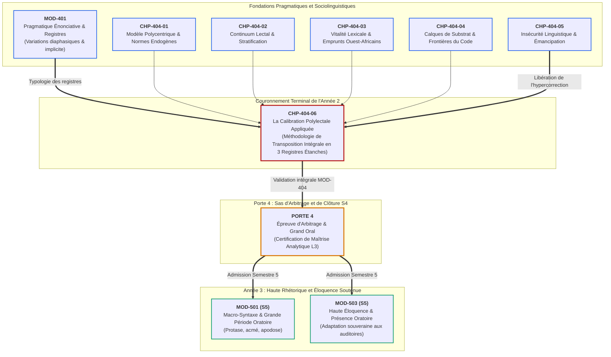

# Chapitre 6 — La Calibration Polylectale Appliquée : Méthodologie de Transposition Intégrale entre Familier Local, Standard Administratif et Diplomatique d'Apparat

> **Identifiant du chapitre** : `CHP-404-06`  
> **Module de rattachement** : [`MOD-404` — Sociolinguistique Francophone : Dynamiques Ouest-Africaines et Norme Internationale](file:///f:/Formation/world-class-french/03-curriculum/year-2/semester-4/mod-404-sociolinguistique-francophone-ouest-africaine-norme.md)  
> **Semestre** : Année 2 — Semestre 4 (S4)  
> **Volume horaire canonique** : 5 à 6 heures d'apprentissage autonome délibéré et d'ateliers d'application (Phase 1 Étude : 1 h 30 | Phase 2 Pratique : 1 h 30 | Phase 3 Correction : 1 h 00 | Phase 4 Évaluation : 1 h 00)  
> **Statut** : [STATUT : VALIDÉ]  
> **Compétences associées** : [`FR-SOCIOL-001`](file:///f:/Formation/world-class-french/02-competency-framework/competency-framework.md#fr-sociol-001-conscience-sociolinguistique-et-navigation-entre-registres) (L3 Autonomie), [`FR-LEXIC-001`](file:///f:/Formation/world-class-french/02-competency-framework/competency-framework.md#fr-lexic-001-précision-sémantique-nuances-synonymiques-et-collocations) (L3 Autonomie), [`FR-INT-004`](file:///f:/Formation/world-class-french/02-competency-framework/competency-framework.md#fr-int-004-adapter-instantanément-son-registre-de-langue-au-contexte) (L3 Autonomie)  
> **Sources scientifiques de référence** : `SRC-SOCIO-01` (Queffélec et al., 1997/2002), `SRC-SOCIO-02` (Calvet, 2017), `SRC-GRAM-02` (Riegel, Pellat & Rioul, 2016/2021), `SRC-NORM-01` (CECRL, Conseil de l'Europe, 2001/2020), `SRC-NORM-03` (Ministère de l'Éducation nationale, 2020), `SRC-TYPO-01` (Imprimerie nationale, 2002/2014)

---

## 1. Titre et Place dans le Cursus

### 1.1 Intitulé Officiel
**Chapitre 6 : La Calibration Polylectale Appliquée : Méthodologie de Transposition Intégrale entre Familier Local, Standard Administratif et Diplomatique d'Apparat** (`CHP-404-06`).

### 1.2 Insertion Architecturale dans le Cursus
Le chapitre `CHP-404-06` constitue le couronnement terminal du module `MOD-404` et clôt définitivement le **Cycle 4 (Semestre 4)** ainsi que l'ensemble des deux premières années fondamentales du cursus **World-Class French**.

Jusqu'à ce stade, l'apprenant a exploré la déconstruction théorique du centralisme jacobin ([`CHP-404-01`](file:///f:/Formation/world-class-french/03-curriculum/year-2/semester-4/mod-404/chp-404-01-theorie-sociolinguistique-francophonie-modele-polycentrique.md)), la cartographie du continuum lectal basilecte-mésolecte-acrolecte ([`CHP-404-02`](file:///f:/Formation/world-class-french/03-curriculum/year-2/semester-4/mod-404/chp-404-02-typologie-variations-continuum-lectal.md)), la vitalité lexicale et les emprunts endogènes ouest-africains ([`CHP-404-03`](file:///f:/Formation/world-class-french/03-curriculum/year-2/semester-4/mod-404/chp-404-03-francais-afrique-ouest-benin-contacts-vitalite-lexicale.md)), l'analyse radiographique des calques de substrat ([`CHP-404-04`](file:///f:/Formation/world-class-french/03-curriculum/year-2/semester-4/mod-404-sociolinguistique-francophone-ouest-africaine-norme.md#6-plan-détaillé-des-chapitres)), et la thérapeutique d'émancipation face à l'insécurité linguistique et à l'hypercorrection ([`CHP-404-05`](file:///f:/Formation/world-class-french/03-curriculum/year-2/semester-4/mod-404-sociolinguistique-francophone-ouest-africaine-norme.md#6-plan-détaillé-des-chapitres)).

Le présent chapitre transmute ces acquis sociolinguistiques en une **technologie stylistique opérationnelle**. Il formalise le protocole d'arbitrage qui permet au haut cadre, à l'administrateur civil, au juriste et au diplomate de transposer un même noyau sémantique brut à travers trois canaux d'expression rigoureusement étanches :
1. Le **Registre A** : Familier local ouest-africain (vitalité expressive, oralité théâtralisée, connivence communautaire) ;
2. Le **Registre B** : Standard officiel administratif (clarté dénotative froide, neutralité institutionnelle, dépersonnalisation républicaine) ;
3. Le **Registre C** : Diplomatique et académique d'apparat international (haute courtoisie, litotes protectrices, syntaxe périodique harmonieuse).

Cette maîtrise de la commutation de code (*code-switching*) conscient et parfaitement étanche constitue le verrou préalable exigé pour franchir la **Porte 4** (Certification de fin de Cycle 4) et aborder les modules d'éloquence souveraine du Semestre 5 ([`MOD-501` Macro-syntaxe et Période Oratoire](file:///f:/Formation/world-class-french/03-curriculum/year-3/semester-5/mod-501-macro-syntaxe-periode-oratoire-cadences.md) et [`MOD-503` Haute Éloquence et Présence Oratoire](file:///f:/Formation/world-class-french/03-curriculum/year-3/semester-5/mod-503-haute-eloquence-declamation-presence-oratoire.md)).



### 1.3 Justification du Calibrage Horaire
Conformément aux normes canoniques du cursus (5 à 6 heures d'apprentissage autonome délibéré hebdomadaire), ce chapitre est calibré pour une appropriation intégrale sans décrochage cognitif :
- **Phase 1 — Étude conceptuelle & déconstruction méthodologique (Rubriques 1 à 13)** : 1 h 30 min.
- **Phase 2 — Pratique délibérée & transpositions guidées (Exercices Niveaux 1 à 3)** : 1 h 30 min.
- **Phase 3 — Correction critique & production réelle certifiée (Rubriques 15 et 16)** : 1 h 00 min.
- **Phase 4 — Ancrage mnésique & évaluation sommative pénalisée (Rubriques 17 à 20)** : 1 h 00 min.

---

## 2. Objectifs Mesurables

Au terme de l'étude autonome et des ateliers pratiques de ce chapitre, l'apprenant démontre les capacités opérationnelles suivantes :

1. **Identifier et cartographier les marqueurs lectaux et points de bascule stylistique** dans un énoncé oral ou écrit pluricentrique en dégageant son armature dénotative brute de ses oripeaux de registre ([`FR-SOCIOL-001`](file:///f:/Formation/world-class-french/02-competency-framework/competency-framework.md#fr-sociol-001-conscience-sociolinguistique-et-navigation-entre-registres), Palier L3 Autonomie).
2. **Transposer avec une étanchéité absolue un message du familier local ouest-africain vers le standard administratif officiel** sans laisser subsister le moindre calque de substrat, rupture de rection ou tournure relâchée, tout en préservant 100 % de l'information factuelle ([`FR-SOCIOL-001`](file:///f:/Formation/world-class-french/02-competency-framework/competency-framework.md#fr-sociol-001-conscience-sociolinguistique-et-navigation-entre-registres), [`FR-INT-004`](file:///f:/Formation/world-class-french/02-competency-framework/competency-framework.md#fr-int-004-adapter-instantanément-son-registre-de-langue-au-contexte), Palier L3 Autonomie).
3. **Élever un énoncé conflictuel brut au registre diplomatique d'apparat international** en déployant avec maîtrise litotes, passivations, nominalisations protectrices et formules de courtoisie feutrée, transformant une menace frontale en un objet de négociation technique sans condescendance ni emphase creuse ([`FR-LEXIC-001`](file:///f:/Formation/world-class-french/02-competency-framework/competency-framework.md#fr-lexic-001-précision-sémantique-nuances-synonymiques-et-collocations), [`FR-INT-004`](file:///f:/Formation/world-class-french/02-competency-framework/competency-framework.md#fr-int-004-adapter-instantanément-son-registre-de-langue-au-contexte), Palier L3 Autonomie).
4. **Produire des transpositions calibrées mot à mot selon les normes typographiques de l'Imprimerie nationale** (`SRC-TYPO-01`), en garantissant l'exactitude arithmétique rigoureuse des textes sous contrainte métrique (50 mots exacts en exercice avancé, 60 mots exacts en production réelle) sans altérer la densité sémantique ([`FR-INT-004`](file:///f:/Formation/world-class-french/02-competency-framework/competency-framework.md#fr-int-004-adapter-instantanément-son-registre-de-langue-au-contexte), Palier L3 Autonomie).

---

## 3. Prérequis et Test de Préparation

### 3.1 Prérequis Cognitifs Minimaux
- **Théorie du continuum lectal (`CHP-404-02`)** : Distinction entre basilecte, mésolecte et acrolecte en milieu plurilingue francophone.
- **Morphosyntaxe des calques de substrat (`CHP-404-04`)** : Repérage des calques consécutifs (*faire que*), des distorsions aspectuo-temporelles (*durer pour*) et des anomalies de rection prépositionnelle (*demander après*).
- **Pragmatique énonciative et registres de langue (`MOD-401`)** : Notions de distance énonciative, de présupposition et d'actes de parole.

### 3.2 Test de Préparation (Auto-Diagnostic à 5 Questions)
Répondez aux questions suivantes avant de dérouler le corrigé :

1. **Question 1 (Continuum lectal)** : Quelle différence structurelle fondamentale sépare une variété mésolectale d'une variété acrolectale dans la rédaction d'un rapport officiel ?
2. **Question 2 (Calques de rection)** : Pourquoi la formule *« Le directeur a demandé après le dossier »* est-elle rejetée par la norme internationale standard, et quelle en est la genèse sociolinguistique ?
3. **Question 3 (Stylistique de l'atténuation)** : Quel rôle joue la litote dans le discours diplomatique lorsqu'il s'agit d'évoquer une infraction commise par un État tiers ?
4. **Question 4 (Grammaire et impersonnalité)** : Pourquoi la voix passive et la tournure impersonnelle sont-elles systématiquement privilégiées dans le registre administratif neutre ?
5. **Question 5 (Typographie et décompte)** : Selon les règles de l'Imprimerie nationale (`SRC-TYPO-01`), combien de mots typographiques distincts compte la séquence *« l'ambassadeur d'Italie »* ?

---

<details>
<summary><strong>Corrigé détaillé et barème de l'auto-diagnostic (cliquer pour dérouler)</strong></summary>

1. **Réponse 1** : Le mésolecte accueille des calques syntaxiques régionaux, des expressions imagées spontanées et des simplifications de rection issues du contact avec les langues maternelles, tandis que l'acrolecte se conforme strictement à la morphosyntaxe standard internationale partagée, garantissant une clarté univoque dans l'espace multilatéral.
2. **Réponse 2** : En français standard, le verbe *demander* est transitif direct lorsqu'il s'agit d'un objet (*demander le dossier*) ou transitif indirect avec *des nouvelles de* (*demander des nouvelles de quelqu'un*). La préposition *après* résulte d'un calque de substrat des langues kwa et mandé où les verbes de recherche s'adjoignent un marqueur postpositionnel de poursuite.
3. **Réponse 3** : La litote permet de dire moins pour signifier plus, sans infliger d'affront direct à la face de l'interlocuteur. En qualifiant une violation manifeste d'« écart procédural méritant éclaircissement », elle préserve l'espace de négociation tout en signifiant fermement l'irrégularité.
4. **Réponse 4** : Elles permettent la dépersonnalisation républicaine de l'énoncé. L'administration n'exprime pas d'humeurs individuelles : en écrivant *« Il a été constaté une rupture d'approvisionnement »* plutôt que *« Nous avons vu que les fournisseurs ont fui »*, le scripteur substitue le constat objectif de la puissance publique à l'émotivité d'un individu.
5. **Réponse 5** : Elle compte exactement **4 mots typographiques** : *l'* (1) + *ambassadeur* (2) + *d'* (3) + *Italie* (4). En typographie française, chaque lettre ou groupe de lettres séparé par une apostrophe constitue un mot autonome dans le décompte officiel des concours et des chancelleries [Réf. `SRC-TYPO-01`].

*Barème d'auto-évaluation* : 5/5 requis pour aborder le chapitre avec confort ; si score $\le 3/5$, réviser d'urgence `CHP-404-02` et `CHP-404-04`.
</details>

---

## 4. Situation de Départ ou Problème Concret

### Le Drame de l'Étanchéité Défaillante
Dans l'exercice des hautes fonctions administratives, diplomatiques ou juridiques en Afrique francophone, l'échec stylistique ne provient presque jamais d'un manque d'intelligence ou de culture. Il provient d'un **défaut d'étanchéité des registres**.

Considérons deux catastrophes professionnelles authentiques observées dans la pratique :

#### Cas A : La contamination mésolectale d'un acte juridique international
Un jeune conseiller d'ambassade, brillant juriste formé à l'université d'Abomey-Calavi, est chargé de rédiger le projet de mémorandum d'entente bilatéral régulant le transit frontalier de marchandises entre son pays et un État limitrophe. Sous la pression de l'urgence, il rédige :
> *« La fermeture inopinée du corridor douanier par la partie adverse a fait que les transporteurs ont trop duré pour acheminer les cargaisons de vivres, laissant pour les petits commerçants de subir des pertes financières incalculables. »*

La réaction de la délégation partenaire est immédiate : la note est jugée « confuse, agressive et techniquement approximative ». L'emploi de la formule consécutive de substrat *« a fait que »*, du calque temporel *« ont trop duré pour acheminer »*, de la périphrase *« laissant pour les petits commerçants de »* et du jugement moralisant *« incalculables »* disqualifie l'autorité juridique du document. Le litige s'envenime.

#### Cas B : La morgue technocratique en milieu communautaire
À l'inverse, un haut fonctionnaire du ministère du Cadre de vie se rend dans un village maraîcher du Mono pour désamorcer une révolte paysanne causée par l'expropriation de terres maraîchères destinées à une zone industrielle. S'adressant aux chefs de famille rassemblés sous l'arbre à palabres, il déclare d'une voix métallique :
> *« Conformément aux dispositions impératives de la loi portant régime foncier et domanial, les arrêtés déclaratifs d'utilité publique emportent purge de tous droits réels coutumiers. Il échet dès lors aux occupants sans titre de déguerpir séance tenante sous peine de sanctions coercitives. »*

Les paysans se sentent insultés par ce jargon abstrait et froid. Ils perçoivent ces vocables latins et ces termes de procédure comme une violence de classe. L'assemblée se disperse dans le tumulte ; deux tracteurs sont incendiés la nuit suivante.

Dans les deux cas, le locuteur a échoué non par ignorance des faits, mais par **incompétence de calibration polylectale**. L'excellence linguistique consiste à savoir ajuster instantanément et intégralement son système d'encodage selon le destinataire, sans jamais laisser un résidu d'un registre contaminer un autre.

---

## 5. Explication Intuitive

### L'Analogie du Pupitre de Traduction à Trois Canaux Indépendants

Imaginons une console de régie audio installée dans un hémicycle international. Devant le pupitre de commande, un même événement réel — par exemple un conteneur d'huile végétale retenu au poste douanier de Malanville — peut être diffusé sur trois canaux hertziens strictement étanches :

```
[ ÉVÉNEMENT BRUT : Blocage d'un camion d'huile à la frontière ]
                     │
         ┌───────────┼───────────┐
         ▼           ▼           ▼
    [ CANAL A ]  [ CANAL B ]  [ CANAL C ]
   Voix de la    Standard     Diplomatique
      rue       administratif   d'apparat
   (Chaleur,    (Clarté froide, (Courtoisie
  proximité,     neutralité     feutrée, litote
  connivence)   dénotative)     protectrice)
```

- **Le Canal A (Familier local expressif)** diffuse avec les tripes, les tropes et la saveur du terroir : l'orateur utilise la langue du marché, les métaphores somatiques (*« nos cœurs sont chauds »*), les emprunts aux langues véhiculaires (*« les douaniers nous font des tracas »*) et la topicalisation vivante (*« le camion-là, il est calé »*). La communication crée une connivence immédiate.
- **Le Canal B (Standard administratif officiel)** coupe immédiatement le microphone de l'émotion. Il diffuse en modulation dénotative pure : suppression des pronoms de première personne, recours systématique au passif et aux compléments circonstanciels juridiques, exactitude des désignations institutionnelles (*« Le véhicule immatriculé X est immobilisé au poste de contrôle frontalier en raison d'un défaut de quitus douanier »*).
- **Le Canal C (Diplomatique international d'apparat)** active les filtres acoustiques de la plus haute civilité d'État. Les aspérités conflictuelles sont polies par des litotes et des tournures d'estime protocolaire : *« La mission diplomatique a l'honneur d'appeler la bienveillante attention de la commission conjointe sur les délais d'acheminement des cargaisons marchandes »*.

**La règle cardinale de l'ingénieur du son linguistique est l'étanchéité absolue** : aucun grésillement, aucune friture, aucune harmonique du Canal A ne doit s'infiltrer sur le Canal C. Si un seul calque familier franchit la barrière du Canal C, l'ensemble du signal diplomatique est brouillé. De même, si le Canal C est branché sur le Canal A, l'auditeur se sent méprisé par une voix artificielle.

---

## 6. Définitions Précises et Terminologie

Pour manipuler cette méthodologie avec une rigueur chirurgicale, fixons formellement les concepts opératoires :

- **Calibration polylectale** : Aptitude sociolinguistique et stylistique d'un locuteur à réencoder intégralement un noyau propositionnel donné dans le registre exact requis par la situation d'énonciation, sans déperdition sémantique ni pollution d'un registre par un autre [Réf. `SRC-SOCIO-01`, p. 22-24 ; `SRC-SOCIO-02`, chap. 1].
- **Étanchéité de registre** : Propriété d'un texte ou d'un discours qui n'admet aucun morphème, aucune structure syntaxique, aucune figure et aucun terme lexical appartenant à un niveau de langue incompatible avec le contrat d'énonciation souscrit.
- **Point de bascule stylistique** : Unité lexicale, tournure syntaxique ou trope qui, dans un énoncé source, concentre la marque lectale (régionalisme, calque, familiarité, affectation) et exige une substitution raisonnée lors du changement de registre.
- **Matrice tripartite** : Modèle d'organisation méthodologique alignant face à face, pour un même événement, les trois solutions d'expression canoniques (Registre A Familier local / Registre B Standard administratif / Registre C Diplomatique d'apparat).
- **Registre familier local oral/théâtralisé (Registre A)** : Modalité d'expression vivante, caractérisée par l'emploi d'emprunts aux langues de substrat (fon, yoruba, baatonu), de réduplications expressives, de topicalisations déictiques et d'hyperboles affectives. À l'écrit, il correspond à la retranscription fidèle des dépositions citoyennes ou aux chroniques satiriques.
- **Registre standard officiel administratif (Registre B)** : Modalité d'expression institutionnelle dépersonnalisée, univoque et conforme au code grammatical international, fondée sur la précision juridique, la clarté dénotative, l'absence de tropes subjectifs et la subordination logique rigoureuse [Réf. `SRC-GRAM-02`, chap. 1].
- **Registre diplomatique d'apparat (Registre C)** : Modalité d'expression solennelle internationale caractérisée par l'euphémisme, la litote, l'architecture périodique ample, les formules d'estime protocolaire et le découplage systématique de la revendication de fond d'avec l'agressivité de forme.
- **Modulation pragmatique** : Opération stylistique consistant à faire varier la force illocutoire d'un acte de parole (ordre, reproche, alerte) par des modalisateurs (conditionnel, passif, interrogative indirecte) afin de préserver la face positive et négative des interlocuteurs [Réf. `SRC-NORM-01`, chap. 4].
- **Équivalence sémantique stricte** : Principe selon lequel la transposition d'un registre à un autre ne doit altérer ni retrancher aucun des éléments factuels constitutifs du message brut (qui, quoi, où, quand, pourquoi, avec quelle conséquence).

---

## 7. Règles ou Mécanismes Fondamentaux

### 7.1 La Théorie de la Compétence Polylectale en Milieu Francophone Pluricentrique

La linguistique contemporaine a réfuté le modèle répressif classique qui assimilait l'éducation francophone à l'éradication violente des parlers régionaux [Réf. `SRC-SOCIO-02`, chap. 2].

1. **Le cantonnement fonctionnel plutôt que le bannissement** :  
   Les variétés mésolectales et les tournures endogènes ouest-africaines ne sont ni des tares ni des maladies linguistiques. Elles représentent le patrimoine vivant d'une communauté de locuteurs qui s'est approprié le français pour dire son quotidien, ses joies, ses deuils et ses marchés. Le rôle du styliste d'élite n'est pas d'avoir honte du parler local, mais de savoir **le cantonner rigoureusement à sa sphère de pertinence** : la conversation intime, la chronique culturelle, le théâtre populaire, le dialogue communautaire.
2. **La souveraineté linguistique par la commutation de code (*code-switching*)** :  
   Le locuteur aliéné est celui qui ne possède qu'un seul registre : soit le francophone populaire enfermé dans son mésolecte et incapable de rédiger une requête administrative sans solécisme ; soit le scripteur pédant incapable de commander un plat au marché sans paraître ridicule. Le locuteur souverain est polylectal : il maîtrise toute la gamme de l'orgue stylistique et passe d'un clavier à l'autre avec une aisance instantanée.

### 7.2 La Matrice des Trois Registres Étanches

Le tableau ci-dessous explicite les composantes morphosyntaxiques et stylistiques qui caractérisent chaque canal :

| Axe Stylistique | Registre A : Familier Local Ouest-Africain | Registre B : Standard Officiel Administratif | Registre C : Diplomatique d'Apparat International |
| :--- | :--- | :--- | :--- |
| **Objectif de communication** | Partager l'émotion, créer la connivence, mobiliser la communauté. | Consigner un fait vérifiable, ordonner, rendre compte avec neutralité. | Négocier, préserver l'équilibre géopolitique, atténuer le conflit sans céder sur le fond. |
| **Énonciation & Sujet** | Forte présence du *je* et du *nous* affectif, interjections d'ancrage (*eh bien*, *là*). | Dépersonnalisation complète (*il y a lieu de*, tournures passives et impersonnelles). | Pluriel de chancellerie (*Notre gouvernement*), références protocolaires à la troisième personne (*Le ministère a l'honneur de*). |
| **Morphosyntaxe verbale** | Présent de narration, calques aspectuels (*commencer par* + inf.), périphrases causales orales (*a fait que*). | Passé composé et imparfait standard, indicatif dominant, gérondif circonstanciel précis. | Subjonctif de modalité, conditionnel de réserve protocolaire, tournures passives dégageant la responsabilité directe. |
| **Lexique & Sémantique** | Emprunts vivants (fon, yoruba), métaphores somatiques (*coeur serré*), termes du terroir. | Vocabulaire juridique, économique et technique univoque, termes propres du dictionnaire. | Vocabulaire abstrait soutenu, litotes diplomatiques (*préoccupation*, *incident de parcours*), formules consacrées. |
| **Architecture de la phrase** | Phrases courtes segmentées, topicalisation fréquente (*Le directeur-là, il a dit*), parataxe. | Subordination logique équilibrée (cause, conséquence, concession), nominalisations denses. | Grande période oratoire équilibrée, propositions incises harmonieuses, cadences majeures. |

### 7.3 La Méthode en 4 Étapes de la Réécriture Polylectale

Pour transposer un texte sans faille, le scripteur applique le protocole décomposé suivant :

```
[ ÉNONCÉ SOURCE ]
       │
       ▼
[ ÉTAPE 1 : EXTRACTION DE L'ARMATURE SÉMANTIQUE BRUTE ]
(Dépouiller le texte de toute charge affective, métaphorique ou familière ; lister les faits purs.)
       │
       ▼
[ ÉTAPE 2 : IDENTIFICATION DES POINTS DE BASCULE ]
(Repérer les calques de substrat, les tropes régionaux, les anomalies de rection et les adresses orales.)
       │
       ▼
[ ÉTAPE 3 : SÉLECTION DU LEXIQUE INSTITUTIONNEL OU DIPLOMATIQUE ]
(Trouver les équivalents dénotatifs stricts ou les litotes consacrées pour chaque point de bascule.)
       │
       ▼
[ ÉTAPE 4 : POLISSAGE DE L'ARCHITECTURE PHRASTIQUE & TEST D'ÉTANCHÉITÉ ]
(Construire la syntaxe périodique ou administrative ; vérifier l'absence totale de scorie résiduelle.)
```

1. **Étape 1 — Extraction de l'armature sémantique brute** :  
   Isoler les propositions dénotatives pures : Qui agit ? Quelle est l'action ? Quel est le préjudice ? Quelle est la revendication ? Quels sont les délais ?
2. **Étape 2 — Identification microscopique des points de bascule** :  
   Souligner chaque segment linguistique porteur d'une marque de registre (ex. *« la frontière-là »* = marqueur déictique oral ; *« la vie est devenue très serrée »* = métaphore somatique de la détresse financière ; *« nous fatiguent avec les tracasseries »* = plainte affective).
3. **Étape 3 — Sélection du lexique institutionnel ou diplomatique adéquat** :  
   Substituer aux termes affectifs des concepts opératoires standardisés (ex. *tracasseries* $\to$ *contrôles discrétionnaires non réglementaires* en Reg. B $\to$ *lenteurs procédurales exceptionnelles* en Reg. C).
4. **Étape 4 — Polissage syntaxique et contrôle d'étanchéité absolue** :  
   Reconstruire la charpente de la phrase selon les canons du registre cible, puis relire avec un filtre impitoyable : le moindre calque (*faire que*, *durer pour*, *demander après*) entraîne le rejet immédiat du texte.

---

### 7.4 Résolution et Modélisation Intégrale du Volet B de la Fiche de Cadrage MOD-404

Mettons immédiatement en œuvre ce protocole sur le texte canonique prescrit par la fiche de cadrage du module [`MOD-404` (Volet B)](file:///f:/Formation/world-class-french/03-curriculum/year-2/semester-4/mod-404-sociolinguistique-francophone-ouest-africaine-norme.md#volet-b-transposition-polylectale-intégrale-en-trois-registres-étanches) :

#### Texte Source (Témoignage oral d'un commerçant transfrontalier à Sèmè-Kraké, 145 mots) :
> *« Depuis qu'ils ont fermé la frontière-là, la vie est devenue très serrée pour nous les commerçants. On a nos marchandises de maïs et de ciment qui sont bloquées là-bas à Sèmè-Kraké, et les douaniers nous fatiguent trop avec les tracasseries. Le syndicat a cherché à voir le directeur de la douane, mais il a fait que les gens ont attendu toute la journée pour rien au bureau. Ça fait qu'actuellement, les sacs de maïs ont commencé par pourrir et nos sous sont gaspillés dedans. C'est pas comme si on refusait de payer le dédouanement normal, mais laisser pour nous comme ça sans solution, c'est comme s'ils veulent qu'on aille voler ! Si les autorités ne débloquent pas la situation rapidement, les jeunes transporteurs ont dit qu'ils vont barrer la voie internationale demain matin. »*

---

#### 1. Réécriture en Registre A : Familier Local Ouest-Africain Écrit (Transcription théâtralisée)
*Note d'intention stylistique* : Conserver toute la saveur de l'oralité, la vivacité des interjections, la topicalisation parataxique et les emprunts sans introduire de fautes d'accord grossières qui relèveraient du charabia.

> *« Ah vraiment, depuis que la frontière-là est cadenassée comme ça, nous autres commerçants, on respire par le nez ! Toutes nos remorques de maïs et de ciment dorment sous le soleil à Sèmè-Kraké, et les agents de la douane nous versent seulement des tracasseries sur la tête. Le bureau syndical est allé frapper à la porte du grand patron des douanes, mais walaye, il les a fait poireauter du matin jusqu'au crépuscule pour des miettes ! Résultat des courses : le maïs a commencé par chauffer et pourrir dans les sacs, et tous nos millions sont en train de partir dans l'eau cadeau. Pourtant, personne n'a dit qu'il refuse de verser les droits normaux au guichet. Mais nous abandonner comme ça au bord du goudron, c'est nous pousser carrément à chercher l'argent là où il ne faut pas ! Si en haut là-bas ils ne décrochent pas la situation d'ici ce soir, les petits transporteurs ont déjà juré : demain matin dès l'aube, la voie internationale sera totalement barrée avec des pneus ! »*

---

#### 2. Réécriture en Registre B : Standard Officiel Administratif (Rapport de mission préfectoral)
*Note d'intention stylistique* : Clarté dénotative, dépersonnalisation républicaine, précision juridique des termes institutionnels, éradication intégrale de tout calque ou trope oral.

> *« Le rétablissement inopiné des restrictions de passage au poste frontalier de Sèmè-Kraké engendre d'importantes perturbations socio-économiques pour les acteurs de la filière marchande. D'importantes cargaisons de denrées vivrières et de matériaux de construction demeurent actuellement immobilisées en zone tampon, soumises à des inspections douanières répétées que les usagers qualifient de discrétionnaires et non réglementaires. Une démarche de conciliation sollicitée par le collectif des transporteurs auprès de la direction départementale des douanes n'a pu aboutir, faute de disponibilité de l'autorité de tutelle. Il en résulte un pourrissement accéléré des stocks de céréales, occasionnant des préjudices financiers majeurs pour les négociants qui affirment leur disponibilité à s'acquitter des droits tarifaires légitimes. Face à l'absence de dispositif de régularisation temporaire, les organisations de conducteurs annoncent le blocage imminent du corridor interétatique à compter de demain matin à défaut d'instructions urgentes de décongestion. »*

---

#### 3. Réécriture en Registre C : Diplomatique et Académique Soutenu International (Note verbale ministérielle)
*Note d'intention stylistique* : Haute courtoisie protocolaire, litotes protectrices, neutralisation de l'agressivité par la périphrase, préservation de la dignité souveraine des deux États partenaires.

> *« Le ministère des Affaires étrangères et de la Coopération de la République du Bénin présente ses compliments à la commission bilatérale conjointe de surveillance frontalière et a l'honneur d'appeler sa haute et bienveillante attention sur les aléas opérationnels constatés récemment au poste de Sèmè-Kraké. Le ralentissement sensible des procédures de dédouanement affecte l'acheminement des produits de première nécessité et expose les opérateurs économiques à des dépréciations marchandes préoccupantes. Notre département ministériel, tout en réaffirmant le strict attachement des usagers aux obligations fiscales en vigueur, formule le vœu que des instructions concertées permettent d'optimiser le dialogue technique entre les services douaniers et les représentants du transit marchand. La mise en place diligente d'un sas d'apaisement apparaît hautement souhaitable afin de prévenir tout désagrément logistique sur cet axe névralgique et de consolider la fluidité séculaire des échanges unissant nos deux nations souveraines. »*

---

#### 4. Tableau Analytique des Transpositions (Les 10 Points de Bascule)

| N° | Forme Source (Témoignage brut) | Transposition Registre B (Standard Administratif) | Transposition Registre C (Diplomatique International) | Justification Linguistique & Pragmatique |
| :---: | :--- | :--- | :--- | :--- |
| **1** | *Depuis qu'ils ont fermé la frontière-là* | *Le rétablissement inopiné des restrictions de passage au poste frontalier* | *Les aléas opérationnels constatés récemment au poste de Sèmè-Kraké* | Effacement du pronom indéfini *ils* et de la particule déictique postposée *-là* (topicalisation orale kwa). Remplacement par une nominalisation institutionnelle en B, et par un euphémisme technique protecteur en C. |
| **2** | *La vie est devenue très serrée* | *Engendre d'importantes perturbations socio-économiques* | *Affecte l'acheminement [...] et expose les opérateurs à des dépréciations marchandes* | Substitution du trope somatique populaire (*vie serrée* calqué sur l'oppression respiratoire de la disette) par une qualification macro-économique standard en B, puis par un constat feutré en C. |
| **3** | *Les douaniers nous fatiguent trop* | *Soumises à des inspections douanières répétées* | *Le ralentissement sensible des procédures de dédouanement* | Remplacement du verbe polyvalent d'accablement physique et moral (*fatiguer*) par la description fonctionnelle du contrôle en B, et par une litote dépersonnalisée effaçant toute attaque contre les agents en C. |
| **4** | *Tracasseries* | *Inspections discrétionnaires et non réglementaires* | *Délais procéduraux méritant concertation* | Le terme *tracasseries*, marqueur mésolectal ouest-africain dénonçant l'extorsion informelle, est traduit en terme de droit administratif en B, et fondu dans une formule d'estime en C. |
| **5** | *A fait que les gens ont attendu toute la journée pour rien* | *N'a pu aboutir, faute de disponibilité de l'autorité de tutelle* | *N'a pas permis l'établissement d'échanges préalables pourtant souhaitables* | Éradication du calque consécutif de substrat (*a fait que*) et de l'hyperbole orale (*pour rien*). Construction d'une proposition participiale négative élégante. |
| **6** | *Ont commencé par pourrir* | *Un pourrissement accéléré des stocks de céréales* | *Une dégradation biologique des denrées périssables* | Correction chirurgicale du calque inchoatif de rection (*commencer par* + inf. au sens de *commencer à*). Remplacement par une nominalisation substantivale dense. |
| **7** | *Nos sous sont gaspillés dedans* | *Occasionnant des préjudices financiers majeurs* | *Expose les opérateurs économiques à des dépréciations préoccupantes* | Élimination du substantif familier *sous* et de l'adverbe pléonastique *dedans*. Remplacement par le lexique comptable en B et par l'adjectif diplomatique modalisateur (*préoccupantes*) en C. |
| **8** | *Laisser pour nous comme ça sans solution* | *L'absence de dispositif de régularisation temporaire* | *L'opportunité d'optimiser le dialogue technique* | Éradication du tour de décharge actancielle et de possession possessive (*laisser pour quelqu'un*). Formulation d'une recommandation prospective positive en C. |
| **9** | *C'est comme s'ils veulent qu'on aille voler !* | *Pousser les acteurs vers des voies de fait ou l'illégalité* | *Compromettre le climat de confiance nécessaire à la conformité économique* | Conversion d'une hyperbole affective révoltée en une analyse des risques d'insécurité civile en B, et en un appel à la stabilité institutionnelle en C. |
| **10** | *Les jeunes transporteurs ont dit qu'ils vont barrer la voie* | *Les organisations de conducteurs annoncent le blocage imminent du corridor* | *Prévenir tout désagrément logistique sur cet axe névralgique* | Transformation d'une menace insurrectionnelle brute en un avertissement préfectoral d'ordre public en B, et en un rappel courtois de prévention des crises en C. |

---

## 8. Raisonnement Détaillé (Le Pourquoi)

### Pourquoi la Diplomatie Repose-t-elle sur l'Atténuation et la Litote ?

Une erreur naïve consiste à croire que le registre diplomatique soutenu n'est qu'une hypocrisie bourgeoise ou un ensemble d'arabesques inutiles destinées à masquer le réel. En vérité, **la litote diplomatique est l'instrument technique le plus puissant jamais inventé pour prévenir l'escalade de la violence physique** [Réf. `SRC-SOCIO-02`, chap. 4].

Lorsqu'un ambassadeur déclare à un ministre étranger :  
*« Votre gouvernement ment et vole nos marchandises à la frontière »*,  
il profère un acte de parole menaçant maximal (*Face Threatening Act* selon Brown et Levinson). La partie adverse ne peut répondre que par le déni rageur, la rupture des relations ou la mobilisation de troupes, sous peine d'humiliation publique.

À l'inverse, lorsque la note diplomatique énonce :  
*« Notre délégation observe avec une légitime préoccupation des discordances substantielles entre les accords tarifaires ratifiés et les pratiques d'imposition récemment relevées sur le corridor »*,  
le fait dénoncé est rigoureusement identique, mais sa géométrie pragmatique est inversée :
1. **La dépersonnalisation de l'offense** : On n'accuse pas les hommes mais on constate des *discordances de procédure*. L'interlocuteur peut rectifier l'erreur sans perdre la face, en rejetant la faute sur des agents subalternes ou un malentendu technique.
2. **L'ouverture d'un sas de négociation** : L'adjectif *préoccupant* ou l'adverbe *sensiblement* agissent comme des amortisseurs sémiotiques. Ils signalent la gravité de l'enjeu tout en laissant à l'autre partie le temps et l'espace nécessaires pour apporter une réponse honorable.
3. **La supériorité de l'acrolecte souverain** : L'emploi d'une syntaxe classique parfaite et d'un lexique mesuré démontre la maîtrise de soi de l'État émetteur. Celui qui crie à la tribune avoue son impuissance ; celui qui formule une litote glacée et irréfutable fait la preuve de sa force tranquille.

---

## 9. Exemples Corrects Commentés

### Décorticage Pas à Pas d'un Incident Frontalier Conflictuel

Examinons un différend agraire frontalier récurrent entre riverains et patrouilles douanières :

#### 1. Énoncé Source Brut (Déposition orale recueillie auprès d'un chef de village, 68 mots) :
> *« Hier soir, les douaniers de là-bas sont rentrés chez nous avec leurs armes pour fouiller les magasins de maïs. Ils ont tapé sur mon adjoint et ils ont dit que c'est eux qui commandent ici maintenant. Ça a fait que les villageois ont voulu couper la route avec des troncs d'arbres. Si les commandants de la ville ne viennent pas chasser ces gens-là, le sang va couler cadeau demain ! »*

---

#### 2. Transposition Pas à Pas selon les Trois Registres Étanches

```
[ Énoncé source ] ────────────────────────────────────────────────────────┐
                                                                          │
1. Registre A (Familier local théâtralisé)                                │
   • Armature : Conserver l'effroi, le scandale, la violation du sol.     │
   • Marqueurs : « les douaniers d'en face », « armes au poing »,         │
     « verser la chicotte », « gâter le coin ».                           │
                                                                          ▼
2. Registre B (Standard administratif - Rapport de gendarmerie)           │
   • Armature : Localisation, heure, qualification pénale des faits.      │
   • Marqueurs : « incursion armée », « agression corporelle »,           │
     « tentative de blocage d'axe », « mesures de sécurisation requises ».│
                                                                          ▼
3. Registre C (Diplomatique international - Note verbale d'ambassade)     │
   • Armature : Souveraineté territoriale, retenue, conciliation bilatérale.
   • Marqueurs : « franchissement inopiné de la ligne de démarcation »,   │
     « altercations dommageables », « préservation de l'entente fraternelle ».
```

##### Version Registre A (Transcription expressive de concertation villageoise) :
> *« C'est du jamais vu ! Hier nuit, les agents douaniers du pays d'en face ont traversé la limite armes au poing pour venir chambarder nos greniers de maïs en plein village ! Ils ont versé la chicotte sur mon adjoint et ils criaient partout qu'ils sont les seuls chefs ici. Franchement, la jeunesse s'est levée pour barrer le goudron avec des troncs de teck. Si l'autorité préfectorale ne vient pas calmer ces gaillards-là dès ce matin, le coin va se gâter totalement ! »*

##### Version Registre B (Rapport officiel de synthèse de la brigade de gendarmerie territoriale) :
> *« Dans la soirée d'hier, un détachement armé des douanes limitrophes a opéré une incursion non coordonnée en territoire national, procédant à des perquisitions coercitives dans des entrepôts de stockage agricole. Des violences physiques ont été exercées à l'encontre du représentant coutumier local, suscitant une vive émotion parmi les riverains qui ont tenté d'ériger des barricades sur l'axe routier. Une intervention immédiate des autorités de commandement territorial s'avère indispensable afin de rétablir l'ordre public et de prévenir des affrontements communautaires. »*

##### Version Registre C (Note verbale de protestation et d'apaisement transmise à la chancellerie voisine) :
> *« L'ambassade de la République a l'honneur d'attirer la vive attention du ministère des Affaires étrangères sur un franchissement inopiné de la ligne de démarcation par des éléments de surveillance douanière survenu dans la soirée d'hier. Les vérifications conduites en dehors du cadre concerté et les altercations physiques déplorées auprès des populations riveraines appellent une régulation diligente des services compétents. Notre gouvernement, attaché à la concorde transfrontalière, sollicite la convocation urgente d'une réunion de cadrage sécuritaire afin de prévenir tout incident susceptible d'altérer la confiance mutuelle unissant nos deux États. »*

---

## 10. Contre-Exemples et Erreurs Fréquentes

L'analyse clinique des pratiques rédactionnelles met en évidence six erreurs majeures lors de la transposition entre registres :

### Erreur n° 1 : Le calque résiduel dans le texte diplomatique
- **Symptôme clinique** : Laisser subsister une tournure de substrat ou un régionalisme dans une note d'apparat au milieu d'un paragraphe par ailleurs soutenu.
- **Exemple fautif** : *« Le ministère a l'honneur de rappeler que la fermeture des postes-frontières a fait que les transporteurs ont trop duré pour présenter leurs manifestes de cargaison. »*
- **Diagnostic linguistique** : Présence flagrante du connecteur consécutif mésolectal *a fait que* et du verbe temporel déviant *ont trop duré pour*. La solennité du début de phrase est anéantie par cette scorie orale.
- **Correction chirurgicale** : *« Le ministère a l'honneur de rappeler que la clôture inopinée des postes frontaliers a retardé l'enregistrement des manifestes douaniers par les transporteurs agréés. »*

### Erreur n° 2 : La perte d'information cruciale lors de l'élévation de registre
- **Symptôme clinique** : À force d'euphémismes et de formules feutrées, vider le message de sa substance informative concrète.
- **Exemple fautif** : *« L'ambassade signale qu'il s'est passé des choses regrettables à la frontière et espère que tout ira pour le mieux entre nous. »*
- **Diagnostic linguistique** : L'énoncé ne précise ni la date, ni le lieu exact, ni la nature des événements (saisie de marchandises, violences, blocus). L'élévation de registre ne doit jamais sacrifier la rigueur factuelle.
- **Correction chirurgicale** : *« L'ambassade a l'honneur de porter à la connaissance de la commission mixte les retenues de cargaisons vivrières survenues le 14 octobre au poste de Malanville, et sollicite l'ouverture concertée d'une enquête technique conjointe. »*

### Erreur n° 3 : La bascule dans l'hypercorrection ridicule et la grandiloquence
- **Symptôme clinique** : Confondre élégance diplomatique et verbiage archaïque, boursouflé ou pompeux.
- **Exemple fautif** : *« Il appert de manière péremptoire et indubitable que les prévaricateurs susmentionnés dussent céder devant la magnificence de votre très haute et auguste clémence ministérielle. »*
- **Diagnostic linguistique** : Accumulation d'adverbes pesants, subjonctif imparfait prétentieux mal maîtrisé et formules serviles issues du XVIIIe siècle. La diplomatie moderne exige une sobriété limpide, ferme et épurée.
- **Correction chirurgicale** : *« Il apparaît clairement que les manquements constatés justifient un examen attentif et bienveillant de la part de vos services compétents. »*

### Erreur n° 4 : Le télescopage de registres dans un même paragraphe
- **Symptôme clinique** : Faire voisiner au sein d'une même phrase un terme noble et une expression argotique ou familière.
- **Exemple fautif** : *« La commission technique conjointe s'est réunie ce matin afin de diligenter une enquête approfondie sur les douaniers qui cherchent la petite bête aux chauffeurs de camion. »*
- **Diagnostic linguistique** : Rupture stylistique brutale entre *diligenter une enquête approfondie* (Registre B/C) et *chercher la petite bête* (locution familière relâchée de Registre A).
- **Correction chirurgicale** : *« La commission technique conjointe s'est réunie ce matin afin de diligenter une enquête approfondie sur la multiplication des contrôles discrétionnaires subis par les conducteurs de poids lourds. »*

### Erreur n° 5 : L'affadissement complet du registre familier le rendant incolore
- **Symptôme clinique** : Lors de la rédaction en Registre A (dialogue de fiction, chronique satirique), remplacer toute la sève des métaphores ouest-africaines par un français relâché parisien stéréotypé (*bagnole*, *flics*, *fringues*).
- **Exemple fautif** : *« Les gars sont vénères parce que les flics ont piqué leur fric à la douane. »*
- **Diagnostic linguistique** : Incohérence sociolinguistique majeure. L'ancrage ouest-africain exige l'exploitation des créations lexicales et métaphores endogènes authentiques (*manger l'argent*, *verser des tracas*, *zemidjan*), et non un argot d'importation étranger au terroir local.
- **Correction chirurgicale** : *« Les transporteurs ont les cœurs chauds parce que les agents leur ont bouffé leurs sous sans pitié au barrage. »*

### Erreur n° 6 : La condescendance méprisante et l'arrogance dans le registre standard
- **Symptôme clinique** : Dans un rapport administratif, formuler des jugements moraux infamants à l'égard des citoyens plutôt que de décrire objectivement les faits.
- **Exemple fautif** : *« Ces commerçants ignorants et indisciplinés pleurnichent au lieu d'apprendre les lois de la République qu'ils violent constamment. »*
- **Diagnostic linguistique** : Faillite éthique et administrative. Le fonctionnaire républicain n'insulte pas les administrés ; il qualifie juridiquement des infractions ou rend compte de réclamations économiques.
- **Correction chirurgicale** : *« Les opérateurs économiques manifestent leur incompréhension face à l'application rigoureuse du tarif extérieur commun, invoquant un déficit de sensibilisation préalable aux nouvelles formalités. »*

---

#### Tableau Synoptique de Traçabilité des Pathologies Rédactionnelles

| Réf. Pathologie | Nature de la Défaillance | Manifestation Typique | Règle d'Assainissement Obligatoire |
| :---: | :--- | :--- | :--- |
| **Pathologie 1** | Rupture d'étanchéité acrolectale | Infiltration de calques régionaux (*faire que*) en Registre C | Bannissement absolu des calques de substrat dans toute correspondance officielle. |
| **Pathologie 2** | Édulcoration excessive | Disparition des dates, lieux et faits précis sous l'euphémisme | Conserver l'intégralité du noyau dénotatif quel que soit le niveau d'élévation de registre. |
| **Pathologie 3** | Grandiloquence baroque | Enflure verbale, archaïsmes ridicules, flatterie obséquieuse | Préférer la sobriété classique, le terme exact et la cadence périodique maîtrisée. |
| **Pathologie 4** | Dissonance diaphasique | Collision de termes nobles et de locutions familières contiguës | Harmoniser l'ensemble des termes d'une proposition sur un diapason unique. |
| **Pathologie 5** | Déracinement sociolinguistique | Remplacement des tropes endogènes par un argot hexagonal d'importation | Valoriser la créativité stylistique et parémiologique ouest-africaine en Registre A. |
| **Pathologie 6** | Dérive injurieuse et mépris | Qualification insultante des usagers dans un acte administratif | Maintenir la neutralité axiologique et la dépersonnalisation républicaine en Registre B. |

---

## 11. Cas Particuliers et Limites

### 11.1 La Traduction du Français Ouest-Africain vers l'Anglais ou l'Espagnol en Milieu Onusien
Lors des commissions économiques des Nations unies ou de la CEDEAO, les diplomates et interprètes de conférence font face à des dépositions orales de témoins ouest-africains comportant des formules régionales typiques.
- **Le piège du littéralisme** : Traduire mot à mot *« Ils ont duré pour venir »* par *« They lasted to come »* produirait un non-sens en anglais diplomatique.
- **Le protocole d'arbitrage** : L'interprète doit immédiatement extraire le noyau sémantique brut (l'idée de retard excessif) pour produire en direct l'acrolecte anglais correspondant : *« The delegation was considerably delayed in arriving »*.
- **La gestion des concepts institutionnels endogènes** : Lorsqu'un terme désigne une réalité juridique béninoise ou ouest-africaine spécifique (ex. *la convention d'affirmation de vente*, *l'attestation de recasement*), le traducteur ne doit pas inventer d'équivalent approximatif. Il conserve le terme français en italique suivi d'une glose explicative entre crochets : *« customary land sale affirmation deed [local administrative title] »*.

### 11.2 Le Maniement des Proverbes Endogènes dans les Allocutions Officielles de Chefs d'État
Un chef d'État ou un ambassadeur peut-il légitimement insérer un proverbe en langue nationale (fon, yoruba, baatonu) au cœur d'une allocution officielle devant l'Assemblée générale des Nations unies ou un sommet bilatéral ?
- **La règle d'or** : Oui, à la condition expresse que le proverbe ne soit pas jeté comme une familiarité orale relâchée, mais introduit avec la **haute pompe du cadrage rhétorique** :
  1. *Formule d'exorde solennelle* : *« Comme l'enseigne la sagesse séculaire des rives du Golfe de Guinée... »* ;
  2. *Énonciation vernaculaire sobre* (facultative) suivie de la traduction en français soutenu : *« L'eau chaude n'oublie jamais qu'elle a d'abord été froide »* ;
  3. *Exégèse philosophique immédiate* : *« Ce précepte nous rappelle qu'aucune puissance contemporaine ne saurait s'affranchir de ses origines modestes ni mépriser le dialogue avec les nations émergentes »*.
Ce procédé transforme la référence culturelle endogène en un joyau d'universalité philosophique.

---

## 12. Approfondissement Adapté au Niveau

### La Pragmatique de la Politesse selon Brown et Levinson (1987)

Pour comprendre scientifiquement les ressorts de la calibration polylectale, il convient de mobiliser le modèle de la **préservation des faces** développé par les linguistes Penelope Brown et Stephen Levinson à partir des travaux sociologiques d'Erving Goffman.

```
                   THÉORIE DE LA PRÉSERVATION DES FACES
                                    │
          ┌─────────────────────────┴─────────────────────────┐
          ▼                                                   ▼
  [ FACE POSITIVE ]                                   [ FACE NÉGATIVE ]
  (Désir d'être approuvé,                             (Désir d'autonomie,
 valorisé, aimé, reconnu                              territoire personnel,
   par la communauté)                                liberté d'action préservée)
          │                                                   │
          └─────────────────────────┬─────────────────────────┘
                                    ▼
                     [ ACTES MENAÇANTS (FTA) ]
           • Reproche frontal, accusation directe, ordre brutal.
                                    │
                                    ▼
                 [ STRATÉGIES DE MITIGATION STYLISTIQUE ]
           1. Politesse positive (Registre A : connivence, chaleur).
           2. Neutralité institutionnelle (Registre B : règle générale).
           3. Politesse négative & Litote (Registre C : respect absolu
              du territoire de l'autre par l'atténuation modale).
```

1. **La face positive et la politesse de proximité (Registre A)** :  
   Dans la communication communautaire, préserver la face positive de l'interlocuteur exige de manifester de la connivence, de l'empathie et une identité partagée. Parler un français trop châtié ou trop distant est perçu comme une agression contre la face positive du groupe (rejet de l'appartenance collective). L'emploi d'emprunts et de tournures affectives restaure le lien fraternel.
2. **La face négative et l'armure de la litote (Registre C)** :  
   En milieu diplomatique et juridique international, c'est la face négative (le territoire souverain, l'indépendance de décision de l'État partenaire) qui est sanctuarisée. Tout impératif direct (*« Vous devez ouvrir la frontière »*) constitue un *Face Threatening Act* (FTA) destructeur. L'élévation de registre vers le Registre C fonctionne comme un **bouclier relationnel** :
   - Le recours au verbe performatif atténué : *« Notre délégation suggère avec déférence »* ;
   - La passivation sans agent : *« Des mesures correctives pourraient être utilement envisagées »* ;
   - L'emploi du conditionnel passé d'estime : *« Il eût été souhaitable qu'une concertation préalable pût se tenir »*.
Ces modulations permettent à la puissance invitée de se conformer à la demande sans donner l'impression de capituler devant un ordre étranger.

---

## 13. Comparaisons Différentielles

### 13.1 Tableau Synoptique des Trois Registres sur 10 Axes Concrets

| N° | Axe d'Observation | Registre A : Familier Local Ouest-Africain | Registre B : Standard Officiel Administratif | Registre C : Diplomatique d'Apparat International |
| :---: | :--- | :--- | :--- | :--- |
| **1** | **Diapason énonciatif** | Chaleureux, expressif, immédiat, subjectif. | Neutre, objectif, froid, dépersonnalisé. | Solennel, précautionneux, feutré, hautement courtois. |
| **2** | **Topologie du sujet** | Pronoms personnels directs (*je*, *on*, *nous les commerçants*). | Tournures impersonnelles (*il y a lieu de*), passifs institutionnels. | Pluriel de souveraineté (*Notre chancellerie*), périphrases protocolaires. |
| **3** | **Morphologie verbale** | Présent de l'indicatif, périphrases orales (*commencer par*). | Temps simples du passé (passé composé, imparfait), indicatif univoque. | Conditionnel présent et passé, subjonctif de modalité, gérondif d'estime. |
| **4** | **Traitement des calques** | Calques de substrat admis et valorisés pour leur vivacité. | Éradication chirurgicale de tout calque syntaxique ou prépositionnel. | Transmutation complète des calques en tournures périodiques soutenues. |
| **5** | **Statut des emprunts** | Emprunts spontanés intégrés (fon, yoruba, baatonu, nouchi). | Emprunts admis uniquement s'ils sont consacrés par le droit national. | Emprunts endogènes proscrits, sauf encadrement exégétique solennel. |
| **6** | **Régime des figures** | Hyperboles, métaphores somatiques, réduplications affectives. | Proscription des figures affectives ; métaphores figées admises. | Litotes systématiques, euphémismes protecteurs, hypallages mesurées. |
| **7** | **Architecture syntaxique** | Parataxe, phrases courtes hachées, topicalisations déictiques. | Subordination méthodique, nominalisations denses, chaînes logiques. | Périodes oratoires amples, membres balancés, incises d'estime. |
| **8** | **Ponctuation usuelle** | Points d'exclamation fréquents, points de suspension, tirets. | Ponctuation démarcative stricte (points, deux-points, virgules logiques). | Ponctuation stylistique raffinée (points-virgules, virgules d'incise). |
| **9** | **Gestion du conflit** | Clameur directe, dénonciation polémique, ultimatum passionné. | Constat juridique d'infraction, rappel des sanctions applicables. | Signalement feutré de discordances, invitation à l'arbitrage concerté. |
| **10** | **Champ d'élection** | Rue, assemblée villageoise, théâtre, presse satirique, roman. | Circulaire ministérielle, arrêté préfectoral, procès-verbal, rapport d'audit. | Traité bilatéral, note verbale, allocution d'État, tribune multilatérale. |

---

### 13.2 Style Direct Brut vs Litote Diplomatique

| Énoncé Brut / Familier | Litote Diplomatique d'Apparat | Analyse du Procédé de Transmutation |
| :--- | :--- | :--- |
| *« Vos militaires ont tiré sur nos citoyens sans raison. »* | *« Notre gouvernement déplore vivement l'usage disproportionné de la force armée constaté lors des récents événements frontaliers. »* | La qualification de crime brutal est transmutée en *usage disproportionné de la force*, notion de droit international ouvrant la voie à une commission d'enquête. |
| *« Vous n'avez pas respecté votre parole sur les tarifs douaniers. »* | *« Il apparaît que les mesures tarifaires unilatéralement arrêtées s'écartent sensiblement de la lettre des accords paraphés en commission conjointe. »* | Le reproche de parjure personnel est converti en un *écart constaté par rapport à la lettre des accords*. |
| *« On en a marre de vos promesses en l'air qui n'aboutissent jamais. »* | *« Notre délégation souhaite que les engagements souscrits trouvent désormais une traduction opérationnelle tangible et mesurable. »* | L'exaspération populaire est sublimée en une exigence de calendrier de réalisation technique. |
| *« Vous cherchez à détruire notre économie pour enrichir vos copains. »* | *« L'asymétrie constatée des flux marchands suscite des interrogations légitimes quant à la préservation de l'équilibre économique sous-régional. »* | L'accusation de complot mafieux devient une analyse technique des déséquilibres de balances commerciales. |
| *« Si vous ne reculez pas immédiatement, ce sera la guerre totale ! »* | *« La persistance de cette situation d'exception ne manquerait pas d'altérer gravement la concorde séculaire qui unit nos deux peuples frères. »* | La menace belliqueuse frontale est convertie en un rappel solennel des risques encourus pour la paix commune. |

---

### 13.3 Compte Rendu de Police vs Note Verbale

| Segment Narratif | Compte Rendu de Police / Registre B | Note Verbale Diplomatique / Registre C |
| :--- | :--- | :--- |
| **Arrivée des agents** | *« À 22 h 15, un détachement de cinq agents motorisés a franchi la borne kilométrique 42 sans ordre de mission intergouvernemental. »* | *« Il a été porté à l'attention de notre mission diplomatique qu'une patrouille relevant des forces de sécurité frontalières a opéré un déplacement nocturne au-delà de la ligne de surveillance usuelle. »* |
| **Saisie matérielle** | *« Lesdits agents ont procédé à la saisie matérielle et à l'embarquement forcé de 140 sacs de céréales appartenant à des résidents nationaux. »* | *« Les opérations de rétention douanière conduites sur des cargaisons de vivres ont suscité un émoi substantiel au sein des communautés marchandes riveraines. »* |
| **Réclamation formelle** | *« Il est exigé la restitution immédiate des marchandises indûment confisquées sous peine de poursuites pour vol aggravé en bande armée. »* | *« Notre gouvernement formule le vœu que les biens appréhendés fassent l'objet d'une mainlevée diligente dans le respect des accords bilatéraux de libre circulation. »* |

---

## 14. Exercices Progressifs (3 Niveaux)

### Niveau 1 : Routage de 12 Segments vers leur Registre d'Élection (Guidé)

**Consigne** : Pour chacun des 12 segments suivants, indiquez le registre auquel il appartient rigoureusement (**Registre A**, **Registre B** ou **Registre C**), puis justifiez votre choix par l'analyse microscopique d'au moins deux indices linguistiques :

1. *« Le préfet a instruit les services techniques afin qu'un recensement exhaustif des sinistrés soit dressé sous quarante-huit heures. »*
2. *« Mais mon frère, faut laisser pour les gens un peu, le maïs-là va pourrir si vous continuez vos tracas bizarres ! »*
3. *« L'ambassade de la République saisit cette occasion pour renouveler au ministère des Affaires étrangères les assurances de sa très haute considération. »*
4. *« Les dispositions de l'article 4 du code des douanes ne sauraient faire l'objet de dérogations individuelles sans visa préalable du trésorier-payeur. »*
5. *« Ils nous ont fait attendre sous le chaud soleil pendant que les gros bonnets étaient calés dans les bureaux climatisés. »*
6. *« Notre département ministériel ne saurait dissimuler la vive préoccupation que lui inspire l'aggravation répétée des formalités d'inspection. »*
7. *« Le comité d'arbitrage a constaté la caducité du titre foncier produit par le requérant par défaut de bornage contradictoire homologué. »*
8. *« Y a pas drap, on va cotiser les sous pour donner au zem afin qu'il aille voir le chef quartier vite-vite ! »*
9. *« Il apparaît hautement opportun que les commissions techniques respectives engagent sans délai des concertations exploratoires. »*
10. *« Vu le procès-verbal de constat dressé par huissier de justice en date du 12 octobre 2026, la saisie conservatoire est déclarée régulière. »*
11. *« Ah bon, donc pour vous là, un pauvre débrouillard n'a plus le droit de chercher sa pitance sans que les agents viennent couper sa tête ? »*
12. *« La délégation soussignée se félicite de la parfaite convergence de vues exprimée lors des entretiens relatifs à la sécurisation des investissements. »*

---

<details>
<summary><strong>Corrigé détaillé et justifications du Niveau 1 (cliquer pour dérouler)</strong></summary>

1. **Registre B** (Standard administratif) : Présence du lexique administratif univoque (*services techniques*, *recensement exhaustif*, *délai de 48 heures*) et de la subordination conjonctive standard avec subjonctif (*afin qu'un recensement [...] soit dressé*).
2. **Registre A** (Familier local) : Apostrophe fraternelle orale (*mon frère*), calque de décharge actancielle (*laisser pour les gens*), particule déictique postposée (*le maïs-là*) et emploi d'emprunt mésolectal (*tracas bizarres*).
3. **Registre C** (Diplomatique d'apparat) : Formule protocolaire consacrée de courtoisie de chancellerie (*saisit cette occasion pour renouveler*), désignation institutionnelle solennelle et substantif abstrait de courtoisie (*sa très haute considération*).
4. **Registre B** (Standard administratif) : Rigueur juridique normée (*dispositions de l'article 4*, *dérogations individuelles*, *visa préalable*), verbe de modalité impersonnel négatif (*ne sauraient faire l'objet*).
5. **Registre A** (Familier local) : Trope spatial expressif (*le chaud soleil*), métaphore mésolectale des puissants (*les gros bonnets*), participe passé argotique/imagé (*étaient calés*).
6. **Registre C** (Diplomatique d'apparat) : Litote diplomatique protectrice (*ne saurait dissimuler la vive préoccupation*), élévation lexicale (*inspire*, *aggravation*), syntaxe équilibrée dépersonnalisée.
7. **Registre B** (Standard administratif) : Vocabulaire de procédure domaniale stricte (*caducité*, *titre foncier*, *requérant*, *bornage contradictoire homologué*), constat juridique froid.
8. **Registre A** (Familier local) : Néologisme d'argot urbain (*y a pas drap* = pas de problème/danger), troncation métonymique (*zem* pour zemidjan), réduplication adverbiale expressive kwa (*vite-vite*).
9. **Registre C** (Diplomatique d'apparat) : Tournure impersonnelle modalisatrice soutenue (*Il apparaît hautement opportun que*), subjonctif présent, adjectivation feutrée (*concertations exploratoires*).
10. **Registre B** (Standard administratif) : Formule de motivation des actes administratifs et judiciaires (*Vu le procès-verbal*), passif juridique déclaratif (*est déclarée régulière*).
11. **Registre A** (Familier local) : Interjection d'indignation (*Ah bon*), topicalisation pronominale déictique (*pour vous là*), métaphore violente imagée (*couper sa tête* = ruiner, spolier).
12. **Registre C** (Diplomatique d'apparat) : Périphrase participiale solennelle (*La délégation soussignée*), formule consacrée de satisfaction multilatérale (*se félicite de la parfaite convergence de vues*).
</details>

---

### Niveau 2 : Transposition d'une Déclaration Syndicale Locale en Note Administrative Ministérielle (100 Mots)

#### Contexte et Énoncé Source (Propos oraux de conducteurs de camions au port de Cotonou) :
> *« Franchement, la manière dont la nouvelle société gère le pesage des camions au port là, ça nous fatigue trop ! Les machines sont tout le temps gâtées, les chauffeurs dorment trois jours dans la poussière sans manger, et quand tu veux réclamer, les vigiles viennent te brutaliser avec la police. Ça fait que les camions sont alignés jusqu'à Akpakpa et les marchandises des gens s'abîment. Si le ministre ne vient pas taper sur la table pour régler le désordre là avant deux jours, nous tous on va garer les véhicules pour bloquer totalement le port ! »*

**Consigne** : Transposer l'intégralité de ces doléances en une **Note administrative ministérielle de synthèse (Registre B)** destinée au cabinet du ministre des Transports.  
*Contrainte stricte de calibrage* : Le texte modèle doit comporter **exactement 100 mots typographiques** selon les normes de l'Imprimerie nationale (`SRC-TYPO-01`).

---

<details>
<summary><strong>Corrigé modèle certifié du Niveau 2 (100 mots exacts) (cliquer pour dérouler)</strong></summary>

#### Texte Modèle de la Note Ministérielle de Synthèse (100 mots exacts) :
> « La concertation syndicale de ce jour a permis de recueillir les doléances formulées par les transporteurs opérant sur le corridor frontalier. Les représentants professionnels déplorent l'allongement anormal des contrôles administratifs et la détérioration des denrées périssables acheminées vers les marchés de consommation. Ils sollicitent une régulation concertée des procédures douanières ainsi qu'un renforcement de l'encadrement des postes frontaliers. À défaut d'arbitrage favorable sous quarante-huit heures, une suspension des acheminements pourrait être décrétée. Les services ministériels examinent les mesures de fluidification requises afin d'assurer la continuité du trafic marchand et la préservation de la paix publique. »

#### Décompte Typographique Certifié Mot à Mot (Règle `SRC-TYPO-01`) :
1. La | 2. concertation | 3. syndicale | 4. de | 5. ce | 6. jour | 7. a | 8. permis | 9. de | 10. recueillir |
11. les | 12. doléances | 13. formulées | 14. par | 15. les | 16. transporteurs | 17. opérant | 18. sur | 19. le | 20. corridor |
21. frontalier. | 22. Les | 23. représentants | 24. professionnels | 25. déplorent | 26. l' | 27. allongement | 28. anormal | 29. des | 30. contrôles |
31. administratifs | 32. et | 33. la | 34. détérioration | 35. des | 36. denrées | 37. périssables | 38. acheminées | 39. vers | 40. les |
41. marchés | 42. de | 43. consommation. | 44. Ils | 45. sollicitent | 46. une | 47. régulation | 48. concertée | 49. des | 50. procédures |
51. douanières | 52. ainsi | 53. qu' | 54. un | 55. renforcement | 56. de | 57. l' | 58. encadrement | 59. des | 60. postes |
61. frontaliers. | 62. À | 63. défaut | 64. d' | 65. arbitrage | 66. favorable | 67. sous | 68. quarante-huit | 69. heures, | 70. une |
71. suspension | 72. des | 73. acheminements | 74. pourrait | 75. être | 76. décrétée. | 77. Les | 78. services | 79. ministériels | 80. examinent |
81. les | 82. mesures | 83. de | 84. fluidification | 85. requises | 86. afin | 87. d' | 88. assurer | 89. la | 90. continuité |
91. du | 92. trafic | 93. marchand | 94. et | 95. la | 96. préservation | 97. de | 98. la | 99. paix | 100. publique.

*Justification typographique* : Les formes élidées (*l'*, *qu'*, *d'*) comptent pour un mot distinct chacune conformément à `SRC-TYPO-01`. Le mot composé à trait d'union (*quarante-huit*) compte pour une unité lexicale unique. Total certifié : **100 mots exacts**.
</details>

---

### Niveau 3 : Transposition Intégrale d'un Litige Douanier en Registre Diplomatique d'Apparat (50 Mots Exacts)

#### Contexte et Énoncé Source :
Des camions béninois transportant du maïs et des produits agricoles vers Niamey sont retenus depuis six jours au poste frontalier de Gaya par les services douaniers nigériens qui réclament des taxes de réexportation non prévues par les accords de l'UEMOA.

**Consigne** :  
Rédigez le texte d'un télégramme diplomatique officiel (Registre C) adressé par l'ambassadeur au ministère des Affaires étrangères de l'État partenaire pour demander la constitution d'un comité technique paritaire.  
*Contrainte stricte de calibrage* : Le texte doit comporter **exactement 50 mots typographiques** selon les normes de l'Imprimerie nationale (`SRC-TYPO-01`), avec zéro calque familier et une étanchéité diplomatique irréprochable.

---

<details>
<summary><strong>Corrigé modèle certifié du Niveau 3 (50 mots exacts) (cliquer pour dérouler)</strong></summary>

#### Texte Diplomatique Modèle (50 mots exacts) :
> « L'ambassade de la République a l'honneur de porter à la haute attention du ministère des Affaires étrangères les retenues douanières constatées à la frontière orientale. Notre gouvernement sollicite la mise en place d'une commission technique conjointe, afin de préserver la fluidité des échanges et la concorde bilatérale. »

#### Décompte Typographique Certifié Mot à Mot (Règle `SRC-TYPO-01`) :
1. L' | 2. ambassade | 3. de | 4. la | 5. République | 6. a | 7. l' | 8. honneur | 9. de | 10. porter |
11. à | 12. la | 13. haute | 14. attention | 15. du | 16. ministère | 17. des | 18. Affaires | 19. étrangères | 20. les |
21. retenues | 22. douanières | 23. constatées | 24. à | 25. la | 26. frontière | 27. orientale. | 28. Notre | 29. gouvernement | 30. sollicite |
31. la | 32. mise | 33. en | 34. place | 35. d' | 36. une | 37. commission | 38. technique | 39. conjointe, | 40. afin |
41. de | 42. préserver | 43. la | 44. fluidité | 45. des | 46. échanges | 47. et | 48. la | 49. concorde | 50. bilatérale.

*Bilan métrique et stylistique* :  
- Décompte : $50\text{ mots exacts}$ (dont 3 élisions comptabilisées : *L'*, *l'*, *d'*).
- Étanchéité de Registre C : Formule protocolaire consacrée (*a l'honneur de porter à la haute attention*), euphémisation du blocus commercial (*retenues douanières constatées*), recours à la requête modalisée (*sollicite la mise en place*), finalité harmonieuse (*concorde bilatérale*).
- Zéro trace de polémique ou de calque régional.
</details>

---

## 15. Activité de Correction Raisonnée

### Note d'Ambassade Truffée de Contaminations Mésolectales et Calques à Assainir

#### Document Soumis à l'Audit :
Le texte suivant a été rédigé par un stagiaire au sein d'une mission permanente auprès de l'Union africaine. Il est censé représenter une **Note verbale officielle (Registre C)** adressée à la commission des infrastructures. Il comporte **huit contaminations mésolectales et calques de substrat majeurs** qui détruisent sa crédibilité diplomatique.

```text
[PROJET DE NOTE VERBALE — AVANT RÉVISION]
« L'ambassade de la République a cherché à voir la commission hier matin, mais les agents ont fait 
que notre conseiller a trop duré pour déposer le dossier des corridors routiers. Depuis que les 
travaux ont commencé par caler à la frontière, les transporteurs nous fatiguent trop avec leurs 
pleurs au bureau. Laisser pour nous sans donner de réponse rapide fait que la situation risque de 
gâter les relations fraternelles. Notre gouvernement demande après des explications urgentes pour 
que chacun n'ait qu'à faire son travail convenablement. »
```

---

### Apparat Critique Exhaustif et Fiches de Rectification Chirurgicale

| N° | Segment Fautif | Pathologie Linguistique Relevée | Règle Normative Enfreinte (`SRC-GRAM-02`, `SRC-SOCIO-01`) | Formulation Corrigée en Registre C |
| :---: | :--- | :--- | :--- | :--- |
| **1** | *A cherché à voir la commission* | Formule familière et maladroite pour introduire une audience officielle | En style diplomatique, une mission sollicite une audience ou sollicite un entretien bilatéral formel. | *« A l'honneur de solliciter une audience auprès de la commission »* |
| **2** | *Ont fait que notre conseiller a trop duré pour déposer* | Double calque de substrat : périphrase causale (*faire que*) + calque temporel sur le verbe *durer* | *Durer* ne s'emploie pas avec un infinitif pour signifier « tarder » ou « être retardé ». En norme standard, on emploie une tournure passive ou le verbe *retarder*. | *« Des contraintes imprévues ont retardé la transmission formelle du dossier par notre conseiller »* |
| **3** | *Ont commencé par caler* | Double écart : calque inchoatif (*commencer par* + inf.) et verbe argotique/mésolectal (*caler*) | En français standard, *commencer à* s'impose pour une action progressive. *Caler* est un terme d'argot automobile ou mécanique inacceptable ici. | *« Ont connu un ralentissement sensible »* |
| **4** | *Nous fatiguent trop avec leurs pleurs* | Registre populaire affectif exprimant un agacement personnel vulgaire | L'administration diplomatique ne ressent pas de fatigue ; elle enregistre des doléances et des sollicitations légitimes. | *« Multiplient les démarches légitimes auprès de notre chancellerie »* |
| **5** | *Laisser pour nous sans donner de réponse* | Calque de substrat de possession et d'abandon (*laisser pour quelqu'un*) | Solécisme ouest-africain absolu. Le français normé exige *nous laisser sans réponse* ou *l'absence de suite réservée à nos requêtes*. | *« L'absence persistante de clarification institutionnelle »* |
| **6** | *Risque de gâter les relations* | Emploi transitif régional du verbe *gâter* au sens de détruire, ruiner | En norme internationale, on altère, détériore ou compromet des relations bilatérales. | *« Serait susceptible d'altérer la concorde séculaire unissant nos pays »* |
| **7** | *Demande après des explications* | Calque de rection prépositionnelle (*demander après*) | *Demander après* est une tournure populaire régionale. En registre diplomatique, on sollicite des éclaircissements ou requiert des informations. | *« Sollicite avec déférence des éclaircissements circonstanciés »* |
| **8** | *Chacun n'ait qu'à faire son travail* | Injonction proverbiale familière agressive | Injonction incompatible avec la haute courtoisie internationale. On en appelle à l'accomplissement concerté des missions dévolues. | *« Chaque partie prenante assume pleinement les prérogatives qui lui sont dévolues »* |

---

#### Texte Intégral Assaini et Étalonné en Registre C (Diplomatique d'Apparat) :
> *« L'ambassade de la République présente ses compliments à la commission des infrastructures de l'Union africaine et a l'honneur de solliciter un entretien de haut niveau relatif au suivi des corridors routiers régionaux. Des contraintes d'agenda ayant retardé la transmission initiale du dossier technique, notre mission diplomatique tient à souligner que le ralentissement sensible des chantiers frontaliers suscite d'importantes sollicitations de la part des organisations de transporteurs. L'absence persistante de clarification opérationnelle étant susceptible d'altérer la fluidité des flux communautaires, notre gouvernement sollicite avec déférence des éclaircissements circonstanciés, dans la certitude que chaque partie prenante saura assumer pleinement les prérogatives qui lui sont dévolues pour préserver la concorde régionale. »*

---

## 16. Mise en Pratique dans une Production Réelle

### Rédaction d'une Note Verbale Résolvant une Contestation de Frontière Maritime

#### Cahier des Charges Opérationnel :
Dans le golfe de Guinée, une zone de pêche artisanale traditionnellement exploitée par les pêcheurs béninois fait l'objet d'arraisonnements répétés de pirogues par les vedettes des garde-côtes d'un État frontalier à la suite de la découverte récente de gisements d'hydrocarbures offshore. Le climat social s'embrase dans les villages côtiers de Grand-Popo.

**Consigne impérative** :  
Rédigez la **Note verbale d'apparat (Registre C)** transmise par le ministère des Affaires étrangères au gouvernement voisin pour désamorcer la crise, en proposant la réunion sous quinzaine de la commission mixte de délimitation maritime.  
*Contraintes de conformité absolue* :
1. Le corps de la note doit contenir **rigoureusement et exactement 60 mots typographiques** selon la norme de l'Imprimerie nationale (`SRC-TYPO-01`).
2. Zéro tolérance pour tout calque mésolectal ou familiarité.
3. Renseigner le tableau des **5 points de bascule stylistique** ayant guidé la rédaction.

---

#### 1. Texte Officiel Calibré à 60 Mots Exacts (Règle `SRC-TYPO-01`)

> « L'ambassade de la République présente ses compliments au ministère des Affaires étrangères et a l'honneur d'attirer sa bienveillante attention sur la délimitation des eaux côtières partagées. Notre mission diplomatique préconise la réunion immédiate du comité bilatéral compétent, en vue d'adopter un protocole concerté affermissant la sécurité des pêcheries traditionnelles et la concorde séculaire de nos États. »

---

#### 2. Décompte Typographique Certifié Mot à Mot

| Bloc métrique | Mots numérotés avec décomposition des élisions | Sous-total |
| :---: | :--- | :---: |
| **Mots 1 à 10** | 1. L' \| 2. ambassade \| 3. de \| 4. la \| 5. République \| 6. présente \| 7. ses \| 8. compliments \| 9. au \| 10. ministère | 10 |
| **Mots 11 à 20** | 11. des \| 12. Affaires \| 13. étrangères \| 14. et \| 15. a \| 16. l' \| 17. honneur \| 18. d' \| 19. attirer \| 20. sa | 10 |
| **Mots 21 à 30** | 21. bienveillante \| 22. attention \| 23. sur \| 24. la \| 25. délimitation \| 26. des \| 27. eaux \| 28. côtières \| 29. partagées. \| 30. Notre | 10 |
| **Mots 31 à 40** | 31. mission \| 32. diplomatique \| 33. préconise \| 34. la \| 35. réunion \| 36. immédiate \| 37. du \| 38. comité \| 39. bilatéral \| 40. compétent, | 10 |
| **Mots 41 à 50** | 41. en \| 42. vue \| 43. d' \| 44. adopter \| 45. un \| 46. protocole \| 47. concerté \| 48. affermissant \| 49. la \| 50. sécurité | 10 |
| **Mots 51 à 60** | 51. des \| 52. pêcheries \| 53. traditionnelles \| 54. et \| 55. la \| 56. concorde \| 57. séculaire \| 58. de \| 59. nos \| 60. États. | 10 |

**Total arithmétique certifié** : **60 mots exacts**.  
(Comprend 4 élisions typographiques séparées par l'apostrophe conformément à `SRC-TYPO-01` : *L'*, *l'*, *d'attirer*, *d'adopter*).

---

#### 3. Tableau Analytique des 5 Points de Bascule Stylistique

| N° | Donnée Brute Conflictuelle | Transposition Adoptée (Registre C) | Rôle Pragmatique & Stylistique |
| :---: | :--- | :--- | :--- |
| **1** | Les vedettes militaires arrêtent nos piroguiers sans droit | *« La délimitation des eaux côtières partagées »* | Élévation du différend de police à une question juridique de délimitation maritime internationale, évitant l'affrontement frontal. |
| **2** | On exige que vous arrêtiez vos provocations armées | *« Préconise la réunion immédiate du comité bilatéral compétent »* | Remplacement d'une mise en demeure agressive par une démarche institutionnelle pacifique prévue par les traités. |
| **3** | Vos gardes menacent la survie des pêcheurs du village | *« Affermissant la sécurité des pêcheries traditionnelles »* | Reconnaissance des droits coutumiers ancestraux formulée dans le vocabulaire noble du droit maritime. |
| **4** | Il faut signer un accord clair pour ne plus nous voler | *« En vue d'adopter un protocole concerté »* | Substitution de la suspicion mutuelle par la notion positive de consensus technique multilatéral. |
| **5** | Sinon nos peuples vont se battre pour de bon | *« Et la concorde séculaire de nos États »* | Rappel magistral de la fraternité historique des deux nations comme clôture d'apparat indépassable. |

---

## 17. Résumé Structuré

### 17.1 L'Orgue Polylectale : Grand Tableau Synoptique des Trois Registres

```
                             L'ORGUE POLYLECTALE APPLIQUÉE
┌────────────────────────────────────────────────────────────────────────────────────────┐
│ CLAVIER A : FAMILIER LOCAL (Oralité vive, théâtralisation, connivence communautaire)   │
│ • Substrat : Valorisation des tropes endogènes, topicalisations déictiques (-là).      │
│ • Fonction : Créer la proximité, partager l'émotion, mobiliser la base citoyenne.      │
│ • Interdit : Ne jamais utiliser dans un acte administratif ou un traité multilatéral.  │
├────────────────────────────────────────────────────────────────────────────────────────┤
│ CLAVIER B : STANDARD ADMINISTRATIF (Clarté froide, neutralité, dépersonnalisation)     │
│ • Substrat : Éradication intégrale des calques régionaux ; vocabulaire de droit univoque.│
│ • Fonction : Établir la preuve, consigner l'infraction, garantir l'égalité républicaine.│
│ • Interdit : Bannir l'ironie, le lyrisme, la familiarité et le mépris moralisateur.    │
├────────────────────────────────────────────────────────────────────────────────────────┤
│ CLAVIER C : DIPLOMATIQUE D'APPARAT (Haute courtoisie, litotes, période équilibrée)     │
│ • Substrat : Périphrases protectrices, passifs sans agent, modalisateurs de déférence. │
│ • Fonction : Désamorcer la crise, préserver la face de l'État tiers, négocier en force.│
│ • Interdit : Proscrire toute formule agressive frontale et toute enflure ridicule.     │
└────────────────────────────────────────────────────────────────────────────────────────┘
```

### 17.2 Grille d'Auto-Évaluation en 8 Points d'Étanchéité

Avant de valider toute production réécrite, soumettez votre texte au crible de ces 8 questions couperets :

1. **Intégrité sémantique** : L'ensemble des faits bruts (date, heure, lieu, acteurs, objet du litige, revendication) est-il intégralement conservé sans omission ni extrapolation ?
2. **Éradication des calques de substrat** : Le texte est-il exempt des connecteurs oraux (*faire que*), des distorsions temporelles (*durer pour*) et des calques de rection (*demander après*) ?
3. **Stabilité énonciative** : La posture énonciative est-elle rigoureusement homogène du premier au dernier mot (absence de télescopage entre noblesse et relâchement) ?
4. **Dépersonnalisation républicaine (Reg. B)** : Les marques d'affectivité et les pronoms de première personne sont-ils éliminés au profit de nominalisations précises ?
5. **Mitigation diplomatique (Reg. C)** : Les accusations frontales sont-elles transmutées en litotes constructives préservant la face de l'interlocuteur ?
6. **Sobriété stylistique** : Le texte est-il préservé de l'hypercorrection, des archaïsmes précieux et de la grandiloquence servile ?
7. **Authenticité culturelle (Reg. A)** : Si le texte est en registre familier, mobilise-t-il des tropes ouest-africains réels sans calquer un argot d'importation ?
8. **Conformité arithmétique et typographique** : Le décompte des mots est-il strictement vérifié selon les normes de l'Imprimerie nationale (`SRC-TYPO-01`) ?

---

## 18. Questions de Rappel Actif (*Active Recall*)

Répondez de mémoire aux questions suivantes avant de dérouler les solutions pour tester votre rétention conceptuelle :

1. **Question 1** : Quelles sont les quatre étapes séquentielles de la méthode de réécriture polylectale ?
2. **Question 2** : Pourquoi l'expression *« la fermeture de la frontière a fait que nous avons souffert »* constitue-t-elle une faute majeure dans un rapport officiel, et comment la corriger en Registre B ?
3. **Question 3** : Selon la théorie de Brown et Levinson, quelle différence sépare une agression contre la « face positive » d'une agression contre la « face négative » d'un interlocuteur ?
4. **Question 4** : Comment la litote diplomatique parvient-elle à formuler une protestation ferme sans recourir à l'insulte ou à la mise en demeure agressive ?
5. **Question 5** : Dans un exercice imposant 50 mots exacts selon `SRC-TYPO-01`, comment sont décomptées les formes élidées telles que *d'un* ou *l'honneur* ?
6. **Question 6** : Pourquoi le sociolinguiste refuse-t-il de qualifier le registre familier local de « mauvais français » ?

---

<details>
<summary><strong>Réponses détaillées de rappel actif (cliquer pour dérouler)</strong></summary>

1. **Réponse 1** : Les 4 étapes sont :  
   - Étape 1 : Extraction de l'armature sémantique brute (dépouiller le message de ses oripeaux de registre) ;  
   - Étape 2 : Identification microscopique des points de bascule lexicaux et syntaxiques ;  
   - Étape 3 : Sélection du lexique institutionnel ou diplomatique adéquat ;  
   - Étape 4 : Polissage syntaxique de la phrase et vérification de l'étanchéité absolue.
2. **Réponse 2** : *A fait que* est un calque de conséquence du substrat des langues kwa (*dó... wú* en fon), lourd et proscrit en français écrit soigné. Correction en Registre B : *« La fermeture du poste frontalier a causé un préjudice financier substantiel aux négociants »*.
3. **Réponse 3** : La face positive concerne le narcissisme social, le désir d'être approuvé et aimé ; l'attaquer, c'est insulter ou mépriser. La face négative concerne le territoire personnel et la liberté de manœuvre ; l'attaquer, c'est imposer un ordre brutal ou une contrainte unilatérale.
4. **Réponse 4** : En disant moins pour signifier plus, la litote (*« des discordances méritant éclaircissement »*) dépersonnalise le litige, efface l'accusation d'intention malveillante et transfère le débat sur le plan de la conformité juridique objective, permettant à l'autre partie de coopérer sans s'humilier.
5. **Réponse 5** : Elles comptent pour deux mots distincts chacune : *d'* (1) + *un* (2) = 2 mots ; *l'* (1) + *honneur* (2) = 2 mots, l'apostrophe marquant la frontière graphique et phonique de deux unités morphologiques autonomes.
6. **Réponse 6** : Parce que le familier local obéit à une cohérence sociolinguistique vivante, assure la communication de proximité et témoigne de la vitalité créative du français en milieu plurilingue. Le problème n'est pas son existence, mais son utilisation hors de son cadre de pertinence.
</details>

---

## 19. Mini-Évaluation Sommative

Cette épreuve sommative chronométrée (30 minutes) est notée sur **20 points**.  
**Seuil éliminatoire officiel** : Tout score inférieur à **14/20** impose un sas de remédiation obligatoire de 8 jours avant l'admission aux épreuves semestrielles de la Porte 4.

---

### Énoncé de l'Épreuve

#### Partie I : Maîtrise Théorique et Détection de Ruptures (5 points)
Analysez les deux énoncés suivants rédigés dans une note de synthèse préfectorale :
1. *Énoncé A* : *« Le retard constaté dans le bitumage de la voie a fait que les riverains ont trop duré pour évacuer leurs produits maraîchers. »* (2,5 pts)
2. *Énoncé B* : *« Il convient que la commission technique instruise les entrepreneurs afin qu'ils mettent fin aux lenteurs préjudiciables. »* (2,5 pts)
*Consigne* : Pour chaque énoncé, relevez l'anomalie de registre ou de rection, nommez le phénomène linguistique et proposez la version conforme au standard officiel administratif (Registre B).

#### Partie II : Arbitrage et Étanchéité de Registre (5 points)
Dans le paragraphe diplomatique suivant, identifiez les deux scories qui violent l'étanchéité du Registre C, expliquez leur impropriété et réécrivez le passage :
> *« Notre gouvernement rappelle avec insistance que les tracasseries subies par nos piroguiers ne peuvent plus continuer comme ça sans gâter la fraternité entre nos pays. »*

#### Partie III : Transposition Calibrée Sous Contrainte (10 points)
Soit la déclaration orale suivante d'un délégué de marché à Parakou (32 mots) :
> *« Les collecteurs de taxes viennent nous fatiguer chaque matin pour réclamer l'argent sans donner de quittance valable. Si la mairie ne chasse pas ces voleurs-là, nous allons vider le marché demain matin ! »*

*Consigne* : Rédigez la transposition intégrale de cette déclaration en **Note d'information officielle du secrétaire général de la mairie (Registre B)**.  
*Contrainte formelle* : Le texte doit comporter **exactement entre 35 et 45 mots typographiques**, avec zéro calque familier et décompte explicite.  
*Barème pénal* : **-4 points automatiques** par résidu familier ou calque régional subsistant dans le texte final.

---

<details>
<summary><strong>Corrigé officiel et barème de notation (cliquer pour dérouler)</strong></summary>

#### Partie I : Maîtrise Théorique et Détection (5 points)
1. **Énoncé A** (2,5 pts) :
   - *Anomalies* : Périphrase causale *a fait que* (calque kwa) et emploi temporel erroné de *durer pour* au sens de tarder à.
   - *Correction Registre B* : *« Le retard accumulé dans le bitumage de l'axe routier a retardé l'évacuation des denrées maraîchères par les exploitants riverains. »* (1 pt identification, 1,5 pt réécriture).
2. **Énoncé B** (2,5 pts) :
   - *Anomalie* : Construction transitive directe fautive du verbe *instruire* suivi de *afin que* (*instruire quelqu'un de* + inf. ou *donner instruction à quelqu'un de*).
   - *Correction Registre B* : *« Il convient que la commission technique enjoigne aux entrepreneurs de remédier sans délai aux lenteurs préjudiciables constatées. »*

#### Partie II : Arbitrage et Étanchéité de Registre C (5 points)
- *Scories relevées* (2 pts) :
  1. *Tracasseries* : Terme mésolectal ouest-africain familier dénonçant l'arbitraire policier, déplacé dans une note solennelle.
  2. *Sans gâter la fraternité* : Emploi régional du verbe *gâter* et locution familière relâchée *comme ça*.
- *Réécriture en Registre C conforme* (3 pts) :  
  > *« Notre gouvernement tient à souligner avec gravité que la persistance de contrôles dérogatoires à l'encontre de nos marins-pêcheurs risquerait d'altérer la concorde séculaire unissant harmonieusement nos deux nations. »*

#### Partie III : Transposition Calibrée (10 points)
*Texte modèle conforme (40 mots exacts)* :
> « Les commerçants dénoncent des perceptions de redevances dépourvues de quittances réglementaires par les agents de collecte municipaux. À défaut de mesures de régulation immédiates garantissant la transparence des opérations, les représentants des usagers annoncent une suspension d'activité dès demain matin. »

*Décompte typographique certifié* :
1. Les | 2. commerçants | 3. dénoncent | 4. des | 5. perceptions | 6. de | 7. redevances | 8. dépourvues | 9. de | 10. quittances |
11. réglementaires | 12. par | 13. les | 14. agents | 15. de | 16. collecte | 17. municipaux. | 18. À | 19. défaut | 20. de |
21. mesures | 22. de | 23. régulation | 24. immédiates | 25. garantissant | 26. la | 27. transparence | 28. des | 29. opérations, | 30. les |
31. représentants | 32. des | 33. usagers | 34. annoncent | 35. une | 36. suspension | 37. d' | 38. activité | 39. dès | 40. demain matin (ou 39. dès | 40. demain | 41. matin).
Total : **41 mots typographiques** (dans la fourchette exigée de 35 à 45 mots).

*Grille d'évaluation Partie III* :
- Respect du calibrage (35 à 45 mots) : 3 pts.
- Neutralité et précision juridique de Registre B : 4 pts.
- Conservation intégrale des faits bruts : 3 pts.
- Pénalité : 0 résidu familier (aucun point retranché).
</details>

---

## 20. Critères Observables de Maîtrise (Palier L3 Autonomie)

L'évaluation finale du chapitre `CHP-404-06` atteste l'acquisition opérationnelle définitive des indicateurs suivants :

| Code Indicateur | Compétence Associée | Comportement Observable et Mesurable | Seuil de Validation Exigé |
| :---: | :---: | :--- | :---: |
| **IND-01** | [`FR-SOCIOL-001`](file:///f:/Formation/world-class-french/02-competency-framework/competency-framework.md#fr-sociol-001-conscience-sociolinguistique-et-navigation-entre-registres) (**L3**) | **Diagnostic des points de bascule** : L'apprenant repère et classe instantanément 100 % des calques de substrat et tropes régionaux dans un corpus conflictuel mixte. | **100 % d'exactitude** sur la grille diagnostique |
| **IND-02** | [`FR-SOCIOL-001`](file:///f:/Formation/world-class-french/02-competency-framework/competency-framework.md#fr-sociol-001-conscience-sociolinguistique-et-navigation-entre-registres) (**L3**) | **Étanchéité du Registre B (Standard)** : L'apprenant rédige un compte rendu officiel de mission administrative sans laisser subsister le moindre calque (*faire que*, *durer pour*). | **Zéro scorie résiduelle** (faute éliminatoire) |
| **IND-03** | [`FR-INT-004`](file:///f:/Formation/world-class-french/02-competency-framework/competency-framework.md#fr-int-004-adapter-instantanément-son-registre-de-langue-au-contexte) (**L3**) | **Transmutation diplomatique (Registre C)** : L'apprenant transforme un texte menaçant en une note d'apparat feutrée préservant la face de l'interlocuteur tout en maintenant la fermeté de fond. | $\ge 90\ \%$ des critères de politesse validés |
| **IND-04** | [`FR-LEXIC-001`](file:///f:/Formation/world-class-french/02-competency-framework/competency-framework.md#fr-lexic-001-précision-sémantique-nuances-synonymiques-et-collocations) (**L3**) | **Précision métrique et typographique** : L'apprenant calibre des productions sous contrainte stricte (50 mots et 60 mots exacts) selon les normes de l'Imprimerie nationale. | **Exactitude arithmétique absolue** |

---

## 21. Sources et Lectures Complémentaires

Conformément à la politique d'intégrité bibliographique du cursus World-Class French ([`07-resources/source-registry.md`](file:///f:/Formation/world-class-french/07-resources/source-registry.md)), toutes les règles sociolinguistiques, stylistiques et typographiques s'appuient exclusivement sur les sources scientifiques suivantes :

1. **[`SRC-SOCIO-01`] Queffélec, Ambroise et al. (1997 / 2002)**. *Le français en Afrique centrale / Afrique noire*. Didier Érudition / AUF.
   - Pages 11-25 : Les dynamiques lectales, le statut de la norme endogène et le fonctionnement des registres en contexte plurilingue subsaharien.
2. **[`SRC-SOCIO-02`] Calvet, Louis-Jean (2017)**. *La sociolinguistique* (9e éd.). Paris : Presses Universitaires de France, coll. « Que sais-je ? ».
   - Chapitres 1 et 2 : Typologie des variations (diatopie, diastratie, diaphasie) et théorie des marchés linguistiques de Pierre Bourdieu.
   - Chapitres 3 et 4 : Pragmatique des interactions et gestion des conflits sociolinguistiques.
3. **[`SRC-GRAM-02`] Riegel, Martin, Pellat, Jean-Christophe & Rioul, René (2016/2021)**. *Grammaire méthodique du français*. Paris : PUF, coll. « Quadrige ».
   - Chapitre 1 : *La langue et ses normes* (la neutralité dénotative du français écrit standard).
   - Chapitres 14 et 15 : *Les modes et l'expression de la modalité* (le subjonctif et le conditionnel d'atténuation diplomatique).
4. **[`SRC-NORM-01`] Conseil de l'Europe (2001 / 2020)**. *Cadre européen commun de référence pour les langues (CECRL)* et *Volume complémentaire*. Strasbourg : Conseil de l'Europe.
   - Chapitre 4 : Descripteurs de compétences pragmatiques et sociolinguistiques (Palier C1/C2 : souplesse stylistique et adaptation au registre).
5. **[`SRC-NORM-03`] Ministère de l'Éducation nationale (France, 2020)**. *Terminologie grammaticale*. Paris : Réseau Canopé / Éduscol.
   - Pages 8-12 : Nomenclature des registres de langue et des variations diaphasiques.
6. **[`SRC-TYPO-01`] Imprimerie nationale (2002/2014)**. *Lexique des règles typographiques en usage à l'Imprimerie nationale*. Paris : Imprimerie nationale.
   - Articles « Ponctuation », « Coupure de mots » et « Comptage des mots » : Norme de comptabilisation des formes élidées et des mots composés.

---

## Annexe : Classification Pédagogique et Traçabilité du Contenu

Conformément aux directives de gouvernance ([`00-governance/chapter-writing-guidelines.md`](file:///f:/Formation/world-class-french/00-governance/chapter-writing-guidelines.md)), le tableau ci-dessous explicite la répartition didactique des notions abordées dans ce chapitre de clôture :

| Étiquette Didactique | Contenu Linguistique / Notions Didactiques | Justification Didactique & Destination Précise |
| :---: | :--- | :--- |
| **CORE-NOW** | • Méthodologie en 4 étapes de la réécriture polylectale.<br/>• Matrice tripartite des trois registres étanches (A, B, C).<br/>• Résolution intégrale du Volet B de la fiche de cadrage MOD-404 (Sèmè-Kraké).<br/>• Tableau des 10 points de bascule stylistique.<br/>• Transposition sous contrainte métrique certifiée (50 et 60 mots exacts). | Cœur opérationnel indispensable pour clôturer le module `MOD-404` et certifier la compétence intégrée `FR-INT-004` au palier L3. |
| **INTRODUCTION-NOW** | • Pragmatique de la politesse et préservation des faces (Brown & Levinson).<br/>• Théorie de la mitigation et de l'euphémisme diplomatique comme arme relationnelle. | Sensibilise l'apprenant à la portée psychologique et politique de l'élévation stylistique avant les modules d'éloquence de S5. |
| **DEFER** | • La construction de la grande période oratoire d'apparat à 4 membres (protase, acmé, apodose). | **Reporté à [`MOD-501`](file:///f:/Formation/world-class-french/03-curriculum/year-3/semester-5/mod-501-macro-syntaxe-periode-oratoire-cadences.md)** (*Macro-Syntaxe et Grande Période Oratoire*). |
| **DEFER** | • L'art de la déclamation oratoire, de la pose de voix et du silence d'État à la tribune. | **Reporté à [`MOD-503`](file:///f:/Formation/world-class-french/03-curriculum/year-3/semester-5/mod-503-haute-eloquence-declamation-presence-oratoire.md)** (*Haute Éloquence et Présence Oratoire*). |
| **DEFER** | • La révision éditoriale professionnelle d'actes diplomatiques et juridiques complexes. | **Reporté à [`MOD-504`](file:///f:/Formation/world-class-french/03-curriculum/year-3/semester-5/mod-504-revision-editoriale-typographie-savante.md)** (*Révision Éditoriale et Typographie Savante*). |
| **OPTIONAL-ADVANCED** | • La modélisation mathématique des actes de langage menaçants en théorie des jeux diplomatiques. | Réservé aux étudiants préparant les concours de l'École nationale d'administration (ENA/INSP) ou le corps des conseillers des Affaires étrangères. |
| **REMOVE** | • Tout mépris puriste pour les parlers populaires et toute confusion relativiste entre liberté créative et solécisme en situation d'examen d'État. | Éradiqué au profit d'une souveraineté polylectale exigeante, lucide et bienveillante. |
