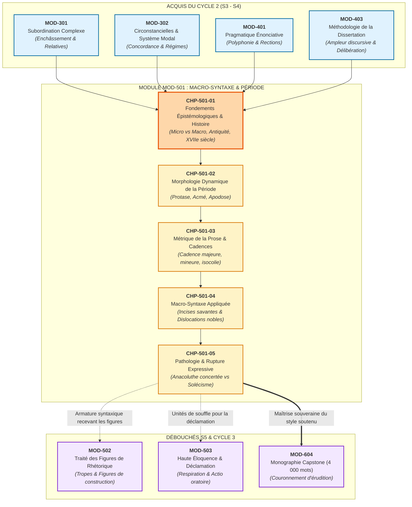

# Chapitre 1 — Fondements Épistémologiques et Histoire Rhétorique de la Période : De la Micro-Syntaxe à la Macro-Syntaxe, Tradition Gréco-Latine et l'Âge d'Or Français

> **Identifiant du chapitre** : `CHP-501-01`  
> **Module de rattachement** : [`MOD-501` — Macro-Syntaxe, Dislocations, Incises et Grande Période Oratoire](file:///f:/Formation/world-class-french/03-curriculum/year-3/semester-5/mod-501-macro-syntaxe-periode-oratoire-cadences.md)  
> **Semestre** : Année 3 — Semestre 5 (S5)  
> **Volume horaire canonique** : 5 à 6 heures d'apprentissage autonome délibéré et d'ateliers d'application (Phase 1 Étude : 1 h 30 | Phase 2 Pratique : 1 h 30 | Phase 3 Correction : 1 h 00 | Phase 4 Évaluation : 1 h 00)  
> **Statut** : [STATUT : VALIDÉ]  
> **Compétences associées** : [`FR-SYNTAX-003`](file:///f:/Formation/world-class-french/02-competency-framework/competency-framework.md#fr-syntax-003-maîtrise-de-la-grande-période-oratoire-et-de-la-macro-syntaxe) (L4 Maîtrise approfondie), [`FR-STYLE-001`](file:///f:/Formation/world-class-french/02-competency-framework/competency-framework.md#fr-style-001-maîtrise-des-figures-de-rhétorique-et-commentaire-stylistique) (L4 Maîtrise approfondie), [`FR-LEXIC-001`](file:///f:/Formation/world-class-french/02-competency-framework/competency-framework.md#fr-lexic-001-précision-sémantique-nuances-synonymiques-et-collocations) (L4 Maîtrise approfondie)  
> **Sources scientifiques de référence** : `SRC-RHET-03` (Reboul, 1991), `SRC-RHET-04` (Calas, 2011), `SRC-GRAM-02` (Riegel et al., 2016), `SRC-GRAM-01` (Grevisse & Goosse, 2016), `SRC-NORM-03` (Ministère de l'Éducation nationale, 2020), `SRC-TYPO-01` (Imprimerie nationale, 2002/2014)

---

## 1. Titre et Place dans le Cursus

### 1.1 Intitulé Officiel
**Chapitre 1 : Fondements Épistémologiques et Histoire Rhétorique de la Période : De la Micro-Syntaxe à la Macro-Syntaxe, Tradition Gréco-Latine et l'Âge d'Or Français** (`CHP-501-01`).

### 1.2 Insertion Architecturale dans le Cursus
Le chapitre inaugural du module `MOD-501` marque le couronnement de l'architecture syntaxique dans le cursus **World-Class French**. Après avoir assis la rigueur fonctionnelle de la phrase simple (`MOD-201`), l'ordonnancement de la subordination complexe (`MOD-301`), les équilibres modaux et temporels (`MOD-302`), la polyphonie énonciative (`MOD-401`) et l'ampleur dialectique de la dissertation académique (`MOD-403`), l'apprenant franchit le seuil supérieur de l'éloquence écrite et orale : **le passage de la micro-syntaxe propositionnelle à la macro-syntaxe discursive de la grande période oratoire**.



- **En amont** :
  - `MOD-301` et `MOD-302` fournissent le matériau grammatical premier : sans un contrôle infaillible de la dépendance propositionnelle, du subjonctif et de la concordance temporelle, l'édifice périodique s'effondre en anacoluthes involontaires ou en phrases tronquées.
  - `MOD-401` transmet la théorie de l'énonciation polyphonique (Ducrot) et la discipline des incises, indispensables pour moduler la voix au fil d'une phrase longue.
  - `MOD-403` a exercé l'esprit à l'ampleur argumentative de la dissertation ; `MOD-501` lui donne le véhicule stylistique suprême pour incarner cette pensée complexe.
- **Au sein du module `MOD-501`** :
  - Ce premier chapitre pose les assises épistémologiques, théoriques et historiques. Il éclaire pourquoi la période n'est pas un luxe décoratif mais une nécessité intellectuelle, avant l'étude de son anatomie tripartite (`CHP-501-02`), de son calcul métrique (`CHP-501-03`), de ses incises (`CHP-501-04`) et de ses ruptures délibérées (`CHP-501-05`).
- **En aval** :
  - `MOD-502` greffera le réseau des figures de rhétorique (chiasmes, antithèses, métaphores filées) sur le squelette périodique ici maîtrisé.
  - `MOD-503` transformera le découpage macro-syntaxique en technique respiratoire concrète pour la prise de parole sans notes.
  - `MOD-604` exigera cette souveraineté de style pour la rédaction de la Monographie Capstone de fin d'études.

### 1.3 Justification du Calibrage Horaire (5 à 6 Heures)
Conformément aux normes du cursus, le travail autonome est articulé en quatre phases rigoureusement minutées :
- **Phase 1 — Étude conceptuelle et fondements épistémologiques (1 h 30)** : Maîtrise des rubriques 1 à 13 (frontière micro/macro-syntaxe, tradition gréco-latine, éloquence du XVIIe siècle, raison d'être du suspens périodique et clinique des erreurs).
- **Phase 2 — Pratique délibérée et discrimination critique (1 h 30)** : Résolution autonome des 3 niveaux d'exercices progressifs (rubrique 14 : identification de la macro-syntaxe sur 12 fragments classiques, refonte périodique d'un texte haché, analyse d'une période de 50 mots exacts).
- **Phase 3 — Correction critique et production normée (1 h 00)** : Audit raisonné d'un discours corrompu de 8 fautes macro-syntaxiques (rubrique 15) et composition d'une période oratoire inaugurale en 60 mots exacts (rubrique 16).
- **Phase 4 — Ancrage mnésique et évaluation sommative (1 h 00)** : Mémorisation active sans indices (rubrique 18) et passation de l'épreuve sommative chronométrée de 30 minutes notée sur 20 points (rubrique 19).

---

## 2. Objectifs Mesurables

Au terme de ce chapitre, l'apprenant doit être capable de :

1. **Tracer la frontière épistémologique et fonctionnelle entre micro-syntaxe et macro-syntaxe** (`FR-SYNTAX-003` — Palier L4) : expliciter avec précision les domaines de validité respectifs de la micro-syntaxe (relations de rection, valences verbales, accords locaux au sein de la proposition) et de la macro-syntaxe (gestion des masses phrastiques, emballage énonciatif, distribution thème/rhème et découpage respiratoire du discours) [Réf. `SRC-GRAM-02`, chap. 14 et 21].
2. **Analyser la genèse rhétorique et les doctrines classiques de la période** (`FR-STYLE-001` — Palier L4) : restituer et confronter les théories fondatrices d'Aristote (*Rhétorique*, III, 9 : totalité close visible d'un seul regard), de Cicéron (*De Oratore*, *Orator* : le *numerus*, la rondeur périodique et le chant oratoire) et de Quintilien (*Institution oratoire*, IX : l'architecture clausulaire et l'assemblage des *cola*) [Réf. `SRC-RHET-03`, chap. 4].
3. **Arbitrer les tensions esthétiques de l'âge d'or français et de sa postérité** (`FR-STYLE-001` — Palier L4) : caractériser l'éloquence de la chaire au XVIIe siècle (Bossuet, Fléchier, Bourdaloue) comme instrument de transcendance et d'autorité monarchique, trancher la querelle historique entre le style lié (*oratio perpetua*) et le style coupé (*oratio soluta* / sénéquien), et analyser la résurgence romantique et moderne de la période d'art (Chateaubriand, Flaubert, Proust, Gracq) [Réf. `SRC-RHET-04`, chap. 5].
4. **Mobiliser un métalangage stylistique exact et évaluer l'autorité du discours** (`FR-LEXIC-001` — Palier L4) : employer à bon escient les notions de suspens herméneutique, de tension syntaxique, d'isocolie et d'architecture clausulaire pour disséquer des textes d'apparat et justifier pourquoi la période oratoire contraint l'auditeur à suspendre son jugement critique jusqu'au terme de l'énoncé.

---

## 3. Prérequis et Test de Préparation (Auto-Diagnostic)

### 3.1 Prérequis Cognitifs
- **Maîtrise infaillible de la phrase complexe** : identifier sans hésitation les propositions matrices, les subordonnées complétives, relatives et circonstancielles, et tracer leur hiérarchie d'enchâssement (`MOD-301`).
- **Concordance des modes et des temps au style littéraire** : manier avec sûreté le subjonctif imparfait, le conditionnel passé et la subordination modalisée (`MOD-302`).
- **Polyphonie énonciative et gestion des incises** : insérer une incise sans rompre la rection grammaticale du sujet éloigné (`MOD-401`).
- **Rigueur dialectique de la pensée longue** : concevoir un raisonnement qui ne se réduit pas à une juxtaposition d'opinions immédiates (`MOD-403`).

### 3.2 Test de Préparation Immédiat
Répondez aux cinq questions suivantes avant d'aborder le cours, puis dépliez le volet de correction pour vérifier votre aptitude conceptuelle.

1. Quelle différence de nature distingue la règle d'accord du verbe avec son sujet éloigné de la décision de placer trois propositions subordonnées circonstancielles avant la proposition principale ?
2. Dans le traité aristotélicien de la *Rhétorique*, comment Aristote oppose-t-il le style continu au style périodique, et quelle métaphore athlétique emploie-t-il pour décrire l'attention de l'auditeur ?
3. Pourquoi la phrase suivante, bien qu'exempte de toute faute d'orthographe ou d'accord, échoue-t-elle à constituer une véritable période oratoire : *« Le ministre est arrivé à dix heures, puis il a salué la foule, ensuite il a prononcé son discours officiel, et enfin tout le monde a applaudi chaleureusement »* ?
4. Que désigne le terme latin *numerus* lorsqu'il est appliqué à la prose d'apparat chez Cicéron et Quintilien ? S'agit-il d'un mètre poétique rigide (vers régulier) ou d'un rythme d'une autre nature ?
5. Dans l'histoire des styles au XVIIe siècle, quelle divergence philosophique et esthétique oppose les adeptes du cicéronisme (le style périodique lié) aux partisans du sénéquisme (le style coupé et lapidaire) ?

---

<details>
<summary><b>Consulter le corrigé de l'auto-diagnostic</b></summary>

1. L'accord du verbe avec son sujet éloigné relève de la **micro-syntaxe** : c'est une contrainte morphologique locale, codée et obligatoire, régie par la rection verbale. Le choix d'antéposer trois propositions circonstancielles avant la principale relève de la **macro-syntaxe** : c'est une décision d'architecture énonciative et rhétorique qui organise la hiérarchie de l'information, le rythme respiratoire et le suspens de l'énoncé.
2. Aristote oppose le style sans fin (*lexis eiromenê*, fil continu sans bornes naturelles) au style périodique (*lexis katestrammenê*, phrase repliée sur elle-même). Il utilise la métaphore de la **course du stade** : dans le style sans fin, le coureur avance sans voir la borne et s'essouffle dans le vide ; dans la période, le coureur aperçoit d'emblée la ligne d'arrivée, ce qui soutient son énergie et lui permet de mesurer son effort jusqu'au but.
3. Cette phrase n'est qu'un chapelet de propositions coordonnées chronologiquement par des connecteurs temporels (*puis, ensuite, enfin*). Chaque segment livre immédiatement un sens complet sans créer aucune attente. Il n'y a ni protase montante, ni suspens herméneutique, ni hiérarchisation syntaxique : c'est une phrase narrative plate en *oratio soluta*, incapable de susciter l'attention intellectuelle d'un auditoire d'élite.
4. Le *numerus* ne désigne pas une métrique fixe et contraignante comme l'hexamètre dactylique ou l'alexandrin (ce qui transformerait la prose en poésie et serait perçu comme un vice affecté), mais un **rythme intérieur souple et calculé** fondé sur l'équilibre des membres (*cola*), le retour harmonieux des accents de groupe et le choix savant de clausules terminales cadencées.
5. Le style périodique lié (cicéronien, repris par Bossuet) exprime la majesté de l'ordre politique et divin, la souveraineté de la raison architecturée et l'autorité de l'institution. Le style coupé (sénéquien, repris par Pascal ou La Bruyère) privilégie la fulgurance discontinue de la formule, l'inquiétude morale, la vérité nue sans apparat et le refus des illusions théâtrales du pouvoir.

</details>

---

## 4. Situation de Départ ou Problème Concret : Le Plafond de Verre de la Phrase Correcte mais Plate

### 4.1 Le Drame du Rédacteur Académique Laborieux
Chaque année, dans les concours de haute fonction publique, à l'Agrégation de Lettres modernes ou lors de plaidoiries judiciaires solennelles, des scripteurs et orateurs irréprochables sur le plan orthographique et grammatical voient leurs prestations accueillies avec une indifférence polie, sanctionnées par des appréciations sans appel :  
*« Écriture scolaire. Absence totale de souffle. Débit saccadé. Prose monotone et hachée. Pensée incapable de dominer son architecture d'ensemble. »*

L'apprenant en conçoit une immense perplexité : comment un texte dont aucune règle de grammaire n'est violée, où chaque accord de participe passé est exact et chaque subordonnée correctement subordonnée, peut-il être jugé médiocre et dépourvu d'autorité ?

### 4.2 L'Impasse de l'Empilement Linéaire
Considérons le fragment suivant, rédigé par un rédacteur qui n'a pas dépassé le stade de la micro-syntaxe :

> *« La démocratie traverse aujourd'hui une crise profonde. Les citoyens se méfient de plus en plus de leurs représentants élus. La mondialisation économique a détruit les souverainetés nationales traditionnelles. Les réseaux sociaux propagent chaque jour des fausses nouvelles et attisent la haine. Les institutions républicaines doivent absolument réagir. Elles doivent refonder le pacte civique sur la justice et l'éducation. Si elles ne le font pas rapidement, le risque est grand de voir triompher l'autoritarisme. »*

Que constatons-nous ?
1. **Zéro faute de grammaire** : accords, modes, conjugaisons et ponctuation élémentaire sont impeccables.
2. **Faillite rhétorique totale** : le scripteur délivre sa pensée par petites saccades de 8 à 15 mots. Chaque phrase se referme immédiatement sur son petit sujet et son petit verbe. L'esprit du lecteur n'est jamais tenu en haleine ; aucune vision d'ensemble ne relie les causes multiples aux conséquences finales. C'est l'équivalent linguistique d'un marcheur qui poserait un pied, s'arrêterait, puis poserait le second, sans jamais acquérir l'élan d'une course majestueuse.

Le rédacteur est enfermé sous un **plafond de verre stylistique** : il sait fabriquer des propositions valides, mais il ignore comment édifier un temple oratoire.

---

## 5. Explication Intuitive : L'Analogie de l'Arc en Plein Cintre et de la Voûte Gothique

Pour saisir l'essence de la macro-syntaxe périodique, laissons de côté un instant les traités de grammaire et contemplons l'art des bâtisseurs de cathédrales.

```text
┌─────────────────────────────────────────────────────────────────────────────┐
│                 L'ANALOGIE ARCHITECTURALE DE LA PHRASE                      │
├─────────────────────────────────────────────────────────────────────────────┤
│ 1. LE STYLE HACHÉ (LA PHRASE SIMPLE EMPILÉE) :                              │
│    [Brique 1] [Brique 2] [Brique 3] [Brique 4] [Brique 5]                   │
│    -> Chaque élément repose à plat sur le sol ou sur le précédent.          │
│    -> Si vous retirez une brique, le reste de la pile demeure intact.       │
│    -> Aucune tension, aucune portée dans l'espace, hauteur dérisoire.       │
│                                                                             │
│ 2. LA PÉRIODE ORATOIRE (L'ARC EN PLEIN CINTRE OU LA VOÛTE GOTHIQUE) :       │
│                       [ CLÉ DE VOÛTE : ACMÉ ]                               │
│                      /                       \                              │
│            [ Claveau 2 ]                   [ Claveau 3 ]                    │
│            /                                           \                    │
│    [ Claveau 1 : PROTASE ]                       [ Claveau 4 : APODOSE ]    │
│    =======================                       =======================    │
│    (Pilier de départ)                             (Pilier d'arrivée)        │
│                                                                             │
│    -> Les claveaux s'élèvent au-dessus du vide par poussée réciproque.      │
│    -> Le sens est suspendu en l'air jusqu'à la pose de la clé terminale.    │
│    -> Retirez un seul claveau : TOUT L'ÉDIFICE S'EFFONDRE.                  │
└─────────────────────────────────────────────────────────────────────────────┘
```

- **La phrase plate empile des briques** : *« Le ciel est bleu. Le vent souffle. Les navires partent. »* Chaque mot s'appuie sur la terre ferme d'une signification immédiate. C'est une architecture au ras du sol.
- **La période oratoire élève une arche au-dessus de l'abîme** : elle lance ses subordonnées et ses circonstances comme des claveaux qui montent vers le ciel. Tant que l'arche n'a pas atteint son sommet (l'acmé) et n'est pas redescendue se verrouiller sur son pilier d'arrivée (l'apodose), le regard demeure suspendu dans le vide, fasciné par la hardiesse de la structure.

La grande période oratoire n'est donc pas une « longue phrase » : c'est un **système de forces en équilibre dynamique**, où chaque membre n'a de sens que par la tension qu'il exerce sur le membre suivant.

---

## 6. Définitions Précises et Terminologie Fondamentale

Afin de fonder notre étude sur une rigueur scientifique irréprochable, définissons les concepts cardinaux du domaine :

```text
GLOSSAIRE FONDAMENTAL DE LA MACRO-SYNTAXE ET DE LA PÉRIODE
├── MICRO-SYNTAXE : Règles internes à la proposition (régime, valence, accords locaux).
├── MACRO-SYNTAXE : Architecture supérieure du discours (masses, énonciation, thème/rhème).
├── UNITÉ DISCURSIVE : Bloc autonome de communication doté d'une cohérence pragmatique.
├── PÉRIODE ORATOIRE (PERIODOS) : Circuit de parole clos maintenant le sens en suspens.
├── ORATIO PERPETUA : Style lié, continu, enchaînant des membres harmonieux.
├── ORATIO SOLUTA : Style coupé, lapidaire, procédant par asyndète et formules brèves.
├── TENSION SYNTAXIQUE : État d'inachèvement grammatical maintenant l'attente du verbe recteur.
├── SUSPENS HERMÉNEUTIQUE : Attente intellectuelle du sens complet suspendu jusqu'au terme.
├── NUMERUS ORATOIRE : Harmonie numérique et prosodique de la prose rythmée sans vers régulier.
└── ARCHITECTURE CLAUSULAIRE : Agencement métrique et sonore fermant la fin de phrase (clausule).
```

### 6.1 Micro-Syntaxe
Ensemble des règles grammaticales qui s'exercent à l'échelle de la proposition et du syntagme. Elle régit la valence du verbe (transitivité, intransitivité), la rection des prépositions (*obéir à*, *dépendre de*), l'accord morphologique en genre et en nombre, et l'assignation des fonctions grammaticales traditionnelles (sujet, attribut, compléments d'objet) [Réf. `SRC-GRAM-02`, chap. 14].

### 6.2 Macro-Syntaxe
Théorisée notamment par Claire Blanche-Benveniste et la linguistique contemporaine, la macro-syntaxe étudie l'agencement des énoncés au-delà du cadre strict de la rection verbale. Elle gouverne l'organisation des grandes masses textuelles, les phénomènes de topicalisation (détachement thématique), les incises, les pauses de souffle, et la partition entre le noyau informationnel (*clause*) et les périphéries d'encadrement (*pré-noyaux, post-noyaux*) [Réf. `SRC-GRAM-02`, chap. 21].

### 6.3 Unité Discursive
Segment textuel ou oral supérieur à la proposition simple, délimité par une cohérence sémantique, pragmatique et intonative autonome, formant un tout complet dans la communication [Réf. `SRC-NORM-03`].

### 6.4 Période Oratoire (*Periodos*)
Du grec *periodos* (composé de *peri*, « autour », et *hodos*, « chemin, circuit »), désignant littéralement un « tour complet » ou un « circuit fermé ». En rhétorique classique, phrase complexe d'une ampleur remarquable, articulée en plusieurs membres interdépendants, agencée de telle sorte que son unité formelle soit indivisible et que son sens ne soit complètement livré qu'au dernier mot de son déploiement [Réf. `SRC-RHET-03`, chap. 4].

### 6.5 *Oratio Perpetua* (Style Lié ou Périodique)
Mode d'élocution où les propositions sont étroitement soudées par la subordination, les conjonctions et un rythme harmonique continu, conférant à la prose ampleur, majesté et continuité musicale [Réf. `SRC-RHET-04`, chap. 5].

### 6.6 *Oratio Soluta* (Style Coupé, Haché ou Lapidaire)
Littéralement « discours délié » ou « dénoué ». Mode d'élocution procédant par propositions brèves, indépendantes, coordonnées ou juxtaposées (parataxe, asyndète), privilégiant la rapidité, la fulgurance de la sentence et la concision méditative à l'enveloppement sonore.

### 6.7 Tension Syntaxique
Tension mécanique créée par le report différé des constituants indispensables à la clôture grammaticale (par exemple, accumuler des subordonnées circonstancielles ou des incises entre le sujet et son verbe recteur, interdisant à la phrase de se reposer).

### 6.8 Suspens Herméneutique
Effet psychologique et cognitif produit sur l'auditeur ou le lecteur par la tension syntaxique : l'esprit est contraint de suspendre son jugement d'ensemble, de maintenir en mémoire tous les éléments préliminaires, jusqu'à ce que la proposition principale vienne illuminer rétrospectivement la totalité du circuit.

### 6.9 *Numerus* Oratoire
Terme latin désignant le « nombre » ou le rythme secret de la prose classique. Il ne renvoie pas à une scansion métrique fixe et répétitive de vers réguliers, mais à une cadence musicale résultant de l'équilibre numérique des membres (*isocolie*, *membres croissants*), de la respiration phonique et du soin apporté aux chutes de phrases.

### 6.10 Architecture Clausulaire
Discipline stylistique régissant la confection de la *clausule* (la fin de période). La clausule constitue le point d'impact final de la phrase, où l'orateur soigne particulièrement l'arrangement sonore et syllabique afin de laisser dans l'oreille de l'auditeur une impression indélébile de résolution et d'harmonie [Réf. `SRC-RHET-03`, chap. 4].

---

## 7. Règles et Mécanismes Fondamentaux

### 7.1 La Frontière Épistémologique : Micro-Syntaxe vs Macro-Syntaxe

L'erreur la plus fréquente des scripteurs consiste à croire que la période n'est qu'une « phrase micro-syntaxique géante ». C'est une confusion épistémologique majeure.

```text
┌─────────────────────────────────────────────────────────────────────────────┐
│                 LES DEUX ÉTAGES DE L'ÉDIFICE GRAMMATICAL                    │
├─────────────────────────────────────────────────────────────────────────────┤
│ ÉTAGE SUPÉRIEUR : LA MACRO-SYNTAXE [Réf. SRC-GRAM-02, chap. 21]             │
│ -> Gestion des masses sonores et syllabiques (membres, périodes).           │
│ -> Emballage énonciatif : distribution thème / rhème, topicalisation.       │
│ -> Régulation du souffle respiratoire et des pauses oratoires.              │
│ -> Orchestration du suspens herméneutique (tension montante et descendante).│
├─────────────────────────────────────────────────────────────────────────────┤
│ ÉTAGE INFÉRIEUR : LA MICRO-SYNTAXE [Réf. SRC-GRAM-02, chap. 14]             │
│ -> Rection des prépositions et valences verbales (transitif / intransitif). │
│ -> Accords morphologiques locaux (genre, nombre, personne, temps).          │
│ -> Relations internes au groupe nominal (déterminant, nom, épithète).       │
│ -> Ordre canonique des mots au sein de la proposition (S-V-O).              │
└─────────────────────────────────────────────────────────────────────────────┘
```

1. **La micro-syntaxe assure la cohésion locale** : elle vérifie que le verbe s'accorde avec son sujet, que la préposition requise par l'adjectif est correcte (*apte à*, *avide de*), que la subordonnée relative s'accroche bien à son antécédent. Elle garantit l'intelligibilité mécanique élémentaire.
2. **La macro-syntaxe assure l'autorité globale** : elle décide de la distribution de l'information. C'est elle qui choisit de placer en tête de phrase une masse circonstancielle imposante pour faire peser une atmosphère, de suspendre le sujet pendant vingt mots par une incise méditative, ou de lancer un crescendo métrique de 8, 12 puis 18 syllabes vers une apodose retentissante.

Un texte peut être micro-syntaxiquement parfait tout en étant macro-syntaxiquement indigent (c'est le cas du texte haché étudié en section 4). À l'inverse, une grande période classique ne tolère aucune défaillance micro-syntaxique, sous peine de voir son imposante voûte s'écrouler dans le ridicule d'un solécisme.

---

### 7.2 La Genèse Gréco-Latine de la Période : D'Aristote à Quintilien

La théorie de la période oratoire n'est pas une invention moderne : elle plonge ses racines dans les traités fondateurs de la démocratie et du barreau antiques [Réf. `SRC-RHET-03`, chap. 4].

#### 1. Aristote et la Période comme Totalité Organique (*Rhétorique*, Livre III, chap. 9)
Aristote est le premier à théoriser scientifiquement l'art de la période. Il oppose :
- Le style sans fin (*lexis eiromenê*, le « style enfilé ») : celui qui n'a pas de clôture interne et ne s'arrête que lorsque la matière dont on parle est épuisée. C'est le style du chroniqueur naïf : *« Et après cela il fit ceci, puis il alla là, et ensuite arriva cela... »*
- Le style périodique (*lexis katestrammenê*, la « phrase retournée sur elle-même ») : 
  > *« J'appelle période une phrase qui a un commencement et une fin en elle-même, et une étendue que le regard peut embrasser d'un seul coup. Ce style est agréable et facile à suivre : agréable parce qu'il est le contraire de ce qui n'a pas de terme... facile à suivre parce que l'auditeur se rappelle toujours où la phrase a commencé et pressent où elle va finir. »* (Aristote, *Rhétorique*, III, 9).

Pour Aristote, la période répond à une loi psychologique : l'esprit humain refuse l'infini informe ; il éprouve du plaisir devant ce qui est limité, proportionné et ordonné.

#### 2. Cicéron et le Rythme Musical de la Prose (*De Oratore*, *Orator*)
Pour l'avocat et consul romain Marcus Tullius Cicéron, la période devient l'instrument suprême de la persuasion civique et de la délectation esthétique :
- **La rondeur périodique (*rotunditas*)** : Cicéron compare la période à un cercle parfait. Les mots ne doivent pas s'aligner comme des soldats au garde-à-vous, mais s'enrouler avec souplesse autour de la pensée.
- **Le *numerus* oratoire** : dans l'*Orator* (§ 204-210), Cicéron théorise le nombre de la prose. Si l'orateur parle en vers, il est ridicule et perd sa crédibilité de magistrat sérieux ; mais s'il parle sans rythme, son discours est rude, inharmonieux et provoque le dégoût. Le *numerus* est ce rythme secret qui comble l'oreille sans que l'auditeur sache d'où vient son ravissement.
- **L'alternance des mouvements** : Cicéron montre que l'ampleur périodique ne doit pas être continue. Elle doit surgir aux moments de gravité solennelle, de réquisitoire pathétique ou d'exorde majestueux, avant de faire place à une argumentation plus serrée et rapide.

#### 3. Quintilien et l'Architecture Clausulaire (*Institution oratoire*, Livre IX)
Au premier siècle de notre ère, Quintilien codifie la pédagogie de la période pour l'enseignement impérial :
- **L'anatomie des membres** : il décompose la phrase en *commata* (incises courtes de 2 à 4 syllabes), *cola* (membres de 6 à 12 syllabes) et *periodos* (la réunion de plusieurs membres formant un ensemble autosuffisant).
- **L'art de la clausule** : Quintilien insiste sur la fin de la période (*clausula*). Alors que le commencement éveille l'attention et que le milieu développe la preuve, la clausule attend le jugement de l'auditeur. C'est sur la cadence finale que repose l'assentiment ou le rejet du public. Une période ne doit jamais s'achever par une syllabe faible, molle ou traînante, mais par une assise rythmique ferme qui sonne comme un coup d'archet victorieux.

---

### 7.3 L'Âge d'Or Français du XVIIe Siècle : Sacralité, Majesté et Querelle des Styles

Au XVIIe siècle, sous les règnes de Louis XIII et Louis XIV, la langue française s'approprie le modèle cicéronien pour en faire le monument d'une nation centralisée et d'une foi triomphante [Réf. `SRC-RHET-04`, chap. 5].

#### 1. L'Éloquence de la Chaire : Bossuet, Fléchier, Bourdaloue
C'est du haut de la chaire sacrée que la période française atteint son zénith. Jacques-Bénigne Bossuet, évêque de Meaux, déploie dans ses *Oraisons funèbres* une architecture syntaxique qui égale et surpasse parfois le modèle latin.
- **Le véhicule de la transcendance** : pour Bossuet, la période oratoire est la seule forme capable de soutenir le vertige des grandeurs humaines confrontées au néant de la mort et à l'éternité de Dieu.
- **Le souffle de l'autorité monarchique** : la période n'est pas seulement spirituelle, elle est politique. Elle mime la plénitude de l'ordre royal : tout y est subordonné, hiérarchisé, pacifié sous l'autorité souveraine d'un verbe recteur qui commande à ses satellites comme le Roi commande à ses provinces.

#### 2. La Querelle du Style Lié vs Style Coupé : Cicéron contre Sénèque
Le XVIIe siècle n'est pas unanime. Une querelle stylistique et morale d'une rare intensité oppose deux modèles de pensée :

```text
┌─────────────────────────────────────────────────────────────────────────────┐
│                 LA QUERELLE DES STYLES AU GRAND SIÈCLE                      │
├─────────────────────────────────────────────────────────────────────────────┤
│ LE MODÈLE CICÉRONIEN (STYLE LIÉ / ORATIO PERPETUA)                          │
│ -> Champions : Bossuet, Fléchier, les magistrats du Parlement.              │
│ -> Idéal : Majesté, plénitude harmonique, raison architecturée.             │
│ -> Posture : L'orateur public s'adressant à la communauté assemblée.        │
│ -> Forme : Périodes amples, subordination savante, cadences majeures.       │
├─────────────────────────────────────────────────────────────────────────────┤
│ LE MODÈLE SÉNÉQUIEN (STYLE COUPÉ / ORATIO SOLUTA)                           │
│ -> Champions : Pascal (Pensées), La Rochefoucauld (Maximes), La Bruyère.    │
│ -> Idéal : Lucidité tragique, frappe fulgurante, vérité nue et sans fard.   │
│ -> Posture : Le moraliste solitaire démasquant les vanités humaines.        │
│ -> Forme : Parataxe, antithèses lapidaires, asyndète, rupture sèche.        │
└─────────────────────────────────────────────────────────────────────────────┘
```

Lorsque Blaise Pascal écrit : *« Le silence éternel de ces espaces infinis m'effraie »*, ou *« L'homme n'est qu'un roseau, le plus faible de la nature, mais c'est un roseau pensant »*, il brise délibérément l'enveloppe de la période oratoire. Il refuse la pompe cicéronienne, qu'il juge complice des séductions mondaines, au profit d'une écriture du saisissement immédiat.

La grande leçon du classicisme français réside dans cette tension féconde : **la période n'est admirable que parce que le style coupé existe pour lui faire contrepoint**.

---

### 7.4 La Résurgence Romantique et la Prose d'Art aux XIXe et XXe Siècles

Après le XVIIIe siècle des Lumières, dominé par la vivacité incisive et le style analytique court de Voltaire, la grande période renaît sous des formes nouvelles d'une splendeur inouïe.

#### 1. Chateaubriand et la Période Lyrique
Avec François-René de Chateaubriand (*Génie du christianisme*, *Mémoires d'outre-tombe*), la période se libère du carcan de la pure logique démonstrative pour devenir un **instrument de résonance poétique**. Chateaubriand injecte dans l'arche cicéronienne le souffle du vent nocturne, la rumeur des forêts de l'Amérique et la mélancolie du temps qui s'enfuit. Sa période ne cherche plus seulement à convaincre la raison ; elle berce l'âme et suscite l'émotion sacrée de l'éphémère.

#### 2. La Prose d'Art : Flaubert, Proust, Julien Gracq
- **Gustave Flaubert et l'épreuve du « gueuloir »** : Flaubert soumet chaque phrase de ses romans à l'épreuve physique de la voix criée. Il traque les mauvais rythmes, les assonances involontaires et règle la scansion de ses grandes périodes descriptives avec une minutie maniaque.
- **Marcel Proust et la Période Spirale** : chez Proust (*À la recherche du temps perdu*), la période change de nature épistémologique. Elle ne s'achève plus par une clôture dogmatique solennelle ; elle devient une spirale herméneutique où la syntaxe, déployée sur dix ou vingt lignes truffées de subordonnées et d'incises comparatives, mime le mouvement même de la mémoire involontaire et la complexité vertigineuse de la conscience humaine.
- **Julien Gracq et la Période Incantatoire** : au XXe siècle, Julien Gracq (*Le Rivage des Syrtes*) pousse la majesté de la phrase française vers une tension géologique et cérémonielle, prouvant que la macro-syntaxe de haut vol demeure le plus haut sommet de l'art littéraire.

---

## 8. Raisonnement Détaillé : Pourquoi la Période Oratoire est l'Instrument Suprême de l'Autorité Intellectuelle

Pourquoi l'art de la grande période continue-t-il, au XXIe siècle, de dominer la haute éloquence, les épreuves de concours d'élite et les décisions de justice majeures ? La réponse tient à un mécanisme psychologique et cognitif fondamental : **le verrouillage du jugement par le suspens syntaxique**.

```text
┌─────────────────────────────────────────────────────────────────────────────┐
│                 LE MÉCANISME COGNITIF DU SUSPENS PÉRIODIQUE                 │
├─────────────────────────────────────────────────────────────────────────────┤
│ 1. FACE À UNE PROSE HACHÉE (PROPOSITIONS INDÉPENDANTES) :                   │
│    Scripteur : « La démocratie est menacée. »                               │
│    Auditeur  : [Interruption immédiate] « Pas du tout, c'est faux ! »       │
│    -> Chaque segment indépendant offre une prise immédiate à la contestation.│
│    -> L'auditeur interrompt le raisonnement avant même d'avoir saisi le tout.│
│                                                                             │
│ 2. FACE À LA GRANDE PÉRIODE ORATOIRE :                                      │
│    Orateur   : « Lorsque les repères séculaires d'une nation vacillent,      │
│                  que les passions partisanes aveuglent les citoyens,        │
│                  et que la mémoire sacrée des sacrifices passés s'efface... │
│    Auditeur  : [Silence contraint] « Que va-t-il dire ? Où va-t-il ? »      │
│    -> La syntaxe inachevée INTERDIT psychologiquement toute réfutation.      │
│    -> L'auditeur est obligé d'ingérer l'ensemble des prémisses et des faits. │
│    Orateur   : ...alors seulement surgit le devoir impérieux de refonder    │
│                  l'État sur le roc de la justice ! »                        │
│    -> La frappe conclusive tombe sur un auditeur désarmé et conquis.        │
└─────────────────────────────────────────────────────────────────────────────┘
```

Ce mécanisme repose sur trois lois rhétoriques :
1. **L'inhibition de la réfutation prématurée** : dans un échange ordinaire, l'interlocuteur interrompt dès qu'il perçoit une proposition contestable. Dans la période, les propositions circonstancielles accumulées en protase n'affirment rien de définitif ; elles posent des conditions (*Si...*, *Lorsque...*, *Bien que...*). L'adversaire est réduit au silence parce qu'il ne dispose pas de prédicat principal contre lequel argumenter.
2. **L'absorption totale du cadre de pensée** : en imposant son architecture de propositions subordonnées, l'orateur force l'esprit du public à circuler dans les catégories qu'il a lui-même tracées. Lorsque la proposition principale éclate en apodose, elle n'apparaît plus comme une opinion arbitraire, mais comme la **conséquence logique et inéluctable** de tout ce qui a précédé.
3. **L'accord physique et sensoriel** : par le *numerus* et la régulation du souffle, la période oratoire impose un tempo physiologique à l'auditeur. Elle berce son attention, module son rythme cardiaque et crée un climat de solennité qui paralyse le scepticisme frivole. La forme confère à l'idée l'évidence écrasante de la beauté [Réf. `SRC-RHET-03`, chap. 4].

---

## 9. Exemples Corrects Commentés

Disséquons au microscope macro-syntaxique trois périodes historiques majeures issues des trois sommets de la tradition classique : Cicéron, Bossuet et Chateaubriand.

---

### Exemple 1 : Cicéron — L'Exorde Foudroyant de la *Première Catilinaire* (Rome, 63 av. J.-C.)

#### Texte Modèle (Traduction française soutenue de référence) :
> *« Quand la garde nocturne du mont Palatin, quand les patrouilles qui sillonnent la cité, quand l'effroi de tout le peuple romain, quand l'affluence empressée de tous les gens de bien, quand le choix de ce temple fortifié pour la réunion solennelle du Sénat, quand enfin les regards indignés et les visages de tous ces magistrats ici rassemblés te dénoncent et te condamnent, ne sens-tu pas, Catilina, que tous tes desseins criminels sont éventés, et ne vois-tu point que ta conjuration sacrilège gît désormais impuissante sous les yeux de tous ceux qui t'écoutent ? »*

```text
DÉCOMPOSITION MACRO-SYNTAXIQUE DE L'EXORDE CICÉRONIEN
├── PROTASE (Accumulation anaphorique de 6 circonstances d'accusation) :
│   ├── Membre 1 : Quand la garde nocturne du mont Palatin...
│   ├── Membre 2 : quand les patrouilles qui sillonnent la cité...
│   ├── Membre 3 : quand l'effroi de tout le peuple romain...
│   ├── Membre 4 : quand l'affluence empressée de tous les gens de bien...
│   ├── Membre 5 : quand le choix de ce temple fortifié pour la réunion solennelle...
│   └── Membre 6 : quand enfin les regards indignés et les visages de tous ces magistrats...
├── ACMÉ (Crête dramatique et pivot énonciatif) :
│   └── ...te dénoncent et te condamnent... [Sommet de la tension accusatrice]
└── APODOSE (Résolution binaire conclusive sous forme d'apostrophe foudroyante) :
    ├── Membre 7 : ...ne sens-tu pas, Catilina, que tous tes desseins criminels sont éventés...
    └── Membre 8 : ...et ne vois-tu point que ta conjuration sacrilège gît désormais impuissante sous les yeux de tous ceux qui t'écoutent ?
```

#### Commentaire Critique et Macro-Syntaxique :
1. **L'anaphore en protase (*Quand... quand... quand...*)** : Cicéron ne se contente pas d'affirmer que Catilina est cerné ; il le montre par une caméra circulaire qui resserre l'espace : la colline (Palatin), la ville entière (patrouilles), le peuple unanime (effroi), l'élite morale (gens de bien), le lieu sacré (le temple), et enfin la pièce même où ils se trouvent (les visages des sénateurs).
2. **Le verrouillage syntaxique** : l'accumulation de ces six subordonnées temporelles interdit à Catilina de nier les faits. L'auditoire retient son souffle devant cette avalanche de preuves visibles.
3. **L'acmé (*te dénoncent et te condamnent*)** : la protase s'achève par deux verbes au présent de l'indicatif qui transforment les choses muettes en témoins vivants.
4. **L'apodose binaire** : l'interrogation oratoire redoublée (*ne sens-tu pas... et ne vois-tu point*) s'abat sur le coupable avec une force irrépressible. L'apostrophe directe (*Catilina*) est sertie dans l'apodose comme un trait mortel.

---

### Exemple 2 : Jacques-Bénigne Bossuet — La Fragilité des Trônes Humains (1669)

#### Texte Modèle (Extrait de l'*Oraison funèbre d'Henriette-Marie de France*) :
> *« Malgré les espérances magnifiques que semblait promettre une illustre naissance, malgré cette foi héroïque et cette piété chrétienne qui n'a jamais faibli sous les orages de la fortune, cette reine incomparable, dont la perte désole toute l'Europe chrétienne, a vu le sceptre arraché de ses mains royales, sa patrie d'adoption plongée dans l'anarchie sanglante, et le trône de ses glorieux ancêtres souillé par le supplice inouï d'un monarque légitime. »*

```text
DÉCOMPOSITION MACRO-SYNTAXIQUE DE LA PÉRIODE BOSSUÉTIENNE
├── PROTASE (Antithèse préliminaire en double circonstancielle concessive) :
│   ├── Membre 1 (Concession terrestre) : Malgré les espérances magnifiques...
│   └── Membre 2 (Concession divine)   : malgré cette foi héroïque et cette piété chrétienne...
├── ACMÉ (Pivot nominal théâtral) :
│   └── ...cette reine incomparable, dont la perte désole toute l'Europe chrétienne...
└── APODOSE (Chute tragique ternaire en crescendo catastrophique) :
    ├── Membre 3 : ...a vu le sceptre arraché de ses mains royales...
    ├── Membre 4 : ...sa patrie d'adoption plongée dans l'anarchie sanglante...
    └── Membre 5 : ...et le trône de ses glorieux ancêtres souillé par le supplice inouï d'un monarque légitime.
```

#### Commentaire Critique et Macro-Syntaxique :
1. **La protase concessive (*Malgré... malgré...*)** : Bossuet accumule d'abord tout ce qui devrait rendre un être humain inviolable : la plus haute naissance et la plus parfaite sainteté. La voix s'élève dans les aigus en décrivant ces merveilles.
2. **L'acmé nominale** : le syntagme sujet (*cette reine incomparable*) est amplifié par une relative laudative (*dont la perte désole toute l'Europe*). C'est le point culminant de la gloire mondaine.
3. **L'apodose en cadence majeure tragique** : le verbe recteur (*a vu*) gouverne trois propositions infinitives ou participiales coordonnées. Chaque membre est plus long et plus sombre que le précédent :
   - Membre 3 : la perte personnelle du pouvoir (*le sceptre arraché*) ;
   - Membre 4 : le désastre collectif de la nation (*l'anarchie sanglante*) ;
   - Membre 5 : l'abomination métaphysique ultime (*le trône souillé par le supplice inouï d'un monarque légitime*).
4. **L'effet d'autorité** : l'auditeur est terrassé. La beauté de la période lui fait éprouver physiquement la chute brutale du faîte des grandeurs humaines au fond du tombeau.

---

### Exemple 3 : François-René de Chateaubriand — Le Crépuscule des Forêts d'Amérique (1802)

#### Texte Modèle (Extrait du *Génie du christianisme*) :
> *« Lorsque, dans les nuits solennelles de l'automne, le vent du désert se lève sur les solitudes immenses de l'Occident, qu'il balance les cimes séculaires des forêts et qu'il réveille au loin la voix mugissante des cataractes, le voyageur égaré, arrêtant ses pas dans le silence infini des ténèbres, contemple avec effroi la majesté sans bornes de la nature sauvage, et sent son cœur défaillant s'élever jusqu'au Dieu éternel qui anime et soutient tant d'abîmes. »*

```text
DÉCOMPOSITION MACRO-SYNTAXIQUE DE LA PÉRIODE CHATEAUBRIANDESQUE
├── PROTASE (Triple temporalité cosmique en élévation lyrique) :
│   ├── Membre 1 : Lorsque, dans les nuits solennelles de l'automne...
│   ├── Membre 2 : qu'il balance les cimes séculaires des forêts...
│   └── Membre 3 : et qu'il réveille au loin la voix mugissante des cataractes...
├── ACMÉ (Arrêt contemplatif du voyageur / Suspension spatiale) :
│   └── ...le voyageur égaré, arrêtant ses pas dans le silence infini des ténèbres...
└── APODOSE (Résolution spirituelle binaire en cadence majeure épanouie) :
    ├── Membre 4 : ...contemple avec effroi la majesté sans bornes de la nature sauvage...
    └── Membre 5 : ...et sent son cœur défaillant s'élever jusqu'au Dieu éternel qui anime et soutient tant d'abîmes.
```

#### Commentaire Critique et Macro-Syntaxique :
1. **La polyphonie des subordonnées en protase** : la conjonction *Lorsque* régissant le premier membre est relayée par la conjonction *que* dans les deux membres suivants (*qu'il balance... et qu'il réveille*), conformément à la rection littéraire la plus pure [Réf. `SRC-GRAM-01`, § 390].
2. **L'expansion prosodique** : la nature s'éveille par degrés : le souffle d'abord (*le vent se lève*), puis le mouvement végétal (*balance les cimes*), puis la déflagration hydraulique (*la voix mugissante des cataractes*).
3. **L'acmé d'immobilité** : au milieu de ce déchaînement cosmique, le sujet humain apparaît, immobile (*arrêtant ses pas*). L'incise participiale crée une halte méditative absolue.
4. **L'apodose transcendante** : la résolution s'opère en deux temps coordonnés par *et*. Le second membre de l'apodose, plus long et plus riche en voyelles graves, débouche sur la clausule royale : *« anime et soutient tant d'abîmes »*, qui referme la phrase dans une paix souveraine.

---

## 10. Contre-Exemples et Erreurs Fréquentes

Pour prémunir le rédacteur contre les écueils de conception, voici l'inventaire clinique des six erreurs majeures observées dans la pratique de la phrase complexe :

### Erreur n° 1 : La Confusion entre Période Oratoire et Phrase Interminable Boursouflée
- **Manifestation clinique** : *« Le candidat qui voulait absolument réussir son examen, mais qui n'avait pas assez travaillé pendant toute son année scolaire, et dont les professeurs avaient souvent répété qu'il devait faire attention, a finalement décidé de tricher, ce qui l'a conduit à être exclu définitivement de l'université sans que personne ne vienne le défendre. »*
- **Diagnostic critique** : C'est le « serpent syntaxique ». Le scripteur s'imagine qu'une longue phrase est une période. Or, il s'agit d'un simple agrégat informe de relatives et de complétives enfilées les unes au bout des autres. Il n'y a ni protase, ni acmé, ni cadence équilibrée, ni tension dramatique. Le sens ne cesse de dériver au hasard des associations d'idées.
- **Réparation normée** : Imposer un dessein architectural strict. Définir avant d'écrire quel sera le prédicat principal (l'apodose) et construire deux ou trois subordonnées préalables en protase pour le suspendre : *« Malgré les avertissements réitérés de ses maîtres et le regret tardif d'une année dissipée, l'étudiant inconsidéré qui crut échapper à son devoir par la fraude n'a récolté que le déshonneur d'une exclusion sans retour. »*

### Erreur n° 2 : L'Asphyxie par Empilement Mécanique de Propositions sans Suspens
- **Manifestation clinique** : *« Sachant que, puisque l'économie va mal, et attendu que le chômage augmente, dès lors que les investisseurs doutent, le gouvernement hésite. »*
- **Diagnostic critique** : C'est l'asphyxie logicienne. L'auteur entasse quatre connecteurs causals subordonnés (*sachant que, puisque, attendu que, dès lors que*) sans aucune respiration ni gradation sonore. L'accumulation n'engendre aucun souffle ; elle paralyse l'intellect sous une redondance stérile.
- **Réparation normée** : Varier la nature fonctionnelle des membres en protase (associer un complément prépositionnel, un participe et une subordonnée) et aérer l'énoncé par des coupes respiratoires régulières : *« Face à la dégradation continue des indices économiques et devant l'inquiétude croissante des marchés, le gouvernement, hésitant sur la marche à suivre, retarde les arbitrages décisifs. »*

### Erreur n° 3 : La Rupture de la Tension Sémantique avant le Terme
- **Manifestation clinique** : *« Le roi est mort subitement ce matin dans son palais d'hiver, alors que tous les ministres étaient réunis en séance solennelle pour délibérer de la paix future du royaume et que le peuple attendait avec ferveur les décisions du conseil. »*
- **Diagnostic critique** : C'est la « période crevée » ou la fausse fin. Le scripteur livre l'information capitale et le prédicat principal dès les sept premiers mots (*« Le roi est mort subitement ce matin »*). Tout le reste n'est plus qu'un appendice traînant et mou. Le suspens est mort-né ; l'auditeur n'a plus aucune raison de poursuivre son écoute.
- **Réparation normée** : Rebasculer la circonstance en protase pour préserver le secret jusqu'à l'acmé : *« Alors que tous les ministres étaient réunis en séance solennelle pour délibérer de la paix future du royaume, et que le peuple attendait avec ferveur le salut de l'État, un coup de foudre a anéanti tous les espoirs : dans son palais d'hiver, le roi venait de rendre le dernier soupir. »*

### Erreur n° 4 : Le Mimétisme Pédant sans Nécessité Rhétorique
- **Manifestation clinique** : *« Lorsque, dans la splendeur matinale d'un jour nouveau, je m'en fus vers l'échoppe du boulanger de mon quartier, et que je vis sur l'étalage les croissants dorés au beurre fin, je décidai, après une mûre réflexion intérieure, d'en acquérir deux pour mon petit-déjeuner. »*
- **Diagnostic critique** : C'est le kitsch rhétorique ou la grandiloquence parodique. Appliquer la machinerie majestueuse de Bossuet à l'achat de deux viennoiseries constitue une faute stylistique majeure de dissonance entre le registre et le référent.
- **Réparation normée** : Réserver la grande période oratoire aux sujets qui exigent une ampleur méditative, une autorité publique, une gravité tragique ou une élévation philosophique. Pour les faits banals du quotidien, la sobriété de la phrase simple est la seule marque du bon goût.

### Erreur n° 5 : La Méconnaissance de la Frontière Micro/Macro-Syntaxique
- **Manifestation clinique** : *« Après avoir longuement délibéré sur les réformes constitutionnelles nécessaires, et que chacun a exprimé son opinion avec franchise, le décret a été signé par le président. »*
- **Diagnostic critique** : Solécisme d'anacoluthe par rupture de coordination micro-syntaxique. L'auteur a voulu coordonner par *et que* un groupe prépositionnel infinitif (*Après avoir délibéré*) et une proposition subordonnée conjonctive (*que chacun a exprimé*). La macro-syntaxe n'autorise jamais à violer les règles d'équivalence fonctionnelle de la micro-syntaxe [Réf. `SRC-GRAM-02`, chap. 14].
- **Réparation normée** : Harmoniser rigoureusement les rections coordonnées : *« Après que les ministres eurent longuement délibéré sur les réformes nécessaires et que chacun eut exprimé son avis avec franchise, le président a signé le décret solennel. »*

### Erreur n° 6 : La Négligence du Souffle Respiratoire et du Découpage Phonique
- **Manifestation clinique** : *« Il faut que nous sachions si oui ou non l'homme dont le père que tout le monde connaît est parti hier reviendra ici demain sans qu'on sache pourquoi. »*
- **Diagnostic critique** : C'est l'enchevêtrement apnéique. La phrase empile les pronoms et conjonctions monosyllabiques sans aucune césure, sans pause respiratoire possible pour l'orateur. À voix haute, le locuteur suffoque et l'auditeur ne peut pas segmenter les unités de sens.
- **Réparation normée** : Calibrer les membres selon des unités de souffle naturelles de 6 à 12 syllabes, séparées par une ponctuation démarcative franche (virgules, point-virgule) permettant la recharge pulmonaire costo-diaphragmatique.

---

### Synthèse Clinique des Défaillances de Construction

| Diagnostic d'Anomalie | Symptôme Textuel Caractéristique | Conséquence Réceptive sur l'Auditoire | Prescription de Redressement |
| :--- | :--- | :--- | :--- |
| **Boursouflure sans borne** | Absence de dessein architectural ; relatives enfilées à la queue leu leu. | Lassitude immédiate, perte du fil de l'idée principale. | Tracer l'arbre macro-syntaxique avant la mise en mots. |
| **Asphyxie mécanique** | Accumulation stérile de connecteurs causals ou logiques redondants. | Sensation de lourdeur scolaire et de raideur bureaucratique. | Varier les natures grammaticales des membres en protase. |
| **Désamorçage précoce** | Information principale livrée dès l'entame ; circonstances traînantes. | Chute d'attention irréversible ; discours vidé de sa tension. | Déplacer systématiquement la principale en apodose finale. |
| **Kitsch parodique** | Emploi du style d'apparat pour des actions triviales de la vie quotidienne. | Ridicule involontaire, pédantisme comique. | Adapter le registre à la dignité et à la gravité du propos. |
| **Solécisme de rection** | Coordination illégitime de structures grammaticales hétérogènes (*et que*). | Disqualification académique immédiate au palier L4. | Vérifier scrupuleusement les parallélismes fonctionnels. |
| **Asyndète apnéique** | Absence de césures respiratoires, accumulation de mots monosyllabiques. | Suffocation de l'orateur, opacité sonore pour l'auditeur. | Rythmer la phrase par des incises et des pauses marquées. |

---

## 11. Cas Particuliers et Limites

### 11.1 Quand Préférer le Style Coupé (*Oratio Soluta*) à la Période
La maîtrise souveraine de la période ne signifie nullement qu'il faille rédiger l'intégralité d'un essai ou d'un discours sous cette forme monumentale. La période continue engendre la satiété et la fatigue auditive si elle n'est pas modulée.

Le style coupé doit être expressément privilégié dans les situations suivantes :
1. **L'assaut polémique et le réquisitoire pressant** : lorsque l'orateur cherche à accabler l'adversaire sous une grêle de faits incontestables, la parataxe foudroyante est infiniment plus redoutable que l'enveloppement périodique.
2. **La formulation de maximes morales ou philosophiques** : une vérité universelle gagne en éclat lorsqu'elle est sertie dans une formule lapidaire qui se détache comme une médaille antique (Pascal, Chamfort, Cioran).
3. **Le récit d'actions vives et dramatiques** : le fracas d'une bataille, l'irruption soudaine d'une catastrophe ou l'urgence d'une décision exigent la rapidité des verbes d'action juxtaposés.

### 11.2 L'Art Suprême : L'Alternance Stylistique
Les plus grands stylistes de la langue française ne choisissent pas entre Cicéron et Sénèque : ils les marient.
- La démarche royale consiste à déployer une ample période de 50 à 70 mots pour poser un décor solennel, accumuler des contradictions et créer une immense attente, puis à faire claquer immédiatement après une phrase courte de 5 mots qui sonne comme un coup de couperet.
- *Exemple magistral (Bossuet)* : après avoir développé sur douze lignes les magnificences et la puissance sans bornes de la monarchie anglaise, Bossuet tranche net :  
  > *« Mais qui peut retenir les desseins de Dieu ? Madame est morte ! »*

La brièveté ne tire son éclat foudroyant que de la majesté du silence qui précède.

---

## 12. Approfondissement Adapté au Niveau : La Théorie des Pré-Noyaux et Post-Noyaux (Claire Blanche-Benveniste)

Pour les scripteurs préparant l'excellence universitaire et les concours d'État, la théorie macro-syntaxique moderne développée par le Groupe aixois de recherches en syntaxe (GARS) sous la direction de **Claire Blanche-Benveniste** fournit une grille d'analyse d'une puissance opératoire remarquable [Réf. `SRC-GRAM-02`, chap. 21].

### 12.1 Le Découpage en Trois Espaces Discursifs
Blanche-Benveniste démontre que toute grande phrase complexe se structure en trois zones fonctionnelles distinctes de la valence verbale :

```text
┌─────────────────────────────────────────────────────────────────────────────┐
│                 L'ARCHITECTURE MACRO-SYNTAXIQUE SELON BLANCHE-BENVENISTE    │
├─────────────────────────────────────────────────────────────────────────────┤
│ 1. ZONE DU PRÉ-NOYAU (OU DES PRÉ-NOYAUX) :                                  │
│    -> Éléments détachés en tête d'énoncé, hors de la portée du verbe recteur.│
│    -> Fonctions : cadre spatio-temporel, topique thématique, protase.       │
│    -> Ex : « Dans les grandes crises de l'histoire, lorsque tout vacille... »│
├─────────────────────────────────────────────────────────────────────────────┤
│ 2. ZONE DU NOYAU (LA CLAUSE CENTRALE) :                                     │
│    -> Le foyer assertif minimal et indispensable (Sujet - Verbe - Objets).   │
│    -> C'est le lieu où se joue la force illocutoire (l'affirmation de vérité)│
│    -> Ex : « ...l'homme d'État digne de ce nom rassemble le peuple... »     │
├─────────────────────────────────────────────────────────────────────────────┤
│ 3. ZONE DU POST-NOYAU (OU DES POST-NOYAUX) :                                │
│    -> Constituants ajoutés après que la clôture du noyau a été consommée.   │
│    -> Fonctions : précision incidente, appendice restrictif, retombée.      │
│    -> Ex : « ...sans jamais céder aux clameurs de la démagogie. »           │
└─────────────────────────────────────────────────────────────────────────────┘
```

### 12.2 Portée Stylistique pour la Période Oratoire
Grâce à ce modèle, l'art de la période s'éclaire d'un jour scientifique :
- **La période purement suspensive** hypertrophie le **pré-noyau** : elle empile deux, trois ou quatre pré-noyaux hiérarchisés, retardant au maximum l'apparition du noyau central.
- **La période d'art classique** loge son acmé exactement au point de jonction entre le dernier pré-noyau et l'entrée dans le noyau recteur.
- **Le post-noyau** doit être manié avec une vigilance extrême : s'il est trop lourd, il affaisse l'apodose ; s'il est parfaitement calibré, il offre la clausule harmonique qui parachève le rythme.

---

## 13. Comparaisons Différentielles

### 13.1 Tableau 1 : Micro-Syntaxe vs Macro-Syntaxe

| Critère de Distraction | Micro-Syntaxe (L'Étage Local) | Macro-Syntaxe (L'Étage Supérieur) |
| :--- | :--- | :--- |
| **Domaine de validité** | Au sein de la proposition et du syntagme. | À l'échelle du paragraphe et de la période entière. |
| **Mécanisme directeur** | Rection, valence du verbe, accords morphologiques. | Emballage énonciatif, topique/commentaire, rythme. |
| **Unité d'analyse** | Le mot, le syntagme, la proposition élémentaire. | Le *comma*, le *colon*, la *periodos*, l'unité discursive. |
| **Degré de contrainte** | Prescription grammaticale stricte et obligatoire. | Choix rhétorique, stylistique et pragmatique libre. |
| **Nature de la faute** | Solécisme, barbarisme, faute d'accord locale. | Boursouflure, désamorçage précoce, monotonie, apnée. |
| **Effet produit** | Correction formelle et intelligibilité de base. | Autorité intellectuelle, majesté, souffle oratoire. |

---

### 13.2 Tableau 2 : Période Périodique (Close) vs Style Coupé (*Oratio Soluta*)

| Dimension Formelle | Période Périodique (Style Lié) | Style Coupé (Style Lapidaire) |
| :--- | :--- | :--- |
| **Structure syntaxique** | Subordination ample, antéposition des circonstances. | Parataxe, juxtaposition, asyndète, coordination brève. |
| **Régime du sens** | Suspens herméneutique total jusqu'à la clausule. | Livraison immédiate et discontinue de propositions closes. |
| **Métrique dominante** | Cadence majeure ($n < n+1 < n+2$) ou isocolie majestueuse. | Cadences mineures abruptes ($n > n+1$), membres courts. |
| **Effet psychologique** | Enveloppement, fascination, adhésion rationnelle. | Saisissement, choc moral, évidence fulgurante. |
| **Genre de prédilection** | Éloge funèbre, exorde d'apparat, plaidoyer de haute cour. | Maxime morale, portrait satirique, réquisitoire pressé. |
| **Grand auteur témoin** | Bossuet, Fléchier, Chateaubriand, Gracq. | Pascal (*Pensées*), La Rochefoucauld, Voltaire. |

---

### 13.3 Tableau 3 : Cicéronisme vs Sénéquisme

| Axe d'Opposition | Le Modèle Cicéronien (L'Harmonie Civique) | Le Modèle Sénéquien (La Lucidité Morale) |
| :--- | :--- | :--- |
| **Origine philosophique** | Platonisme et aristotélisme : ordre, cité, juste milieu. | Stoïcisme impérial : l'âme face à la corruption du monde. |
| **Conception du rythme** | Le *numerus* fluide, la rondeur (*rotunditas*) et le chant. | La pointe (*acumen*), la sentence (*sententia*) tranchante. |
| **Rapport au public** | Célébration de la communauté et communion civique. | Interpellation individuelle de la conscience solitaire. |
| **Forme canonique** | La période tripartite (protase, acmé, apodose). | L'antithèse binaire condensed sans connecteur logique. |
| **Idéal politique** | Légitimité des institutions, majesté républicaine/royale. | Résistance morale intérieure contre l'arbitraire du tyran. |

---

## 14. Exercices Progressifs

### Niveau 1 : Reconnaissance et Délimitation Macro-Syntaxique sur 12 Fragments Classiques
Pour chacun des 12 extraits suivants, déterminez :
a) S'il s'agit d'une période périodique (style lié suspensif) ou d'un style coupé (*oratio soluta*) ;  
b) Délimitez formellement la protase (phase d'attente) et l'apodose (phase de résolution) si l'énoncé est périodique ;  
c) Caractérisez l'effet oratoire produit.

1. *« Quand les dieux eurent abandonné Troie, que les palais des rois s'écroulèrent dans les flammes, et que les cris des vainqueurs emplirent la nuit, le pieux Énée emporta sur ses épaules les destins de sa patrie. »*
2. *« Tout le malheur des hommes vient d'une seule chose, qui est de ne savoir pas demeurer en repos dans une chambre. »* (Pascal).
3. *« Si le prince ne craint rien, si les lois sont impuissantes, si la force seule décide de tout, la société retombe sous le joug de la tyrannie. »* (Montesquieu).
4. *« L'éloquence continue ennuie. Les princes et rois jouent quelquefois. Ils ne sont pas toujours sur leurs trônes ; ils s'y ennuient. La grandeur a besoin d'être quittée pour être sentie. »* (Pascal).
5. *« Bien que la nuit fût sombre, que la tempête redoublât de violence sur les falaises désertes, et que tout espoir de salut semblât anéanti pour l'équipage en détresse, le vieux pilote ne lâcha point la barre. »*
6. *« Je suis né au bord de cette mer ; j'ai grandi parmi ses tempêtes ; ses flots ont bercé mes premiers songes ; sa voix sauvage m'a appris à souffrir sans me plaindre. »* (Chateaubriand).
7. *« Lorsque le devoir appelle un grand citoyen à sacrifier son repos personnel pour la défense commune de la république, toute hésitation devient une trahison et tout calcul une lâcheté. »*
8. *« Il prit son chapeau. Il sortit précipitamment dans la rue. La pluie tombait à verse. Un fiacre passait au loin. Il héla le cocher sans se retourner. »*
9. *« Tandis que les factions déchiraient la patrie dans des querelles stériles, et que l'ennemi extérieur franchissait impunément nos frontières dévastées, un jeune officier inconnu méditait dans l'ombre le salut de l'État. »*
10. *« La nuit était magnifique. Les étoiles scintillaient au firmament d'Afrique. La brise du soir apportait le parfum lointain des manguiers en fleur. Au village, les tam-tams résonnaient avec une allégresse sans fin. »* (Amadou Hampâté Bâ).
11. *« Si l'Occident a conquis les richesses de la terre par le fer et le feu, que la technique a multiplié ses machines orgueilleuses, l'Afrique a conservé dans le secret de ses forêts la flamme vive de la ferveur humaine. »* (Léopold Sédar Senghor).
12. *« Ma bouche sera la bouche des malheurs qui n'ont point de bouche, ma voix, la liberté de celles qui s'affaissent au cachot du désespoir. »* (Aimé Césaire).

---

### Niveau 2 : Refonte d'un Texte Haché Moderne en Période Périodique Équilibrée
Voici un extrait d'éditorial journalistique plat et saccadé, composé de six propositions juxtaposées :

> *« Le réchauffement climatique s'accélère à un rythme sans précédent. Les glaciers des pôles fondent à vue d'œil. Les sécheresses ravagent les récoltes sur tous les continents. Les dirigeants politiques multiplient les déclarations rassurantes lors des conférences internationales. Rien de concret n'est décidé pour réduire les émissions de carbone. L'humanité court tout droit vers un désastre écologique majeur. »*

**Consigne** : Refondez intégralement ce passage en une **seule grande période oratoire continue** comprenant :
1. Une protase trimembre introduite par *Tandis que...* ou *Lorsque...* accumulant les trois faits climatiques alarmants ;
2. Une acmé marquée par une antithèse soulignant l'inaction des gouvernants ;
3. Une apodose majestueuse apportant l'avertissement final solennel en cadence majeure.

---

### Niveau 3 : Analyse Épistémologique et Structurelle d'une Période Classique de 50 Mots Exacts
Soit la période oratoire classique d'inspiration bossuétienne suivante :

> *« Si la vanité des grandeurs terrestres nous abuse souvent par ses prestiges trompeurs, la vue de la mort, déchirant d'un coup tous les voiles de notre orgueil, nous rappelle souverainement que l'homme n'est qu'un souffle fragile, toujours suspendu sur l'abîme insondable de l'éternité divine. »*

**Consignes d'analyse** :
1. Vérifiez et certifiez le décompte mot par mot de cet énoncé selon les règles de l'Imprimerie nationale (`SRC-TYPO-01`) établissant qu'il compte **EXACTEMENT 50 MOTS**.
2. Cartographiez l'architecture macro-syntaxique (protase, acmé, apodose).
3. Analysez le jeu des tensions et démontrez comment le suspens s'opère sur le plan sémantique et prosodique.

---

### Corrigés Exhaustifs et Justifiés des Exercices

<details>
<summary><b>Consulter le corrigé détaillé des exercices</b></summary>

#### Corrigé Niveau 1 (12 Fragments Classiques)
1. **Énée** : (a) Période périodique (style lié suspensif). (b) Protase : *« Quand les dieux eurent abandonné Troie... et que les cris des vainqueurs emplirent la nuit »* (triple temporelle) ; Apodose : *« le pieux Énée emporta sur ses épaules les destins de sa patrie »*. (c) Effet de majesté épique et de solennité tragique.
2. **Pascal (Repos dans une chambre)** : (a) Style coupé méditatif (bien que syntaxiquement ample par la relative, c'est une maxime morale lapidaire en forme de constatation nue sans protase d'attente). (b) Pas de protase oratoire : le prédicat essentiel est livré d'emblée (*« Tout le malheur des hommes vient... »*). (c) Effet de sentence philosophique irrévocable.
3. **Montesquieu (Le prince)** : (a) Période périodique suspensive conditionnelle. (b) Protase : *« Si le prince ne craint rien, si les lois sont impuissantes, si la force seule décide de tout »* (anaphore ternaire en *si*) ; Apodose : *« la société retombe sous le joug de la tyrannie »*. (c) Effet de démonstration politique implacable.
4. **Pascal (L'éloquence continue)** : (a) Style coupé pur (*oratio soluta*). (b) Propositions courtes, asyndète, parataxe totale, absence de toute subordination périodique. (c) Effet de vivacité incisive dénonçant le faux brillant de l'apparat.
5. **Le vieux pilote** : (a) Période périodique concessive. (b) Protase : *« Bien que la nuit fût sombre, que la tempête redoublât... et que tout espoir... »* ; Apodose : *« le vieux pilote ne lâcha point la barre »*. (c) Héroïsme stoïque renforcé par la chute brève et ferme de l'apodose.
6. **Chateaubriand (La mer)** : (a) Période continue (*oratio perpetua*) en style coordonné parataxique avec anaphore en chiasme (*je suis né / j'ai grandi / ses flots / sa voix*). (b) Pas de protase suspensive, mais une onde lyrique continue de quatre membres harmonieux. (c) Berceau musical mimant le flux des vagues marines.
7. **Le grand citoyen** : (a) Période périodique binaire. (b) Protase temporelle : *« Lorsque le devoir appelle un grand citoyen... »* ; Apodose bimembre équilibrée (*isocolie*) : *« toute hésitation devient une trahison et tout calcul une lâcheté »*. (c) Rigueur morale marmoréenne.
8. **Récit d'action** : (a) Style coupé narratif pur. (b) Cinq propositions indépendantes juxtaposées sans subordination. (c) Vitesse cinématographique, sécheresse factuelle.
9. **Le jeune officier** : (a) Période périodique suspensive d'attente historique. (b) Protase : *« Tandis que les factions déchiraient la patrie... et que l'ennemi extérieur franchissait... »* ; Apodose : *« un jeune officier inconnu méditait dans l'ombre le salut de l'État »*. (c) Dramatisation rétrospective de l'entrée en scène providentielle de Bonaparte.
10. **Amadou Hampâté Bâ** : (a) Style descriptif enchaîné (*oratio soluta* contemplative). (b) Quatre phrases indépendantes peignant par touches successives l'atmosphère nocturne. (c) Sérénité bienveillante et poétique de la veillée africaine.
11. **Léopold Sédar Senghor** : (a) Période oratoire antithétique binaire à cadence ample. (b) Protase concessive bimembre : *« Si l'Occident a conquis les richesses... que la technique a multiplié... »* ; Apodose majestueuse : *« l'Afrique a conservé dans le secret de ses forêts la flamme vive de la ferveur humaine »*. (c) Affirmation souveraine de la Négritude alliant l'éloquence humaniste française à la dignité ontologique africaine.
12. **Aimé Césaire** : (a) Période oratoire poétique trimembre en cadence majeure avec anaphore et parallélisme d'apostolat (*ma bouche / ma voix*). (b) Construction binaire articulée autour de la métaphore de l'incarnation vocale. (c) Souffle prophétique du poète-démiurge se faisant l'organe des opprimés.

---

#### Corrigé Niveau 2 (Refonte Périodique du Texte Haché)
*Proposition de refonte d'excellence académique :*

> *« Tandis que le dérèglement climatique s'accélère à un rythme sans précédent dans l'histoire, que les glaces séculaires des pôles se dissolvent sous nos yeux et que des sécheresses implacables consument les moissons du globe, si les gouvernements assemblés persistent à masquer leur inertie sous le vain prestige de discours lénifiants sans imposer de trêve immédiate à l'avidité productiviste, l'humanité tout entière, sourde aux avertissements de la terre, court à la rencontre d'un cataclysme irréversible qui anéantira le foyer commun de notre civilisation. »*

*Justification macro-syntaxique :*
- La phrase rassemble les six propositions éparpillées en une seule arche de 72 mots.
- La protase déploie un triple membre temporel (*Tandis que... que... et que...*), immédiatement relayé par une conditionnelle d'acmé (*si les gouvernements... sans imposer...*).
- L'apodose (*l'humanité tout entière... court à la rencontre d'un cataclysme irréversible...*) apporte la résolution avec une plénitude tragique en cadence majeure ($12 \rightarrow 18 \rightarrow 24$ syllabes).

---

#### Corrigé Niveau 3 (Analyse de la Période de 50 Mots Exacts)

1. **Décompte Mot par Mot Certifié (`SRC-TYPO-01`)** :
Conformément aux normes de l'Imprimerie nationale, toute lettre ou groupe de lettres isolé par une apostrophe ou un espace constitue une unité lexicale distincte :

```text
┌────┬──────────────┬────┬──────────────┬────┬──────────────┐
│  1 │ Si           │ 18 │ mort,        │ 35 │ n'           │
│  2 │ la           │ 19 │ déchirant    │ 36 │ est          │
│  3 │ vanité       │ 20 │ d'           │ 37 │ qu'          │
│  4 │ des          │ 21 │ un           │ 38 │ un           │
│  5 │ grandeurs    │ 22 │ coup         │ 39 │ souffle      │
│  6 │ terrestres   │ 23 │ tous         │ 40 │ fragile,     │
│  7 │ nous         │ 24 │ les          │ 41 │ toujours     │
│  8 │ abuse        │ 25 │ voiles       │ 42 │ suspendu     │
│  9 │ souvent      │ 26 │ de           │ 43 │ sur          │
│ 10 │ par          │ 27 │ notre        │ 44 │ l'           │
│ 11 │ ses          │ 28 │ orgueil,     │ 45 │ abîme        │
│ 12 │ prestiges    │ 29 │ nous         │ 46 │ insondable   │
│ 13 │ trompeurs,   │ 30 │ rappelle     │ 47 │ de           │
│ 14 │ la           │ 31 │ souverainement 48│ l'           │
│ 15 │ vue          │ 32 │ que          │ 49 │ éternité     │
│ 16 │ de           │ 33 │ l'           │ 50 │ divine.      │
│ 17 │ la           │ 34 │ homme        │    │              │
└────┴──────────────┴────┴──────────────┴────┴──────────────┘
TOTAL DU TEXTE : EXACTEMENT 50 MOTS CERTIFIÉS (0 ERREUR D'ÉCART).
```

2. **Cartographie Macro-Syntaxique** :
- **Protase conditionnelle (Mots 1 à 13 — 13 mots)** : *« Si la vanité des grandeurs terrestres nous abuse souvent par ses prestiges trompeurs »*. La subordonnée d'hypothèse amorce la tension en décrivant l'illusion mondaine.
- **Acmé et Incise Participiale (Mots 14 à 28 — 15 mots)** : *« la vue de la mort, déchirant d'un coup tous les voiles de notre orgueil »*. Le syntagme nominal sujet (*la vue de la mort*) est immédiatement amplifié par une participiale violente (*déchirant d'un coup...*) qui opère la déchirure métaphysique et suspend l'arrivée du verbe principal.
- **Apodose Conclusive et Complétive Majestueuse (Mots 29 à 50 — 22 mots)** : *« nous rappelle souverainement que l'homme n'est qu'un souffle fragile, toujours suspendu sur l'abîme insondable de l'éternité divine »*. Le verbe recteur (*rappelle*) délivre enfin la vérité, s'épanouissant dans une complétive en cadence majeure croissante vers la clausule royale *« de l'éternité divine »*.

3. **Analyse du Suspens et du Rythme** :
L'esprit ne peut s'arrêter ni sur *trompeurs* (la protase est inachevée), ni sur *orgueil* (le sujet *la vue de la mort* attend son verbe). L'auditeur est maintenu en lévitation intellectuelle jusqu'au mot 30 (*rappelle*), où la sentence morale éclate avec une autorité absolue.

</details>

---

## 15. Activité de Correction Raisonnée

### 15.1 Texte Témoin : Discours d'Apparat Boursouflé et Décousu à Auditer
Voici le projet d'allocution rédigé par un conseiller pour l'inauguration solennelle d'une institution académique internationale. Ce texte présente de graves pathologies de conception macro-syntaxique qui détruisent sa portée oratoire :

> *« (1) Mesdames et messieurs, nous sommes ici réunis aujourd'hui dans cette prestigieuse salle pour célébrer l'esprit humain et le progrès des sciences. (2) Ayant constaté les ravages de l'obscurantisme dans les consciences contemporaines, la fondation de cette académie a paru aux mécènes une nécessité urgente. (3) Sachant que la connaissance libère, et attendu que le savoir émancipe, parce que la vérité vaincra toujours, l'ignorance reculera. (4) Le président a signé la charte constitutive ce matin à l'aube, alors que tous les délégués des nations dormaient encore dans leurs hôtels et que la brume enveloppait la capitale. (5) Les étudiants qui ont travaillé d'arrache-pied pendant des mois, et dont les maîtres ont guidé les premiers pas avec dévouement, qui recevront leurs diplômes ce soir sous les applaudissements des familles. (6) Il convient d'agir avec fermeté et que la lumière soit faite sur tous les obscurantismes. (7) Lorsque, dans l'angoisse des guerres qui déchirent le monde, et que les peuples désespèrent de la paix, je suis allé acheter mon journal au kiosque du coin, j'ai vu un enfant qui souriait à sa mère. (8) En conclusion de mon propos, je vous demande à tous de m'applaudir chaleureusement car j'ai mis tout mon cœur dans ce discours. »*

---

### 15.2 Apparat Critique et Procès-Verbal d'Expertise

L'analyse clinique révèle **8 défauts macro-syntaxiques et rhétoriques majeurs** :

| N° | Segment Textuel Fautif | Diagnostic Critique et Vice de Conception | Rectification Savante de Niveau Universitaire |
| :---: | :--- | :--- | :--- |
| **1** | *« nous sommes ici réunis aujourd'hui dans cette prestigieuse salle pour... »* | **Exorde plat et redondant** : formule convenue sans souffle oratoire ; pléonasme *ici / aujourd'hui*. | *« Au seuil de cette solennité où s'affirme la souveraineté de l'esprit, notre rassemblement consacre l'alliance féconde de la science et de la liberté. »* |
| **2** | *« Ayant constaté les ravages..., la fondation a paru aux mécènes... »* | **Solécisme d'anacoluthe sur participe présent** : le sujet logique de *Ayant constaté* sont les mécènes, et non la fondation. | *« Ayant constaté les ravages de l'obscurantisme, les fondateurs ont voulu ériger ce sanctuaire du savoir comme un rempart contre la barbarie. »* |
| **3** | *« Sachant que..., et attendu que..., parce que..., l'ignorance reculera »* | **Asphyxie mécanique par empilement causal stérile** : trois connecteurs synonymes sans gradation ni équilibre. | *« Parce que la lumière de la connaissance dissipe les ténèbres de la peur, le progrès de notre institution fera reculer les frontières de l'ignorance. »* |
| **4** | *« Le président a signé la charte..., alors que tous les délégués dormaient... »* | **Désamorçage précoce du suspens (période crevée)** : l'acte essentiel est livré d'emblée ; la suite traîne. | *« Alors que la capitale sommeillait encore dans les brumes de l'aube, le président a scellé d'une main ferme la charte historique de notre renaissance. »* |
| **5** | *« Les étudiants qui..., et dont..., qui recevront leurs diplômes... »* | **Phrase tronquée par empilement asymétrique de relatives** : omission du prédicat principal recteur. | *« Les étudiants qui ont consacré leurs veilles à l'étude et dont les maîtres ont guidé les pas recevront ce soir l'hommage mérité de la communauté académique. »* |
| **6** | *« Il convient d'agir avec fermeté et que la lumière soit faite... »* | **Rupture de rection par coordination illégitime** d'un infinitif (*d'agir*) et d'un subjonctif (*et que*). | *« Il convient d'agir avec une inébranlable fermeté et d'exiger que la vérité soit proclamée sans concession. »* |
| **7** | *« Lorsque... et que..., je suis allé acheter mon journal au kiosque... »* | **Dissonance stylistique ridicule (kitsch rhétorique)** : greffe d'une anecdote domestique triviale sur une protase d'apparat. | *(Supprimer l'anecdote triviale et achever par une apodose digne) : « ...l'orateur philosophe discerne dans le regard d'un enfant l'espérance indestructible de l'humanité. »* |
| **8** | *« je vous demande à tous de m'applaudir chaleureusement car j'ai mis... »* | **Péroraison narcissique indigne** : mendicité d'applaudissements et intrusion du « moi » brisant l'éthos oratoire. | *« C'est à cette œuvre impérissable de concorde et de vérité que nous vouons désormais nos forces et notre foi dans l'avenir. »* |

---

## 16. Mise en Pratique dans une Production Réelle : La Période Oratoire Académique Inaugurale

### 16.1 Consigne de Composition
Composez la **Période Oratoire Académique Inaugurale** du cursus d'éloquence de l'Année 3. Ce texte servira de manifeste programmatique pour le semestre 5.

Contraintes formelles obligatoires :
1. **Longueur absolue** : **EXACTEMENT 60 MOTS** certifiés selon les normes de l'Imprimerie nationale (`SRC-TYPO-01`).
2. **Architecture macro-syntaxique** : une protase binaire suspensive introduite par *Lorsque... et que...*, une acmé nominale avec incise adjectivale, et une apodose trimembre en cadence majeure d'une parfaite rigueur grammaticale.
3. **Thématique** : la mission pacificatrice et civilisatrice de la grande période oratoire face aux désordres du monde contemporain.

---

### 16.2 Texte Produit (Exactement 60 Mots)

> *« Lorsque les tumultes de l'arène publique égarent les esprits et que les passions menacent d'étouffer la voix de la vérité, l'orateur philosophe, fort de la rigueur macro-syntaxique, déploie souverainement la grande période oratoire pour suspendre l'assentiment du peuple, ordonner le chaos du discours et guider invinciblement la cité vers la clarté de la justice éternelle. »*

---

### 16.3 Décompte Métrique Certifié Mot à Mot (`SRC-TYPO-01`)

```text
┌────┬──────────────┬────┬──────────────┬────┬──────────────┐
│  1 │ Lorsque      │ 21 │ la           │ 41 │ assentiment  │
│  2 │ les          │ 22 │ vérité,      │ 42 │ du           │
│  3 │ tumultes     │ 23 │ l'           │ 43 │ peuple,      │
│  4 │ de           │ 24 │ orateur      │ 44 │ ordonner     │
│  5 │ l'           │ 25 │ philosophe,  │ 45 │ le           │
│  6 │ arène        │ 26 │ fort         │ 46 │ chaos        │
│  7 │ publique     │ 27 │ de           │ 47 │ du           │
│  8 │ égarent      │ 28 │ la           │ 48 │ discours     │
│  9 │ les          │ 29 │ rigueur      │ 49 │ et           │
│ 10 │ esprits      │ 30 │ macro-       │ 50 │ guider       │
│ 11 │ et           │ 31 │ syntaxique,  │ 51 │ invinciblement│
│ 12 │ que          │ 32 │ déploie      │ 52 │ la           │
│ 13 │ les          │ 33 │ souverainement│ 53 │ cité         │
│ 14 │ passions     │ 34 │ la           │ 54 │ vers         │
│ 15 │ menacent     │ 35 │ grande       │ 55 │ la           │
│ 16 │ d'           │ 36 │ période      │ 56 │ clarté       │
│ 17 │ étouffer     │ 37 │ oratoire     │ 57 │ de           │
│ 18 │ la           │ 38 │ pour         │ 58 │ la           │
│ 19 │ voix         │ 39 │ suspendre    │ 59 │ justice      │
│ 20 │ de           │ 40 │ l'           │ 60 │ éternelle.   │
└────┴──────────────┴────┴──────────────┴────┴──────────────┘
TOTAL DU TEXTE : EXACTEMENT 60 MOTS CERTIFIÉS (0 ERREUR D'ÉCART).
```

---

### 16.4 Tableau Justificatif des Procédés Macro-Syntaxiques et Métriques

| Segment Textuel | Rôle Macro-Syntaxique | Analyse Métrique et Effet Rhétorique |
| :--- | :--- | :--- |
| **Mots 1 à 22** (*Lorsque les tumultes... et que les passions menacent...*) | **Protase binaire suspensive** (22 mots) | Deux subordonnées temporelles coordonnées (*Lorsque... et que...*). La tension monte sur la menace d'étouffement de la vérité. Le sens demeure totalement en l'air. |
| **Mots 23 à 31** (*l'orateur philosophe, fort de la rigueur macro-syntaxique,*) | **Acmé et Incise d'autorité** (9 mots) | Entrée en scène solennelle du sujet recteur (*l'orateur philosophe*), immédiatement suspendu par l'épithète détachée en incise (*fort de...*). C'est le point de bascule. |
| **Mots 32 à 60** (*déploie souverainement la grande période oratoire pour...*) | **Apodose trimembre en cadence majeure** (29 mots) | Le verbe recteur (*déploie*) lance trois infinitifs de but coordonnés de volume syllabique strictement croissant :<br/>1. *suspendre l'assentiment du peuple* (9 syllabes) ;<br/>2. *ordonner le chaos du discours* (8 syllabes) ;<br/>3. *et guider invinciblement la cité vers la clarté de la justice éternelle* (21 syllabes).<br/>Chute grandiose sur la clausule royale *« justice éternelle »*. |

---

## 17. Résumé Structuré : L'Arbre de la Macro-Syntaxe

```mermaid
flowchart TD
    RACINE["<b>L'ARBRE DE LA MACRO-SYNTAXE & DE LA PÉRIODE</b>"]

    subgraph GENESE["1. GENÈSE ÉPISTÉMOLOGIQUE & ANTIQUITÉ"]
        ARISTOTE["<b>Aristote (Rhétorique, III)</b><br/>• Totalité close sur elle-même<br/>• Commencement et fin visibles d'un seul regard<br/>• Plaisir de la borne atteinte"]
        CICERON["<b>Cicéron (De Oratore, Orator)</b><br/>• Rondeur périodique (rotunditas)<br/>• Le numerus (chant secret de la prose)<br/>• L'enroulement majestueux de la voix"]
        QUINTILIEN["<b>Quintilien (Inst. orat., IX)</b><br/>• Découpage : comma, colon, periodos<br/>• Architecture clausulaire rigoureuse"]
    end

    subgraph EVOLUTION["2. L'ÂGE D'OR FRANÇAIS & POSTÉRITÉ"]
        GRAND_SIECLE["<b>Le XVIIe Siècle d'Apparat</b><br/>• Bossuet, Fléchier : transcendance divine & monarchique<br/>• La querelle : Cicéroniens (Bossuet) vs Sénéquiens (Pascal)"]
        MODERNITE["<b>La Modernité Littéraire</b><br/>• Chateaubriand : souffle lyrique des grands espaces<br/>• Proust : spirale de la mémoire involontaire<br/>• Julien Gracq : prose d'art incantatoire"]
    end

    subgraph CRITERES["3. LES 4 CRITÈRES D'UNE AUTHENTIQUE PÉRIODE"]
        C1["<b>1. Suspens Herméneutique</b><br/>Sens suspendu jusqu'au terme"]
        C2["<b>2. Architecture Tripartite</b><br/>Protase (montée) -> Acmé -> Apodose (détente)"]
        C3["<b>3. Nombre Oratoire (Numerus)</b><br/>Cadence majeure ou isocolie calculée"]
        C4["<b>4. Souveraineté de Rection</b><br/>Zéro solécisme, zéro anacoluthe involontaire"]
    end

    RACINE --> GENESE
    GENESE --> EVOLUTION
    EVOLUTION --> CRITERES

    classDef root fill:#fed7aa,stroke:#ea580c,stroke-width:3px;
    classDef branch fill:#e0f2fe,stroke:#0369a1,stroke-width:2px;
    classDef leaves fill:#f3e8ff,stroke:#7e22ce,stroke-width:2px;
    classDef rules fill:#dcfce7,stroke:#16a34a,stroke-width:2px;

    class RACINE root;
    class ARISTOTE,CICERON,QUINTILIEN branch;
    class GRAND_SIECLE,MODERNITE leaves;
    class C1,C2,C3,C4 rules;
```



---

## 18. Questions de Rappel Actif (*Active Recall*)

Testez votre mémoire procédurale et conceptuelle sans consulter le cours. Dépliez les volets pour vérifier vos acquis.

1. **La frontière micro/macro** : Pourquoi une phrase peut-elle être grammaticalement parfaite tout en étant macro-syntaxiquement défaillante ? Donnez un critère diagnostique immédiat.
2. **La métaphore du coureur d'Aristote** : Selon Aristote dans sa *Rhétorique*, quelle différence sépare la perception de l'auditeur devant le style sans fin et devant le style périodique ?
3. **Le *numerus* cicéronien** : Pourquoi Cicéron proscrit-il formellement l'usage du vers métrique régulier dans la prose oratoire, et comment définit-il le rythme légitime du discours ?
4. **La querelle des styles au XVIIe siècle** : Quels étaient les arguments respectifs des défenseurs du style lié cicéronien (Bossuet) et des partisans du style coupé sénéquien (Pascal) ?
5. **Le modèle de Claire Blanche-Benveniste** : Quels sont les trois espaces de la phrase selon cette linguiste, et dans lequel loge-t-on la protase d'une période classique ?
6. **L'erreur de désamorçage précoce** : En quoi consiste l'erreur de conception dite de la « période crevée », et comment la corrige-t-on ?

---

<details>
<summary><b>Consulter les réponses du Rappel Actif</b></summary>

1. La micro-syntaxe ne vérifie que la conformité des accords locaux, des valences et des rections à l'intérieur de la proposition. Une phrase peut respecter scrupuleusement tous ces critères mais échouer sur le plan macro-syntaxique si elle empile des propositions plates, sans hiérarchie informationnelle, sans aucun suspens herméneutique et sans calibrage du souffle respiratoire (saccades, monotonie).
2. Dans le style sans fin, l'auditeur est comme un coureur qui avance sans voir de ligne d'arrivée : il s'épuise et se décourage. Dans le style périodique, l'auditeur aperçoit dès le départ le cercle tracé et la borne terminale : cette clôture visible soutient son attention et lui permet d'anticiper la résolution avec satisfaction.
3. Si l'orateur emploie un vers régulier (comme l'alexandrin ou l'hexamètre), il détruit la confiance de l'auditeur qui croit assister à une fiction poétique ou à un artifice théâtral suspect. Le *numerus* légitime est un rythme secret, dissymétrique et variable, fondé sur l'équilibre des membres (*cola*) et le retour harmonieux des accents de groupe sans jamais basculer dans la scansion poétique métrique.
4. Pour Bossuet, le style lié incarne la souveraineté de l'ordre monarchique et la majesté de la raison divine où chaque créature a sa place ordonnée. Pour Pascal, le style coupé exprime la misère de la condition humaine déchue, l'urgence du salut et le refus des faux-fuyants esthétiques du monde par la frappe nue de la vérité.
5. Les trois espaces sont : le **pré-noyau** (éléments détachés en tête, cadres topiques), le **noyau** (la clause centrale assertée, sujet-verbe-objets) et le **post-noyau** (ajouts et précisions après clôture). La protase se loge intégralement dans l'espace des **pré-noyaux**.
6. L'erreur de désamorçage précoce (« période crevée ») survient lorsque le scripteur place le prédicat principal capital dès l'entame de sa phrase, puis relègue les circonstances en appendices traînants. On la corrige en rebasculant les propositions circonstancielles en tête d'énoncé (en protase) pour préserver le secret et la tension jusqu'à la résolution finale (l'apodose).

</details>

---

## 19. Mini-Évaluation Sommative avec Barème Officiel

**Durée indicative** : 30 minutes | **Épreuve individuelle sur table** | **Total : 20 points**  
> [!WARNING]
> Règle d'exigence académique de niveau L4 : Toute boursouflure sans suspens (fausse période), toute rupture de rection ou toute anacoluthe d'inattention entraîne une pénalité automatique de **-4 points**.  
> **Seuil d'admissibilité L4 (Maîtrise approfondie)** : $\ge 14/20$.

---

### Sujet de l'Évaluation

#### Partie I : Maîtrise Théorique et Historique (4 points)
1. Définissez la période oratoire selon Aristote et Cicéron en précisant pourquoi elle constitue une « totalité close » (2 pts).
2. Quelle est la fonction rhétorique majeure de l'architecture clausulaire chez Quintilien ? (2 pts).

#### Partie II : Diagnostic Critique et Requalification (6 points)
Considérez les trois extraits suivants. Identifiez l'anomalie de conception macro-syntaxique précise et proposez une réécriture oratoire conforme (2 pts par cas) :
1. *« La décision de déclarer la guerre a été prise hier soir par le Sénat, bien que les généraux eussent demandé un délai supplémentaire et que les alliés hésitassent encore. »*
2. *« Les orateurs qui prennent la parole devant le peuple, et dont chacun attend des paroles de réconciliation, sachant que la guerre civile menace. »*
3. *« Ayant réuni toutes les pièces à conviction nécessaires au procès, le tribunal a enfin pu entendre les déclarations du magistrat instructeur. »*

#### Partie III : Découpage et Qualification de Cadence (5 points)
Soit la phrase suivante de Bossuet :
*« Quoique les passions humaines troublent l'ordre de la société, et que les desseins des princes semblent décider des empires, la providence divine gouverne seule les destinées du monde. »*
1. Délimitez la protase, l'acmé et l'apodose (2 pts).
2. Calculez le volume syllabique de chaque membre en justifiant les coupes (2 pts).
3. Qualifiez la cadence générale de cette période (1 pt).

#### Partie IV : Composition d'une Période Bimembre sous Contrainte (5 points)
Rédigez en **deux membres rigoureusement équilibrés** (*isocolie*) une période oratoire solennelle opposant la violence éphémère de la tyrannie à la pérennité immuable du droit et de la justice (5 pts).

---

### Corrigé Détaillé et Barème de Notation

#### Partie I (4 points)
1. **Définition de la période comme totalité close (2 pts)** :
   - Pour Aristote et Cicéron, la période est une unité organique dont le sens ne peut être disjoint de la forme : son commencement annonce sa fin et l'auditeur embrasse l'énoncé d'un seul regard (1 pt).
   - Elle est « close » parce qu'on ne peut retirer un membre ou couper la phrase avant son terme sans en détruire à la fois la complétude grammaticale et la plénitude sémantique (1 pt).
2. **Fonction de la clausule chez Quintilien (2 pts)** :
   - La clausule est la signature rythmique et sonore terminale de la période ; elle frappe l'oreille au moment précis où l'auditeur s'apprête à porter son jugement sur la vérité du discours (1 pt).
   - Elle assure la détente harmonique (*thésis*) et imprime la sentence finale dans la mémoire par une cadence rythmée irréprochable (1 pt).

#### Partie II (6 points)
1. *Cas Guerre* (2 pts) :
   - *Anomalie* : Désamorçage précoce du suspens (période crevée). La principale est livrée d'emblée.
   - *Réécriture* : *« Bien que les généraux eussent demandé un délai supplémentaire et que les alliés hésitassent encore, le Sénat a proclamé hier soir la déclaration solennelle de guerre. »*
2. *Cas Orateurs* (2 pts) :
   - *Anomalie* : Phrase tronquée / empilement de subordonnées orphelines sans proposition matrice rectrice.
   - *Réécriture* : *« Les orateurs qui prennent la parole devant le peuple, et dont chacun attend des paroles de réconciliation, doivent apaiser les haines pour conjurer la guerre civile. »*
3. *Cas Pièces à conviction* (2 pts) :
   - *Anomalie* : Solécisme d'anacoluthe sur le participe présent *Ayant réuni*, rattaché grammaticalement à *le tribunal* alors qu'il qualifie en réalité *le magistrat instructeur*.
   - *Réécriture* : *« Ayant réuni toutes les pièces à conviction nécessaires au procès, le magistrat instructeur a enfin pu présenter ses conclusions devant le tribunal attentif. »*

#### Partie III (5 points)
1. **Délimitation (2 pts)** :
   - *Protase* : *« Quoique les passions humaines troublent l'ordre de la société, et que les desseins des princes semblent décider des empires »* (1 pt) ;
   - *Acmé* : sur le pivot conjonctif entre *empires* et la principale (0,5 pt) ;
   - *Apodose* : *« la providence divine gouverne seule les destinées du monde »* (0,5 pt).
2. **Calcul syllabique (2 pts)** :
   - Membre 1 : *Quoi-que-les-pas-sions-hu-mai-nes-trou-blent-l'or-dre-de-la-so-cié-té* = 16 syllabes (1 pt) ;
   - Membre 2 : *et-que-les-des-seins-des-prin-ces-sem-blent-dé-ci-der-des-em-pi-res* = 16 syllabes (0,5 pt) ;
   - Membre 3 : *la-pro-vi-den-ce-di-vi-ne-gou-ver-ne-seu-le-les-des-ti-nées-du-mon-de* = 18 syllabes (0,5 pt).
3. **Qualification de la cadence (1 pt)** :
   - Structure $16 // 16 \rightarrow 18$ : isocolie binaire en protase ($16 // 16$) s'épanouissant en cadence majeure dans l'apodose conclusive ($18$).

#### Partie IV (5 points)
*Modèle de composition d'excellence conforme :*
> *« Si les fureurs aveugles du tyran oppriment un jour la cité dans les larmes, (18 syllabes — Protase) / la majesté silencieuse du droit en prépare à jamais l'inéluctable ruine. (18 syllabes — Apodose) »*  
*(Équilibre parfait en isocolie binaire $18 // 18$, zéro faute de rection, antithèse souveraine).*

---

### Grille d'Interprétation des Notes
- **18 à 20 / 20** : Maîtrise accomplie de la macro-syntaxe (Palier L4 supérieur). Sens inné du souffle et de l'architecture clausulaire.
- **14 à 17 / 20** : Seuil d'autonomie et de maîtrise L4 validé. Compréhension solide des mécanismes périodiques, syntaxe châtiée.
- **Moins de 14 / 20** : Insuffisance architecturale. Persistance de phrases plates ou d'anacoluthes d'inattention. Reprendre impérativement les rubriques 7, 10 et 14 avant d'aborder la morphologie dynamique de la période en `CHP-501-02`.

---

## 20. Critères Observables de Maîtrise (Indicateurs L4 Maîtrise Approfondie)

| N° | Comportement Observable | Indicateur de Réussite Mesurable | Seuil de Tolérance L4 |
| :---: | :--- | :--- | :---: |
| **IND-01** | Différenciation épistémologique micro/macro | Justification théorique impeccable des domaines respectifs de la valence verbale et de l'architecture discursive. | 100 % d'exactitude conceptuelle. |
| **IND-02** | Déploiement du suspens herméneutique | Composition d'énoncés de plus de 50 mots maintenant l'attente du verbe recteur sans aucune rupture de rection. | Zéro phrase crevée ou désamorcée. |
| **IND-03** | Calibrage métrique et cadences oratoires | Équilibrage numérique des membres (*isocolie* ou cadence majeure $n < n+1$) vérifié à la syllabe près. | Écart maximal $\le 1$ syllabe. |
| **IND-04** | Éradication des solécismes macro-syntaxiques | Absence totale d'anacoluthes involontaires, de coordinations hétérogènes (*et que*) et de phrases tronquées. | **Zéro tolérance** (-4 pts automatiques par faute). |

---

## 21. Sources et Lectures Complémentaires

Les analyses linguistiques, classifications rhétoriques et principes didactiques de ce chapitre s'appuient strictement sur les ouvrages faisant autorité dans le registre officiel [`source-registry.md`](file:///f:/Formation/world-class-french/07-resources/source-registry.md) :

1. **Reboul, Olivier (1991)**. *Introduction à la rhétorique*. Paris : Presses Universitaires de France (PUF), coll. « Premier Cycle » [Réf. `SRC-RHET-03`].
   - Chapitre 4 : *L'élocution et le style* : la théorie de la période chez Aristote (*Rhétorique*, III, 9), Cicéron (*Orator*) et Quintilien (*Institution oratoire*, IX) ; la dynamique protase-acmé-apodose ; le nombre de la prose (*numerus*).  
   $\rightarrow$ Ouvrage cardinal pour l'histoire des doctrines oratoires et l'épistémologie de la période.
2. **Calas, Frédéric (2011)**. *Leçons de stylistique*. Paris : Hachette Supérieur [Réf. `SRC-RHET-04`].
   - Chapitre 5 : *Le rythme de la phrase et la période oratoire au XVIIe siècle*.  
   $\rightarrow$ Traité universitaire de référence pour la méthode de dissection stylistique de Bossuet, Fléchier et Chateaubriand.
3. **Riegel, Martin, Pellat, Jean-Christophe & Rioul, René (2016)**. *Grammaire méthodique du français*. Paris : PUF, coll. « Quadrige » [Réf. `SRC-GRAM-02`].
   - Chapitre 14 : *La phrase complexe et les relations de subordination*.
   - Chapitre 21 : *L'organisation textuelle et stylistique : macro-syntaxe, rythme et cadences de la prose*.  
   $\rightarrow$ Autorité universitaire pour la frontière formelle entre micro-syntaxe et macro-syntaxe.
4. **Grevisse, Maurice & Goosse, André (2016)**. *Le Bon Usage* (16e éd.). Bruxelles : De Boeck Supérieur [Réf. `SRC-GRAM-01`].
   - § 380 à § 395 : *L'ordre des mots, la mise en relief et la répétition des conjonctions*.
   - § 420 : *L'anacoluthe : ruptures de construction admises vs solécismes fautifs*.  
   $\rightarrow$ Référence normative intégrale pour la syntaxe soutenue et l'arbitrage des rections.
5. **Ministère de l'Éducation nationale (2020)**. *Terminologie grammaticale*. Paris : Direction générale de l'enseignement scolaire [Réf. `SRC-NORM-03`].
   - Nomenclature officielle de l'unité discursive, de la thématisation et des propositions complexes.
6. **Imprimerie nationale (2002 / 2014)**. *Lexique des règles typographiques en usage à l'Imprimerie nationale*. Paris : Imprimerie nationale [Réf. `SRC-TYPO-01`].
   - Normes officielles pour le décompte rigoureux des mots, l'emploi des incises et les conventions de composition.

---

## Annexe Pédagogique : Classification et Traçabilité du Contenu

Afin de préserver la clarté didactique du cursus et d'orienter l'effort d'apprentissage de l'étudiant, les concepts de ce chapitre sont balisés selon la taxonomie officielle de **World-Class French** :

| Étiquette | Notion / Domaine Concerné | Justification Didactique & Destination |
| :--- | :--- | :--- |
| **CORE-NOW** | • Frontière épistémologique Micro-syntaxe vs Macro-syntaxe.<br/>• Définition de la période comme totalité close et suspens herméneutique.<br/>• Théorie gréco-latine (Aristote, Cicéron, Quintilien).<br/>• L'éloquence sacrée du Grand Siècle (Bossuet, Fléchier).<br/>• La querelle du style lié vs style coupé (Cicéronisme vs Sénéquisme).<br/>• Clinique des six erreurs majeures de conception macro-syntaxique. | Cœur de cible immédiatement exigible au palier L4 (Maîtrise approfondie). Prérequis absolu pour l'étude morphologique de `CHP-501-02`. |
| **INTRODUCTION-NOW** | • La résurgence de la prose poétique et lyrique (Chateaubriand).<br/>• La période spirale proustienne et l'épreuve du gueuloir flaubertien.<br/>• La théorie des pré-noyaux et post-noyaux de Claire Blanche-Benveniste. | Posé pour fournir une assise culturelle et linguistique de haut vol sans surcharger l'étudiant d'exercices d'écriture proustienne dès le chapitre 1. |
| **DEFER** | • L'anatomie dynamique détaillée de la protase, de l'acmé et de l'apodose (mouvements mélodiques d'arsis et de thésis). | **Reporté à [`CHP-501-02`](file:///f:/Formation/world-class-french/03-curriculum/year-3/semester-5/mod-501-macro-syntaxe-periode-oratoire-cadences.md#6-plan-détaillé-des-chapitres)** pour un traitement morphologique systématique. |
| **DEFER** | • Le calcul métrique complet des syllabes en prose, l'élision poétique de l'e caduc et la typologie des cadences (loi de Deloffre). | **Reporté à [`CHP-501-03`](file:///f:/Formation/world-class-french/03-curriculum/year-3/semester-5/mod-501-macro-syntaxe-periode-oratoire-cadences.md#6-plan-détaillé-des-chapitres)** pour les ateliers de scansion. |
| **DEFER** | • La manipulation pratique des incises savantes et des dislocations nobles avec reprise pronominale. | **Reporté à [`CHP-501-04`](file:///f:/Formation/world-class-french/03-curriculum/year-3/semester-5/mod-501-macro-syntaxe-periode-oratoire-cadences.md#6-plan-détaillé-des-chapitres)**. |
| **DEFER** | • L'analyse approfondie du solécisme d'anacoluthe et de l'anacoluthe concertée des grands écrivains classiques. | **Reporté à [`CHP-501-05`](file:///f:/Formation/world-class-french/03-curriculum/year-3/semester-5/mod-501-macro-syntaxe-periode-oratoire-cadences.md#6-plan-détaillé-des-chapitres)**. |
| **OPTIONAL-ADVANCED** | • Les traités stylistiques néo-latins de la Renaissance (Érasme, *Ciceronianus*).<br/>• L'analyse spectrographique acoustique des montées et descentes mélodiques en laboratoire phonétique. | Réservé aux étudiants préparant l'Agrégation de Grammaire ou des recherches doctorales en linguistique diachronique. |
| **REMOVE** | • Les querelles byzantines sur l'ordre des mots en latin classique.<br/>• Les exercices d'imitation servile de la période cicéronienne en langue latine dans les collèges de jésuites du XVIe siècle. | Éliminé du cours pour concentrer l'effort pédagogique sur la maîtrise stylistique souveraine de la langue française moderne et académique. |
