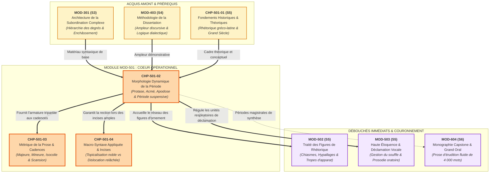
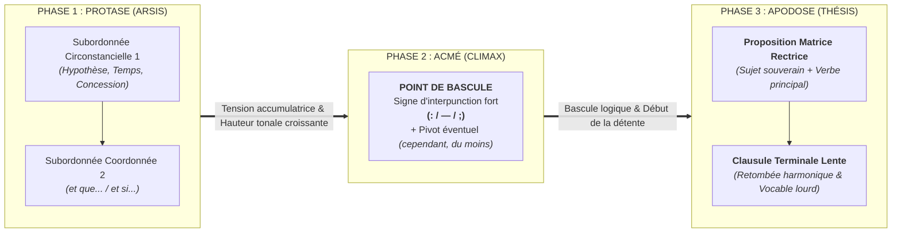

# Chapitre 2 — Morphologie Dynamique de la Période : Protase, Acmé, Apodose et Architecture des Périodes Suspensive et Continue

> **Identifiant du chapitre** : `CHP-501-02`  
> **Module de rattachement** : [`MOD-501` — Macro-Syntaxe, Dislocations, Incises et Grande Période Oratoire](file:///f:/Formation/world-class-french/03-curriculum/year-3/semester-5/mod-501-macro-syntaxe-periode-oratoire-cadences.md)  
> **Semestre** : Année 3 — Semestre 5 (S5)  
> **Volume horaire canonique** : 5 à 6 heures d'apprentissage autonome délibéré et d'ateliers d'application (Phase 1 Étude : 1 h 30 | Phase 2 Pratique : 1 h 30 | Phase 3 Correction : 1 h 00 | Phase 4 Évaluation : 1 h 00)  
> **Statut du document** : [STATUT : VALIDÉ]  
> **Compétences associées** : [`FR-SYNTAX-003`](file:///f:/Formation/world-class-french/02-competency-framework/competency-framework.md#fr-syntax-003-maîtrise-de-la-grande-période-oratoire-et-de-la-macro-syntaxe) (Palier L4 Maîtrise approfondie), [`FR-STYLE-001`](file:///f:/Formation/world-class-french/02-competency-framework/competency-framework.md#fr-style-001-maîtrise-des-figures-de-rhétorique-et-commentaire-stylistique) (Palier L4 Maîtrise approfondie), [`FR-INT-003`](file:///f:/Formation/world-class-french/02-competency-framework/competency-framework.md#fr-int-003-réviser-et-corriger-un-texte-tiers-en-justifiant-les-interventions) (Palier L3 Autonomie)  
> **Sources scientifiques de référence** : `SRC-RHET-03` (Reboul, 1991, chap. 4), `SRC-RHET-04` (Calas, 2011, chap. 5), `SRC-GRAM-02` (Riegel, Pellat & Rioul, 2016, chap. 14 & 21), `SRC-GRAM-01` (Grevisse & Goosse, 2016, § 380, § 420, § 468, § 1060), `SRC-NORM-03` (Ministère de l'Éducation nationale, 2020), `SRC-TYPO-01` (Imprimerie nationale, 2002/2014)

---

## 1. Titre et Place dans le Cursus

### 1.1 Intitulé Officiel et Périmètre Didactique
**Chapitre 2 : Morphologie Dynamique de la Période : Protase, Acmé, Apodose et Architecture des Périodes Suspensive et Continue** (`CHP-501-02`).

Ce chapitre constitue le cœur structurel du module [`MOD-501`](file:///f:/Formation/world-class-french/03-curriculum/year-3/semester-5/mod-501-macro-syntaxe-periode-oratoire-cadences.md). Alors que le Chapitre 1 a posé les fondements épistémologiques et l'histoire rhétorique du concept de période depuis Aristote jusqu'aux maîtres de la chaire classique, le présent chapitre formalise la **mécanique interne** du mouvement périodique. Il dote l'apprenant d'une conscience aiguë des flux d'énergie syntaxique, enseigne l'art de retarder souverainement la proposition matrice, de suspendre le jugement de l'auditeur, et de faire coïncider le sommet mélodique (*arsis*) et le nœud logique avant d'amorcer la retombée résolutive (*thésis*) [Réf. `SRC-RHET-03`, chap. 4 ; `SRC-GRAM-02`, chap. 21].

### 1.2 Insertion Architecturale et Synergies Didactiques



- **En amont** : Ce chapitre réinvestit les compétences de subordination complexe validées en [`MOD-301`](file:///f:/Formation/world-class-french/03-curriculum/year-2/semester-3/mod-301-architecture-subordination-completives.md) et la gestion des grands souffles démonstratifs de [`MOD-403`](file:///f:/Formation/world-class-french/03-curriculum/year-2/semester-4/mod-403-methodologie-dissertation-essai-academique.md). Il s'enracine directement dans [`CHP-501-01`](file:///f:/Formation/world-class-french/03-curriculum/year-3/semester-5/mod-501-macro-syntaxe-periode-oratoire-cadences.md#chapitre-1--fondements-épistémologiques-et-histoire-rhétorique-de-la-période-3-h-00) qui a clarifié le passage historique de la phrase segmentée à la phrase périodique.
- **En aval immédiat** : La morphologie tripartite formalisée ici conditionne la métrique de la prose et le calibrage des cadences (majeure, mineure, équilibrée) du [`CHP-501-03`](file:///f:/Formation/world-class-french/03-curriculum/year-3/semester-5/mod-501-macro-syntaxe-periode-oratoire-cadences.md#chapitre-3--la-métrique-de-la-prose-et-le-système-des-cadences-rythmiques-4-h-30) ainsi que la manipulation des incises nobles sans rupture de rection dans [`CHP-501-04`](file:///f:/Formation/world-class-french/03-curriculum/year-3/semester-5/mod-501-macro-syntaxe-periode-oratoire-cadences.md#chapitre-4--macro-syntaxe-appliquée--incises-savantes-et-dislocations-nobles-3-h-30).
- **En prolongement supérieur** : L'armature périodique close fournit le réceptacle des figures d'éloquence dans [`MOD-502`](file:///f:/Formation/world-class-french/03-curriculum/year-3/semester-5/mod-502-traite-figures-rhetorique-poetique.md), guide la respiration costo-diaphragmatique en déclamation publique dans [`MOD-503`](file:///f:/Formation/world-class-french/03-curriculum/year-3/semester-5/mod-503-haute-eloquence-declamation-presence-oratoire.md), et confère à la monographie de fin d'études ([`MOD-604`](file:///f:/Formation/world-class-french/03-curriculum/year-3/semester-6/mod-604-capstone-project-grand-oral.md)) la gravité et l'harmonie propres aux grands travaux académiques.

---

## 2. Objectifs Mesurables

Au terme des 5 à 6 heures d'apprentissage autonome délibéré et d'ateliers pratiques de ce chapitre, l'apprenant est capable de :

1. **Délimiter et cartographier les trois phases dynamiques de la période oratoire** (protase ascendante, acmé nodale et apodose résolutive) sur un corpus patrimonial et moderne, en explicitant le statut syntaxique exact de chaque proposition constitutive ([`FR-SYNTAX-003`](file:///f:/Formation/world-class-french/02-competency-framework/competency-framework.md#fr-syntax-003-maîtrise-de-la-grande-période-oratoire-et-de-la-macro-syntaxe), Palier L4 Maîtrise approfondie).
2. **Identifier, positionner et déplacer l'acmé syntaxique et sémantique** au sein d'énoncés amples en maniant avec rigueur les marqueurs de rupture (deux-points, tiret demi-cadratin, point-virgule d'articulation) ou les adverbes pivots (*cependant, néanmoins, du moins*), avec un taux de réussite de 100 % sur épreuve de révision ([`FR-SYNTAX-003`](file:///f:/Formation/world-class-french/02-competency-framework/competency-framework.md#fr-syntax-003-maîtrise-de-la-grande-période-oratoire-et-de-la-macro-syntaxe), Palier L4 Maîtrise approfondie).
3. **Différencier et classifier les architectures périodiques** selon leur régime de clôture (période suspensive/close vs période continue/liée) et selon leur articulation numérique (structures bimembres $A // B$, trimembres $A + B // C$, quadrimembres $A + B // C + D$), en explicitant les effets esthétiques et psychologiques engendrés ([`FR-STYLE-001`](file:///f:/Formation/world-class-french/02-competency-framework/competency-framework.md#fr-style-001-maîtrise-des-figures-de-rhétorique-et-commentaire-stylistique), Palier L4 Maîtrise approfondie).
4. **Composer sous contrainte métrique et typographique une période oratoire inédite** de 60 mots exacts conforme aux règles de l'Imprimerie nationale (`SRC-TYPO-01`), associant deux membres de protase, une acmé nette et une apodose résolutive, exempte de tout solécisme d'anacoluthe ou d'étiolement syntaxique ([`FR-SYNTAX-003`](file:///f:/Formation/world-class-french/02-competency-framework/competency-framework.md#fr-syntax-003-maîtrise-de-la-grande-période-oratoire-et-de-la-macro-syntaxe), Palier L4 Maîtrise approfondie).

---

## 3. Prérequis et Test de Préparation

### 3.1 Prérequis Cognitifs et Grammaticaux Exigibles
- **Maîtrise absolue de la phrase complexe (`MOD-301`)** : Capacité à tracer l'arbre syntaxique complet d'une phrase comportant des subordonnées circonstancielles antéposées et des relatives coordonnées, sans omission de matrice rectrice.
- **Concordance des modes et des temps (`MOD-302`)** : Maniement infaillible du subjonctif et des tiroirs verbaux du style soutenu lors de la coordination de propositions hypothétiques (*si... et que...*).
- **Distinction Micro-syntaxe vs Macro-syntaxe (`CHP-501-01`)** : Aptitude à dépasser la simple vérification de la valence verbale pour analyser la distribution des masses phrastiques et l'emballage prosodique.

### 3.2 Test de Préparation (Auto-Diagnostic à 5 Questions)
Répondez aux cinq questions suivantes avant d'ouvrir le corrigé repliable :

1. **Question 1 (Frontière prédicative)** : Dans la phrase : *« Bien que le vent eût redoublé de violence et que la nuit enveloppât le rivage, les matelots ne perdirent point courage »*, quelle est la proposition principale (matrice) ? Quelle est la fonction des deux premières propositions ?
2. **Question 2 (Prosodie de l'attente)** : Pourquoi la voix monte-t-elle naturellement en hauteur mélodique lorsqu'on lit à voix haute une subordonnée circonstancielle placée en tête d'énoncé ? Comment nomme-t-on ce mouvement en rhétorique classique ?
3. **Question 3 (Nature de la parataxe)** : Soit l'énoncé : *« L'armée avançait, le canon grondait, l'ennemi reculait, la victoire approchait »*. Pourquoi cette phrase ne constitue-t-elle pas une période suspensive au sens cicéronien ?
4. **Question 4 (Le pivot logique)** : Dans *« Si tous les périls s'étaient ligués contre sa patrie : du moins n'a-t-il jamais défailli à son honneur »*, quel rôle joue le segment *du moins* vis-à-vis des deux membres ?
5. **Question 5 (Vigilance actancielle)** : Pourquoi la proposition *« En observant la chute de la monarchie, les causes de la révolution apparurent clairement à l'historien »* constitue-t-elle un vice de construction ?

---

<details>
<summary><strong>Corrigé détaillé et barème de l'auto-diagnostic (cliquer pour dérouler)</strong></summary>

1. **Réponse 1** : La proposition principale (matrice rectrice) est *« les matelots ne perdirent point courage »*. Les deux premières propositions sont des subordonnées circonstancielles de concession coordonnées (*Bien que... et que...*) occupant la fonction de compléments de phrase antéposés.
2. **Réponse 2** : L'antéposition des subordonnées suspend la clôture prédicative : l'auditeur ne peut pas clore le sens de l'énoncé. La voix élève sa hauteur mélodique pour signaler que la complétude syntaxique est à venir. En rhétorique classique, ce mouvement d'élévation prosodique s'appelle l'**arsis** [Réf. `SRC-RHET-03`, chap. 4].
3. **Réponse 3** : Il s'agit d'une suite de propositions juxtaposées (parataxe) où chaque segment est syntaxiquement et sémantiquement autonome dès son émission. Le sens n'est nullement suspendu : on pourrait s'arrêter après n'importe quel segment. La période suspensive exige au contraire que le sens demeure incomplet jusqu'à l'apodose terminale.
4. **Réponse 4** : L'adverbe *du moins* sert de **pivot disjonctif et modal** : placé immédiatement après le signe fort d'articulation (les deux-points), il marque le basculement entre la protase concessive et l'apodose affirmative, incarnant le sommet logique (*acmé*).
5. **Réponse 5** : C'est une **anacoluthe fautive** (solécisme de rection) : le gérondif antéposé *« En observant la chute de la monarchie »* n'a pas de sujet propre et doit obligatoirement être coréférentiel avec le sujet syntaxique de la proposition principale. Or, ce sujet est *les causes de la révolution* ; ce ne sont pas les causes qui observent, mais l'historien. Forme correcte : *« En observant la chute de la monarchie, l'historien comprit clairement les causes de la révolution »* [Réf. `SRC-GRAM-01`, § 420].

> **Barème d'orientation** :  
> • **Score 5/5** : Prérequis maîtrisés. Vous pouvez aborder directement l'analyse dynamique.  
> • **Score 3/5 ou 4/5** : Fragilités sur la prosodie ou la rection. Consultez attentivement les sections 6 et 7.  
> • **Score $< 3/5$** : Prérequis insuffisants. Relisez impérativement [`MOD-301`](file:///f:/Formation/world-class-french/03-curriculum/year-2/semester-3/mod-301-architecture-subordination-completives.md) et la section 7 de [`MOD-501`](file:///f:/Formation/world-class-french/03-curriculum/year-3/semester-5/mod-501-macro-syntaxe-periode-oratoire-cadences.md#7-concepts-fondamentaux-et-notions-avancées).
</details>

---

## 4. Situation de Départ ou Problème Concret

### 4.1 Le Malaise de la Phrase Amorphe ou Avortée
Dans la rédaction académique de haut niveau, le plaidoyer ou l'éloquence publique, les scripteurs commettent régulièrement l'une de ces deux erreurs symétriques lorsqu'ils tentent de donner du souffle à leur prose :
1. **L'effondrement amorphe** : Le scripteur aligne plusieurs propositions circonstancielles avec sincérité, mais livre le cœur de sa pensée dès le sixième mot, puis laisse traîner la phrase dans une queue de subordonnées relatives et circonstancielles parasites qui s'éteignent sans énergie.
2. **L'avortement sans acmé** : Le scripteur accumule des subordonnées préparatoires, tend l'attention du lecteur, mais ne ménage aucun point d'orgue ni aucune bascule ; la phrase s'achève sur un verbe étique ou une coordination banale, privant l'auditeur du sentiment de plénitude intellectuelle.

Observons cette tentative maladroite relevée dans un discours universitaire d'apparat :

```text
[TENTATIVE AMORPHE — SANS MORPHOLOGIE DYNAMIQUE]
« Le président de l'université a annoncé hier la création du nouvel institut de recherche, 
parce que les mutations technologiques s'accélèrent et que les financements internationaux 
ont enfin été débloqués après de longues négociations menées par le ministère des Affaires 
étrangères, qui s'était pourtant montré très hésitant au début de l'année scolaire. »
```

### 4.2 Diagnostic Clinique
- **Sens dévoilé trop tôt** : L'information majeure (*Le président a annoncé la création de l'institut*) est jetée en incipit. Dès lors, le suspens est anéanti.
- **Absence de trajectoire** : La phrase subit une déperdition d'énergie continue. Elle glisse du fait institutionnel majeur vers un détail anecdotique de politique ministérielle (*très hésitant au début*).
- **Acmé introuvable** : Aucun point de rupture n'est identifiable. La voix du lecteur descend immédiatement et cherche en vain un appui rythmique.

### 4.3 La Transposition Magistrale en Période Suspensive
Pour conférer à cette même information la solennité et la puissance d'adhésion nécessaires, le styliste inverse la hiérarchie informationnelle, édifie une **protase montante** accumulant les motifs, marque l'**acmé** par un pivot net, et libère l'**apodose** dans une formule magistrale :

> *« Alors que les mutations technologiques bouleversent les certitudes de notre siècle, et que de longues négociations diplomatiques viennent enfin de débloquer les financements nécessaires : le président de l'université a solennellement proclamé la naissance de notre institut, consacrant ainsi l'alliance souveraine du savoir et de l'avenir. »*

La phrase n'est pas seulement « plus élégante » : elle est devenue une **entité organique** qui capture l'esprit, soutient le souffle et impose son autorité rationnelle.

---

## 5. Explication Intuitive

### 5.1 L'Analogie de la Trajectoire Parabolique du Projectile
Pour comprendre la morphologie dynamique de la période, imaginons la trajectoire d'un projectile propulsé vers le ciel :
1. **L'Ascension balistique (La Protase)** : L'obus quitte le canon avec une vitesse initiale considérable. Il lutte contre la gravité, accumule de l'énergie potentielle, monte régulièrement dans l'azur. À chaque mètre franchi, la tension croît : on ignore encore où se situera l'impact, mais l'impulsion est manifeste.
2. **L'Apogée critique (L'Acmé)** : Pendant une fraction de seconde, au sommet de la parabole, le projectile atteint sa hauteur maximale. La vitesse ascensionnelle s'annule ; il flotte à la frontière exacte entre la montée et la chute. C'est le point de bascule critique où l'énergie accumulée bascule dans une direction nouvelle.
3. **La Descente fulgurante (L'Apodose)** : Attiré par la terre, le projectile redescend en accélérant selon une courbure harmonieuse et s'abat sur la cible avec une puissance irrésistible.

```text
TRAJECTOIRE PARABOLIQUE DE LA PÉRIODE ORATOIRE
               [ ACMÉ / CLIMAX ]
               Point de bascule
                     /\
                    /  \
                   /    \
 [ PROTASE ]      /      \      [ APODOSE ]
 Tension montante/        \      Détente résolutive
 Accumulation   /          \     Accomplissement
 (Arsis)       /            \    (Thésis)
              /              \
             /                \
------------+                  +------------
Lancement                      Résolution
(Incipit)                      (Clausule)
```

### 5.2 L'Analogie de la Vague Océanique
Considérons la mécanique du déferlement d'une lame océanique :
- **La Houle qui grossit (Protase)** : Loin du rivage, la masse liquide s'enfle, aspire l'eau environnante, soulève sa crête sombre dans un grondement contenu.
- **La Crête écumante (Acmé)** : L'onde arrive sur le haut-fond ; la crête devient translucide, suspendue entre ciel et mer, au comble de sa verticalité instable.
- **Le Déferlement souverain (Apodose)** : La crête s'effondre en avant, déploie son écume blanche et vient mourir en un murmure majestueux et étale sur le sable de la grève.

En prose classique, toute phrase périodique digne de ce nom est une **vague d'intelligence et de souffle** qui refuse de s'écraser avant d'avoir atteint sa crête [Réf. `SRC-RHET-04`, chap. 5].

---

## 6. Définitions Précises et Terminologie

Les définitions ci-dessous fixent la nomenclature scientifique adoptée dans le cursus World-Class French, en conformité avec la tradition rhétorique classique (`SRC-RHET-03`), la stylistique universitaire (`SRC-RHET-04`) et la grammaire méthodique (`SRC-GRAM-02`).

### 6.1 Morphologie Dynamique
Étude de la configuration formelle de la phrase littéraire envisagée non pas comme un schéma syntaxique statique (arbre de dépendances immobile), mais comme un **processus cinétique continu** gouverné par des flux de tension sémantique, des variations de pression respiratoire et des oscillations mélodiques.

### 6.2 Protase (*Protasis*)
Phase initiale et ascendante de la période (du grec *protasis*, action de tendre en avant). 
- **Rôle syntaxique** : Accumulation de constituants périphériques d'arrière-plan (propositions subordonnées circonstancielles d'hypothèse, de temps, de concession, syntagmes participiaux ou compléments détachés).
- **Rôle sémantique** : Création et maintien d'un état de **suspens cognitif absolu**. La protase pose les conditions, les circonstances ou les obstacles, mais se refuse à formuler l'assertion centrale.
- **Rôle prosodique (*Arsis*)** : Montée continue de la hauteur tonale (fréquence fondamentale $F_0$) et maintien d'un débit contenu, signifiant à l'auditeur que le message demeure incomplet [Réf. `SRC-RHET-03`, chap. 4].

### 6.3 Acmé (*Akmê*) ou Climax
Point culminant, crête ou frontière charnière de la période oratoire (du grec *akmê*, pointe, sommet).
- **Caractère nodale** : L'acmé sépare obligatoirement la protase de l'apodose. C'est l'instant où le suspens atteint son degré d'intensité maximale.
- **Signalisation typographique** : En français soigné, l'acmé est matérialisée par un signe d'interpunction fort : les deux-points (rupture explicative ou révélatrice), le tiret demi-cadratin (suspension oratoire), ou le point-virgule d'articulation majeure [Réf. `SRC-TYPO-01`, p. 143].
- **Signalisation lexicale** : Présence fréquente d'un **pivot disjonctif ou oppositif** (*cependant, néanmoins, du moins, enfin*).

### 6.4 Apodose (*Apodosis*)
Phase conclusive et descendante de la période (du grec *apodosis*, restitution, acquittement d'une dette).
- **Rôle syntaxique** : Déploiement de la **proposition matrice (principale)** qui régit l'énoncé et délivre le prédicat central attendu.
- **Rôle sémantique** : Résolution du problème posé en protase, apaisement de la curiosité intellectuelle, formulation de la sentence ou du jugement décisif.
- **Rôle prosodique (*Thésis*)** : Retombée mélodique vers les fréquences graves, décélération solennelle du débit et plénitude harmonique de la **clausule terminale** [Réf. `SRC-GRAM-02`, chap. 21].

### 6.5 Période Suspensive (ou Période Close / *Periodos*)
Phrase complexe arborescente construite selon une architecture telle que le sens global demeure rigoureusement suspendu et incomplet jusqu'à l'émission de la dernière proposition. Toute interruption matérielle avant l'apodose produit un énoncé tronqué et agrammatical. C'est le canon de l'éloquence classique d'apparat.

### 6.6 Période Continue (ou Période Liée / *Oratio Vincta*)
Architecture périodique plus ouverte dans laquelle des propositions complètes et autonomes sur le plan de la micro-syntaxe sont enchaînées par des coordinations harmonieuses, des anaphores ou des parallélismes métriques. La cohésion y est assurée par le rythme d'ensemble et la symétrie des membres (*cola*) plutôt que par la stricte dépendance grammaticale.

### 6.7 Typologie Numérique des Membres (*Cola*)
- **Période Bimembre ($A // B$)** : Période à deux membres majeurs, articulant généralement 1 membre de protase et 1 membre d'apodose dans une balance antithétique ou comparative.
- **Période Trimembre ($A + B // C$)** : Période à trois membres, comprenant 2 membres en protase ascendante coordonnée et 1 membre d'apodose concluante (ou symétriquement $A // B + C$).
- **Période Quadrimembre ($A + B // C + D$)** : Période royale à quatre membres, structurant deux membres ascendants et deux membres descendants dans un équilibre monumental.

---

## 7. Règles ou Mécanismes Fondamentaux

### 7.1 La Mécanique de la Protase : Tension et Suspens

#### Règle 7.1.1 — Le Principe de l'Antéposition Circonstancielle
La protase tire sa puissance dynamique du refus absolu de commencer par la proposition principale rectrice. Le scripteur doit antéposer systématiquement les propositions circonstancielles ou les compléments lourds.
- **Modes circonstanciels privilégiés** :
  1. *L'Hypothèse et la condition* (*Si..., quand bien même...*) : pose un monde possible non encore advenu ;
  2. *Le Temps et la simultanéité* (*Quand..., lorsque..., alors que..., dès lors que...*) : accumule les circonstances historiques ou dramatiques ;
  3. *La Concession* (*Bien que..., quoique..., quelque grand que soit...*) : dresse l'inventaire des obstacles que l'apodose viendra surmonter.
- **La coordination anaphorique en protase** : Pour élever la tension dans une période trimembre ou quadrimembre, le scripteur emploie la reprise de conjonction :
  *« **Quand** la fortune abandonne le prince, **et que** ses courtisans d'hier se dispersent... »* [Réf. `SRC-GRAM-01`, § 1062].

#### Règle 7.1.2 — L'Arsis Prosodique et le Calibrage Respiratoire
Sur le plan de la phonétique acoustique et de la déclamation oratoire, la protase exige :
- Une élévation continue de la courbe intonative de syllabe accentuée en syllabe accentuée ;
- Un volume de réserve respiratoire maîtrisé : l'orateur inspire profondément avant l'attaque de la protase et contrôle son débit abdominal pour ne jamais épuiser son air avant l'acmé [Réf. `SRC-RHET-03`, chap. 4].

#### Règle 7.1.3 — Le Maintien Impérieux du Suspens Sémantique
Il est formellement interdit de glisser dans la protase un constituant qui dévoilerait l'issue logique du propos. La protase doit demeurer une attente pure. Tout adverbe conclusif prématuré (*donc, par conséquent*) au sein de la protase constitue un vice de forme rédhibitoire.

---

### 7.2 L'Art Souverain du Positionnement de l'Acmé

#### Règle 7.2.1 — La Coïncidence du Sommet Prosodique et du Sommet Logique
L'acmé ne doit jamais être un accident typographique arbitraire. Elle marque l'instant exact où :
- La tension intellectuelle ne peut plus croître sans devenir confuse ;
- La hauteur mélodique atteint son sommet (*aigu relatif*) avant de s'inverser ;
- La question posée par la protase exige impérieusement sa réponse.

#### Règle 7.2.2 — La Matérialisation Graphique de l'Acmé
En conformité avec les règles de l'Imprimerie nationale (`SRC-TYPO-01`), l'acmé est signalée par :
1. **Les deux-points (:)** : Marqueur privilégié de la révélation. Ils créent une pause nette, annonçant que ce qui suit apporte l'explication souveraine ou l'événement attendu.
2. **Le tiret demi-cadratin (—)** : Marqueur de la suspension dramatique ou du saisissement de la pensée.
3. **Le point-virgule (;)** : Marqueur de la bascule équilibrée dans les périodes bimembres solennelles.

#### Règle 7.2.3 — Le Rôle du Pivot Conjonctif ou Adverbial
Pour accentuer la bascule, l'acmé peut être immédiatement suivie d'un pivot :
- *Pivot d'adversité* : *« ... : cependant l'âme vertueuse ne fléchit point. »*
- *Pivot de restriction noble* : *« ... : du moins sauverons-nous la liberté. »*
- *Pivot d'accomplissement temporel* : *« ... : alors seulement éclata la vérité. »*

---

### 7.3 La Résolution de l'Apodose : Plénitude et Clausule

#### Règle 7.3.1 — Le Déploiement de la Matrice Rectrice
L'apodose réintègre l'ordre grammatical souverain : c'est elle qui abrite le verbe recteur de degré 0 ([`MOD-301`](file:///f:/Formation/world-class-french/03-curriculum/year-2/semester-3/mod-301-architecture-subordination-completives.md)). Le sujet recteur et son groupe verbal se déploient enfin, dissipant toute incertitude syntaxique.

#### Règle 7.3.2 — La Thésis Prosodique
La courbe mélodique descend de manière continue vers les fréquences graves. L'orateur ralentit insensiblement le tempo syllabique, conférant à chaque vocable un poids d'évidence et d'incontestabilité [Réf. `SRC-GRAM-02`, chap. 21].

#### Règle 7.3.3 — L'Autorité de la Clausule Terminale
La fin de l'apodose (la *clausule*) ne doit jamais s'achever sur un mot faible, un pronom clitique atone ou un complément adventice efflanqué. Elle doit se clore sur un vocable lourd, dense sémantiquement (substantif noble, adjectif sonore), frappant l'oreille d'un coup définitif :
- *Clausule faible (à proscrire)* : *« ... les citoyens décidèrent de s'en aller chez eux. »*
- *Clausule forte (canonique)* : *« ... les citoyens scellèrent dans le sang l'immortalité de la patrie. »*

---

### 7.4 Typologie Structurelle des Périodes

| Type de Période | Formule Symbolique | Schéma Dynamique | Genre & Registre Privilégiés |
| :--- | :---: | :--- | :--- |
| **Période Bimembre Équilibrée** | $A // B$ | Protase (1 membre) $\rightarrow$ Acmé $\rightarrow$ Apodose (1 membre de masse égale). | Philosophie morale, sentences juridiques, maximes d'apparat. |
| **Période Trimembre Ascendante** | $A + B // C$ | Protase en 2 membres coordonnés $\rightarrow$ Acmé $\rightarrow$ Apodose résolutive ample. | Réquisitoires, plaidoyers civiques, démonstrations dialectiques. |
| **Période Trimembre Descendante** | $A // B + C$ | Protase courte et incisive $\rightarrow$ Acmé $\rightarrow$ Apodose binaire déployée en éventail. | Éloges funèbres, célébrations lyriques, évocations élégiaques. |
| **Période Quadrimembre Royale** | $A + B // C + D$ | Protase binaire ($A+B$) en crescendo $\rightarrow$ Acmé $\rightarrow$ Apodose binaire ($C+D$) en majesté. | Harangues d'État, préambules constitutionnels, manifestes historiques. |
| **Période Continue / Liée** | $A \sim B \sim C \sim D$ | Enchaînement de propositions assertives par anaphores ou coordinations régulières. | Récit épique, fresque historique, méditation philosophique continue. |

---

## 8. Raisonnement Détaillé (Le Pourquoi)

### 8.1 Pourquoi la Triade Protase-Acmé-Apodose Répond-elle à une Constante Psychologique Universelle ?
On pourrait se demander pourquoi la rhétorique classique, depuis Aristote (*Rhétorique*, livre III, chap. 9) et Cicéron (*Orator*, § 204-215) jusqu'aux modernes, a accordé un tel privilège à cette structure tripartite. Est-ce un simple caprice académique, un vestige d'élitisme formaliste ?

La réponse de la psychologie cognitive et de la stylistique contemporaine est formelle : **la structure périodique épouse la loi fondamentale de la perception et de l'émotion humaine : le cycle Tension $\rightarrow$ Crise $\rightarrow$ Résolution** [Réf. `SRC-RHET-03`, chap. 4].

```text
LE CYCLE PSYCHO-COGNITIF DE L'ADHÉSION ORATOIRE
┌────────────────────────────────────────────────────────────────────────┐
│ 1. ÉVEIL ATTENTIONNEL & SUSPENS (Protase)                              │
│    L'esprit refuse d'abandonner l'écoute tant que le sens est incomplet│
│    -> Création d'une "dette cognitive" que l'orateur promet de payer. │
├────────────────────────────────────────────────────────────────────────┤
│ 2. SAISISSEMENT PAROXYSTIQUE (Acmé)                                    │
│    L'attention est focalisée au maximum sur un point singulier         │
│    -> Réceptivité totale de l'auditoire à l'argument central.          │
├────────────────────────────────────────────────────────────────────────┤
│ 3. DÉTENTE CATALYTIQUE & CONSENTEMENT (Apodose)                        │
│    La livraison du prédicat principal apporte le soulagement logique   │
│    -> L'apaisement émotionnel favorise l'acceptation de la vérité.     │
└────────────────────────────────────────────────────────────────────────┘
```

1. **La création de la dette cognitive** : Dès lors qu'une phrase s'ouvre par *« Quoique les factions prétendent... »*, le cerveau de l'auditeur se trouve placé dans un état de déséquilibre homéostatique. Il est biologiquement contraint de maintenir son attention vigilante jusqu'à ce que la proposition principale vienne refermer le circuit.
2. **L'illusion d'évidence** : Lorsque l'apodose survient après une longue protase minutieusement ordonnée, le jugement qu'elle énonce semble découler **naturellement et nécessairement** de tout ce qui a précédé. L'auditeur n'a pas le sentiment qu'on lui impose une opinion : il a le sentiment d'assister à l'avènement inéluctable d'une loi physique.
3. **L'harmonie respiratoire partagée** : Comme le souligne Frédéric Calas (`SRC-RHET-04`, chap. 5), la période impose à l'auditeur la respiration même de l'orateur. En calquant son rythme mental sur le souffle pulmonaire du scripteur, le destinataire est physiquement incorporé à la démonstration.

---

## 9. Exemples Corrects Commentés

### 9.1 Autopsie d'une Période Historique Majeure : Bossuet (94 Mots)

Considérons le chef-d'œuvre de **Jacques-Bénigne Bossuet**, extrait de l'*Oraison funèbre d'Henriette-Anne d'Angleterre, duchesse d'Orléans* (1670) [Réf. `SRC-RHET-03` ; `SRC-RHET-04`] :

> *« Malgré ce grand cœur, si noble et si bien partagé ; malgré cette fidélité inviolable pour un frère chéri dans ses malheurs, et ce respect religieux pour un époux couronné ; malgré cette bonté souveraine, qui ne se lassait jamais de pardonner aux ingrats ; ô nuit désastreuse ! ô nuit effroyable ! où retentit tout à coup, comme un éclat de tonnerre, cette étonnante nouvelle : Madame se meurt ! Madame est morte ! qui pourrait aujourd'hui mesurer l'amertume de nos cœurs, et raconter dignement une si prodigieuse douleur ? »*

```text
DÉCOMPOSITION STRUCTURELLE DES TROIS PHASES DYNAMIQUES
┌──────────────────────────────────────────────────────────────────────────────────────┐
│ PHASE I : PROTASE TRIPARTITE EN ANAPHORE CONCESSIVE                                  │
│ ├── Colon 1 : « Malgré ce grand cœur, si noble et si bien partagé ; »                │
│ │   └── Tension amorcée : rappel des vertus morales intimes                          │
│ ├── Colon 2 : « malgré cette fidélité inviolable pour un frère chéri dans ses         │
│ │   malheurs, et ce respect religieux pour un époux couronné ; »                     │
│ │   └── Amplification épique : vertus fraternelles et dynastiques                    │
│ └── Colon 3 : « malgré cette bonté souveraine, qui ne se lassait jamais de            │
│     pardonner aux ingrats ; »                                                        │
│     └── Sommet de la sainteté royale : pardon évangélique                            │
├──────────────────────────────────────────────────────────────────────────────────────┤
│ PHASE II : ACMÉ EN DOUBLE ÉRUPTION (Rupture apostrophique et foudre du drame)        │
│ ├── Point de rupture : « ô nuit désastreuse ! ô nuit effroyable ! »                  │
│ │   └── Suspension de la syntaxe par exclamation tragique                            │
│ └── Le Climax dramatique : « où retentit tout à coup [...] cette étonnante nouvelle :│
│     Madame se meurt ! Madame est morte ! »                                           │
│     └── Les deux-points annoncent le coup de tonnerre, le présent cède au passé.     │
├──────────────────────────────────────────────────────────────────────────────────────┤
│ PHASE III : APODOSE EN INTERROGATION RHÉTORIQUE DESCENDANTE                          │
│ └── « qui pourrait aujourd'hui mesurer l'amertume de nos cœurs,                      │
│     et raconter dignement une si prodigieuse douleur ? »                             │
│     └── Thésis solennelle : aveu d'impuissance humaine et communion dans le deuil.   │
└──────────────────────────────────────────────────────────────────────────────────────┘
```

#### Analyse Technique Approfondie :
1. **La Protase anaphorique** : Bossuet érige d'abord un rempart de vertus princières par le triple martèlement de la préposition concessive *Malgré*. Chaque membre s'élargit : le premier évoque le cœur intérieur, le deuxième le frère exilé et le roi époux, le troisième la grâce divine envers les ennemis. La tension monte car l'auditeur sait que la mort a brisé ce triple rempart.
2. **L'Acmé par rupture d'anacoluthe** : Au lieu de poursuivre froidement par une principale attendue (*« Malgré tout cela, elle est morte »*), Bossuet brise délibérément l'armature logique par le cri déchirant : *« ô nuit désastreuse ! »*. C'est l'irruption du réel tragique qui submerge l'ordre syntaxique. Les deux-points jouent leur rôle cardinal d'acmé, libérant l'agonie en deux sentences de quatre syllabes (*Madame se meurt ! / Madame est morte !*).
3. **L'Apodose en question oratoire** : La phrase s'épanche enfin dans une vaste question descendante, coordonnée par *et*, qui n'attend aucune réponse sinon le silence et les larmes de la cour assemblée.

---

### 9.2 Analyse d'une Période Philosophique Majeure : Jean-Jacques Rousseau

Considérons ce passage monumental de **Jean-Jacques Rousseau**, extrait de l'*Émile ou De l'éducation* (1762, Livre IV, « Profession de foi du vicaire savoyard ») [Réf. `SRC-RHET-04`] :

> *« Quand les premiers besoins de la vie matérielle sont pleinement satisfaits, que le repos physique permet à l'esprit de se replier sur lui-même, et que le silence des passions laisse enfin retentir la voix de la conscience : l'homme moral reconnaît sans peine que le bonheur terrestre ne consiste point dans l'accumulation stérile des richesses, mais dans la paix intérieure d'une âme fidèle au devoir. »*

```text
DIAGRAMME FONCTIONNEL DE LA PÉRIODE DE ROUSSEAU
[ PROTASE ASCENDANTE (3 propositions temporelles coordonnées) ]
  ├── P1 : Quand les premiers besoins [...] sont satisfaits (18 syllabes)
  ├── P2 : que le repos physique permet [...] (18 syllabes)
  └── P3 : et que le silence des passions laisse [...] (20 syllabes)
                      │
                   [ ACMÉ ] (Deux-points de bascule démonstrative)
                      │
[ APODOSE DESCENDANTE (Proposition matrice rectrice binaire) ]
  └── Matrice : l'homme moral reconnaît sans peine [...] (20 syllabes)
        ├── Volet A (Rejet négatif) : ne consiste point dans l'accumulation [...]
        └── Volet B (Résolution positive) : mais dans la paix intérieure [...]
```

#### Commentaire Didactique :
- **Régularité de la protase** : Trois paliers rigoureusement coordonnés (*Quand..., que..., et que...*). Chaque condition prépare l'avènement de la clairvoyance morale.
- **Fonction des deux-points à l'acmé** : Ils matérialisent le passage de la préparation psychologique à l'illumination philosophique.
- **Apodose antithétique** : L'apodose livre la sentence rectrice articulée sur une opposition bipartite (*ne consiste point dans... mais dans...*), refermant le cercle logique avec une autorité souveraine.

---

## 10. Contre-Exemples et Erreurs Fréquentes

Nous analysons ici six erreurs récurrentes observées dans les copies d'étudiants et les projets d'allocution, avec leur réfutation scientifique et leur protocole de redressement :

### Erreur n° 1 : L'apodose prématurée révélant le sens dès le début de la protase
- **Manifestation pathologique** : Le scripteur formule sa thèse principale au tout début de la phrase, puis tente maladroitement d'en faire une période en accumulant des subordonnées à la traîne.
- **Exemple fautif** :  
  *« La réforme fiscale sera inévitablement adoptée par le Parlement, bien que les syndicats s'y opposent avec virulence et que l'opinion publique manifeste son inquiétude devant la hausse des contributions indirectes. »*
- **Réfutation stylistique** : Le suspens est mort-né. Dès le sixième mot (*adoptée*), la tension psychologique retombe à zéro. La phrase n'a pas de protase : elle commence par son apodose et s'achève par un dégonflement mélodique informe.
- **Chirurgie corrective** : Antéposer les subordonnées pour créer une protase concessive, ménager une acmé nette, et placer l'adoption de la loi en apodose triomphante :  
  *« Bien que les syndicats s'opposent avec virulence au projet gouvernemental, et que l'opinion publique manifeste son inquiétude devant la fiscalité indirecte : la fermeté des institutions garantira l'adoption inéluctable d'une réforme indispensable au salut des finances publiques. »*

---

### Erreur n° 2 : L'acmé introuvable dans une prose amorphe ou parataxique
- **Manifestation pathologique** : La phrase s'étire sur 60 mots par une succession de propositions coordonnées par *et* ou juxtaposées par de simples virgules, sans qu'aucun sommet mélodique ou logique ne vienne organiser le parcours.
- **Exemple fautif** :  
  *« Les négociations ont repris ce matin entre les diplomates, et chacun a exposé ses griefs, et les médiateurs ont pris des notes, et la tension était palpable dans la salle, et aucune solution concrète n'a encore émergé des discussions. »*
- **Réfutation stylistique** : C'est le degré zéro de la macro-syntaxe. L'énoncé est plat, uniforme, sans relief intonatif. L'auditeur ne sait jamais où focaliser son attention et s'endort sous le bercement monotone de la coordination parataxique.
- **Chirurgie corrective** : Hiérarchiser en subordonnées temporelles et circonstancielles pour bâtir une véritable protase, fixer l'acmé par un point-virgule et libérer l'apodose conclusive :  
  *« Alors que les diplomates reprenaient ce matin des pourparlers décisifs, et que les médiateurs mesuraient dans un silence pesant la gravité des griefs réciproques ; aucune perspective tangible de conciliation n'a encore pu dissiper le spectre d'une rupture imminente. »*

---

### Erreur n° 3 : La protase hypertrophiée étouffant une apodose étique
- **Manifestation pathologique** : L'auteur empile 6 subordonnées en protase (50 mots), puis, à bout de souffle, conclut par une proposition principale rachitique de 4 mots.
- **Exemple fautif** :  
  *« Puisque les traités internationaux obligent notre pays, que nos alliés réclament notre intervention, que nos frontières sont directement menacées par l'instabilité régionale, et que notre propre honneur constitutionnel nous interdit la moindre lâcheté devant l'agresseur : nous agirons. »*
- **Réfutation stylistique** : Déséquilibre métrique monstrueux. Une houle immense accouche d'une vaguelette ridicule. L'auditeur ressent une déception esthétique aiguë (*parturiunt montes, nascetur ridiculus mus*).
- **Chirurgie corrective** : Déployer l'apodose pour lui donner une masse syllabique et lexicale proportionnée à l'ampleur de la protase :  
  *« Puisque nos alliances nous obligent, que nos frontières sont directement menacées, et que l'honneur national réprouve la moindre défaillance : le gouvernement de la République déploiera sans faiblir l'ensemble de ses forces pour préserver l'intégrité du territoire et la liberté du peuple. »*

---

### Erreur n° 4 : La rupture de construction entre protase et apodose (anacoluthe fautive)
- **Manifestation pathologique** : Le scripteur débute sa protase par un participe présent ou un gérondif, mais change de sujet grammatical lors du passage à l'apodose, produisant un solécisme de sujet orphelin.
- **Exemple fautif** :  
  *« En examinant avec rigueur les pièces comptables de la société en faillite, des malversations financières inexcusables apparurent soudain aux yeux des magistrats instructeurs. »*
- **Réfutation stylistique** : Faute de rection micro-syntaxique lourde (`SRC-GRAM-01`, § 420). Le gérondif *En examinant* est syntaxiquement rattaché au sujet de la principale : *des malversations*. Or, ce ne sont pas les malversations qui examinent les pièces comptables, mais les magistrats.
- **Chirurgie corrective** : Rétablir la coréférence actancielle stricte entre le noyau de la protase et le sujet de la principale :  
  *« En examinant avec rigueur les pièces comptables de la société en faillite : les magistrats instructeurs mirent au jour des malversations financières dont l'ampleur stupéfia le tribunal. »*

---

### Erreur n° 5 : La fausse symétrie détruisant l'équilibre binaire
- **Manifestation pathologique** : L'auteur cherche à construire une période bimembre antithétique, mais juxtapose deux membres de natures morphologiques hétérogènes (par exemple un syntagme prépositionnel nominal d'un côté, et une proposition subordonnée complétive de l'autre).
- **Exemple fautif** :  
  *« D'un côté par la fermeté des forces de police dans le maintien de l'ordre public ; mais d'un autre côté le gouvernement souhaite que le dialogue social reprenne avec tous les partenaires. »*
- **Réfutation stylistique** : Boiterie syntaxique. La symétrie annoncée (*D'un côté... d'un autre côté*) est brisée par le refus du parallélisme grammatical : syntagme prépositionnel sans verbe opposé à une proposition indépendante verbale avec complétive.
- **Chirurgie corrective** : Rétablir le parallélisme parfait des deux plateaux de la balance :  
  *« Si l'État assure avec une fermeté inébranlable le maintien de l'ordre public sur l'ensemble du territoire ; il ouvre avec une égale bienveillance les voies d'un dialogue sincère à tous les partenaires de la nation. »*

---

### Erreur n° 6 : La retombée abrupte sans détente harmonique
- **Manifestation pathologique** : L'apodose apporte bien la réponse au problème, mais s'interrompt brutalement sur un monosyllabe sec ou une particule atone, privant l'énoncé de sa clausule.
- **Exemple fautif** :  
  *« Quand bien même l'ennemi franchirait nos défenses et que nos bataillons plieraient sous le nombre : nos soldats se battront pour. »*
- **Réfutation stylistique** : Choc phonétique cacophonique et inachèvement syntaxique. L'énergie accumulée en protase est stoppée net contre un mur au lieu de s'étaler dans une nappe harmonique.
- **Chirurgie corrective** : Offrir à l'apodose un rythme décroissant harmonieux achevé par une clausule sonore :  
  *« Quand bien même l'ennemi franchirait nos défenses et que nos bataillons plieraient sous le nombre : nos soldats combattront jusqu'au dernier souffle pour la sauvegarde sacrée de nos foyers. »*

---

## 11. Cas Particuliers et Limites

### 11.1 La Période Oratoire Interrogative
Dans l'éloquence judiciaire ou la harangue politique, l'apodose ne se résout pas toujours en une proposition déclarative affirmative. Elle s'épanouit fréquemment sous la forme d'une **question rhétorique sublime** (*interrogatio*).
- **Fonctionnement dynamique** : La protase accumule les preuves accablantes ou les paradoxes moraux ; l'acmé pose la sommation ; l'apodose projette alors une interrogation à laquelle l'auditoire ne peut répondre que par la condamnation de l'adversaire :
  *« Quand un citoyen a trahi le secret de nos armes, qu'il a vendu aux puissances étrangères les plans de nos forteresses, et que le sang de nos soldats a coulé par son infamie : quel tribunal oserait encore invoquer la clémence pour suspendre le glaive des lois ? »*

### 11.2 La Période Inversée (Apodose Antéposée et Déploiement Descendant)
Il arrive que les grands prosateurs (Chateaubriand, Julien Gracq) construisent une **période inversée**, particulièrement adaptée au registre élégiaque ou à la contemplation poétique :
- La proposition matrice brève est énoncée d'emblée comme un glas solennel ;
- L'acmé se situe immédiatement après cette frappe initiale ;
- L'apodose s'étire alors en une très longue retombée méditative parsemée de relatives descriptives coordonnées qui miment le reflux d'une vague ou la fuite inexorable du temps :
  *« La mort frappe sans pitié : moissonnant les jeunes espérances avant leur été, brisant les trônes séculaires dans la poussière des tombeaux, et dissipant les songes orgueilleux des mortels comme une fumée vaine que le vent d'automne emporte vers l'oubli. »*

### 11.3 La Période Brisée par Saisissement Affectif
Lorsque la violence de la douleur ou la terreur interdit l'achèvement du circuit syntaxique régulier, la période est légitimement interrompue par une figure de rupture (l'anacoluthe tragique de Bossuet ou la réticence de Racine). C'est le triomphe de la passion sur la norme : mais cette licence n'est tolérée qu'à la condition expresse que la rupture soit **mimétique et concertée**, et non le fruit d'une impuissance stylistique (`SRC-RHET-01`).

---

## 12. Approfondissement Adapté au Niveau

### 12.1 La Formalisation Macro-Syntaxique chez Frédéric Deloffre et Frédéric Calas
La stylistique contemporaine ne se satisfait plus d'une description purement impressionniste du « souffle » de la phrase. Dans ses travaux fondateurs sur l'harmonie de la prose, **Frédéric Deloffre** a formalisé la notion de **macro-syntaxe clausulaire**, prolongée à l'université par **Frédéric Calas** [Réf. `SRC-RHET-04`, chap. 5].
- La phrase oratoire se définit comme un emboîtement d'unités de rangs distincts :
  $$\text{Comma (Incise)} \subset \text{Colon (Membre)} \subset \text{Periodos (Période)}$$
- Le comma (de 2 à 5 syllabes) constitue l'atome respiratoire ; le colon (de 6 à 18 syllabes) forme le palier sémantique intermédiaire pourvu d'une autonomie mélodique ; la periodos rassemble 2, 3 ou 4 cola sous un **arc intonatif unificateur**.
- Sur le plan formel, la macro-syntaxe distingue le **noyau assertif** (la proposition principale) des **constituants pré-nucléaires** (la protase) et **post-nucléaires** (l'extension de l'apodose). La grandeur de la période classique réside dans l'hypertrophie savamment maîtrisée de la zone pré-nucléaire sans rupture du lien de rection avec le noyau [Réf. `SRC-GRAM-02`, chap. 21].

### 12.2 La Théorie Musicale de la Prose Littéraire : La Cadence Parfaite
Depuis la Renaissance, les théoriciens de la langue française ont souligné la parenté profonde entre la période oratoire et la composition musicale polyphonique :
- La **protase** correspond à la modulation vers la dominante ($V^e$ degré) : elle crée la tension harmonique et l'instabilité acoustique ;
- L'**acmé** équivaut à l'accord de septième de dominante posé sur point d'orgue ;
- L'**apodose** réalise la résolution sur l'accord parfait de tonique ($I^{er}$ degré), apportant le sentiment d'apaisement absolu et de clôture définitive.

---

## 13. Comparaisons Différentielles

### 13.1 Protase vs Apodose

| Critère d'Analyse | La Protase (*Protasis*) | L'Apodose (*Apodosis*) |
| :--- | :--- | :--- |
| **Fonction Syntaxique Dominante** | Périphérie d'arrière-plan (subordonnées circonstancielles, participiales). | Noyau assertif souverain (proposition matrice principale). |
| **Mouvement Mélodique (Prosodie)** | **Arsis** : élévation continue vers l'aigu ($F_0$ croissante). | **Thésis** : retombée continue vers le grave ($F_0$ décroissante). |
| **Statut Sémantique & Cognitif** | Suspens absolu, formulation d'hypothèses, attente de sens. | Résolution pleine, formulation du jugement, délivrance du sens. |
| **Gestion du Souffle Pulmonaire** | Débit contenu, pression sous-glottique maintenue. | Décélération majestueuse, détente costo-diaphragmatique. |
| **Ponctuation d'Aboutissement** | Débouche sur un signe d'acmé fort (deux-points, tiret, point-virgule). | S'achève impérativement sur un point final de clôture absolue. |

---

### 13.2 Période Suspensive (Close) vs Période Continue (Liée)

| Dimension Stylistique | Période Suspensive (Close / *Periodos*) | Période Continue (Liée / *Oratio Vincta*) |
| :--- | :--- | :--- |
| **Régime de Dépendance** | Dépendance hypotaxique stricte : le sens est nul sans l'apodose. | Autonomie parataxique ou coordinative : propositions complètes. |
| **Possibilité d'Interruption** | Impossible : couper la phrase à mi-parcours crée un tronçon agrammatical. | Possible : chaque membre possède un sens achevé, lié par le rythme. |
| **Effet Psychologique sur l'Auditeur** | Fascination, tension captivante, adhésion forcée par la logique. | Majesté fluide, déroulement historique continu, contemplation. |
| **Genres de Prédilection** | Plaidoyer d'assises, réquisitoire, discours d'apparat, décret souverain. | Récit de batailles, épopée, méditation morale, description picturale. |

---

### 13.3 Période Bimembre vs Période Quadrimembre

| Paramètre Morphologique | Période Bimembre ($A // B$) | Période Quadrimembre ($A + B // C + D$) |
| :--- | :--- | :--- |
| **Nombre de Membres (*Cola*)** | Exactement 2 membres majeurs séparés par l'acmé. | Exactement 4 membres majeurs (2 en protase, 2 en apodose). |
| **Principe d'Équilibre** | Balancement binaire strict (isocolie ou antithèse frontale). | Double balance : crescendo ascendant puis décrescendo descendant. |
| **Complexité Syntaxique** | Modérée : 1 subordonnée rectrice opposée à 1 principale. | Haute : arborescence de subordonnées coordonnées en protase et apodose. |
| **Tempo Oratoire** | Rythme lapidaire, tranchant, sentencieux. | Ampleur symphonique, solennité marmoréenne, souffle grandiose. |

---

## 14. Exercices Progressifs

### 14.1 Niveau 1 : Repérage de la Protase, de l'Acmé et de l'Apodose (Guidé)

Dans chacune des 12 périodes classiques ci-dessous, délimitez entre crochets la **Protase**, indiquez le signe ou le pivot marquant l'**Acmé**, et soulignez l'**Apodose**.

1. *« Quand les dieux abandonnent les empires à leur propre aveuglement, et que les princes refusent d'entendre les leçons de l'histoire : la ruine des nations devient le châtiment inévitable de l'orgueil des hommes. »* (Bossuet)
2. *« Si la justice est le premier devoir des souverains, et la paix le bien suprême des peuples ; comment concevoir qu'un monarque chrétien puisse allumer sans remords le feu de la discorde ? »* (Massillon)
3. *« Quoique les factions redoublent d'insolence dans les ténèbres, et que les traîtres conspirent jusque sous les voûtes du sénat : la vigilance sacrée des magistrats saura déjouer tous les complots de la tyrannie. »* (Mirabeau)
4. *« Lorsque le voyageur solitaire contemple du haut de la colline les ruines fumantes de la cité déchue, et qu'il mesure la vanité des grandeurs humaines : son âme s'élève avec recueillement vers l'éternité immuable du Créateur. »* (Chateaubriand)
5. *« Si vous avez le courage d'affronter l'injustice des lois barbares, et la constance de souffrir l'exil pour la vérité : l'avenir vous réservera la couronne immarcescible des martyrs de la liberté. »* (Lamartine)
6. *« Tant que le travailleur verra son salaire confisqué par l'usure, et que l'enfant du prolétaire sera condamné dès le berceau à l'ignorance et à la misère : la République ne sera qu'un vain mot inscrit sur le fronton de nos édifices. »* (Jean Jaurès)
7. *« Bien que la patrie eût été submergée sous le flot des armées ennemies, et que ses chefs officiels eussent capitulé dans la honte : une poignée de Français fidèles sut ranimer au fond des cœurs la flamme sacrée de la résistance. »* (Charles de Gaulle)
8. *« Quand la brise matinale balaie les sables du fleuve, que les palmiers oscillent sous le ciel d'opale, et que monte au loin la voix mélodieuse des piroguiers : l'Afrique ancestrale délivre aux âmes pures le secret millénaire de sa divine harmonie. »* (Léopold Sédar Senghor)
9. *« Tandis que les cavaliers gravissaient les pentes arides de la chaîne côtière, et que le soleil couchant incendiait la mer d'un éclat sanglant : le général comprit avec une angoisse glacée que l'ennemi leur avait coupé toute retraite. »* (Julien Gracq)
10. *« Si les préjugés du vulgaire peuvent égarer un instant la multitude crédule, et si l'imposture triomphe un jour à la tribune : le temps, vengeur infaillible de la justice, rétablira toujours la vérité dans son éclat immortel. »* (Robespierre)
11. *« Alors même que la tempête arracherait nos mâts et déchirerait nos voiles, et que l'abîme s'ouvrirait sous notre étrave : le capitaine tiendra la barre sans pâlir jusqu'à l'entrée du havre sauveur. »* (Victor Hugo)
12. *« Dès que le philosophe a pénétré le secret des lois de la nature, et qu'il a mesuré l'ordre admirable de l'univers : toute vaine terreur s'évanouit de son cœur pour faire place à la sérénité des sages. »* (Diderot)

---

<details>
<summary><strong>Corrigé détaillé et justifié du Niveau 1 (cliquer pour dérouler)</strong></summary>

1. **Protase** : *« [Quand les dieux abandonnent les empires à leur propre aveuglement, et que les princes refusent d'entendre les leçons de l'histoire] »* (deux subordonnées temporelles coordonnées). **Acmé** : Les deux-points (:). **Apodose** : <u>« la ruine des nations devient le châtiment inévitable de l'orgueil des hommes. »</u> (proposition principale déclarative).
2. **Protase** : *« [Si la justice est le premier devoir des souverains, et la paix le bien suprême des peuples] »* (deux conditionnelles coordonnées). **Acmé** : Le point-virgule d'articulation (;). **Apodose** : <u>« comment concevoir qu'un monarque chrétien puisse allumer sans remords le feu de la discorde ? »</u> (question oratoire interrogative).
3. **Protase** : *« [Quoique les factions redoublent d'insolence dans les ténèbres, et que les traîtres conspirent jusque sous les voûtes du sénat] »* (deux concessives coordonnées). **Acmé** : Les deux-points (:). **Apodose** : <u>« la vigilance sacrée des magistrats saura déjouer tous les complots de la tyrannie. »</u> (matrice principale d'autorité).
4. **Protase** : *« [Lorsque le voyageur solitaire contemple du haut de la colline les ruines fumantes de la cité déchue, et qu'il mesure la vanité des grandeurs humaines] »*. **Acmé** : Les deux-points (:). **Apodose** : <u>« son âme s'élève avec recueillement vers l'éternité immuable du Créateur. »</u>.
5. **Protase** : *« [Si vous avez le courage d'affronter l'injustice des lois barbares, et la constance de souffrir l'exil pour la vérité] »*. **Acmé** : Les deux-points (:). **Apodose** : <u>« l'avenir vous réservera la couronne immarcescible des martyrs de la liberté. »</u>.
6. **Protase** : *« [Tant que le travailleur verra son salaire confisqué par l'usure, et que l'enfant du prolétaire sera condamné dès le berceau à l'ignorance et à la misère] »*. **Acmé** : Les deux-points (:). **Apodose** : <u>« la République ne sera qu'un vain mot inscrit sur le fronton de nos édifices. »</u>.
7. **Protase** : *« [Bien que la patrie eût été submergée sous le flot des armées ennemies, et que ses chefs officiels eussent capitulé dans la honte] »*. **Acmé** : Les deux-points (:). **Apodose** : <u>« une poignée de Français fidèles sut ranimer au fond des cœurs la flamme sacrée de la résistance. »</u>.
8. **Protase** : *« [Quand la brise matinale balaie les sables du fleuve, que les palmiers oscillent sous le ciel d'opale, et que monte au loin la voix mélodieuse des piroguiers] »* (protase trimembre). **Acmé** : Les deux-points (:). **Apodose** : <u>« l'Afrique ancestrale délivre aux âmes pures le secret millénaire de sa divine harmonie. »</u>.
9. **Protase** : *« [Tandis que les cavaliers gravissaient les pentes arides de la chaîne côtière, et que le soleil couchant incendiait la mer d'un éclat sanglant] »*. **Acmé** : Les deux-points (:). **Apodose** : <u>« le général comprit avec une angoisse glacée que l'ennemi leur avait coupé toute retraite. »</u>.
10. **Protase** : *« [Si les préjugés du vulgaire peuvent égarer un instant la multitude crédule, et si l'imposture triomphe un jour à la tribune] »*. **Acmé** : Les deux-points (:). **Apodose** : <u>« le temps, vengeur infaillible de la justice, rétablira toujours la vérité dans son éclat immortel. »</u>.
11. **Protase** : *« [Alors même que la tempête arracherait nos mâts et déchirerait nos voiles, et que l'abîme s'ouvrirait sous notre étrave] »*. **Acmé** : Les deux-points (:). **Apodose** : <u>« le capitaine tiendra la barre sans pâlir jusqu'à l'entrée du havre sauveur. »</u>.
12. **Protase** : *« [Dès que le philosophe a pénétré le secret des lois de la nature, et qu'il a mesuré l'ordre admirable de l'univers] »*. **Acmé** : Les deux-points (:). **Apodose** : <u>« toute vaine terreur s'évanouit de son cœur pour faire place à la sérénité des sages. »</u>.
</details>

---

### 14.2 Niveau 2 : Déplacement et Réajustement de l'Acmé (Semi-Autonome)

Chacune des 6 phrases suivantes souffre d'un positionnement défectueux ou flou de son acmé, détruisant la tension oratoire. Réécrivez chaque phrase en déplaçant méthodiquement l'acmé pour restaurer une dynamique périodique magistrale.

1. *Phrase A* : *« Le magistrat a refusé de signer l'ordonnance de non-lieu, alors que le ministre lui ordonnait d'étouffer l'affaire et que la presse exerçait sur lui une pression insupportable. »*
2. *Phrase B* : *« Quoique les réserves de vivres soient presque épuisées, la garnison tiendra jusqu'à la dernière extrémité, même si les renforts tardent à paraître. »*
3. *Phrase C* : *« Si vous refusez de vous soumettre aux ordres du tribunal, et que vous persistez dans cette révolte insensée, vous perdrez vos droits et vous serez banni du royaume. »*
4. *Phrase D* : *« Dès que les premières lueurs de l'aube dissipèrent la brume des marais, les soldats aperçurent la bannière ennemie qui flottait fièrement sur la forteresse réputée imprenable. »*
5. *Phrase E* : *« Nous devons agir avec fermeté : parce que la jeunesse réclame la justice, et que les abus séculaires des puissants ne peuvent plus être tolérés. »*
6. *Phrase F* : *« Bien que les pourparlers de paix se poursuivent à Genève, les armes ne se tairont pas, tant que l'agresseur occupera nos provinces orientales. »*

---

<details>
<summary><strong>Corrigé détaillé et réécritures modèles du Niveau 2 (cliquer pour dérouler)</strong></summary>

1. **Réécriture A** :  
   *« Alors que le ministre lui ordonnait froidement d'étouffer l'affaire, et que la presse déchaînée exerçait sur son cabinet une pression insupportable : le magistrat intègre refusa de signer l'ordonnance inique qui eût déshonoré sa charge. »*  
   *Justification* : Antéposition des deux subordonnées adversatives en protase ; l'acmé (deux-points) isole le refus héroïque du juge en apodose solennelle.
2. **Réécriture B** :  
   *« Quoique les réserves de vivres soient presque anéanties, et que les renforts promis tardent désespérément à paraître : la garnison héroïque tiendra la citadelle jusqu'à la dernière extrémité du sacrifice. »*  
   *Justification* : Regroupement des deux concessions en protase binaire coordonnée (*Quoique... et que...*) ; acmé nette avant la résolution militaire.
3. **Réécriture C** :  
   *« Si vous refusez de vous soumettre à l'autorité souveraine des lois, et que vous persistez dans une sédition que réprouve la patrie : le bras de la justice sévira sans faiblesse, vous privant de vos honneurs et vous condamnant au bannissement perpétuel. »*  
   *Justification* : Remplacement de l'apodose plate (*vous perdrez... vous serez*) par un grand mouvement oratoire hiérarchisé achevé par une clausule grave.
4. **Réécriture D** :  
   *« Dès que les premières lueurs de l'aube eurent dissipé la brume glacée des marais : les sentinelles éperdues virent surgir devant elles la bannière ennemie qui flottait déjà sur le donjon réputé imprenable. »*  
   *Justification* : L'acmé sépare nettement la condition temporelle du saisissement de la découverte.
5. **Réécriture E** :  
   *« Parce que la jeunesse réclame impérieusement la justice, et que les abus intolérables des oligarchies ont épuisé la patience de la nation : le devoir sacré des républicains commande d'agir sans délai pour restaurer la dignité civique. »*  
   *Justification* : Suppression de l'apodose prématurée (*Nous devons agir*) ; l'impératif moral devient la conclusion inéluctable de la période.
6. **Réécriture F** :  
   *« Bien que les diplomates poursuivent à Genève de stériles pourparlers, et tant que l'armée ennemie occupera nos provinces sacrées : nos combattants ne déposeront point les armes et défendront la patrie jusqu'à la victoire totale. »*  
   *Justification* : Fusion des deux réserves en protase binaire montante ; acmé placée avant le serment de résistance nationale.
</details>

---

### 14.3 Niveau 3 : Analyse Morphologique Complète d'une Période d'Apparat de 50 Mots Exacts (Autonome)

Soit la période philosophique suivante, calibrée rigoureusement selon les normes typographiques de l'Imprimerie nationale (`SRC-TYPO-01`) :

> *« Quand le tumulte des passions s'apaise enfin dans le silence du cabinet, et que l'esprit contemple sans illusion la fragilité des grandeurs humaines : le philosophe découvre avec sérénité que la véritable gloire réside dans la conquête de soi et le mépris généreux des vains honneurs de la fortune. »*

#### Travail Demandé :
1. Établir le **décompte typographique certifié mot à mot** de la période selon les règles officielles de `SRC-TYPO-01` (comptabilisation des formes élidées).
2. Dresser le **tableau d'analyse morphologique intégrale** de la période (délimitation de la Protase, nature exacte de l'Acmé, déploiement de l'Apodose, qualification de l'architecture).
3. Rédiger un **commentaire stylistique synthétique** (150 mots) démontrant l'interaction entre le suspens syntaxique et l'apaisement moral exprimé par le texte.

---

<details>
<summary><strong>Corrigé modèle certifié du Niveau 3 (50 mots exacts) (cliquer pour dérouler)</strong></summary>

#### 1. Décompte Typographique Certifié Mot à Mot (Règle `SRC-TYPO-01`) :

| Tranche | Mots numérotés avec décomposition des élisions | Sous-total |
| :---: | :--- | :---: |
| **Mots 1 à 10** | 1. Quand \| 2. le \| 3. tumulte \| 4. des \| 5. passions \| 6. s' \| 7. apaise \| 8. enfin \| 9. dans \| 10. le | 10 |
| **Mots 11 à 20** | 11. silence \| 12. du \| 13. cabinet, \| 14. et \| 15. que \| 16. l' \| 17. esprit \| 18. contemple \| 19. sans \| 20. illusion | 10 |
| **Mots 21 à 30** | 21. la \| 22. fragilité \| 23. des \| 24. grandeurs \| 25. humaines : \| 26. le \| 27. philosophe \| 28. découvre \| 29. avec \| 30. sérénité | 10 |
| **Mots 31 à 40** | 31. que \| 32. la \| 33. véritable \| 34. gloire \| 35. réside \| 36. dans \| 37. la \| 38. conquête \| 39. de \| 40. soi | 10 |
| **Mots 41 à 50** | 41. et \| 42. le \| 43. mépris \| 44. généreux \| 45. des \| 46. vains \| 47. honneurs \| 48. de \| 49. la \| 50. fortune. | 10 |

**Total arithmétique certifié** : **50 mots exacts** (dont 2 élisions typographiques séparées par l'apostrophe conformément à `SRC-TYPO-01` : *s'*, *l'*).

---

#### 2. Tableau d'Analyse Morphologique Intégrale :

| Phase Dynamique | Délimitation Textuelle Exacte | Statut Syntaxique & Rection | Rôle Prosodique & Sémantique |
| :--- | :--- | :--- | :--- |
| **PROTASE** (Mots 1 à 25) | *« Quand le tumulte des passions s'apaise enfin dans le silence du cabinet, et que l'esprit contemple sans illusion la fragilité des grandeurs humaines »* | Deux subordonnées circonstancielles de temps coordonnées par *et que* (répétition canonique de la subordination). | **Arsis majeure** : Montée mélodique et accumulation des conditions intérieures favorables à la sagesse. Suspens sémantique absolu. |
| **ACMÉ** (Signe central) | **Les deux-points (:)** après *humaines* | Marqueur typographique fort d'articulation et de rupture. | Sommet intonatif et bascule logique : la préparation contemplative fait place à la révélation philosophique. |
| **APODOSE** (Mots 26 à 50) | *« le philosophe découvre avec sérénité que la véritable gloire réside dans la conquête de soi et le mépris généreux des vains honneurs de la fortune. »* | Proposition matrice rectrice (*le philosophe découvre*) commandant une subordonnée complétive binaire coordonnée (*que... et...*). | **Thésis résolutive** : Chute mélodique majestueuse, tempo ralenti, clôture définitive sur la clausule binaire harmonieuse (*honneurs de la fortune*). |

- **Qualification architecturale** : **Période suspensive trimembre** ($A + B // C$) à protase ascendante binaire et apodose matrice ample.

---

#### 3. Commentaire Stylistique Synthétique :
La morphologie de cette période matérialise avec une rigueur exemplaire le cheminement de l'âme vers la sagesse stoïcienne. La protase binaire installe d'abord le calme intellectuel par deux temps successifs : l'apaisement intérieur des passions d'un côté, la lucidité du regard sur le monde de l'autre. Le suspens est total jusqu'au vingt-cinquième mot, où les deux-points marquent l'acmé réflexive. L'apodose s'épanouit alors dans une retombée mélodique parfaite : le verbe principal *découvre*, longtemps différé, libère une complétive qui oppose la souveraineté spirituelle (*la conquête de soi*) à l'illusion sociale (*les vains honneurs*). L'équilibre numérique des masses (25 mots en protase, 25 mots en apodose) confère à l'énoncé la gravité et la stabilité marmoréenne d'une sentence de Marc Aurèle.
</details>

---

## 15. Activité de Correction Raisonnée

### Plaidoyer Judiciaire Défectueux Comportant 8 Défaillances Morphologiques à Assainir

#### Document Soumis à l'Audit :
Le texte suivant a été composé par un jeune avocat pour l'exorde d'un grand plaidoyer d'assises. Animé d'une louable intention oratoire, il a accumulé **huit défaillances majeures de dynamique périodique** qui transforment son discours en un assemblage heurté, amorphe et syntaxiquement bancal.

```text
[PROJET D'EXORDE JUDICIAIRE — AVANT RÉVISION]
« L'accusé est innocent de ce crime atroce, bien que le procureur ait soutenu hier sa 
culpabilité avec rage et que les témoins ont hésité pendant l'audience. En découvrant 
le cadavre de la victime dans le sous-sol glacé, l'effroi a saisi le gardien qui a crié 
pour appeler la police qui est arrivée trop tard. Quoique les indices manquent, 
nous vaincrons. D'une part par l'incohérence absolue des dépositions des accusateurs, 
mais d'autre part le ministère public n'a pas pu prouver le mobile. Si vous condamnez 
cet homme sans preuves, et vous obéissez à la clameur publique : sa condamnation sera 
une honte pour la justice de notre pays. »
```

---

### Apparat Critique et Protocole de Restructuration Complète

#### 1. Tableau d'Audit des 8 Défaillances Morphologiques :

| N° | Segment Fautif ou Défaillant | Nature de la Défaillance | Réfutation Savante & Prescription Normative |
| :---: | :--- | :--- | :--- |
| **1** | *« L'accusé est innocent [...] bien que le procureur ait soutenu... »* | **Apodose prématurée** (sens dévoilé d'emblée). | Destruction du suspens. Il faut antéposer la protase concessive pour faire de l'innocence la conclusion inéluctable. |
| **2** | *« ... et que les témoins **ont** hésité... »* | **Régime modal fautif** après *et que* de concession. | Après *bien que*, la reprise par *et que* régit obligatoirement le subjonctif : *et que les témoins **aient** hésité* [Réf. `SRC-GRAM-01`, § 1062]. |
| **3** | *« En découvrant le cadavre [...], l'effroi a saisi le gardien... »* | **Anacoluthe fautive** sur gérondif (sujet orphelin). | Le gérondif a pour sujet grammatical *l'effroi*. Or, c'est le gardien qui découvre le cadavre. Rétablir la coréférence : *le gardien sentit l'effroi le glacer* [Réf. `SRC-GRAM-01`, § 420]. |
| **4** | *« ... qui a crié pour appeler la police qui est arrivée... »* | **Cascade de relatives en enfilade** sans relief. | Empilement micro-syntaxique disgracieux qui détruit l'arc mélodique. À fondre dans une proposition participiale ou une apodose noble. |
| **5** | *« Quoique les indices manquent, nous vaincrons. »* | **Protase étique et chute abrupte** sans ampleur. | Énoncé trop sec pour un discours d'assises : étendre la protase et déployer l'apodose en cadence équilibrée. |
| **6** | *« D'une part par l'incohérence [...], mais d'autre part le ministère... »* | **Fausse symétrie binaire** (rupture de construction). | Coordonner deux membres de structures morphologiques identiques : deux propositions circonstancielles parallèles. |
| **7** | *« Si vous condamnez [...], et vous obéissez... »* | **Omission de la conjonction de reprise** *que*. | Lors de la coordination de deux subordonnées hypothétiques en *si*, la seconde doit s'introduire par *et que* : *et que vous obéissiez* [Réf. `SRC-GRAM-01`, § 1062]. |
| **8** | *« ... sa condamnation sera une honte pour la justice de notre pays. »* | **Clausule faible et amorphe** sans autorité. | La phrase se termine par un groupe prépositionnel plat. Il faut une clausule solennelle marquant la conscience des jurés. |

---

#### 2. Restructuration Magistrale du Plaidoyer (Version Homologuée) :

> *« Messieurs les jurés,  
> Alors même que le ministère public a déployé hier contre mon client une véhémence implacable, et que les dépositions hésitantes des témoins ont étalé devant vous la fragilité de l'accusation : la conscience intime de ce tribunal sait déjà que l'homme assis sur ce banc est innocent.  
> Lorsque le gardien de l'immeuble découvrit dans le sous-sol glacé la dépouille inanimée de la victime : un effroi légitime paralysa ses sens avant que l'alerte ne pût être donnée aux enquêteurs.  
> Si l'accusation échoue à produire la moindre preuve matérielle de sa thèse, et que le mobile même du crime demeure une énigme impénétrable : comment pourriez-vous, en immolant un innocent à la fureur aveugle de l'opinion, souiller à jamais la majesté souveraine de la justice ? »*

---

## 16. Mise en Pratique dans une Production Réelle

### Cahier des Charges de l'Atelier d'Écriture de Haute Rhétorique
Rédiger, en temps limité (**durée : 45 minutes**), une **période oratoire magistrale trimembre de 60 mots exacts**, destinée à un réquisitoire républicain contre la corruption politique, respectant le cahier des charges suivant :
1. **Architecture tripartite stricte** :
   - Deux membres coordonnés en **protase ascendante** ($A + B$) introduits par une locution circonstancielle lourde ;
   - Une **acmé** impérativement matérialisée par **les deux-points (:)** ;
   - Un membre d'**apodose résolutive** ($C$) portant la proposition matrice et s'achevant sur une clausule majestueuse.
2. **Calibrage arithmétique absolu** : Exactement **60 mots**, décomptés selon les règles officielles de l'Imprimerie nationale (`SRC-TYPO-01`).
3. **Pureté syntaxique** : Zéro solécisme d'anacoluthe, zéro coordination asymétrique, maintien de la rection du sujet sur 25 mots.

---

### Modèle de Référence Homologué (60 Mots Exacts)

> « Tant que les lois fondamentales de la République demeurent bafouées par l'arrogance des factions corrompues, et que la voix souveraine du peuple ne trouve aucun écho dans les assemblées soumises aux intérêts particuliers : le devoir sacré des citoyens libres commande d'opposer aux abus de l'arbitraire la force inébranlable du droit et le courage civique de la vertu. »

---

### Décompte Typographique Certifié Mot à Mot (Règle `SRC-TYPO-01`)

| Tranche métrique | Mots numérotés avec décomposition des élisions | Sous-total |
| :---: | :--- | :---: |
| **Mots 1 à 10** | 1. Tant \| 2. que \| 3. les \| 4. lois \| 5. fondamentales \| 6. de \| 7. la \| 8. République \| 9. demeurent \| 10. bafouées | 10 |
| **Mots 11 à 20** | 11. par \| 12. l' \| 13. arrogance \| 14. des \| 15. factions \| 16. corrompues, \| 17. et \| 18. que \| 19. la \| 20. voix | 10 |
| **Mots 21 à 30** | 21. souveraine \| 22. du \| 23. peuple \| 24. ne \| 25. trouve \| 26. aucun \| 27. écho \| 28. dans \| 29. les \| 30. assemblées | 10 |
| **Mots 31 à 40** | 31. soumises \| 32. aux \| 33. intérêts \| 34. particuliers : \| 35. le \| 36. devoir \| 37. sacré \| 38. des \| 39. citoyens \| 40. libres | 10 |
| **Mots 41 à 50** | 41. commande \| 42. d' \| 43. opposer \| 44. aux \| 45. abus \| 46. de \| 47. l' \| 48. arbitraire \| 49. la \| 50. force | 10 |
| **Mots 51 à 60** | 51. inébranlable \| 52. du \| 53. droit \| 54. et \| 55. le \| 56. courage \| 57. civique \| 58. de \| 59. la \| 60. vertu. | 10 |

**Total arithmétique certifié** : **60 mots exacts**.  
*(Comprend 4 élisions typographiques séparées par l'apostrophe conformément à `SRC-TYPO-01` : l'arrogance, d'opposer, l'arbitraire).*

---

### Tableau Structural de la Période Produite

```text
ARCHITECTURE MACRO-SYNTAXIQUE DE LA PÉRIODE DE 60 MOTS
┌────────────────────────────────────────────────────────────────────────────────────────┐
│ PROTASE ASCENDANTE (Mots 1 à 34 — 34 mots)                                             │
│ ├── Membre 1 (Colon A) : « Tant que les lois fondamentales de la République demeurent │
│ │   bafouées par l'arrogance des factions corrompues, » (16 mots)                      │
│ │   └── Statut : Subordonnée de proportion temporelle | Arsis initiale                 │
│ └── Membre 2 (Colon B) : « et que la voix souveraine du peuple ne trouve aucun écho    │
│     dans les assemblées soumises aux intérêts particuliers : » (18 mots)               │
│     └── Statut : Subordonnée coordonnée en "et que" | Crescendo et tension maximale    │
├────────────────────────────────────────────────────────────────────────────────────────┤
│ ACMÉ NODALE                                                                            │
│ └── Les deux-points (:) après "particuliers" (Mot 34) : Point de bascule logique       │
├────────────────────────────────────────────────────────────────────────────────────────┤
│ APODOSE RÉSOLUTIVE (Mots 35 à 60 — 26 mots)                                            │
│ └── Membre 3 (Colon C) : « le devoir sacré des citoyens libres commande d'opposer aux  │
│     abus de l'arbitraire la force inébranlable du droit et le courage civique de la    │
│     vertu. » (26 mots)                                                                 │
│     └── Statut : Matrice rectrice + compléments d'objet coordonnés | Thésis conclusive │
└────────────────────────────────────────────────────────────────────────────────────────┘
```

---

## 17. Résumé Structuré

### 17.1 Le Schéma de la Vague Périodique



### 17.2 Grille de Contrôle Morphologique en 6 Points Cardinaux
Avant de considérer une période oratoire comme définitive, l'auteur vérifie les six points de contrôle séquentiels :
1. **Contrôle du suspens protatique** : L'assertion principale est-elle strictement absente des 20 premiers mots ? Le sens est-il suspendu ?
2. **Contrôle de l'acmé** : Le point culminant est-il signalé par un signe de ponctuation fort (deux-points, tiret demi-cadratin, point-virgule) ? Coïncide-t-il avec le sommet de la tension ?
3. **Contrôle de l'apodose** : La proposition principale se déploie-t-elle avec autorité dès la bascule ?
4. **Contrôle de l'équilibre des masses** : La protase n'écrase-t-elle pas une apodose trop brève ? Les membres se répondent-ils en proportion harmonieuse ?
5. **Contrôle de la rection et coréférence** : Zéro sujet orphelin sur participe ou gérondif ? Respect rigoureux des modes après *et que* ?
6. **Contrôle de la clausule** : Le dernier mot de la phrase est-il un vocable plein, portant l'accent final sans s'éteindre sur une particule molle ?

---

## 18. Questions de Rappel Actif (Active Recall)

Testez votre mémoire procédurale et conceptuelle sans relire le cours :

1. **Question 1** : Quelle est la distinction sémiotique et fonctionnelle fondamentale entre l'*arsis* et la *thésis* au sein de la période classique ?
2. **Question 2** : Pourquoi l'emploi des deux-points est-il traditionnellement privilégié pour matérialiser l'acmé d'une période suspensive ?
3. **Question 3** : Dans une période trimembre de structure $A + B // C$, quelle est la règle normative de réfection syntaxique lors de la coordination des deux membres de la protase ?
4. **Question 4** : Qu'appelle-t-on la « clausule » d'une période et quelle condition phonétique doit-elle remplir pour assurer la plénitude harmonique ?
5. **Question 5** : Comment distingue-t-on techniquement une période suspensive d'une période continue ?
6. **Question 6** : Pourquoi une phrase qui révèle sa proposition principale dès ses premiers mots ne peut-elle jamais constituer une période suspensive authentique ?

---

<details>
<summary><strong>Réponses détaillées aux questions de rappel actif (cliquer pour dérouler)</strong></summary>

1. **Réponse 1** : L'**arsis** est le mouvement prosodique et psychologique d'élévation tonale et de mise en tension accompagnant la protase ; la **thésis** est le mouvement inverse de retombée mélodique vers le grave et de résolution sémantique caractérisant l'apodose [Réf. `SRC-RHET-03`, chap. 4].
2. **Réponse 2** : Les deux-points créent une pause médiane majeure tout en maintenant l'attente : ils indiquent que le sens n'est pas clos (contrairement au point) mais que l'énoncé va immédiatement délivrer la cause, l'effet souverain ou la révélation de ce qui a été accumulé [Réf. `SRC-TYPO-01`, p. 143].
3. **Réponse 3** : Lorsque deux subordonnées circonstancielles sont coordonnées en protase, la conjonction introductrice doit être reprise sous la forme **et que** (ou *et si*), et le verbe de la seconde subordonnée doit adopter le mode régi par la locution originelle (subjonctif obligatoire après *bien que et que...*) [Réf. `SRC-GRAM-01`, § 1062].
4. **Réponse 4** : La **clausule** est la chute ou le segment terminal de l'apodose. Pour être harmonieuse, elle doit éviter les sons étiques ou les clitiques atones et s'achever sur un mot pesant, sonore et rythmiquement stable [Réf. `SRC-GRAM-02`, chap. 21].
5. **Réponse 5** : La période suspensive maintient une dépendance grammaticale absolue où le sens ne peut être clos avant le terme ; la période continue enchaîne des propositions pourvues chacune d'un sens autonome, unies par le parallélisme métrique et des connecteurs logiques.
6. **Réponse 6** : Parce que l'assertion centrale étant immédiatement connue, l'auditeur ne se trouve placé dans aucun état de « dette cognitive » ni d'attente ; ce qui suit n'est plus qu'une extension accessoire (post-nucléaire) et non une apodose résolutive.
</details>

---

## 19. Mini-Évaluation Sommative Notée sur 20 Points

> **Conditions de passation** : Durée : 30 minutes. Aucun document autorisé.  
> **Barème pénal officiel** : Toute copie présentant une phrase amorphe sans acmé distincte subit un retrait forfaitaire automatique de **-5 points**. Note éliminatoire fixée à **$< 14/20$** (Palier L4).

---

### Sujet de l'Épreuve

#### Partie I : Dissection Morphologique d'une Période Classique (6 points)
Soit la période suivante (42 mots) :
> *« Quand les illusions de la gloire militaire se dissipent devant les champs de bataille dévastés, et que l'ambition des conquérants se heurte au désespoir des mères en deuil : l'histoire impartiale flétrit pour jamais les lauriers sanglants de la tyrannie. »*

1. Isolez la Protase, nommez sa structure interne et ses liens de coordination (2 pts).
2. Caractérisez l'Acmé : signe graphique et valeur fonctionnelle (1,5 pt).
3. Délimitez l'Apodose, identifiez son verbe recteur et qualifiez la clausule (2,5 pts).

#### Partie II : Traitement d'Anomalies de Période (6 points)
Soit les deux énoncés fautifs suivants :
- *Énoncé 1* : *« En voulant réformer trop vite les institutions sans consulter les citoyens, les révoltes populaires ont éclaté dans toutes les provinces. »* (3 pts)
- *Énoncé 2* : *« Le gouvernement a pris des mesures d'urgence pour sauver les banques, bien que les députés de l'opposition aient voté contre et que la colère gronde. »* (3 pts)

Pour chaque énoncé : identifiez la défaillance morphologique précise et réécrivez la phrase en une période suspensive irréprochable.

#### Partie III : Composition d'une Période Bimembre en Isocolie (8 points)
Composez une période oratoire bimembre ($A // B$) inédite sur le thème : *La rigueur de la vérité face au mensonge flatteur*.
- **Contraintes** :
  1. Membre A (Protase d'hypothèse) de 12 à 14 syllabes ;
  2. Acmé marquée par un point-virgule ou deux-points ;
  3. Membre B (Apodose résolutive) de volume syllabique équivalent ($A \approx B$) ;
  4. Zéro faute de rection, élisions de l'*e* caduc respectées.

---

### Corrigé Détaillé et Barème de Notation

<details>
<summary><strong>Corrigé officiel de la mini-évaluation (cliquer pour dérouler)</strong></summary>

#### Partie I : Dissection Morphologique (6 points)
1. **Protase** (2 pts) : *« Quand les illusions de la gloire militaire se dissipent devant les champs de bataille dévastés, et que l'ambition des conquérants se heurte au désespoir des mères en deuil »*. Structure binaire de deux subordonnées temporelles coordonnées par *et que* (répétition canonique de la conjonction). Arsis continue (1 pt). Suspens absolu maintenu sur 30 mots (1 pt).
2. **Acmé** (1,5 pt) : Matérialisée par les **deux-points (:)** après *deuil*. Fonction : rupture mélodique, sommet de l'attente et basculement immédiat vers le verdict moral.
3. **Apodose** (2,5 pts) : *« l'histoire impartiale flétrit pour jamais les lauriers sanglants de la tyrannie. »*. Matrice rectrice principale portée par le verbe *flétrit* (1 pt). Clausule forte, solennelle, achevée par le groupe nominal pesant *les lauriers sanglants de la tyrannie* (1,5 pt).

#### Partie II : Traitement d'Anomalies (6 points)
- **Énoncé 1** (3 pts) :
  - *Diagnostic* : Solécisme d'anacoluthe sur gérondif (*En voulant réformer...* attribué à *les révoltes*) (1,5 pt).
  - *Réécriture périodique normée* : *« En voulant réformer trop vite les institutions sans consulter la nation : le gouvernement imprudent provoqua dans toutes les provinces l'embrasement de révoltes populaires inéluctables. »* (1,5 pt).
- **Énoncé 2** (3 pts) :
  - *Diagnostic* : Apodose prématurée ruinant le suspens, dégonflement à la traîne (1,5 pt).
  - *Réécriture périodique normée* : *« Bien que les députés de l'opposition aient voté avec véhémence contre le projet, et que la colère gronde sourdement parmi le peuple : le gouvernement a proclamé l'état d'urgence pour préserver la stabilité financière de la nation. »* (1,5 pt).

#### Partie III : Composition d'une Période Bimembre (8 points)
- **Exemple de composition homologuée** :
  > *« Si le mensonge flatteur séduit un instant les cours frivoles ; (14 syllabes — Protase)*  
  > *la vérité sévère éclaire pour toujours l'esprit des sages. (14 syllabes — Apodose) »*
- **Ventilation des points** :
  - Respect de l'architecture bimembre et placement de l'acmé (point-virgule) : 2,5 pts.
  - Équilibre isocolique ($14 // 14$ syllabes) : 2,5 pts.
  - Densité philosophique et antithèse morale : 1,5 pt.
  - Correction absolue de la rection et noblesse lexicale : 1,5 pt.
</details>

---

## 20. Critères Observables de Maîtrise (Palier L4)

Conformément aux normes d'excellence de l'Année 3 du cursus World-Class French, la maîtrise du présent chapitre est attestée lorsque l'apprenant satisfait aux quatre indicateurs comportementaux observables suivants :

| Code Indicateur | Compétence & Palier | Comportement Observable Évaluable | Seuil de Validation Exigé |
| :---: | :---: | :--- | :---: |
| **IND-01** | [`FR-SYNTAX-003`](file:///f:/Formation/world-class-french/02-competency-framework/competency-framework.md#fr-syntax-003-maîtrise-de-la-grande-période-oratoire-et-de-la-macro-syntaxe) (**L4**) | **Délimitation tripartite infaillible** : Capacité à segmenter instantanément la protase, l'acmé et l'apodose sur un corpus littéraire dense de 10 périodes classiques sans confusion d'interpunction. | **100 % d'identifications exactes** |
| **IND-02** | [`FR-SYNTAX-003`](file:///f:/Formation/world-class-french/02-competency-framework/competency-framework.md#fr-syntax-003-maîtrise-de-la-grande-période-oratoire-et-de-la-macro-syntaxe) (**L4**) | **Positionnement souverain de l'acmé** : Aptitude à convertir une phrase amorphe en période suspensive en plaçant l'acmé au point exact d'équilibre logique et prosodique. | $\ge 90\ \%$ de réécritures conformes sur 10 cas |
| **IND-03** | [`FR-STYLE-001`](file:///f:/Formation/world-class-french/02-competency-framework/competency-framework.md#fr-style-001-maîtrise-des-figures-de-rhétorique-et-commentaire-stylistique) (**L4**) | **Caractérisation stylistique des structures** : Justification rigoureuse des effets psychologiques d'une période trimembre ou continue dans un commentaire littéraire. | Note $\ge 16/20$ sur épreuve de commentaire |
| **IND-04** | [`FR-SYNTAX-003`](file:///f:/Formation/world-class-french/02-competency-framework/competency-framework.md#fr-syntax-003-maîtrise-de-la-grande-période-oratoire-et-de-la-macro-syntaxe) (**L4**) | **Production calibrée sous contrainte stricte** : Rédaction d'une période oratoire originale de 60 mots exacts conforme à `SRC-TYPO-01`, associant 2 membres en protase, 1 acmé marquée et 1 apodose résolutive, exempte de toute anacoluthe. | **Conformité intégrale (60 mots exacts, zéro faute)** |

---

## 21. Sources et Lectures Complémentaires

Conformément à la charte d'intégrité bibliographique du cursus World-Class French ([`07-resources/source-registry.md`](file:///f:/Formation/world-class-french/07-resources/source-registry.md)), toutes les doctrines rhétoriques, règles syntaxiques et prescriptions de ce cours s'appuient exclusivement sur les autorités scientifiques suivantes :

1. **[`SRC-RHET-03`] Reboul, Olivier (1991)**. *Introduction à la rhétorique*. Paris : Presses Universitaires de France (PUF), coll. « Premier Cycle ».
   - **Chapitre 4 (*L'élocution et le style*)** : La théorie de la période chez Aristote (*Rhétorique*, III, 9) et Cicéron (*Orator*) ; dynamique protase-acmé-apodose ; arsis et thésis ; le *numerus* et l'harmonie oratoire.
2. **[`SRC-RHET-04`] Calas, Frédéric (2011)**. *Leçons de stylistique*. Paris : Hachette Supérieur.
   - **Chapitre 5 (*Le rythme de la phrase et la syntaxe oratoire*)** : Dissection stylistique des périodes du Grand Siècle (Bossuet, Fléchier) ; théorie de la macro-syntaxe clausulaire et articulation des membres de souffle (*cola* et *commata*).
3. **[`SRC-GRAM-02`] Riegel, Martin, Pellat, Jean-Christophe & Rioul, René (2016/2021)**. *Grammaire méthodique du français*. Paris : PUF, coll. « Quadrige ».
   - **Chapitre 14 (*La phrase complexe et la subordination*)** : Hiérarchie de la subordination, récursivité et place des propositions circonstancielles antéposées.
   - **Chapitre 21 (*L'organisation textuelle et stylistique*)** : Rythme de la phrase littéraire, emballage prosodique et dynamique de la clôture périodique.
4. **[`SRC-GRAM-01`] Grevisse, Maurice & Goosse, André (2016)**. *Le Bon Usage* (16e éd.). Bruxelles : De Boeck Supérieur.
   - **§ 380-385** : L'ordre des mots, la mise en relief et la thématisation.
   - **§ 420** : L'anacoluthe : distinction formelle entre figure concertée et solécisme fautif de rection actancielle.
   - **§ 468-472** : Les propositions incidentes et la distance actancielle entre sujet et verbe.
   - **§ 1060-1065** : La répétition canonique de la conjonction *que* dans la coordination (*et que*).
5. **[`SRC-NORM-03`] Ministère de l'Éducation nationale (2020)**. *Terminologie grammaticale*. Paris : Réseau Canopé / Éduscol.
   - **Pages 44 à 48** : Nomenclature officielle de la phrase complexe : proposition matrice, proposition subordonnée et connecteurs d'articulation.
6. **[`SRC-TYPO-01`] Imprimerie nationale (2002/2014)**. *Lexique des règles typographiques en usage à l'Imprimerie nationale*. Paris : Imprimerie nationale.
   - **Article « Ponctuation » (p. 143-149)** : Normes d'emploi des deux-points, du point-virgule et du tiret demi-cadratin ; règles de comptabilisation des mots et des formes élidées.

---

## Annexe : Classification Pédagogique et Traçabilité du Contenu

Conformément au guide de rédaction académique ([`00-governance/chapter-writing-guidelines.md`](file:///f:/Formation/world-class-french/00-governance/chapter-writing-guidelines.md)), la matrice ci-dessous consigne le statut didactique de l'ensemble des notions de ce chapitre :

| Étiquette Didactique | Notion / Contenu Morphologique | Justification Didactique & Destination dans le Cursus |
| :---: | :--- | :--- |
| **CORE-NOW** | • Définition et mécanique dynamique de la triade Protase / Acmé / Apodose.<br/>• Typologie binaire : Période suspensive (close) vs Période continue (ouverte).<br/>• Typologie numérique des membres : bimembre ($A // B$), trimembre ($A + B // C$), quadrimembre ($A + B // C + D$).<br/>• Règle de l'antéposition circonstancielle et de la répétition en *et que*.<br/>• Traque des 6 erreurs morphologiques récurrentes (dont anacoluthe et apodose prématurée).<br/>• Calibrage métrique rigoureux sous contrainte de 50 et 60 mots exacts (`SRC-TYPO-01`). | Cœur souverain du chapitre `CHP-501-02`. Socle indispensable pour transformer l'étudiant en styliste accompli capable de bâtir des énoncés amples sans effondrement syntaxique. |
| **INTRODUCTION-NOW** | • Notions prosodiques fondamentales d'*Arsis* (élévation) et de *Thésis* (retombée).<br/>• Notions métriques de *comma* (incise) et *colon* (membre majeur).<br/>• Période oratoire interrogative et période inversée. | Éveil de la perception auditive et rythmique de la prose, préparant les chapitres métriques et déclamatoires ultérieurs. |
| **DEFER** | • Calcul quantitatif exhaustif du volume syllabique (scansion complète, gestion minutieuse de l'*e* caduc et des liaisons).<br/>• La loi de Deloffre sur la cadence majeure ($N_1 < N_2 < N_3$) et la cadence mineure tranchante. | **Reporté à [`MOD-501` — Chapitre 3](file:///f:/Formation/world-class-french/03-curriculum/year-3/semester-5/mod-501-macro-syntaxe-periode-oratoire-cadences.md#chapitre-3--la-métrique-de-la-prose-et-le-système-des-cadences-rythmiques-4-h-30)** (*La métrique de la prose et le système des cadences rythmiques*). |
| **DEFER** | • Insertion d'incises méditatives savantes sur plus de 30 mots de distance sans rupture d'accord.<br/>• Topicalisation formelle avec reprise anaphorique noble vs dislocation relâchée. | **Reporté à [`MOD-501` — Chapitre 4](file:///f:/Formation/world-class-french/03-curriculum/year-3/semester-5/mod-501-macro-syntaxe-periode-oratoire-cadences.md#chapitre-4--macro-syntaxe-appliquée--incises-savantes-et-dislocations-nobles-3-h-30)** (*Macro-syntaxe appliquée : Incises savantes et dislocations nobles*). |
| **DEFER** | • Traité exhaustif de l'anacoluthe concertée comme figure majeure de style chez Racine, Pascal et Proust. | **Reporté à [`MOD-501` — Chapitre 5](file:///f:/Formation/world-class-french/03-curriculum/year-3/semester-5/mod-501-macro-syntaxe-periode-oratoire-cadences.md#chapitre-5--pathologie-et-virtuosité-de-la-rupture--lanacoluthe-3-h-00)** (*Pathologie et virtuosité de la rupture : L'anacoluthe*). |
| **MOVE** | • Greffe des figures de construction (chiasme, anaphore, hypallage, polysyndète) sur l'architecture périodique. | **Rattaché à [`MOD-502`](file:///f:/Formation/world-class-french/03-curriculum/year-3/semester-5/mod-502-traite-figures-rhetorique-poetique.md)** (*Traité des figures de rhétorique et de poétique*). |
| **MOVE** | • Technique de pose vocale, respiration diaphragmatique et déclamation publique sans notes. | **Rattaché à [`MOD-503`](file:///f:/Formation/world-class-french/03-curriculum/year-3/semester-5/mod-503-haute-eloquence-declamation-presence-oratoire.md)** (*Haute éloquence, déclamation et présence oratoire*). |
| **OPTIONAL-ADVANCED** | • Modélisation mathématique acoustique de la courbe mélodique ($F_0$) de la période et formalisation générative de la structure clausulaire profonde. | Réservé aux étudiants préparant l'Agrégation de lettres modernes ou les concours de linguistique de l'enseignement supérieur. |
| **REMOVE** | • Les digressions polémiques du XIXe siècle sur la supériorité de la période latine cicéronienne sur la syntaxe française. | Écarté pour préserver la clarté normative et la visée pédagogique francophone contemporaine. |
