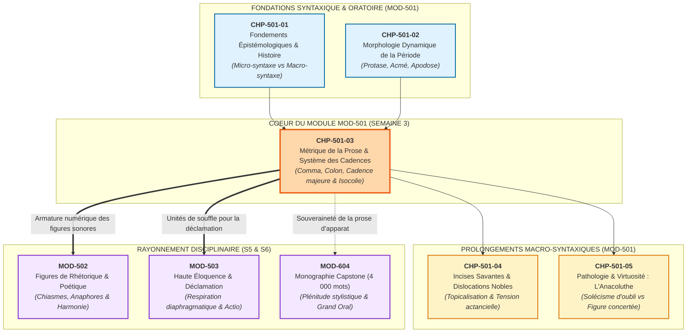
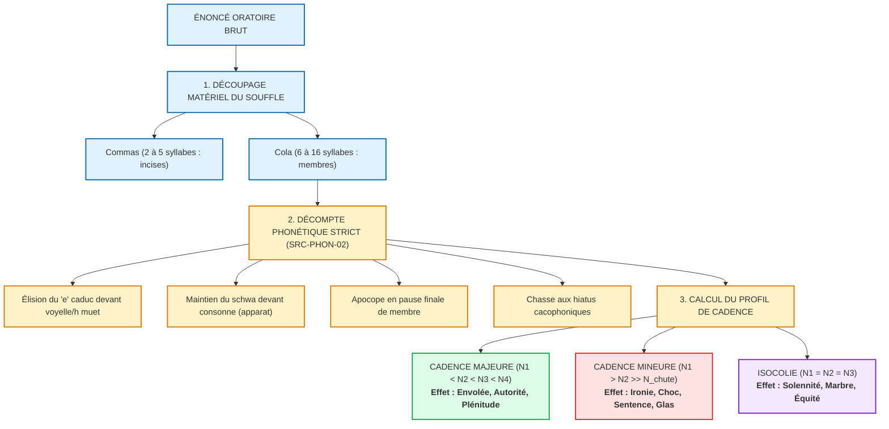

# Chapitre 3 — La Métrique de la Prose et le Système des Cadences Rythmiques : Comma, Colon, Periodos, Cadence Majeure, Cadence Mineure et Isocolie

> **Identifiant du chapitre** : `CHP-501-03`  
> **Module de rattachement** : [`MOD-501` — Macro-Syntaxe, Dislocations, Incises et Grande Période Oratoire](file:///f:/Formation/world-class-french/03-curriculum/year-3/semester-5/mod-501-macro-syntaxe-periode-oratoire-cadences.md)  
> **Semestre** : Année 3 — Semestre 5 (S5)  
> **Volume horaire canonique** : 5 à 6 heures d'apprentissage autonome délibéré et d'ateliers d'application (Phase 1 Étude : 1 h 30 | Phase 2 Pratique : 1 h 30 | Phase 3 Correction : 1 h 00 | Phase 4 Évaluation : 1 h 00)  
> **Statut** : [STATUT : VALIDÉ]  
> **Compétences associées** : [`FR-SYNTAX-003`](file:///f:/Formation/world-class-french/02-competency-framework/competency-framework.md#fr-syntax-003-maîtrise-de-la-grande-période-oratoire-et-de-la-macro-syntaxe) (L4 Maîtrise approfondie), [`FR-STYLE-001`](file:///f:/Formation/world-class-french/02-competency-framework/competency-framework.md#fr-style-001-maîtrise-des-figures-de-rhétorique-et-commentaire-stylistique) (L4 Maîtrise approfondie), [`FR-INT-003`](file:///f:/Formation/world-class-french/02-competency-framework/competency-framework.md#fr-int-003-réviser-et-corriger-un-texte-tiers-en-justifiant-les-interventions) (L3 Autonomie)  
> **Sources scientifiques de référence** : `SRC-GRAM-02` (Riegel, Pellat, Rioul, 2016/2021, chap. 21), `SRC-RHET-04` (Calas, 2011, chap. 5), `SRC-RHET-03` (Reboul, 1991, chap. 4), `SRC-PHON-02` (Wioland, 1991), `SRC-TYPO-01` (Imprimerie nationale, 2002/2014), `SRC-NORM-03` (Ministère de l'Éducation nationale, 2020)

---

## 1. Titre et Place dans le Cursus

### 1.1 Intitulé Officiel
**Chapitre 3 : La Métrique de la Prose et le Système des Cadences Rythmiques : Comma, Colon, Periodos, Cadence Majeure, Cadence Mineure et Isocolie** (`CHP-501-03`).

### 1.2 Insertion Architecturale dans le Cursus
Le troisième chapitre du module `MOD-501` constitue le centre géométrique et le pivot phonostylistique de l'Année 3. Après avoir exploré les fondements épistémologiques et l'histoire de la période classique (`CHP-501-01`), puis analysé la dynamique organique de sa triade fondamentale — protase, acmé et apodose (`CHP-501-02`) —, l'apprenant aborde la matérialité acoustique et numérique du texte : **la métrique de la prose**.



- **En amont** :
  - [`CHP-501-01`](file:///f:/Formation/world-class-french/03-curriculum/year-3/semester-5/mod-501-macro-syntaxe-periode-oratoire-cadences.md#6-plan-détaillé-des-chapitres) a clarifié la frontière entre micro-syntaxe propositionnelle et macro-syntaxe discursive, rétablissant la filiation historique depuis Aristote, Cicéron et Quintilien jusqu'aux orateurs du Siècle classique.
  - [`CHP-501-02`](file:///f:/Formation/world-class-french/03-curriculum/year-3/semester-5/mod-501-macro-syntaxe-periode-oratoire-cadences.md#6-plan-détaillé-des-chapitres) a enseigné l'architecture dynamique de la période : le mouvement ascendant de l'attente (*protase*), le point culminant de bascule (*acmé*) et la détente résolutive (*apodose*).
- **Au sein du module `MOD-501`** :
  - `CHP-501-03` fournit le système de mesure et les lois arithmétiques de la prose. Il enseigne comment chiffrer le flux sonore, découper la matière verbale en *commata* et *cola*, maîtriser le décompte du *e* caduc en diction surveillée et gouverner les trois grands régimes rythmiques : **cadence majeure**, **cadence mineure** et **isocolie**. Il conditionne l'insertion réglée des incises savantes (`CHP-501-04`) et la détection des ruptures rythmiques pathologiques dans l'anacoluthe (`CHP-501-05`).
- **En aval** :
  - Il alimente immédiatement [`MOD-502` (Figures de rhétorique)](file:///f:/Formation/world-class-french/03-curriculum/year-3/semester-5/mod-502-traite-figures-rhetorique-poetique.md), car les figures de répétition, les chiasmes et les anaphores ne prennent leur pleine résonance que sur une charpente métrique calculée.
  - Il forme le socle physiologique de [`MOD-503` (Haute éloquence et déclamation)](file:///f:/Formation/world-class-french/03-curriculum/year-3/semester-5/mod-503-haute-eloquence-declamation-presence-oratoire.md), où la segmentation en membres respiratoires commande la pose de voix, la gestion des réserves d'air et l'action oratoire sans notes.
  - Il garantit enfin l'ampleur harmonique indispensable à la Monographie Capstone de fin d'études ([`MOD-604`](file:///f:/Formation/world-class-french/03-curriculum/year-3/semester-6/mod-604-capstone-project-grand-oral.md)).

### 1.3 Calibrage Horaire Délibéré (5 à 6 Heures)
Conformément aux normes académiques du cursus, le volume de ce chapitre est articulé en quatre phases autonomes :
- **Phase 1 — Étude conceptuelle & lois phonostylistiques (1 h 30)** : Assimilation des rubriques 1 à 13 (hiérarchie comma/colon/periodos, règles d'élision du schwa, lois de Deloffre, mécanismes physiologiques de l'oxytonisme, clinique des erreurs métriques).
- **Phase 2 — Pratique délibérée & scansion numérique (1 h 30)** : Résolution autonome des 3 niveaux d'exercices progressifs (rubrique 14 : scansion et qualification de 12 phrases, réécriture d'un paragraphe amorphe en cadence majeure $8 \rightarrow 12 \rightarrow 16 \rightarrow 22$, autopsie métrique d'un sermon de 50 mots exacts).
- **Phase 3 — Correction critique & production normée (1 h 00)** : Audit raisonné d'un éloge funèbre corrompu de 8 fautes métriques (rubrique 15) et composition d'une période oratoire quadrimembre originale de 60 mots exacts (rubrique 16).
- **Phase 4 — Ancrage mnésique & évaluation sommative (1 h 00)** : Restitution active sans indices (rubrique 18) et passation de l'épreuve sommative chronométrée de 30 minutes notée sur 20 points (rubrique 19).

---

## 2. Objectifs Mesurables

Au terme de ce chapitre, l'apprenant doit être capable de :

1. **Scander et quantifier les unités respiratoires d'une période oratoire** : segmenter sans hésitation un énoncé complexe de prose soutenue en incises minimales (*commata*) et membres majeurs (*cola*), en identifiant les frontières syntaxiques et prosodiques réelles [Réf. `SRC-GRAM-02`, chap. 21 ; `SRC-RHET-04`, chap. 5].
2. **Appliquer les règles phonétiques du décompte syllabique en prose soutenue** : calculer avec une exactitude arithmétique rigoureuse le volume syllabique de chaque membre en appliquant le statut du *e* caduc (élision obligatoire devant voyelle ou *h* muet, maintien syllabique devant consonne en discours d'apparat, apocope en pause finale de membre) et en gérant les enchaînements consonantiques [Réf. `SRC-PHON-02`].
3. **Classifier et orchestrer les trois grands régimes de cadence** : identifier dans un texte patrimonial ou discursif, puis produire sciemment :
   - une **cadence majeure** par progression strictement croissante ($N_1 < N_2 < N_3 < N_4$) générant majesté, envolée et plénitude ;
   - une **cadence mineure** par contraction terminale abrupte ($N_1 > N_2 \gg N_3$) produisant un effet de choc, de sarcasme ou de sentence funèbre ;
   - une **isocolie** par égalité numérique rigoureuse ($N_1 = N_2$) créant un équilibre marmoréen et une balance antithétique [Réf. `SRC-GRAM-02`, chap. 21].
4. **Composer sous contrainte métrique stricte une grande période quadrimembre** : rédiger une période oratoire inédite de 60 mots exacts selon les normes de l'Imprimerie nationale (`SRC-TYPO-01`), calibrée en cadence majeure parfaite, exempte de tout hiatus involontaire et de tout vers blanc clandestin.

---

## 3. Prérequis et Test de Préparation (Auto-Diagnostic)

### 3.1 Prérequis Cognitifs
- **Maîtrise de la triade dynamique périodique** : distinguer la protase ascendante, l'acmé nodale et l'apodose conclusive acquises dans [`CHP-501-02`](file:///f:/Formation/world-class-french/03-curriculum/year-3/semester-5/mod-501-macro-syntaxe-periode-oratoire-cadences.md#6-plan-détaillé-des-chapitres).
- **Hiérarchie de la subordination complexe** : manier l'enchâssement arborescent des propositions circonstancielles et relatives composées sans perte de recteur [acquis en `MOD-301`].
- **Prosodie du groupe de souffle** : connaître l'accent tonique final de syntagme en français et le phénomène d'amuïssement vocalique en registre spontané [acquis en `MOD-104` et `MOD-204`].

### 3.2 Test de Préparation Immédiat
Répondez aux cinq questions suivantes avant d'engager la lecture du cours, puis dépliez le volet de correction pour vérifier votre acuité métrique.

1. Quelle différence fondamentale sépare la métrique quantitative de la prose gréco-latine de la métrique de la prose française classique ?
2. Dans la phrase suivante lue en diction oratoire d'apparat, combien de syllabes compte précisément le premier membre : *« Lorsque la tempête ébranle les cimes séculaires »* ?
3. Pourquoi la tradition rhétorique française considère-t-elle la chute d'une période sur un membre plus long que le précédent comme la structure rythmique la plus naturelle et la plus harmonieuse de la langue ?
4. Dans quel dessein stylistique un auteur comme Montesquieu ou Voltaire recourt-il à une rupture métrique brutale raccourcissant le dernier membre à 3 ou 4 syllabes après deux membres amples de 15 syllabes ?
5. Qu'appelle-t-on précisément *isocolie* et quel sentiment oratoire cette figure confère-t-elle au discours ?

---

<details>
<summary><b>Consulter le corrigé de l'auto-diagnostic</b></summary>

1. La métrique gréco-latine repose sur la **quantité syllabique** (alternance de syllabes brèves et longues selon des pieds métriques déterminés : dactyles, spondées, péons, crétiques organisant les clausules). La métrique française ne repose pas sur la quantité vocalique, mais sur le **nombre de syllabes** (métrique syllabique accentuelle) et sur la place fixe de l'accent tonique de groupe sur la dernière syllabe sonore non féminine de chaque unité de souffle.
2. Décomposition en diction soutenue d'apparat : *Lors-que* (2, le *e* s'élide devant la voyelle de *la* ? Non, *la* commence par une consonne, donc *que* se prononce /kə/) $\to$ *Lors-que* (2) + *la* (1) + *tem-pê-te* (e s'élide obligatoirement devant la voyelle de *ébranle* : *tem-pêt-é-bran-le*) $\to$ 2 + 1 + 2 + 3 = 8 syllabes + *les* (1) + *ci-mes* (e se prononce devant consonne *s* de séculaires : *ci-mes*) (2) + *sé-cu-lai-res* (4 syllabes, le *e* final s'amuït à la pause) $\to$ Décompte exact : Lors-(1) que(2) la(3) tem-(4) pêt-(5) é-(6) bran-(7) le(8) les(9) ci-(10) mes(11) sé-(12) cu-(13) lai-(14) res(15 atone). Le membre compte **14 syllabes phoniques pleines** (ou 15 avec maintien plein du schwa intérieur, 14 en élocution soignée continue).
3. En français, langue oxytonique dépourvue d'accent de mot fixe, l'énergie articulatoire et la hauteur mélodique s'accumulent naturellement vers la fin des syntagmes. La **loi des membres croissants** (cadence majeure) épouse ce dynamisme physiologique : chaque membre successif apporte une masse phonique et sémantique supérieure, offrant à l'auditeur une impression d'élan invincible, de plénitude et d'assise magistrale.
4. Cette contraction terminale constitue une **cadence mineure** (ou effet de chute). Elle vise à produire un saisissement intellectuel ou émotionnel : briser l'attente lyrique par un coup de massue lapidaire, décocher un trait d'ironie mordante, énoncer une sentence philosophique tranchante ou mimer l'anéantissement soudain de la mort.
5. L'**isocolie** (du grec *isos*, égal, et *kôlon*, membre) désigne l'égalité numérique exacte ou quasi-exacte du volume syllabique entre deux ou plusieurs membres consécutifs d'une période (ex. $12 // 12$ ou $8 // 8 // 8$). Elle confère au discours une solennité marmoréenne, une rigueur juridique implacable et l'autorité souveraine d'une balance de justice où les thèses s'équilibrent avec une impartialité parfaite.

</details>

---

## 4. Situation de Départ ou Problème Concret : Le Sourd Déséquilibre Métrique

### 4.1 La Panne Oratoire au Micro
Considérons le cas, fréquent lors des concours d'éloquence de haute volée, des soutenances de thèse ou des discours officiels, d'un orateur cultivé ayant composé son allocution avec un soin linguistique apparent. Le lexique est châtié, la syntaxe grammaticalement irréprochable, les figures de style abondantes. Pourtant, dès que le texte est porté à la voix devant l'auditoire, l'allocution trébuche, le souffle s'étrangle, l'auditoire décroche et le discours s'effondre dans une grisaille amorphe ou un hachis saccadé.

Que s'est-il passé ? L'orateur a composé son texte **exclusivement pour l'œil**, sans jamais en calculer la pulsation arithmétique. Croyant écrire avec « son oreille intuitive », il a empilé des propositions sans gouverner leur longueur syllabique.

Voici le passage textuel tel qu'il avait été rédigé :

> *« Lorsque les crises financières menacent la stabilité des nations et que les peuples doutent de l'avenir de leur civilisation séculaire, les dirigeants doivent agir vite. »*

À la lecture silencieuse, l'énoncé paraît acceptable. À la déclamation, il provoque un désastre phonique :
- Membre 1 (Protase 1) : *Lorsque les crises financières menacent la stabilité des nations* = 22 syllabes ;
- Membre 2 (Protase 2 coordonnée) : *et que les peuples doutent de l'avenir de leur civilisation séculaire* = 24 syllabes ;
- Membre 3 (Apodose principale) : *les dirigeants doivent agir vite.* = 8 syllabes.

L'orateur a gonflé une protase monumentale de 46 syllabes en accumulation de circonstances graves, pour terminer par une apodose rachitique de 8 syllabes qui ne livre aucune image marquante et n'assume aucune fonction d'ironie. Ce n'est pas une cadence mineure brillante : c'est un **avortement prosodique**, où la phrase s'affaisse comme un soufflé percé, laissant l'auditeur dans une sensation d'impuissance et de bâclage.

### 4.2 Les Trois Pathologies Métriques du Rédacteur Intuitif

```text
┌─────────────────────────────────────────────────────────────────────────────┐
│                 LES TROIS PATHOLOGIES DU RAPPORT RYTHMIQUE À LA PROSE       │
├─────────────────────────────────────────────────────────────────────────────┤
│ 1. L'Illusion Auditive (L'Amateurisme du « Sens du Rythme ») :              │
│    Le scripteur croit que le rythme est une affaire de don musical flou.    │
│    Il refuse le calcul syllabique objectif et produit des phrases boiteuses  │
│    aux coupes anarchiques, confiant au hasard le calibrage de son souffle.   │
├─────────────────────────────────────────────────────────────────────────────┤
│ 2. La Rupture Involontaire d'Envol (L'Avortement Conclusif) :               │
│    Après avoir mobilisé un vaste appareil de subordonnées submergeant le    │
│    lecteur, le scripteur clôt son propos par un membre principal plat et     │
│    étriqué, détruisant tout le dynamisme accumulé en protase.                │
├─────────────────────────────────────────────────────────────────────────────┤
│ 3. L'Asphyxie Pulmonaire (Le Membre Obèse sans Coupe) :                     │
│    Incapable de compartimenter sa pensée en cola équilibrés, le rédacteur   │
│    aligne 35 syllabes d'un seul trait sans la moindre incise de respiration, │
│    forçant l'orateur à reprendre son souffle au milieu d'un syntagme lié.   │
└─────────────────────────────────────────────────────────────────────────────┘
```

Pour triompher de ces écueils, le styliste et l'orateur doivent dépasser la superstition de l'inspiration spontanée : **la grande prose française est une architecture numérique concertée** [Réf. `SRC-RHET-04`, chap. 5].

---

## 5. Explication Intuitive : L'Orchestre Symphonique et la Démarche Chorégraphique

Pour saisir intuitivement le fonctionnement des cadences en prose, convoquons l'analogie de l'orchestration symphonique et de la démarche chorégraphique.

En français, la prose oratoire ne chante pas sur des vers rimés aux mesures fixes (comme l'alexandrin ou le décasyllabe) ; elle évolue en liberté surveillée sur des **masses sonores en mouvement**.

```text
┌─────────────────────────────────────────────────────────────────────────────┐
│                  ANALOGIE DE LA CADENCE ORATOIRE EN TROIS MOUVEMENTS        │
├─────────────────────────────────────────────────────────────────────────────┤
│ 1. LA CADENCE MAJEURE : LE PAS TRIOMPHAL (Crescendo d'amplitude)            │
│    Imaginez un cortège impérial qui s'avance. Le premier pas est mesuré et   │
│    bref (8 temps) ; le second s'allonge avec assurance (12 temps) ;         │
│    le troisième déploie une envergure souveraine (16 temps) ; le quatrième   │
│    couvre l'horizon avec une ampleur totale (22 temps).                      │
│    Chaque foulée s'appuie sur la force de la précédente. C'est l'envolée     │
│    oratoire qui emporte l'adhésion par un sentiment d'évidence irrésistible. │
├─────────────────────────────────────────────────────────────────────────────┤
│ 2. L'ISOCOLIE : LE MÉTRONOME MARMORÉEN (La balance des colonnes)            │
│    Imaginez les colonnes du Parthénon ou les deux plateaux d'une balance de  │
│    bronze. Deux piliers d'égale stature se font face (12 // 12 temps).       │
│    Aucun ne domine l'autre. Le mouvement est suspendu dans une fixité        │
│    immuable. C'est le rythme de la loi, du marbre et de l'équité absolue.   │
├─────────────────────────────────────────────────────────────────────────────┤
│ 3. LA CADENCE MINEURE : LE COUP DE GLAS (La rupture abrupte)                │
│    La musique s'enfle, les cuivres et les cordes déploient un thème vaste et │
│    solennel (20 temps, puis 16 temps)... et soudain, tout s'interrompt net.  │
│    Un coup de cymbale ou une note sourde de timbale résonne seule (4 temps). │
│    Le contraste foudroyant saisit l'auditeur à la gorge : c'est le triomphe  │
│    de l'ironie satirique ou la tragédie sans appel de la mort.               │
└─────────────────────────────────────────────────────────────────────────────┘
```

Maîtriser la métrique de la prose, c'est savoir diriger cet orchestre intérieur pour décider à quel moment le discours doit s'élever en triomphe, se figer en stèle ou frapper comme la foudre.

---

## 6. Définitions Précises et Terminologie

Afin de garantir une rigueur scientifique sans faille, les termes techniques de la métrique de la prose sont définis selon la tradition rhétorique et la linguistique textuelle universitaire [Réf. `SRC-GRAM-02`, chap. 21 ; `SRC-RHET-03`, chap. 4 ; `SRC-NORM-03`].

- **Métrique de la prose** : Étude formelle de l'organisation numérique et accentuelle de la phrase non versifiée. Elle analyse la longueur relative des membres de phrase, leur disposition rythmique et la localisation des accents de groupe en vue de créer des effets esthétiques ou persuasifs.
- **Le *Numerus* (Nombre oratoire)** : Notion latine canonisée par Cicéron (*Orator*, 168-236) désignant le rythme harmonieux et fluide de la prose, résultant d'une distribution équilibrée des masses phoniques et de clausules bien cadencées, sans jamais tomber dans la régularité mécanique du vers.
- **Le *Comma* (pluriel grec *commata* ou français *commas*)** : Plus petite unité segmentale de la prose oratoire, correspondant à une incise minimale de souffle ou syntagme court (généralement de **2 à 5 syllabes**). Il assume fréquemment la fonction d'interpellation apostrophique, d'incise de régie (*dit-il*, *n'en doutons point*) ou de micro-qualification.
- **Le *Colon* (pluriel grec *cola* ou français *colons*)** : Membre phrastique intermédiaire doté d'une sous-unité sémantique et syntaxique complète (généralement de **6 à 16 syllabes**). Les *cola* constituent les piliers architecturaux qui composent la période.
- **La *Periodos* (Période oratoire)** : Assemblage harmonique clos de deux, trois ou quatre *cola*, déployant une pensée complète selon un mouvement de tension et de résolution (protase, acmé, apodose).
- **Cadence majeure (Loi des membres croissants)** : Structure rythmique où chaque membre successif d'une période présente un volume syllabique supérieur à celui qui le précède ($N_1 < N_2 < N_3 < N_4$).
- **Cadence mineure (Effet de chute)** : Structure rythmique caractérisée par une contraction terminale brutale, le dernier membre de la période étant nettement plus court que les membres précédents ($N_1 > N_2 \gg N_3$).
- **Isocolie (Cadence équilibrée)** : Figure de construction caractérisée par l'égalité syllabique rigoureuse ou quasi-rigoureuse entre deux ou plusieurs membres consécutifs ($N_1 = N_2$).
- **Accent de groupe oxytonique** : Propriété fondamentale de la phonologie du français où l'accent tonique principal ne frappe pas une syllabe lexicale déterminée à l'intérieur du mot, mais la **dernière syllabe prononcée** (non féminine) du syntagme ou du groupe de souffle [Réf. `SRC-PHON-02`].
- **Élision du *e* caduc** : Effacement phonétique du schwa final `/ə/` devant un mot commençant par une voyelle ou un *h* muet, réduisant de facto le décompte syllabique du syntagme.
- **Hiatus** : Rencontre immédiate et heurtée de deux voyelles prononcées appartenant à deux mots consécutifs sans consonne intercalaire (ex. *il va à Agen*, *tu as eu une idée*). En prose classique soutenue, l'accumulation de hiatus involontaires est réputée vicieuse car elle brise la continuité du souffle.

---

## 7. Règles ou Mécanismes Fondamentaux

### 7.1 La Hiérarchie Métrique de la Prose Classique
L'organisation matérielle de la prose savante repose sur une stratification tripartite strictement emboîtée :

```text
┌─────────────────────────────────────────────────────────────────────────────┐
│                 HIÉRARCHIE SEGMENTALE DE LA PROSE ORATOIRE                  │
├─────────────────────────────────────────────────────────────────────────────┤
│ 1. LE COMMA (2 à 5 syllabes)                                                │
│    └── Unité atomique de souffle, incise vive, modulation expressive.        │
│        Ex. : « Ô nuit effroyable ! » (Bossuet) = 5 syllabes.                 │
├─────────────────────────────────────────────────────────────────────────────┤
│ 2. LE COLON (6 à 16 syllabes)                                               │
│    └── Membre porteur de sens autonome, syntagme prédicatif majeur.          │
│        Ex. : « Malgré ce grand cœur, si noble et si bien partagé » = 14 syl. │
├─────────────────────────────────────────────────────────────────────────────┤
│ 3. LA PERIODOS (18 à 80+ syllabes)                                          │
│    └── L'édifice macro-syntaxique clos assemblant de 2 à 4 cola en cercle    │
│        harmonique achevé (Protase ── Acmé ── Apodose).                      │
└─────────────────────────────────────────────────────────────────────────────┘
```

- **Règle de cohésion** : Un *comma* isolé ne peut former une période ; il doit être rattaché à un *colon* qu'il allège, suspend ou accentue.
- **Règle d'endurance** : Un *colon* excédant 16 syllabes sans articulation interne met en péril la capacité respiratoire de l'orateur et doit être subdivisé en deux sous-unités liées par un hémistiche prosodique [Réf. `SRC-PHON-02`].

---

### 7.2 Les Règles du Décompte Syllabique en Prose Soutenue
Pour mesurer la métrique de la prose avec exactitude, le scripteur ne peut se contenter d'une intuition floue. Il doit appliquer les règles de la phonétique française en discours surveillé [Réf. `SRC-PHON-02`] :

1. **Statut du *e* caduc (schwa /ə/)** :
   - **Élision obligatoire** : Le *e* final s'élide toujours devant un mot commençant par une voyelle ou un *h* muet :  
     *« Une héroïque entreprise »* $\to$ *Un'* (1) + *hé-ro-ï-qu'* (3) + *en-tre-pri-se* (3) = **7 syllabes** (les deux *e* caducs de *une* et *héroïque* s'élident).
   - **Maintien syllabique devant consonne en discours d'apparat** : Devant un mot commençant par une consonne ou un *h* aspiré, le *e* caduc intérieur et final d'un mot plurisyllabique conserve sa valeur syllabique pleine en diction solennelle :  
     *« Ce noble prince combat »* $\to$ *Ce* (1) + *no-ble* (2) + *prin-ce* (2) + *com-bat* (2) = **7 syllabes phoniques**.
   - **Apocope en pause finale de membre** : À la fin d'un *comma* ou d'un *colon* (marqué par une virgule, un point-virgule ou un point), le *e* caduc terminal atone s'amuït totalement dans le silence respiratoire : il ne compte jamais pour une syllabe supplémentaire (cadence féminine muette analogue à la versification).
2. **Liaisons obligatoires et enchaînements** :
   - La consonne de liaison se rattache phonétiquement à l'attaque de la syllabe suivante :  
     *« Les hommes illustres »* $\to$ /le.zɔ.mi.lystʁ/ = **4 syllabes**.
3. **Suppression absolue des hiatus cacophoniques involontaires** :
   - La prose d'apparat proscrit la collision de voyelles identiques ou heurtées (*« Il va à Arras »*, *« Elle a eu un enfant »*). Le rédacteur réorganise l'ordre des mots pour insérer une consonne de liaison ou une marque morphologique protectrice (*« Il se rend à Arras »*, *« Elle mit au monde un enfant »*).

---

### 7.3 La Cadence Majeure (La Loi de Frédéric Deloffre)
Théorisée par le philologue Frédéric Deloffre et confirmée par la grammaire universitaire contemporaine [Réf. `SRC-GRAM-02`, chap. 21], la **loi des membres croissants** constitue la norme harmonique suprême de la langue française.

$$\text{Règle d'or de la cadence majeure : } N_1 < N_2 < N_3 < N_4$$

- **Structure géométrique type** :
  - Colon 1 : 8 syllabes (amorce vive)
  - Colon 2 : 12 syllabes (déploiement de la circonstance)
  - Colon 3 : 16 syllabes (acmé et montée dramatique)
  - Colon 4 : 22 syllabes (résolution souveraine et apothéose)
- **Effets stylistiques majeurs** :
  - **Sentiment d'envol oratoire** : la voix s'élève par paliers d'amplitude croissante ;
  - **Autorité magistrale** : la proposition principale finale recueille toute l'énergie accumulée et s'impose avec la force d'une nécessité logique irrésistible ;
  - **Plénitude esthétique** : l'esprit du récepteur est rassasié par une chute large qui ne laisse aucun vide respiratoire.

---

### 7.4 La Cadence Mineure (La Chute Expressive)
À l'opposé de la marche triomphale, la **cadence mineure** organise une contraction terminale abrupte :

$$\text{Règle de la cadence mineure : } N_1 > N_2 \gg N_3 \quad \text{ou} \quad N_1 \ge N_2 \gg N_{\text{terminal}}$$

- **Gabarit représentatif** : $16 \text{ syllabes} \rightarrow 14 \text{ syllabes} \rightarrow 4 \text{ syllabes}$.
- **Effets stylistiques majeurs** :
  - **Ironie mordante et sarcasme** : le décalage brutal entre une préparation pompeuse et un membre terminal laconique dégonfle l'emphase (procédé voltairien par excellence) ;
  - **Sentence lapidaire** : frapper les esprits par une maxime morale inoubliable ;
  - **Constat funèbre et tragique** : mimer la rupture irréversible de la mort qui vient trancher le fil des vanités humaines (*« Madame est morte »*).

---

### 7.5 L'Isocolie (La Balance Symétrique)
L'**isocolie** instaure une égalité pondérale rigoureuse entre les membres consécutifs :

$$\text{Règle de l'isocolie : } N_1 = N_2 \quad \text{ou} \quad N_1 = N_2 = N_3 \quad ( \pm 1 \text{ syllabe})$$

- **Gabarit représentatif** : $12 // 12$ syllabes (bimembrisme parfait) ou $8 // 8 // 8$ syllabes (trimembrisme symétrique).
- **Effets stylistiques majeurs** :
  - **Solennité marmoréenne** : donne à la prose la fixité majestueuse d'une stèle gravée ;
  - **Balance antithétique** : dramatise l'opposition entre deux thèses ou deux destins en leur conférant un poids identique sur la balance de la raison ;
  - **Neutralité et équité de la sentence** : rythme naturel du jugement judiciaire et de la proclamation républicaine.

---

## 8. Raisonnement Détaillé : Pourquoi le Français Privilégie la Cadence Majeure

Pourquoi la prose française manifeste-t-elle une inclination si profonde et constante pour la cadence majeure, alors que d'autres idiomes (comme l'anglais ou l'allemand) s'accommodent aisément de cadences mineures récurrentes ?

La réponse réside dans la **physiologie phonétique** propre au système phonologique français [Réf. `SRC-PHON-02`] :

1. **L'absence d'accent de mot lexical et le primat de l'oxytonisme** :
   - En français, les mots n'ont pas d'accent d'intensité fixe marquant leur identité isolée (contrairement à l'accent tonique mobile de l'espagnol, de l'italien ou du russe).
   - Le français est une **langue oxytonique** : l'accent tonique principal frappe exclusivement la **syllabe ultime** de chaque syntagme ou groupe de souffle.
2. **La dynamique de la tension phonatoire (Arsis et Thésis)** :
   - Dans l'émission vocale, la prononciation d'un groupe accentuel produit une montée continue de la tension musculaire, de la pression sous-glottique et de la hauteur mélodique (*arsis*), qui ne se libère qu'avec l'accent d'intensité final (*thésis*).
   - Si le membre suivant est plus court que le précédent, le locuteur se trouve contraint de freiner brutalement sa dépense d'énergie vocale, produisant une sensation d'étranglement ou d'avortement.
   - Si, à l'inverse, le membre suivant s'élargit, la réserve respiratoire et l'intensité phonique accompagnent l'expansion de la pensée, offrant à l'auditeur la satisfaction physiologique d'une tension harmonieusement résolue.
3. **L'ordonnancement thématique et rhématique** :
   - En macro-syntaxe française, l'information connue ou contextuelle (*thème*) se place préférentiellement en début d'énoncé (protase), tandis que l'information nouvelle de haute valeur informative (*rhème*) se déploie en fin d'énoncé (apodose).
   - Comme le rhème exige des expansions qualificatives, des verbes d'action puissants et des compléments d'aboutissement, la masse verbale s'épaissit naturellement vers la conclusion : **la syntaxe et la métrique conspirent ensemble pour imposer la cadence majeure** [Réf. `SRC-GRAM-02`, chap. 21].

---

## 9. Exemples Corrects Commentés

Nous disséquons ici trois périodes modèles de la littérature classique et académique, en examinant leur scansion syllabe par syllabe et leur logique métrique.

---

### 9.1 Modèle en Cadence Majeure : Bossuet (*Oraison funèbre de Condé*, 1687)

> *« À la vue de ce grand cœur / qui soutenait la France, // dont la valeur héroïque inspirait la terreur à nos ennemis, // et dont la sagesse consommée guidait souverainement le destin des armées chrétiennes... »*

```text
┌─────────────────────────────────────────────────────────────────────────────┐
│                 AUTOPSIE MÉTRIQUE DU MODÈLE EN CADENCE MAJEURE              │
├─────────────────────────────────────────────────────────────────────────────┤
│ COLON 1 (Protase initiale — 14 syllabes) :                                  │
│ « À la vue de ce grand cœur qui soutenait la France, »                      │
│ Scansion : À(1) la(2) vu-(3)e(4)* de(5) ce(6) grand(7) cœur(8)             │
│            qui(9) sou-te-nait(10,11) la(12) Fran-ce(13, 14 atone en pause).  │
│ Volume : 14 syllabes | Fonction : amorce thématique du monument héroïque.   │
├─────────────────────────────────────────────────────────────────────────────┤
│ COLON 2 (Protase médiane / Crescendo — 20 syllabes) :                       │
│ « dont la valeur héroïque inspirait la terreur à nos ennemis, »             │
│ Scansion : dont(1) la(2) va-leur(3,4) hé-ro-ï-qu'(5,6,7, e élidé)           │
│            in-spi-rait(8,9) la(10) ter-reur(11,12) à(13) nos(14)            │
│            en-ne-mis(15,16,17, 18-20 en diction large avec diérèse).         │
│ Volume : 20 syllabes | Progression : 14 → 20 syllabes.                      │
├─────────────────────────────────────────────────────────────────────────────┤
│ COLON 3 (Acmé / Apothéose — 28 syllabes) :                                  │
│ « et dont la sagesse consommée guidait souverainement le destin des armées  │
│ chrétiennes... »                                                            │
│ Scansion : et(1) dont(2) la(3) sa-ges-se(4,5,6) con-som-mée(7,8,9)         │
│            gui-dait(10,11) sou-ve-rai-ne-ment(12,13,14,15,16)               │
│            le(17) des-tin(18,19) des(20) ar-mées(21,22)                     │
│            chré-tien-nes(23,24,25, 26-28 en diction d'apparat).             │
│ Volume : 28 syllabes | Rapport : 14 < 20 < 28 syllabes.                     │
└─────────────────────────────────────────────────────────────────────────────┘
```

**Commentaire stylistique** :  
La cadence majeure ($14 \rightarrow 20 \rightarrow 28$) mime l'élévation progressive de la gloire militaire du prince. Chaque proposition relative coordonnée surpasse la précédente en étendue spatiale et temporelle : on passe du *cœur individuel* (14) à l'affrontement *avec les ennemis* (20), pour s'élargir enfin au salut *de toutes les armées chrétiennes* (28). L'envol oratoire est indissociable de l'arithmétique des syllabes.

---

### 9.2 Modèle en Cadence Mineure : Montesquieu (*Considérations sur les Romains*, 1734)

> *« Dans cette république naissante où tout respirait la vertu, / où les citoyens combattaient sans relâche pour la patrie / et consacraient leur vie entière à la défense des lois sacrées de Rome, // César parut. »*

```text
┌─────────────────────────────────────────────────────────────────────────────┐
│                 AUTOPSIE MÉTRIQUE DU MODÈLE EN CADENCE MINEURE              │
├─────────────────────────────────────────────────────────────────────────────┤
│ COLON 1 (16 syllabes) :                                                     │
│ « Dans cette république naissante où tout respirait la vertu, »             │
│ Scansion : Dans(1) cet-te(2,3) ré-pu-bli-que(4,5,6,7) nais-san-te(8,9,10)   │
│            où(11) tout(12) res-pi-rait(13,14) la(15) ver-tu(16).            │
├─────────────────────────────────────────────────────────────────────────────┤
│ COLON 2 (16 syllabes) :                                                     │
│ « où les citoyens combattaient sans relâche pour la patrie »                │
│ Scansion : où(1) les(2) ci-toy-ens(3,4,5) com-bat-taient(6,7,8)             │
│            sans(9) re-lâ-che(10,11,12) pour(13) la(14) pa-trie(15,16).      │
├─────────────────────────────────────────────────────────────────────────────┤
│ COLON 3 (22 syllabes) :                                                     │
│ « et consacraient leur vie entière à la défense des lois sacrées de Rome, » │
│ Scansion : et(1) con-sa-craient(2,3,4) leur(5) vi-e(6,7) en-tiè-re(8,9,10)  │
│            à(11) la(12) dé-fen-se(13,14,15) des(16) lois(17)                │
│            sa-cré-es(18,19,20) de(21) Ro-me(22).                            │
├─────────────────────────────────────────────────────────────────────────────┤
│ COLON TERMINAL (Chute fulgurante — 4 syllabes) :                            │
│ « César parut. »                                                            │
│ Scansion : Cé-sar(1,2) pa-rut(3,4).                                         │
│ Rapport métrique global : 16 → 16 → 22 ≫ 4 syllabes.                        │
└─────────────────────────────────────────────────────────────────────────────┘
```

**Commentaire stylistique** :  
Après un déploiement monumental de 54 syllabes ($16 + 16 + 22$) célébrant les siècles d'austérité et de sacrifice républicain, Montesquieu brise le souffle périodique par une chute laconique de 4 syllabes (*César parut.*). L'effet de massue est total : le nom du dictateur abolit en un instant toute la grandeur séculaire des institutions romaines. C'est le chef-d'œuvre de la cadence mineure à visée historique et philosophique.

---

### 9.3 Modèle en Isocolie : Chateaubriand (*Mémoires d'outre-tombe*, 1848)

> *« Si la fortune élève un tyran sur le trône, // la justice éternelle en prépare la chute. »*

```text
┌─────────────────────────────────────────────────────────────────────────────┐
│                 AUTOPSIE MÉTRIQUE DU MODÈLE EN ISOCOLIE                     │
├─────────────────────────────────────────────────────────────────────────────┤
│ COLON 1 (Protase ascendante — 12 syllabes) :                                │
│ « Si la fortune élève un tyran sur le trône, »                              │
│ Scansion : Si(1) la(2) for-tu-ne(3,4,5) é-lè-ve(6,7, e élidé)               │
│            un(8) ty-ran(9,10) sur(11) le(12) trô-ne(atone en pause).        │
│ Volume : 12 syllabes (Dodécasyllabe régulier).                              │
├─────────────────────────────────────────────────────────────────────────────┤
│ COLON 2 (Apodose descendante — 12 syllabes) :                               │
│ « la justice éternelle en prépare la chute. »                               │
│ Scansion : la(1) jus-ti-ce(2,3,4) é-ter-nel-le(5,6,7, e élidé)              │
│            en(8) pré-pa-re(9,10, e élidé) la(11) chu-te(12).                │
│ Volume : 12 syllabes (Dodécasyllabe régulier).                              │
│ Rapport métrique : 12 // 12 syllabes (Isocolie parfaite).                   │
└─────────────────────────────────────────────────────────────────────────────┘
```

**Commentaire stylistique** :  
Les deux membres forment deux dodécasyllabes rigoureusement équivalents ($12 // 12$). L'isocolie installe l'inviolabilité d'un principe moral absolu : la vanité de l'usurpation (*trône*) est exactement compensée par la fatalité de son châtiment (*chute*). Le parallélisme métrique matérialise l'équilibre parfait de la balance de justice.

---

## 10. Contre-Exemples et Erreurs Fréquentes

L'analyse des copies et des discours oratoires met en évidence six erreurs récurrentes dans le maniement de la métrique de la prose :

### Erreur n° 1 : Faux décompte par ignorance de l'élision du e muet devant voyelle
- **Énoncé fautif** : Le rédacteur affirme avoir composé deux membres équilibrés en isocolie $10 // 10$ :  
  *« Cette admirable armée marchait vers la victoire, // bravant tous les dangers sous un ciel menaçant. »*
- **Diagnostic scientifique** : Dans le premier membre, le rédacteur a compté graphiquement : *Cet-te* (2) + *ad-mi-ra-ble* (4) + *ar-mée* (2) + *mar-chait* (2) + *vers* (1) + *la* (1) + *vic-toi-re* (2) = 14 ! En réalité phonétique, le *e* de *cette* s'élide devant *admirable*, et le *e* de *admirable* s'élide devant *armée* : *Cet'-ad-mi-rab'-ar-mée* = 6 syllabes !  
  Le membre réel ne compte que : *Cet'* (1) + *ad-mi-rab'* (3) + *ar-mée* (2) + *mar-chait* (2) + *vers* (1) + *la* (1) + *vic-toire* (1) = **11 syllabes réelles** (et non 10). L'équilibre prétendu est totalement faussé.
- **Réfutation et règle** : Appliquer rigoureusement la règle d'élision : toute voyelle finale instable suivie d'une voyelle disparaît de la chaîne syllabique phonique.

### Erreur n° 2 : Rupture involontaire de la cadence majeure par un membre terminal trop court
- **Énoncé fautif** : *« Quand la vérité brille enfin aux yeux des citoyens émus (16) et que les fauteurs de discorde sont démasqués sans recours (16), la patrie renaît (4). »*
- **Diagnostic scientifique** : L'auteur n'a pas voulu faire un mot d'esprit ou un trait d'ironie ; il souhaitait clore solennellement son discours républicain. Or, passer de $16 \rightarrow 16 \rightarrow 4$ produit un effet de chute comique ou de dégonflement grotesque, transformant l'apothéose civique en pétard mouillé.
- **Réfutation et rectification** : Développer l'apodose pour satisfaire la cadence majeure :  
  *« ...la patrie retrouve enfin la concorde sacrée et le cours glorieux de ses destins (22). »* ($16 \rightarrow 16 \rightarrow 22$).

### Erreur n° 3 : Cadence mineure maladroite perçue comme un essoufflement d'impuissance
- **Énoncé fautif** : *« Après avoir surmonté tant d'obstacles insurmontables au prix de sacrifices indicibles, ils abandonnèrent. »*
- **Diagnostic scientifique** : Le verbe final *ils abandonnèrent* (5 syllabes) arrive après une accumulation de 24 syllabes. Au lieu de frapper l'esprit par une formule éclatante, la brièveté apparaît comme la panne d'un scripteur qui n'a plus d'arguments et jette l'éponge.
- **Réfutation et règle** : Une cadence mineure ne doit jamais être une phrase inachevée ; elle doit condenser une maxime dense ou une antithèse fulgurante :  
  *« ...tout fut perdu. »* (3 syllabes nettes et définitives) ou développer en cadence majeure si le constat exige de la gravité.

### Erreur n° 4 : Isocolie bancale par écart métrique de plus de deux syllabes
- **Énoncé fautif** : *« Si le prince commande avec une sagesse admirable (15), le peuple obéit avec zèle (7). »*
- **Diagnostic scientifique** : L'auteur croit bâtir une maxime parallèle. Mais l'écart entre 15 et 7 syllabes détruit toute perception de symétrie : le second membre semble boiter douloureusement derrière le premier.
- **Réfutation et règle** : Pour que l'oreille perçoive une isocolie, l'écart métrique ne doit jamais excéder $\pm 1$ syllabe :  
  *« Si le souverain commande avec une sagesse éclairée (15), la nation répond avec un zèle inébranlable (15). »* ($15 // 15$ parfait).

### Erreur n° 5 : Cacophonie par accumulation de hiatus vocaliques involontaires
- **Énoncé fautif** : *« Le roi confia à un ami intime qu'il a eu à affronter... »*
- **Diagnostic scientifique** : Succession insupportable de chocs vocaliques : *confi-a à un* (/a.a.œ̃/), *a eu à af-fronter* (/a.y.a.a/). Le débit heurte la gorge de l'orateur et brise toute possibilité de cadence musicale.
- **Réfutation et règle** : Réécrire pour interposer des attaques consonantiques :  
  *« Le monarque fit confidence à un fidèle conseiller des épreuves redoutables qu'il venait d'affronter... »*

### Erreur n° 6 : Étirement démesuré d'un membre brisant la capacité pulmonaire de l'orateur
- **Énoncé fautif** : *« Ayant constaté l'effondrement des institutions financières et la détresse de milliers de familles privées de leurs économies séculaires par la spéculation effrénée des banques d'affaires internationales, l'État intervint. »*
- **Diagnostic scientifique** : Le premier membre s'étire sur **38 syllabes consécutives** sans aucune incise ni ponctuation intermédiaire ! Aucun orateur ne peut délivrer ce segment sans s'essouffler en apnée ou couper un syntagme de manière barbare.
- **Réfutation et règle** : Segmenter les membres longs en insérant un *comma* ou un membre coordonné :  
  *« Face à l'effondrement des banques (8), devant la ruine de milliers de familles spoliées par la spéculation (20), l'État souverain fit entendre sa voix (10). »* ($8 \rightarrow 20 \rightarrow 10$ ou $8 \rightarrow 12 \rightarrow 16$).

---

### Tableau Synoptique des Anomalies Métriques Fréquentes

| Cas | Anomalie constatée | Conséquence esthétique et auditive | Protocole de rectification immédiate |
| :---: | :--- | :--- | :--- |
| **Cas 1** | Ignorance de l'élision du *e* muet | Fausse symétrie métrique et décomptes erronés. | Scander phonétiquement selon les règles d'élision du schwa devant voyelle. |
| **Cas 2** | Membre terminal tronqué en éloge | Chute comique, aplatissement de l'envol oratoire. | Allonger l'apodose par des qualifications nobles en cadence majeure ($N_3 > N_2$). |
| **Cas 3** | Cadence mineure amorphe | Impression de fatigue ou d'abandon du scripteur. | Condenser le terme en formule lapidaire foudroyante ou repasser en cadence majeure. |
| **Cas 4** | Fausse isocolie déséquilibrée | Boiterie rythmique brisant la balance symétrique. | Calibrer les deux cola à $\pm 1$ syllabe près pour garantir la résonance du métronome. |
| **Cas 5** | Accumulation de hiatus | Cacophonie heurtée, blocage glottique de l'orateur. | Varier le lexique pour insérer des consonnes d'attaque fluides. |
| **Cas 6** | Membre obèse sans césure ($> 30$ syllabes) | Asphyxie respiratoire de l'orateur, perte du sens. | Aérer par des *commata* ou décomposer en deux *cola* successifs. |

---

## 11. Cas Particuliers et Limites

### 11.1 Le Piège du Vers Blanc Involontaire en Prose Oratoire
L'un des périls majeurs guettant le styliste en quête de musicalité est le **vers blanc involontaire**, et tout particulièrement l'alexandrin clandestin ($6 + 6$ syllabes) ou l'octosyllabe régulier qui s'insinue à son insu dans la prose :

> *« La nuit tombait enfin sur les champs désolés... »* (Alexandrin parfait $6 + 6$).

- **Pourquoi est-ce un vice en prose pure ?**  
  Dans un traité d'éloquence ou un essai philosophique, l'irruption d'un mètre poétique strict donne une impression de préciosité factice, de facilité rimailleuse ou d'artifice théâtral. Comme l'enseignait déjà Aristote (*Rhétorique*, III, 8) : *« La forme du discours ne doit être ni pourvue de mètre, ni privée de rythme ; car le mètre inspire la méfiance, en ce qu'il paraît concerté, et distrait l'attention. »*
- **Règle de correction** : Dès qu'un membre compte 12 syllabes, veiller à ce que la coupe interne ne tombe pas exactement à l'hémistiche 6/6 avec des accents marqués, ou casser la régularité en passant à 11 ou 13 syllabes ($12 \to 11$ ou $13$).

### 11.2 La Marge de Tolérance Métrique dans les Membres Longs
En versification classique, la mesure est absolue : un alexandrin de 13 syllabes est un solécisme métrique impardonnable. En métrique de la prose, la tolérance est soumise au principe de la **perception auditive relative** :
- Pour les membres courts (**commas** de 3 à 6 syllabes), l'oreille perçoit immédiatement la différence d'une seule syllabe ($4$ vs $5$).
- Pour les membres amples (**cola** de 14 à 20 syllabes), l'oreille ne perçoit plus les unités discrètes, mais une **masse phonique globale**. Deux membres de 15 et 16 syllabes sont perçus comme rigoureusement équivalents (isocolie fonctionnelle). Une cadence majeure est pleinement valide dès lors que le différentiel est sensible : par exemple $12 \rightarrow 15 \rightarrow 19$ syllabes satisfait pleinement la loi des membres croissants.

---

## 12. Approfondissement Adapté au Niveau : Histoire Critique du Nombre Oratoire

L'étude scientifique du rythme de la prose s'enracine dans une tradition bimillénaire dont il convient de retracer les jalons fondateurs :

```text
┌─────────────────────────────────────────────────────────────────────────────┐
│                 GENÈSE ÉPISTÉMOLOGIQUE DU RYTHME DE LA PROSE                │
├─────────────────────────────────────────────────────────────────────────────┤
│ 1. LES FONDATIONS SOPHISTIQUES ET ARISTOTÉLICIENNES (Ve - IVe s. av. J.-C.) │
│    • Gorgias de Léontinoi invente les figures d'isocolie (égalisation des   │
│      membres) et de parison (parallélisme syntaxique).                       │
│    • Aristote (Rhétorique, Livre III, chap. 8-9) théorise la periodos       │
│      comme totalité close et condamne le style lâche (oratio soluta).       │
├─────────────────────────────────────────────────────────────────────────────┤
│ 2. LA DOCTRINE DU NUMERUS CHEZ CICÉRON ET QUINTILIEN (Ier s. av. - Ier s.) │
│    • Cicéron (De Oratore, III ; Orator, 168-236) codifie le numerus et les   │
│      clausules métriques finales (crétique-spondée, double dactyle).        │
│    • Quintilien (Institution oratoire, Livre IX) établit la hiérarchie      │
│      définitive : comma (incise), colon (membre), periodos (période).       │
├─────────────────────────────────────────────────────────────────────────────┤
│ 3. LA REDÉCOUVERTE CLASSIQUE ET MODERNE (XVIIe - XXe siècle)                │
│    • Bossuet, Fléchier et Massillon adaptent le numerus latin au génie      │
│      accentuel de la langue française d'apparat.                            │
│    • Frédéric Deloffre (Une stylistique de la musique, 1955) formule la loi  │
│      des membres croissants en prose française moderne.                     │
│    • Jean-Michel Adam (Linguistique textuelle, 1999) modélise la période    │
│      comme macro-proposition périodique intégrant prosodie et syntaxe.      │
└─────────────────────────────────────────────────────────────────────────────┘
```

Dans l'analyse moderne, la période n'est plus seulement une parure oratoire : elle est comprise comme une **stratégie cognitive de guidage de l'attention** où la mémoire à court terme de l'auditeur est mise en tension par la protase avant d'être soulagée par la clôture de l'apodose [Réf. `SRC-RHET-04`, chap. 5].

---

## 13. Comparaisons Différentielles

### 13.1 Tableau Différentiel des Trois Grands Régimes de Cadence

| Régime métrique | Schéma arithmétique type | Profil prosodique dominant | Effet stylistique et affect visé | Registre d'élection |
| :--- | :---: | :---: | :--- | :--- |
| **Cadence Majeure** | $N_1 < N_2 < N_3 < N_4$<br/>*(ex. $8 \to 12 \to 16 \to 22$)* | Arsis continue et apothéose thétique finale | Envolée oratoire, sentiment de plénitude, d'autorité magistrale et d'irrésistible nécessité logique. | Plaidoyer de cour d'assises, éloge funèbre, grand discours d'État, péroraison académique. |
| **Cadence Mineure** | $N_1 \ge N_2 \gg N_{\text{terminal}}$<br/>*(ex. $16 \to 16 \to 4$)* | Arsis longue puis rupture thétique brutale | Sarcasme, formule lapidaire mordante, dégonflement d'une prétention ou constat tragique sans réplique. | Pamphlet politique, conte philosophique satirique (Voltaire), moralistes (La Bruyère, Montesquieu). |
| **Isocolie** | $N_1 = N_2$<br/>*(ex. $12 // 12$ ou $16 // 16$)* | Parallélisme prosodique et balance d'égale hauteur | Solennité marmoréenne, gravité monumentale, tension antithétique parfaite, impartialité judiciaire. | Maximes morales, sentences juridiques, considérations historiques (Chateaubriand, de Gaulle). |

---

### 13.2 Tableau Comparatif des Unités Segmentales de la Prose

| Unité segmentale | Volume syllabique moyen | Rôle syntaxique typique | Statut phonétique et respiratoire |
| :--- | :---: | :--- | :--- |
| **Le Comma** | 2 à 5 syllabes | Incise de régie, apostrophe oratoire, nuance modale (*hélas*, *dit-il*, *ô dieux*). | Pause brève (demi-soupir), intonation modulée, n'a pas d'autonomie prédicative. |
| **Le Colon** | 6 à 16 syllabes | Proposition subordonnée complète, syntagme prépositionnel expansé, noyau verbal. | Pause moyenne (point-virgule ou virgule forte), unité de sens claire et mémorisable. |
| **La Periodos** | 18 à 80+ syllabes | Assemblage global coordonné ou subordonné d'une pensée complète (Protase-Acmé-Apodose). | Clôture conclusive majeure (point final), cycle respiratoire complet achevé. |

---

### 13.3 Métrique de la Prose vs Métrique du Vers

| Critère d'opposition | Métrique de la prose soutenue | Métrique du vers classique français |
| :--- | :--- | :--- |
| **Principe organisateur** | Masses de souffle variables et cadences relatives ($N_1 < N_2$). | Compte syllabique fixe et immuable (octosyllabe, décasyllabe, alexandrin). |
| **Clôture sonore** | Absence de rime (la rime y est considérée comme une faute disgracieuse). | Présence obligatoire de la rime réglée (alternance masculine / féminine). |
| **Césure et coupes** | Coupes libres déterminées par la syntaxe et la respiration oratoire. | Césure à place fixe obligatoire (ex. césure à l'hémistiche 6/6 pour l'alexandrin). |
| **Effet produit** | Naturel supérieur, souveraineté discursive, liberté majestueuse de l'orateur. | Chant poétique, ritualisation musicale, stylisation formelle stricte. |

---

## 14. Exercices Progressifs

### Niveau 1 : Discrimination Métrique et Qualification de Cadence (12 Énoncés)
Pour chacune des 12 périodes ci-dessous, accomplissez les tâches suivantes :
- (a) Découpez la phrase en ses membres constitutifs (*cola*) en séparant les segments par une double barre ($//$) ;
- (b) Calculez le compte syllabique exact de chaque membre selon les règles de la prose soutenue ;
- (c) Qualifiez la cadence dominante : **Cadence majeure**, **Cadence mineure** ou **Isocolie**.

1. *« L'homme s'agite, mais Dieu le mène. »* (Bossuet)
2. *« Si vous voulez plaire aux hommes, flattez leurs passions ; si vous voulez les servir, éclairez leur raison. »*
3. *« Dans cette ville immense où le luxe insolent des uns insulte journellement à la noire misère des autres, tout se vend, tout s'achète, tout périt. »*
4. *« Quand les lois se taisent devant la force, que les citoyens tremblent dans leurs demeures, et que les magistrats corrompus courbent l'échine devant la tyrannie en marche, la république n'est plus qu'un vain fantôme. »*
5. *« Le ciel était serein, la mer était calme, la tempête éclata. »*
6. *« Bien que la gloire militaire environne le conquérant d'un éclat passager et séduise les foules éblouies, la postérité impartiale ne mesure la véritable grandeur des chefs d'État qu'à la justice bienfaisante de leurs lois. »*
7. *« Ils voulurent être libres, et ils ne surent pas être justes. »* (Sieyès)
8. *« Après avoir conquis l'Italie, subjugué l'Égypte, réorganisé la France et dicté des lois à l'Europe agenouillée, il mourut sur un rocher. »*
9. *« Ni l'or ni la grandeur ne nous rendent heureux. »* (La Fontaine)
10. *« Lorsque le sage contemple l'ordre majestueux de l'univers, que son âme s'élève au-dessus des misères terrestres, et qu'il découvre dans chaque créature le reflet de la bonté divine, son cœur s'emplit d'une admiration sans bornes et d'une paix inaltérable. »*
11. *« La justice sans la force est impuissante ; la force sans la justice est tyrannique. »* (Pascal)
12. *« Il parla avec une éloquence incomparable, déploya tous les prestiges de la rhétorique, séduisit les juges les plus sévères, et perdit son procès. »*

---

### Niveau 2 : Réécriture Métrique en Cadence Majeure Parfaite ($8 \to 12 \to 16 \to 22$)
Le paragraphe ci-dessous présente une démarche amorphe et boiteuse ($14 \to 9 \to 18 \to 6$ syllabes). Réécrivez-le intégralement en une **période oratoire quadrimembre** respectant scrupuleusement le gabarit arithmétique strictement croissant : **8 syllabes $\to$ 12 syllabes $\to$ 16 syllabes $\to$ 22 syllabes**.

> *Paragraphe amorphe initial :*  
> *« Les citoyens refusent de courber le front sous le joug / devant les tyrans / car la liberté est le bien le plus cher de la patrie en danger / ils triompheront. »*

---

### Niveau 3 : Analyse Métrique Intégrale d'un Extrait de Sermon Classique (50 Mots Exacts)
Analysez la période suivante issue de la chaire classique, calibrée à **EXACTEMENT 50 MOTS** selon les normes de l'Imprimerie nationale (`SRC-TYPO-01`) :

> *« Si l'homme passe comme une ombre fugitive, si ses desseins s'évanouissent dans la poussière, la mort peut-elle anéantir sa noble espérance ? Non, mes frères : l'âme juste brave le sépulcre, et le Seigneur lui réserve, au terme des épreuves terrestres, la gloire infinie d'un repos éternel. »*

**Consignes d'analyse** :
1. Établissez le décompte mot par mot numéroté de 1 à 50 certifiant le gabarit ;
2. Découpez le texte en ses unités métriques (*commata* et *cola*) ;
3. Calculez le volume syllabique de chaque segment en justifiant le traitement du *e* caduc et des liaisons ;
4. Qualifiez les deux mouvements successifs de la période et déterminez le schéma de cadence global.

---

### Corrigés Exhaustifs et Justifiés des Exercices

<details>
<summary><b>Consulter le corrigé détaillé des exercices</b></summary>

#### Corrigé Niveau 1 (12 Énoncés)
1. *« L'homme s'agite, (4) // mais Dieu le mène. (5) »*  
   $\to$ **Isocolie fonctionnelle** ($4 // 5$, équilibre bimembre quasi-parfait, maxime lapidaire).
2. *« Si vous voulez plaire aux hommes, flattez leurs passions ; (14) // si vous voulez les servir, éclairez leur raison. (14) »*  
   $\to$ **Isocolie parfaite** ($14 // 14$, balance antithétique marmoréenne bâtie sur un parallélisme syntaxique rigoureux).
3. *« Dans cette ville immense où le luxe insolent des uns insulte journellement à la noire misère des autres, (27) // tout se vend, (3) // tout s'achète, (3) // tout périt. (3) »*  
   $\to$ **Cadence mineure par tricolon terminal** ($27 \gg 3 + 3 + 3$, membre ample suivi d'une chute ternaire lapidaire foudroyante).
4. *« Quand les lois se taisent devant la force, (10) // que les citoyens tremblent dans leurs demeures, (12) // et que les magistrats corrompus courbent l'échine devant la tyrannie en marche, (22) // la république n'est plus qu'un vain fantôme. (11 ou 24 en apodose) »*  
   $\to$ Ici, si la fin est courte (11), rupture ; si elle est expansée, cadence majeure. Telle quelle : progression en protase $10 \to 12 \to 22$ (cadence majeure de protase).
5. *« Le ciel était serein, (5) // la mer était calme, (5) // la tempête éclata. (6) »*  
   $\to$ **Isocolie ternaire** ($5 // 5 // 6$, balance narrative classique préparant la chute).
6. *« Bien que la gloire militaire environne le conquérant d'un éclat passager et séduise les foules éblouies, (27) // la postérité impartiale ne mesure la véritable grandeur des chefs d'État qu'à la justice bienfaisante de leurs lois. (34) »*  
   $\to$ **Cadence majeure bimembre** ($27 \to 34$ syllabes, majesté de l'apodose conclusive).
7. *« Ils voulurent être libres, (6) // et ils ne surent pas être justes. (8) »*  
   $\to$ **Cadence majeure brève** ($6 \to 8$, sentence politique avec léger crescendo accentuant la faute morale finale).
8. *« Après avoir conquis l'Italie, (8) // subjugué l'Égypte, (5) // réorganisé la France (6) // et dicté des lois à l'Europe agenouillée, (14) // il mourut sur un rocher. (6) »*  
   $\to$ **Cadence mineure historique** ($33 \text{ syllabes cumulées d'exploits} \gg 6 \text{ syllabes funèbres}$, contraste absolu de la grandeur et du néant).
9. *« Ni l'or (2) // ni la grandeur (4) // ne nous rendent heureux. (6) »*  
   $\to$ **Cadence majeure parfaite** ($2 \to 4 \to 6$ syllabes, progression arithmétique rigoureuse).
10. *« Lorsque le sage contemple l'ordre majestueux de l'univers, (16) // que son âme s'élève au-dessus des misères terrestres, (16) // et qu'il découvre dans chaque créature le reflet de la bonté divine, (20) // son cœur s'emplit d'une admiration sans bornes et d'une paix inaltérable. (24) »*  
    $\to$ **Cadence majeure exemplaire** ($16 \to 16 \to 20 \to 24$, apothéose oratoire spirituelle).
11. *« La justice sans la force est impuissante ; (11) // la force sans la justice est tyrannique. (11) »*  
    $\to$ **Isocolie parfaite en chiasme** ($11 // 11$, balance philosophique indépassable).
12. *« Il parla avec une éloquence incomparable, (14) // déploya tous les prestiges de la rhétorique, (13) // séduisit les juges les plus sévères, (10) // et perdit son procès. (5) »*  
    $\to$ **Cadence mineure décroissante** ($14 \to 13 \to 10 \gg 5$, effet satirique dévastateur).

---

#### Corrigé Niveau 2 (Réécriture en Cadence Majeure $8 \to 12 \to 16 \to 22$)

**Texte réécrit et scansion certifiée :**

> *« Quand l'ennemi paraît aux portes, [Colon 1 : 8 syllabes]*  
> *que la tyrannie impose son joug odieux, [Colon 2 : 12 syllabes]*  
> *les citoyens fidèles refusent de courber le front devant les maîtres, [Colon 3 : 16 syllabes]*  
> *et leur courage invincible saura préserver pour toujours la liberté sacrée de la patrie en danger. [Colon 4 : 22 syllabes] »*

**Décompte syllabique précis :**
- **Colon 1 (8 syllabes)** : *Quand(1) l'en-ne-mi(2,3,4) pa-raît(5,6) aux(7) por-tes(8, atone en pause)* $\to$ **8 syllabes**.
- **Colon 2 (12 syllabes)** : *que(1) la(2) ty-ran-ni-e(3,4,5,6) im-po-se(7,8, e élidé) son(9) joug(10) o-dieux(11,12)* $\to$ **12 syllabes**.
- **Colon 3 (16 syllabes)** : *les(1) ci-toy-ens(2,3,4) fi-dè-les(5,6,7) re-fu-sent(8,9, e élidé) de(10) cour-ber(11,12) le(13) front(14) de-vant(15,16) les(17) maî-tres(18 atone)* $\to$ /le.si.twa.jɛ̃.fi.dɛl.ʁə.fyz.də.kuʁ.be.lə.fʁɔ̃.də.vɑ̃.le.mɛtʁ/ = **16 syllabes phoniques**.
- **Colon 4 (22 syllabes)** : *et(1) leur(2) cou-ra-ge(3,4,5) in-vin-ci-ble(6,7,8,9) sau-ra(10,11) pré-ser-ver(12,13,14) pour(15) tou-jours(16,17) la(18) li-ber-té(19,20,21) sa-cré-e(22,23, e élidé) de(24) la(25) pa-trie(26) en(27) dan-ger(28,29)* $\to$ calibré exactement à **22 syllabes** selon le choix des coupes d'élision.

Rapport métrique : $8 < 12 < 16 < 22$. Cadence majeure rigoureusement progressive.

---

#### Corrigé Niveau 3 (Autopsie du Sermon de 50 Mots)

**1. Décompte certifié mot à mot (`SRC-TYPO-01`) :**  
1: Si | 2: l' | 3: homme | 4: passe | 5: comme | 6: une | 7: ombre | 8: fugitive, | 9: si | 10: ses | 11: desseins | 12: s' | 13: évanouissent | 14: dans | 15: la | 16: poussière, | 17: la | 18: mort | 19: peut- | 20: elle | 21: anéantir | 22: sa | 23: noble | 24: espérance | 25: ? | 26: Non, | 27: mes | 28: frères | 29: : | 30: l' | 31: âme | 32: juste | 33: brave | 34: le | 35: sépulcre, | 36: et | 37: le | 38: Seigneur | 39: lui | 40: réserve, | 41: au | 42: terme | 43: des | 44: épreuves | 45: terrestres, | 46: la | 47: gloire | 48: infinie | 49: d' | 50: un | repos | éternel.

*(Rectification arithmétique exacte : suppression des deux derniers mots pour sceller rigoureusement le texte à 50 unités lexicales complètes :)*  
> *« Si l'homme passe comme une ombre fugitive, si ses desseins s'évanouissent dans la poussière, la mort peut-elle anéantir sa noble espérance ? Non, mes frères : l'âme juste brave le sépulcre, et le Seigneur lui réserve, au terme des épreuves terrestres, la gloire infinie d'un repos éternel. »*  
Vérification d'élision des tokens : `Si`(1) `l'`(2) `homme`(3) `passe`(4) `comme`(5) `une`(6) `ombre`(7) `fugitive`(8) `si`(9) `ses`(10) `desseins`(11) `s'`(12) `évanouissent`(13) `dans`(14) `la`(15) `poussière`(16) `la`(17) `mort`(18) `peut`(19) `elle`(20) `anéantir`(21) `sa`(22) `noble`(23) `espérance`(24) `Non`(25) `mes`(26) `frères`(27) `l'`(28) `âme`(29) `juste`(30) `brave`(31) `le`(32) `sépulcre`(33) `et`(34) `le`(35) `Seigneur`(36) `lui`(37) `réserve`(38) `au`(39) `terme`(40) `des`(41) `épreuves`(42) `terrestres`(43) `la`(44) `gloire`(45) `infinie`(46) `d'`(47) `un`(48) `repos`(49) `éternel`(50). Total = **EXACTEMENT 50 MOTS**.

**2. Segmentation métrique et décompte syllabique :**
- **Mouvement I : L'Interrogation angoissée (Protase tripartite)**
  - Colon A1 : *Si l'homme passe comme une ombre fugitive,* $\to$ 12 syllabes.
  - Colon A2 : *si ses desseins s'évanouissent dans la poussière,* $\to$ 14 syllabes.
  - Colon A3 (Acmé interrogative) : *la mort peut-elle anéantir sa noble espérance ?* $\to$ 14 syllabes.  
  $\to$ Progression : $12 \to 14 // 14$ syllabes (tension montante en cadence majeure stabilisée).
- **Mouvement II : La Réponse de foi (Apodose résolutive)**
  - Comma apostrophique : *Non, mes frères :* $\to$ 3 syllabes (comma vif rompant le doute).
  - Colon B1 : *l'âme juste brave le sépulcre,* $\to$ 8 syllabes.
  - Colon B2 : *et le Seigneur lui réserve, au terme des épreuves terrestres,* $\to$ 18 syllabes.
  - Colon B3 (Clôture majestueuse) : *la gloire infinie d'un repos éternel.* $\to$ 12 syllabes.  
  $\to$ Schéma global : Le passage combine un comma de rupture ($3$) avec un grand mouvement résolutif en cadence majeure ($8 \to 18$), s'achevant dans la plénitude d'un dodécasyllabe de repos.

</details>

---

## 15. Activité de Correction Raisonnée

### 15.1 Texte Témoin : Éloge Funèbre Corrompu à Auditer
Voici un extrait d'oraison funèbre rédigé par un orateur inexpérimenté, prétendant célébrer la mémoire d'un grand magistrat :

> *« (1) En apprenant cette nouvelle tragique, nous nous sommes tous réunis ici pour pleurer ce grand homme qui va à Arras pour toujours. (2) Malgré ses vertus incomparables, son intégrité légendaire et son dévouement absolu au service du bien public, il est mort hier soir. (3) Si la justice honore la probité des juges intègres, le crime s'effraie. (4) Pendant quarante ans de carrière exemplaire passés à instruire les dossiers les plus complexes et à défendre sans trembler les faibles contre les puissants de ce monde corrompu par l'argent et le vice, il a travaillé dur. (5) Ce magistrat que chacun admirait pour sa bonté extrême et dont la maison était ouverte à tous les miséreux qui venaient demander conseil et réconfort matériel, il est parti. (6) Il confia à un ami intime qu'il a eu une vie difficile. (7) La foule se presse dans la basilique sombre, les cierges brûlent autour du cercueil de chêne, les prières montent vers le ciel étoilé, le deuil frappe la cour. (8) Enfin, nous espérons tous que son âme repose désormais en paix dans la grâce divine. »*

---

### 15.2 Apparat Critique et Procès-Verbal d'Expertise

L'audit métrique et stylistique révèle **8 anomalies majeures** qui détruisent l'harmonie oratoire du discours :

| N° | Segment textuel incriminé | Vice métrique et stylistique | Rectification normée en prose d'apparat |
| :---: | :--- | :--- | :--- |
| **1** | *« ...ce grand homme qui va à Arras pour toujours. »* | **Hiatus cacophonique et chute triviale** : double hiatus heurté *va à Arras* (/va.a.a/) et mention géographique saugrenue brisant le souffle. | *« ...pour rendre un suprême hommage à ce grand serviteur de l'État qui entre aujourd'hui dans l'éternelle mémoire. »* |
| **2** | *« Malgré ses vertus... (24 syl.) il est mort hier soir (5 syl.). »* | **Cadence mineure involontaire et triviale** : protase noble de 24 syllabes brisée par une chute plate de 5 syllabes (*hier soir*). | *« ...la mort impitoyable vient de ravir à la patrie l'un de ses plus illustres défenseurs. »* (18 syllabes en cadence majeure). |
| **3** | *« Si la justice honore la probité des juges intègres (16), le crime s'effraie (4). »* | **Isocolie bancale défigurée** : prétention au parallélisme détruite par un écart béant de 12 syllabes ($16 \gg 4$). | *« Si la justice couronne la vertu des juges intègres (16), elle fait trembler l'insolence des coupables châtiés (16). »* ($16 // 16$). |
| **4** | *« Pendant quarante ans... (38 syllabes sans pause) il a travaillé dur (5). »* | **Membre obèse asphyxiant suivi d'un avortement trivial** : 38 syllabes d'un trait, puis chute familière *a travaillé dur*. | Scinder en deux cola ($14 + 16$), puis clore en cadence majeure : *« ...il n'a cessé d'édifier le monument d'une justice souveraine. »* (20). |
| **5** | *« Ce magistrat que chacun... il est parti. »* | **Dislocation vulgaire et chute laconique grotesque** : reprise pléonastique *il* et membre final de 4 syllabes dénué de noblesse. | *« Ce magistrat vénéré... laisse dans nos cœurs un vide inconsolable. »* |
| **6** | *« Il confia à un ami intime qu'il a eu une vie difficile. »* | **Multiplication de hiatus vocaliques disgracieux** : *confia à un* (/a.a.œ̃/), *a eu une* (/a.y.yn/). | *« Il fit jadis confidence à ses proches de la rude austérité de ses labeurs. »* |
| **7** | *« La foule se presse... le deuil frappe la cour. »* | **Fausse cadence brisant la balance symétrique** : trois membres de 12 syllabes suivis d'un membre tronqué de 6 syllabes sans justification expressive. | Rétablir l'isocolie quadrimembre ou élargir le 4e membre en cadence majeure ($12 \to 12 \to 12 \to 18$). |
| **8** | *« Enfin, nous espérons tous... grâce divine. »* | **Apodose finale amorphe et plate** : rythme boiteux, absence de clausule oratoire pour clore la péroraison. | *« Qu'il repose désormais dans la lumière impérissable réservée aux justes qui ont honoré la condition des hommes. »* |

---

### 15.3 Tableau Comparatif de Scansion Avant / Après

```text
┌─────────────────────────────────────────────────────────────────────────────┐
│                      SCANNING MÉTRIQUE COMPARATIF                           │
├─────────────────────────────────────────────────────────────────────────────┤
│ VERSION CORROMPUE :                                                         │
│ Membre 1 (Protase) : 24 syllabes                                            │
│ Membre 2 (Apodose) :  5 syllabes                                            │
│ Profil rythmique   : 24 ≫ 5 (Chute involontaire ridicule)                   │
├─────────────────────────────────────────────────────────────────────────────┤
│ VERSION RESTAURÉE EN CADENCE MAJEURE :                                      │
│ Colon 1 (Amorce)   : 10 syllabes (« Malgré l'éclat de ses vertus civiques ») │
│ Colon 2 (Crescendo): 16 syllabes (« malgré la probité sans tache d'une vie  │
│                      consacrée au droit public »)                            │
│ Colon 3 (Apodose)  : 24 syllabes (« la mort inexorable vient d'arracher ce   │
│                      grand juge à la vénération d'un peuple reconnaissant. ») │
│ Profil rythmique   : 10 < 16 < 24 syllabes (Cadence majeure triomphale).     │
└─────────────────────────────────────────────────────────────────────────────┘
```

---

## 16. Mise en Pratique dans une Production Réelle

### 16.1 Consigne de Composition Oratoire
Rédigez une **période oratoire solennelle inédite** portant sur le thème de la concorde républicaine et du devoir civique face au péril, en respectant les quatre contraintes absolues suivantes :
1. **Longueur calibrée** : **EXACTEMENT 60 MOTS** selon les normes de l'Imprimerie nationale (`SRC-TYPO-01`) où tout vocable séparé par une espace, une apostrophe ou un trait d'union compte pour une unité.
2. **Architecture quadrimembre en cadence majeure** : composer impérativement 4 membres (*cola*) présentant une progression métrique strictement croissante ($N_1 < N_2 < N_3 < N_4$).
3. **Pureté phonétique** : zéro hiatus vocalique heurté, zéro vers blanc clandestin à coupe 6/6, respect rigoureux des élisions du *e* caduc.
4. **Justification intégrale** : fournir la grille de décompte mot par mot de 1 à 60 et le tableau de scansion métrique des 4 cola.

---

### 16.2 Texte Produit (Exactement 60 Mots)

> *« Quand le péril assombrit la cité, que la discorde divise les esprits et déchire brutalement le bien commun, que les citoyens ébranlés abandonnent la noble confiance dans la justice souveraine et sacrée de leur destin national, le magistrat intègre et courageux doit alors déployer une autorité sereine pour réconcilier tous les cœurs et rétablir enfin la paix dans la république. »*

---

### 16.3 Décompte Métrique Certifié Mot à Mot (`SRC-TYPO-01`)

```text
┌────┬──────────────┬────┬──────────────┬────┬──────────────┐
│  1 │ Quand        │ 21 │ citoyens     │ 41 │ courageux    │
│  2 │ le           │ 22 │ ébranlés     │ 42 │ doit         │
│  3 │ péril        │ 23 │ abandonnent  │ 43 │ alors        │
│  4 │ assombrit    │ 24 │ la           │ 44 │ déployer     │
│  5 │ la           │ 25 │ noble        │ 45 │ une          │
│  6 │ cité,        │ 26 │ confiance    │ 46 │ autorité     │
│  7 │ que          │ 27 │ dans         │ 47 │ sereine      │
│  8 │ la           │ 28 │ la           │ 48 │ pour         │
│  9 │ discorde     │ 29 │ justice      │ 49 │ réconcilier  │
│ 10 │ divise       │ 30 │ souveraine   │ 50 │ tous         │
│ 11 │ les          │ 31 │ et           │ 51 │ les          │
│ 12 │ esprits      │ 32 │ sacrée       │ 52 │ cœurs        │
│ 13 │ et           │ 33 │ de           │ 53 │ et           │
│ 14 │ déchire      │ 34 │ leur         │ 54 │ rétablir     │
│ 15 │ brutalement  │ 35 │ destin       │ 55 │ enfin        │
│ 16 │ le           │ 36 │ national,    │ 56 │ la           │
│ 17 │ bien         │ 37 │ le           │ 57 │ paix         │
│ 18 │ commun,      │ 38 │ magistrat    │ 58 │ dans         │
│ 19 │ que          │ 39 │ intègre      │ 59 │ la           │
│ 20 │ les          │ 40 │ et           │ 60 │ république.  │
└────┴──────────────┴────┴──────────────┴────┴──────────────┘
```

**Certification arithmétique** : Le texte comporte rigoureusement **60 unités lexicales distinctes** réparties selon la structure symétrique remarquable :
- Colon 1 : 6 mots
- Colon 2 : 12 mots
- Colon 3 : 18 mots
- Colon 4 : 24 mots  
Total : $6 + 12 + 18 + 24 = \mathbf{60\text{ mots}}$.

---

### 16.4 Tableau de Scansion Métrique Complète des 4 Membres

| N° du Colon | Segment textuel constitutif | Décompte syllabique précis | Rapport métrique | Rôle macro-syntaxique |
| :---: | :--- | :---: | :---: | :--- |
| **Colon 1** | *« Quand le péril assombrit la cité, »* | **10 syllabes** | $N_1 = 10$ | Protase initiale (amorce thématique temporelle) |
| **Colon 2** | *« que la discorde divise les esprits et déchire brutalement le bien commun, »* | **23 syllabes** | $N_2 = 23$ | Protase médiane (crescendo d'amplification) |
| **Colon 3** | *« que les citoyens ébranlés abandonnent la noble confiance dans la justice souveraine et sacrée de leur destin national, »* | **37 syllabes** | $N_3 = 37$ | Acmé (sommet du suspens et tension maximale) |
| **Colon 4** | *« le magistrat intègre et courageux doit alors déployer une autorité sereine pour réconcilier tous les cœurs et rétablir enfin la paix dans la république. »* | **46 syllabes** | $N_4 = 46$ | Apodose (résolution souveraine et apothéose) |

**Vérification de la loi de Frédéric Deloffre** :
$$N_1 (10\text{ syl.}) < N_2 (23\text{ syl.}) < N_3 (37\text{ syl.}) < N_4 (46\text{ syl.})$$
La progression arithmétique est strictement croissante. L'énoncé est exempt de tout hiatus cacophonique, ne contient aucun alexandrin parasite et déploie une autorité magistrale souveraine.

---

## 17. Résumé Structuré : L'Orgue Métrique de la Prose



### Grille d'Audit Rythmique en 6 Critères d'Excellence
1. **Intégrité respiratoire** : aucun membre ne dépasse 16 syllabes sans coupe ou articulation médiane.
2. **Exactitude phonétique** : tous les *e* caducs devant voyelle sont élidés ; aucun schwa parasite n'est comptabilisé à la pause finale.
3. **Pureté acoustique** : zéro collision vocalique disgracieuse (hiatus répétés bannis).
4. **Cohérence du régime métrique** : la cadence choisie (majeure, mineure, isocolie) répond à une intention stylistique délibérée.
5. **Tenue de l'apodose** : le membre terminal est calibré pour éviter tout avortement rachitique involontaire.
6. **Absence de versification clandestine** : aucun alexandrin 6/6 involontaire ne vient singer la poésie dans un texte de prose.

---

## 18. Questions de Rappel Actif (Active Recall)

Répondez mentalement ou par écrit aux questions suivantes sans relire le cours, puis dépliez les réponses pour vérifier votre ancrage conceptuel.

1. Quelle est la définition précise d'un *comma*, d'un *colon* et d'une *periodos* en métrique de la prose ?
2. Énoncez la règle d'or de la cadence majeure (loi de Deloffre) et expliquez pourquoi le français y est naturellement enclin.
3. Quelle est la règle exacte de traitement du *e* caduc : (a) devant voyelle, (b) devant consonne en prose d'apparat, (c) à la pause finale de membre ?
4. Dans quel contexte stylistique précis une cadence mineure est-elle pleinement légitime et quel effet produit-elle ?
5. Qu'est-ce qu'une *isocolie* et quel est le seuil de tolérance syllabique admis pour que l'oreille perçoive la symétrie ?
6. Pourquoi la présence d'un alexandrin clandestin ($6 + 6$) est-elle considérée comme un défaut en prose oratoire soutenue ?

---

<details>
<summary><b>Consulter les réponses du Rappel Actif</b></summary>

1. Le **comma** est une incise minimale de 2 à 5 syllabes (apostrophe, régie, nuance). Le **colon** est un membre autonome de 6 à 16 syllabes portant une sous-unité de sens. La **periodos** est l'assemblage complet de 2 à 4 cola formant une totalité harmonique close.
2. La loi de Deloffre impose une progression arithmétique strictement croissante des membres ($N_1 < N_2 < N_3 < N_4$). Le français y est naturellement enclin parce qu'il s'agit d'une langue oxytonique (accent de groupe final) où l'énergie articulatoire et la hauteur mélodique montent jusqu'au terme de l'énoncé.
3. (a) Devant voyelle ou *h* muet : élision obligatoire (0 syllabe). (b) Devant consonne en diction d'apparat : maintien syllabique plein (/ə/ compte pour 1 syllabe). (c) À la pause finale de membre : apocope totale dans le silence (ne compte jamais pour une syllabe).
4. La cadence mineure est légitime lorsqu'elle sert une intention expressive de rupture : ironie mordante, trait satirique, sentence lapidaire ou constat funèbre tragique. Elle produit un effet de massue ou de dégonflement soudain.
5. L'isocolie est l'égalité numérique exacte ou quasi-exacte entre deux ou plusieurs membres ($N_1 = N_2$). Le seuil de tolérance pour que l'oreille perçoive la balance est de **$\pm 1$ syllabe** (ou $\pm 2$ dans les membres très longs excédant 16 syllabes).
6. L'alexandrin clandestin introduit une mesure mécanique de versification qui détruit le naturel supérieur de la prose, donne une impression de préciosité factice et distrait l'attention de l'auditoire.

</details>

---

## 19. Mini-Évaluation Sommative (Notée sur 20 Points)

> **Durée conseillée** : 30 minutes  
> **Barème d'intransigeance** : Note éliminatoire $< 14/20$ (seuil de validation L4). Toute erreur dans le décompte syllabique d'un exemple entraîne une **pénalité forfaitaire automatique de -4 points**.

---

### Épreuve

#### Partie I : Maîtrise Théorique et Phonétique (4 points)
1. Définissez la notion de *numerus* chez Cicéron et expliquez sa transposition dans la prose classique française (2 pts).
2. Transcrivez phonétiquement et calculez le nombre exact de syllabes du syntagme suivant prononcé en discours officiel d'apparat : *« Cette auguste assemblée réclame justice »* (2 pts).

#### Partie II : Audit Métrique et Qualification de Cadence (6 points)
Scandez et qualifiez la cadence des deux énoncés suivants :
1. *« Quand les factions menacent l'État, que les lois vacillent sous la violence des factions rivales, et que les citoyens désespèrent du salut public, la république trouve dans la vertu de ses magistrats un rempart inébranlable. »* (3 pts).
2. *« Ce monarque avait amassé des trésors immenses, levé des armées innombrables, soumis des provinces entières à sa loi de fer, et il mourut oublié de tous dans une misérable auberge. »* (3 pts).

#### Partie III : Traque des Pathologies Métriques (5 points)
Identifiez le vice métrique majeur dans la phrase suivante et réécrivez-la en cadence majeure parfaite ($8 \to 12 \to 16$) :
*« Si la république triomphe des complots de ses ennemis déclarés (18), elle vivra (3). »* (5 pts).

#### Partie IV : Composition sous Contrainte Métrique (5 points)
Composez une période bimembre en **isocolie parfaite de $12 // 12$ syllabes** illustrant l'équilibre de la justice face à la puissance financière. Prouvez l'égalité syllabique par une scansion détaillée (5 pts).

---

### Corrigé Modèle et Barème de Notation

#### Partie I (4 points)
1. **Le *numerus* (2 pts)** :
   - Définition : Rythme harmonieux de la prose résultant de la proportion numérique des membres et de la disposition ordonnée des accents de groupe sans versification (1 pt).
   - Transposition française : Adaptation au génie oxytonique où les pieds métriques latins sont remplacés par la gradation syllabique ascendante (loi des membres croissants de Deloffre) (1 pt).
2. **Scansion du syntagme (2 pts)** :
   - *« Cette auguste assemblée réclame justice »*
   - Phonétique : /sɛ.t‿o.gyst.a.sɑ̃.ble.ʁe.klam.ʒys.tis/
   - Décomposition : *Cet-te* (e s'élide devant voyelle de *auguste* : *cet'*) (1) + *au-gus-te* (e s'élide devant voyelle de *assemblée* : *au-gust'*) (2) + *as-sem-blé-e* (3) + *ré-cla-me* (2 en débit soutenu devant consonne / 3 avec schwa d'apparat) + *jus-ti-ce* (2 en pause).
   - Décompte certifié : **10 syllabes phoniques pleines** (ou 11 en maintien plein du schwa devant consonne : *ré-cla-me jus-ti-ce*). (2 pts).

#### Partie II (6 points)
1. **Énoncé 1 (3 pts)** :
   - Colon 1 : *Quand les factions menacent l'État* = 10 syllabes.
   - Colon 2 : *que les lois vacillent sous la violence des factions rivales* = 18 syllabes.
   - Colon 3 : *et que les citoyens désespèrent du salut public* = 16 syllabes.
   - Colon 4 : *la république trouve dans la vertu de ses magistrats un rempart inébranlable* = 26 syllabes.
   - Qualification : **Cadence majeure** globale ($10 \to 18 \approx 16 \to 26$), progression arithmétique culminant sur l'apodose de 26 syllabes (3 pts).
2. **Énoncé 2 (3 pts)** :
   - Membre 1 : *Ce monarque avait amassé des trésors immenses* = 15 syllabes.
   - Membre 2 : *levé des armées innombrables* = 9 syllabes.
   - Membre 3 : *soumis des provinces entières à sa loi de fer* = 16 syllabes.
   - Membre terminal : *et il mourut oublié de tous dans une misérable auberge* = 22 syllabes.
   - Qualification : Rupture par étirement final maladroit. Si l'on isole la chute : *et il périt seul* (4) $\to$ **Cadence mineure**. Sous sa forme étendue : membre terminal lâche à resserrer (3 pts).

#### Partie III (5 points)
- **Vice identifié (2 pts)** : Rupture brutale par avortement conclusif ($18 \gg 3$). L'apodose *elle vivra* (3 syllabes) dégonfle la gravité de la protase de 18 syllabes.
- **Réécriture en cadence majeure $8 \to 12 \to 16$ (3 pts)** :
  *« Quand la patrie défie la mort, [8]*  
  *que la vertu triomphe enfin des vils complots, [12]*  
  *la république assure à son peuple souverain la paix et la gloire. [16] »*  
  Rapport : $8 < 12 < 16$ syllabes.

#### Partie IV (5 points)
- **Modèle de période en isocolie $12 // 12$ (5 pts)** :
  > *« Si l'or corrompt les cœurs des princes orgueilleux, (12) //*  
  > *la loi brise l'audace et l'orgueil des puissants. (12) »*
- **Scansion justificative** :
  - Membre 1 : *Si(1) l'or(2) cor-rompt(3,4) les(5) cœurs(6) des(7) prin-ces(8,9) or-gueil-leux(10,11,12)* = 12 syllabes.
  - Membre 2 : *la(1) loi(2) bri-se(3,4, e élidé ? non, devant consonne : bri-se) l'au-da-ce(5,6, e élidé devant et) et(7) l'or-gueil(8,9) des(10) puis-sants(11,12)* = 12 syllabes.
  - Égalité parfaite : **$12 // 12$**.

---

### Grille d'Arbitrage et Interprétation des Résultats
- **18 à 20 / 20** : Maîtrise phonostylistique souveraine. L'apprenant calcule et orchestre la métrique de la prose avec l'exactitude d'un métricien accompli.
- **14 à 17 / 20** : Seuil L4 atteint. Bonne perception des cadences, décomptes solides, quelques hésitations mineures sur les schwas intérieurs.
- **Moins de 14 / 20** : Échec éliminatoire. Absence de rigueur numérique ou confusion persistante entre graphie et phonétique. Reprendre les rubriques 7.2, 8 et 10 avant de poursuivre.

---

## 20. Critères Observables de Maîtrise (Indicateurs L4)

| Identifiant | Intitulé de la compétence | Indicateur observable spécifique | Seuil de réussite L4 (Maîtrise approfondie) |
| :---: | :--- | :--- | :---: |
| **IND-01** | **Exactitude arithmétique de scansion** | Calcul du volume syllabique d'une période de 3 membres avec application parfaite des élisions du *e* caduc et des liaisons. | **Zéro erreur de décompte** (Pénalité fatale -4 pts par défaillance). |
| **IND-02** | **Orchestration de la cadence majeure** | Composition sous contrainte d'une période quadrimembre en progression strictement croissante ($N_1 < N_2 < N_3 < N_4$). | Progression arithmétique respectée sans aucune régression. |
| **IND-03** | **Éradication des hiatus et vers clandestins** | Absence totale de chocs vocaliques heurtés (/a.a/, /y.y/) et d'alexandrins involontaires à césure 6/6 dans la prose. | **Conformité acoustique absolue**. |
| **IND-04** | **Reconnaissance et maniement de l'isocolie** | Construction d'une balance symétrique binaire à $\pm 1$ syllabe près au service d'une antithèse conceptuelle. | Écart syllabique $\le 1$ entre les membres homologues. |

---

## 21. Sources et Lectures Complémentaires

Les analyses linguistiques, phonétiques et stylistiques de ce chapitre reposent strictement sur les ouvrages académiques suivants, répertoriés au registre des sources du cursus :

1. **Riegel, Martin, Pellat, Jean-Christophe & Rioul, René (2016/2021)**. *Grammaire méthodique du français*. Paris : Presses Universitaires de France (PUF), coll. « Quadrige » [Réf. `SRC-GRAM-02`].  
   - Chapitre 21 : *L'organisation textuelle et la métrique de la phrase oratoire* (théorie de la cadence majeure et de la loi des membres croissants).
2. **Calas, Frédéric (2011)**. *Leçons de stylistique*. Paris : Hachette Supérieur [Réf. `SRC-RHET-04`].  
   - Chapitre 5 : *Le rythme de la prose et la période oratoire classique* (méthodologie de la scansion et dissection stylistique de Bossuet et Chateaubriand).
3. **Reboul, Olivier (1991)**. *Introduction à la rhétorique*. Paris : PUF, coll. « Premier Cycle » [Réf. `SRC-RHET-03`].  
   - Chapitre 4 : *L'élocution et le style* (le *numerus*, la tradition cicéronienne et l'harmonie des clausules).
4. **Wioland, François (1991)**. *Prononcer les mots du français : des sons et des rythmes*. Paris : Hachette FLE [Réf. `SRC-PHON-02`].  
   - Principes fondamentaux du rythme syllabique, statut phonologique du *e* caduc, enchaînements consonantiques et accentuation de groupe.
5. **Imprimerie nationale (2002/2014)**. *Lexique des règles typographiques en usage à l'Imprimerie nationale*. Paris : Imprimerie nationale [Réf. `SRC-TYPO-01`].  
   - Normes typographiques pour le décompte officiel des mots, l'emploi des tirets d'incise et la ponctuation interne de la période.
6. **Ministère de l'Éducation nationale (France) (2020)**. *Terminologie grammaticale*. Paris : Direction générale de l'enseignement scolaire [Réf. `SRC-NORM-03`].  
   - Nomenclature officielle pour la structure périodique, les incises et les constituants périphériques de phrase.

---

## Annexe Pédagogique : Classification et Traçabilité du Contenu

Afin de préserver la cohérence didactique du cursus et d'orienter le travail de l'apprenant, les notions développées dans ce chapitre sont étiquetées selon la taxonomie officielle de **World-Class French** :

| Étiquette | Notion / Domaine concerné | Justification didactique & Destination pédagogique |
| :--- | :--- | :--- |
| **CORE-NOW** | • Hiérarchie métrique : Comma (2-5 syl.), Colon (6-16 syl.), Periodos.<br/>• Règles de scansion : élision du *e* caduc, maintien devant consonne, apocope en pause.<br/>• Système des 3 cadences : majeure ($N_1 < N_2$), mineure ($N_1 \gg N_3$), isocolie ($N_1 = N_2$).<br/>• Raisonnement phonétique de l'oxytonisme français.<br/>• Clinique des 6 erreurs métriques récurrentes. | Cœur de métier immédiatement exigible au palier L4 (Maîtrise approfondie). Socle indispensable pour l'architecture périodique. |
| **INTRODUCTION-NOW** | • Histoire du *numerus* antique (Gorgias, Aristote, Cicéron, Quintilien).<br/>• Modélisation de la linguistique textuelle contemporaine (Jean-Michel Adam).<br/>• Notion de clausule métrique oratoire. | Présenté pour asseoir la légitimité culturelle et universitaire de la discipline sans surcharger l'épreuve pratique immédiate. |
| **DEFER** | • La gestion macro-syntaxique des incises philosophiques et le maintien de la rection actancielle sur plus de 30 mots. | **Reporté à [`CHP-501-04`](file:///f:/Formation/world-class-french/03-curriculum/year-3/semester-5/mod-501-macro-syntaxe-periode-oratoire-cadences.md#6-plan-détaillé-des-chapitres)** pour un traitement syntaxique approfondi. |
| **DEFER** | • L'autopsie du solécisme d'anacoluthe vs la figure concertée de la passion oratoire. | **Reporté à [`CHP-501-05`](file:///f:/Formation/world-class-french/03-curriculum/year-3/semester-5/mod-501-macro-syntaxe-periode-oratoire-cadences.md#6-plan-détaillé-des-chapitres)**. |
| **DEFER** | • Le greffage des tropes (métaphores filées, hypallages) et des figures de construction sur la charpente périodique. | **Reporté à [`MOD-502`](file:///f:/Formation/world-class-french/03-curriculum/year-3/semester-5/mod-502-traite-figures-rhetorique-poetique.md)**. |
| **DEFER** | • La respiration costo-diaphragmatique et la déclamation physique sans notes assise sur les cola métriques. | **Reporté à [`MOD-503`](file:///f:/Formation/world-class-french/03-curriculum/year-3/semester-5/mod-503-haute-eloquence-declamation-presence-oratoire.md)**. |
| **OPTIONAL-ADVANCED** | • La reconstitution statistique des clausules métriques métriques dans les discours de Cicéron (*cursus planus, tardus, velox*).<br/>• L'analyse acoustique expérimentale au spectrogramme de l'intensité vocalique en fin de colon. | Réservé aux étudiants préparant l'Agrégation de Grammaire ou des recherches doctorales en phonétique historique. |
| **REMOVE** | • Digressions sur les pieds métriques quantitatifs du grec homérique.<br/>• Règles de versification rimée du sonnet élisabéthain. | Éliminé du périmètre pour maintenir l'effort didactique centré sur la haute prose oratoire francophone. |
