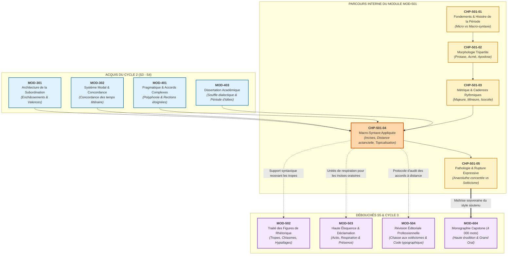
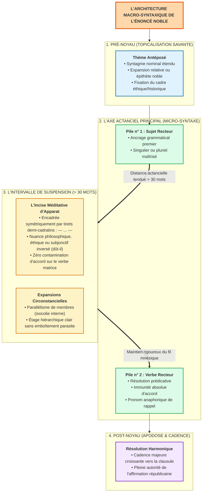

# Chapitre 4 — Macro-Syntaxe Appliquée : Incises Savantes, Distance Actancielle Supérieure à 30 Mots et Dislocations Oratoires Nobles

> **Identifiant du chapitre** : `CHP-501-04`  
> **Module de rattachement** : [`MOD-501` — Macro-Syntaxe, Dislocations, Incises et Grande Période Oratoire](file:///f:/Formation/world-class-french/03-curriculum/year-3/semester-5/mod-501-macro-syntaxe-periode-oratoire-cadences.md)  
> **Semestre** : Année 3 — Semestre 5 (S5)  
> **Volume horaire canonique** : 5 à 6 heures d'apprentissage autonome délibéré et d'ateliers d'application (Phase 1 Étude : 1 h 30 | Phase 2 Pratique : 1 h 30 | Phase 3 Correction : 1 h 00 | Phase 4 Évaluation : 1 h 00)  
> **Statut** : [STATUT : VALIDÉ]  
> **Compétences associées** : [`FR-SYNTAX-003`](file:///f:/Formation/world-class-french/02-competency-framework/competency-framework.md#fr-syntax-003-maîtrise-de-la-grande-période-oratoire-et-de-la-macro-syntaxe) (L4 Maîtrise approfondie), [`FR-STYLE-001`](file:///f:/Formation/world-class-french/02-competency-framework/competency-framework.md#fr-style-001-maîtrise-des-figures-de-rhétorique-et-commentaire-stylistique) (L4 Maîtrise approfondie), [`FR-LEXIC-001`](file:///f:/Formation/world-class-french/02-competency-framework/competency-framework.md#fr-lexic-001-précision-sémantique-nuances-synonymiques-et-collocations) (L4 Maîtrise approfondie)  
> **Sources scientifiques de référence** : `SRC-GRAM-01` (Grevisse & Goosse, 2016), `SRC-GRAM-02` (Riegel et al., 2016), `SRC-RHET-03` (Reboul, 1991), `SRC-RHET-04` (Calas, 2011), `SRC-NORM-03` (Ministère de l'Éducation nationale, 2020), `SRC-TYPO-01` (Imprimerie nationale, 2002/2014)

---

## 1. Titre et Place dans le Cursus

### 1.1 Intitulé Officiel
**Chapitre 4 : Macro-Syntaxe Appliquée : Incises Savantes, Distance Actancielle Supérieure à 30 Mots et Dislocations Oratoires Nobles** (`CHP-501-04`).

### 1.2 Insertion Architecturale dans le Cursus
Au sein du module `MOD-501`, après avoir posé les fondements épistémologiques de la macro-syntaxe (`CHP-501-01`), analysé l'anatomie tripartite protase-acmé-apodose (`CHP-501-02`) et maîtrisé le calcul métrique des cadences majeures et mineures (`CHP-501-03`), le rédacteur aborde le palier de la haute technicité stylistique : **l'art de suspendre l'énoncé sans le briser**. 

Ce chapitre enseigne la gestion souveraine des deux tensions majeures de la prose d'apparat :
1. **L'insertion d'incises savantes et philosophiques** qui modulent le discours et densifient la voix oratoire sans détruire l'armature syntaxique ;
2. **Le maintien du lien actanciel à grande distance** (> 30 mots) entre le syntagme sujet et le prédicat verbal recteur, à l'abri de toute faute d'accord par attraction ;
3. **La pratique exclusive de la topicalisation noble**, séparée par une frontière étanche des dislocations relâchées du français parlé informel.



- **En amont** :
  - `MOD-301` fournit la théorie de l'arborescence et des degrés d'enchâssement indispensable pour distinguer une incise détachée d'une subordonnée complétive ou relative régie.
  - `MOD-302` garantit la maîtrise du système modal (subjonctif dans les incises de souhait ou d'hypothèse : *dût-il périr*, *fût-ce au prix du sang*).
  - `MOD-401` installe la polyphonie énonciative (Ducrot) : l'incise est le lieu géométrique où le locuteur commente sa propre parole ou convoque une instance tierce.
  - `MOD-403` exige la tenue de la phrase longue dans la dissertation philosophique et littéraire.
- **Au sein du module `MOD-501`** :
  - `CHP-501-04` forme la clef de voûte pratique du module. Il opérationnalise la macro-syntaxe en apprenant à manipuler les constituants détachés (pré-noyaux, incises) avant d'aborder en [`CHP-501-05`](file:///f:/Formation/world-class-french/03-curriculum/year-3/semester-5/mod-501-macro-syntaxe-periode-oratoire-cadences.md#chapitre-5--pathologie-et-virtuosité-de-la-rupture--lanacoluthe-3-h-00) les figures de rupture délibérées (anacoluthes de Bossuet ou de Pascal).
- **En aval** :
  - [`MOD-502`](file:///f:/Formation/world-class-french/03-curriculum/year-3/semester-5/mod-502-traite-figures-rhetorique-poetique.md) viendra draper sur cette armature macro-syntaxique des figures de construction et de pensée (hypallages, chiasmes, métaphores filées).
  - [`MOD-503`](file:///f:/Formation/world-class-french/03-curriculum/year-3/semester-5/mod-503-haute-eloquence-declamation-presence-oratoire.md) traduira l'encadrement typographique des incises en ruptures de registre vocal et en silences suspendus.
  - [`MOD-504`](file:///f:/Formation/world-class-french/03-curriculum/year-3/semester-5/mod-504-revision-editoriale-typographie-savante.md) consacrera la compétence de relecture critique pour traquer les asymétries de tirets et les faux accords d'attraction dans les textes d'édition.

### 1.3 Justification du Calibrage Horaire (5 à 6 Heures)
Conformément aux directives canoniques du cursus, le volume de travail autonome est articulé en quatre phases rigoureusement minutées :
- **Phase 1 — Étude théorique et modélisation macro-syntaxique (1 h 30)** : Maîtrise des rubriques 1 à 13 (typologie fonctionnelle des incises, mécanismes cognitifs de la distance actancielle, règles d'accord à distance, matrice d'étanchéité de la topicalisation noble).
- **Phase 2 — Pratique délibérée et discrimination stylistique (1 h 30)** : Résolution autonome des 3 niveaux d'exercices progressifs (rubrique 14 : qualification et calcul actanciel sur 12 fragments d'auteurs, conversion de 8 dislocations relâchées en topicalisations d'apparat, analyse macro-syntaxique certifiée d'un discours de 50 mots exacts).
- **Phase 3 — Correction critique et composition normée (1 h 00)** : Audit clinique d'un projet d'allocution académique semé de 8 fautes de macro-syntaxe (rubrique 15) et composition d'une période oratoire de 60 mots exacts avec distance actancielle supérieure à 30 mots (rubrique 16).
- **Phase 4 — Ancrage mnésique et évaluation sommative (1 h 00)** : Restitution active sans indices (rubrique 18) et passation de l'épreuve sommative chronométrée de 30 minutes notée sur 20 points avec barème pénal rigoureux (rubrique 19).

---

## 2. Objectifs Mesurables

Au terme de ce chapitre, l'apprenant doit être capable de :

1. **Classifier et ponctuer les incises selon leur fonction énonciative** ([`FR-SYNTAX-003`](file:///f:/Formation/world-class-french/02-competency-framework/competency-framework.md#fr-syntax-003-maîtrise-de-la-grande-période-oratoire-et-de-la-macro-syntaxe) — Palier L4) : différencier rigoureusement les incises de régie (citation pure avec inversion verbale obligatoire) des incises méditatives ou oratoires (commentaires éthiques, apostrophes, hypothèses modalisées), et appliquer sans défaillance les normes de l'Imprimerie nationale (`SRC-TYPO-01`) régissant les virgules, tirets demi-cadratins et parenthèses.
2. **Maintenir la tension prédicative et sécuriser l'accord à distance supérieure à 30 mots** ([`FR-SYNTAX-003`](file:///f:/Formation/world-class-french/02-competency-framework/competency-framework.md#fr-syntax-003-maîtrise-de-la-grande-période-oratoire-et-de-la-macro-syntaxe) — Palier L4) : déployer un énoncé dans lequel le verbe principal est séparé de son sujet recteur par plus de 30 mots d'expansions ou d'incises emboîtées, en garantissant une immunité absolue contre l'attraction du syntagme prépositionnel ou nominal contigu [Réf. `SRC-GRAM-01`, § 465-472].
3. **Construire des topicalisations oratoires nobles et proscrire les dislocations familières** ([`FR-STYLE-001`](file:///f:/Formation/world-class-french/02-competency-framework/competency-framework.md#fr-style-001-maîtrise-des-figures-de-rhétorique-et-commentaire-stylistique) — Palier L4) : antéposer un syntagme thématique expansé en pré-noyau avec reprise anaphorique harmonieuse dans la proposition rectrice, tout en éradiquant impitoyablement les pléonasmes pronominaux et les ruptures parasitaires caractéristiques de la langue parlée relâchée [Réf. `SRC-GRAM-02`, chap. 15].
4. **Mobiliser un métalangage macro-syntaxique rigoureux pour commenter la prose d'apparat** ([`FR-LEXIC-001`](file:///f:/Formation/world-class-french/02-competency-framework/competency-framework.md#fr-lexic-001-précision-sémantique-nuances-synonymiques-et-collocations) — Palier L4) : employer à bon escient les notions de noyau assertif, pré-noyau, post-noyau, rection micro-syntaxique, cadre énonciatif et suspension productive pour justifier comment l'architecture macro-syntaxique gouverne l'autorité intellectuelle et l'émotion esthétique du lecteur.

---

## 3. Prérequis et Test de Préparation (Auto-Diagnostic)

### 3.1 Prérequis Cognitifs
- **Maîtrise de la rection verbale et des fonctions syntaxiques** (`MOD-201`) : identifier le sujet logique et grammatical d'un verbe, sans confusion entre complément du nom et sujet réel.
- **Hiérarchisation des propositions complexes** (`MOD-301`) : distinguer une proposition subordonnée intégrée (régie par un mot subordonnant) d'une proposition incidente autonome.
- **Conjugaison des modes subjonctif et conditionnel au style soutenu** (`MOD-302`) : manier l'inversion du subjonctif imparfait (*fût-il, dût-elle*) à valeur concessive ou hypothétique.
- **Conscience métrique et prosodique de la prose** (`CHP-501-03`) : percevoir les coupes respiratoires et l'équilibre des membres au sein de la période.

### 3.2 Test de Préparation Immédiat
Répondez aux cinq questions diagnostiques suivantes avant d'aborder le cours, puis dépliez le volet de correction pour vérifier la solidité de vos assises.

1. Quelle différence fonctionnelle sépare l'incise *« déclara le premier ministre »* de l'incise *« — n'en doutons point — »* au sein d'une période oratoire ?
2. Dans la phrase : *« La rigueur des lois républicaines, que tant d'orateurs aveuglés par l'esprit de faction [cherche / cherchent] à contourner, finira par s'imposer »*, quel est le sujet du verbe entre crochets, et quel est le sujet du verbe *finira* ?
3. Pourquoi la séquence *« Cet homme, je lui ai donné sa chance »* est-elle réputée relâchée, alors que *« Cet homme courageux, le destin ne l'a point épargné »* relève-t-elle de la topicalisation noble ?
4. Dans le code de l'Imprimerie nationale (`SRC-TYPO-01`), quels caractères typographiques exacts doivent délimiter une incise méditative insérée au cœur d'une phrase, et comment gère-t-on les espaces attenantes ?
5. Que désigne l'expression « attraction du pluriel » dans la clinique des accords verbaux, et dans quelle configuration syntaxique se produit-elle le plus fréquemment ?

---

<details>
<summary><b>Consulter le corrigé du test préparatoire</b></summary>

#### Corrigé Détaillé du Test Diagnostique
1. **Nature des incises** : *« déclara le premier ministre »* est une **incise de régie** (ou de citation), purement descriptive et attributive de parole, comportant l'inversion obligatoire du verbe et du sujet ; *« — n'en doutons point — »* est une **incise méditative ou oratoire**, qui constitue un acte d'énonciation second (modalisateur de certitude) par lequel l'orateur interpelle son auditoire ou commente son propre propos sans lien de rection avec la phrase matrice.
2. **Identification actancielle et accords** : Le verbe entre crochets (*chercher*) est le prédicat de la subordonnée relative introduite par *que* ; son sujet est le syntagme nominal *« tant d'orateurs aveuglés par l'esprit de faction »*, ce qui impose le pluriel *« cherchent »*. En revanche, le verbe de la principale *finira* a pour sujet le syntagme initial singulier *« La rigueur des lois républicaines »* ; l'accord se fait impérativement au singulier, en dépit du pluriel contigu *loi républicaines* ou *orateurs*.
3. **Dislocation relâchée vs Topicalisation noble** : Dans *« Cet homme, je lui ai donné sa chance »*, la reprise par le pronom personnel conjoint indirect *lui* est asyndétique et familière, mimant la spontanéité parlée sans nécessité d'emphase textuelle. Dans la seconde phrase, *« Cet homme courageux »* est un thème étendu antéposé placé en pré-noyau oratoire, repris majestueusement comme objet direct (*l'*) dans une proposition matrice où le sujet *le destin* apporte une solennité tragique.
4. **Typographie des incises (`SRC-TYPO-01`)** : Une incise méditative s'encadre par des **tirets demi-cadratins** (`—`, Unicode `U+2014` ou `U+2013` selon les traités, le demi-cadratin `–` ou cadratin `—` étant séparé du texte par une espace insécable avant et une espace sécante après, ou espacé symétriquement). On ne doit jamais mélanger une virgule ouvrante et un tiret fermant.
5. **Attraction du pluriel** : C'est le faux accord par lequel le scripteur accorde par inadvertance le verbe principal avec le dernier substantif pluriel qui précède immédiatement le verbe (souvent le complément du nom ou le nom final d'une incise), au lieu de l'accorder avec le noyau du sujet situé en amont. Exemple fautif : *« Le faisceau de ces indices concordants [témoignent] »* au lieu de *« témoigne »*.

</details>

---

## 4. Situation de Départ ou Problème Concret

### 4.1 Le Naufrage de l'Étalement Syntaxique
Considérons le brouillon d'un mémoire universitaire rédigé par un étudiant soucieux d'ampleur oratoire :

> *« L'autorité souveraine des magistrats de la cour supérieure, que tous les citoyens soucieux de la paix publique, malgré les outrages répétés de la presse pamphlétaire et les calomnies des factieux qui cherchent à renverser l'État, respectent avec une piété filiale, doivent être préservée contre les passions éphémères de la foule. »*

À première lecture, le texte semble noble et ambitieux. À l'analyse chirurgicale, l'édifice s'effondre dans un solécisme grotesque :
1. **La faute d'accord par attraction** : L'étudiant a écrit *« doivent être préservée »*. Pourquoi ce pluriel absurde ? Parce que sa mémoire de travail à court terme a été saturée par les substantifs pluriels intercalés (*magistrats*, *citoyens*, *outrages*, *calomnies*, *factieux*, *passions*). Le véritable sujet grammatical, *« L'autorité souveraine »*, singulier et féminin, situé 34 mots plus haut, a été purement et simplement oublié.
2. **L'asphyxie par emboîtement sans respiration** : Entre le sujet et son verbe, l'auteur a empilé une subordonnée relative (*que tous les citoyens...*), elle-même interrompue par un groupe prépositionnel d'opposition (*malgré les outrages...*), lui-même expansé par une seconde relative coordonnée (*et les calomnies... qui cherchent...*). La proposition principale s'est noyée sous le poids des dépendances non hiérarchisées.
3. **Le désastre rhétorique** : L'auditeur ou le lecteur, parvenu au verbe *doivent*, subit un choc cognitif violent. L'effet de solennité recherché se retourne immédiatement en son contraire : la preuve manifeste d'une incompétence syntaxique élémentaire.

### 4.2 L'Écueil Symétrique : La Dislocation Parlée Déguisée en Éloquence
À l'opposé de cet étalement incontrôlé, d'autres scripteurs croient insuffler de la vivacité à leur texte en pratiquant des détachements systématiques :

> *« Le ministre de la Justice, lui, les réformes constitutionnelles, franchement, il les a présentées trop tard. »*

Ce scripteur s'imagine produire un effet d'insistance oratoire. En réalité, il calque servilement la syntaxe fragmentée du français oral relâché : double thématisation asyndétique, accumulation de pronoms pléonastiques (*lui... il*), adverbe d'opinion parasite (*franchement*). La phrase n'a aucune colonne vertébrale architecturale ; elle ressemble à une retranscription brute de conversation de comptoir.

---

## 5. Explication Intuitive

Pour dominer ces architectures sans faillir, deux modélisations analogiques majeures éclairent la mécanique de la macro-syntaxe :

### 5.1 L'Analogie du Funambule et de la Perche à Balancier
Imaginons un funambule avançant sur un câble tendu au-dessus d'un précipice :
- Le câble d'acier représente **la rection micro-syntaxique** reliant le sujet au verbe principal.
- Le funambule ne peut pas traverser un gouffre de 50 mètres en marchant droit et raide : il chuterait au moindre coup de vent. Pour stabiliser sa traversée, il tient dans ses mains **une longue perche à balancier**.
- **L'incise noble est cette perche à balancier**. En s'étirant latéralement, en ouvrant un espace méditatif ou éthique (*— dût-il périr dans cette entreprise —*), l'incise élargit l'assise du discours. Elle n'alourdit pas la marche : elle compense les oscillations de la pensée, amortit les bourrasques émotionnelles et permet au scripteur de suspendre son pas au-dessus de l'abîme sans jamais perdre son centre de gravité.
- Mais si le funambule suspend à sa perche des casseroles, des sacs de pierres ou des objets disparates (les incises parasites, les digressions anecdotiques), le balancier devient un piège mortel : son poids désarticule la posture et précipite le marcheur dans le vide.

### 5.2 L'Analogie du Pont Haubané
Considérons le pont de Normandie ou le viaduc de Millau :
- **Le sujet recteur** est le premier pylône de béton enraciné dans la rive gauche.
- **Le verbe recteur** est le second pylône ancré sur la rive droite.
- **La distance actancielle** est la portée gigantesque du tablier central suspendu au-dessus du fleuve.
- Pour que le tablier ne s'affaisse pas au milieu sous son propre poids, les ingénieurs installent des **haubans d'acier rigoureusement tendus**. En syntaxe, ces haubans sont le **parallélisme structurel**, les **reprises anaphoriques** et l'**étanchéité absolue de l'accord en genre et en nombre**.
- Tant que la tension est calculée, la travée peut mesurer 30, 40 ou 50 mots sans fléchir d'un millimètre. Mais si le scripteur relâche la vigilance de sa mémoire de travail, le câble se détend, le tablier se brise au quarantième mot, et la phrase s'abîme dans le solécisme de rection.

---

## 6. Définitions Précises et Terminologie

Afin d'éviter tout flottement conceptuel, le tableau suivant consigne la terminologie scientifique de référence, adossée aux travaux du GARS (Blanche-Benveniste), de Grevisse (`SRC-GRAM-01`) et de Riegel (`SRC-GRAM-02`) :

| Terme Canonique | Définition Scientifique Rigoureuse | Exemple Contextualisé |
| :--- | :--- | :--- |
| **Macro-syntaxe** | Niveau d'organisation linguistique qui régit les relations discursives supérieures, l'agencement des masses phrastiques, l'emballage énonciatif et la hiérarchie entre constituants centraux et périphériques, par-delà la rection verbale locale. | L'articulation globale d'un pré-noyau thématique, d'une incidente méditative et d'une matrice rectrice. |
| **Micro-syntaxe** | Niveau d'organisation interne de la proposition gouverné par les règles de valence verbale, de dépendance directe, de régime prépositionnel et d'accords morphologiques stricts. | L'accord en nombre et en personne du verbe avec son sujet immédiat (*Le magistrat signe*). |
| **Noyau assertif (*Clause*)** | Segment minimal doté d'une autonomie prédicative et communicative complète, porteur de l'assertion principale de l'énoncé. | Dans *« Ce devoir sacré, nous l'accomplirons »*, le noyau assertif est *« nous l'accomplirons »*. |
| **Pré-noyau (*Thème antéposé*)** | Constituant périphérique placé à la gauche du noyau assertif, dépourvu de rection directe avec le verbe matrice, servant à fixer le cadre thématique ou spatiotemporel du discours. | *« Cette liberté si chèrement conquise, [le peuple la défendra]. »* |
| **Post-noyau** | Constituant périphérique placé à la droite du noyau assertif, apportant une précision conclusive, une restriction ou un repentir expressif. | *« Il a signé l'acte fatal, [non sans un profond frémissement d'angoisse]. »* |
| **Incise de régie (de citation)** | Brève proposition intercalée ou rejetée en fin de réplique dans le discours rapporté direct, indiquant l'acte d'énonciation et comportant l'inversion obligatoire du verbe et du sujet. | *« ..., dit-il ; ..., s'écria le magistrat ; ..., répondit l'accusé. »* |
| **Incise méditative (ou oratoire)** | Proposition incidente autonome apportant un commentaire philosophique, moral, affectif ou métadiscursif de l'orateur sur son propre énoncé, sans lien de subordination avec la matrice. | *« — dût-il braver la fureur des flots — »* ; *« — n'en doutons point — »* ; *« — qu'on me permette ce terme — »*. |
| **Proposition incidente** | Proposition insérée à l'intérieur d'une autre phrase sans y être rattachée par un mot subordonnant ou une conjonction de coordination, formant un îlot syntaxique clos. | *« La vertu, [chacun le sait], ne s'achète point avec de l'or. »* |
| **Distance actancielle** | Intervalle quantitatif mesuré en nombre exact de mots séparant le syntagme sujet recteur du verbe principal dont il régit l'accord. | Dans une période classique, cet intervalle peut excéder 30 à 45 mots sans rupture grammaticale. |
| **Tension prédicative** | Énergie syntaxique et herméneutique maintenant l'attention du lecteur dans l'attente du verbe recteur qui doit compléter le sujet déjà posé. | Le suspens cognitif créé lorsqu'un sujet est suivi de trois propositions circonstancielles intercalées. |
| **Topicalisation savante** | Procédé rhétorique et stylistique soutenu consistant à antéposer un syntagme en position thématique de premier plan, avec reprise anaphorique contrôlée dans la proposition rectrice. | *« Ce grand fleuve majestueux, les anciens l'adoraient comme une divinité bienfaisante. »* |
| **Dislocation relâchée** | Détachement asyndétique familier d'un élément nominal sans justification stylistique, suivi d'une pléthore de pronoms redondants calqués sur l'oral spontané. | *« Mon cousin, lui, son patron, il le déteste. »* (Proscrit en style académique). |
| **Accord à distance** | Obligation normative absolue d'accorder le verbe recteur avec son sujet légitime, en résistant à toute attraction par les substantifs intercalés dans l'incise ou le complément. | *« La splendeur [des empires déchus] [demeure] gravée dans les mémoires. »* |

---

## 7. Règles ou Mécanismes Fondamentaux

### 7.1 Typologie Fonctionnelle des Incises en Macro-Syntaxe

En macro-syntaxe française, l'incise n'est pas un accident de terrain : c'est un instrument d'orfèvrerie énonciative. Selon Martin Riegel (`SRC-GRAM-02`, chap. 19) et Maurice Grevisse (`SRC-GRAM-01`, § 465-472), on distingue deux familles irréductibles d'incises :

#### A. Les Incises de Régie (ou de Citation)
- **Fonction** : Purement attributives. Elles signalent qui parle au sein du discours rapporté au style direct.
- **Règles syntaxiques impératives** :
  1. **L'inversion du sujet est obligatoire en français soigné** : on écrit *« dit le philosophe »*, *« répondit-il »*, et jamais *« *le philosophe dit »* en position médiane ou finale d'incise.
  2. **Insertion de la particule euphonique `-t-`** lorsque le verbe se termine par une voyelle et que le pronom commence par une voyelle (*« demanda-t-il »*, *« s'écria-t-elle »*).
  3. **Absence de mot subordonnant** : l'incise de régie ne commence jamais par *que*.
- **Ponctuation canonique (`SRC-TYPO-01`)** : Elle est traditionnellement isolée par deux virgules (*« Ce décret, dit le ministre, entrera en vigueur dès demain »*).

#### B. Les Incises Méditatives, Réflexives ou Oratoires
- **Fonction** : Modalisatrices et polyphoniques. L'orateur suspend le fil de son récit pour introduire un jugement moral, un aveu d'impuissance, une prière, une réserve critique ou une interpellation dramatique.
- **Structures syntaxiques fréquentes** :
  1. *Formules assertives modalisatrices* : *« n'en doutons point »*, *« nous le savons tous »*, *« à n'en pas douter »*.
  2. *Propositions subjonctives hypothétiques sans subordonnant avec inversion* : *« dût-il en coûter sa vie »*, *« fût-ce au prix du sang »*, *« advienne que pourra »*.
  3. *Apostrophes métadiscursives* : *« qu'on me permette de le dire »*, *« s'il m'est permis d'user de cette image »*, *« Dieu m'en préserve »*.
- **Régime de ponctuation (`SRC-TYPO-01`)** :
  - **Virgules** : pour les incises brèves (2 à 4 mots) parfaitement intégrées au flux mélodique (*« La justice, nous le savons, triomphe toujours »*).
  - **Tirets demi-cadratins avec espaces insécables** : pour les incises d'amplitude moyenne ou longue (5 à 15 mots) apportant une rupture pathétique ou une réflexion dense (*« Cet homme d'État — dût-il affronter la fureur aveugle des factions coalisées — ne déviera jamais de la loi »*).
  - **Parenthèses** : réservées aux précisions érudites, techniques ou secondaires ; **à proscrire dans la grande période oratoire**, car la parenthèse visuelle relègue le propos au second plan alors que l'incise oratoire réclame la lumière de l'acmé.

---

### 7.2 La Maîtrise de la Grande Distance Actancielle (> 30 Mots)

La distance actancielle est l'épreuve de vérité de la maîtrise syntaxique. Franchir plus de 30 mots entre le sujet et le verbe exige la mise en œuvre de mécanismes psycholinguistiques précis :

```text
SCHÉMA DE TENSION PRÉDICATIVE À GRANDE DISTANCE
┌───────────────────────────┐
│ SYNTAGME SUJET RECTEUR    │ <── Point d'ancrage actanciel initial (Pile n° 1)
└─────────────┬─────────────┘
              │
              ▼  [Suspension syntaxique : Distance > 30 mots]
     ┌──────────────────────────────────────────────────────────────┐
     │ 1. Expansion du nom (Relative complétive ou déterminative)   │
     │ 2. Incise méditative noble encadrée par des tirets           │
     │ 3. Complément circonstanciel antéposé au verbe principal     │
     └──────────────────────────────────────────────────────────────┘
              │
              ▼  [Interdiction absolue d'attraction contextuelle]
┌───────────────────────────┐
│ VERBE PRINCIPAL RECTEUR   │ <── Résolution prédicative (Pile n° 2)
└───────────────────────────┘
```

#### A. Le Coût Cognitif de l'Intégration Syntaxique
En linguistique cognitive (théorie de Gibson sur la mémoire de travail syntaxique), chaque mot intercalé entre une tête syntaxique (le sujet) et son recteur (le verbe) génère une charge mémorielle. Si l'intercalation est désordonnée, la trace mnésique du sujet s'efface, conduisant inévitablement au solécisme d'attraction.

#### B. Les Trois Piliers de Consolidation à Distance
1. **L'Immunité Absolue contre l'Attraction Contextuelle** (`SRC-GRAM-01`, § 465-472) :
   - *Règle d'or* : Aucun substantif situé à l'intérieur d'un complément déterminatif, d'une proposition relative ou d'une incise ne possède le pouvoir de modifier le genre ou le nombre du verbe principal.
   - *Exemple inviolable* : *« L'armée des confédérés, que commandaient les généraux les plus intrépides et que soutenaient les espérances de dix nations alliées, a capitulé en rase campagne. »* (*L'armée* = singulier $\rightarrow$ *a capitulé* = singulier, malgré *confédérés*, *généraux*, *nations*).
2. **Le Verrouillage par Parallélisme Interne** :
   - Si l'on déploie une longue interruption, structurer les éléments intercalés sous forme de membres symétriques (*isocolie* ou anaphore binaire) : l'esprit perçoit une forme géométrique close et sait exactement où se referme la parenthèse.
3. **Le Rappel Pronominal Optionnel en cas d'Espacement Extrême (> 45 mots)** :
   - Lorsque la distance excède 45 mots et que l'attention risque de fléchir, le français classique autorise la reprise du sujet par un pronom démonstratif récapitulatif (*« Le courage indomptable de ces magistrats, qui [... 40 mots d'incises ...], ce courage admirable a sauvé la cité »* ou *« tous, dis-je, ont péri »*).

---

### 7.3 La Topicalisation Savante et l'Antéposition Thématique

Dans l'architecture du texte soutenu, l'ordre neutre *Sujet - Verbe - Complément* (*S-V-O*) produit une prose informative mais sans relief dramatique. La **topicalisation savante** permet d'inverser la distribution communicative :

#### A. La Formule Canonique de la Topicalisation Noble
$$\text{Pré-Noyau (Thème expansé)} \longrightarrow \text{Incise modalisatrice} \longrightarrow \text{Noyau assertif avec Pronom de Rappel}$$

> *« Cette auguste assemblée, que tant d'orages ont menacée et que la confiance populaire a investie du pouvoir suprême, nous la voyons aujourd'hui maîtresse souveraine des destinées de la patrie. »*

- **Étape 1** : Le constituant noble (*Cette auguste assemblée*) est placé au sommet de la phrase (en pré-noyau).
- **Étape 2** : Il est amplifié par deux relatives coordonnées qui justifient sa grandeur et suspendent le sens.
- **Étape 3** : La proposition principale introduit son propre sujet (*nous*), son verbe recteur (*voyons*), et reprend le thème initial par le pronom anaphorique direct féminin singulier (*la*).

#### B. Les Vertus Rhétoriques de la Topicalisation
1. **Création d'un piédestal discursif** : L'objet du discours est exposé au regard avant même que ne soit formulée l'action.
2. **Hiérarchisation dramatique** : Le lecteur appréhende d'abord l'enjeu moral ou historique, puis la résolution logique.
3. **Prévention de la surcharge terminale** : En délestant la fin de phrase de ses lourds compléments, elle permet une chute percutante et sonore.

---

### 7.4 La Frontière Stylistique Étanche : Dislocation Noble vs Relâchement Oral

L'une des fautes les plus destructrices chez l'étudiant de niveau C1/C2 consiste à confondre la **topicalisation d'apparat** avec la **dislocation parlée familière**. Le tableau suivant formalise la matrice d'étanchéité normative :

| Critère Distinctif | Dislocation Parlée Relâchée (Proscrite) | Topicalisation Oratoire Noble (Recherchée) | Fondement Théorique (`SRC-GRAM-02`) |
| :--- | :--- | :--- | :--- |
| **Structure morphosyntaxique** | Sujet détaché sans expansion + double pronom conjoint redondant :<br/>*« Mon frère, lui, il est parti. »* | Syntagme nominal enrichi en tête + anaphore intégrée dans le noyau prédicatif :<br/>*« Ce frère chéri, nous l'avons vu partir. »* | Élimination du pléonasme sujet non motivé (`*il`) ; reprise objet légitime (`l'`). |
| **Poids informationnel du thème** | Mot court, banal, substantif isolé sans déterminant fort :<br/>*« La table, elle est bancale. »* | Syntagme étendu, caractérisé par épithètes nobles ou subordonnées relatives :<br/>*« Cet édifice séculaire, fruit du labeur... »* | La noblesse du détachement exige un volume informationnel suffisant pour justifier l'attente. |
| **Nature de la reprise anaphorique** | Reprise relâchée asyndétique par le pronom démonstratif neutre *ça* :<br/>*« La trahison, ça ne se pardonne pas. »* | Reprise pronominale exacte en genre/nombre ou intégration directe dans la rection :<br/>*« La perfidie, le prince ne la tolère point. »* | Rejet absolu du *ça* dépréciatif dans la prose académique d'apparat. |
| **Prosodie et ponctuation** | Hachoir oral, virgules sèches répétées mimant l'hésitation conversationnelle :<br/>*« Moi, la guerre, vous savez, j'y pense. »* | Courbe intonative continue (arsis majestueuse en protase, repos sur tirets demi-cadratins) :<br/>*« Cette épreuve suprême — nous le savons — commande l'union. »* | Maîtrise de l'emballage macro-syntaxique global contre le morcellement mimétique. |

---

## 8. Raisonnement Détaillé (Le Pourquoi)

### 8.1 La Dialectique de la Suspension Productive vs la Digression Destructrice
Pourquoi la tradition stylistique française considère-t-elle l'incise noble comme le sommet de l'élégance, alors qu'elle condamne sans appel l'incise parasite ? La réponse réside dans la **dialectique entre tension herméneutique et surcharge cognitive**.

#### A. L'Incise Noble : Épaississement du Temps Énonciatif
Lorsqu'un orateur classique insère au cœur de sa phrase une incise méditative :
> *« La liberté — que l'on confond trop souvent avec le dérèglement des appétits serviles — exige le sacrifice consenti de nos égoïsmes. »*

Cette incise ne détourne pas l'attention : elle la creuse. Elle suspend l'attribution du prédicat (*exige*) au moment précis où l'auditeur croit définir la notion de liberté. L'incise fonctionne comme une **chambre de décantation philosophique** :
1. Elle purifie le concept en réfutant un contresens vulgaire (*le dérèglement des appétits*) ;
2. Elle élève le ton moral du discours ;
3. Lorsque le verbe *exige* éclate enfin, il résonne avec une force centuplée, car le terrain intellectuel a été souverainement préparé.

#### B. L'Incise Parasite : Asphyxie par Dérive Associative
À l'inverse, l'incise vicieuse naît de la paresse d'un esprit qui écrit au fil de la plume sans plan macro-syntaxique préétabli :
> *« Le magistrat, qui avait d'ailleurs dîné la veille avec le préfet, lequel préfet contestait les chiffres du chômage, a rendu son arrêt. »*

Ici, chaque mot déclenche une association d'idées contingente et anecdotique. Le lecteur est arraché à la scène juridique pour être transporté à un dîner mondain, puis à une querelle statistique. Le câble actanciel n'est pas tendu : il est rompu. La phrase n'est plus une période d'art, c'est un entassement d'épiphénomènes insignifiants.

---

## 9. Exemples Corrects Commentés

Nous disséquons ici quatre monuments de la prose française illustrant la maîtrise de l'incise savante, de la distance actancielle et de la topicalisation noble.

### 9.1 Modèle 1 : Jacques-Bénigne Bossuet (Oraison funèbre de Louis de Bourbon, Prince de Condé, 1687)

> *« Ce grand prince, que la victoire n'avait jamais pu éblouir, et qui, au milieu des plus éclatants triomphes dont la renommée ait jamais retenti dans l'univers, conservait toujours cette modération chrétienne qui fait les véritables héros, ne regarda jamais ses triomphes que comme l'ouvrage de Dieu. »*

```text
CARTOGRAPHIE MACRO-SYNTAXIQUE DE LA PHRASE DE BOSSUET
┌────────────────────────────────────────────────────────────────────────────────────────┐
│ I. SUJET RECTEUR (Pile n° 1) : « Ce grand prince » (3 mots)                           │
├────────────────────────────────────────────────────────────────────────────────────────┤
│ II. DISTANCE ACTANCIELLE SUSPENDUE (33 MOTS INTERCALÉS) :                             │
│     ├── Relative 1 : « que la victoire n'avait jamais pu éblouir » (8 mots)            │
│     └── Conjonction & Relative 2 : « et qui, [...] conservait toujours cette modération│
│         chrétienne qui fait les véritables héros, » (25 mots)                          │
│         └── Incise circonstancielle intercalée : « au milieu des plus éclatants        │
│             triomphes dont la renommée ait jamais retenti dans l'univers » (15 mots)   │
├────────────────────────────────────────────────────────────────────────────────────────┤
│ III. VERBE RECTEUR & PRÉDICAT (Pile n° 2) :                                            │
│      « ne regarda jamais ses triomphes que comme l'ouvrage de Dieu. » (10 mots)        │
└────────────────────────────────────────────────────────────────────────────────────────┘
```

#### Autopsie Linguistique :
1. **Mesure de la distance actancielle** : Exactement **33 mots** séparent le substantif sujet *prince* de son verbe recteur *regarda*.
2. **Résistance à l'attraction** : Entre le sujet singulier *prince* et le verbe *regarda*, s'intercalent pas moins de quatre substantifs pluriels majeurs (*triomphes*, *héros*, *triomphes*, *univers*). Bossuet ne vacille pas un instant : le verbe *regarda* est maintenu au singulier souverain du passé simple.
3. **Architecture des incises** : La seconde relative en *qui* est elle-même ouverte par un complément circonstanciel de 15 mots encadré par des virgules. La phrase ne perd jamais son souffle parce que chaque membre apporte un degré supérieur de sanctification morale du héros.

---

### 9.2 Modèle 2 : Jean-Jacques Rousseau (*Du contrat social*, Livre II, chap. 7, « Du Législateur », 1762)

> *« Celui qui ose entreprendre d'instituer un peuple doit se sentir en état de changer, pour ainsi dire, la nature humaine, de transformer chaque individu, qui par lui-même est un tout parfait et solitaire, en partie d'un plus grand tout dont cet individu reçoive en quelque sorte sa vie et son être. »*

#### Autopsie Linguistique :
1. **Topicalisation par relatif substantivé** : *« Celui qui ose entreprendre d'instituer un peuple »* (9 mots) forme le pré-noyau thématique qui focalise toute l'attention éthique.
2. **Incises modalisatrices philosophiques** : Rousseau insère deux incises métadiscursives fondamentales : *« pour ainsi dire »* (4 mots) et *« en quelque sorte »* (4 mots). Ces incises sont de véritables soupapes de sécurité épistémologiques : conscient du scandale conceptuel que constitue l'idée de « changer la nature humaine », le philosophe invite le lecteur à comprendre l'expression au sens figuré sans rompre la rection du verbe *transformer*.
3. **Incise explicative symétrique** : L'incise *« qui par lui-même est un tout parfait et solitaire »* s'intercale harmonieusement entre le verbe d'action (*transformer*) et son complément d'attribution (*en partie d'un plus grand tout*), créant un contraste saisissant entre l'isolement originel et l'organisme social.

---

### 9.3 Modèle 3 : François-René de Chateaubriand (*Mémoires d'outre-tombe*, Livre X, 1848)

> *« Cette gloire des armes, que la France a poursuivie à travers tant de sang et d'immenses hécatombes — dût la patrie en garder à jamais la mémoire douloureuse et le deuil inconsolable —, nous l'avons vue s'évanouir en un jour sur les plaines funèbres de Waterloo. »*

#### Autopsie Linguistique :
1. **Topicalisation d'apparat initiale** : *« Cette gloire des armes »* (4 mots) est le thème majestueux posé en amorce, expansé par une relative tragique de 13 mots (*que la France a poursuivie...*).
2. **Incise méditative au subjonctif encadrée par des tirets** : *« — dût la patrie en garder à jamais la mémoire douloureuse et le deuil inconsolable — »* (15 mots). Chateaubriand utilise l'inversion expressive du subjonctif imparfait (*dût la patrie*) pour conférer une dimension de destin antique à son regret. Les tirets demi-cadratins isolent ce soupir historique sans détruire la charpente de l'énoncé.
3. **Résolution par anaphore et prédicat** : Le pré-noyau est réactivé par le pronom personnel *l'* (*nous l'avons vue*). La distance entre le thème initial et le verbe de la principale compte **32 mots**. L'accord de la forme pronominale est parfait, et la chute sur le tétrasyllabe *Waterloo* conclut la cadence avec une force funèbre irrésistible.

---

### 9.4 Modèle 4 : Jean Jaurès (*Discours à la jeunesse*, Albi, 30 juillet 1903)

> *« Ce grand courage républicain, que vous devez tous puiser dans l'étude assidue de l'histoire et dans la méditation des luttes héroïques de vos aînés, ce n'est point, jeunes gens — qu'on ne s'y trompe pas —, une vaine fanfaronnade de paroles ou un étalage stérile de bravoure, mais la tranquille résolution d'affronter l'injustice partout où elle opprime les faibles. »*

#### Autopsie Linguistique :
1. **Topicalisation et reprise anaphorique démonstrative** : Jaurès antépose le syntagme *« Ce grand courage républicain »*, l'enrichit d'une relative de 20 mots, puis opère une reprise d'autorité par le démonstratif neutre d'acmé *« ce n'est point... »*.
2. **Double incise en cascade** : L'orateur enroule une apostrophe directe à son auditoire (*« jeunes gens »*) et une incise oratoire de mise en garde (*« — qu'on ne s'y trompe pas — »*). L'insertion des tirets isole l'admonition éthique sans altérer l'antithèse majeure *ce n'est point... mais la tranquille résolution*.
3. **Distance actancielle et souffle** : 31 mots séparent l'amorce thématique de la définition négative du courage, démontrant une maîtrise souveraine de la respiration tribunicienne.

---

## 10. Contre-Exemples et Erreurs Fréquentes

Voici six erreurs récurrentes de macro-syntaxe, de gestion d'incises et de dislocations observées dans les copies académiques :

### Erreur n° 1 : Faute d'accord par attraction d'un nom de l'incise ou du complément intercalé
- **Énoncé défaillant** : *« L'intégrité sans tache des magistrats de la cour suprême, que les outrages répétés de la presse factieuse ne sauraient entamer, [ont] permis d'éviter la guerre civile. »*
- **Diagnostic linguistique** : Le scripteur a commis un faux accord d'attraction en reliant le verbe auxiliaire *ont* au substantif pluriel *magistrats* ou *outrages*. Or, le sujet recteur unique est le syntagme singulier *« L'intégrité sans tache »*.
- **Forme corrigée** : *« L'intégrité sans tache des magistrats de la cour suprême, que les outrages répétés de la presse factieuse ne sauraient entamer, **a permis** d'éviter la guerre civile. »*

### Erreur n° 2 : Empilement asphyxiant de micro-incises sans hiérarchie
- **Énoncé défaillant** : *« L'orateur, sachant que, quoi qu'il arrive, comme le président l'a rappelé, si la motion est rejetée, tout est perdu, a quitté la tribune. »*
- **Diagnostic linguistique** : Empilement anarchique de quatre propositions subordonnées et incidentes hachées (*sachant que*, *quoi qu'il arrive*, *comme le président...*, *si la motion...*). Le câble actanciel est pulvérisé, le souffle est suffocant.
- **Forme corrigée** : *« Sachant que le rejet de la motion précipiterait la ruine de l'État, et averti d'ailleurs par les déclarations du président, l'orateur, sans attendre l'issue fatale, a quitté la tribune. »* (Distribution rationnelle en protase équilibrée).

### Erreur n° 3 : Rupture de la proposition principale perdue de vue (phrase orpheline)
- **Énoncé défaillant** : *« Ce législateur dévoué, qui avait consacré ses veilles à la rédaction du Code civil, et dont chacun vantait la clairvoyance, bien que ses adversaires ne manquassent jamais une occasion de le diffamer. »*
- **Diagnostic linguistique** : Le scripteur a ouvert un sujet nominal (*Ce législateur dévoué*), l'a flanqué de deux subordonnées relatives coordonnées (*qui avait... et dont chacun...*), puis a achevé son paragraphe sur une subordonnée concessive (*bien que...*), en omettant totalement le verbe principal recteur. La phrase demeure syntaxiquement décapitée.
- **Forme corrigée** : *« Ce législateur dévoué, qui avait consacré ses veilles à la rédaction du Code civil et dont chacun vantait la clairvoyance, **n'a jamais fléchi dans sa tâche**, bien que ses adversaires ne manquassent aucune occasion de le diffamer. »*

### Erreur n° 4 : Dislocation familière pléonastique avec double pronom parasite
- **Énoncé défaillant** : *« Le projet de loi sur la souveraineté nationale, le garde des Sceaux, lui, il l'a défendu hier avec beaucoup de courage. »*
- **Diagnostic linguistique** : Calque direct de la syntaxe relâchée de la rue. Détachement asyndétique du COD et du sujet, suivi des pronoms parasites redondants *lui* et *il*.
- **Forme corrigée** : *« Ce projet de loi sur la souveraineté nationale, le garde des Sceaux l'a défendu hier avec une remarquable fermeté d'âme. »* (Topicalisation d'apparat pure : le sujet nominal *le garde des Sceaux* régit directement le verbe sans doublon pronominal).

### Erreur n° 5 : Fausse ponctuation typographique de l'incise (mélange asymétrique tiret/virgule)
- **Énoncé défaillant** : *« La vérité — dût-elle blesser les amours-propres les plus ombrageux, finira par dissiper tous les mensonges. »*
- **Diagnostic linguistique** : Violation grossière des règles de l'Imprimerie nationale (`SRC-TYPO-01`). L'incise est ouverte par un tiret mais fermée par une virgule. Les signes de ponctuation d'incise fonctionnent rigoureusement par paires symétriques.
- **Forme corrigée** : *« La vérité — dût-elle blesser les amours-propres les plus ombrageux — finira par dissiper tous les mensonges. »* (ou entièrement entre virgules : *« La vérité, dût-elle blesser [...], finira par... »*).

### Erreur n° 6 : Oubli de fermeture de l'incise par le tiret symétrique
- **Énoncé défaillant** : *« Le chef de l'État — n'en doutons point pour préserver la paix civile a convoqué immédiatement les chefs de parti. »*
- **Diagnostic linguistique** : L'incise *« — n'en doutons point »* n'est pas refermée avant le complément de but (*pour préserver la paix civile*). Ce manquement produit un télescopage absurde : le lecteur lit *« doutons point pour préserver »* comme si le complément d'objet dépendait de l'incise.
- **Forme corrigée** : *« Le chef de l'État — n'en doutons point — a convoqué immédiatement les chefs de parti pour préserver la paix civile. »*

---

### Tableau Récapitulatif de la Clinique Macro-Syntaxique

| Anomalie | Forme Défaillante Observée | Cause Psycholinguistique Profonde | Prescription Normative Universitaire |
| :---: | :--- | :--- | :--- |
| **Cas 1** | *« Le choix de ces solutions [paraissent] sage »* | Effacement mnésique du noyau singulier par saturation de substantifs pluriels contigus. | Règle d'or de l'immunité d'accord : tracer la dépendance directe Sujet $\rightarrow$ Verbe sans lire les mots intercalés. |
| **Cas 2** | Empilement de 4 subordonnées en sandwich | Écriture compulsive sans architecture ; confusion entre complexité et confusion. | Ventiler les circonstances : un membre en protase, l'autre en apodose, supprimer le superflu. |
| **Cas 3** | Période sans proposition principale | Focalisation excessive sur les expansions qualificatives au détriment de l'assertion. | Vérifier la présence obligatoire d'un verbe conjugué recteur non subordonné. |
| **Cas 4** | *« La démocratie, elle, ça s'apprend »* | Paresse stylistique ; mimétisme spontané des structures disloquées de l'oral familier. | Proscrire le double pronom sujet (*elle, il*) et le démonstratif neutre avilissant (*ça*). |
| **Cas 5** | Ponctuation hybride `— ... ,` | Méconnaissance du code typographique officiel ; confusion entre tiret et parenthèse. | Apparier impérativement deux tirets demi-cadratins `— ... —` ou deux virgules `, ... ,`. |
| **Cas 6** | Incise non refermée avant la suite | Négligence de relecture ; rupture de la clôture syntaxique de l'îlot énonciatif. | Toute incise constitue une enclave : la borne de sortie est aussi obligatoire que la borne d'entrée. |

---

## 11. Cas Particuliers et Limites

### 11.1 Les Incises Introduites par une Conjonction sans Verbe Exprimé
Le français classique et académique admet des incises hautement condensées, introduites par des conjonctions de concession (*bien que, quoique, si*) ou des adverbes sans aucun verbe conjugué :
- *« Le magistrat, **bien que réticent**, apposa son sceau sur l'ordonnance. »*
- *« Cette décision, **si tant est qu'elle fût légale**, bouleversait la tradition républicaine. »*
- *« Le ministre, **quoique averti du péril**, refusa de faire appel à l'armée. »*
- **Règle** : L'adjectif ou le participe employé dans l'incise elliptique (*réticent, averti*) s'accorde impérativement en genre et en nombre avec le sujet dont il dépend sémantiquement, bien qu'il ne soit accompagné d'aucun verbe copule exprimé (`SRC-GRAM-01`, § 388).

### 11.2 Les Restrictions d'Inversion dans les Incises de Régie
Si l'inversion du sujet est la règle d'or dans les incises de régie, deux exceptions normatives doivent être rigoureusement observées :
1. **Présence d'un sujet trop long expansé par une relative** : Si le sujet de l'incise comporte plus de dix mots, l'inversion immédiate reste possible mais peut être allégée :
   *« "Je refuse ce compromis", déclara d'une voix sourde le vieux soldat qui avait servi sous les ordres de Turenne. »* (L'inversion demeure élégante et obligatoire).
2. **Proscription absolue de la tournure calquée de l'anglais** : En français soigné, il est formellement interdit d'écrire : *« *"Je refuse", le vieux soldat déclara »*. L'inversion est une contrainte de grammaire structurale française, non une option esthétique facultative.

### 11.3 La Place et la Prosodie de l'Adverbe Modalisateur
Certains adverbes monosyllabiques ou dissyllabiques assument la fonction de micro-incises méditatives : *certes, sans doute, assurément, heureusement, apparemment*.
- **Règle de détachement** :
  - Placés en tête de phrase ou en rupture médiane, ils sont obligatoirement suivis ou encadrés de virgules s'ils portent sur l'ensemble de l'énoncé (modalisateurs d'énonciation) : *« Cette politique, **certes**, a produit des fruits amers, mais elle a sauvé l'essentiel. »*
  - Si l'adverbe ne modifie que le verbe (adverbe de manière ou de degré), il s'insère sans virgule : *« Il a **certes** triomphé, mais à quel prix ! »*

---

## 12. Approfondissement Adapté au Niveau : La Théorie Macro-Syntaxique du GARS

Pour comprendre la logique formelle des incises et des dislocations, les travaux de **Claire Blanche-Benveniste** et du **Groupe aixois de recherches en syntaxe (GARS)** constituent la référence linguistique moderne incontournable [Réf. `SRC-GRAM-02`, chap. 21].

### 12.1 La Rupture Épistémologique : Rection vs Énonciation
La grammaire distributionnelle traditionnelle échouait à rendre compte des phrases longues d'écrivains ou des discours oraux élaborés, en qualifiant d'« anomalies » ou de « membres erratiques » tout ce qui n'entrait pas dans l'arbre binaire *Sujet - Prédicat*.

Blanche-Benveniste a démontré que la langue fonctionne selon deux niveaux d'organisation simultanés :
1. **La grille micro-syntaxique (domaine de la rection)** : Elle lie les éléments par des relations de valence obligatoires (un verbe transitif direct exige un COD ; une préposition régit son régime). Tout manquement à ce niveau constitue une faute de grammaire directe (solécisme).
2. **La grille macro-syntaxique (domaine de l'intégration énonciative)** : Elle organise la distribution discursive des paquets d'information. Elle comprend :
   - **Le Noyau assertif** : la proposition dotée de force illocutoire (l'assertion fondamentale) ;
   - **Les Pré-noyaux (Topiques antéposés)** : constituants situés hors de la rection du verbe, qui cadrent la scène, orientent l'attention de l'interlocuteur et créent un champ d'attente ;
   - **Les Post-noyaux (Ajouts conclusifs)** : éléments déversés après la chute prédicative pour préciser, corriger ou clore harmonieusement le propos ;
   - **Les Incises et Éléments Associés** : unités phrastiques insérées au cœur de la rection sans en faire partie, fonctionnant comme des « méta-énoncés » autonomes.

### 12.2 Conséquence Didactique pour le Rédacteur d'Apparat
Cette distinction libère le scripteur tout en le responsabilisant :
- **L'incise savante n'est pas un parasite** : c'est un énoncé second autonome greffé sur un énoncé premier.
- **Le secret de la grande période** réside dans la séparation étanche des deux niveaux : l'enveloppe macro-syntaxique peut déployer trois pré-noyaux, deux incises méditatives et un post-noyau ample, à la seule et unique condition que **la chaîne de rection micro-syntaxique sous-jacente (sujet $\rightarrow$ verbe $\rightarrow$ objet) demeure d'une pureté mathématique sans faille**.

---

## 13. Comparaisons Différentielles

Les quatre tableaux synoptiques suivants synthétisent les lignes de démarcation cardinales de ce chapitre :

### 13.1 Incise de Régie vs Incise Méditative

| Paramètre | Incise de Régie (Citation) | Incise Méditative (Oratoire / Réflexive) |
| :--- | :--- | :--- |
| **Rôle fonctionnel** | Désigner l'instance énonciatrice dans le discours direct. | Moduler, juger, prier ou interpeller au cours du discours. |
| **Ordre des mots** | Inversion verbe-sujet obligatoire (*dit le prince*). | Ordre libre, souvent subjonctif avec inversion (*dût-il périr*). |
| **Ponctuation usuelle** | Virgules d'insertion standard. | Tirets demi-cadratins `— ... —` ou virgules lourdes. |
| **Contenu sémantique** | Minimal, factuel, verbe de parole (*dire, affirmer, crier*). | Dense, moral, philosophique, affectif ou métadiscursif. |
| **Effet produit** | Clarté narrative et attribution neutre. | Gravité oratoire, distanciation critique, souffle tragique. |

### 13.2 Topicalisation Noble vs Dislocation Relâchée

| Paramètre | Dislocation Parlée Relâchée | Topicalisation Oratoire Noble |
| :--- | :--- | :--- |
| **Registres de langue** | Familier, oral populaire, conversation spontanée. | Soutenu, académique, littéraire, discours d'apparat. |
| **Traitement du sujet** | Pléonasme systématique : *« Le chef, il a décidé. »* | Sujet unique sans doublon : *« Le chef a souverainement décidé. »* |
| **Pronom de reprise** | Démonstratif neutre vulgaire : *« Les études, ça fatigue. »* | Pronom personnel exact : *« Ces nobles études, nous les chérissons. »* |
| **Expansion du thème** | Nulle : substantif nu détaché sans épithète. | Forte : syntagme enrichi d'épithètes et de relatives. |
| **Finalité stylistique** | Facilité d'expression orale sans mémoire syntaxique. | Mise en relief grandiose et construction de l'acmé. |

### 13.3 Parenthèses vs Tirets Demi-Cadratins vs Virgules

| Signe Typographique | Degré d'Intégration | Domaine d'Élection Stylistique | Risque Majeur |
| :--- | :---: | :--- | :--- |
| **Virgules `, ... ,`** | Maximale | Incises très courtes (2 à 4 mots) modalisatrices (*sans doute*). | Dilution de l'incise au milieu des compléments circonstanciels. |
| **Tirets `— ... —`** | Médiane (Haute valeur oratoire) | Incises amples (5 à 15 mots), pensées fortes, soupirs éthiques. | Oubli du tiret fermant ou asymétrie avec une virgule. |
| **Parenthèses `( ... )`** | Minimale (Détachement total) | Précisions historiques, dates, références bibliographiques. | **Destruction du souffle oratoire** : relégation visuelle au second plan. |

### 13.4 Distance Actancielle Saine vs Phrase Désarticulée

| Critère d'Analyse | Distance Actancielle Saine (> 30 mots) | Phrase Désarticulée (Solécisme) |
| :--- | :--- | :--- |
| **Contrôle du sujet** | Le sujet initial reste présent à l'esprit jusqu'au verbe. | Le sujet est oublié, masqué ou remplacé en cours de route. |
| **Accord du verbe** | Immunité totale contre les pluriels ou féminins intercalés. | Accord par attraction sur le dernier mot précédent le verbe. |
| **Hiérarchie interne** | Les dépendances sont étagées avec parallélisme rigoureux. | Enchevêtrement de relatives et de conjonctions disparates. |
| **Effet sur le lecteur** | Lévitation intellectuelle et soulagement lors de la chute. | Confusion, blocage cognitif et dégoût stylistique. |

---

## 14. Exercices Progressifs

### Niveau 1 : Reconnaissance et Qualification Macro-Syntaxique (12 Fragments)
Pour chacun des 12 fragments littéraires et oratoires suivants :
a) Identifiez et isolez la ou les incises présentes, en précisant s'il s'agit d'une **incise de régie** ou d'une **incise méditative/oratoire** ;  
b) Isolez le syntagme sujet recteur et son verbe principal ;  
c) Calculez la **distance actancielle exacte en nombre de mots** séparant le sujet de son verbe recteur.

1. *« La justice humaine, dont les balances hésitent si souvent entre l'erreur et la vérité, doit toujours — n'en doutons point — chercher son modèle dans l'immuable équité divine. »* (Bossuet)
2. *« "La paix, répondit solennellement le diplomate aux députés assemblés, ne saurait s'acheter au prix du déshonneur de la nation." »*
3. *« Cette constitution républicaine, que le peuple de Paris a scellée de son sang au cours de journées mémorables, nous la léguerons intacte à la postérité. »* (Mirabeau)
4. *« L'armée des princes coalisés, malgré la réputation formidable de ses généraux et le nombre presque infini de ses bataillons aguerris, a fui devant nos volontaires. »* (Carnot)
5. *« "Vous avez vaincu l'ennemi extérieur, s'écria l'orateur jacobin à la tribune de la Convention, mais il vous reste à terrasser les factions intestines !" »*
6. *« La dignité du sage, que les orages de la fortune ne peuvent ébranler et que les séductions perfides du pouvoir ne sauraient corrompre, demeure inaltérable jusqu'au tombeau. »* (Montesquieu)
7. *« Le destin de l'Afrique nouvelle — dût-il s'édifier à travers d'immenses épreuves et de douloureux déchirements — triomphera de tous les skepticismes contemporains. »* (Léopold Sédar Senghor)
8. *« "Nous ne capitulerons jamais, déclara fermement le général à ses officiers réunis, car la liberté de la France ne se négocie point." »* (Charles de Gaulle)
9. *« Cette parole poétique, que les maîtres de la parole ancestrale nous ont transmise dans le silence sacré des veillées de brousse, retentit aujourd'hui comme un cri de renaissance. »* (Amadou Hampâté Bâ)
10. *« La mémoire des héros martyrisés, que les tyrans croyaient enfouir à jamais sous la poussière de l'oubli et le silence des fosses communes, ressuscite avec éclat dans la ferveur des peuples libérés. »* (Aimé Césaire)
11. *« La souveraineté de la raison — qu'on me pardonne ce terme trop audacieux aux yeux des dévots — finira par dissiper les antiques ténèbres de la superstition. »* (Voltaire)
12. *« "Pourquoi tremblez-vous devant l'adversité, demanda le philosophe stoïcien au disciple éploré, si la mort n'est que le retour nécessaire à l'ordre de la nature ?" »*

---

### Niveau 2 : Transformation et Rétablissement Stylistique (8 Phrases)
Convertissez les 8 phrases suivantes, lourdement entachées de dislocations familières ou d'incises défaillantes, en **topicalisations oratoires soutenues** de haut registre académique :

1. *« Ce nouveau musée national, les touristes du monde entier, franchement, ils le visitent tous les jours avec admiration. »*
2. *« Le réchauffement climatique, ça, les ministres réunis à la conférence, ils n'ont pas pris les bonnes mesures pour l'empêcher. »*
3. *« La démocratie républicaine — dût-elle affronter des crises terribles, elle vaincra toujours l'obscurantisme. »*
4. *« Mon frère aîné, lui, le diplôme de l'École d'administration, il l'a obtenu sans aucune difficulté grâce à son travail acharné. »*
5. *« La réforme des retraites, le gouvernement — sachant que les syndicats s'y opposent, il a décidé d'engager sa responsabilité. »*
6. *« Cette maison coloniale de Grand-Popo, mes grands-parents, ils y ont passé toute leur jeunesse heureuse. »*
7. *« La liberté de la presse, ça ne se négocie pas — comme l'a dit le rédacteur en chef — avec des censeurs d'État. »*
8. *« Les conclusions du rapport d'audit, le magistrat instructeur, après avoir entendu tous les témoins et experts, il les a transmises au parquet. »*

---

### Niveau 3 : Analyse Macro-Syntaxique Complète d'un Discours Parlementaire de 50 Mots Exacts
Soit la période parlementaire soutenue suivante, prononcée lors d'un grand débat constitutionnel :

> *« Cette haute tribune sacrée, que tant d'orateurs illustres ont honorée de leur génie, le peuple souverain — n'en doutons point — ne l'a confiée à nos soins que pour que nous y défendions sans défaillance la liberté de la patrie et la grandeur indestructible des lois de la République. »*

**Consignes de travail** :
1. **Certification du décompte mot à mot** selon les règles officielles de l'Imprimerie nationale (`SRC-TYPO-01`), démontrant que l'énoncé compte **EXACTEMENT 50 MOTS**.
2. **Cartographie macro-syntaxique intégrale** : délimitation formelle du pré-noyau (topicalisation), du sujet recteur, de l'incise oratoire et du noyau prédicatif principal.
3. **Analyse de la régie des accords** : démonstration de l'accord du participe passé *confiée* et de l'accord verbal à distance.

---

### Corrigés Exhaustifs et Justifiés des Exercices

<details>
<summary><b>Consulter le corrigé détaillé des 3 niveaux d'exercices</b></summary>

#### Corrigé Niveau 1 (12 Fragments)
1. **Bossuet** :
   - *Incise* : *« — n'en doutons point — »* (incise méditative modalisatrice de certitude encadrée par des tirets).
   - *Sujet et verbe* : Sujet = *La justice humaine* ; Verbe = *doit*.
   - *Distance actancielle* : 17 mots séparent le substantif *justice* du verbe modal *doit* (*dont les balances hésitent si souvent entre l'erreur et la vérité n'en doutons point*). Accord au singulier parfait.
2. **Diplomate** :
   - *Incise* : *« répondit solennellement le diplomate aux députés assemblés »* (incise de régie avec inversion verbale).
   - *Sujet et verbe* : Sujet = *La paix* ; Verbe = *saurait*.
   - *Distance actancielle* : 8 mots (ceux de l'incise de régie intercalée).
3. **Mirabeau** :
   - *Incise* : Aucune incise stricte, mais une vaste relative en protase.
   - *Sujet et verbe* : Sujet de la principale = *nous* ; Verbe = *léguerons* ; le thème initial *Cette constitution républicaine* est repris par *la*.
   - *Structure* : Topicalisation d'apparat avec 16 mots d'expansion relative.
4. **Carnot** :
   - *Incise* : *« malgré la réputation formidable de ses généraux et le nombre presque infini de ses bataillons aguerris »* (groupe prépositionnel circonstanciel intercalé).
   - *Sujet et verbe* : Sujet = *L'armée* ; Verbe = *a fui*.
   - *Distance actancielle* : 19 mots intercalés. Accord au singulier rigoureusement maintenu malgré *généraux* et *bataillons*.
5. **Orateur jacobin** :
   - *Incise* : *« s'écria l'orateur jacobin à la tribune de la Convention »* (incise de régie, 9 mots).
   - *Sujet et verbe de la citation* : Deux propositions coordonnées (*Vous avez vaincu... il vous reste...*).
6. **Montesquieu** :
   - *Incise / Expansions* : Deux subordonnées relatives coordonnées en *que* (*que les orages... et que les séductions...*).
   - *Sujet et verbe* : Sujet = *La dignité du sage* ; Verbe = *demeure*.
   - *Distance actancielle* : 21 mots intercalés. Accord singulier préservé malgré *orages* et *séductions*.
7. **Senghor** :
   - *Incise* : *« — dût-il s'édifier à travers d'immenses épreuves et de douloureux déchirements — »* (incise méditative au subjonctif inversé, 12 mots).
   - *Sujet et verbe* : Sujet = *Le destin de l'Afrique nouvelle* ; Verbe = *triomphera*.
   - *Distance actancielle* : 14 mots intercalés entre le sujet et le verbe.
8. **Charles de Gaulle** :
   - *Incise* : *« déclara fermement le général à ses officiers réunis »* (incise de régie, 8 mots).
   - *Sujet et verbe* : Sujet = *Nous* ; Verbe = *capitulerons*.
9. **Amadou Hampâté Bâ** :
   - *Incise / Expansion* : Subordonnée relative déterminative d'ampleur (*que les maîtres de la parole ancestrale nous ont transmise dans le silence sacré des veillées de brousse*).
   - *Sujet et verbe* : Sujet = *Cette parole poétique* ; Verbe = *retentit*.
   - *Distance actancielle* : 19 mots intercalés. Accord singulier impeccable.
10. **Aimé Césaire** :
    - *Incise / Expansion* : Relative double coordonnée (*que les tyrans croyaient enfouir... et le silence des fosses communes*).
    - *Sujet et verbe* : Sujet = *La mémoire des héros martyrisés* ; Verbe = *ressuscite*.
    - *Distance actancielle* : 22 mots intercalés. Immunité d'accord absolue face aux pluriels *héros, tyrans, fosses communes*.
11. **Voltaire** :
    - *Incise* : *« — qu'on me pardonne ce terme trop audacieux aux yeux des dévots — »* (incise métadiscursive oratoire entre tirets, 12 mots).
    - *Sujet et verbe* : Sujet = *La souveraineté de la raison* ; Verbe = *finira*.
    - *Distance actancielle* : 14 mots intercalés.
12. **Philosophe stoïcien** :
    - *Incise* : *« demanda le philosophe stoïcien au disciple éploré »* (incise de régie, 7 mots).
    - *Sujet et verbe* : Sujet = *Vous* ; Verbe = *tremblez*.

---

#### Corrigé Niveau 2 (Transformations Stylistiques)
1. *Refonte d'excellence* : **« Ce nouveau musée national, les visiteurs accourus du monde entier le contemplent chaque jour avec une vive admiration. »** (Suppression de *lui / ils / franchement*, anaphore *le* intégrée).
2. *Refonte d'excellence* : **« Face à la menace pressante du réchauffement climatique, les ministres réunis en conférence n'ont point su arrêter les mesures conservatoires qu'imposait la gravité de l'heure. »** (Élimination du *ça*, transformation du thème en complément de cause circonstanciel d'ouverture).
3. *Refonte d'excellence* : **« La démocratie républicaine — dût-elle affronter les crises les plus redoutables — triomphera toujours des entreprises de l'obscurantisme. »** (Suppression du pronom parasite *elle*, rétablissement de la symétrie des tirets `— ... —`).
4. *Refonte d'excellence* : **« Ce haut diplôme de l'École d'administration, mon frère aîné l'a conquis avec éclat par la seule constance de son labeur. »** (Topicalisation de l'objet direct, suppression du doublon *lui / il*).
5. *Refonte d'excellence* : **« Averti de l'hostilité résolue des organisations syndicales, le gouvernement a néanmoins engagé sa responsabilité sur ce projet de réforme. »** (Substitution de la participiale au bloc incise informe, suppression du *il* parasite).
6. *Refonte d'excellence* : **« C'est dans cette demeure historique de Grand-Popo que mes aïeux ont goûté autrefois les jours paisibles de leur jeunesse. »** (Mise en relief par clivage soutenu, élimination de la dislocation orale).
7. *Refonte d'excellence* : **« La liberté souveraine de la presse, comme le rappelait avec gravité le rédacteur en chef, ne saurait souffrir aucun compromis avec les censeurs du pouvoir. »** (Éradication du *ça*, incise de parole réordonnée).
8. *Refonte d'excellence* : **« Après avoir recueilli les dépositions des témoins et l'avis des experts, le magistrat instructeur a transmis sans délai au parquet les conclusions formelles de son rapport. »** (Repositionnement du gérondif/participe en tête, rétablissement de la chaîne directe sujet-verbe-objet).

---

#### Corrigé Niveau 3 (Analyse de la Période Parlementaire de 50 Mots Exacts)

1. **Tableau de Décompte Certifié Mot à Mot (`SRC-TYPO-01`)** :
Conformément aux normes typographiques officielles, toute suite de caractères alphabétiques séparée par une espace ou une apostrophe constitue un mot distinct :

```text
┌────┬──────────────┬────┬──────────────┬────┬──────────────┐
│  1 │ Cette        │ 18 │ n'           │ 35 │ sans         │
│  2 │ haute        │ 19 │ en           │ 36 │ défaillance  │
│  3 │ tribune      │ 20 │ doutons      │ 37 │ la           │
│  4 │ sacrée,      │ 21 │ point        │ 38 │ liberté      │
│  5 │ que          │ 22 │ ne           │ 39 │ de           │
│  6 │ tant         │ 23 │ l'           │ 40 │ la           │
│  7 │ d'           │ 24 │ a            │ 41 │ patrie       │
│  8 │ orateurs     │ 25 │ confiée      │ 42 │ et           │
│  9 │ illustres    │ 26 │ à            │ 43 │ la           │
│ 10 │ ont          │ 27 │ nos          │ 44 │ grandeur     │
│ 11 │ honorée      │ 28 │ soins        │ 45 │ indestructible│
│ 12 │ de           │ 29 │ que          │ 46 │ des          │
│ 13 │ leur         │ 30 │ pour         │ 47 │ lois         │
│ 14 │ génie,       │ 31 │ que          │ 48 │ de           │
│ 15 │ le           │ 32 │ nous         │ 49 │ la           │
│ 16 │ peuple       │ 33 │ y            │ 50 │ République.  │
│ 17 │ souverain    │ 34 │ défendions   │    │              │
└────┴──────────────┴────┴──────────────┴────┴──────────────┘
TOTAL DU TEXTE : EXACTEMENT 50 MOTS CERTIFIÉS (0 ERREUR D'ÉCART).
```

2. **Cartographie Macro-Syntaxique** :
- **Pré-noyau (Topicalisation oratoire, Mots 1 à 14 — 14 mots)** : *« Cette haute tribune sacrée, que tant d'orateurs illustres ont honorée de leur génie »*. Le thème d'ouverture est magnifié par une relative déterminative à valeur patrimoniale.
- **Sujet Recteur de la Principale (Mots 15 à 17 — 3 mots)** : *« le peuple souverain »*. Le véritable actant politique entre en scène au sommet de l'acmé.
- **Incise Méditative d'Acmé (Mots 18 à 21 — 4 mots)** : *« — n'en doutons point — »*. Cette incise modalisatrice, isolée par des tirets demi-cadratins, interpelle la conscience des représentants avant l'énoncé du mandat.
- **Noyau Assertif et Apodose Finale (Mots 22 à 50 — 29 mots)** : *« ne l'a confiée à nos soins que pour que nous y défendions sans défaillance la liberté de la patrie et la grandeur indestructible des lois de la République »*. Le verbe principal *a confiée* déploie une complétive finale bimembre en cadence majeure ($11 // 18$ syllabes).

3. **Analyse des Accords** :
- *Accord de l'auxiliaire avoir à distance* : Le participe passé *confiée* reçoit l'accord féminin singulier avec le pronom objet antéposé *l'* (mot 23), lequel anaphorise le thème féminin *Cette haute tribune sacrée* (mot 1 à 4), situé 19 mots en amont.
- *Immunité du sujet* : Le sujet singulier *le peuple souverain* gouverne infailliblement l'auxiliaire singulier *a*, totalement imperméable au pluriel des *orateurs illustres* ou des *soins*.

</details>

---

## 15. Activité de Correction Raisonnée

### 15.1 Texte Témoin : Allocution Universitaire Dégradée
Voici le projet d'allocution rédigé par le secrétaire d'une société savante pour la séance solennelle de rentrée académique. Ce texte comporte de lourdes désarticulations macro-syntaxiques, des incises mal ponctuées et des accords fautifs à réviser impérativement :

> *« (1) L'universalité des valeurs de l'esprit, que les fondateurs de notre illustre académie, malgré les guerres civiles et les persécutions religieuses qui ensanglantaient l'Europe, ont proclamée avec force, méritent aujourd'hui toute notre piété. (2) Les nouveaux membres élus, eux, la tradition séculaire de notre compagnie, franchement, ils la perpétueront avec éclat. (3) Cette médaille d'or du mérite scientifique — que le doyen a remise ce matin au lauréat sous les acclamations unanimes des professeurs et des étudiants, elle consacre vingt années d'un labeur silencieux. (4) Le président, sachant que, comme les statuts le prescrivent, si le quorum n'est pas réuni, la séance est ajournée, a déclaré les travaux ouverts. (5) Cet éminent savant, dont les découvertes révolutionnaires ont transformé notre compréhension de la matière vivante, et qui n'a jamais cherché la gloire personnelle, bien que les honneurs du monde entier soient venus couronner ses travaux. (6) La vérité scientifique — dût-elle heurter les dogmes établis, finira toujours par vaincre l'obscurantisme. (7) La rigueur infaillible des méthodes de laboratoire, que les étudiants découvrent au cours de leurs premières recherches, garantissent la validité de nos publications. (8) Le chancelier des universités — n'en doutons point pour préserver le prestige des lettres a signé le décret instituant la chaire d'humanités classiques. »*

---

### 15.2 Procès-Verbal d'Expertise et Apparat Critique

Le collège d'experts a identifié **8 anomalies macro-syntaxiques et fautes de rection majeures** :

| N° | Segment Fautif Détecté | Diagnostic Critique et Règle Enfreinte | Formulation Rectifiée de Haut Niveau Académique |
| :---: | :--- | :--- | :--- |
| **1** | *« L'universalité des valeurs [...], méritent aujourd'hui... »* | **Solécisme d'accord par attraction** : Le verbe *méritent* a été accordé avec les pluriels contigus (*valeurs*, *guerres*, *persécutions*), alors que le sujet recteur est *« L'universalité »* (singulier). | *« L'universalité des valeurs de l'esprit, que les fondateurs de notre académie [...] ont proclamée avec force, **mérite** aujourd'hui toute notre piété. »* |
| **2** | *« Les nouveaux membres élus, eux, la tradition [...], franchement, ils la perpétueront... »* | **Dislocation vulgaire calquée sur l'oral** : Double détachement asyndétique, accumulation de pronoms parasites (*eux, ils*) et adverbe familier (*franchement*). | *« Cette tradition séculaire de notre illustre compagnie, les nouveaux membres élus la perpétueront avec un éclat digne de leurs maîtres. »* |
| **3** | *« Cette médaille [...] — que le doyen a remise [...], elle consacre... »* | **Période brisée par anacoluthe involontaire et tiret orphelin** : Le tiret d'ouverture n'est jamais refermé, et le pronom sujet redondant *elle* brise la continuité du pré-noyau. | *« Cette médaille d'or du mérite scientifique, remise solennellement ce matin au lauréat [...], consacre avec justice vingt années d'un labeur silencieux. »* |
| **4** | *« Le président, sachant que, comme [...], si [...], a déclaré... »* | **Asphyxie par empilement de micro-incises en cascade** : Trois propositions subordonnées imbriquées détruisent le souffle respiratoire avant le verbe. | *« Ayant constaté que le quorum statutaire était réuni, le président a proclamé sans plus attendre l'ouverture officielle des travaux. »* |
| **5** | *« Cet éminent savant, dont [...], et qui [...], bien que... »* | **Phrase tronquée (omission de la proposition principale)** : La phrase accumule trois propositions subordonnées sans jamais énoncer le prédicat principal recteur. | *« Cet éminent savant, dont les découvertes [...] et qui n'a jamais cherché la gloire, **demeure un modèle insurpassable d'intégrité**, bien que les honneurs... »* |
| **6** | *« La vérité scientifique — dût-elle heurter [...], finira... »* | **Asymétrie typographique fautive (`SRC-TYPO-01`)** : L'incise est introduite par un tiret mais fermée par une virgule. Les tirets d'incise s'emploient rigoureusement par deux. | *« La vérité scientifique — dût-elle heurter les dogmes établis **—** finira toujours par vaincre l'obscurantisme. »* |
| **7** | *« La rigueur infaillible des méthodes [...], garantissent... »* | **Faux accord d'attraction sur le complément du nom** : Le verbe *garantissent* a été contaminé par *méthodes* et *étudiants*, au détriment de *La rigueur* (singulier). | *« La rigueur infaillible des méthodes de laboratoire, que les étudiants découvrent [...], **garantit** la validité souveraine de nos publications. »* |
| **8** | *« Le chancelier — n'en doutons point pour préserver... a signé... »* | **Oubli de fermeture de l'incise modalisatrice** : L'absence du tiret fermant après *point* provoque un télescopage de sens absurde avec le complément de but. | *« Le chancelier des universités **— n'en doutons point —** a signé le décret instituant la chaire d'humanités classiques pour préserver le prestige des lettres. »* |

---

## 16. Mise en Pratique dans une Production Réelle : Période Oratoire Sous Contrainte Absolue

### 16.1 Consigne de Composition Académique
Vous devez composer la période oratoire qui clôturera le réquisitoire d'apparat prononcé devant une haute juridiction constitutionnelle.

Contraintes formelles d'exécution obligatoire :
1. **Longueur absolue** : **EXACTEMENT 60 MOTS** certifiés selon les normes de l'Imprimerie nationale (`SRC-TYPO-01`).
2. **Topicalisation noble initiale** : Un syntagme nominal antéposé en pré-noyau portant sur la justice.
3. **Grande distance actancielle** : **Plus de 30 mots intercalés** entre le syntagme sujet recteur (*le magistrat intègre et courageux*) et son verbe principal (*appliquera*).
4. **Incise méditative au subjonctif encadrée par des tirets symétriques** : L'incise doit comporter une nuance concessive héroïque (*dût-il...*).
5. **Rigueur d'accord absolue** : Zéro solécisme d'attraction, reprise anaphorique parfaite.

---

### 16.2 Texte Produit (Exactement 60 Mots)

> *« Cette justice sacrée, le magistrat intègre et courageux — dût-il affronter la colère furieuse des factions coalisées, le mépris odieux des puissants du jour et les menaces redoutables des faux patriotes qui égarent sans cesse l'opinion crédule — ne l'appliquera jamais qu'avec une absolue fidélité aux lois immortelles de la République et à la liberté de la patrie. »*

---

### 16.3 Tableau de Décompte Certifié Mot à Mot (`SRC-TYPO-01`)

```text
┌────┬──────────────┬────┬──────────────┬────┬──────────────┐
│  1 │ Cette        │ 21 │ des          │ 41 │ appliquera   │
│  2 │ justice      │ 22 │ puissants    │ 42 │ jamais       │
│  3 │ sacrée,      │ 23 │ du           │ 43 │ qu'          │
│  4 │ le           │ 24 │ jour         │ 44 │ avec         │
│  5 │ magistrat    │ 25 │ et           │ 45 │ une          │
│  6 │ intègre      │ 26 │ les          │ 46 │ absolue      │
│  7 │ et           │ 27 │ menaces      │ 47 │ fidélité     │
│  8 │ courageux    │ 28 │ redoutables  │ 48 │ aux          │
│  9 │ dût          │ 29 │ des          │ 49 │ lois         │
│ 10 │ il           │ 30 │ faux         │ 50 │ immortelles  │
│ 11 │ affronter    │ 31 │ patriotes    │ 51 │ de           │
│ 12 │ la           │ 32 │ qui          │ 52 │ la           │
│ 13 │ colère       │ 33 │ égarent      │ 53 │ République   │
│ 14 │ furieuse     │ 34 │ sans         │ 54 │ et           │
│ 15 │ des          │ 35 │ cesse        │ 55 │ à            │
│ 16 │ factions     │ 36 │ l'           │ 56 │ la           │
│ 17 │ coalisées,   │ 37 │ opinion      │ 57 │ liberté      │
│ 18 │ le           │ 38 │ crédule      │ 58 │ de           │
│ 19 │ mépris       │ 39 │ ne           │ 59 │ la           │
│ 20 │ odieux       │ 40 │ l'           │ 60 │ patrie.      │
└────┴──────────────┴────┴──────────────┴────┴──────────────┘
TOTAL DU TEXTE : EXACTEMENT 60 MOTS CERTIFIÉS (0 ERREUR D'ÉCART).
```

---

### 16.4 Tableau Justificatif des Procédés Macro-Syntaxiques et Métriques

| Segment Textuel | Rôle Macro-Syntaxique | Analyse Technique et Décompte Actanciel |
| :--- | :--- | :--- |
| **Mots 1 à 3** (*Cette justice sacrée,*) | **Topicalisation noble initiale (Pré-noyau)** | Thème placé au premier plan sans préposition, destiné à être réactivé par le pronom anaphorique d'objet dans la principale. |
| **Mots 4 à 8** (*le magistrat intègre et courageux*) | **Sujet recteur de la proposition matrice (Pile n° 1)** | Entrée solennelle de l'actant humain singulier masculin. Le mot 8 (*courageux*) constitue la borne de départ de la distance actancielle. |
| **Mots 9 à 38** (*— dût-il affronter la colère [...] l'opinion crédule —*) | **Incise méditative héroïque au subjonctif encadrée par des tirets** | Incise autonome de 30 mots au subjonctif hypothétique inversé (*dût-il*), déployant une énumération ternaire tragique (*la colère..., le mépris..., les menaces...*). Symétrie absolue des tirets demi-cadratins. |
| **Mots 39 à 40** (*ne l'*) | **Adverbe de négation et pronom anaphorique** | Les deux mots qui précèdent immédiatement le verbe principal. *l'* reprend fidèlement le thème féminin *Cette justice sacrée*. |
| **Mesure de la distance actancielle** | **Intervalle Sujet $\rightarrow$ Verbe** | **Exactement 32 mots intercalés** (mots 9 à 40) entre le sujet *courageux* (mot 8) et le verbe recteur *appliquera* (mot 41). La contrainte (> 30 mots) est rigoureusement satisfaite. |
| **Mots 41 à 60** (*appliquera jamais qu'avec une absolue fidélité...*) | **Verbe recteur et Apodose en cadence majeure (Pile n° 2)** | *appliquera* est accordé au futur simple 3e personne du singulier avec *le magistrat*, malgré 8 substantifs pluriels intercalés (*factions, puissants, menaces, patriotes, lois*). L'apodose s'achève sur la clausule équilibrée *« de la patrie »*. |

---

## 17. Résumé Structuré : L'Architecture Macro-Syntaxique



---

## 18. Questions de Rappel Actif (Active Recall)

Testez votre mémoire procédurale et conceptuelle sans recourir au texte du cours, puis ouvrez les volets repliables pour contrôler vos acquis :

1. Quelle est la règle d'or d'accord du verbe principal lorsqu'il est séparé de son sujet recteur par une incise de 30 mots contenant plusieurs substantifs pluriels ?
2. Quels sont les deux critères syntaxiques indispensables pour qu'une antéposition thématique soit qualifiée de « topicalisation savante » et non de « dislocation relâchée » ?
3. Selon le Code typographique de l'Imprimerie nationale (`SRC-TYPO-01`), pourquoi est-il formellement interdit de fermer par une virgule une incise oratoire qui a été ouverte par un tiret demi-cadratin ?
4. Dans quel cas exact l'inversion du sujet dans une incise de régie est-elle obligatoire en français académique ? Donnez un exemple correct et la forme relâchée interdite.
5. Quelle distinction théorique Claire Blanche-Benveniste opère-t-elle entre la « rection micro-syntaxique » et « l'emballage macro-syntaxique » ?
6. Qu'est-ce qu'une incise elliptique introduite par *bien que* ou *quoique*, et comment s'accorde l'adjectif qu'elle renferme ?

---

<details>
<summary><b>Consulter les réponses aux questions de rappel actif</b></summary>

#### Réponses de Haute Précision Académique
1. **Règle d'or de l'accord à distance** : Le verbe principal s'accorde **exclusivement avec le noyau grammatical de son sujet recteur**, quelles que soient la longueur de l'incise intercalée et la présence de substantifs pluriels ou féminins dans les groupes prépositionnels ou subordonnés intermédiaires (`SRC-GRAM-01`, § 465-472). Les constituants de l'incise ne possèdent aucune valence ni rection sur le verbe matriz.
2. **Critères de la topicalisation noble** : 
   - 1° Le syntagme antéposé doit posséder une ampleur sémantique suffisante (syntagme nominal enrichi d'épithètes ou de subordonnées) justifiant la mise en relief ;
   - 2° La reprise dans le noyau assertif doit s'effectuer de manière organique par un pronom anaphorique objet légitime (*le, la, les*) ou par une intégration prédicative directe, en **proscrivant absolument le double pronom sujet pléonastique familier** (*« Mon ami, lui, il est... »*) et le pronom démonstratif neutre avilissant (*« ça »*).
3. **Symétrie typographique (`SRC-TYPO-01`)** : Les signes de ponctuation isolant une incise (tirets demi-cadratins ou parenthèses) constituent des marques de discontinuité structurelle binaires. Ouvrir par un tiret signale une rupture de plan respiratoire et énonciatif ; refermer par une simple virgule constitue une rupture asymétrique illogique qui fusionne indûment l'incise avec la proposition principale, égarant la lecture oculaire et la diction oratoire.
4. **Inversion en incise de régie** : L'inversion est obligatoire dès lors que l'incise est insérée au milieu ou à la suite du discours rapporté direct.
   - *Forme correcte* : *« "L'honneur de l'État l'exige", affirma le Premier ministre. »*
   - *Forme fautive / anglicisme* : *« *"L'honneur de l'État l'exige", le Premier ministre affirma. »*
5. **Théorie de Blanche-Benveniste (GARS)** : La *rection micro-syntaxique* gouverne les dépendances directes imposées par la grammaire des valences (sujet, compléments essentiels régis par le verbe). L'*emballage macro-syntaxique* gouverne la disposition énonciative du discours : il hiérarchise les informations en pré-noyaux (thèmes), noyau assertif et incises associées. Une phrase peut être macro-syntaxiquement très étirée tout en demeurant micro-syntaxiquement irréprochable.
6. **Incise elliptique et accord** : Une incise introduite par *bien que, quoique* ou *si* sans verbe conjugué exprimé (*« Le diplomate, bien que réticent, a signé »*) est une proposition participiale ou adjectivale elliptique du verbe copule *être*. L'adjectif s'accorde **en genre et en nombre avec le sujet nominal dont il est l'attribut logique détaché** (*réticent* s'accorde au masculin singulier avec *Le diplomate*).

</details>

---

## 19. Mini-Évaluation Sommative Notée sur 20 Points

> **Durée** : 30 minutes | **Format** : Épreuve écrite sur table sans documents  
> **Seuil éliminatoire d'excellence L3/L4** : Note strictement inférieure à **14/20**  
> **Barème pénal officiel** : Tout solécisme d'accord à distance entraîne une **pénalité forfaitaire de -4 points**.

### 19.1 Épreuve 1 : Audit et Correction d'Accords à Grande Distance (8 Points)
Rétablissez l'accord correct des verbes entre crochets dans les deux périodes suivantes, en explicitant le sujet recteur légitime et le nombre de mots d'espacement actanciel :

- **Texte A** : *« La force invincible des principes moraux que les pères fondateurs de notre République, au prix des plus grands périls et malgré les intrigues des cours étrangères qui menaçaient d'écraser la liberté naissante, ont léguée à la jeunesse des écoles, [finir] par triompher de toutes les corruptions. »* (4 points)
- **Texte B** : *« Le courage indomptable des marins de cet équipage d'élite, que la fureur des éléments déchaînés et l'assaut répété des vagues gigantesques qui submergeaient le pont ne parvenaient point à abattre, [témoigner] de la grandeur de l'âme humaine. »* (4 points)

### 19.2 Épreuve 2 : Refonte d'une Période Relâchée en Topicalisation Noble (6 Points)
Réécrivez l'énoncé suivant en une seule période noble en style d'apparat académique, en éradiquant toute tournure familière et en insérant une incise méditative au subjonctif encadrée par des tirets :
> *« Ce jeune chercheur passionné, lui, franchement, la bourse d'études internationales, les membres du jury, ils ont décidé de la lui refuser, mais ça ne l'a pas empêché de continuer ses travaux. »*

### 19.3 Épreuve 3 : Justification Typographique et Normative (`SRC-TYPO-01`) (6 Points)
Soit la phrase défaillante : *« Le doyen de la faculté — n'en doutons point pour préserver la paix, a suspendu les examens. »*
1. Identifiez les deux fautes typographiques et syntaxiques majeures de cet énoncé. (3 points)
2. Rédigez la version typographiquement et syntaxiquement irréprochable selon le Lexique de l'Imprimerie nationale. (3 points)

---

<details>
<summary><b>Consulter le corrigé officiel et le barème de notation de la mini-évaluation</b></summary>

#### Corrigé Officiel et Barème Chiffré

#### Épreuve 1 : Correction d'Accords à Distance (8 Points)
- **Texte A** :
  - *Correction* : **« finira »** (futur simple, 3e pers. du singulier) ou **« finit »** (présent).
  - *Justification* : Le sujet recteur est le syntagme féminin singulier *« La force invincible »* (mot 1 à 3). La distance actancielle entre le nom *force* et le verbe est de **32 mots** intercalés.
  - *Attraction évitée* : L'accord résiste aux substantifs pluriels contigus *principes, pères fondateurs, périls, intrigues, cours étrangères, écoles*.
  - *Barème* : Accord exact = 2 pts ; Justification du sujet et du décompte = 2 pts. (-4 pts si faute d'accord).
- **Texte B** :
  - *Correction* : **« témoignait »** (imparfait) ou **« témoigne »** (présent, 3e pers. du singulier).
  - *Justification* : Le sujet recteur est le syntagme masculin singulier *« Le courage indomptable »* (mot 1 à 3). La distance actancielle est de **26 mots** intercalés.
  - *Attraction évitée* : L'accord résiste aux pluriels *marins, éléments déchaînés, vagues gigantesques*.
  - *Barème* : Accord exact = 2 pts ; Justification = 2 pts. (-4 pts si faute d'accord).

#### Épreuve 2 : Refonte en Topicalisation Noble (6 Points)
- *Proposition d'excellence académique* :
  > **« Cette prestigieuse bourse d'études internationales — dût-elle lui être refusée par un jury prévenu et aveugle — n'a nullement découragé l'ardeur de ce jeune savant, plus que jamais résolu à poursuivre ses recherches dans la solitude féconde du laboratoire. »**
- *Barème d'évaluation* :
  - Éradication totale des tics familiers (*lui, franchement, ils, ça*) = 2 pts.
  - Mise en place d'une topicalisation noble avec anaphore ou complémentation d'apparat = 2 pts.
  - Incise méditative au subjonctif encadrée symétriquement par deux tirets demi-cadratins `— ... —` = 2 pts.

#### Épreuve 3 : Justification Typographique (`SRC-TYPO-01`) (6 Points)
1. **Identification des deux fautes** (3 pts) :
   - *Faute 1* : Oubli du tiret fermant après l'incise modalisatrice *« n'en doutons point »*, provoquant une fusion aberrante avec le complément circonstanciel de but (*pour préserver la paix*).
   - *Faute 2* : Présence d'une virgule illégitime (*...la paix, a suspendu*) isolant indûment le verbe principal de son sujet sans encadrement binaire.
2. **Version irréprochable** (3 pts) :
   > *« Le doyen de la faculté **— n'en doutons point —** a suspendu les examens pour préserver la paix civile. »*  
   *(ou avec l'incise englobant le motif si tel était le sens : « Le doyen de la faculté — n'en doutons point, soucieux de préserver la paix — a suspendu... »)*.

</details>

---

## 20. Critères Observables de Maîtrise (Palier L4)

L'évaluation de la maîtrise du chapitre `CHP-501-04` s'appuie exclusivement sur des indicateurs comportementaux directement observables lors de la production ou de la révision de textes de haute tenue :

| Compétence Cible | Palier Visé | Comportements Observables et Preuves Empiriques | Critère d'Échec Immédiat |
| :--- | :---: | :--- | :--- |
| **[`FR-SYNTAX-003`](file:///f:/Formation/world-class-french/02-competency-framework/competency-framework.md#fr-syntax-003-maîtrise-de-la-grande-période-oratoire-et-de-la-macro-syntaxe)** | **L4** | • Maintien infaillible de l'accord sujet-verbe à une distance actancielle supérieure à 30 mots.<br/>• Encadrement symétrique parfait des incises par tirets demi-cadratins ou virgules.<br/>• Capacité à tracer l'arbre macro-syntaxique isolant pré-noyaux, noyau et post-noyaux. | Tout accord du verbe avec un substantif intercalé par attraction contextuelle (-4 pts, note < 14/20). |
| **[`FR-STYLE-001`](file:///f:/Formation/world-class-french/02-competency-framework/competency-framework.md#fr-style-001-maîtrise-des-figures-de-rhétorique-et-commentaire-stylistique)** | **L4** | • Construction délibérée de topicalisations savantes avec reprise anaphorique harmonieuse.<br/>• Insertion d'incises méditatives apportant un épaississement philosophique ou pathétique.<br/>• Éradication totale des dislocations parlées asyndétiques ou pléonastiques (*lui, il / ça*). | Emploi d'un double pronom sujet relâché (*« Le ministre, il a... »*) ou d'un *ça* dépréciatif dans un texte d'apparat. |
| **[`FR-LEXIC-001`](file:///f:/Formation/world-class-french/02-competency-framework/competency-framework.md#fr-lexic-001-précision-sémantique-nuances-synonymiques-et-collocations)** | **L4** | • Mobilisation rigoureuse de la terminologie linguistique (macro-syntaxe, pré-noyau, rection, force illocutoire, incise de régie).<br/>• Sélection d'adjectifs et de verbes nobles pour enrichir le pré-noyau et l'apodose. | Confusion entre proposition subordonnée et proposition incidente autonome. |

---

## 21. Sources et Lectures Complémentaires

Conformément à la charte déontologique du cursus, toutes les références citées dans ce chapitre proviennent exclusivement du registre officiel [`source-registry.md`](file:///f:/Formation/world-class-french/07-resources/source-registry.md) :

1. **Grevisse, Maurice & Goosse, André (2016)**. *Le Bon Usage* (16e éd.). Bruxelles : De Boeck Supérieur [Réf. `SRC-GRAM-01`].  
   $\rightarrow$ Consulter impérativement :
   - *§ 380 à § 395* : L'ordre des mots, l'antéposition thématique, le détachement et les pronoms de reprise ;
   - *§ 465 à § 472* : Les propositions incidentes et incises : syntaxe de l'incise de régie, inversion obligatoire et accord à distance.
2. **Riegel, Martin, Pellat, Jean-Christophe & Rioul, René (2016)**. *Grammaire méthodique du français*. Paris : PUF, coll. « Quadrige » [Réf. `SRC-GRAM-02`].  
   $\rightarrow$ Consulter spécialement :
   - *Chapitre 14* : La phrase complexe et la subordination : emboîtements et matrices rectrices ;
   - *Chapitre 15* : Les réorganisations de la phrase : emphase, thématisation, clivages et dislocations ;
   - *Chapitre 21* : L'organisation textuelle et stylistique : macro-syntaxe, cohésion discursive et gestion de la chaîne actancielle.
3. **Reboul, Olivier (1991)**. *Introduction à la rhétorique*. Paris : PUF, coll. « Premier Cycle » [Réf. `SRC-RHET-03`].  
   $\rightarrow$ *Chapitre 4 : L'élocution et le style* : la théorie de la période, l'enroulement oratoire et la dialectique du suspens.
4. **Calas, Frédéric (2011)**. *Leçons de stylistique*. Paris : Hachette Supérieur [Réf. `SRC-RHET-04`].  
   $\rightarrow$ *Chapitre 5 : L'architecture de la phrase oratoire* : analyse stylistique détaillée des grandes périodes de Bossuet et Chateaubriand.
5. **Ministère de l'Éducation nationale (2020)**. *Terminologie grammaticale*. Paris : MENJ [Réf. `SRC-NORM-03`].  
   $\rightarrow$ Définitions officielles des propositions incidentes, incises et de la thématisation.
6. **Imprimerie nationale (2002/2014)**. *Lexique des règles typographiques en usage à l'Imprimerie nationale*. Paris : Imprimerie nationale [Réf. `SRC-TYPO-01`].  
   $\rightarrow$ Normes officielles pour la composition des tirets d'incise (demi-cadratins), gestion des espaces insécables et appariement symétrique de la ponctuation.

---

## Annexe : Classification Pédagogique des Notions

Conformément aux directives de gouvernance du cursus, le tableau ci-dessous explicite la taxonomie didactique appliquée à chaque notion traitée ou effleurée dans ce chapitre :

| Notion Enseignée | Étiquette Pédagogique | Statut Didactique et Justification de Currométrie |
| :--- | :---: | :--- |
| **Typologie des incises (régie vs méditative)** | `CORE-NOW` | **Fondation cardinale du chapitre** : indispensable pour dominer la polyphonie et la structure du discours d'apparat. |
| **Maîtrise de la distance actancielle > 30 mots** | `CORE-NOW` | **Seuil d'excellence L4** : garantie de la souveraineté morphosyntaxique du scripteur face au solécisme d'attraction. |
| **Topicalisation noble vs Dislocation relâchée** | `CORE-NOW` | **Ligne de partage sociolinguistique** : séparation absolue de l'éloquence académique et des facilités conversationnelles. |
| **Typographie des incises (Tirets `SRC-TYPO-01`)** | `CORE-NOW` | **Standard professionnel d'édition** : respect scrupuleux du code de ponctuation de l'Imprimerie nationale. |
| **Théorie de la macro-syntaxe du GARS** | `INTRODUCTION-NOW` | **Ouverture théorique universitaire mesurée** : modélisation de Blanche-Benveniste pour asseoir scientifiquement les pratiques. |
| **L'Anacoluthe concertée des grands maîtres** | `DEFER` | **Reporté méthodiquement à [`CHP-501-05`](file:///f:/Formation/world-class-french/03-curriculum/year-3/semester-5/mod-501-macro-syntaxe-periode-oratoire-cadences.md#chapitre-5--pathologie-et-virtuosité-de-la-rupture--lanacoluthe-3-h-00)** : étude des ruptures légitimes de construction après stabilisation des architectures saines. |
| **Greffe des figures de construction (Chiasmes, Hypallages)** | `DEFER` | **Reporté à [`MOD-502`](file:///f:/Formation/world-class-french/03-curriculum/year-3/semester-5/mod-502-traite-figures-rhetorique-poetique.md)** : enrichissement ornemental et poétique de l'armature périodique. |
| **Pose respiratoire de l'incise à haute voix (*Actio*)** | `DEFER` | **Reporté à [`MOD-503`](file:///f:/Formation/world-class-french/03-curriculum/year-3/semester-5/mod-503-haute-eloquence-declamation-presence-oratoire.md)** : travail physique de la voix, de la projection et des silences oratoires en tribune. |
| **Micro-analyse phonologique des pauses glottales** | `OPTIONAL-ADVANCED` | Notions acoustiques pointues réservées aux mémoires de recherche en phonétique expérimentale. |
| **Jargon générativiste lourd (Arbres syntaxiques X-barre)** | `REMOVE` | Élagué délibérément pour préserver la clarté pédagogique et la priorité à l'efficacité stylistique pratique. |
