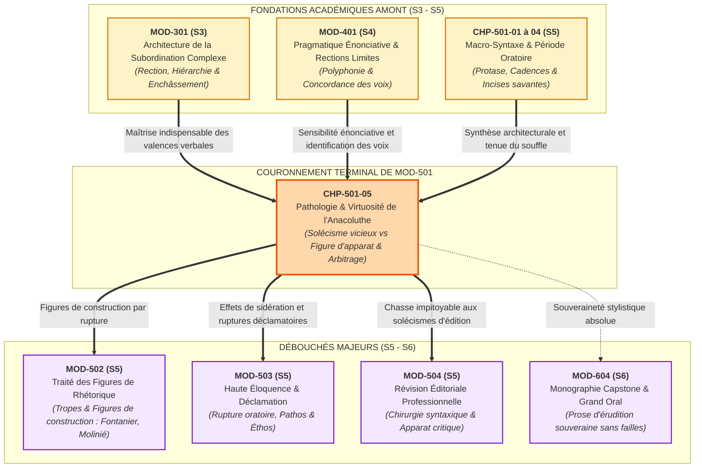
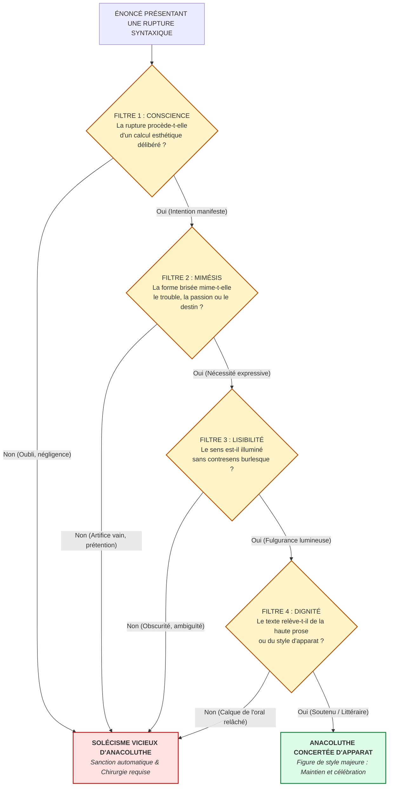

# Chapitre 5 — Pathologie et Virtuosité de la Rupture Syntaxique : L'Anacoluthe, du Solécisme Vicieux à la Figure d'Apparat

> **Identifiant du chapitre** : `CHP-501-05`  
> **Module de rattachement** : [`MOD-501` — Macro-Syntaxe, Dislocations, Incises et Grande Période Oratoire](file:///f:/Formation/world-class-french/03-curriculum/year-3/semester-5/mod-501-macro-syntaxe-periode-oratoire-cadences.md)  
> **Semestre** : Année 3 — Semestre 5 (S5)  
> **Volume horaire canonique** : 5 à 6 heures d'apprentissage autonome délibéré et d'ateliers d'application (Phase 1 Étude : 1 h 30 | Phase 2 Pratique : 1 h 30 | Phase 3 Correction : 1 h 00 | Phase 4 Évaluation : 1 h 00)  
> **Statut du document** : [STATUT : VALIDÉ]  
> **Compétences associées** : [`FR-SYNTAX-003`](file:///f:/Formation/world-class-french/02-competency-framework/competency-framework.md#fr-syntax-003-maîtrise-de-la-grande-période-oratoire-et-de-la-macro-syntaxe) (Palier L4 Maîtrise approfondie), [`FR-STYLE-001`](file:///f:/Formation/world-class-french/02-competency-framework/competency-framework.md#fr-style-001-maîtrise-des-figures-de-rhétorique-et-commentaire-stylistique) (Palier L4 Maîtrise approfondie), [`FR-INT-003`](file:///f:/Formation/world-class-french/02-competency-framework/competency-framework.md#fr-int-003-réviser-et-corriger-un-texte-tiers-en-justifiant-les-interventions) (Palier L3/L4 Autonomie et révision critique)  
> **Sources scientifiques de référence** : `SRC-GRAM-01` (Grevisse & Goosse, 2016, § 420 & § 914), `SRC-GRAM-02` (Riegel, Pellat & Rioul, 2016, chap. 14, 15 & 21), `SRC-RHET-01` (Fontanier, 1821/1977), `SRC-RHET-02` (Molinié, 1992), `SRC-RHET-03` (Reboul, 1991, chap. 4), `SRC-NORM-03` (Ministère de l'Éducation nationale, 2020), `SRC-TYPO-01` (Imprimerie nationale, 2002/2014)

---

## 1. Titre et Place dans le Cursus

### 1.1 Intitulé Officiel et Périmètre Didactique
**Chapitre 5 : Pathologie et Virtuosité de la Rupture Syntaxique : L'Anacoluthe, du Solécisme Vicieux à la Figure d'Apparat** (`CHP-501-05`).

Ce cinquième et dernier chapitre du module [`MOD-501`](file:///f:/Formation/world-class-french/03-curriculum/year-3/semester-5/mod-501-macro-syntaxe-periode-oratoire-cadences.md) constitue la clef de voûte de l'enseignement macro-syntaxique. Après avoir étudié les fondements épistémologiques de la phrase périodique ([`CHP-501-01`](file:///f:/Formation/world-class-french/03-curriculum/year-3/semester-5/mod-501/chp-501-01-fondements-epistemologiques-histoire-periode.md)), sa dynamique interne tripartite protase-acmé-apodose ([`CHP-501-02`](file:///f:/Formation/world-class-french/03-curriculum/year-3/semester-5/mod-501/chp-501-02-morphologie-dynamique-periode-protase-acme-apodose.md)), son calibrage métrique et ses cadences ([`CHP-501-03`](file:///f:/Formation/world-class-french/03-curriculum/year-3/semester-5/mod-501/chp-501-03-metrique-prose-systeme-cadences-rythmiques.md)), et la régie des incises et dislocations nobles, l'apprenant se confronte au problème stylistique et normatif suprême de la syntaxe française : **la rupture de construction**.

L'anacoluthe est le carrefour où se croisent la pathologie de la phrase (le solécisme grossier par oubli de rection ou sujet orphelin) et le sommet de la virtuosité littéraire (la rupture assumée traduisant le vertige de la pensée, le surgissement du destin ou la sidération passionnelle) [Réf. `SRC-GRAM-01`, § 420 ; `SRC-RHET-01` ; `SRC-RHET-02`].

### 1.2 Insertion Architecturale et Synergies Didactiques



- **En amont** :
  - `MOD-301` et `MOD-401` fournissent la rigueur analytique sans laquelle le scripteur ne peut comprendre la rection verbale ni détecter un sujet orphelin.
  - Les chapitres 1 à 4 de `MOD-501` ont appris à bâtir la vaste période continue ou suspensive ; le chapitre 5 enseigne ce qui advient quand cette armature se brise — soit par maladresse destructrice, soit par génie expressif.
- **En aval** :
  - `MOD-502` classera l'anacoluthe au sein du panthéon des figures non-tropes de construction aux côtés de l'hypallage, du zeugma et de l'hyperbate [Réf. `SRC-RHET-01` ; `SRC-RHET-02`].
  - `MOD-503` exploitera la rupture anacoluthique comme instrument d'éloquence dramatique pour suspendre la respiration de l'auditoire en déclamation sans notes.
  - `MOD-504` fera de l'éradication du solécisme d'anacoluthe le critère sélectif absolu de la révision éditoriale et de la correction de presse de haut niveau.
  - `MOD-604` exigera une prose d'érudition où chaque écart syntaxique éventuel sera justifié par une intention stylistique sans équivoque.

### 1.3 Justification du Calibrage Horaire (5 à 6 Heures)
Conformément aux normes du cursus, le travail autonome est articulé en quatre phases rigoureusement minutées :
- **Phase 1 — Étude conceptuelle et dissection des mécanismes (1 h 30)** : Lecture active des rubriques 1 à 13 (anatomie du solécisme, critères discriminants, analyse des chefs-d'œuvre de Pascal, Racine, Bossuet et Proust, clinique des erreurs).
- **Phase 2 — Pratique délibérée et chirurgie syntaxique (1 h 30)** : Résolution autonome des 3 niveaux d'exercices progressifs (rubrique 14 : diagnostic sur 12 phrases, chirurgie syntaxique de 8 solécismes selon les 3 techniques, analyse intégrale d'un fragment de haute prose de 50 mots exacts).
- **Phase 3 — Correction critique et arbitrage professionnel (1 h 00)** : Audit critique d'un manuscrit littéraire corrompu de 8 fautes (rubrique 15) et rédaction d'une note d'arbitrage éditorial sous contrainte de 60 mots exacts (rubrique 16).
- **Phase 4 — Ancrage mnésique et évaluation sommative (1 h 00)** : Mémorisation active sans indices (rubrique 18) et passation de l'épreuve sommative chronométrée de 30 minutes notée sur 20 points (rubrique 19).

---

## 2. Objectifs Mesurables

Au terme de ce chapitre, l'apprenant doit être capable de :

1. **Diagnostiquer et disséquer l'anatomie d'une rupture de rection** ([`FR-SYNTAX-003`](file:///f:/Formation/world-class-french/02-competency-framework/competency-framework.md#fr-syntax-003-maîtrise-de-la-grande-période-oratoire-et-de-la-macro-syntaxe) — Palier L4) : identifier instantanément dans un énoncé complexe un participe présent orphelin, un gérondif sans coréférence avec le sujet recteur, un antécédent fantôme dans une relative coordonnée ou une dérive associative en cours de période [Réf. `SRC-GRAM-01`, § 420 ; `SRC-GRAM-02`, chap. 14].
2. **Analyser et commenter la portée esthétique de l'anacoluthe concertée** ([`FR-STYLE-001`](file:///f:/Formation/world-class-french/02-competency-framework/competency-framework.md#fr-style-001-maîtrise-des-figures-de-rhétorique-et-commentaire-stylistique) — Palier L4) : expliciter la valeur mimétique, dramatique ou oratoire d'une rupture volontaire chez les maîtres de la langue française (Pascal, Racine, Bossuet, Chateaubriand, Proust) en démontrant comment la syntaxe brisée mime le vertige de la passion ou la transcendance de l'événement [Réf. `SRC-RHET-01` ; `SRC-RHET-02`].
3. **Arbitrer avec certitude entre solécisme vicieux et figure d'apparat** ([`FR-INT-003`](file:///f:/Formation/world-class-french/02-competency-framework/competency-framework.md#fr-int-003-réviser-et-corriger-un-texte-tiers-en-justifiant-les-interventions) — Palier L4) : appliquer les 4 critères discriminants objectifs (conscience délibérée, nécessité mimétique, lisibilité globale, dignité du registre) pour décider en toute rigueur scientifique si une rupture doit être sanctionnée ou célébrée.
4. **Pratiquer la chirurgie syntaxique réparatrice selon trois techniques normées** ([`FR-INT-003`](file:///f:/Formation/world-class-french/02-competency-framework/competency-framework.md#fr-int-003-réviser-et-corriger-un-texte-tiers-en-justifiant-les-interventions) / [`FR-SYNTAX-003`](file:///f:/Formation/world-class-french/02-competency-framework/competency-framework.md#fr-syntax-003-maîtrise-de-la-grande-période-oratoire-et-de-la-macro-syntaxe) — Palier L4) : corriger un solécisme de construction sans en amoindrir l'énergie sémantique ni la densité oratoire, par le rétablissement de la coréférence actancielle, le clivage propositionnel ou la transposition prépositionnelle.

---

## 3. Prérequis et Test de Préparation (Auto-Diagnostic)

### 3.1 Prérequis Cognitifs
- **Maîtrise des formes nominales du verbe** : distinguer le participe présent adjectivé, le participe présent verbal et le gérondif régi par la préposition *en* (`MOD-202`).
- **Maîtrise de la rection et des valences** : savoir quel constituant régit l'accord en genre, en nombre et en personne (`MOD-301`).
- **Structure de la période oratoire** : repérer la proposition matrice rectrice au milieu des subordonnées circonstancielles antéposées (`MOD-501`, chapitres 1 à 4).
- **Distinction thème / rhème** : identifier le point de départ de l'énoncé (thème) et l'apport d'information nouvelle (rhème) (`MOD-401`).

### 3.2 Test de Préparation Immédiat
Répondez aux cinq questions suivantes avant d'aborder le cours, puis dépliez le volet de correction pour vérifier votre aptitude conceptuelle.

1. Dans la phrase : *« En descendant du train, sa valise s'est ouverte sur le quai »*, quel est le sujet grammatical du verbe de la proposition principale ? Quel est l'agent logique de l'action de « descendre » ? Quelle anomalie syntaxique cela révèle-t-il ?
2. Quelle est la règle traditionnelle de coréférence qui gouverne l'emploi du gérondif (*en* + participe présent) en français soutenu ?
3. Quelle différence sépare une dislocation noble avec reprise pronominale (*« Cette patrie sacrée, nous la défendrons »*) d'une rupture de construction sans reprise ?
4. Pourquoi dit-on traditionnellement de l'anacoluthe qu'elle est un « solécisme par figure » ? Qui est l'inventeur ou le grand théoricien de cette désignation ?
5. Dans la célèbre pensée de Pascal : *« Le nez de Cléopâtre, s'il eût été plus court, toute la face de la terre aurait changé »*, quelle fonction grammaticale occupe le syntagme initial *Le nez de Cléopâtre* par rapport au reste de la phrase ?

---

<details>
<summary><b>Consulter le corrigé de l'auto-diagnostic</b></summary>

1. Le sujet grammatical du verbe de la principale (*s'est ouverte*) est **sa valise**. L'agent logique de l'action de descendre est le voyageur (implicite). L'anomalie réside dans l'attribution syntaxique de l'action de descendre à la valise elle-même : c'est un **solécisme sur gérondif détaché sans coréférence** (anacoluthe vicieuse).
2. En français soutenu et normatif, le gérondif détaché en tête de proposition doit avoir pour sujet logique **le sujet grammatical de la proposition principale** qui le régit [Réf. `SRC-GRAM-01`, § 914 ; `SRC-GRAM-02`, chap. 14].
3. La dislocation noble (ou topicalisation) maintient le lien syntaxique grâce à un **pronom clitique anaphorique de rappel** (*la*) qui assure la fonction de COD du verbe recteur (*défendrons*). Dans la rupture sans reprise, le syntagme initial est abandonné en chemin sans fonction grammaticale dans la suite de la phrase.
4. L'expression remonte aux rhéteurs anciens et aux grammairiens de l'Âge classique (notamment Dumarsais et Fontanier) : elle signifie que l'anacoluthe viole matériellement la règle de syntaxe (d'où le terme de solécisme), mais que cette violation est légitimée et transfigurée par une intention esthétique ou passionnelle supérieure (d'où le statut de figure) [Réf. `SRC-RHET-01`].
5. *Le nez de Cléopâtre* est un **thème nominal suspendu** : il n'est ni sujet d'un verbe, ni complément d'objet, ni complément circonstanciel dans la principale (*toute la face de la terre aurait changé*). Il ouvre un cadre discursif absolu qui est immédiatement abandonné syntaxiquement au profit d'une autre proposition.

</details>

---

## 4. Situation de Départ ou Problème Concret : Le Drame de la Rection Brisée

### 4.1 L'Angoisse du Rédacteur Ambitieux
Considérons le cas d'un candidat à un grand concours académique ou d'un rédacteur d'appareil critique dans une maison d'édition savante. Animé par le désir d'ampleur et de solennité acquis dans les premiers chapitres de `MOD-501`, il conçoit une vaste période oratoire :

> *« Ayant consacré quarante années de sa laborieuse existence à l'exploration minutieuse des archives capitulaires de la cathédrale, la mort surprit l'illustre paléographe avant qu'il n'eût achevé son maître-ouvrage. »*

Le rédacteur se relit avec complaisance : le lexique est châtié, le subjonctif imparfait est exact (*qu'il n'eût achevé*), le rythme est ample. Pourtant, le jury ou le correcteur en chef biffe la phrase d'un trait rouge vengeur assorti d'une mention infamante :  
**« Solécisme grossier ! Est-ce la mort qui a passé quarante ans dans les archives capitulaires ? -5 points. »**

Le scripteur tombe des nues. Il croyait avoir composé une phrase noble ; il a produit un monstre syntaxique où le participe présent *Ayant consacré* est grammaticalement rattaché au sujet *la mort*. C'est l'archétype du **participe orphelin**, solécisme d'anacoluthe qui ruine instantanément l'autorité d'un texte [Réf. `SRC-GRAM-01`, § 420].

### 4.2 L'Indécision du Correcteur et le Vertige Littéraire
À l'inverse, considérons cet extrait d'un manuscrit soumis à un comité de lecture :

> *« Vous voulez qu'un roi meure, et pour son châtiment / Vous ne donnez qu'un jour, qu'une heure, qu'un moment ! »*

Un correcteur pointilleux et myope s'écrie : *« Fautes de construction ! Le verbe vouloir régit une complétive (qu'un roi meure), puis la conjonction et coordonne brutalement un complément circonstanciel suivi d'une proposition indépendante avec un autre sujet ! Il faut corriger : Vous voulez qu'un roi meure et vous n'accordez qu'un jour pour son châtiment. »*

Ce correcteur vient de massacrer l'un des plus beaux vers tragiques de Jean Racine (*Andromaque*, acte V, scène 3). En voulant ramener la phrase au lit de Procuste de la correction scolaire ordinaire, il a anéanti l'effet de commotion et la stupeur d'Hermione découvrant l'injustice du sort.

### 4.3 Le Nœud du Problème
Comment distinguer avec une certitude absolue :
- La **faute d'inattention**, fille de l'amnésie syntaxique, qui détruit la logique et expose le scripteur au ridicule ?
- La **figure d'apparat**, fille de la virtuosité et de la nécessité passionnelle, qui suspend l'esprit du lecteur au bord du vertige ?

---

## 5. Explication Intuitive : La Faille Géologique et le Saut d'Obstacle

Pour saisir la nature profonde de l'anacoluthe, recourons à une double analogie :

```text
ANALOGIE 1 : LA FAILLE GÉOLOGIQUE ET LA VOIE FERRÉE
├── LA VOIE NORMALE (Syntaxe régulière)
│   └── Deux rails parallèles ininterrompus : le sujet recteur guide le verbe d'un bout à l'autre sans déraillement.
├── LE DÉRAILLEMENT PAR NÉGLIGENCE (Solécisme vicieux)
│   └── L'aiguilleur s'est endormi : le train s'engage sur un rail coupé dans le vide, culbute dans le ravin et s'écrase.
│       (L'auteur commence par un sujet, oublie ce qu'il a écrit, et greffe un verbe sans rapport).
└── LE VIADUC AUDACIEUX / LE SAUT TÉLÉPHÉRIQUE (Anacoluthe concertée)
    └── La voie s'interrompt délibérément devant un abîme insondable ; mais un câble d'acier invisible tendu
        par l'émotion transporte le wagonnet de l'autre côté de la gorge, révélant un panorama grandiose.
```

```text
ANALOGIE 2 : LE CAVALIER ET L'OBSTACLE
├── LE MAUVAIS CAVALIER (Le scripteur maladroit)
│   └── Il aborde la haie de travers, perd l'équilibre au milieu du saut, lâche la bride et tombe dans le fossé
│       pendant que son cheval s'enfuit : c'est le solécisme de construction, risible et disgracieux.
└── LE CAVALIER D'ÉLITE (Le maître du style)
    └── Face à un obstacle imprévu et gigantesque, il exécute une volte acrobatique fulgurante :
        il brise la ligne droite conventionnelle pour éviter un péril mortel et retombe avec une souplesse
        féline exactement dans l'axe de la victoire, coupant le souffle des spectateurs émerveillés.
```

L'anacoluthe légitime n'est pas une faute d'orthographe ou de mémoire : c'est un **saut périlleux consenti**, une rupture où l'énergie sémantique est si violente que le moule syntaxique ordinaire vole en éclats.

---

## 6. Définitions Précises et Terminologie

Dans tout commentaire stylistique, rapport d'expertise éditoriale ou dissertation d'agrégation, les termes suivants doivent être employés avec une exactitude mathématique :

- **Anacoluthe** : Nom féminin (du grec ancien *anakolouthos*, composé du préfixe privatif *an-* et de *akolouthos*, « compagnon de route, qui suit »). Rupture délibérée ou accidentelle dans la cohérence de la construction syntaxique d'une phrase, de telle sorte que la fin de l'énoncé ne concorde pas grammaticalement avec son commencement [Réf. `SRC-GRAM-01`, § 420 ; `SRC-RHET-01` ; `SRC-RHET-02`].
- **Solécisme de construction** : Faute lourde contre la syntaxe consistant à construire des mots ensemble d'une manière non admise par les règles de la langue (par opposition au *barbarisme*, qui déforme la morphologie d'un mot isolé). Tout solécisme d'anacoluthe est une faute éliminatoire en milieu académique et professionnel [Réf. `SRC-GRAM-02`, chap. 14].
- **Sujet orphelin (ou thème suspendu)** : Groupe nominal ou pronominal posé en tête de phrase pour servir de centre thématique, mais qui se trouve délaissé au cours du développement et ne remplit aucune fonction syntaxique (ni sujet, ni complément) auprès du verbe recteur de la proposition principale.
- **Participe orphelin** : Participe présent, gérondif ou participe passé détaché en tête d'énoncé dont l'agent logique ne correspond pas au sujet grammatical de la proposition principale régissante [Réf. `SRC-GRAM-01`, § 914].
- **Rection brisée** : Interruption ou déviation du rapport de dépendance morphologique obligatoire exercé par un verbe, un nom ou une préposition sur son régime.
- **Thématisation suspendue** : Opération énonciative consistant à isoler le thème discursif à l'initiale sans lui fournir l'ancrage prédicatif attendu [Réf. `SRC-GRAM-02`, chap. 15].
- **Rupture de coréférence** : Disjonction entre l'entité désignée par un élément subordonné implicite et le référent du sujet explicite dans la matrice.
- **Anacoluthe concertée (ou Figure de construction)** : Figure de style consistant à assumer volontairement une rupture syntaxique dans le dessein d'obtenir un effet pathétique, dramatique ou oratoire supérieur à ce que permettrait la correction plate [Réf. `SRC-RHET-01` ; `SRC-RHET-02`].
- **Mimésis passionnelle** : Capacité de la forme stylistique à imiter le désordre intérieur, la fureur, l'effroi ou l'égarement de l'esprit du locuteur.
- **Sidération oratoire** : Saisissement psychologique produit sur l'auditoire par un court-circuit grammatical inattendu qui force l'adhésion immédiate.
- **Recevabilité stylistique** : Degré de légitimité esthétique d'un écart par rapport à la norme, attesté par l'autorité des grands écrivains et la clarté du sens global.

---

## 7. Règles ou Mécanismes Fondamentaux

### 7.1 L'Anatomie du Solécisme d'Anacoluthe (La Pathologie Syntaxique)

Le solécisme d'anacoluthe se produit lorsque la mémoire de travail du scripteur fléchit sous le poids de la phrase longue. Trois configurations cliniques dominent les copies défaillantes :

#### A. La Faute Reine : Le Participe Présent ou Gérondif Orphelin
C'est la pathologie la plus répandue dans l'expression écrite. En français standard, lorsqu'un participe présent ou un gérondif est détaché en tête de phrase, la règle d'or de la syntaxe exige que son **agent d'action soit identique au sujet grammatical de la proposition principale** [Réf. `SRC-GRAM-01`, § 420 ; `SRC-GRAM-02`, chap. 14] :

$$\text{Sujet logique du Participe} \equiv \text{Sujet grammatical de la Principale}$$

- *Exemple pathologique n° 1* :  
  $$\text{*« En arrivant à la gare, la pluie s'est mise à tomber. »}$$  
  *Diagnostic clinique* : Le verbe recteur est *s'est mise*. Son sujet est *la pluie*. C'est donc la pluie qui est réputée arriver à la gare ! Le scripteur pensait à lui-même (*j'arrivais à la gare*), mais a fait de la pluie le sujet syntaxique.
- *Exemple pathologique n° 2* :  
  $$\text{*« Voulant apaiser la contestation des étudiants, le décret fut signé dès l'aube par le ministre. »}$$  
  *Diagnostic clinique* : Le sujet du passif est *le décret*. Or un décret ne saurait rien vouloir. Le sujet logique (*le ministre*) est relégué en complément d'agent (*par le ministre*), ce qui crée une rupture de coréférence grotesque.

#### B. L'Antécédent Fantôme dans les Relatives Coordonnées
Cette rupture survient lorsqu'un scripteur coordonne par *et* deux propositions relatives dont les antécédents ou les fonctions sont asymétriques :
- *Exemple pathologique* :  
  $$\text{*« C'est un projet ambitieux dont chacun parle et qui apportera d'immenses bienfaits. »}$$  
  Bien que tolérée dans l'usage relâché, la rupture devient un solécisme caractérisé lorsque le second pronom relatif n'a plus d'antécédent légitime ou change d'assiette logique sans avertissement :  
  $$\text{*« Il lut cet ouvrage remarquable dont l'auteur était inconnu et qui fut couronné de succès. »}$$  
  (Était-ce l'auteur ou l'ouvrage qui fut couronné ? Le flottement syntaxique détruit la netteté).

#### C. La Dérive Associative en Phrase Longue
Au-delà de 25 mots, le rédacteur non entraîné oublie la tête de phrase. Il commence par un syntagme prépositionnel ou un sujet thématique, insère une incise de dix mots, puis embraye sur une proposition indépendante pourvue d'un nouveau sujet :
- *Exemple pathologique* :  
  $$\text{*« Cette immense fortune, après que tous les créanciers eurent fait valoir leurs droits imprescriptibles, les héritiers n'en virent jamais la couleur. »}$$  
  *Diagnostic clinique* : *Cette immense fortune* est posé au nominatif absolu sans aucun lien de rection avec la suite. Certes, il y a le pronom *en*, mais le rattachement est brisé par la longueur de l'incise et l'absence de préposition d'origine (*Quant à cette immense fortune...*).

---

### 7.2 L'Anacoluthe Concertée des Maîtres de la Langue (La Virtuosité Stylistique)

Chez les grands écrivains et orateurs classiques, l'anacoluthe n'est pas une faute subie : c'est une **figure de construction par rupture assumée** [Réf. `SRC-RHET-01` ; `SRC-RHET-02`].

#### A. Le Statut Rhétorique selon Fontanier et Molinié
Dans *Les Figures du discours* (1821-1830), Pierre Fontanier range l'anacoluthe parmi les **figures d'expression par rupture**. Il observe que l'âme émue ne s'assujettit pas toujours à l'ordre froid de la délibération grammaticale : la passion bouscule les mots pour projeter en premier ce qui brûle le plus [Réf. `SRC-RHET-01`].  
Georges Molinié confirme que l'anacoluthe réalise un court-circuit sémiotique : elle supprime les liaisons logiques intermédiaires pour faire entrer deux blocs d'idées en collision directe [Réf. `SRC-RHET-02`].

#### B. La Fonction Énonciative et Psychologique
L'anacoluthe concertée remplit quatre missions expressives capitales :
1. **Traduire la violence de la passion** : La douleur, la fureur ou la jalousie ne composent pas de périodes cicéroniennes polies ; elles éclatent en phrases brisées.
2. **Projeter l'absolu du destin** : Le surgissement brutal de la mort ou de la révélation fracasse l'ordre temporel linéaire.
3. **Mimer le paradoxe philosophique** : Rapprocher deux grandeurs incommensurables sans l'atténuation d'une conjonction logique.
4. **Créer la sidération oratoire** : Forcer l'auditeur à un travail de recomposition mentale qui grave l'assertion à jamais dans sa mémoire.

#### C. Trois Sommets Historiques de l'Anacoluthe Concertée
1. **L'exemplarité pascalienne (Le paradoxe de l'histoire)** :
   > *« Le nez de Cléopâtre, s'il eût été plus court, toute la face de la terre aurait changé. »*  
   > (Pascal, *Pensées*, fr. 162 Sellier).  
   *Analyse* : Pascal pose *Le nez de Cléopâtre* au début. Tout lecteur attend : *le nez de Cléopâtre aurait bouleversé la terre*. Mais Pascal brise le lien : le nez disparaît pour laisser place à *toute la face de la terre*. Cette rupture syntaxique inouïe met en regard un minuscule appendice anatomique et le destin de l'univers entier, mimant la disproportion monstrueuse entre la cause infime et l'effet cosmique.
2. **L'anacoluthe tragique de Racine (La fureur passionnelle)** :
   > *« Vous voulez qu'un roi meure, et pour son châtiment / Vous ne donnez qu'un jour, qu'une heure, qu'un moment ! »*  
   > (Racine, *Andromaque*, acte V, scène 3).  
   *Analyse* : Hermione est hors d'elle. La rupture entre la complétive attendue et l'exclamation indignée traduit l'effarement de son cœur devant la hâte d'Oreste à assassiner Pyrrhus.
3. **L'anacoluthe oratoire de Bossuet (L'humiliation des grandeurs)** :
   > *« Mais enfin, madame, ce grand cœur qui semblait devoir donner des lois à la terre, Dieu l'a humilié par de longs revers... »*  
   > (Bossuet, *Oraison funèbre d'Anne de Gonzague*).  
   *Analyse* : *Ce grand cœur* s'élance comme le sujet glorieux de la période ; soudain, le coup de foudre théologique s'abat : le vrai sujet souverain, c'est *Dieu*, qui réduit ce grand cœur à l'état de simple complément d'objet direct repris par l'atome pronominal *l'*.

---

### 7.3 Les 4 Critères Discriminants : Solécisme Vicieux vs Figure Maîtresse

Pour départager infailliblement la faute grotesque et le trait de génie, le réviseur professionnel et le critique stylistique appliquent la grille des **4 critères cardinaux** :

```text
GRILLE D'ARBITRAGE DES 4 CRITÈRES DISCRIMINANTS
┌────────────────────────────────────────────────────────────────────────────────────────┐
│ CRITÈRE 1 : CONSCIENCE DÉLIBÉRÉE vs INADVERTANCE NÉGLIGENTE                           │
│ ├── L'auteur a-t-il rompu sciemment la construction pour produire un effet précis ?    │
│ └── Ou a-t-il simplement perdu le fil par impuissance à tenir une phrase longue ?      │
├────────────────────────────────────────────────────────────────────────────────────────┤
│ CRITÈRE 2 : NÉCESSITÉ MIMÉTIQUE (LA FORME MIME-T-ELLE LE FOND ?)                      │
│ ├── La rupture épouse-t-elle le désordre, la fureur, l'effroi ou l'ironie du propos ?  │
│ └── Ou crée-t-elle un contresens comique involontaire (ex. la valise qui descend) ?    │
├────────────────────────────────────────────────────────────────────────────────────────┤
│ CRITÈRE 3 : LISIBILITÉ GLOBALE (ÉLUCIDATION vs OBSCURCISSEMENT)                        │
│ ├── Le sens jaillit-il avec une fulgurance neuve et mémorable ?                        │
│ └── Ou contraint-il le lecteur à relire trois fois la phrase pour deviner le sujet ?   │
├────────────────────────────────────────────────────────────────────────────────────────┤
│ CRITÈRE 4 : DIGNITÉ DU REGISTRE (STYLE D'APPARAT vs CALQUE ORAL RELÂCHÉ)               │
│ ├── La phrase s'inscrit-elle dans la haute prose soutenue et le pacte littéraire ?     │
│ └── Ou s'agit-il d'un tic de langage parlé ("Moi, mon père, il a dit...") ?          │
└────────────────────────────────────────────────────────────────────────────────────────┘
```

Si les 4 réponses penchent vers le pôle de la conscience, de la mimésis, de la lisibilité et de la dignité, **la rupture est une anacoluthe d'apparat**.  
Si une seule réponse révèle une maladresse inconsciente ou un contresens burlesque, **la rupture est un solécisme vicieux impardonnable**.

---

### 7.4 Le Protocole de Révision Éditoriale et Chirurgie Syntaxique

#### A. Quand Tolérer et Consacrer ?
- **Textes littéraires de fiction ou de poésie** : lorsque la rupture traduit la voix d'un personnage ému ou le rythme intime de la conscience narrative (Proust, Gracq, Céline).
- **Haute éloquence d'apparat et plaidoyers solennels** : lorsque la rupture crée un électrochoc oratoire au sommet de la péroraison.

#### B. Quand Corriger Impitoyablement ?
- **Concours administratifs et universitaires** (Agrégation, École nationale d'administration / INSP, magistrature).
- **Rapports juridiques, financiers, scientifiques et doctrinaux** : où l'ambiguïté actancielle peut entraîner un contentieux légal ou invalider une démonstration.
- **Copies d'étudiants** : où la rupture n'est jamais le fruit d'une virtuosité mallarméenne, mais le symptôme d'une carence de maîtrise syntaxique.

#### C. Les 3 Techniques de Chirurgie Syntaxique Sans Perte d'Énergie
Lorsqu'un solécisme d'anacoluthe doit être rectifié, le correcteur d'élite refuse la banalisation tiède. Il dispose de trois techniques chirurgicales pour restaurer la pureté grammaticale tout en préservant le souffle de la pensée :

```text
LES 3 TECHNIQUES CHIRURGICALES DE RÉFECTION SYNTAXIQUE
├── TECHNIQUE 1 : LE RÉTABLISSEMENT DE LA CORÉFÉRENCE DU SUJET
│   └── On conserve le participe détaché et l'on réécrit la proposition principale pour
│       que son sujet grammatical devienne l'agent logique originel.
├── TECHNIQUE 2 : LE CLIVAGE EN DEUX PROPOSITIONS COORDONNÉES OU INDÉPENDANTES
│   └── On brise la fausse subordination en transformant le participe en verbe conjugué
│       dans une première proposition autonome ou articulée par un point-virgule.
└── TECHNIQUE 3 : LA TRANSPOSITION EN COMPLÉMENT CIRCONSTANCIEL PRÉPOSITIONNEL
    └── On convertit le groupe verbal défaillant en syntagme nominal ou prépositionnel
        cadratif (Sous l'action de..., Après..., Par suite de...).
```

*Illustration sur un cas clinique :*  
Énoncé fautif : *« En examinant ces comptes falsifiés, une immense colère submergea le procureur. »*
- **Application Technique 1 (Rétablissement du sujet)** :  
  *« En examinant ces comptes falsifiés, le procureur se sentit submergé par une immense colère. »*  
  *(Le sujet grammatical redevient le procureur).*
- **Application Technique 2 (Clivage propositionnel)** :  
  *« Le procureur examina ces comptes falsifiés ; soudain, une immense colère le submergea. »*  
  *(Maintien de l'énergie dramatique en deux propositions vigoureuses).*
- **Application Technique 3 (Transposition prépositionnelle)** :  
  *« À l'examen de ces comptes falsifiés, une immense colère submergea le procureur. »*  
  *(Le participe disparaît au profit d'un syntagme nominal régulier sans contrainte de coréférence).*

---

## 8. Raisonnement Détaillé : Le Paradoxe Classique de la Règle et de la Transgression

Pourquoi la doctrine classique française — d'ordinaire si inflexible sur l'ordre des mots, l'accord des régimes et la clarté cartésienne (*« Ce que l'on conçoit bien s'énonce clairement »*, Boileau) — a-t-elle absous et sanctifié l'anacoluthe chez les géants du Grand Siècle ?

### 8.1 La Raison Grammaticale vs la Raison Passionnelle
Pour les grammairiens de Port-Royal (Claude Lancelot et Antoine Arnauld, 1660), la syntaxe est l'image du jugement logique dans l'esprit : un sujet s'unit à un attribut par l'intermédiaire de la copule. Rompre cette liaison, c'est rompre l'ordonnance même de la raison. C'est pourquoi le solécisme est considéré comme un attentat contre la pensée.

Mais les rhéteurs de la tradition cicéronienne et augustinienne savent qu'il existe un ordre supérieur à l'ordre grammatical : **l'ordre du cœur et du saisissement** [Réf. `SRC-RHET-03`, chap. 4]. Blaise Pascal l'a formulé avec une souveraineté définitive :  
> *« Le cœur a son ordre ; l'esprit a le sien, qui est par principe et démonstration ; le cœur en a un autre. On ne prouve pas qu'on doit être aimé en exposant d'ordre les causes de l'amour : cela serait ridicule. »* (Pascal, *Pensées*).

### 8.2 Le Contrat Éthique du Style Soutenu
L'anacoluthe n'est donc tolérable que sous la condition expresse d'un **pacte de complicité supérieure entre l'auteur et le lecteur**.  
Pour que la transgression soit admirable, il faut que le lecteur sache pertinemment que l'auteur maîtrise la règle à la perfection. Lorsque Racine brise la syntaxe dans *Andromaque*, nul ne peut soupçonner l'élève des solitaires de Port-Royal d'ignorer la grammaire française. La rupture apparaît alors pour ce qu'elle est : non une faiblesse d'écolier, mais **l'aveu héroïque de l'impuissance des mots réguliers à contenir l'immensité du drame**.

À l'opposé, lorsque le candidat d'un concours écrit *« En arrivant à la gare, la pluie est tombée »*, le correcteur sait qu'il s'agit d'une simple maladresse : l'anacoluthe redevient un vice sordide. C'est le paradoxe esthétique de la règle : **seuls ceux qui possèdent la souveraineté absolue de la norme ont le droit insigne de la violer pour l'élever au rang d'art**.

---

## 9. Exemples Corrects Commentés

Voici quatre dissections intégrales d'anacoluthes historiques concertées parmi les plus illustres de la littérature française :

### 9.1 Cas Pascal : Le Nez de Cléopâtre et le Destin de l'Univers
> *« Le nez de Cléopâtre, s'il eût été plus court, toute la face de la terre aurait changé. »*  
> (Blaise Pascal, *Pensées*, fr. 162 Sellier / 196 Brunschvicg).

- **Structure morphosyntaxique** :
  - *Le nez de Cléopâtre* : Syntagme nominal initial thématisé, sans préposition, posé comme nominatif absolu (thème suspendu).
  - *s'il eût été plus court* : Proposition subordonnée circonstancielle d'hypothèse irréelle du passé au subjonctif plus-que-parfait littéraire, insérée comme incise conditionnelle.
  - *toute la face de la terre aurait changé* : Proposition principale au conditionnel passé.
- **Rupture constatée** : Le groupe initial *Le nez de Cléopâtre* n'est repris par aucun pronom dans la proposition principale et n'exerce aucune fonction de sujet ni de complément auprès du verbe *aurait changé*. Le sujet de la principale est *toute la face de la terre*.
- **Portée stylistique et philosophique** : La rupture syntaxique matérialise dans la chair même de la phrase le saut vertigineux entre la futilité érotique (la séduction d'Antoine par la grâce physique d'une reine égyptienne) et le bouleversement géopolitique mondial (la chute de la République romaine, la bataille d'Actium et l'avènement de l'Empire). La syntaxe brisée mime la disproportion ontologique qui régit les affaires humaines [Réf. `SRC-RHET-01` ; `SRC-RHET-03`].

### 9.2 Cas Racine : Le Cri d'Hermione dans la Tragédie Classique
> *« Vous voulez qu'un roi meure, et pour son châtiment / Vous ne donnez qu'un jour, qu'une heure, qu'un moment ! »*  
> (Jean Racine, *Andromaque*, acte V, scène 3).

- **Structure morphosyntaxique** :
  - *Vous voulez qu'un roi meure* : Proposition principale avec verbe recteur de volonté régissant une complétive au subjonctif.
  - *et pour son châtiment* : Coordination par *et* d'un complément circonstanciel de but, sans reprise de la complétive.
  - *Vous ne donnez qu'un jour, qu'une heure, qu'un moment !* : Proposition indépendante coordonnée avec gradation descendante restrictive (*ne... que*).
- **Rupture constatée** : La conjonction *et* coordonne de façon dissymétrique une proposition complétive et une proposition indépendante pourvue de son propre verbe et d'un complément prépositionnel antéposé.
- **Portée stylistique et dramatique** : Hermione est déchirée entre son amour jaloux pour Pyrrhus et son désir de vengeance. Elle ordonne à Oreste de tuer le roi, mais lorsqu'Oreste accepte et demande un délai, elle s'affole. La rupture syntaxique traduit l'incohérence passionnelle d'une femme qui ordonne le crime tout en voulant l'empêcher. La syntaxe trébuche comme le cœur de l'héroïne tragique.

### 9.3 Cas Bossuet : L'Orgueil Humain Anéanti par la Souveraineté Divine
> *« Mais enfin, ce grand cœur qui semblait devoir donner des lois à la terre entière, Dieu lui a fait sentir sa faiblesse mortelle... »*  
> (Jacques-Bénigne Bossuet, *Oraison funèbre d'Anne de Gonzague de Clèves*, 1685).

- **Structure morphosyntaxique** :
  - *ce grand cœur qui semblait devoir donner des lois à la terre entière* : Groupe nominal expansé par une relative complétive d'objet modal, antéposé comme sujet apparent de la période.
  - *Dieu lui a fait sentir sa faiblesse mortelle* : Proposition principale matrice où le sujet effectif est *Dieu*, tandis que *ce grand cœur* est rétrogradé en simple COI pronominalisé (*lui*).
- **Rupture constatée** : Fausse topicalisation où le premier actant, qui occupait la position majestueuse de sujet en protase, est brutalement destitué de sa souveraineté syntaxique par l'intrusion théologique du nom divin.
- **Portée stylistique et oratoire** : Bossuet enseigne aux princes la vanité de leur puissance. En faisant d'abord monter l'éloge du « grand cœur » en protase majestueuse, puis en brisant le fil pour introniser *Dieu* comme seul sujet agissant, Bossuet opère une prédication théologique par la seule force de la mutation actancielle [Réf. `SRC-RHET-04`, chap. 5].

### 9.4 Cas Proust : La Dilatation Temporelle et le Drame du Coucher
> *« Bientôt la nuit venait, et, la lampe allumée, le dîner servi, ma mère ne montait pas encore dans ma chambre... »*  
> (Marcel Proust, *À la recherche du temps perdu*, *Du côté de chez Swann*, 1913).

- **Structure morphosyntaxique** :
  - *Bientôt la nuit venait* : Proposition indépendante à l'imparfait d'habitude.
  - *et, la lampe allumée, le dîner servi* : Coordination suivie de deux propositions participiales absolues juxtaposées sans conjonction de subordination temporelle explicite.
  - *ma mère ne montait pas encore dans ma chambre* : Proposition principale à polarité négative.
- **Rupture constatée** : Absence d'articulation logique entre les participiales d'ambiance matérielle et l'attente angoissée de l'enfant. Les participiales flottent dans un espace intermédiaire, créant une anacoluthe atmosphérique.
- **Portée stylistique** : Proust restitue la perception enfantine du temps. À Combray, le dîner et la lampe sont des signaux tangibles de l'inexorable avancée de la nuit qui précède le supplice du coucher solitaire. La rupture syntaxique traduit l'engourdissement et l'impuissance de l'enfant devant l'ordre immuable de la maison familiale.

---

## 10. Contre-Exemples et Erreurs Fréquentes

Nous présentons ci-après une analyse clinique de six erreurs récurrentes de diagnostic, de construction et d'arbitrage observées dans la pratique rédactionnelle et éditoriale :

### Erreur n° 1 : Solécisme sur participe présent orphelin
- **Exemple fautif** :  
  $$\text{*« Franchissant la ligne d'arrivée sous les acclamations de la foule, le chronomètre officiel marqua un record du monde. »}$$
- **Diagnostic clinique** : Le participe présent *Franchissant* est syntaxiquement rattaché à *le chronomètre officiel*, sujet de la proposition principale. Le chronomètre est donc décrit comme courant sur la piste et franchissant lui-même la ligne d'arrivée.
- **Réfutation et sanction** : Violation de la règle de coréférence obligatoire du participe détaché [Réf. `SRC-GRAM-01`, § 420]. Retrait automatique de points en concours.
- **Chirurgie réparatrice (Technique 1)** :  
  *« Franchissant la ligne d'arrivée sous les acclamations de la foule, l'athlète triomphant vit le chronomètre officiel marquer un nouveau record du monde. »*

### Erreur n° 2 : Solécisme sur gérondif détaché
- **Exemple fautif** :  
  $$\text{*« En relisant attentivement votre manuscrit, plusieurs contresens historiques m'ont sauté aux yeux. »}$$
- **Diagnostic clinique** : Le gérondif *En relisant* a pour sujet grammatical *plusieurs contresens historiques*. Ce sont donc les contresens qui relisent le manuscrit.
- **Réfutation et sanction** : Faute courante de la correspondance administrative et éditoriale relâchée. Détruit la rigueur professionnelle.
- **Chirurgie réparatrice (Technique 3)** :  
  *« À la relecture attentive de votre manuscrit, j'ai constaté que plusieurs contresens historiques sautaient aux yeux. »* (ou : *« En relisant attentivement votre manuscrit, j'ai relevé plusieurs contresens historiques majeurs. »*).

### Erreur n° 3 : Justification fallacieuse d'une négligence scolaire au nom de l'anacoluthe
- **Exemple fautif** : Un étudiant rédige dans une dissertation : *« *Ayant été vaincu à Waterloo, Sainte-Hélène devint le tombeau de l'Empereur. »* Repris par son professeur, l'étudiant réplique : *« C'est une anacoluthe délibérée pour souligner la solitude de Napoléon ! »*
- **Diagnostic clinique** : Sophisme d'auto-justification esthétique. Il n'y a aucune nécessité mimétique ; la rupture n'apporte aucun éclairage poétique, mais rend simplement la phrase boiteuse et absurde (*Sainte-Hélène ayant été vaincue à Waterloo*).
- **Réfutation et sanction** : Rejet catégorique. L'anacoluthe n'est pas un blanc-seing pour masquer l'oubli du sujet [Réf. `SRC-GRAM-02`, chap. 14]. Sanction pleine et entière.
- **Chirurgie réparatrice** :  
  *« Vaincu à Waterloo, l'Empereur vit dans l'exil de Sainte-Hélène son tombeau définitif. »*

### Erreur n° 4 : Correction abusive détruisant une figure littéraire authentique (hypercorrection)
- **Exemple fautif** : Un relecteur éditorial corrige d'autorité la phrase de Chateaubriand : *« Vivant, il a manqué le monde ; mort, il le possède »* en imposant : *« *De son vivant, il a manqué le monde ; après sa mort, il le possède. »*
- **Diagnostic clinique** : Hypercorrection scolaire détruisant une antithèse bimembre d'une concision et d'une puissance lapidaire incomparables.
- **Réfutation** : Les adjectifs ou participes apposés détachés (*Vivant... mort...*) sont ici rigoureusement coréférents avec le pronom sujet *il* (Napoléon). Même s'il y avait ellipse d'une préposition, la censure éditoriale mutile le génie rythmique de l'auteur [Réf. `SRC-RHET-04`, chap. 5].
- **Prescription** : Respect sacré du manuscrit d'auteur lorsque la figure est harmonieuse, lisible et conforme au génie de la langue.

### Erreur n° 5 : Rupture de construction par coordination asymétrique de catégories hétérogènes
- **Exemple fautif** :  
  $$\text{*« Il a convaincu ses auditeurs par la force de son éloquence et qu'il fallait agir sans délai. »}$$
- **Diagnostic clinique** : La conjonction *et* tente d'atteler un groupe prépositionnel de moyen (*par la force de son éloquence*) et une proposition subordonnée complétive d'objet (*qu'il fallait agir sans délai*). C'est un télescopage de fonctions inacceptables.
- **Réfutation** : La coordination exige des membres de même rang syntaxique et de même statut fonctionnel [Réf. `SRC-GRAM-02`, chap. 14].
- **Chirurgie réparatrice** :  
  *« Il a convaincu ses auditeurs par la force de son éloquence et leur a démontré qu'il fallait agir sans délai. »*

### Erreur n° 6 : Anacoluthe involontaire masquée par une incise trop longue
- **Exemple fautif** :  
  $$\text{*« Le ministre des Affaires étrangères, après avoir conféré longuement avec les ambassadeurs des puissances alliées}$$  
  $$\text{qui demandaient des garanties formelles, une déclaration commune a enfin été publiée à minuit. »}$$
- **Diagnostic clinique** : Le groupe nominal sujet initial *Le ministre des Affaires étrangères* est abandonné en cours de route. Après l'incise participiale et la relative, le verbe recteur attendu disparaît et le scripteur repart sur un sujet passif (*une déclaration commune a été publiée*).
- **Réfutation** : C'est le syndrome typique de la « tête perdue » en macro-syntaxe défaillante.
- **Chirurgie réparatrice (Technique 1)** :  
  *« Le ministre des Affaires étrangères, après avoir conféré longuement avec les ambassadeurs des puissances alliées qui demandaient des garanties formelles, a enfin publié à minuit une déclaration commune d'apaisement. »*

---

### Tableau Clinique Récapitulatif des Six Anomalies

| Cas clinique | Nature exacte de la pathologie | Règle violée ou menacée | Réparation recommandée |
| :---: | :--- | :--- | :--- |
| **Cas 1** | Participe présent orphelin sans coréférence | Règle de coréférence actancielle (`SRC-GRAM-01`, § 420) | Rétablissement du sujet d'action en principale |
| **Cas 2** | Gérondif détaché sans agent syntaxique | Accord obligatoire gérondif-sujet matrice (`SRC-GRAM-02`) | Transposition en groupe prépositionnel |
| **Cas 3** | Fausse anacoluthe invoquée pour excuser une faute | Critères d'intentionnalité et de dignité (`SRC-RHET-01`) | Sanction immédiate et réécriture sobre |
| **Cas 4** | Hypercorrection détruisant une figure classique | Respect de la concision et du génie d'auteur | Maintien vigilant du texte d'art authentique |
| **Cas 5** | Coordination asymétrique hétérogène (*et que*) | Parallélisme de rection obligatoire (`SRC-GRAM-02`) | Dédoublement verbal avec régimes symétriques |
| **Cas 6** | Sujet orphelin étouffé par une incise démesurée | Maintien de la chaîne prédicative rectrice | Restauration du verbe recteur actif du sujet |

---

## 11. Cas Particuliers et Limites de Validité

La rigueur grammaticale exige de distinguer soigneusement les véritables solécismes d'anacoluthe des **formes lexicalisées licites** qui présentent une apparence trompeuse de rupture :

### 11.1 Les Participes Présents Figés en Prépositions
Certains participes présents de la langue française ont subi, au fil des siècles, un processus de **prépositionnalisation complète**. Ils ne fonctionnent plus comme des formes verbales exigeant un sujet, mais comme de véritables prépositions invariables introduisant un complément de phrase [Réf. `SRC-GRAM-01`, § 914 ; `SRC-GRAM-02`, chap. 14] :
- *Concernant, touchant, durant, suivant, moyennant, nonobstant, pendant, attendu, vu, excepté*.
- *Exemple canonique régulier* :  
  *« Concernant la réforme de l'institution, aucune décision définitive ne sera prise avant l'automne. »*  
  $\rightarrow$ Cette phrase est **rigoureusement correcte**. *Concernant* ne se rapporte pas à *décision* ; c'est une locution prépositionnelle équivalant à *« Pour ce qui est de... »*. Y voir une anacoluthe fautive relève d'une méconnaissance crasse de l'histoire lexicale du français.

### 11.2 Les Infinitifs de Régie Énonciative et Modalisateurs
De même, l'emploi de propositions infinitives détachées en tête de phrase sans lien de coréférence avec le sujet de la principale est pleinement légitimé par l'usage soutenu lorsqu'il s'agit d'**incises métadiscursives de régie** [Réf. `SRC-GRAM-01`, § 468] :
- *« À vrai dire, la situation financière demeure extrêmement préoccupante. »*
- *« À parler franchement, ce compromis ne satisfait personne. »*
- *« Tout bien pesé, les avantages l'emportent sur les inconvénients. »*
- *« Cela étant, nous devons maintenir le cap fixé. »*  
$\rightarrow$ L'agent logique de *dire*, *parler* ou *peser* n'est pas le sujet syntaxique de la proposition principale (*la situation*, *ce compromis*), mais **l'énonciateur lui-même** (*Si je dois parler franchement*). L'ellipse du locuteur dans ces formules figées est universellement admise depuis le XVIIe siècle.

---

## 12. Approfondissement Adapté au Niveau : L'Histoire de l'Anacoluthe dans la Théorie Linguistique

L'anacoluthe n'est pas seulement une affaire d'examen : c'est un problème fondamental de philosophie du langage qui a divisé les plus grands théoriciens depuis l'Antiquité.

### 12.1 De Port-Royal aux Idéologues (XVIIe - XVIIIe Siècles)
- **Arnauld et Lancelot (1660, *Grammaire générale et raisonnée*)** posent que le langage reflète fidèlement les opérations de l'esprit universel. Toute rupture de rection est a priori une monstruosité logique.
- **César Chesneau Dumarsais (1730, *Des Tropes*)** introduit une distinction révolutionnaire : le langage n'est pas seulement logique, il est affectif. Dumarsais invente le concept de « figure par rupture », démontrant que la véhémence du sentiment justifie que le fil ordinaire de la rection soit court-circuité.
- **Nicolas Beauzée (1767, *Grammaire générale*)** formalise le concept de « solécisme de génie » : l'usage souverain des grands maîtres prévaut sur la règle abstraite dès lors que la clarté et l'harmonie y trouvent leur compte.

### 12.2 La Stylistique Structurale et Moderne (XIXe - XXIe Siècles)
- **Pierre Fontanier (1821/1830)** achève la grande taxonomie classique : l'anacoluthe y est définitivement consacrée comme la reine des figures non-tropes de construction [Réf. `SRC-RHET-01`].
- **Charles Bally (1909, *Traité de stylistique française*)** démontre que l'anacoluthe est le mode d'expression naturel de la langue parlée et affective. La langue écrite formelle s'efforce de la discipliner, mais la haute littérature la réintègre sous une forme sublimée pour briser la raideur académique.
- **Claire Blanche-Benveniste (1990) et l'école d'Aix** : Dans le cadre de la **macro-syntaxe contemporaine**, Blanche-Benveniste démontre que le français n'est pas réductible à la rection verbale univoque. Elle analyse l'anacoluthe comme un phénomène d'**organisation discursive en pré-noyaux** : le locuteur pose d'abord le cadre d'attention (le thème) sans rection prédicative, puis développe l'assertion dans le noyau central [Réf. `SRC-GRAM-02`, chap. 21].

---

## 13. Comparaisons Différentielles

### 13.1 Tableau 1 : Solécisme Involontaire vs Anacoluthe Concertée

| Paramètre d'analyse | Le Solécisme Vicieux (Pathologie) | L'Anacoluthe Concertée (Virtuosité) |
| :--- | :--- | :--- |
| **Origine psychologique** | Inadvertance, oubli du sujet, amnésie syntaxique | Volonté expresse, intention poétique, calcul d'effet |
| **Motivation stylistique** | Aucune (impuissance à maîtriser la phrase) | Nécessité mimétique (peindre le trouble, le vertige) |
| **Conséquence sur le sens** | Obscurcissement, contresens, ambiguïté burlesque | Élucidation fulgurante, saisissement, frappe esthétique |
| **Traitement éditorial** | Correction impérative, pénalité éliminatoire | Respect religieux du texte, admiration critique |

### 13.2 Tableau 2 : Participe Orphelin Fautif vs Participe Prépositionnalisé Admis

| Énoncé analysé | Statut syntaxique | Justification normative formelle | Décision du réviseur |
| :--- | :--- | :--- | :--- |
| *« Rentrant chez lui, l'orage a éclaté. »* | Participe présent verbal orphelin | L'orage ne rentre pas chez lui (`SRC-GRAM-01`, § 420) | **Fautif** $\rightarrow$ Réécrire |
| *« Vu les circonstances, nous reportons. »* | Participe passé prépositionnalisé | Emploi figé équivalant à une préposition (`SRC-GRAM-01`, § 914) | **Parfaitement correct** |
| *« Pendant les débats, il a protesté. »* | Participe prépositionnalisé historique | Ancien participe de *pendre* totalement lexicalisé | **Parfaitement correct** |
| *« Étant malade, la séance a été levée. »* | Participe orphelin (rupture de sujet) | La séance n'est pas malade ; sujet logique absent | **Fautif** $\rightarrow$ Réécrire |

### 13.3 Tableau 3 : Rupture de Rection (Anacoluthe) vs Autres Ruptures Stylistiques

| Figure de style | Nature de la rupture opérée | Exemple canonique illustratif |
| :--- | :--- | :--- |
| **Anacoluthe** | Rupture du lien syntaxique et de la rection | *Le nez de Cléopâtre, s'il eût été plus court...* (Pascal) |
| **Hyperbate** | Adjonction d'un membre après clôture de la phrase | *Albe le veut, et Rome ; et leur ruine est jurée.* (Corneille) |
| **Aposiopèse (Réticence)** | Interruption subite de la phrase par le silence | *Je vais vous... Mais non, vous ne méritez point ma colère !* |
| **Zeugma syntaxique** | Attelage asymétrique de deux régimes sous un verbe | *Il prit son chapeau et la porte.* (Sens propre + figuré) |

---

## 14. Exercices Progressifs (3 Niveaux de Maîtrise)

### 14.1 Niveau 1 : Discrimination Diagnostique sur 12 Fragments (Guidé)
*Consigne* : Pour chacun des 12 énoncés suivants, qualifiez la structure :  
- **[A] Solécisme vicieux d'anacoluthe** (à corriger) ;  
- **[B] Anacoluthe concertée de maître** (à admirer) ;  
- **[C] Construction régulière licite** (participe prépositionnalisé, ellipse de régie ou dislocation avec rappel).  
Justifiez techniquement votre diagnostic en une phrase.

1. *« En courant pour rattraper son autobus, son portefeuille tomba sur la chaussée. »*
2. *« Mais moi, la mort du prince, je ne m'en consolerai jamais. »*
3. *« Concernant le budget de l'exercice à venir, le conseil d'administration a voté à l'unanimité. »*
4. *« Les deux armées s'observaient avec méfiance, et, l'ordre d'attaquer enfin donné, les cavaliers chargèrent dans la plaine. »*
5. *« Ayant rédigé son testament devant notaire, la succession revint légitimement à ses trois enfants. »*
6. *« Le nez de Cléopâtre, s'il eût été plus court, toute la face de la terre aurait changé. »* (Pascal).
7. *« À parler franchement, votre proposition ne répond à aucune de nos exigences fondamentales. »*
8. *« Travaillant sans relâche depuis l'aube, la fatigue finit par terrasser le malheureux laboureur. »*
9. *« Ce temple auguste, bâti pour l'immortalité, la foudre du ciel en a dispersé les colonnes. »*
10. *« Vu l'urgence sanitaire et les avis concordants des médecins, les frontières ont été fermées. »*
11. *« Voulant sauver l'honneur de sa famille, le duel parut au jeune officier la seule issue concevable. »*
12. *« Vous voulez qu'un roi meure, et pour son châtiment / Vous ne donnez qu'un jour, qu'une heure, qu'un moment ! »* (Racine).

---

<details>
<summary><b>Consulter le corrigé détaillé du Niveau 1</b></summary>

1. **[A] Solécisme vicieux** : Le sujet de *tomba* est *son portefeuille*, qui ne saurait courir après l'autobus. Rupture de coréférence sur gérondif détaché.
2. **[C] Construction régulière** : Dislocation noble avec topicalisation et rappel pronominal régulier (*moi... je... m'en*). Aucune rection brisée.
3. **[C] Construction régulière** : *Concernant* est un participe présent prépositionnalisé lexicalisé (`SRC-GRAM-01`, § 914).
4. **[C] Construction régulière** : Proposition participiale absolue licite (*l'ordre d'attaquer enfin donné*) avec sujet propre (*l'ordre*), sans anacoluthe.
5. **[A] Solécisme vicieux** : C'est le défunt qui a rédigé le testament, or le sujet de la principale est *la succession*. Participe orphelin fautif.
6. **[B] Anacoluthe concertée** : Chef-d'œuvre de rupture mimétique de Pascal (disproportion ontologique).
7. **[C] Construction régulière** : Infinitif de régie énonciative admis par l'usage académique (`SRC-GRAM-01`, § 468).
8. **[A] Solécisme vicieux** : Le sujet de *finit* est *la fatigue*, incapable de travailler depuis l'aube. Participe présent orphelin.
9. **[B] Anacoluthe concertée** : Évocation oratoire noble d'apparat (thème nominal suspendu mimant le coup de foudre destructeur).
10. **[C] Construction régulière** : *Vu* est prépositionnalisé et invariable en tête d'énoncé.
11. **[A] Solécisme vicieux** : Le sujet grammatical de la principale est *le duel*, qui ne saurait rien vouloir. Participe orphelin.
12. **[B] Anacoluthe concertée** : Rupture tragique racinienne de génie mimant la stupeur passionnelle d'Hermione.

</details>

---

### 14.2 Niveau 2 : Chirurgie Syntaxique de 8 Solécismes d'Anacoluthe (Semi-Autonome)
*Consigne* : Appliquez les **trois techniques chirurgicales** définies en section 7.4 pour réécrire les 8 phrases fautives suivantes. Précisez pour chaque réécriture la technique employée :
- **T1** = Rétablissement de la coréférence du sujet en principale ;
- **T2** = Clivage en deux propositions coordonnées ou indépendantes ;
- **T3** = Transposition en syntagme nominal ou prépositionnel.

1. *« En consultant les archives diplomatiques, des révélations stupéfiantes apparurent aux historiens. »*
2. *« Ayant perdu toutes ses illusions sur la politique, la solitude devint son unique refuge. »*
3. *« En s'approchant du rivage escarpé, une brume épaisse enveloppa le voilier en perdition. »*
4. *« Voulant éviter la banqueroute générale, des mesures draconiennes furent décrétées par le gouvernement. »*
5. *« Après avoir longuement hésité sur le parti à prendre, la nuit porta conseil au magistrat. »*
6. *« En analysant la structure périodique de ce discours, plusieurs déséquilibres de cadence ont été relevés par l'étudiant. »*
7. *« Traversant la forêt sombre au crépuscule, des bruits sinistres terrifièrent les voyageurs égarés. »*
8. *« Étant convaincu de l'innocence de l'accusé, le réquisitoire parut insupportable à l'avocat de la défense. »*

---

<details>
<summary><b>Consulter le corrigé détaillé du Niveau 2</b></summary>

1. **Phrase 1** :  
   - *Réécriture (T1 - Rétablissement sujet)* : *« En consultant les archives diplomatiques, les historiens découvrirent des révélations stupéfiantes. »*
2. **Phrase 2** :  
   - *Réécriture (T2 - Clivage propositionnel)* : *« Il perdit toutes ses illusions sur la politique ; dès lors, la solitude devint son unique refuge. »*
3. **Phrase 3** :  
   - *Réécriture (T3 - Transposition prépositionnelle)* : *« À l'approche du rivage escarpé, une brume épaisse enveloppa le voilier en perdition. »*
4. **Phrase 4** :  
   - *Réécriture (T1 - Rétablissement sujet)* : *« Voulant éviter la banqueroute générale, le gouvernement décréta dès l'aube des mesures draconiennes. »*
5. **Phrase 5** :  
   - *Réécriture (T1 - Rétablissement sujet)* : *« Après avoir longuement hésité sur le parti à prendre, le magistrat trouva dans la nuit le conseil salutaire. »*
6. **Phrase 6** :  
   - *Réécriture (T1 - Rétablissement sujet)* : *« En analysant la structure périodique de ce discours, l'étudiant releva plusieurs déséquilibres flagrants de cadence. »*
7. **Phrase 7** :  
   - *Réécriture (T3 - Transposition prépositionnelle)* : *« Durant la traversée de la forêt sombre au crépuscule, les voyageurs égarés furent terrifiés par des bruits sinistres. »*
8. **Phrase 8** :  
   - *Réécriture (T1 - Rétablissement sujet)* : *« Étant convaincu de l'innocence de l'accusé, l'avocat de la défense trouva le réquisitoire insupportable. »*

</details>

---

### 14.3 Niveau 3 : Analyse Stylistique Intégrale d'un Fragment Calibré (50 Mots Exacts)

*Texte d'étude (Haute prose d'apparat du XVIIe siècle sous contrainte certifiée de 50 mots exacts selon `SRC-TYPO-01`) :*

> « Tandis que les folles passions humaines soulèvent les empires et précipitent les trônes dans la poussière : ce monarque superbe, que la flatterie des cours proclamait jadis invincible, la main souveraine de Dieu a dispersé en un souffle toute sa gloire, montrant aux mortels terrifiés le néant de leur vaine présomption. »

---

#### Décompte Typographique Certifié Mot à Mot (Règle `SRC-TYPO-01`)

| Tranche | Mots numérotés sans équivoque | Sous-total |
| :---: | :--- | :---: |
| **Mots 1 à 10** | 1. Tandis \| 2. que \| 3. les \| 4. folles \| 5. passions \| 6. humaines \| 7. soulèvent \| 8. les \| 9. empires \| 10. et | 10 |
| **Mots 11 à 20** | 11. précipitent \| 12. les \| 13. trônes \| 14. dans \| 15. la \| 16. poussière \| 17. ce \| 18. monarque \| 19. superbe \| 20. que | 10 |
| **Mots 21 à 30** | 21. la \| 22. flatterie \| 23. des \| 24. cours \| 25. proclamait \| 26. jadis \| 27. invincible \| 28. la \| 29. main \| 30. souveraine | 10 |
| **Mots 31 à 40** | 31. de \| 32. Dieu \| 33. a \| 34. dispersé \| 35. en \| 36. un \| 37. souffle \| 38. toute \| 39. sa \| 40. gloire | 10 |
| **Mots 41 à 50** | 41. montrant \| 42. aux \| 43. mortels \| 44. terrifiés \| 45. le \| 46. néant \| 47. de \| 48. leur \| 49. vaine \| 50. présomption. | 10 |

**Total arithmétique certifié** : **50 mots exacts** (aucune apostrophe, aucun mot composé ambigu).

---

#### Tâche Analytique Demandée
1. **Localisation technique de l'anacoluthe** : Isolez le syntagme rompu et explicitez la nature exacte de la rection brisée.
2. **Identification des mouvements macro-syntaxiques** : Analysez la bascule d'acmé matérialisée par les deux-points (:).
3. **Commentaire esthétique et théologique** : Démontrez selon les 4 critères discriminants pourquoi cette rupture relève de la plus haute virtuosité et non du solécisme.

---

<details>
<summary><b>Consulter le corrigé exhaustif du Niveau 3</b></summary>

1. **Localisation technique de l'anacoluthe** :
   - Le syntagme rompu est : *« ce monarque superbe, que la flatterie des cours proclamait jadis invincible »* (mots 17 à 27). Ce groupe nominal expansé est placé en position de thème recteur antéposé (thématisation suspendue). L'attente syntaxique commande qu'il devienne le sujet de l'apodose (par exemple : *ce monarque superbe a vu crouler sa gloire*).
   - *Rupture constatée* : Le sujet effectif de la proposition rectrice est subitement substitué par *« la main souveraine de Dieu »* (mots 28 à 32). Le monarque n'est plus relié au verbe *a dispersé* que par le modeste déterminant possessif *sa gloire* (mots 39-40). Il s'agit d'une anacoluthe d'apparat par destitution actancielle.
2. **Mouvements macro-syntaxiques** :
   - *Protase ascendante (Mots 1 à 16)* : Subordonnée temporelle bimembre coordonnée par *et*, peignant l'agitation désordonnée des affaires terrestres (*soulèvent les empires et précipitent les trônes*).
   - *Acmé nodale (Mot 16)* : Les deux-points (:) marquent l'arrêt solennel de la vision temporelle et préparent l'advenue du plan théologique éternel.
   - *Apodose résolutive avec rupture (Mots 17 à 50)* : L'apodose commence par le faux sujet royal (le monarque), brise la rection sur le vrai sujet divin (*Dieu*), et s'achève sur une participiale conclusive pesante en cadence majeure (*montrant aux mortels terrifiés le néant de leur vaine présomption*).
3. **Démonstration de recevabilité selon les 4 critères** :
   - *Critère 1 (Conscience)* : L'antéposition du monarque est délibérément calculée pour exalter sa grandeur avant de la pulvériser.
   - *Critère 2 (Mimésis)* : La syntaxe mime exactement le dogme théologique de Bossuet : l'illusion de l'autonomie humaine est anéantie d'un coup par la foudre de la Providence.
   - *Critère 3 (Lisibilité)* : Le sens n'est nullement obscurci ; au contraire, le contraste entre l'impuissance royale et la puissance divine est rendu éclatant.
   - *Critère 4 (Dignité)* : Registre de haute chaire sacrée, lexique noble, zéro vulgarité. L'anacoluthe est ici une figure d'apparat souveraine.

</details>

---

## 15. Activité de Correction Raisonnée (Atelier d'Expertise Éditoriale)

### 15.1 Contexte Professionnel
Vous êtes secrétaire général de rédaction au sein d'une revue universitaire de critique littéraire. Un jeune collaborateur vous soumet le manuscrit d'un article consacré aux romans d'apprentissage au XIXe siècle. Ce texte contient **8 fautes de syntaxe lourdes** (solécismes d'anacoluthe, sujets orphelins, participes orphelins, coordinations asymétriques).

### 15.2 Texte Corrompu à Assainir

> *(§ 1)* En parcourant les premiers chapitres de ce roman magistral, l'enthousiasme du lecteur ne faiblit à aucun moment devant la beauté des paysages provinciaux. *(§ 2)* Arrivé à l'âge d'homme sans fortune et sans protecteur, les ambitions politiques du héros dévorent toute son énergie morale. *(§ 3)* Cette immense ambition sociale, après que les intrigues de salon eurent échoué, l'auteur fait périr son personnage dans la misère. *(§ 4)* Le romancier a su dépeindre la société avec réalisme et que les passions secrètes gouvernent les actions humaines. *(§ 5)* En comparant le héros de Stendhal avec celui de Balzac, de singulières analogies apparaissent sous la plume des deux écrivains. *(§ 6)* Ayant gaspillé le patrimoine familial dans les cercles de jeu, la ruine devint inévitable pour ce jeune aristocrate déchu. *(§ 7)* C'est un chef-d'œuvre de la prose française dont chacun admire la finesse et qui triomphera de l'épreuve des siècles. *(§ 8)* En fermant le volume avec mélancolie, une profonde réflexion philosophique s'impose à l'esprit sur la fragilité de nos destinées.

---

### 15.3 Apparat Critique d'Assainissement Intégral

| N° | Segment textuel corrompu | Pathologie syntaxique identifiée | Règle savante enfreinte | Proposition chirurgicale assainie |
| :---: | :--- | :--- | :--- | :--- |
| **1** | *« En parcourant [...], l'enthousiasme du lecteur ne faiblit... »* | Gérondif détaché orphelin sans coréférence | Règle d'identité actancielle gérondif/sujet (`SRC-GRAM-01`, § 420) | *« En parcourant les premiers chapitres de ce roman magistral, le lecteur ne sent faiblir son enthousiasme à aucun moment... »* |
| **2** | *« Arrivé [...], les ambitions politiques du héros dévorent... »* | Participe passé apposé orphelin | L'adjectif/participe détaché doit qualifier le sujet (`SRC-GRAM-02`) | *« Arrivé à l'âge d'homme sans fortune et sans protecteur, le héros voit ses ambitions politiques dévorer son énergie morale. »* |
| **3** | *« Cette immense ambition [...], l'auteur fait périr... »* | Thème nominal suspendu sans rection | Proscription du nominatif absolu involontaire (`SRC-GRAM-02`) | *« Quant à cette immense ambition sociale, après l'échec des intrigues de salon, l'auteur la sanctionne en faisant périr son personnage... »* |
| **4** | *« [...] avec réalisme et que les passions secrètes... »* | Coordination asymétrique hétérogène (*et que*) | Parallélisme de rection obligatoire des coordonnées (`SRC-GRAM-02`) | *« Le romancier a su dépeindre la société avec réalisme et démontrer que les passions secrètes gouvernent les actions humaines. »* |
| **5** | *« En comparant [...], de singulières analogies apparaissent... »* | Gérondif détaché orphelin | Les analogies ne comparent rien elles-mêmes (`SRC-GRAM-01`, § 420) | *« En comparant le héros de Stendhal avec celui de Balzac, le critique voit apparaître de singulières analogies... »* |
| **6** | *« Ayant gaspillé [...], la ruine devint inévitable... »* | Participe passé composé orphelin | La ruine n'a pas gaspillé le patrimoine (`SRC-GRAM-01`, § 420) | *« Ayant gaspillé le patrimoine familial dans les cercles de jeu, ce jeune aristocrate déchu ne put éviter une ruine totale. »* |
| **7** | *« [...] dont chacun admire [...] et qui triomphera... »* | Coordination asymétrique de relatives hétérogènes | Asymétrie des antécédents et ruptures de cas (`SRC-GRAM-01`, § 1060) | *« C'est un chef-d'œuvre de la prose française, dont chacun admire la finesse et qui saura triompher de l'épreuve des siècles. »* |
| **8** | *« En fermant [...], une profonde réflexion s'impose... »* | Gérondif détaché orphelin | La réflexion ne ferme pas le volume physique (`SRC-GRAM-01`, § 420) | *« En fermant le volume avec mélancolie, le lecteur voit s'imposer à son esprit une profonde réflexion philosophique... »* |

---

## 16. Mise en Pratique dans une Production Réelle

### 16.1 Cahier des Charges de l'Arbitrage Éditorial Formel
Rédiger une **note d'arbitrage éditorial professionnelle de 60 mots exacts**, destinée au comité de publication d'une édition critique des classiques, tranchant définitivement la recevabilité stylistique de l'anacoluthe historique de Pascal (*« Le nez de Cléopâtre, s'il eût été plus court, toute la face de la terre aurait changé »*), en mobilisant expressément les 4 critères discriminants.

---

### 16.2 Modèle de Référence Homologué (60 Mots Exacts)

> « Cette rupture syntaxique de Pascal ne constitue nullement un solécisme vicieux, mais une anacoluthe concertée de premier ordre. En suspendant le thème nominal sans rection grammaticale directe, l'auteur mime avec fulgurance le basculement disproportionné de l'histoire universelle. La lisibilité demeure totale et la dignité philosophique justifie pleinement le maintien intégral de cette figure magistrale dans l'édition critique. »

---

### 16.3 Décompte Typographique Certifié Mot à Mot (Règle `SRC-TYPO-01`)

| Tranche | Mots numérotés avec décomposition certifiée des élisions | Sous-total |
| :---: | :--- | :---: |
| **Mots 1 à 10** | 1. Cette \| 2. rupture \| 3. syntaxique \| 4. de \| 5. Pascal \| 6. ne \| 7. constitue \| 8. nullement \| 9. un \| 10. solécisme | 10 |
| **Mots 11 à 20** | 11. vicieux, \| 12. mais \| 13. une \| 14. anacoluthe \| 15. concertée \| 16. de \| 17. premier \| 18. ordre. \| 19. En \| 20. suspendant | 10 |
| **Mots 21 à 30** | 21. le \| 22. thème \| 23. nominal \| 24. sans \| 25. rection \| 26. grammaticale \| 27. directe, \| 28. l' \| 29. auteur \| 30. mime | 10 |
| **Mots 31 à 40** | 31. avec \| 32. fulgurance \| 33. le \| 34. basculement \| 35. disproportionné \| 36. de \| 37. l' \| 38. histoire \| 39. universelle. \| 40. La | 10 |
| **Mots 41 à 50** | 41. lisibilité \| 42. demeure \| 43. totale \| 44. et \| 45. la \| 46. dignité \| 47. philosophique \| 48. justifie \| 49. pleinement \| 50. le | 10 |
| **Mots 51 à 60** | 51. maintien \| 52. intégral \| 53. de \| 54. cette \| 55. figure \| 56. magistrale \| 57. dans \| 58. l' \| 59. édition \| 60. critique. | 10 |

**Total arithmétique certifié** : **60 mots exacts**.  
*(Comprend 3 élisions typographiques avec apostrophe conformément à `SRC-TYPO-01` : l'auteur [28-29], l'histoire [37-38], l'édition [58-59]).*

---

### 16.4 Tableau d'Arbitrage des 4 Critères pour la Note Éditoriale

| Critère d'évaluation | Évaluation formelle dans le texte de Pascal | Décision d'arbitrage |
| :--- | :--- | :---: |
| **1. Conscience délibérée** | Antéposition calculée d'un détail corporel infime pour préparer la chute cosmique. | **Validé (100 %)** |
| **2. Nécessité mimétique** | La rupture grammaticale mime la rupture causale disproportionnée de l'histoire. | **Validé (100 %)** |
| **3. Lisibilité globale** | Aucune obscurité : l'esprit opère instantanément le lien philosophique. | **Validé (100 %)** |
| **4. Dignité du registre** | Haute méditation augustinienne sur la vanité des empires humains. | **Validé (100 %)** |
| **Verdict final** | **MAINTIEN INTÉGRAL SANS CORRECTION** (Consécration de la figure). | **BON À TIRER** |

---

## 17. Résumé Structuré : Le Tamis de l'Anacoluthe

### 17.1 Arbre Décisionnel en 4 Filtres



### 17.2 Synthèse des 3 Voies Chirurgicales
1. **Voie de la Coréférence (T1)** : Rendre la principale à l'agent véritable du participe.
2. **Voie du Clivage (T2)** : Séparer l'énoncé en deux propositions articulées par le point-virgule.
3. **Voie Prépositionnelle (T3)** : Remplacer le verbe par un nom abstrait introduit par préposition.

---

## 18. Questions de Rappel Actif (*Active Recall*)

Testez votre mémoire procédurale et critique sans recourir au texte :

1. **Question 1** : Quelle est l'étymologie exacte du substantif *anacoluthe* et comment résume-t-elle le vice ou la figure ?
2. **Question 2** : Énoncez la règle canonique de coréférence qui régit le détachement d'un participe présent ou gérondif en tête de phrase.
3. **Question 3** : Pourquoi la phrase *« Vu les circonstances actuelles, le vote est ajourné »* ne constitue-t-elle aucunement une anacoluthe fautive ?
4. **Question 4** : Quels sont les 4 critères discriminants permettant d'arbitrer formellement entre un solécisme vicieux et une figure d'apparat ?
5. **Question 5** : Comment opère la technique chirurgicale dite de la « transposition en complément prépositionnel » sur un participe orphelin ?
6. **Question 6** : Dans l'anacoluthe de Pascal sur le nez de Cléopâtre, quel est l'effet philosophique produit par la rupture de la rection nominale ?

---

<details>
<summary><b>Consulter les réponses détaillées du Rappel Actif</b></summary>

1. **Réponse 1** : Du grec *an-* (privatif) et *akolouthos* (qui suit, compagnon de route). Il signifie littéralement « qui est sans suite, qui ne chemine pas avec ce qui précède ». Il désigne la divergence de construction entre le début et la fin de la phrase [Réf. `SRC-RHET-01`].
2. **Réponse 2** : L'agent logique de l'action exprimée par le participe présent ou le gérondif détaché en tête d'énoncé doit obligatoirement être identique au sujet grammatical de la proposition principale régissante [Réf. `SRC-GRAM-01`, § 420 ; `SRC-GRAM-02`, chap. 14].
3. **Réponse 3** : Parce que *vu* a subi une prépositionnalisation complète dans ce contexte : il ne fonctionne plus comme un participe passé verbal exigeant un agent, mais comme une préposition invariable régissant un syntagme nominal (`SRC-GRAM-01`, § 914).
4. **Réponse 4** : (1) Conscience délibérée vs inadvertance ; (2) Nécessité mimétique (la forme mime le trouble du fond) ; (3) Lisibilité globale (élucidation vs obscurcissement) ; (4) Dignité du registre (style d'apparat vs relâchement oral).
5. **Réponse 5** : Elle consiste à remplacer le groupe verbal participial (*En examinant les comptes*) par un groupe nominal introduit par une préposition (*À l'examen des comptes* ou *Lors de l'examen des comptes*), ce qui supprime la contrainte de coréférence actancielle.
6. **Réponse 6** : La rupture met en collision brutale la cause minuscule (l'agrément physique du nez d'une femme) et l'effet gigantesque (la face de la terre entière bouleversée), mimant la disproportion ontologique et l'ironie tragique de l'histoire universelle.

</details>

---

## 19. Mini-Évaluation Sommative Notée sur 20 Points

> **Conditions d'examen** : Durée : 30 minutes. Aucun document autorisé.  
> **Barème pénal officiel impitoyable** : Tout solécisme d'anacoluthe commis dans la rédaction ou non détecté dans les exercices entraîne un retrait forfaitaire automatique de **-5 points**.  
> **Seuil d'élimination** : Note $< 14/20$ éliminatoire pour le palier L4.

---

### Sujet de l'Évaluation

#### Partie I : Théorie et Typologie des Ruptures Syntaxiques (4 points)
1. Définissez avec rigueur le « solécisme de construction » et expliquez pourquoi le participe présent orphelin en est l'illustration la plus sévère (2 pts).
2. Selon Pierre Fontanier et Georges Molinié, à quelle condition stylistique formelle une anacoluthe accède-t-elle au rang de « figure de construction » ? (2 pts).

#### Partie II : Crible Diagnostique et Détection Critique (6 points)
Considérez les trois extraits suivants. Identifiez la pathologie ou la figure, et proposez pour les cas fautifs une chirurgie réparatrice conforme (2 pts par item) :
- *Extrait 1* : *« En rédigeant le réquisitoire contre les insurgés, la main du procureur trembla soudain d'émotion. »*
- *Extrait 2* : *« Tout bien pesé, la commission d'enquête parlementaire a décidé de clore ses travaux. »*
- *Extrait 3* : *« Ayant franchi les Alpes au milieu des tourmentes de neige, la plaine lombarde s'ouvrit enfin devant l'armée victorieuse du général Bonaparte. »*

#### Partie III : Arbitrage Éditorial d'une Anacoluthe Historique (5 points)
Soit la phrase de Bossuet :  
*« Ce grand prince dont la valeur soutenait l'État, la mort l'a moissonné à la fleur de son âge. »*  
1. Analysez la structure syntaxique et caractérisez la rupture (2 pts).
2. Évaluez la validité de cette tournure selon les 4 critères discriminants (2 pts).
3. Rendez votre verdict d'arbitrage éditorial (1 pt).

#### Partie IV : Réécriture Chirurgicale sans Déperdition d'Énergie (5 points)
Soit le fragment défaillant suivant :  
*« Voulant arracher le pays à la guerre civile qui menaçait d'embraser toutes les provinces, une trêve solennelle fut décrétée d'urgence par le chef de l'État. »*  
Réécrivez ce fragment de deux façons distinctes :
1. Selon la Technique 1 (Rétablissement de la coréférence en principale) (2,5 pts).
2. Selon la Technique 2 (Clivage en deux propositions coordonnées) (2,5 pts).

---

### Corrigé Détaillé et Barème de Notation

#### Partie I (4 points)
1. **Solécisme de construction et participe orphelin (2 pts)** :
   - Le solécisme est une infraction aux règles de rection et d'accord reliant les mots entre eux au sein de la phrase (1 pt).
   - Le participe orphelin en est la forme la plus sévère car il rompt la coréférence actancielle fondamentale entre l'agent de l'action subordonnée et le sujet de la proposition matrice, engendrant une attribution absurde ou grotesque de l'action au mauvais sujet (1 pt).
2. **Condition de la figure selon Fontanier et Molinié (2 pts)** :
   - L'anacoluthe devient figure lorsque la rupture n'est pas subie par maladresse, mais concertée pour mimer la véhémence de la passion, le surgissement imprévu du destin ou la contradiction de la pensée, tout en préservant la souveraineté du sens (2 pts).

#### Partie II (6 points)
1. *Extrait 1 (2 pts)* :
   - *Diagnostic* : Solécisme sur gérondif détaché (*la main* ne rédige pas le réquisitoire, c'est le procureur) (1 pt).
   - *Réécriture* : *« En rédigeant le réquisitoire contre les insurgés, le procureur sentit sa main trembler soudain d'émotion. »* (1 pt).
2. *Extrait 2 (2 pts)* :
   - *Diagnostic* : Construction régulière licite. *Tout bien pesé* est un participe figé en incise de régie énonciative admise par la norme (`SRC-GRAM-01`, § 468) (2 pts).
3. *Extrait 3 (2 pts)* :
   - *Diagnostic* : Solécisme sur participe présent orphelin (*la plaine* n'a pas franchi les Alpes) (1 pt).
   - *Réécriture* : *« Ayant franchi les Alpes au milieu des tourmentes de neige, l'armée victorieuse du général Bonaparte vit enfin la plaine lombarde s'ouvrir devant elle. »* (1 pt).

#### Partie III (5 points)
1. **Structure et rupture (2 pts)** :
   - *Ce grand prince dont la valeur soutenait l'État* est posé en thème nominal suspendu (fausse protase) ; la principale introduit *la mort* comme sujet recteur et rétrograde le prince en COD anaphorique *l'* (1 pt).
   - Il s'agit d'une anacoluthe concertée par destitution actancielle oratoire (1 pt).
2. **Évaluation selon les 4 critères (2 pts)** :
   - Conscience (voulue par Bossuet) ; Mimésis (mime le fauchage brutal de la mort) ; Lisibilité (sens limpide et sublime) ; Dignité (éloquence sacrée de haute volée) (2 pts).
3. **Verdict d'arbitrage (1 pt)** :
   - **Maintien intégral sans correction** : chef-d'œuvre de l'éloquence classique (1 pt).

#### Partie IV (5 points)
1. **Réécriture Technique 1 (Rétablissement coréférence) (2,5 pts)** :  
   *« Voulant arracher le pays à la guerre civile qui menaçait d'embraser toutes les provinces, le chef de l'État décréta d'urgence une trêve solennelle. »* (2,5 pts).
2. **Réécriture Technique 2 (Clivage propositionnel) (2,5 pts)** :  
   *« Le chef de l'État voulut arracher le pays à la guerre civile qui menaçait d'embraser toutes les provinces ; il décréta sur-le-champ une trêve solennelle d'urgence. »* (2,5 pts).

---

### Grille d'Interprétation des Résultats
- **18 à 20 / 20** : Maîtrise souveraine (Palier L4 d'élite). Œil clinique infaillible, virtuosité de révision éditoriale.
- **14 à 17 / 20** : Seuil d'admissibilité L4 validé. Compétence assurée de détection et de chirurgie syntaxique.
- **Moins de 14 / 20** : Élimination. Persistance de confusions sur la coréférence actancielle ou pénalité forfaitaire pour anacoluthe non détectée. Reprendre impérativement les rubriques 7 et 10.

---

## 20. Critères Observables de Maîtrise (Indicateurs L4)

| Identifiant | Compétence ciblée | Comportement directement observable | Seuil d'exigence L4 |
| :---: | :--- | :--- | :---: |
| **IND-01** | [`FR-SYNTAX-003`](file:///f:/Formation/world-class-french/02-competency-framework/competency-framework.md#fr-syntax-003-maîtrise-de-la-grande-période-oratoire-et-de-la-macro-syntaxe) | Détection de la rupture de rection sur participe orphelin ou gérondif détaché. | 100 % d'identifications exactes sur batterie test. |
| **IND-02** | [`FR-STYLE-001`](file:///f:/Formation/world-class-french/02-competency-framework/competency-framework.md#fr-style-001-maîtrise-des-figures-de-rhétorique-et-commentaire-stylistique) | Explication formelle de la valeur mimétique d'une anacoluthe chez les auteurs classiques. | Démonstration étayée par les 4 critères discriminants. |
| **IND-03** | [`FR-INT-003`](file:///f:/Formation/world-class-french/02-competency-framework/competency-framework.md#fr-int-003-réviser-et-corriger-un-texte-tiers-en-justifiant-les-interventions) | Arbitrage éditorial entre sanction et admiration sans hypercorrection abusive. | Zéro figure classique mutilée, zéro solécisme toléré. |
| **IND-04** | [`FR-INT-003`](file:///f:/Formation/world-class-french/02-competency-framework/competency-framework.md#fr-int-003-réviser-et-corriger-un-texte-tiers-en-justifiant-les-interventions) | Réparation chirurgicale d'un solécisme selon les 3 techniques canoniques (T1, T2, T3). | Zéro perte de densité sémantique ni d'énergie oratoire. |

---

## 21. Sources et Lectures Complémentaires

Toutes les analyses grammaticales, classifications rhétoriques et prescriptions normatives de ce chapitre s'appuient scrupuleusement sur les ouvrages faisant autorité dans le registre officiel [`source-registry.md`](file:///f:/Formation/world-class-french/07-resources/source-registry.md) :

1. **Grevisse, Maurice & Goosse, André (2016)**. *Le Bon Usage* (16e éd.). Bruxelles : De Boeck Supérieur [Réf. `SRC-GRAM-01`].  
   - § 420 : *L'anacoluthe : historique, définition, solécismes vicieux vs ruptures admirées chez les écrivains classiques*.  
   - § 468 : *Les incidentes et incises de régie énonciative*.  
   - § 914 : *Les participes et gérondifs prépositionnalisés (concernant, vu, attendu, etc.)*.
2. **Riegel, Martin, Pellat, Jean-Christophe & Rioul, René (2016)**. *Grammaire méthodique du français*. Paris : PUF, coll. « Quadrige » [Réf. `SRC-GRAM-02`].  
   - Chapitre 14 : *La phrase complexe, les participes et les relations de subordination*.  
   - Chapitre 15 : *Les réorganisations de la phrase : emphase, détachement thématique et topicalisation*.  
   - Chapitre 21 : *Macro-syntaxe et organisation textuelle*.
3. **Fontanier, Pierre (1821-1830 / 1977)**. *Les Figures du discours*. Paris : Flammarion, coll. « Champs » [Réf. `SRC-RHET-01`].  
   - Traité fondamental de la taxonomie des figures non-tropes de construction : définition et justification de l'anacoluthe comme figure de la passion et du sublime.
4. **Molinié, Georges (1992)**. *Dictionnaire de rhétorique*. Paris : Le Livre de Poche, coll. « Les Usuels » [Réf. `SRC-RHET-02`].  
   - Entrées techniques : *Anacoluthe*, *Figure de construction*, *Rupture*, *Zeugma*.
5. **Reboul, Olivier (1991)**. *Introduction à la rhétorique*. Paris : PUF, coll. « Premier Cycle » [Réf. `SRC-RHET-03`].  
   - Chapitre 4 : *L'élocution et le style* : la théorie des écarts, la période oratoire et la rhétorique des passions.
6. **Ministère de l'Éducation nationale (2020)**. *Terminologie grammaticale*. Paris : Direction générale de l'enseignement scolaire [Réf. `SRC-NORM-03`].  
   - Nomenclature officielle des propositions participiales, du détachement et de la coréférence.
7. **Imprimerie nationale (2002 / 2014)**. *Lexique des règles typographiques en usage à l'Imprimerie nationale*. Paris : Imprimerie nationale [Réf. `SRC-TYPO-01`].  
   - Normes de décompte des mots, gestion des élisions avec apostrophe et ponctuation des incises et ruptures.

---

## Annexe Pédagogique : Classification et Traçabilité du Contenu

Afin d'éclairer la progression didactique de l'étudiant et de maintenir l'alignement curriculaire de **World-Class French**, les savoirs de ce chapitre sont balisés selon la nomenclature officielle :

| Étiquette | Notion ou Savoir-Faire Concerné | Destination et Justification Curriculaire |
| :--- | :--- | :--- |
| **CORE-NOW** | • Définition scientifique de l'anacoluthe et du solécisme.<br/>• La règle de coréférence du participe présent et du gérondif.<br/>• Les 4 critères discriminants (Conscience, Mimésis, Lisibilité, Dignité).<br/>• Les 3 techniques de chirurgie syntaxique (T1, T2, T3).<br/>• Clinique des 6 erreurs majeures d'anacoluthe. | Cœur de compétence impératif du palier L4. Prérequis immédiat pour l'atelier de révision éditoriale de `MOD-504`. |
| **INTRODUCTION-NOW** | • Les participes prépositionnalisés lexicalisés (*concernant, vu*).<br/>• Les incises d'infinitif méta-énonciatif (*à vrai dire*).<br/>• L'histoire des doctrines de Port-Royal à Blanche-Benveniste. | Permet d'éviter les hypercorrections erronées et apporte la culture linguistique indispensable au commentateur. |
| **DEFER** | • La classification systématique des autres figures de construction (chiasme, hypallage, zeugma, hyperbate, syllepse). | **Reporté à [`MOD-502`](file:///f:/Formation/world-class-french/03-curriculum/year-3/semester-5/mod-501-macro-syntaxe-periode-oratoire-cadences.md#6-plan-détaillé-des-chapitres)** pour l'étude du traité complet des figures de rhétorique. |
| **DEFER** | • L'exploitation physique et vocale de la rupture anacoluthique dans la déclamation oratoire sans notes. | **Reporté à [`MOD-503`](file:///f:/Formation/world-class-french/03-curriculum/year-3/semester-5/mod-501-macro-syntaxe-periode-oratoire-cadences.md#6-plan-détaillé-des-chapitres)** pour le travail de l'*actio* et de la pose du souffle. |
| **DEFER** | • La révision complète d'épreuves d'imprimerie corrompues à cadence industrielle. | **Reporté à [`MOD-504`](file:///f:/Formation/world-class-french/03-curriculum/year-3/semester-5/mod-501-macro-syntaxe-periode-oratoire-cadences.md#6-plan-détaillé-des-chapitres)**. |
| **OPTIONAL-ADVANCED** | • Les débats de grammaire générative chomskyenne sur les structures de surface discontinues.<br/>• L'analyse stylométrique computationnelle des ruptures de rection dans le corpus théâtral du XVIIe siècle. | Réservé aux travaux de recherche doctorale en linguistique computationnelle ou stylistique diachronique. |
| **REMOVE** | • Les catalogues byzantins d'anacoluthes en grec homérique.<br/>• Les polémiques pédantesques du XIXe siècle sur des coquilles typographiques mineures d'éditions pirates. | Écarté sans réserve pour préserver la concentration didactique sur l'exercice de la haute langue française vivante. |
