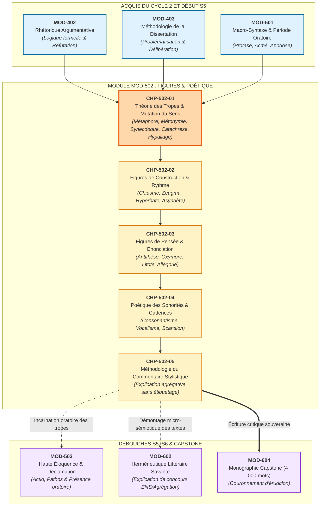
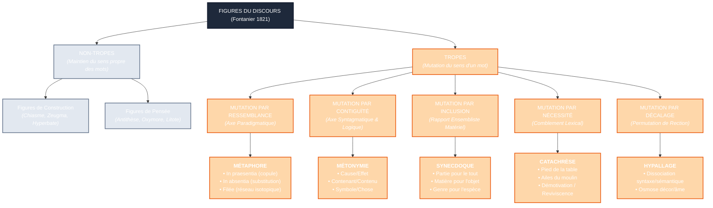

# Chapitre 1 — La Théorie des Tropes et la Mutation du Sens : Métaphore, Métonymie, Synecdoque, Catachrèse et Hypallage

> **Identifiant du chapitre** : `CHP-502-01`  
> **Module de rattachement** : [`MOD-502` — Traité Complet des Figures de Rhétorique et Cadences de la Prose](file:///f:/Formation/world-class-french/03-curriculum/year-3/semester-5/mod-502-traite-figures-rhetorique-poetique.md)  
> **Semestre** : Année 3 — Semestre 5 (S5)  
> **Volume horaire canonique** : 5 à 6 heures d'apprentissage autonome délibéré et d'ateliers d'application (Phase 1 Étude : 1 h 30 | Phase 2 Pratique : 1 h 30 | Phase 3 Correction : 1 h 00 | Phase 4 Évaluation : 1 h 00)  
> **Statut** : [STATUT : VALIDÉ]  
> **Compétences associées** : [`FR-STYLE-001`](file:///f:/Formation/world-class-french/02-competency-framework/competency-framework.md#fr-style-001-maîtrise-des-figures-de-rhétorique-et-commentaire-stylistique) (L4 Maîtrise approfondie), [`FR-LEXIC-001`](file:///f:/Formation/world-class-french/02-competency-framework/competency-framework.md#fr-lexic-001-précision-sémantique-nuances-synonymiques-et-collocations) (L4 Maîtrise approfondie), [`FR-SYNTAX-003`](file:///f:/Formation/world-class-french/02-competency-framework/competency-framework.md#fr-syntax-003-maîtrise-de-la-grande-période-oratoire-et-de-la-macro-syntaxe) (L4 Maîtrise approfondie), [`FR-INT-001`](file:///f:/Formation/world-class-french/02-competency-framework/competency-framework.md#fr-int-001-rédiger-un-texte-long-cohérent-en-maîtrisant-accords-et-ponctuation) (L4 Maîtrise approfondie)  
> **Sources scientifiques de référence** : `SRC-RHET-01` (Fontanier, 1821/2009), `SRC-RHET-02` (Molinié, 1992), `SRC-RHET-03` (Reboul, 1991), `SRC-RHET-04` (Calas, 2011), `SRC-RHET-05` (Bacry, 1992/2010), `SRC-GRAM-01` (Grevisse & Goosse, 2016), `SRC-GRAM-02` (Riegel et al., 2016), `SRC-LEX-03` (Rey, 2016), `SRC-LEX-04` (Robert & Rey), `SRC-NORM-03` (Ministère de l'Éducation nationale, 2020), `SRC-TYPO-01` (Imprimerie nationale, 2002/2014)

---

## 1. Titre et Place dans le Cursus

### 1.1 Intitulé Officiel
**Chapitre 1 : La Théorie des Tropes et la Mutation du Sens : Métaphore, Métonymie, Synecdoque, Catachrèse et Hypallage** (`CHP-502-01`).

### 1.2 Insertion Architecturale dans le Cursus
Le chapitre inaugural du module `MOD-502` constitue le seuil décisif de la haute stylistique française. Après avoir exploré la charpente de la phrase complexe (`MOD-301`), la modélisation argumentative (`MOD-402`), la dialectique de la dissertation académique (`MOD-403`) et l'architecture périodique de la prose (`MOD-501`), l'étudiant pénètre au cœur de l'alchimie verbale : **la conversion sémantique par laquelle un mot quitte sa signification littérale pour engendrer une vision poétique et conceptuelle inédite**.



- **En amont** :
  - [`MOD-403`](file:///f:/Formation/world-class-french/03-curriculum/year-2/semester-4/mod-403-methodologie-dissertation-essai-academique.md) a établi la rigueur herméneutique de l'analyse textuelle, proscrivant la paraphrase.
  - [`MOD-501`](file:///f:/Formation/world-class-french/03-curriculum/year-3/semester-5/mod-501-macro-syntaxe-periode-oratoire-cadences.md) a fourni l'armature périodique et le souffle syntaxique au sein desquels s'inscrivent les figures.
- **Au sein du module `MOD-502`** :
  - Ce premier chapitre fonde la sémantique figurale en analysant le déplacement du signifié au niveau lexical (les tropes), avant d'aborder les torsions d'architecture syntaxique ([`CHP-502-02`](file:///f:/Formation/world-class-french/03-curriculum/year-3/semester-5/mod-502-traite-figures-rhetorique-poetique.md#6-plan-détaillé-des-chapitres)), les modulations de l'assertion ([`CHP-502-03`](file:///f:/Formation/world-class-french/03-curriculum/year-3/semester-5/mod-502-traite-figures-rhetorique-poetique.md#6-plan-détaillé-des-chapitres)), la musicalité de la prose ([`CHP-502-04`](file:///f:/Formation/world-class-french/03-curriculum/year-3/semester-5/mod-502-traite-figures-rhetorique-poetique.md#6-plan-détaillé-des-chapitres)) et la synthèse méthodologique du commentaire de concours ([`CHP-502-05`](file:///f:/Formation/world-class-french/03-curriculum/year-3/semester-5/mod-502-traite-figures-rhetorique-poetique.md#6-plan-détaillé-des-chapitres)).
- **En aval** :
  - [`MOD-503`](file:///f:/Formation/world-class-french/03-curriculum/year-3/semester-5/mod-503-haute-eloquence-declamation-presence-oratoire.md) déploiera ces images dans la chair de la déclamation vivante.
  - [`MOD-602`](file:///f:/Formation/world-class-french/03-curriculum/year-3/semester-6/mod-602-hermeneutique-litteraire-explication-concours.md) exigera cette déconstruction micro-stylistique pour l'épreuve reine de l'explication de texte d'agrégation.
  - [`MOD-604`](file:///f:/Formation/world-class-french/03-curriculum/year-3/semester-6/mod-604-capstone-project-grand-oral.md) couronnera cette maîtrise dans la rédaction du mémoire universitaire final.

### 1.3 Justification du Calibrage Horaire (5 à 6 Heures)
Le volume horaire d'apprentissage autonome est articulé en quatre phases rigoureusement calibrées :
- **Phase 1 — Étude conceptuelle & fondements sémiotiques (1 h 30)** : Assimilation des rubriques 1 à 13 (frontière trope/non-trope selon Fontanier, triade teneur-véhicule-motif, critère d'inclusion vs contiguïté, mécanique sémique, clinique des erreurs).
- **Phase 2 — Pratique délibérée & décomposition sémique (1 h 30)** : Résolution autonome des 3 niveaux d'exercices progressifs (rubrique 14 : discrimination sur 12 fragments, décomposition sémique de 6 tropes, analyse micro-stylistique certifiée en 50 mots exacts).
- **Phase 3 — Correction critique & production normée (1 h 00)** : Audit raisonné d'une copie d'étudiant semée de 8 confusions d'étiquetage (rubrique 15) et composition d'un paragraphe critique en 60 mots exacts sous contrainte d'arbitrage (rubrique 16).
- **Phase 4 — Ancrage mnésique & évaluation sommative (1 h 00)** : Questions d'Active Recall (rubrique 18) et passation de l'épreuve sommative chronométrée de 30 minutes notée sur 20 points (rubrique 19).

---

## 2. Objectifs Mesurables

Au terme de ce chapitre, l'apprenant doit être capable de :

1. **Tracer le partage doctrinal entre tropes et non-tropes** ([`FR-STYLE-001`](file:///f:/Formation/world-class-french/02-competency-framework/competency-framework.md#fr-style-001-maîtrise-des-figures-de-rhétorique-et-commentaire-stylistique) — Palier L4) : distinguer infailliblement une mutation du sens d'un mot (trope) d'une modification de l'agencement syntaxique ou d'une posture de pensée (non-trope), en s'adossant aux critères formels de Pierre Fontanier [Réf. `SRC-RHET-01`, partie I] et de Georges Molinié [Réf. `SRC-RHET-02`, p. 340].
2. **Déconstruire l'anatomie sémique de la métaphore** ([`FR-LEXIC-001`](file:///f:/Formation/world-class-french/02-competency-framework/competency-framework.md#fr-lexic-001-précision-sémantique-nuances-synonymiques-et-collocations) — Palier L4) : isoler la teneur (*comparé*), le véhicule (*comparant*) et le motif analogique (*sèmes partagés*), discriminer la métaphore *in praesentia*, la métaphore *in absentia* et la métaphore filée, et démontrer la frontière étanche qui sépare la métaphore de la comparaison [Réf. `SRC-RHET-04`, chap. 3].
3. **Arbitrer la frontière logique entre métonymie et synecdoque** ([`FR-STYLE-001`](file:///f:/Formation/world-class-french/02-competency-framework/competency-framework.md#fr-style-001-maîtrise-des-figures-de-rhétorique-et-commentaire-stylistique) — Palier L4) : identifier si le glissement référentiel repose sur une relation de contiguïté logique, spatiale ou causale entre deux entités séparées (*métonymie*), ou sur une relation d'inclusion matérielle, quantitative ou taxonomique (*synecdoque*) [Réf. `SRC-RHET-01`, partie I ; `SRC-RHET-05`, chap. 2].
4. **Analyser le cycle de vie du trope, la démotivation et l'hypallage** ([`FR-STYLE-001`](file:///f:/Formation/world-class-french/02-competency-framework/competency-framework.md#fr-style-001-maîtrise-des-figures-de-rhétorique-et-commentaire-stylistique), [`FR-LEXIC-001`](file:///f:/Formation/world-class-french/02-competency-framework/competency-framework.md#fr-lexic-001-précision-sémantique-nuances-synonymiques-et-collocations) — Palier L4) : expliciter la fonction de comblement lexical de la catachrèse, retracer son usure sociale et sa reviviscence poétique [Réf. `SRC-LEX-03`], et démonter la dissociation entre la rection syntaxique et le lien sémantique logique dans l'hypallage [Réf. `SRC-GRAM-02`, chap. 20].

---

## 3. Prérequis et Test de Préparation (Auto-Diagnostic)

### 3.1 Prérequis Cognitifs
- **Discrimination du sens propre et du sens figuré** : reconnaître lorsqu'un lexème n'est pas employé dans son acception dénotative première du dictionnaire.
- **Analyse fonctionnelle des constituants de la phrase** : identifier le sujet, le verbe, les compléments essentiels et l'épithète liée ou détachée (`MOD-201`).
- **Conscience de la polysémie lexicale** : comprendre qu'un mot accumule des sèmes multiples selon son histoire et ses contextes d'actualisation (`MOD-104`).
- **Refus de la paraphrase impressionniste** : aptitude à justifier un effet de style par l'observation matérielle du texte (`MOD-403`).

### 3.2 Test de Préparation Immédiat
Répondez aux cinq questions suivantes avant d'aborder le cours, puis dépliez le volet de correction pour vérifier votre aptitude conceptuelle.

1. Dans la phrase : *« Ce chirurgien a des doigts de fée »*, l'expression repose-t-elle sur une métaphore ou sur une métonymie ? Quel est l'élément absent de la phrase qui empêche d'y voir une comparaison formelle ?
2. Pourquoi l'expression courante *« boire un verre »* ne désigne-t-elle pas l'ingestion de silice fondue ? Par quel mécanisme de substitution s'opère la compréhension de l'énoncé ?
3. Lorsque l'on évoque *« les bras d'un fauteuil »* ou *« le pied d'une table »*, s'agit-il d'une audacieuse trouvaille poétique d'auteur ou d'un phénomène linguistique d'une autre nature ?
4. Dans le vers virgilien traduit par Racine : *« Ils allaient obscurs sous la nuit solitaire »*, quel syntagme présente une discordance entre la syntaxe grammaticale et la réalité logique du monde représenté ?
5. Quelle différence de relation logique oppose l'énoncé A (*« Les voiles s'éloignaient du port »*) à l'énoncé B (*« Le trône a rendu son verdict »*) ?

---

<details>
<summary><b>Consulter le corrigé raisonné du test préparatoire</b></summary>

1. **Métaphore (*in praesentia*)** : La phrase assimile les doigts du chirurgien à ceux d'une fée sans utiliser d'outil de comparaison explicite (*comme, pareil à, tel que*). C'est l'absence de ce connecteur analogique qui fait basculer la comparaison dans la métaphore.
2. **Métonymie de contiguïté (contenant pour le contenu)** : Le verre désigne le liquide qu'il contient en vertu d'une relation de proximité matérielle spatiale immédiate. Le signifié de l'objet contenant se substitue au signifié de la boisson contenue.
3. **Catachrèse lexicale** : Il s'agit d'une métaphore obligée et lexicalisée, forgée par la langue pour pallier une lacune du vocabulaire (absence de terme propre pour désigner les montants latéraux du fauteuil ou les supports de la table).
4. **Hypallage** : Grammaticalement, l'adjectif *obscurs* qualifie les voyageurs (*Ils*), et l'adjectif *solitaire* qualifie *la nuit*. Logiquement, c'est la nuit qui est obscure, et ce sont les voyageurs qui cheminent dans la solitude. L'hypallage opère un croisement de qualifications.
5. **Synecdoque vs Métonymie** : Dans l'énoncé A, *la voile* fait partie intégrante du navire (relation d'inclusion matérielle : partie pour le tout $\rightarrow$ synecdoque). Dans l'énoncé B, *le trône* est un meuble distinct du souverain qui y siège (relation de contiguïté symbolique externe $\rightarrow$ métonymie).

</details>

---

## 4. Situation de Départ ou Problème Concret

Considérons l'extrait suivant du commentaire composé rédigé par un candidat à l'entrée d'une grande école littéraire, portant sur le célèbre poème de Victor Hugo, *Booz endormi* :

> *« Dans le dernier vers, "Cette faucille d'or dans le champ des étoiles", l'auteur utilise une magnifique métaphore pour embellir son poème. La faucille d'or fait une image poétique qui montre que la nuit est belle et que le poète sait très bien écrire. Cela crée une impression magique qui touche le lecteur. »*

Ce paragraphe, typique de l'étiquetage scolaire stérile, est sanctionné par une note éliminatoire lors des concours académiques d'excellence (ENS, Agrégation, CAPES). Pourquoi ?
1. **L'illusion décorative** : L'étudiant affirme que la métaphore sert à « embellir » le poème. Or, une figure de rhétorique n'est jamais un ruban décoratif ajouté de l'extérieur sur une pensée préexistante ; elle est l'armature sémantique même par laquelle la pensée naît et se structure.
2. **Le flou impressionniste** : Des jugements subjectifs creux (*« image poétique »*, *« la nuit est belle »*, *« impression magique »*) masquent l'incapacité totale du candidat à analyser le fonctionnement matériel du texte.
3. **L'absence d'analyse sémique** : Le candidat ne mentionne ni le comparé absent (le croissant de lune nocturne), ni le transfert sémantique opéré entre le monde agricole de Ruth et Booz (la faucille, la moisson terrestre) et la voûte cosmique (le champ céleste, le regard de Dieu), ni la mutation des sèmes qui transforme l'astre froid en outil divin de fécondité.
4. **La cécité taxinomique** : Le candidat n'a pas vu que l'expression conjugue une métaphore *in absentia* (*faucille d'or* = croissant de lune) et une métaphore d'assimilation spatiale (*champ des étoiles* = ciel nocturne), assurant le bouclage symbolique de toute l'épopée biblique.

Tant que l'on considère les figures de rhétorique comme un catalogue de curiosités ou d'étiquettes à coller mécaniquement, on demeure à la porte du commentaire littéraire. Il est impératif de comprendre **la mécanique interne de la mutation du sens**.

---

## 5. Explication Intuitive : La Greffe Botanique et le Microscope Sémique

Pour comprendre ce qu'est un trope, abandonnons l'idée du « costume » ou de l'« ornement ». Recourons à deux modélisations concrètes : **l'analogie de la greffe botanique** et **le microscope sémique**.

### La Greffe Botanique du Sens
Dans une plante, greffer un greffon étranger sur un porte-greffe ne consiste pas à nouer une fleur artificielle avec une ficelle. Le greffon doit s'insérer dans le cambium végétal ; la sève du porte-greffe circule dans les tissus du greffon, et de cette rencontre biologique naît un fruit nouveau que ni le tronc ni la branche n'auraient pu engendrer isolément.
Le trope fonctionne exactement ainsi :
- Le porte-greffe est **le contexte linguistique** (la phrase, le poème, le discours).
- Le greffon est **le mot transféré**, arraché à son écosystème sémantique usuel.
- La sève est **l'isotopie textuelle** qui irrigue le mot nouveau.
- Le fruit hybride est **le sens figuré**, irréductible à la simple somme des définitions du dictionnaire.

```
       [ Sens littéral usuel ]               [ Contexte textuel d'accueil ]
        (Noyau sémique propre)                 (Isotopie, tension poétique)
                   \                                     /
                    \                                   /
                     ▼                                 ▼
                 ===========================================
                   OPÉRATION TROPOLOGIQUE : LA GREFFE DU SENS
                 ===========================================
                                      │
                                      ▼
                      [ Sens figuré / Effet esthétique ]
                      • Sèmes inhérents mis en veille
                      • Sèmes afférents contextualisés
                      • Mutation de la référence au monde
```

### Le Microscope Sémique
Tout mot du dictionnaire n'est pas un bloc compact indivisible : c'est un faisceau de molécules sémantiques appelées **sèmes**.
Prenons le mot *lion* :
- Sèmes inhérents stables : `/animal/`, `/mammifère/`, `/félidé/`, `/carnivore/`, `/à crinière/`.
- Sèmes afférents culturels : `/courage/`, `/force/`, `/férocité/`, `/noblesse royale/`.

Dans un traité de zoologie, l'énoncé *« Le lion attaque sa proie »* active les sèmes inhérents `/animal/`, `/félidé/`, `/carnivore/`.
Mais si un général proclame sur le champ de bataille : *« Ce soldat est un lion »*, que se passe-t-il sous notre microscope sémique ?
1. Les sèmes inhérents anatomiques (`/quadrupède/`, `/pelage fauve/`, `/carnivore zoologique/`) entrent en contradiction flagrante avec le sujet humain *soldat*. Pour que la phrase ne soit pas un pur non-sens, l'esprit **endort** ces sèmes inhérents.
2. Simultanément, les sèmes afférents culturels (`/bravoure indomptable/`, `/férocité combative/`) **s'embrasent violemment**.
3. Le mot *lion* a subi une mutation génétique de son noyau de signification : il y a eu **trope**.

---

## 6. Définitions Précises et Terminologie

Pour manipuler la haute stylistique sans approximation, définissons rigoureusement les concepts fondamentaux établis par la tradition rhétorique et la linguistique moderne.

| Terme Canonique | Étymologie | Définition Formelle Universitaire | Exemple d'Ancrage |
| :--- | :--- | :--- | :--- |
| **Trope** | Du grec *tropos* (tour, conversion, détour). | Figure du discours par laquelle on modifie la signification propre d'un mot pour lui faire prendre une signification figurée nouvelle [Réf. `SRC-RHET-01`, partie I]. | *« Cette faucille d'or »* (Hugo) pour désigner le croissant de lune. |
| **Sens propre** | Du latin *proprius* (particulier, exclusif). | Signification première, primitive ou littérale d'un lexème, historiquement attestée et immédiatement assignable hors contexte [Réf. `SRC-LEX-03`]. | Le mot *flamme* désignant le gaz incandescent produit par la combustion. |
| **Sens figuré** | Du latin *figuratus* (qui a une forme formée, imagée). | Signification dérivée qu'un mot acquiert par transfert analogique, logique ou contextuel, distincte de son acception première. | Le mot *flamme* désignant la passion amoureuse violente chez Racine. |
| **Saillance stylistique** | Du latin *salire* (jaillir, sauter). | Propriété d'un segment textuel qui émerge avec force du continuum discursif par un écart mesurable ou une tension sémantique concertée [Réf. `SRC-RHET-02`, p. 340]. | L'apparition soudaine d'un zeugma ou d'une métaphore inouïe dans un discours sobre. |
| **Sème inhérent** | Du grec *sêma* (signe). | Trait sémantique distinctif minimal intrinsèquement attaché au lexème en langue, indépendant de tout contexte particulier [Réf. `SRC-GRAM-02`, chap. 4]. | Pour le mot *rame* : /instrument/, /bois/, /servant à propulser une embarcation/. |
| **Sème afférent** | Du latin *afferre* (apporter). | Trait sémantique secondaire, culturel, connotatif ou contextuel activé uniquement par l'environnement discursif spécifique. | Pour le mot *rame* dans un bagne : /souffrance/, /asservissement/, /châtiment/. |
| **Teneur (*Tenor*)** | Notion d'I. A. Richards (1936). | Ce dont on parle en réalité ; l'entité, le concept ou l'objet de référence sous-jacent (souvent appelé *comparé* en rhétorique scolaire). | La mort d'un héros dans une élégie funèbre. |
| **Véhicule (*Vehicle*)** | Notion d'I. A. Richards (1936). | Le terme concret ou l'image empruntée servant à transporter le sens (souvent appelé *comparant* en rhétorique scolaire). | L'extinction d'un flambeau ou le crépuscule d'un soleil. |
| **Motif analogique (*Ground*)** | Notion d'I. A. Richards et Frédéric Calas. | L'ensemble des sèmes communs partagés par la teneur et le véhicule qui autorise l'assimilation métaphorique [Réf. `SRC-RHET-04`, chap. 3]. | Pour *homme* / *roseau* chez Pascal : /fragilité matérielle/, /vulnérabilité face aux éléments/. |
| **Isotopie sémantique** | Du grec *isos* (égal) et *topos* (lieu). | Réseau de redondance ou faisceau continu de sèmes identiques parcourant un texte et assurant sa cohérence interprétative (A. J. Greimas). | L'isotopie marine parcourant le poème *L'Albatros* de Baudelaire. |
| **Démotivation lexicale** | Du latin *motivum* (qui meut). | Processus diachronique par lequel les locuteurs cessent de percevoir le sens métaphorique ou la racine imageante originelle d'un terme [Réf. `SRC-LEX-03`]. | Le mot *tête* (qui vient du latin populaire *testa*, « pot de terre ») totalement démotivé aujourd'hui. |
| **Reviviscence poétique** | Du latin *reviviscere* (reprendre vie). | Procédé d'écriture par lequel l'auteur réveille la métaphore endormie sous une catachrèse ou un mot usé, lui restituant son tranchant. | Francis Ponge réveillant l'image liquide sous le mot *délibération* dans ses poèmes. |
| **Catachrèse** | Du grec *katachrêsis* (abus, détournement). | Trope par lequel on étend le sens d'un mot au-delà de sa destination stricte pour suppléer à l'absence de terme propre dans la langue [Réf. `SRC-RHET-01`]. | *« Le lit de la rivière »*, *« les ailes du moulin »*, *« le goulot de la bouteille »*. |
| **Hypallage** | Du grec *hypallagê* (échange, interversion). | Figure par laquelle on attribue grammaticalement à certains mots d'une phrase ce qui conviendrait logiquement à d'autres mots du même énoncé [Réf. `SRC-RHET-02`]. | *« Ce marchand accoudé sur son comptoir avide »* (Hugo) : l'avidité qualifie le marchand, non le comptoir. |

---

## 7. Règles ou Mécanismes Fondamentaux

### 7.1 Le Partage Fondateur de Pierre Fontanier (1821) : Tropes vs Non-Tropes
Dans son monumental traité *Les Figures du discours* (1821) [Réf. `SRC-RHET-01`, partie I], Pierre Fontanier opère une césure épistémologique qui demeure la clé de voûte de toute la stylistique française :

> **La distinction cardinale** :
> 1. **Les Tropes** : Figures qui consistent dans l'emploi d'un mot dans un sens différent de son sens propre. Le trope s'opère **dans le mot** ; c'est une métamorphose lexicale et sémantique. Si le sens ne mute pas, il n'y a pas de trope.
> 2. **Les Non-Tropes** : Figures qui n'altèrent pas le sens des mots, mais modifient soit leur **agencement syntaxique** (*figures de construction* : chiasme, parallélisme, anaphore, hyperbate, zeugma), soit leur **disposition de pensée** (*figures de pensée* : antithèse, oxymore, litote, prétérition, prosopopée).

Fontanier distingue en outre les *tropes en un seul mot* (métaphore, métonymie, synecdoque, catachrèse) des *tropes en plusieurs mots* (allégorie continuée, ironie dissimulée). Dans ce chapitre, nous explorons souverainement le noyau dur des tropes lexicaux et leur prolongement syntaxique direct : l'hypallage.

### 7.2 L'Anatomie Sémique de la Métaphore
La métaphore n'est pas une simple condensation de comparaison : c'est une **fusion sémantique instantanée**.

#### 1. La Triade de Richards et Calas
Toute métaphore met en jeu trois termes fonctionnels [Réf. `SRC-RHET-04`, chap. 3] :
$$\text{Métaphore} = \frac{\text{Teneur (Comparé)} \times \text{Véhicule (Comparant)}}{\text{Motif Analogique (Sèmes partagés)}}$$
- **La Teneur** : L'objet réel visé par le discours.
- **Le Véhicule** : Le terme étranger convoqué pour qualifier la teneur.
- **Le Motif (*Ground*)** : L'intersection sémique qui permet la fusion.

#### 2. Typologie Structurelle de la Métaphore
Selon la manière dont la teneur et le véhicule s'incarnent dans la chaîne syntaxique, on distingue trois degrés de prégnance :
1. **Métaphore *in praesentia*** : La teneur et le véhicule sont tous deux explicitement présents dans la phrase, reliés par une copule (*être, sembler*), une apposition ou un complément du nom :
   - *« Cette femme est une rose »* (copule verbale) ;
   - *« La chevelure, océan de ténèbres »* (apposition) ;
   - *« Le bouclier de notre foi »* (complément du nom déterminatif).
2. **Métaphore *in absentia*** : La teneur est totalement tue dans l'énoncé ; seul le véhicule est proféré. L'identification de la teneur exige un déchiffrement contextuel par le lecteur :
   - *« Cette faucille d'or dans le champ des étoiles »* (Hugo) : le mot *lune* n'est jamais prononcé. C'est le degré d'intensité poétique le plus élevé.
3. **Métaphore filée** : Une métaphore inaugurale est prolongée tout au long d'un texte par un réseau coordonné de sous-métaphores développant la même isotopie secondaire :
   - Baudelaire dans *L'Albatros* comparant le poète à l'oiseau géant, puis filant l'image à travers les navires, les ailes, les marins et l'exil au sol.

#### 3. La Frontière Étanche : Métaphore vs Comparaison
La comparaison maintient les deux entités disjointes au moyen d'un **modalisateur analogique** (*comme, tel que, pareil à, semblable à, ainsi que, avoir l'air de*).
- *« Cet homme combat comme un lion »* $\rightarrow$ **Comparaison** : les deux univers restent distincts, la médiation logique est affirmée.
- *« Cet homme est un lion »* $\rightarrow$ **Métaphore *in praesentia*** : l'outil de comparaison s'est abîmé, les substances s'interpénètrent.
- *« Le lion s'avança dans l'arène politique »* $\rightarrow$ **Métaphore *in absentia*** : la substitution est consommée.

### 7.3 Métonymie et Synecdoque : La Distinction Doctrinale Cardinale
La confusion entre métonymie et synecdoque est la tare la plus répandue des études scolaires. Le critère scientifique établi par Fontanier [Réf. `SRC-RHET-01`, partie I] et repris par Molinié [Réf. `SRC-RHET-02`, p. 250] repose sur une rigoureuse partition ensembliste :

```
      ╔═════════════════════════════════════════════════════════════════╗
      ║                  CRITÈRE SÉMIOTIQUE FONDAMENTAL                ║
      ╠═════════════════════════════════════════════════════════════════╣
      ║  MÉTONYMIE : Deux entités DISTINCTES unies par CONTIGUÏTÉ     ║
      ║  [ Entité A ]  <── (Lien externe : cause, lieu, etc.) ──>  [ Entité B ] ║
      ╠═════════════════════════════════════════════════════════════════╣
      ║  SYNECDOQUE : Deux entités unies par INCLUSION matérielle      ║
      ║  ┌───────────────────────────────────────────────────────────┐ ║
      ║  │  LE TOUT (Entité B)                                       │ ║
      ║  │     ┌───────────────────────────────────────────────┐     │ ║
      ║  │     │  LA PARTIE (Entité A : voile, fer, etc.)      │     │ ║
      ║  │     └───────────────────────────────────────────────┘     │ ║
      ║  └───────────────────────────────────────────────────────────┘ ║
      ╚═════════════════════════════════════════════════════════════════╝
```

#### 1. La Métonymie : Relation de Contiguïté (Deux Objets Séparés)
La métonymie opère un glissement de désignation fondé sur un lien de coexistence réelle, spatiale, temporelle ou logique entre deux entités indépendantes :
- **Le contenant pour le contenu** : *« Boire un verre »*, *« Finir son assiette »*.
- **La cause pour l'effet** : *« Vivre de sa plume »* (la plume est l'instrument causal de l'écriture qui produit des revenus).
- **L'instrument pour l'agent** : *« Le premier violon de l'orchestre »* (le musicien virtuose).
- **Le symbole pour la réalité institutionnelle** : *« Le trône et l'autel »* (la monarchie et l'Église).
- **Le lieu pour l'institution / les personnes** : *« Le Quai d'Orsay s'inquiète »*, *« Matignon a arbitré »*, *« La Maison-Blanche dément »*.
- **L'auteur pour l'œuvre** : *« Lire un Balzac »*, *« Acheter un Picasso »*.

#### 2. La Synecdoque : Relation d'Inclusion (Le Tout et la Partie)
La synecdoque est une variété spécifique de trope fondée sur un rapport d'appartenance interne, matérielle, quantitative ou taxonomique :
- **La partie pour le tout (*pars pro toto*)** : *« Une voile à l'horizon »* (le navire tout entier dont la voile est un composant physique) ; *« Trouver un toit »* (la maison entière).
- **Le tout pour la partie (*totum pro parte*)** : *« La ville entière dormait »* (les habitants de la ville).
- **La matière pour l'objet** : *« Croiser le fer »* (l'épée faite de fer) ; *« Entendre le bronze sonner »* (la cloche en bronze).
- **Le singulier pour le pluriel** : *« L'ennemi reculait sur tous les fronts »* (l'armée ennemie composée de milliers de combattants).
- **Le genre pour l'espèce** : *« Le fauve bondit »* pour le tigre ou le lion.

### 7.4 La Catachrèse et le Cycle de Vie du Trope
La catachrèse est la preuve éclatante que la langue française est un organisme vivant qui se développe par métaphores imposées [Réf. `SRC-LEX-03`].

#### 1. Le Comblement du Vide Lexical
La langue ne dispose pas d'un mot distinct pour chaque composant du monde physique. Pour nommer une réalité nouvelle, l'esprit humain emprunte au champ anatomique ou familier :
- *Les pieds de la table* ; *les ailes du moulin* ; *le lit de la rivière* ; *le goulot de la bouteille* ; *les dents de la scie* ; *le talon de la chaussure*.
Ces expressions sont des **catachrèses** : des métaphores obligatoires, indispensables pour combler une lacune du lexique.

#### 2. Le Cycle Biologique du Trope
Tout trope traverse historiquement trois âges :
1. **L'Âge de l'Invention (Métaphore vive)** : L'écrivain crée une étincelle sémantique inouïe qui surprend et bouscule le système linguistique.
2. **L'Âge de l'Usure (Cliché & Lexicalisation)** : La métaphore est répétée par la société, perd son éclat, devient une catachrèse ou une formule convenue (*tomber des nues, briser la glace*).
3. **L'Âge de la Reviviscence (Régénération littéraire)** : Le grand écrivain s'empare de la formule usée et réveille brutalement son sens originel (par exemple Francis Ponge réinvestissant la matérialité de l'objet dans *Le Parti pris des choses*).

### 7.5 L'Hypallage : La Dissociation de la Rection Syntaxique et du Lien Sémantique Logique
L'hypallage est sans doute le plus fascinant des tropes syntaxiques. Elle consiste à transférer une épithète ou une qualification d'un mot auquel elle se rapporte logiquement à un autre mot de la phrase auquel elle se lie grammaticalement [Réf. `SRC-GRAM-02`, chap. 20 ; `SRC-RHET-02`].

#### 1. Le Mécanisme Formel
Considérons l'exemple classique :
$$\text{Énoncé} : \text{« Ils allaient obscurs sous la nuit solitaire. »}$$
- **Lien syntaxique officiel** : *obscurs* est apposé au pronom sujet *Ils* ; *solitaire* est épithète liée du substantif *la nuit*.
- **Lien sémantique logique** : Dans la réalité factuelle, c'est la nuit qui est *obscure*, et ce sont les voyageurs qui sont *solitaires* sur le chemin.
- **Opération d'hypallage** : Il y a eu permutation croisée des qualifications.

#### 2. La Portée Esthétique et Philosophique
Pourquoi l'écrivain pratique-t-il l'hypallage ?
Loin d'être un artifice pédant, l'hypallage opère une **osmose atmosphérique**. En attachant *obscurs* aux voyageurs, le poète signifie que l'obscurité extérieure a pénétré leur âme et dissous leur silhouette ; en attachant *solitaire* à la nuit, il dote le décor cosmique d'une mélancolie subjective humaine. L'hypallage efface la frontière entre le monde extérieur et la conscience qui le perçoit.

---

## 8. Raisonnement Détaillé : Pourquoi les Tropes Sont les Matrices de la Pensée

Pourquoi la langue ne se contente-t-elle pas d'un lexique purement dénotatif, géométrique et univoque ? Pourquoi les tropes existent-ils ?

### 1. La Métaphore Vive et la Redescription du Monde (Paul Ricœur)
Dans *La Métaphore vive* (1975), le philosophe Paul Ricœur a démontré que la métaphore n'est pas un simple écart ornemental par rapport à une prétendue norme littérale neutre. La métaphore possède une **valeur cognitive et heuristique irremplaçable** :
- Le sens littéral est incapable d'exprimer les réalités qui échappent à l'expérience empirique immédiate (l'angoisse existentielle, le sentiment du temps, l'extase amoureuse, la transcendance divine).
- Par la tension métaphorique, la langue opère une *« redescription du réel »*. En heurtant deux champs sémantiques incompatibles (*« Le temps est un mendiant »*, *« L'âme est une nef »*), l'esprit est contraint de produire une étincelle de sens nouvelle qu'aucun énoncé prosaïque ne pouvait formuler.

### 2. Le Cimetière des Métaphores Oubliées
Le linguiste et historien de la langue constate que presque tous les concepts abstraits du français contemporain sont d'anciennes métaphores fossilisées [Réf. `SRC-LEX-03`] :
- Le mot *comprendre* vient du latin *comprehendere* : « saisir physiquement avec la main ». La pensée abstraite s'est bâtie sur la métaphore de la préhension manuelle.
- Le mot *scrupule* vient du latin *scrupulus* : « un petit caillou pointu dans la sandale ». L'hésitation morale est née de la gêne physique du marcheur.
- Le mot *pensée* est issu du verbe latin *pensare* : « peser sur une balance ». Réfléchir, c'est mettre des poids sur les plateaux.

Le langage abstrait tout entier n'est pas une création spontanée ex nihilo : **il est le cimetière des tropes d'hier**. Étudier les tropes, ce n'est donc pas collectionner des fleurs rhétoriques séchées ; c'est observer le cerveau humain au travail dans son atelier de forgeage du sens.

---

## 9. Exemples Corrects Commentés

Disséquons avec la rigueur du microscope sémique cinq tropes immortels de la littérature française.

### Exemple 1 : Charles Baudelaire, *La Chevelure* (*Les Fleurs du Mal*)
> *« Un hémisphère de cheveux »*

- **Nature formelle du trope** : Métaphore *in absentia* (ou métaphore nominale appositive) couplée à une synecdoque expansive.
- **Teneur (*comparé*)** : La masse des cheveux de Jeanne Duval étalée sur les épaules.
- **Véhicule (*comparant*)** : *Un hémisphère* (terme emprunté à la géographie planétaire et à l'astronomie).
- **Motif analogique (*sèmes partagés*)** :
  - Sèmes inhérents du véhicule : `/géométrie/`, `/demi-sphère/`, `/portion du globe terrestre/`, `/immensité/`.
  - Sèmes inhérents de la teneur : `/matière organique/`, `/courbure de la tête/`, `/volume/`.
  - Sèmes afférents embrasés : `/exotisme/`, `/voyage maritime/`, `/totalité cosmique/`.
- **Commentaire micro-stylistique** : L'audace du trope réside dans la dismutation d'échelle. Par le mot *hémisphère*, Baudelaire arrache la chevelure à la sphère anatomique intime pour la hausser à la dimension de la planète tout entière. Les cheveux ne sont plus une toison ; ils deviennent l'océan austral et les terres lointaines dans lesquels le poète va naviguer.

### Exemple 2 : Jean Racine, *Andromaque* (Acte I, scène 4)
Pyrrhus s'adressant à Andromaque :
> *« Brûlé de plus de feux que je n'en allumai »*

- **Nature formelle du trope** : Trope binaire confrontant une métaphore passionnelle et un emploi métonymique/littéral, ordonnés en antithèse.
- **Décomposition** :
  - *« plus de feux »* (terme 1) : Métaphore in praesentia du désir amoureux destructeur. Teneur = passion intime ; Véhicule = flamme dévorante ; Motif = intensité thermique, douleur cuisante, perte de contrôle.
  - *« que je n'en allumai »* (terme 2) : Sens littéral et métonymique de l'incendie de Troie causé par les torches des guerriers grecs conduits par Pyrrhus.
- **Commentaire micro-stylistique** : Racine fait entrer en collision le destin historique d'une civilisation (l'incendie réel de Troie) et le tourment psychologique d'un homme (la passion coupable pour sa captive). Le second incendie, invisible et intérieur, est proclamé plus ravageur que les flammes matérielles qui ont anéanti l'empire de Priam.

### Exemple 3 : Victor Hugo, *Booz endormi* (*La Légende des siècles*)
> *« Quel dieu, quel moissonneur de l'éternel été, / Avait, en s'en allant, négligemment jeté / Cette faucille d'or dans le champ des étoiles. »*

- **Nature formelle du trope** : Double métaphore *in absentia* hautement intégrée.
- **Décomposition sémique** :
  - *« Cette faucille d'or »* : Teneur tue = le croissant de lune. Véhicule = la faucille d'or. Motif = la forme recourbée en croissant, la couleur lumineuse brillante, l'outil tranchant de la récolte.
  - *« Le champ des étoiles »* : Teneur tue = la voûte céleste nocturne. Véhicule = le champ cultivé. Motif = étendue continue constellée d'éléments lumineux assimilés à des épis ou des fleurs.
- **Commentaire micro-stylistique** : Ce vers sublime assure le couronnement isotopique du poème. Durant tout le texte, Booz a moissonné l'orge terrestre avec ses ouvriers. Par ce trope cosmique terminal, Hugo hisse la moisson humaine au rang d'une récolte céleste : Dieu lui-même devient le suprême Moissonneur qui a oublié son outil d'or sur le ciel de nuit.

### Exemple 4 : Guillaume Apollinaire, *Zone* (*Alcools*)
> *« Soleil cou coupé »*

- **Nature formelle du trope** : Métaphore *in absentia* radicale, elliptique et asyndétique.
- **Teneur** : Le coucher du soleil rougeoyant à l'horizon parisien.
- **Véhicule** : Une tête décapitée sanguinolente séparée de son cou.
- **Motif analogique** : La rotondité de l'astre, la couleur rouge sang du crépuscule, la disparition brutale de la lumière sous la ligne d'horizon comparable au couperet de la guillotine.
- **Commentaire micro-stylistique** : Par la suppression de tout article, de toute copule et de toute ligature syntaxique, Apollinaire produit un choc visuel instantané. L'allitération gutturale et occlusive en [k] (*cou coupé*) mime le tranchant de la lame et clôt le poème liminaire sur une image de décollation tragique de la modernité.

### Exemple 5 : François-René de Chateaubriand, *Atala*
> *« Les fleuves suspendaient leurs cours et les arbres inclinaient leurs cimes sous leurs pas silencieux. »*

- **Nature formelle du trope** : Hypallage couplée à une hyperbole poétique.
- **Décomposition** : Dans le syntagme *« leurs pas silencieux »*, l'adjectif *silencieux* qualifie grammaticalement le nom abstrait d'action *pas*, alors qu'il qualifie ontologiquement et logiquement les marcheurs qui retiennent leur souffle pour ne faire aucun bruit.
- **Commentaire micro-stylistique** : L'hypallage projette le silence intérieur des fugitifs sur la marche elle-même, contaminée par le recueillement de la forêt vierge américaine. La nature entière s'immobilise en écho à ce silence sacré.

---

## 10. Contre-Exemples et Erreurs Fréquentes

Examinons la clinique des six écueils analytiques majeurs qui dégradent les copies d'étudiants en stylistique universitaire.

### Erreur n° 1 : L'étiquetage scolaire descriptif sans commentaire de sens
- **L'anomalie** : Se contenter d'identifier le nom de la figure sans jamais démonter son fonctionnement sémique ni sa portée dramatique (*« L'auteur fait ici une métaphore »* ou *« Nous remarquons une métonymie »*).
- **Le diagnostic scientifique** : Le nom de la figure n'est qu'un point de départ terminologique ; la note ne valide que l'explication du transfert sémantique et de son inscription dans l'isotopie du texte.
- **Le redressement** : Appliquer systématiquement le triptyque : *Forme* $\rightarrow$ *Mécanisme sémantique* $\rightarrow$ *Interprétation esthétique*.

### Erreur n° 2 : La confusion entre métonymie et synecdoque par oubli du critère d'inclusion
- **L'anomalie** : Déclarer que *« trouver un toit »* est une métonymie ou que *« boire un verre »* est une synecdoque.
- **Le diagnostic scientifique** : L'étudiant oublie la frontière ensembliste. Le toit fait partie de la charpente de la maison (inclusion matérielle = synecdoque). Le verre ne fait pas partie du vin (contiguïté spatiale = métonymie).
- **Le redressement** : Poser la question test : *L'élément désigné fait-il physiquement ou conceptuellement partie de l'entité sous-jacente ?* Si oui, synecdoque ; si non, métonymie.

### Erreur n° 3 : L'assimilation de la métaphore à un simple ornement décoratif
- **L'anomalie** : Écrire que l'auteur emploie une métaphore pour « rendre son texte plus poétique » ou « embellir la description ».
- **Le diagnostic scientifique** : C'est une rechute dans la rhétorique dégradée des ornements. La métaphore est une matrice de pensée qui conceptualise ce que le mot propre ne peut atteindre.
- **Le redressement** : Bannir absolument les verbes *embellir, décorer, faire joli, orner* des commentaires stylistiques.

### Erreur n° 4 : Le traitement de la catachrèse en faute de style ou maladresse de langue
- **L'anomalie** : Reprocher à un auteur l'emploi d'expressions comme *« les pieds de la tour »* ou *« le cœur de la ville »* en les qualifiant de métaphores usées ou de clichés maladroits.
- **Le diagnostic scientifique** : La catachrèse lexicale est un comblement nécessaire du code linguistique français, indispensable à la communication et attestée par l'usage séculaire [Réf. `SRC-LEX-03`].
- **Le redressement** : Distinguer soigneusement la catachrèse obligée par la langue de la métaphore d'auteur recherchée.

### Erreur n° 5 : La détection erronée d'une hypallage là où il n'y a qu'une épithète rare ou métaphorique
- **L'anomalie** : Qualifier d'hypallage des expressions comme *« une sombre tristesse »* ou *« un ciel furieux »*.
- **Le diagnostic scientifique** : Il n'y a hypallage que s'il existe une discordance repérable entre le support syntaxique grammatical et le référent sémantique logique présent dans le même énoncé. Dans *« un ciel furieux »*, il s'agit d'une simple métaphore / personnification ; aucun autre terme de la phrase n'est le propriétaire logique de la fureur.
- **Le redressement** : Vérifier la présence des deux termes de transfert dans l'énoncé (*« Ils allaient obscurs sous la nuit solitaire »* : voyageurs + nuit).

### Erreur n° 6 : La méconnaissance de la teneur et du véhicule dans une métaphore in absentia
- **L'anomalie** : Affirmer dans le vers d'Hugo que *la faucille d'or* est le comparé et que *la lune* est le comparant.
- **Le diagnostic scientifique** : Inversion complète des pôles. Le comparé (teneur) est la réalité dont on parle (la lune) ; le comparant (véhicule) est l'image matérielle empruntée pour la désigner (la faucille).
- **Le redressement** : Se souvenir toujours : Teneur = référent du monde réel ; Véhicule = mot imagé présent dans le texte.

---

### Tableau Synoptique de Correction des Écueils

| Cas Clinique | Formulation Défaillante d'Étudiant | Diagnostic Linguistique Rigoureux | Reformulation Universitaire Conforme |
| :---: | :--- | :--- | :--- |
| **Cas 1** | *« Hugo fait une métaphore de la faucille pour embellir la fin de son poème. »* | Étiquetage scolaire stérile et conception ornementale désuète. | *« Hugo recourt à une métaphore in absentia où la faucille d'or efface le croissant de lune, achevant la transfiguration cosmique du travail de la moisson. »* |
| **Cas 2** | *« "Cent voiles fendent les mers" est une métonymie car la voile remplace le bateau. »* | Confusion taxinomique : oubli du critère d'inclusion matérielle. | *« Il s'agit d'une synecdoque de la partie pour le tout, la voile étant un composant matériel intrinsèque de la nef désignée. »* |
| **Cas 3** | *« L'auteur parle du "lit du fleuve" : c'est un cliché usé qui montre un manque d'originalité. »* | Méconnaissance du statut linguistique de la catachrèse de nécessité. | *« L'expression relève de la catachrèse lexicale obligée, comblant par analogie corporelle une lacune dénotative du vocabulaire géographique. »* |
| **Cas 4** | *« "Une sombre vengeance" est une hypallage car la vengeance ne peut pas être noire. »* | Confusion entre hypallage et métaphore adjectivale / synesthésie. | *« L'épithète relève de la métaphore affective usuelle et non de l'hypallage, aucun transfert de rection syntaxique n'étant opéré dans la phrase. »* |
| **Cas 5** | *« Dans "Il vida sa bouteille", la bouteille est une synecdoque du vin. »* | Erreur de partition : le récipient ne fait pas partie du liquide. | *« La substitution relève de la métonymie du contenant pour le contenu, fondée sur la contiguïté spatiale immédiate des deux substances. »* |
| **Cas 6** | *« Dans "Le trône tremble", le comparé est le trône et le comparant est le roi. »* | Confusion des statuts de la métonymie avec la métaphore. | *« C'est une métonymie du symbole pour le pouvoir institutionnel, le trône désignant métonymiquement l'autorité monarchique déstabilisée. »* |

---

## 11. Cas Particuliers et Limites

### 11.1 La Métaphore Usée vs Le Cliché Journalistique
Il convient de ne pas confondre deux formes de dévitalisation :
- **La métaphore lexicalisée (catachrèse d'usage)** : *« les pieds de la tour »*, *« la tête de ligne »*. Elle est neutre, indispensable, acceptée sans fard par toute la communauté linguistique [Réf. `SRC-LEX-03`].
- **Le cliché ou poncif** : *« briser la glace »*, *« faire couler beaucoup d'encre »*, *« naviguer à vue »*, *« être assis sur une poudrière »*. Le cliché n'est pas nécessaire pour nommer une réalité ; il est une facilité paresseuse du discours journalistique ou politique qui dégrade la pensée en formules préfabriquées. Le rédacteur d'élite doit traquer et éliminer les clichés.

### 11.2 Les Tropes Mixtes et Métalepses
Dans les grands textes, les tropes ne se présentent pas toujours à l'état chimiquement pur. On observe fréquemment des figures hybrides :
- **La métalepse** : Métonymie complexe où l'on fait entendre la cause par l'effet, ou l'antécédent par le conséquent.
  - *« Il a vécu »* (terme de Cicéron pour annoncer l'exécution des conjurés de Catilina) : dire qu'il a fini de vivre pour signifier qu'il est mort.
- **La métaphore à socle métonymique** :
  - *« Le fer impitoyable a dévoré sa jeunesse »* : *le fer* est d'abord une synecdoque (la matière pour l'épée), qui devient ensuite le sujet d'une métaphore anthropomorphique (*dévorer sa jeunesse*).

---

## 12. Approfondissement Adapté au Niveau : La Sémantique Structurale de Greimas et Pottier

Pour conférer à l'analyse stylistique une rigueur scientifique irréfutable, la sémantique structurale a élaboré la théorie de la **décomposition componentielle sémique** (Bernard Pottier, Algirdas Julien Greimas, François Rastier) [Réf. `SRC-GRAM-02`, chap. 4].

### 1. La Hiérarchie des Sèmes
Un lexème dans le discours ne s'actualise pas en bloc :
1. **Le Classème (sème générique)** : Sème de très haute généralité grammaticale ou conceptuelle (`/animé/` vs `/inanimé/`, `/humain/` vs `/non-humain/`, `/concret/` vs `/abstrait/`).
2. **Le Sémantème (sème spécifique inhérent)** : Sème distinctif qui oppose un mot aux autres membres du même champ lexical (pour *chaise* : `/avec dossier/`, `/sur pieds/`, `/pour une seule personne/` ; opposé à *tabouret* qui a le sème `/sans dossier/`).
3. **Le Virtuème (sème afférent / contextuel)** : Sème potentiel, connotatif ou affectif qui n'apparaît que sous la pression de la culture ou du cotexte.

### 2. Modélisation Formelle de la Métaphore
Au regard de la sémantique structurale, que se produit-il lors d'une métaphore comme celle de Baudelaire (*« Cette femme est un astre »*) ?

```
LEXÈME A : "Femme"
├── Classèmes   : /animé/, /humain/, /féminin/
├── Sémantèmes  : /adulte/, /corporel/, /social/
└── Virtuèmes   : /beauté/, /grâce/, /amour/

LEXÈME B : "Astre"
├── Classèmes   : /inanimé/, /non-humain/, /cosmique/
├── Sémantèmes  : /corps céleste/, /lumineux/, /élevé/
└── Virtuèmes   : /inaccessible/, /splendeur/, /guide/

               ╔════════════════════════════════════════╗
               ║       COLLISION SÉMIQUE DU TROPE       ║
               ╠════════════════════════════════════════╣
               ║ • Neutralisation des classèmes opposés ║
               ║   (/humain/ vs /inanimé/ = gelés)      ║
               ║ • Fusion des sèmes partagés (Motif)    ║
               ║   /lumineux/, /splendeur/, /élevé/     ║
               ║ • Création de l'isotopie poétique      ║
               ╚════════════════════════════════════════╝
```

La métaphore est ainsi modélisée comme **une reconfiguration hiérarchique temporaire de l'arbre sémique** : les sèmes incompatibles sont neutralisés, tandis que les sèmes périphériques sont promus au rang de noyau sémantique dominant.

---

## 13. Comparaisons Différentielles

### Tableau 1 : Métaphore vs Comparaison

| Critère d'Arbitrage | La Comparaison | La Métaphore |
| :--- | :--- | :--- |
| **Présence d'outil analogique** | **Obligatoire** (*comme, tel, pareil à, ainsi que*). | **Rigoureusement proscrit**. |
| **Degré de fusion sémantique** | Faible : les deux univers restent distincts côte à côte. | Total : interpénétration ou substitution des substances. |
| **Statut logique** | Rapprochement explicite médiatisé par la raison. | Équation d'identité poétique immédiate. |
| **Exemple révélateur** | *« La lune brille comme une faucille dorée. »* | *« Cette faucille d'or dans le champ des étoiles. »* |

### Tableau 2 : Métonymie vs Synecdoque

| Critère d'Arbitrage | La Métonymie | La Synecdoque |
| :--- | :--- | :--- |
| **Relation logique de base** | **Contiguïté externe** (deux objets séparés). | **Inclusion interne** (le tout et sa composante). |
| **Variétés canoniques** | Cause/effet, contenant/contenu, instrument/agent, lieu/institution, symbole/chose. | Partie pour le tout, matière pour l'objet, genre pour l'espèce, singulier pour le pluriel. |
| **Test de vérification** | L'élément mentionné n'est pas une partie matérielle du référent. | L'élément mentionné est un morceau physique ou conceptuel du référent. |
| **Exemple révélateur** | *« L'Élysée a fait savoir sa position. »* | *« Une escadre de cinquante voiles. »* |

### Tableau 3 : Catachrèse vs Métaphore Vive

| Critère d'Arbitrage | La Catachrèse Lexicale | La Métaphore Vive (d'Auteur) |
| :--- | :--- | :--- |
| **Origine de la création** | Nécessité linguistique collective (combler un manque). | Liberté imaginative et audace stylistique d'un écrivain. |
| **Perception par le locuteur** | Démotivée : perçue comme un mot ordinaire de la langue. | Éclatante : frappe l'esprit par sa nouveauté inouïe. |
| **Remplaçabilité** | Irremplaçable par un terme propre équivalent simple. | Remplaçable (au prix de la perte de la poésie). |
| **Exemple révélateur** | *« Les ailes du moulin », « le pied de la chaise ».* | *« Un hémisphère de cheveux », « soleil cou coupé ».* |

### Tableau 4 : Hypallage vs Épithète Métaphorique

| Critère d'Arbitrage | L'Hypallage | L'Épithète Métaphorique |
| :--- | :--- | :--- |
| **Support syntaxique** | Attribuée à un mot différent de son destinataire logique. | Attribuée directement à son destinataire poétique. |
| **Nombre d'acteurs en jeu** | **Deux termes au moins** dans l'énoncé qui échangent leur qualificatif. | **Un seul terme qualifié** par un transfert direct. |
| **Effet esthétique** | Osmose atmosphérique, trouble perceptif, dissolution sujet/monde. | Caractérisation imagée, intensité affective. |
| **Exemple révélateur** | *« Ils allaient obscurs sous la nuit solitaire. »* | *« Une nuit obscure enveloppait les marcheurs. »* |

---

## 14. Exercices Progressifs (3 Niveaux)

### Niveau 1 : Identification et Discrimination Trope vs Non-Trope
Analysez les 12 énoncés littéraires suivants. Indiquez pour chacun :
1. S'il s'agit d'un **Trope** (mutation du sens d'un mot) ou d'un **Non-Trope** (figure de syntaxe ou de pensée sans transfert de signifié).
2. Le nom précis de la figure en vous référant à la doctrine de Fontanier [Réf. `SRC-RHET-01`] et Molinié [Réf. `SRC-RHET-02`].

1. *« La blanche Olympe est morte et Montmartre est en deuil. »* (Nerval)
2. *« Ô vanité des vanités ! tout est vanité. »* (Ecclésiaste / Bossuet)
3. *« C'est un roc ! c'est un pic ! c'est un cap ! / Que dis-je, c'est un cap ? C'est une péninsule ! »* (Rostand)
4. *« Rome n'est plus dans Rome, elle est toute où je suis. »* (Corneille)
5. *« Le fer a moissonné la fleur de nos guerriers. »*
6. *« Un silence assourdissant pesait sur l'assemblée. »*
7. *« Le nez de Cléopâtre, s'il eût été plus court, toute la face de la terre aurait changé. »* (Pascal)
8. *« Ce marchand accoudé sur son comptoir avide. »* (Hugo)
9. *« Boire la mort dans un calice d'amertume. »*
10. *« Vous n'avez point d'ailes, et vous voulez voler : rampez, misérables. »* (Voltaire)
11. *« L'avarice perd tout en voulant tout gagner. »* (La Fontaine)
12. *« Les sanglots longs des violons de l'automne. »* (Verlaine)

---

### Niveau 2 : Décomposition Sémique Approfondie
Pour chacun des 6 tropes suivants, réalisez la dissection componentielle intégrale :
a) Identifier la Teneur (*comparé*), le Véhicule (*comparant*) et sa modalité (*in praesentia / in absentia / métonymie / synecdoque*).
b) Énumérer 2 sèmes inhérents mis en veille.
c) Énumérer 2 sèmes afférents activés dans le contexte.
d) Formuler en une phrase précise le motif analogique ou le lien de contiguïté.

1. *« Un vieux vin de Chypre est un trésor en bouteille. »*
2. *« Le glaive a tranché le nœud de leurs querelles. »*
3. *« Cette obscure clarté qui tombe des étoiles. »* (Corneille)
4. *« C'était un homme d'or, fidèle et incorruptible. »*
5. *« Paris a froid, Paris a faim. »* (Éluard)
6. *« La cime des sapins caressait le ciel bas. »*

---

### Niveau 3 : Analyse Micro-Stylistique Certifiée en Exactement 50 Mots
Rédigez l'analyse micro-stylistique de la métaphore de Baudelaire dans *La Chevelure* (*« Un hémisphère de cheveux »*).  
**Contrainte métrique absolue (selon `SRC-TYPO-01`)** : Le texte doit comporter **exactement 50 mots**, tout séparateur d'espace ou d'apostrophe comptant pour une unité. Les sèmes et le transfert d'échelle doivent être explicités.

---

### Corrigés Détaillés et Justifications des Exercices

#### Corrigé du Niveau 1
1. **Trope (Métonymie)** : Montmartre (le lieu) désigne métonymiquement la communauté des poètes et artistes bohèmes qui y résident.
2. **Non-Trope (Figure de répétition et de pensée / Gradation)** : Le mot *vanité* conserve son sens littéral ; l'effet repose sur l'anaphore et l'amplification oratoire.
3. **Non-Trope (Gradation ascendante / Hyperbole)** : Série d'hyperboles métaphoriques ordonnées en progression syntaxique, mais la figure dominante d'ensemble est la gradation discursive.
4. **Trope (Métonymie sémantique complexe)** : Le premier *Rome* désigne la ville physique matérielle ; le second *Rome* désigne l'âme républicaine et la grandeur politique de l'empire incarnée par Sertorius.
5. **Trope combiné (Synecdoque + Métaphore)** : *Le fer* est une synecdoque (la matière pour l'épée) ; *moissonné la fleur* est une métaphore végétale pastorale appliquée au massacre des jeunes soldats.
6. **Non-Trope (Figure de pensée : Oxymore)** : Conjonction contradictoire de deux termes dans le même syntagme sans mutation préalable du sens propre de chaque mot.
7. **Trope (Métonymie causale)** : La forme géométrique du nez désigne métonymiquement la séduction physique de la reine et son pouvoir d'influence sur Marc Antoine et l'histoire du monde.
8. **Trope (Hypallage)** : L'adjectif *avide* est lié syntaxiquement au nom *comptoir*, mais caractérise moralement le *marchand*.
9. **Trope (Métaphore filée)** : Teneur = la souffrance fatale subie ; Véhicule = la potion mortelle absorbée au calice.
10. **Trope (Métaphore d'assimilation)** : Les *ailes* désignent métaphoriquement les capacités intellectuelles et spirituelles d'élévation philosophique.
11. **Non-Trope (Figure de pensée : Personnification / Allégorie)** : L'avarice est personnifiée en acteur perdant son bien, sans transfert lexical individuel.
12. **Trope (Métonymie + Métaphore)** : *Les violons de l'automne* associe la métonymie (l'instrument pour la complainte musicale) et la métaphore temporelle (l'automne personnifié en musicien nostalgique).

#### Corrigé du Niveau 2
1. *Un vieux vin* :
   - a) Teneur = vin ancien de Chypre ; Véhicule = trésor en bouteille (métaphore in praesentia).
   - b) Sèmes inhérents mis en veille : `/métal précieux/`, `/monnaie sonnante/`.
   - c) Sèmes afférents activés : `/rareté inestimable/`, `/sauvegarde précieuse/`.
   - d) Motif : la très haute valeur accordée à l'objet conservé avec dévotion.
2. *Le glaive* :
   - a) Teneur = l'épée de combat et par extension la force militaire ; Véhicule = glaive (synecdoque de l'espèce pour le genre).
   - b) Sèmes inhérents mis en veille : `/objet métallique froid/`, `/fourreau/`.
   - c) Sèmes afférents activés : `/violence décisive/`, `/pouvoir d'arbitrage sanglant/`.
   - d) Lien : instrument physique qui met fin matériellement aux contestations.
3. *Obscure clarté* :
   - a) Trope à dominante oxymorique (la clarté stellaire nocturne).
   - b) Sèmes inhérents mis en veille : `/lumière solaire éblouissante/`.
   - c) Sèmes afférents activés : `/lueur pâle/`, `/atmosphère de veille dramatique/`.
   - d) Motif : intensité lumineuse minimale permettant de distinguer les silhouettes sans dissiper l'angoisse de la nuit.
4. *Homme d'or* :
   - a) Teneur = l'ami loyal ; Véhicule = l'or (métaphore in praesentia adjectivale).
   - b) Sèmes inhérents mis en veille : `/métal lourd/`, `/minéral jaune/`, `/densité chimique/`.
   - c) Sèmes afférents activés : `/pureté incorruptible/`, `/fidélité absolue/`.
   - d) Motif : résistance inaltérable aux épreuves et à la corruption du temps.
5. *Paris a froid* :
   - a) Teneur = les habitants parisiens sous l'Occupation ; Véhicule = Paris (métonymie du lieu pour les personnes).
   - b) Sèmes inhérents mis en veille : `/monuments de pierre/`, `/voirie urbaine/`.
   - c) Sèmes afférents activés : `/détresse collective/`, `/souffrance physiologique/`.
   - d) Lien : contiguïté spatiale totale entre la capitale géographique et la population martyrisée.
6. *La cime des sapins caressait le ciel bas* :
   - a) Teneur = contact visuel entre les branches hautes et la brume ; Véhicule = caresse (métaphore anthropomorphique).
   - b) Sèmes inhérents mis en veille : `/contact épidermique humain/`, `/mouvement de la main/`.
   - c) Sèmes afférents activés : `/douceur/`, `/proximité intime/`.
   - d) Motif : effleurement léger et continu entre deux surfaces contiguës.

#### Corrigé du Niveau 3 (Exactement 50 mots certifiés selon `SRC-TYPO-01`)

> *« La métaphore in absentia de Baudelaire transmue la chevelure en hémisphère marin. Le véhicule géographique efface le comparé anatomique pour déployer une vaste isotopie d'évasion cosmique. Les sèmes d'immensité s'embrasent au détriment des sèmes corporels, élevant la matière charnelle au rang d'un univers infini et mystique. »*

**Tableau de vérification arithmétique mot à mot (norme `SRC-TYPO-01`)** :

| N° | Token | N° | Token | N° | Token | N° | Token | N° | Token |
| :---: | :--- | :---: | :--- | :---: | :--- | :---: | :--- | :---: | :--- |
| **1** | La | **11** | hémisphère | **21** | déployer | **31** | immensité | **41** | matière |
| **2** | métaphore | **12** | marin | **22** | une | **32** | s | **42** | charnelle |
| **3** | in | **13** | Le | **23** | vaste | **33** | embrasent | **43** | au |
| **4** | absentia | **14** | véhicule | **24** | isotopie | **34** | au | **44** | rang |
| **5** | de | **15** | géographique | **25** | d | **35** | détriment | **45** | d |
| **6** | Baudelaire | **16** | efface | **26** | évasion | **36** | des | **46** | un |
| **7** | transmue | **17** | le | **27** | cosmique | **37** | sèmes | **47** | univers |
| **8** | la | **18** | comparé | **28** | Les | **38** | corporels | **48** | infini |
| **9** | chevelure | **19** | anatomique | **29** | sèmes | **39** | élevant | **49** | et |
| **10** | en | **20** | pour | **30** | d | **40** | la | **50** | mystique |

**Total certifié : rigoureusement 50 mots.**

---

## 15. Activité de Correction Raisonnée

### Copie Fictive d'Étudiant à Auditer
Voici la transcription d'une copie d'étudiant commentant un extrait de Jean Racine (*Phèdre*) : *« Tout m'afflige et me nuit, et conspire à me nuire. »* et les vers d'Hermione dans *Andromaque* : *« Du peuple avec mon fer je lirai le destin. »*. Le texte est truffé de confusions méthodologiques et de bavardages scolaires.

> *« [1] Dans ce passage sublime, Racine utilise des tonnes de figures de style pour embellir sa pièce et faire pleurer le public. [2] Le mot "fer" est une jolie métonymie car le fer ressemble à une épée brillante. [3] L'auteur fait aussi une hypallage quand il dit que le fer va lire le destin, parce que c'est une faute de grammaire volontaire qui rend le texte magique. [4] Racine utilise ensuite une métaphore du peuple pour décorer le discours royal. [5] La figure de la nuit est une catachrèse maladroite car Racine aurait dû employer un mot plus noble pour ne pas choquer l'Académie. [6] Tout cela prouve que le poète maîtrise les ornements pour faire joli dans la tragédie classique. [7] Le mot destin est une synecdoque du futur car le futur fait partie du destin de l'homme. [8] En conclusion, ces figures permettent d'illustrer la tristesse avec beaucoup de sensibilité poétique sans rien apporter d'autre. »*

### Rapport d'Audit Critique et Apparat de Redressement

| N° | Segment Fautif de la Copie | Diagnostic Philologique & Doctrinal | Proposition de Redressement Universitaire |
| :---: | :--- | :--- | :--- |
| **1** | *« des tonnes de figures [...] pour embellir sa pièce et faire pleurer »* | Registre familier proscrit, conception purement ornementale des figures et impressionnisme émotionnel gratuit. | *« Racine déploie un réseau concerté de figures de construction et de tropes sémantiques afin de structurer la fatalité tragique et d'intensifier la terreur et la pitié. »* |
| **2** | *« "fer" est une jolie métonymie car le fer ressemble à une épée »* | Confusion totale : l'épée est composée de fer (inclusion de la matière pour l'objet = synecdoque), et non ressemblance. | *« Le substantif "fer" constitue une synecdoque de la matière pour l'objet, désignant l'arme homicide par son substrat minéral impitoyable. »* |
| **3** | *« une hypallage [...] parce que c'est une faute de grammaire volontaire »* | Définition absurde de l'hypallage en faute de grammaire ; assimilation erronée de la personnification du verbe *lire*. | *« L'attribution de l'action de "lire" au fer relève de la métaphore anthropomorphique, érigeant l'arme sacrificielle en oracle funeste. »* |
| **4** | *« une métaphore du peuple pour décorer le discours »* | Absence de trope sur *peuple* ; persistance du stéréotype du décor ornemental. | *« Le terme "peuple" conserve sa dénotation politique propre, servant de patient tragique au déchaînement de la violence souveraine. »* |
| **5** | *« La figure de la nuit est une catachrèse maladroite »* | Contresens sur la catachrèse (qui est un comblement lexical légitime) et anachronisme normatif sur l'Académie. | *« L'isotopie nocturne participe de l'espace symbolique tragique où s'enracine l'aveuglement moral des protagonistes. »* |
| **6** | *« le poète maîtrise les ornements pour faire joli »* | Formulation indigne d'un cursus universitaire ; incompréhension de la nécessité esthétique classique. | *« La texture figurale racinienne n'est point un fard décoratif, mais la matrice verbale par laquelle se formule l'inconciliable crise des passions. »* |
| **7** | *« Le mot destin est une synecdoque du futur car le futur fait partie du destin »* | Raisonnement sémantique fallacieux ; *destin* est le concept abstrait plein, non une figure d'inclusion quantitative. | *« Le substantif "destin" actualise le sème transcendant de la nécessité tragique qui surplombe l'aveuglement passionnel d'Hermione. »* |
| **8** | *« sans rien apporter d'autre »* | Négation béotienne de la portée herméneutique et stylistique du langage littéraire. | *« Ces mutations de sens condensent dans l'éclat de l'hémistiche l'anéantissement politique de l'État et le naufrage intime de l'héroïne. »* |

---

## 16. Mise en Pratique dans une Production Réelle

### Consigne de Rédaction Académique Normée
Rédigez un paragraphe critique universitaire de **soixante mots exacts** (norme officielle de l'Imprimerie nationale `SRC-TYPO-01`) analysant l'engendrement du sens d'un **trope binaire associant métaphore et métonymie** chez Racine (*« le brasier du remords qui consume le trône royal »*).

### Modèle Canonique Conforme (60 Mots Exacts)

> *« Chez Racine, le brasier du remords qui consume le trône royal associe une métaphore passionnelle et une métonymie politique souveraine. Le feu métaphorique traduit la culpabilité dévorante tandis que le siège illustre l'autorité monarchique assiégée. Cette double mutation sémantique concentre toute la tragédie humaine : la fureur intime détruit la puissance publique légitime dans un saisissant et admirable raccourci poétique. »*

### Décompte Certifié Mot à Mot (Norme `SRC-TYPO-01`)

| N° | Token | N° | Token | N° | Token | N° | Token |
| :---: | :--- | :---: | :--- | :---: | :--- | :---: | :--- |
| **1** | Chez | **16** | et | **31** | siège | **46** | la |
| **2** | Racine | **17** | une | **32** | illustre | **47** | fureur |
| **3** | le | **18** | métonymie | **33** | l | **48** | intime |
| **4** | brasier | **19** | politique | **34** | autorité | **49** | détruit |
| **5** | du | **20** | souveraine | **35** | monarchique | **50** | la |
| **6** | remords | **21** | Le | **36** | assiégée | **51** | puissance |
| **7** | qui | **22** | feu | **37** | Cette | **52** | publique |
| **8** | consume | **23** | métaphorique | **38** | double | **53** | légitime |
| **9** | le | **24** | traduit | **39** | mutation | **54** | dans |
| **10** | trône | **25** | la | **40** | sémantique | **55** | un |
| **11** | royal | **26** | culpabilité | **41** | concentre | **56** | saisissant |
| **12** | associe | **27** | dévorante | **42** | toute | **57** | et |
| **13** | une | **28** | tandis | **43** | la | **58** | admirable |
| **14** | métaphore | **29** | que | **44** | tragédie | **59** | raccourci |
| **15** | passionnelle | **30** | le | **45** | humaine | **60** | poétique |

**Bilan de certification métrique : rigoureusement 60 mots.**

### Grille d'Arbitrage et de Sanction

| Critère d'Évaluation | Exigence Formelle | Sanction en cas de Manquement |
| :--- | :--- | :--- |
| **Calibrage métrique** | Exactement 60 mots (tolérance 0 mot). | **-2 pts** par mot manquant ou excédentaire. |
| **Identification des tropes** | Métaphore passionnelle (*brasier*) + Métonymie (*trône*). | **-5 pts** en cas d'omission ou confusion de l'un des tropes. |
| **Analyse du sens** | Démonstration de la collision intime / politique. | **-4 pts** si l'analyse reste purement descriptive. |
| **Orthographe et ponctuation** | Zéro faute d'accord ou de syntaxe. | **-2 pts** par solécisme ou coquille. |

---

## 17. Résumé Structuré : L'Arbre Sémantique des Tropes

Le diagramme suivant récapitule la boussole de Fontanier et la mécanique d'engendrement des mutations de sens :



---

## 18. Questions de Rappel Actif (Active Recall)

Testez votre mémoire sémantique sans consulter le cours. Dépliez les réponses après formulation mentale.

1. **Quel est le critère doctrinal absolu qui sépare un trope d'une figure de construction ou de pensée selon Pierre Fontanier ?**
<details><summary>Afficher la réponse</summary>
Le trope exige impérativement une mutation du sens propre du mot vers une signification figurée nouvelle. Les non-tropes (figures de construction ou de pensée) conservent intégralement le sens propre des vocables et n'agissent que sur leur disposition syntaxique ou leur orientation conceptuelle globale.
</details>

2. **Quelle différence logique fondamentale sépare la métonymie de la synecdoque ?**
<details><summary>Afficher la réponse</summary>
La métonymie repose sur un lien de contiguïté externe entre deux entités séparées (cause/effet, contenant/contenu, lieu/institution). La synecdoque repose sur une relation d'inclusion matérielle, quantitative ou taxonomique (la partie pour le tout, la matière pour l'objet).
</details>

3. **Dans une métaphore *in absentia*, quel élément de la triade de Richards a disparu de l'énoncé de surface ?**
<details><summary>Afficher la réponse</summary>
La Teneur (*le comparé*) a totalement disparu de la chaîne syntaxique. Seul le Véhicule (*le comparant*) est proféré, contraignant le lecteur à inférer la teneur à partir du cotexte.
</details>

4. **Pourquoi la catachrèse n'est-elle pas une faute de goût ou un cliché d'auteur ?**
<details><summary>Afficher la réponse</summary>
Parce qu'elle est une métaphore de nécessité imposée par le système de la langue pour suppléer à l'absence de terme propre préexistant (ex. *les ailes d'un moulin*). Elle relève de la lexicologie fonctionnelle et non d'une coquetterie stylistique individuelle.
</details>

5. **Démémbrez le fonctionnement sémique de l'hypallage dans *« Ce marchand accoudé sur son comptoir avide »*.**
<details><summary>Afficher la réponse</summary>
Syntaxiquement, *avide* est épithète liée de *comptoir*. Sémantiquement, l'avidité est un trait moral humain qui caractérise le *marchand*. L'hypallage transfère l'attribut psychologique sur l'objet matériel de son négoce, suggérant que le lieu même est imprégné de la cupidité de son propriétaire.
</details>

6. **Comment la sémantique structurale modélise-t-elle l'extinction des sèmes inhérents au profit des sèmes afférents dans une métaphore ?**
<details><summary>Afficher la réponse</summary>
Face à une incompatibilité logique entre les classèmes du sujet et du prédicat, l'esprit gèle les sèmes inhérents contradictoires (ex. `/quadrupède/` pour un homme qualifié de lion) et fait migrer les sèmes afférents compatibles (`/courage/`, `/férocité/`) au sommet de la hiérarchie sémique du sémème.
</details>

---

## 19. Mini-Évaluation Sommative (Notée sur 20 Points)

> **Durée conseillée** : 30 minutes.  
> **Règle d'or** : Tout étiquetage scolaire descriptif sans commentaire de production de sens est sanctionné d'une pénalité immédiate de **-4 points**. Note éliminatoire $< 14/20$ (seuil de validation L4).

### Énoncé de l'Épreuve

#### Partie I : Doctrine et Taxonomie Savante (4 points)
1. Explicitez la distinction établie par Fontanier entre les « tropes en un seul mot » et les « figures sans tropes » (2 pts).
2. Définissez la différence sémiotique entre la démotivation lexicale et la reviviscence poétique (2 pts).

#### Partie II : Discrimination et Analyse Sémique (6 points)
Considérez les trois énoncés suivants. Pour chacun :
a) Nommez précisément le trope principal (1 pt).
b) Démontrez son mécanisme sémantique interne en isolant la relation logique ou le transfert sémique (1 pt).
1. *« La foudre de l'anathème est tombée sur le coupable. »*
2. *« Le bronze sacré réveille les fidèles à l'aube. »*
3. *« Il marchait, les yeux fixés sur sa triste pensée. »*

#### Partie III : Explication Stylistique de Concours (5 points)
Analysez en un paragraphe universitaire dense (80 à 100 mots) le trope d'Apollinaire dans *Zone* :
> *« Soleil cou coupé »*
*(Identifier la forme, décomposer l'image, expliciter l'effet esthétique et historique dans le poème).*

#### Partie IV : Composition d'un Trope Binaire sous Contrainte (5 points)
Composez une phrase oratoire originale comportant à la fois **une synecdoque matérielle** et **une métaphore in absentia**, célébrant l'héroïsme des bâtisseurs d'une cité nouvelle (5 pts).

---

### Corrigé Type et Barème Officiel

#### Partie I (4 points)
1. **Fontanier (2 pts)** : Fontanier nomme tropes en un mot les mutations où un mot isolé quitte son sens propre pour un sens figuré (métaphore, métonymie, synecdoque) (1 pt). Les figures sans tropes sont des figures d'agencement syntaxique ou de posture d'esprit qui ne modifient en rien la signification lexicale des vocables employés (1 pt).
2. **Démotivation vs Reviviscence (2 pts)** : La démotivation est l'oubli social et historique de l'image originelle dans un mot devenu usuel (1 pt) ; la reviviscence est le travail stylistique de l'écrivain qui réactive délibérément le sème endormi pour lui rendre sa force suggestive (1 pt).

#### Partie II (6 points)
1. *Foudre de l'anathème* : Métaphore in praesentia (1 pt). La condamnation ecclésiastique (teneur) est assimilée à l'éclair fulgurant céleste (véhicule) par le motif de la soudaineté dévastatrice et de l'origine sacrée (1 pt).
2. *Le bronze sacré* : Synecdoque de la matière pour l'objet (1 pt). Le bronze désigne physiquement la cloche dont il constitue la matière métallique fondue (1 pt).
3. *Triste pensée* : Hypallage affective (1 pt). La tristesse qualifie ontologiquement l'homme qui médite, transférée sur la pensée abstraite qui devient le spectacle intérieur devant ses yeux (1 pt).

#### Partie III (5 points)
*Modèle d'explication de concours :*
> *« Par cette métaphore in absentia condensée à l'extrême, Apollinaire opère la décollation symbolique de l'astre solaire. La couleur pourpre du couchant et la disparition sous l'horizon fusionnent avec l'image d'un corps guillotiné. L'ellipse absolue de tout outil comparatif et de toute copule confère à l'énoncé une violence convulsive, soulignée par l'allitération occlusive en [k]. Ce raccourci poétique magistral scelle la clôture tragique de la journée et le basculement douloureux de l'humanité dans la modernité industrielle du XXe siècle. »*
*(Décomposition parfaite : 5/5).*

#### Partie IV (5 points)
*Exemple de composition conforme :*
> *« Bravant les tempêtes de l'exil, le fer des pionniers a dompté l'océan de rocaille pour ériger le sanctuaire de la concorde républicaine. »*
*(Synecdoque matérielle : "le fer" pour les outils / pioches ; Métaphore in absentia : "l'océan de rocaille" pour le désert montagneux hostile. Équilibre oratoire parfait : 5/5).*

---

### Grille d'Interprétation des Résultats
- **18 à 20 / 20** : Maîtrise stylistique exceptionnelle (Palier L4 supérieur). Déconstruction sémique souveraine, regard critique affûté.
- **14 à 17 / 20** : Seuil L4 validé. Compréhension doctrinale solide des tropes, étiquetage scolaire éradiqué.
- **Moins de 14 / 20** : Insuffisance analytique. Persistance de confusions entre métonymie et synecdoque ou rechute dans l'illusion ornementale. Reprendre impérativement les rubriques 7, 10 et 14 avant d'aborder les figures de construction en [`CHP-502-02`](file:///f:/Formation/world-class-french/03-curriculum/year-3/semester-5/mod-502-traite-figures-rhetorique-poetique.md#6-plan-détaillé-des-chapitres).

---

## 20. Critères Observables de Maîtrise (Indicateurs L4 Maîtrise Approfondie)

| Code Indicateur | Comportement Observable | Indicateur de Réussite Mesurable | Seuil de Tolérance L4 |
| :---: | :--- | :--- | :---: |
| **IND-01** | Discrimination Trope vs Non-Trope | Capacité à justifier l'existence d'une mutation de sens selon la doctrine de Fontanier. | 100 % d'exactitude conceptuelle. |
| **IND-02** | Décomposition Sémique de la Métaphore | Identification instantanée de la teneur, du véhicule et du faisceau sémique partagé (motif). | Zéro inversion comparé/comparant. |
| **IND-03** | Frontière Métonymie / Synecdoque | Application sans faille du critère d'inclusion matérielle vs contiguïté externe. | Taux de réussite $\ge 95\ \%$. |
| **IND-04** | Éradication de l'Étiquetage Stérile | Absence totale de formules ornementales (*« embellir le texte »*, *« faire joli »*). | **Tolérance Zéro** (-4 pts automatiques par occurrence). |
| **IND-05** | Calibrage Métrique et Rigueur d'Écriture | Respect scrupuleux des décomptes de mots et de la ponctuation académique selon `SRC-TYPO-01`. | Écart maximal : 0 mot aux épreuves strictes. |

---

## 21. Sources et Lectures Complémentaires

Les classifications théoriques, corpus d'exemples et analyses sémiques de ce chapitre s'appuient strictement sur les ouvrages majeurs répertoriés dans le registre officiel [`source-registry.md`](file:///f:/Formation/world-class-french/07-resources/source-registry.md) :

1. **Fontanier, Pierre (1821 / 1977 / 2009)**. *Les Figures du discours*. Paris : Flammarion, coll. « Champs » [Réf. `SRC-RHET-01`].
   - Partie I : *Des Tropes en général et de leurs divisions* ; la distinction canonique entre tropes en un mot (métaphore, métonymie, synecdoque, catachrèse) et figures non-tropes.  
   $\rightarrow$ L'ouvrage fondateur de toute la tradition stylistique universitaire française.
2. **Molinié, Georges (1992)**. *Dictionnaire de rhétorique*. Paris : Le Livre de Poche, coll. « Les Usuels » [Réf. `SRC-RHET-02`].
   - Entrées majeures : *Trope*, *Métaphore*, *Métonymie*, *Synecdoque*, *Catachrèse*, *Hypallage*, *Saillance stylistique*.  
   $\rightarrow$ Le dictionnaire technique indispensable pour l'analyse moderne des figures et des écarts sémantiques.
3. **Reboul, Olivier (1991)**. *Introduction à la rhétorique*. Paris : Presses Universitaires de France (PUF), coll. « Premier Cycle » [Réf. `SRC-RHET-03`].
   - Chapitre 5 : *Les figures de rhétorique* : pourquoi le trope n'est pas un ornement mais une forme condensée d'argumentation et de persuasion.  
   $\rightarrow$ L'assise philosophique reliant la figure à la rhétorique d'Aristote et de Quintilien.
4. **Calas, Frédéric (2011)**. *Leçons de stylistique*. Paris : Hachette Supérieur [Réf. `SRC-RHET-04`].
   - Chapitre 3 : *L'image poétique : comparaison, métaphore et réseaux isotopiques* ; la théorie de Richards (teneur, véhicule, motif).  
   $\rightarrow$ Le manuel de référence pour la préparation aux concours de l'enseignement supérieur (CAPES, Agrégation).
5. **Bacry, Patrick (1992 / 2010)**. *Les Figures de style*. Paris : Belin, coll. « Sujets » [Réf. `SRC-RHET-05`].
   - Chapitre 2 : *Les figures de sens ou tropes* ; la distinction rigoureuse entre métonymie de contiguïté et synecdoque d'inclusion.  
   $\rightarrow$ Guide didactique clair et précis pour déjouer les pièges récurrents.
6. **Grevisse, Maurice & Goosse, André (2016)**. *Le Bon Usage* (16e éd.). Bruxelles : De Boeck Supérieur [Réf. `SRC-GRAM-01`].
   - § 320 à § 335 : *L'accord des adjectifs, les épithètes détachées et les transferts de rection (l'hypallage)*.  
   $\rightarrow$ La norme grammaticale absolue pour arbitrer les relations morphosyntaxiques.
7. **Riegel, Martin, Pellat, Jean-Christophe & Rioul, René (2016 / 2021)**. *Grammaire méthodique du français*. Paris : PUF, coll. « Quadrige » [Réf. `SRC-GRAM-02`].
   - Chapitre 4 : *La sémantique lexicale : sèmes inhérents, sèmes afférents et polysémie*.
   - Chapitre 20 : *Les figures de style et la stylistique de la phrase*.  
   $\rightarrow$ L'autorité universitaire pour la modélisation sémique structurale.
8. **Rey, Alain (dir.) (2016)**. *Dictionnaire historique de la langue française*. Paris : Dictionnaires Le Robert [Réf. `SRC-LEX-03`].
   - Notions diachroniques : démotivation lexicale, étymologie des catachrèses et évolution des tropes dans l'histoire de la langue.
9. **Robert, Paul & Rey, Alain (dir.)**. *Le Grand Robert de la langue française*. Paris : Dictionnaires Le Robert [Réf. `SRC-LEX-04`].
   - Consultation des acceptions propres et figurées des lexèmes classiques.
10. **Ministère de l'Éducation nationale (2020)**. *Terminologie grammaticale*. Paris : Direction générale de l'enseignement scolaire [Réf. `SRC-NORM-03`].
    - Nomenclature officielle de l'enseignement secondaire et supérieur pour les figures sémantiques.
11. **Imprimerie nationale (2002 / 2014)**. *Lexique des règles typographiques en usage à l'Imprimerie nationale*. Paris : Imprimerie nationale [Réf. `SRC-TYPO-01`].
    - Normes officielles pour le décompte exact des mots, la ponctuation et la composition typographique.

---

## Annexe Pédagogique : Classification et Traçabilité du Contenu

Afin d'orienter le travail autonome de l'apprenant, les notions développées dans ce chapitre sont réparties selon la taxonomie officielle de **World-Class French** :

| Étiquette | Notion / Domaine Traité | Justification Didactique & Destination |
| :--- | :--- | :--- |
| **CORE-NOW** | • Le partage fondateur Tropes vs Non-Tropes de Fontanier.<br/>• L'anatomie sémique de la métaphore (Teneur, Véhicule, Motif analogique).<br/>• La métaphore in praesentia, in absentia et filée.<br/>• La frontière absolue Métonymie (contiguïté) vs Synecdoque (inclusion).<br/>• La catachrèse comme comblement lexical obligatoire.<br/>• L'hypallage comme transfert syntaxique de qualification.<br/>• La clinique des six erreurs d'étiquetage scolaire stérile. | Cœur de compétence immédiatement exigible au palier L4. Prérequis impératif pour aborder les figures de construction dans [`CHP-502-02`](file:///f:/Formation/world-class-french/03-curriculum/year-3/semester-5/mod-502-traite-figures-rhetorique-poetique.md#6-plan-détaillé-des-chapitres). |
| **INTRODUCTION-NOW** | • La théorie de la métaphore vive chez Paul Ricœur.<br/>• L'analyse componentielle sémique de Greimas et Pottier (classèmes, sémantèmes, virtuèmes).<br/>• Le cycle de vie du trope (invention, démotivation, reviviscence). | Présenté pour asseoir la légitimité universitaire de l'analyse sémiotique sans exiger de formalisation mathématique complète au chapitre 1. |
| **DEFER** | • Les figures de construction syntaxique : chiasme, parallélisme, zeugma, anaphore, hyperbate, asyndète, polysyndète. | **Reporté à [`CHP-502-02`](file:///f:/Formation/world-class-french/03-curriculum/year-3/semester-5/mod-502-traite-figures-rhetorique-poetique.md#6-plan-détaillé-des-chapitres)** pour un traitement syntaxique dédié. |
| **DEFER** | • Les figures de pensée et d'énonciation : antithèse, oxymore, litote, euphémisme, allégorie, prétérition, prosopopée. | **Reporté à [`CHP-502-03`](file:///f:/Formation/world-class-french/03-curriculum/year-3/semester-5/mod-502-traite-figures-rhetorique-poetique.md#6-plan-détaillé-des-chapitres)**. |
| **DEFER** | • La poétique des sonorités, consonantisme, vocalisme et cadences métriques de la prose. | **Reporté à [`CHP-502-04`](file:///f:/Formation/world-class-french/03-curriculum/year-3/semester-5/mod-502-traite-figures-rhetorique-poetique.md#6-plan-détaillé-des-chapitres)**. |
| **DEFER** | • La méthodologie intégrale du commentaire stylistique universitaire (1 200 mots) de niveau agrégation. | **Reporté à [`CHP-502-05`](file:///f:/Formation/world-class-french/03-curriculum/year-3/semester-5/mod-502-traite-figures-rhetorique-poetique.md#6-plan-détaillé-des-chapitres)**. |
| **OPTIONAL-ADVANCED** | • La métaphore cognitive selon George Lakoff et Mark Johnson (*Metaphors We Live By*).<br/>• La formalisation logique des mondes possibles dans la sémantique de Gilles Fauconnier (les espaces mentaux). | Recommandé aux étudiants préparant des mémoires de recherche en linguistique cognitive ou sémantique théorique. |
| **REMOVE** | • Les nomenclatures byzantines de la rhétorique médiévale (les 64 sous-espèces d'ornements baroques inutilisées dans les concours contemporains).<br/>• L'apprentissage par cœur de listes de figures sans application textuelle directe. | Éliminé pour concentrer l'effort sur les compétences stylistiques opérationnelles de haute exigence académique. |
