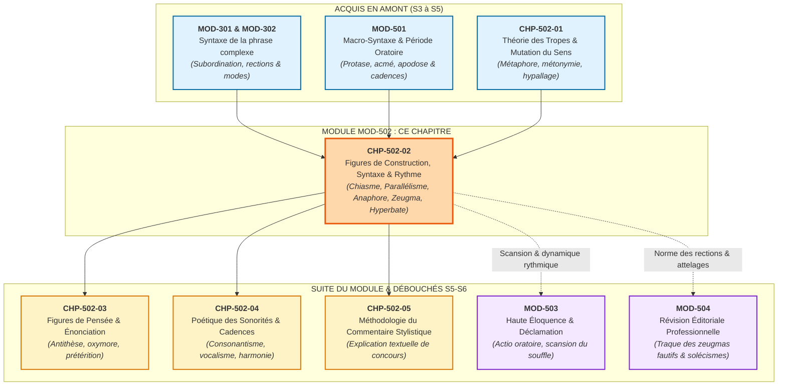
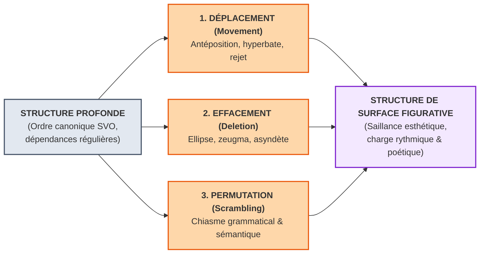
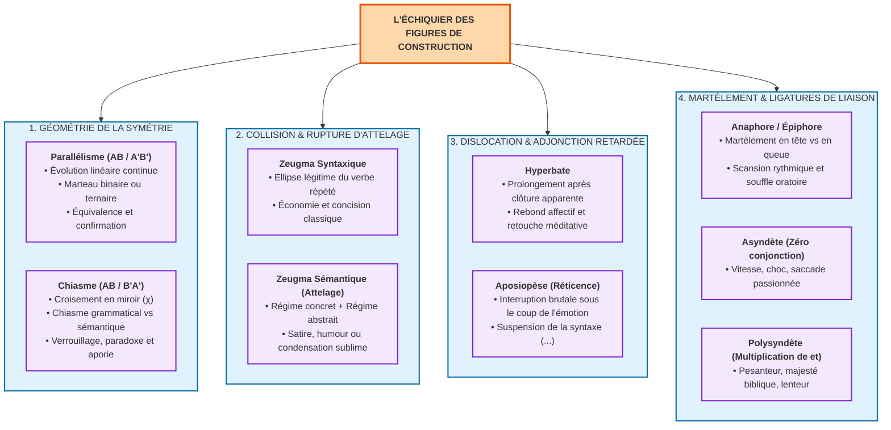

# Chapitre 2 — Figures de Construction, Syntaxe et Rythme de la Prose : Chiasme, Parallélisme, Anaphore, Zeugma et Hyperbate

> **Identifiant du chapitre** : `CHP-502-02`  
> **Module de rattachement** : [`MOD-502` — Traité Complet des Figures de Rhétorique et Cadences de la Prose](file:///f:/Formation/world-class-french/03-curriculum/year-3/semester-5/mod-502-traite-figures-rhetorique-poetique.md)  
> **Semestre** : Année 3 — Semestre 5 (S5)  
> **Volume horaire canonique** : 5 à 6 heures d'apprentissage autonome délibéré et d'ateliers d'application (Phase 1 Étude : 1 h 30 | Phase 2 Pratique : 1 h 30 | Phase 3 Correction : 1 h 00 | Phase 4 Évaluation : 1 h 00)  
> **Statut** : [STATUT : VALIDÉ]  
> **Compétences associées** : [`FR-STYLE-001`](file:///f:/Formation/world-class-french/02-competency-framework/competency-framework.md#fr-style-001-maîtrise-des-figures-de-rhétorique-et-commentaire-stylistique) (L4 Maîtrise approfondie), [`FR-SYNTAX-003`](file:///f:/Formation/world-class-french/02-competency-framework/competency-framework.md#fr-syntax-003-maîtrise-de-la-grande-période-oratoire-et-de-la-macro-syntaxe) (L4 Maîtrise approfondie), [`FR-LEXIC-001`](file:///f:/Formation/world-class-french/02-competency-framework/competency-framework.md#fr-lexic-001-précision-sémantique-nuances-synonymiques-et-collocations) (L4 Maîtrise approfondie), [`FR-INT-001`](file:///f:/Formation/world-class-french/02-competency-framework/competency-framework.md#fr-int-001-rédiger-un-texte-long-cohérent-en-maîtrisant-accords-et-ponctuation) (L4 Maîtrise approfondie)  
> **Sources scientifiques de référence** : `SRC-RHET-01` (Fontanier, 1821/1977), `SRC-RHET-02` (Molinié, 1992), `SRC-RHET-03` (Reboul, 1991), `SRC-RHET-04` (Calas, 2011), `SRC-RHET-05` (Bacry, 1992), `SRC-GRAM-01` (Grevisse & Goosse, 2016), `SRC-GRAM-02` (Riegel, Pellat, Rioul, 2016), `SRC-NORM-03` (Ministère de l'Éducation nationale, 2020), `SRC-TYPO-01` (Imprimerie nationale, 2002/2014)

---

## 1. Titre et Place dans le Cursus

### 1.1 Intitulé Officiel
**Chapitre 2 : Figures de Construction, Syntaxe et Rythme de la Prose : Chiasme, Parallélisme, Anaphore, Zeugma et Hyperbate** (`CHP-502-02`).

### 1.2 Insertion Architecturale dans le Cursus
Au sein du module `MOD-502`, ce deuxième chapitre opère la jonction décisive entre la sémiotique des tropes étudiée au chapitre précédent (`CHP-502-01`) et l'architecture macro-syntaxique de la grande période oratoire acquise en `MOD-501`. Si le trope concerne la mutation de la signification lexicale en profondeur (le sémantisme du mot), la **figure de construction** réorganise l'ordre, la dépendance et la géométrie des constituants de la phrase. Elle façonne le rythme même de la pensée en contraignant la respiration du lecteur et en programmant la distribution de l'attention critique.



- **En amont** :
  - `MOD-301` et `MOD-302` fournissent les fondations syntaxiques indispensables : la connaissance rigoureuse des rections verbales, de l'ordre canonique sujet-verbe-complément (SVO) et de la hiérarchie propositionnelle est requise pour discerner les écarts stylistiques concertés des fautes de grammaire.
  - `MOD-501` transmet l'anatomie tripartite de la période (protase, acmé, apodose) et le calcul du volume syllabique des membres (*cola*). Le présent chapitre étudie les micro-architectures qui s'inscrivent précisément à l'intérieur de ces membrures.
  - `CHP-502-01` a délimité le domaine des tropes (mutation sémantique du mot). L'étudiant sait désormais distinguer une métaphore d'une figure de construction syntaxique.
- **Au sein du module `MOD-502`** :
  - Ce chapitre 2 arme l'étudiant pour aborder les figures de pensée au chapitre 3 (`CHP-502-03`) où la disposition syntaxique soutient les jeux d'énonciation (antithèse, oxymore, prétérition), puis l'analyse phonique au chapitre 4 (`CHP-502-04`) et le commentaire stylistique unifié au chapitre 5 (`CHP-502-05`).
- **En aval** :
  - `MOD-503` (Haute éloquence) utilisera ces figures de construction (anaphore, chiasme, asyndète) comme levier émotionnel direct pour la déclamation oratoire.
  - `MOD-504` (Révision éditoriale) s'appuiera sur la frontière entre le zeugma d'art et le zeugma fautif de rection pour sanctionner les solécismes dans les écrits professionnels.

### 1.3 Justification du Calibrage Horaire (5 à 6 Heures)
Conformément aux normes pédagogiques du cursus, le travail autonome s'articule en quatre phases rigoureusement minutées :
- **Phase 1 — Étude conceptuelle et modélisation géométrique (1 h 30)** : Lecture active et assimilation des rubriques 1 à 13 (géométrie formelle du chiasme et du parallélisme, mécanismes du zeugma et de l'hyperbate, stylistique transformationnelle de Ruwet et clinique des 6 erreurs d'analyse).
- **Phase 2 — Pratique délibérée et dissection formelle (1 h 30)** : Résolution autonome des 3 niveaux d'exercices progressifs (rubrique 14 : qualification et schématisation de 12 figures, dissection micro-syntaxique de 6 zeugmas et hyperbates littéraires, analyse d'une période modèle de 50 mots exacts).
- **Phase 3 — Correction critique et production normée (1 h 00)** : Audit raisonné d'une copie d'éloquence corrompue de 8 contresens d'architecture (rubrique 15) et composition d'un paragraphe d'apparat en 60 mots exacts sous triple contrainte figurative (rubrique 16).
- **Phase 4 — Ancrage mnésique et évaluation sommative (1 h 00)** : Auto-interrogation active sans indices (rubrique 18) et passation de l'épreuve chronométrée de 30 minutes notée sur 20 points (rubrique 19).

---

## 2. Objectifs Mesurables

Au terme de ce chapitre, l'apprenant doit être capable de :

1. **Démonter et schématiser la géométrie formelle du chiasme et du parallélisme** ([`FR-STYLE-001`](file:///f:/Formation/world-class-french/02-competency-framework/competency-framework.md#fr-style-001-maîtrise-des-figures-de-rhétorique-et-commentaire-stylistique), [`FR-SYNTAX-003`](file:///f:/Formation/world-class-french/02-competency-framework/competency-framework.md#fr-syntax-003-maîtrise-de-la-grande-période-oratoire-et-de-la-macro-syntaxe) — Palier L4) : différencier de manière infaillible les architectures linéaires $AB / A'B'$ des structures en miroir croisé $AB / B'A'$ ($\chi$), distinguer les composantes grammaticales (natures, fonctions) des composantes sémantiques (thèmes, isotopies), et expliciter l'effet de verrouillage ou de dynamisme produit sur le rythme de la prose [Réf. `SRC-RHET-02`, p. 112-118 ; `SRC-RHET-05`, chap. 3].
2. **Analyser les collisions isotopiques du zeugma et les ruptures d'attelage** ([`FR-STYLE-001`](file:///f:/Formation/world-class-french/02-competency-framework/competency-framework.md#fr-style-001-maîtrise-des-figures-de-rhétorique-et-commentaire-stylistique) — Palier L4) : distinguer sans confusion le zeugma syntaxique légitime (ellipse d'un terme recteur déjà exprimé) du zeugma sémantique ou attelage (coordination sous un même verbe d'un régime concret/matériel et d'un régime abstrait/moral), et expliciter la portée ironique, satirique ou de condensation sublime du procédé [Réf. `SRC-RHET-02`, p. 384 ; `SRC-GRAM-02`, chap. 20].
3. **Décoder la dynamique expressive de l'hyperbate et des ligatures de liaison** ([`FR-STYLE-001`](file:///f:/Formation/world-class-french/02-competency-framework/competency-framework.md#fr-style-001-maîtrise-des-figures-de-rhétorique-et-commentaire-stylistique), [`FR-SYNTAX-003`](file:///f:/Formation/world-class-french/02-competency-framework/competency-framework.md#fr-syntax-003-maîtrise-de-la-grande-période-oratoire-et-de-la-macro-syntaxe) — Palier L4) : identifier l'hyperbate comme un prolongement concerté après clôture syntaxique et sémantique apparente, évaluer l'impact rythmique de l'asyndète (suppression des conjonctions générant vitesse et véhémence) et de la polysyndète (accumulation solennelle imposant pesanteur et majesté) sur la respiration discursive [Réf. `SRC-RHET-04`, chap. 4 ; `SRC-GRAM-01`, § 385].
4. **Évaluer la scansion oratoire et la portée énonciative de l'anaphore et de la gradation** ([`FR-STYLE-001`](file:///f:/Formation/world-class-french/02-competency-framework/competency-framework.md#fr-style-001-maîtrise-des-figures-de-rhétorique-et-commentaire-stylistique), [`FR-LEXIC-001`](file:///f:/Formation/world-class-french/02-competency-framework/competency-framework.md#fr-lexic-001-précision-sémantique-nuances-synonymiques-et-collocations) — Palier L4) : disséquer le martèlement de l'anaphore, de l'épiphore et de la symploque en relation avec les accents de groupe et les pauses de la phrase, mesurer la progression d'une gradation ascendante (*climax*) ou descendante (*anticlimax*), et éradiquer tout étiquetage scolaire superficiel dans le commentaire critique.

---

## 3. Prérequis et Test de Préparation (Auto-Diagnostic)

### 3.1 Prérequis Cognitifs
- **Maîtrise de la phrase complexe** : identifier instantanément les propositions matrices, coordonnées et subordonnées, ainsi que leurs fonctions syntaxiques respectives (`MOD-301`).
- **Analyse des rections et dépendances verbales** : connaître les constructions transitives directes, indirectes et les régimes prépositionnels des verbes (`MOD-302`).
- **Théorie de la période et cadences** : maîtriser la notion de membre de phrase (*colon*), d'isocolie et de cadence majeure (`MOD-501`).
- **Distinction sémantique fondamentale** : savoir isoler les sèmes constitutifs d'un mot et repérer une rupture d'isotopie sémantique (`CHP-502-01`).

### 3.2 Test de Préparation Immédiat
Répondez aux cinq questions suivantes avant d'aborder le cours, puis dépliez le volet de correction pour vérifier votre niveau de préparation.

1. Quelle est la différence structurelle entre un parallélisme binaire et un chiasme ? Donnez leur formule géométrique respective au moyen des lettres $A, B, A', B'$.
2. Dans la phrase suivante de Victor Hugo, quelle anomalie apparente observe-t-on dans la coordination des compléments d'objet : *« Il prit son chapeau et la porte »* ? Comment nomme-t-on cette figure et quel registre engendre-t-elle ?
3. Pourquoi la phrase de Racine : *« Albe vous a nommé, je ne vous connais plus. — Je vous connais encore, et ce coup me déchire »* comporte-t-elle une hyperbate dans la réplique finale de Curiace ? Où se situe la clôture syntaxique attendue ?
4. Quelle différence fondamentale sépare une anaphore d'une simple répétition lexicale involontaire ?
5. Dans un discours oratoire, quel effet contrasté produit le passage d'une suite de phrases en asyndète à une longue période articulée en polysyndète ?

---

<details>
<summary><b>Consulter le corrigé de l'auto-diagnostic</b></summary>

1. Le parallélisme binaire répète une armature syntaxique identique selon un ordre linéaire parallèle : formule **$A B / A' B'$** (ex. sujet-verbe / sujet-verbe). Le chiasme inverse les termes du second segment pour créer un croisement symétrique en miroir : formule **$A B / B' A'$**, figurant la lettre grecque $\chi$ (khi).
2. Le verbe transitif *prendre* régit simultanément deux compléments d'objet de nature sémantique incompatible : l'un est concret et matériel (*son chapeau*, au sens propre de saisir un objet), l'autre relève d'une expression figée et abstraite (*la porte*, au sens de s'enfuir ou sortir précipitamment). Cette figure est un **zeugma sémantique** (ou attelage), qui produit ici un effet comique et satirique par collision d'isotopies.
3. La clôture syntaxique et sémantique de la proposition principale est parfaitement consommée après *« Je vous connais encore »* (phrase complète autonome répondant terme à terme à la réplique précédente). L'adjonction coordonnée *« et ce coup me déchire »* constitue une **hyperbate** : elle prolonge l'énoncé au-delà de sa clausule naturelle pour exprimer le débordement imprévu de la douleur tragique.
4. Une répétition involontaire est un défaut de style (piétinement, pauvreté lexicale). L'**anaphore** est une figure concertée de construction où le mot ou syntagme est délibérément placé en tête de membres de phrases, de propositions ou de vers successifs pour créer une scansion rythmique, un martèlement oratoire et une cohésion textuelle incantatoire.
5. L'**asyndète** supprime tous les liens de coordination, ce qui accélère le débit, hache la diction et traduit la précipitation, l'urgence, le tumulte ou l'émotion véhémente. La **polysyndète**, à l'inverse, multiplie les conjonctions (*et*, *ni*), ce qui ralentit la diction, alourdit délibérément chaque membre et confère au discours une gravité solennelle, une ampleur biblique ou une majesté rituelle.

</details>

---

## 4. Situation de Départ ou Problème Concret : La Platitude de la Syntaxe Linéaire et les Pièges de l'Architecture Figurative

### 4.1 Le Plafond de la Phrase Correcte mais Inerte
Dans les épreuves de commentaire stylistique de haut niveau (Agrégation, concours d'écoles normales supérieures, concours administratifs de catégorie A), de nombreux candidats rédigent des copies grammaticalement irréprochables mais stylistiquement mortes. Leurs phrases s'enchaînent selon un ordre immuable : *Sujet + Verbe + Complément*, reliés par des chevilles prévisibles (*de plus, par conséquent, en effet*). Cette prose linéaire est incapable de faire ressentir la tension dramatique, le suspens réflexif ou la force démonstrative d'un texte littéraire.

Plus grave encore : confrontés à des textes de grands prosateurs (Bossuet, Saint-Simon, Hugo, Chateaubriand), ces mêmes scripteurs commettent des contresens méthodologiques majeurs :
- Ils qualifient indistinctement de « parallélisme » un chiasme rigoureux, ignorant que le chiasme opère un retournement conceptuel complet là où le parallélisme installe une équivalence rythmée ;
- Ils traitent le zeugma d'attelage d'un auteur classique comme une « incorrection de grammaire » ou une « faute d'accord », sans comprendre qu'il s'agit d'une collision volontaire de deux plans de réalité ;
- Ils prennent l'hyperbate pour une maladresse de rédaction (« l'auteur a oublié de finir sa phrase au bon endroit »), au lieu d'y reconnaître l'artifice raffiné de l'adjonction retardée ;
- Ils se bornent à dresser un catalogue mécanique des anaphores sans jamais analyser comment la répétition initiale modifie les cadences métriques et le volume respiratoire de la phrase.

### 4.2 L'Enjeu Stylistique : De l'Étiquetage à l'Anatomie du Sens
Une figure de construction n'est pas un ornement extérieur posé sur une phrase pour « faire joli ». C'est un **dispositif géométrique et dynamique** qui impose au récepteur une certaine trajectoire de lecture. Décoder ces figures exige d'abandonner l'étiquetage superficiel pour entrer dans la micro-syntaxe :
- Pourquoi l'inversion d'un ordre de mots force-t-elle l'esprit à une relecture rétroactive ?
- Comment la suppression d'une conjonction fait-elle trébucher la respiration du lecteur ?
- Pourquoi le rattachement de deux réalités incompatibles à un seul verbe déclenche-t-il le rire ou le sublime ?

---

## 5. Explication Intuitive : L'Analogie de l'Architecte Baroque et de la Voûte Croisée

Pour comprendre le fonctionnement des figures de construction, envisageons la phrase non pas comme une ligne d'écriture plane, mais comme un **édifice architectural tridimensionnel**.

Dans la construction d'un bâtiment classique :
- **Le vocabulaire** fournit les matériaux bruts : les moellons, les briques, les poutres et le marbre (c'est le domaine du lexique et des tropes : changer de mot, c'est remplacer le bois par du marbre).
- **La syntaxe canonique** (SVO) représente le mur porteur rectiligne : les pierres sont posées les unes sur les autres, horizontalement, de gauche à droite, assurant la stabilité minimale requise pour que le mur ne s'effondre pas.
- **Les figures de construction** correspondent à l'intervention de l'**architecte baroque** qui refuse la monotonie du mur droit et redistribue les masses pour créer des tensions, des équilibres instables et des effets de perspective saisissants.

```
Muret linéaire (Syntaxe ordinaire) :
[Pierre A] ──> [Pierre B] ──> [Pierre C] ──> [Pierre D] (écoulement continu)

Voûte croisée (Chiasme) :
       [Sommet / Clef]
     /                 \
[Pierre A]          [Pierre B']
     \                 /
      [Pierre B] ── [Pierre A']
(L'arc A-B s'appuie contre l'arc inverse B'-A' : fermeture parfaite en miroir)

Porte-à-faux / Balcon suspendu (Hyperbate) :
[Mur principal entièrement clos] ═══> [Console imprévue surplombant le vide]
```

1. **La voûte croisée (Le Chiasme)** : Au lieu d'aligner deux colonnes parallèles, l'architecte fait croiser deux arcs en diagonale ($AB / B'A'$). Les deux poussées s'affrontent et se verrouillent mutuellement au sommet. La structure se clôt sur elle-même ; elle forme un monde clos, hermétique et indépassable.
2. **La colonnade régulière (Le Parallélisme et l'Anaphore)** : L'architecte aligne des piliers identiques à intervalles strictement mesurés. Le regard avance au pas cadencé d'un défilé militaire ; le rythme régulier impose une évidence visuelle indiscutable.
3. **Le chapiteau composite asymétrique (Le Zeugma)** : Une seule colonne porteuse soutient à la fois un arc en pierre rustique brute (le concret) et une frise sculptée en or fin (l'abstrait). L'œil est heurté par cette hétérogénéité sous un même appui : il doit admettre la cohabitation insolite du profane et du sacré.
4. **La corniche en porte-à-faux (L'Hyperbate)** : La façade semble totalement terminée, la toiture posée, les fenêtres closes. Mais soudain, l'architecte ajoute en saillie une console suspendue au-dessus du vide. L'attention, qui s'apprêtait à se reposer, est relancée vers un point d'observation inattendu.
5. **Le mur sans ciment (L'Asyndète) vs la maçonnerie surchargée de tirants (La Polysyndète)** : L'architecte assemble les blocs en pierre sèche, sans mortier : le mur tremble d'une nervosité brute. Ou bien il multiplie les agrafes de fer à chaque jointure : l'édifice acquiert une lourdeur imposante et inébranlable.

---

## 6. Définitions Précises et Terminologie

La description des figures de construction exige un métalangage universitaire rigoureux, exempt d'approximations sémantiques [Réf. `SRC-RHET-01`, `SRC-RHET-02`, `SRC-NORM-03`].

### 6.1 Figure de Construction (ou de Syntaxe)
> **Définition** : Procédé stylistique qui opère un écart concerté par rapport à l'agencement syntaxique canonique, à la distribution prévisible des termes ou à la cohésion propositionnelle habituelle, sans modifier le sens propre des vocables (ce qui la distingue des tropes).  
> Selon Georges Molinié [Réf. `SRC-RHET-02`, p. 112], la figure de construction crée une **saillance stylistique** par manipulation des règles d'ordre, de répétition, d'ellipse ou de rection.

### 6.2 Parallélisme
> **Définition** : Répétition d'une même armature morphosyntaxique sur au moins deux segments discursifs successifs (propositions, membres de période, vers) selon une disposition linéaire :
> $$\text{Formule binaire : } A \; B \; / \; A' \; B' \quad \text{ou ternaire : } A \; B \; / \; A' \; B' \; / \; A'' \; B''$$
> *Exemple d'ancrage* : *« Dieu a créé le monde pour sa gloire ; l'homme a détruit la terre pour son plaisir. »* (Parallélisme binaire exact : Sujet + Passé composé + COD + Circonstant de but).

### 6.3 Chiasme
> **Définition** : Disposition symétrique et croisée d'au moins deux paires d'éléments de même nature ou fonction (chiasme grammatical) ou appartenant à des réseaux lexicaux opposés (chiasme sémantique), selon la géométrie de la lettre grecque $\chi$ (*khi*) :
> $$\text{Formule géométrique : } A \; B \; / \; B' \; A'$$
> *Exemple d'ancrage* : *« Il faut manger pour vivre, et non pas vivre pour manger. »* (Molière, *L'Avare*).  
> $A$ = verbe manger ; $B$ = verbe vivre // $B'$ = verbe vivre ; $A'$ = verbe manger.

### 6.4 Anaphore, Épiphore et Symploque
- **Anaphore rhétorique** : Répétition concertée d'un mot ou d'un syntagme en tête de plusieurs membres de phrases, propositions, phrases ou vers successifs. Elle scande le discours et ancre le thème énonciatif [Réf. `SRC-RHET-05`, p. 188].
- **Épiphore** : Répétition d'un mot ou syntagme en **fin** de segments successifs (clausules identiques).
- **Symploque** : Combinaison de l'anaphore et de l'épiphore (répétition simultanée en tête et en queue de segments parallèles).

### 6.5 Gradation
> **Définition** : Énumération ordonnée de termes ou de propositions selon une intensité croissante (**gradation ascendante** ou *climax*) ou décroissante (**gradation descendante** ou *anticlimax*). L'intensité peut être affective, quantitative, logique ou métrique.

### 6.6 Zeugma (ou Zeugme) et Attelage
> **Définition** : Rattachement de deux ou plusieurs éléments syntaxiques à un seul terme recteur (verbe ou préposition) alors qu'un seul élément y est immédiatement adapté.
> - **Zeugma syntaxique** (ou d'ellipse) : Coordination légitime d'éléments partageant la même fonction mais exigeant des formes verbales distinctes sous-entendues (*« Les Romains vainquirent les Gaulois, et César les Bretons »* — sous-entendu *vainquit*).
> - **Zeugma sémantique (Attelage)** : Coordination sur un même verbe recteur de deux compléments appartenant à des ordres ontologiques ou sémantiques incompatibles, le plus souvent un complément abstrait/moral et un complément concret/matériel [Réf. `SRC-RHET-02`, p. 384 ; `SRC-GRAM-02`, chap. 20].

### 6.7 Hyperbate
> **Définition** : Prolongement imprévu d'une phrase par l'adjonction d'un mot, d'un syntagme ou d'une proposition après que la structure syntaxique et sémantique de l'énoncé semblait entièrement close et achevée [Réf. `SRC-RHET-01`, p. 287].

### 6.8 Asyndète et Polysyndète
- **Asyndète** : Suppression délibérée des conjonctions de coordination ou de liaison entre des mots ou des propositions qui devraient normalement être liés.
- **Polysyndète** : Répétition insistante et systématique des marques de coordination (le plus souvent *et* ou *ni*) devant chacun des membres d'une suite de propositions ou de syntagmes.

### 6.9 Aposiopèse (ou Réticence)
> **Définition** : Interruption brusque de la phrase en plein cours de déroulement, sous le coup d'une émotion violente (colère, pudeur, terreur), laissant le sens en suspens et la syntaxe inachevée (signalée typographiquement par des points de suspension ou un tiret).

---

## 7. Règles ou Mécanismes Fondamentaux

L'analyse des figures de construction repose sur cinq piliers architecturaux majeurs qu'il convient de disséquer sans complaisance.

### 7.1 La Géométrie de la Symétrie : Chiasme vs Parallélisme

La distinction entre parallélisme et chiasme est le premier critère discriminant de la compétence stylistique de niveau L4 [Réf. `SRC-RHET-02`, p. 112-118 ; `SRC-RHET-05`, chap. 3].

```
PARALLÉLISME (Évolution linéaire) :
A [Sujet 1]  ──>  B [Verbe 1]
A' [Sujet 2] ──>  B' [Verbe 2]
Rythme : Marteau binaire régulier, confirmation du sens, équivalence.

CHIASME (Verrouillage en miroir) :
A [Terme 1]  ───────┐     ┌───────>  A' [Terme 1']
                     \   /
                      \ /
                       X
                      / \
                     /   \
B [Terme 2]  ───────┘     └───────>  B' [Terme 2']
Rythme : Inversion de poussée, boucle fermée, retournement dialectique.
```

#### A. Le Parallélisme : L'Isomorphisme Linéaire
Dans le parallélisme, la deuxième proposition reproduit exactement l'architecture syntaxique de la première :
$$\text{Segment 1 : } [A : \text{Sujet}] + [B : \text{Verbe}] + [C : \text{COD}]$$
$$\text{Segment 2 : } [A' : \text{Sujet}] + [B' : \text{Verbe}] + [C' : \text{COD}]$$
*Exemple canonique* : *« Partir pour tout oublier, fuir pour tout recommencer. »*
L'effet produit est celui d'une **équivalence rhétorique** : les deux procès sont placés sur le même plan d'évidence. Le parallélisme structure la comparaison, le balancement oratoire et l'accumulation méthodique.

#### B. Le Chiasme : Le Miroir Croisé
Le chiasme opère une révolution complète. En inversant les termes dans le second membre, il transforme la linéarité du temps discursif en une figure spatiale close :
$$\text{Formule canonique : } A \; B \; / \; B' \; A'$$
Il convient de distinguer impérativement deux modalités du chiasme :
1. **Le Chiasme Grammatical (ou Morphosyntaxique)** : Le croisement porte sur les natures de mots ou sur les fonctions syntaxiques.
   - *Exemple* : *« Des cadavres (Nom, A) hideux (Adjectif, B) et d'illustres (Adjectif, B') tombeaux (Nom, A'). »*
   - Schéma : $\text{Nom} + \text{Adjectif} \; / \; \text{Adjectif} + \text{Nom}$.
2. **Le Chiasme Sémantique (ou Thématique)** : Le croisement porte sur les unités de sens, les oppositions conceptuelles ou les isotopies, indépendamment des classes grammaticales strictes.
   - *Exemple* : *« L'homme (A : humanité) a créé des dieux (B : divinité) ; les dieux (B' : divinité) ont asservi l'homme (A' : humanité). »*
3. **Le Chiasme Complet (Grammatical et Sémantique)** : Le cas d'excellence classique où les mots eux-mêmes ou leurs radicaux s'inversent tout en permutant leurs fonctions grammaticales.
   - *Exemple* : *« La beauté de la vertu et la vertu de la beauté. »*

#### C. L'Effet Épistémique du Chiasme
Le chiasme n'est pas un jeu d'esprit gratuit : il exprime le **piège logique**, l'illusion de réciprocité, l'aporie philosophique ou l'inéluctabilité du destin. En refermant le segment $A'$ sur le point de départ $A$, il suggère qu'on ne peut sortir du cercle tracé. C'est la figure reine du paradoxe moraliste (Pascal, La Rochefoucauld) et de l'ironie tragique (Racine).

---

### 7.2 L'Art du Martèlement et de la Scansion : Anaphore et Gradation

#### A. L'Anaphore : L'Ancrage Oratoire
L'anaphore agit comme un **générateur de cohésion discursive** et un **métronome respiratoire**. Lorsqu'un orateur ou un écrivain reprend le même mot au début de chaque proposition, il impose à son auditoire une triple contrainte :
1. **Contrainte mémorielle** : Le thème de l'énoncé est réinjecté de force dans l'esprit du récepteur à chaque temps fort.
2. **Contrainte rythmique** : L'anaphore crée une pulsation métrique ; elle signale le commencement d'une nouvelle unité de souffle (*colon*).
3. **Contrainte argumentative** : Elle présente chaque argument successif non comme une hypothèse nouvelle, mais comme une ramification naturelle d'un principe unique déjà posé.

#### B. La Gradation : La Tension Dynamique
La gradation insère une flèche vectorielle dans la répétition. Au lieu d'un rythme statique, elle engendre une accélération ou une montée de charge :
- **Le Climax (Gradation ascendante)** : Les termes s'élèvent en dignité sémantique, en violence verbale ou en volume syllabique :
  *« Va, cours, vole, et nous venge ! »* (Corneille, *Le Cid*).  
  Progression verbale : 1 syllabe (*Va*), 1 syllabe (*cours*), 1 syllabe (*vole*), 3 syllabes (*et nous venge*). C'est le triomphe de la cadence majeure qui emporte la décision.
- **L'Anticlimax (Gradation descendante)** : Les termes régressent de l'héroïque au trivial, du sublime au dérisoire :
  *« C'en est fait, je suis mort, je suis enterré. »* (Molière, *L'Avare*).  
  L'anticlimax traduit l'effondrement psychologique, la panique ou le désenchantement satirique.

---

### 7.3 Les Collisions d'Isotopies : Le Zeugma (Attelage)

Le zeugma est sans doute la figure de construction qui requiert la plus haute vigilance didactique [Réf. `SRC-RHET-02`, p. 384 ; `SRC-GRAM-02`, chap. 20].

```
STRUCTURE DU ZEUGMA SÉMANTIQUE (ATTELAGE) :

                  ┌───> [Régime 1 : + CONCRET / + MATÉRIEL]  (Sens propre du verbe)
VERBE RECTEUR ────┤
                  └───> [Régime 2 : + ABSTRAIT / + MORAL]     (Sens figuré du verbe)

Exemple : « Vêtu de probité candide (abstrait) et de lin blanc (concret). » (Hugo)
Collision sémique : Le verbe « vêtir » est contraint d'actualiser simultanément
deux sens sémantiques incompatibles dans l'usage ordinaire.
```

#### A. Le Zeugma Syntaxique (Ellipse d'Économie)
Il consiste à faire régir par un seul verbe plusieurs compléments de même niveau sémantique, en évitant la répétition du prédicat.
*Exemple* : *« L'un portait un fusil, l'autre une épée. »*  
Le verbe *portait* est sous-entendu dans le second membre. C'est une figure de pure concision classique, fréquente chez Voltaire et Montesquieu.

#### B. Le Zeugma Sémantique (Attelage) : La Fracture Ontologique
L'attelage fait violence au principe de sélection sémantique de la langue. En associant deux compléments qui n'appartiennent pas au même univers de référence, il force le verbe à fonctionner selon deux sèmes incompatibles :
- L'un actualise le **sens propre** (souvent matériel, spatial, physique) ;
- L'autre actualise le **sens figuré** (moral, psychologique, métaphorique).

*Exemples littéraires de référence* :
- *« Un livre plein d'esprit et de coquilles. »* (Collision : esprit = abstrait intellectuel / coquilles = concret typographique).
- *« Il posa sa candidature et son chapeau sur la table. »* (Collision d'action : déposer une candidature = acte juridique / poser un chapeau = geste physique).
- *« Vêtu de probité candide et de lin blanc. »* (Hugo, *Booz endormi*) : Ici, l'attelage ne vise pas le rire satirique, mais une **condensation sublime** où la pureté morale de Booz devient aussi visible et tangible que son vêtement de fête.

---

### 7.4 La Dislocation Savante : L'Hyperbate

L'hyperbate est l'art suprême du **rebond expressif** [Réf. `SRC-RHET-01`, p. 287 ; `SRC-RHET-04`, chap. 4].

#### A. Le Mécanisme Micro-Syntaxique
Dans la phrase canonique française, la clôture est atteinte lorsque tous les actants obligatoires du verbe sont saturés et que le contour intonatif descend vers la pause terminale :
$$\text{Proposition principale saturée } [S + V + COD] \longrightarrow \text{Point final attendu.}$$
L'hyperbate déjoue cette attente. Alors que le lecteur a perçu la clausule grammaticale et sémantique, l'auteur ajoute un constituant supplémentaire (un adjectif, un complément circonstanciel, une proposition coordonnée) qui vient déborder la clôture :
$$\text{Proposition close } [S + V + COD] \;\; \dots \text{ (clausule franchie)} \dots \;\; \longrightarrow \text{ [Constituant retardé inattendu]}$$

#### B. La Valeur Poétique et Dramatique
L'hyperbate produit trois effets majeurs dans la prose d'art :
1. **L'effet de retouche méditative** : L'auteur semble revenir sur sa pensée pour en livrer le détail le plus intime ou le plus douloureux.
2. **L'émotion débordante** : Le sentiment du personnage est si violent qu'il refuse de se laisser enfermer dans les limites d'une proposition fermée.
3. **La grâce de la nonchalance** : Chez La Fontaine ou les moralistes, l'hyperbate confère à la phrase l'allure d'une conversation libre et désinvolte, dissimulant le labeur d'une composition minutieuse.

---

### 7.5 Le Dosage des Ligatures de Liaison : Asyndète vs Polysyndète

Le style d'un prosateur se mesure à sa manière de distribuer les conjonctions de coordination [Réf. `SRC-GRAM-01`, § 385 ; `SRC-GRAM-02`, chap. 14].

| Procédé | Définition Formelle | Dynamique du Débit | Effet Stylistique Dominant |
| :--- | :--- | :--- | :--- |
| **Asyndète** | Suppression de toutes les conjonctions de coordination entre propositions ou mots coordonnés : $A, B, C, D$. | **Accélération brutale, débit saccadé, respiration courte.** | Véhémence passionnée, tumulte, précipitation de l'action, choc émotionnel, formule lapidaire. |
| **Polysyndète** | Répétition systématique des conjonctions (notamment *et*) devant chaque élément : *et A, et B, et C, et D*. | **Ralentissement solennel, débit mesuré, respiration ample.** | Majesté rituelle, gravité biblique, accumulation accablante, sentiment d'inépuisable abondance. |

---

## 8. Raisonnement Détaillé : Pourquoi la Syntaxe est le Rythme Même de la Pensée

### 8.1 L'Illusion du Contenu Indépendant de la Forme
Une erreur répandue consiste à imaginer que l'écrivain « conçoit d'abord une idée », puis « l'habille » ensuite d'une syntaxe plus ou moins élégante. Cette scission entre fond et forme est une hérésie linguistique. Comme l'a démontré Émile Benveniste, la pensée n'existe pas en dehors du langage qui la matérialise ; et en prose littéraire, **la syntaxe est la forme temporelle et motrice de la pensée**.

Lorsque nous lisons une phrase, notre cerveau ne stocke pas passivement des mots isolés : il calcule à chaque instant des relations de dépendance, anticipe l'apparition d'un verbe, retient en mémoire un sujet éloigné et attend une résolution clausulaire. Les figures de construction interviennent directement sur ce **système de guidage cognitif** :
1. **Le parallélisme conforte l'anticipation** : En reconnaissant une structure déjà entendue, le cerveau économise de l'énergie de décodage syntaxique pour la reporter intégralement sur la comparaison sémantique des contenus.
2. **Le chiasme bloque l'anticipation linéaire** : À mi-course de la phrase, le récepteur attend un parallélisme ($AB \rightarrow AB$). Lorsque surgit le terme inverse ($B'$), son cerveau est contraint à une régression mnésique immédiate : il doit recalculer le rapport entre le début et la fin, ce qui grave la sentence de manière indélébile dans la mémoire.
3. **L'hyperbate déjoue la relaxation respiratoire** : Dès que la clôture syntaxique apparaît, le lecteur prépare son inspiration pour aborder la phrase suivante. L'hyperbate le surprend en apnée : le constituant inattendu s'imprime alors avec une netteté acoustique et affective décuplée.

### 8.2 La Régulation du Souffle et de l'Adhésion
En rhétorique classique, la persuasion (*peithô*) ne passe pas seulement par les syllogismes de la logique formelle (*logos*) : elle passe par la fascination physique de l'auditeur. En manipulant l'asyndète, l'anaphore et la polysyndète, l'orateur s'empare du rythme cardiaque et de la fréquence respiratoire de son public. Il peut, à son gré, l'asphyxier sous une avalanche de verbes en asyndète, le bercer sous la houle d'une anaphore répétée ou l'écraser sous la marche imposante d'une polysyndète.

---

## 9. Exemples Corrects Commentés

Nous disséquons ici six réalisations d'anthologie empruntées aux sommets de la prose et du théâtre classiques, pour démontrer comment la micro-syntaxe engendre la portée esthétique et philosophique du texte.

### Exemple 1 : Bossuet — Le Chiasme Métaphysique de la Condition Humaine
> *« Les dieux s'en vont avec les rois, et les rois tombent comme les dieux. »*  
> (Bossuet, *Oraison funèbre d'Henriette-Marie de France*, 1669 [Réf. `SRC-RHET-04`, chap. 5]).

- **Micro-syntaxe et géométrie** :
  - Segment 1 : *Les dieux* ($A$ : Nom sujet) + *s'en vont avec les rois* ($B$ : Prédicat / complément du nom roi) ;
  - Segment 2 : *et les rois* ($B'$ : Nom sujet) + *tombent comme les dieux* ($A'$ : Prédicat / complément de comparaison dieu).
  - Formule : $A \; B \; / \; B' \; A'$.
- **Analyse stylistique** : Le chiasme opère un échange de prédication impitoyable. En croisant les rois terrestres et les dieux païens, Bossuet dissout la prétendue pérennité des monarchies dans le néant universel. L'armature symétrique scelle l'équivalence tragique entre la majesté du pouvoir et la vanité de la poussière.

### Exemple 2 : Racine — L'Hyperbate Tragique du Cœur Déchiré
> *« Albe vous a nommé, je ne vous connais plus. — Je vous connais encore, et ce coup me déchire. »*  
> (Racine, *Horace*, acte II, scène 3, vers 502-503).

- **Micro-syntaxe** :
  - Clôture attendue : *« Je vous connais encore »* (Sujet + Pronom COD + Verbe transitif + Adverbe d'insistance). L'hémistiche est clos, le sens est plein, l'antithèse avec la réplique d'Horace (*« je ne vous connais plus »*) est géométriquement achevée.
  - Adjonction retardée (Hyperbate) : *« et ce coup me déchire »*.
- **Analyse stylistique** : Horace réagit en héros de fer romain, absorbé par le devoir civique abstrait. Curiace réagit en homme sensible. L'hyperbate matérialise la fêlure de son humanité : le devoir d'État semblait avoir scellé la réplique, mais la douleur affective déborde la clôture métrique et morale.

### Exemple 3 : Victor Hugo — Le Zeugma Sublime de l'Attelage Moral
> *« Un vieillard qui mourait sans plainte et sans rancune, / Vêtu de probité candide et de lin blanc. »*  
> (Victor Hugo, *La Légende des siècles*, « Booz endormi », 1859).

- **Micro-syntaxe** :
  - Verbe recteur participe : *Vêtu* (régissant deux syntagmes prépositionnels en *de*) ;
  - Régime 1 : *de probité candide* (abstrait / sème [+ moral, - matériel]) ;
  - Régime 2 : *et de lin blanc* (concret / sème [+ textile, + physique]).
- **Analyse stylistique** : Dans la satire voltairienne, l'attelage sert à rabaisser le moral au niveau du matériel (*« il prit du ventre et de l'autorité »*). Hugo accomplit le miracle inverse : il transfigure le lin blanc par la candeur de la probité. Le zeugma fusionne l'habit sacerdotal et la sainteté de l'âme dans une pureté visuelle aveuglante.

### Exemple 4 : Pascal — Le Parallélisme Antithétique du Paradoxe Chrétien
> *« Si l'homme n'est fait pour Dieu, pourquoi n'est-il heureux qu'en Dieu ? S'il est fait pour Dieu, pourquoi est-il si contraire à Dieu ? »*  
> (Pascal, *Pensées*, éd. Sellier, fragment 131).

- **Micro-syntaxe** :
  - Période 1 : [Protase conditionnelle négative : *Si l'homme n'est fait pour Dieu*] + [Apodose interrogative : *pourquoi n'est-il heureux qu'en Dieu ?*]
  - Période 2 : [Protase conditionnelle affirmative : *S'il est fait pour Dieu*] + [Apodose interrogative : *pourquoi est-il si contraire à Dieu ?*]
  - Formule : $A \; B \; / \; A' \; B'$ rigoureusement parallèle avec inversion antithétique des prédicats.
- **Analyse stylistique** : Le parallélisme binaire isole la double contradiction de la créature déchue. L'identité absolue de la syntaxe des deux interrogations empêche la raison humaine d'esquiver le problème : la vérité chrétienne s'impose par la symétrie sans faille de l'alternative.

### Exemple 5 : Chateaubriand — La Polysyndète Lyrique des Grands Espaces
> *« Et la mer s'élargissait, et les bois fuyaient, et les collines descendaient dans la plaine, et le ciel s'abaissait sur les flots sans rivage. »*  
> (Chateaubriand, *Mémoires d'outre-tombe*, 1848).

- **Micro-syntaxe** :
  - Répétition de la conjonction de coordination *et* devant quatre propositions indépendantes complètes juxtaposées.
- **Analyse stylistique** : La polysyndète supprime la hiérarchie logique au profit de la translation contemplative. Chaque *et* relance le regard vers un horizon plus lointain, mimant l'étirement infini de l'espace maritime et l'engloutissement mélancolique du voyageur romantique.

### Exemple 6 : Saint-Simon — L'Asyndète Incisive du Portrait Satyrique
> *« Il parlait peu, écoutait beaucoup, observait tout, ne pardonnait rien. »*  
> (Saint-Simon, *Mémoires*, portrait de Monseigneur le duc de Bourgogne).

- **Micro-syntaxe** :
  - Succession de quatre prédicats verbaux juxtaposés sans aucune cheville conjonctive ($A, B, C, D$).
- **Analyse stylistique** : L'asyndète supprime tout temps mort. Le regard acéré du mémorialiste découpe le personnage à la manière d'un scalpel. Le rythme ternaire ascendant (*parlait peu, écoutait beaucoup, observait tout*) vient buter sur la clausule implacable du quatrième membre négatif (*ne pardonnait rien*), qui foudroie la courtoisie des apparences.

---

## 10. Contre-Exemples et Erreurs Fréquentes

Nous analysons ici six erreurs récurrentes de méthode et d'analyse stylistique relevées dans les copies universitaires, avec leur réfutation scientifique immédiate.

### Erreur n° 1 : Confusion formelle entre chiasme et parallélisme par absence de schéma géométrique
- **Manifestation pathologique** : L'étudiant qualifie de « chiasme » la phrase de Rousseau : *« L'homme est né libre, et partout il est dans les fers »*, ou qualifie de « parallélisme » la maxime de Boileau : *« Ce qui se conçoit bien s'énonce clairement, / Et les mots pour le dire arrivent aisément. »*
- **Réfutation scientifique** : Il ne peut y avoir de chiasme sans **inversion en miroir** des constituants ($AB / B'A'$). Si les deux propositions conservent le même ordre syntaxique linéaire ($AB / A'B'$), il s'agit impérativement d'un parallélisme. Pour prouver la présence d'un chiasme, l'étudiant doit impérativement poser sur sa feuille de brouillon la formule des termes croisés avant de rédiger.

### Erreur n° 2 : Réduction du zeugma littéraire à une simple faute de rection grammaticale
- **Manifestation pathologique** : Dans une copie de commentaire sur Voltaire ou Hugo, l'étudiant écrit : *« L'auteur commet une faute de français en coordonnant un mot abstrait et un mot concret sur le verbe vêtir. »*
- **Réfutation scientifique** : Si une telle rupture était involontaire sous la plume d'un écolier, elle constituerait en effet une maladresse d'expression. Mais chez un grand écrivain, la dislocation concertée de la sélection sémique est un **acte d'art** délibéré qui enrichit la langue par télescopage d'isotopies. Le critique universitaire ne juge pas la grammaire d'un classique à l'aune de celle d'un manuel d'école primaire : il en dégage la portée esthétique, satirique ou métaphysique.

### Erreur n° 3 : Étiquetage scolaire de l'anaphore sans analyse de scansion métrique ni portée énonciative
- **Manifestation pathologique** : *« L'auteur fait une anaphore avec le mot "Rome" parce qu'il le répète au début des vers, ce qui montre son obsession. »*
- **Réfutation scientifique** : C'est le degré zéro de la critique littéraire. Relever une anaphore n'a aucune valeur si l'on ne démontre pas comment la répétition du mot réordonne le volume des propositions successives, modifie les cadences (mineure, majeure, isocolie), installe un crescendo oratoire et positionne l'éthos du locuteur face à ses destinataires.

### Erreur n° 4 : Confusion entre hyperbate concertée et phrase inachevée ou maladroitement rallongée
- **Manifestation pathologique** : L'étudiant affirme qu'une phrase comportant une hyperbate est « mal ponctuée » ou constitue une « rallonge inutile qui alourdit le texte ».
- **Réfutation scientifique** : L'hyperbate est une figure de rhétorique reconnue depuis l'Antiquité grecque (*hyperbaton* : franchissement, transposition). Elle ne relève pas de la maladresse syntaxique, mais d'une stratégie de **rupture de clausule** : l'auteur offre à son lecteur une résolution apparente, puis relance l'énoncé par un supplément d'information qui modifie rétrospectivement le sens de l'ensemble.

### Erreur n° 5 : Prise de l'asyndète oratoire pour une négligence de ponctuation ou un style télégraphique
- **Manifestation pathologique** : Traiter l'absence de conjonction de coordination de Saint-Simon ou Montesquieu de « style haché, négligé ou télégraphique ».
- **Réfutation scientifique** : L'asyndète classique est l'héritière directe de l'*oratio soluta* de Salluste et de Tacite. Elle demande une virtuosité syntaxique supérieure, car les propositions, privées de liens conjonctifs explicites, doivent tirer leur cohérence logique de la seule justesse de leur disposition séquentielle et de la force des temps verbaux.

### Erreur n° 6 : Oubli de la distinction fondamentale entre chiasme sémantique et chiasme grammatical
- **Manifestation pathologique** : Refuser l'étiquette de chiasme à une phrase sous prétexte que les classes grammaticales ne sont pas exactement inversées, alors que le croisement des thèmes sémantiques est parfait.
- **Réfutation scientifique** : La stylistique moderne (Molinié, Bacry) distingue rigoureusement le chiasme grammatical (portant sur les fonctions et natures : Nom + Adj / Adj + Nom) du chiasme sémantique (portant sur les réseaux de sens : lumière / nuit // obscurité / clarté). Méconnaître cette dualité conduit à ignorer plus de la moitié des chiasmes de la littérature d'idées.

---

## 11. Cas Particuliers et Limites

### 11.1 Le Faux Chiasme Accidentel de la Langue Courante
Dans la conversation ordinaire ou la prose journalistique relâchée, il arrive que des mots s'inversent fortuitement sans aucune intention signifiante ni architecture calculée :
*« Il est venu hier en voiture, et son frère en train est arrivé aujourd'hui. »*  
Ici, l'inversion des adverbes et des verbes n'est qu'un hasard de combinatoire sans portée poétique. Pour mériter le titre de figure de construction, le chiasme doit être **marqué stylistiquement** (saillance selon Molinié) et investi d'une signification interprétable.

### 11.2 Le Zeugma Fautif dans les Copies Administratives vs le Zeugma d'Art
Il existe une frontière étanche entre le zeugma d'art littéraire et le **solécisme de rection verbale** commis par négligence dans les rédactions professionnelles :
- *Cas fautif (Solécisme de rection)* : *« Le directeur a assisté et approuvé la décision du comité. »*  
  Le verbe *assister* exige la préposition *à* (*assister à une décision*), tandis qu'*approuver* est transitif direct (*approuver une décision*). Coordonner ces deux verbes sur un unique COD (*la décision*) est une faute de grammaire caractérisée [Réf. `SRC-GRAM-01`, § 390].
- *Cas d'art (Zeugma sémantique)* : *« Il a écouté nos conseils et la pluie qui tombait. »*  
  Ici, la rection grammaticale est impeccable (les deux syntagmes sont d'authentiques COD du verbe *écouter*), mais c'est l'ordre de réalité qui se fracture (écouter un conseil = entendre avec attention et déférence / écouter la pluie = percevoir un son naturel).

### 11.3 L'Hypallage de Construction : À la Frontière du Trope et de la Syntaxe
L'hypallage illustre le croisement singulier entre la syntaxe et la sémantique :
*« Ils cheminaient sombres dans la nuit solitaire. »* (Virgile).  
Syntaxiquement, l'adjectif *solitaire* est épithète liée du nom *nuit* ; sémantiquement, la solitude n'appartient pas à la nuit (qui est un phénomène astronomique), mais aux deux voyageurs (*ils*). L'hypallage transfère l'accord grammatical sur un substantif voisin, créant une contamination poétique de l'atmosphère sur les personnages.

---

## 12. Approfondissement Adapté au Niveau : La Stylistique Transformationnelle de Nicolas Ruwet

Pour dépasser la rhétorique purement descriptive, la stylistique universitaire de niveau L4 s'adosse aux travaux de **Nicolas Ruwet** (*Langage, musique, poésie*, Le Seuil, 1972) et à la grammaire générative chomskyenne.

### 12.1 Structure Profonde vs Structure de Surface
Selon Ruwet, toute phrase littéraire complexe est le résultat d'une série de **transformations stylistiques** appliquées à une structure profonde (*deep structure*) élémentaire régie par l'ordre canonique :
$$\text{Structure Profonde (SVO canonique)} \xrightarrow{\quad \text{Transformations Stylistiques} \quad} \text{Structure de Surface Figurative}$$

Les figures de construction se ramènent alors à trois opérations syntaxiques fondamentales :



1. **La Transformation par Déplacement (*Movement*)** : L'hyperbate déplace un constituant hors du noyau prédicatif fermé pour le rejeter après la clausule. La topicalisation déplace le complément en tête de phrase pour le hisser au rang de thème oratoire.
2. **La Transformation par Effacement (*Deletion*)** : Le zeugma efface la répétition du verbe recteur dans le second membre ; l'asyndète efface le morphème de coordination grammaticale. Cet effacement contraint le lecteur à reconstruire mentalement le nœud syntaxique manquant.
3. **La Transformation par Permutation (*Scrambling*)** : Le chiasme permute l'ordre fonctionnel $AB$ en $B'A'$. Cette permutation crée une distorsion entre l'ordre chronologique des événements et l'ordre spatial de la représentation textuelle.

---

## 13. Comparaisons Différentielles

Les quatre tableaux synoptiques suivants permettent de fixer définitivement la frontière conceptuelle entre les notions voisines.

### Tableau 1 : Chiasme vs Parallélisme

| Critère d'Arbitrage | Parallélisme ($AB / A'B'$) | Chiasme ($AB / B'A'$) |
| :--- | :--- | :--- |
| **Géométrie formelle** | Lignes parallèles, évolution linéaire continue. | Croisement en diagonale, symétrie en miroir ($\chi$). |
| **Mouvement de lecture** | Projection vers l'avant, cumul d'affirmations. | Retour rétroactif vers le centre, boucle fermée. |
| **Effet rythmique** | Marteau binaire régulier, confirmation symétrique. | Verrouillage, choc de retournement, arrêt sur image. |
| **Portée philosophique** | Équivalence, comparaison, ordre méthodique. | Paradoxe, fatalité, piège dialectique, aporie. |
| **Exemple type** | *« Dieu châtie l'orgueilleux ; Dieu console le juste. »* | *« Les puissants humilient le faible, et le faible brise les puissants. »* |

---

### Tableau 2 : Zeugma Syntaxique vs Attelage Sémantique

| Critère d'Arbitrage | Zeugma Syntaxique (d'Ellipse) | Zeugma Sémantique (Attelage) |
| :--- | :--- | :--- |
| **Nature de la liaison** | Ellipse d'un verbe ou d'un terme régissant identique. | Double régime rattaché à un terme fonctionnant sous deux sèmes distincts. |
| **Compatibilité sémantique** | **Parfaite** : les compléments appartiennent au même univers de référence. | **Incompatible** : fracture entre abstrait et concret, matériel et moral. |
| **Visée stylistique** | Concision, élégance, économie de moyens classiques. | Ironie, humour satirique, surprise poétique ou synthèse sublime. |
| **Risque d'erreur** | Répétition évitée avec grâce. | Si involontaire : solécisme d'attelage et maladresse de rédaction. |
| **Exemple type** | *« L'un lisait Tacite, et l'autre Cicéron. »* | *« Il reprit ses esprits et son pardessus. »* |

---

### Tableau 3 : Asyndète vs Polysyndète

| Critère d'Arbitrage | Asyndète ($A, B, C, D$) | Polysyndète (*et A, et B, et C, et D*) |
| :--- | :--- | :--- |
| **Matérialité textuelle** | **Zéro conjonction** de coordination. | **Multiplication insistante** des conjonctions (*et, ni*). |
| **Vitesse respiratoire** | Accélération, saccade, souffle coupé. | Ralentissement majestueux, respiration ample et pesante. |
| **Registres privilégiés** | Tragique, épique véhémente, satire acérée, panique. | Sacré, biblique, élégiaque, solennité funèbre. |
| **Dynamique psychologique** | Spontanéité brute, action immédiate, fièvre. | Cérémonial réfléchi, accumulation accablante, contemplation. |
| **Exemple type** | *« Je suis venu, j'ai vu, j'ai vaincu. »* (César). | *« Et les fleuves tarirent, et les montagnes croulèrent, et la terre trembla. »* |

---

### Tableau 4 : Anaphore vs Épiphore

| Critère d'Arbitrage | Anaphore Rhétorique | Épiphore |
| :--- | :--- | :--- |
| **Localisation du terme** | **En tête** de proposition, de phrase ou de vers. | **En queue** de proposition, de phrase ou de vers (clausule). |
| **Dynamisme de la voix** | Élan initial, amorce répétée, impulsion du souffle. | Butée terminale, écho conclusif, résonance persistante. |
| **Rôle argumentatif** | Fixe le thème sur lequel vont se greffer les prédicats. | Scelle le verdict sous lequel tombent tous les arguments. |
| **Exemple type** | *« Toujours aimer, toujours souffrir, toujours mourir. »* (Corneille). | *« Ils voulaient la paix ; nous réclamions la paix ; le monde entier espérait la paix. »* |

---

## 14. Exercices Progressifs (3 Niveaux)

### Niveau 1 : Reconnaissance et Schématisation Géométrique (Guidé)
Identifiez la figure de construction majeure à l'œuvre dans chacun des 12 fragments suivants. Pour les parallélismes et chiasmes, donnez impérativement la formule géométrique ($AB / A'B'$ ou $AB / B'A'$).

1. *« Travailler sans gloire et périr sans mémoire. »*
2. *« Il faut vivre comme on pense, sans quoi l'on finit par penser comme on a vécu. »* (Paul Bourget).
3. *« Je sais tout, j'admets tout, je pardonne tout. »*
4. *« Ils ont des yeux et ils ne voient point, ils ont des oreilles et ils n'entendent point. »* (Psaumes).
5. *« Le nez de Cléopâtre, s'il eût été plus court, toute la face de la terre aurait changé. »* (Pascal).
6. *« Il a fermé sa porte et son cœur aux misères du monde. »*
7. *« Rome enfin que je hais parce qu'elle t'honore ! / Rome, l'unique objet de mon ressentiment ! »* (Corneille).
8. *« Sous les dehors de la justice régnait la violence, et sous le masque de l'ordre l'anarchie. »*
9. *« Des armes, des chevaux, des vivres, rien ne manquait à l'armée. »*
10. *« Et la nuit approchait, et les ombres montaient, et le silence envahissait la forêt. »*
11. *« Albe vous a nommé, je ne vous connais plus. — Je vous connais encore, et ce coup me déchire. »* (Racine).
12. *« Ce n'est pas la force qui crée le droit, c'est le droit qui limite la force. »*

---

### Niveau 2 : Dissection Micro-Syntaxique de Zeugmas et Hyperbates Littéraires (Semi-autonome)
Pour chacun des 6 extraits suivants :
a) Isolez la figure précise (zeugma sémantique ou hyperbate) ;
b) Identifiez le terme recteur et les constituants disloqués ;
c) Rédigez en trois phrases l'analyse micro-syntaxique et la portée esthétique du procédé.

1. *« Madame de Cambremer n'était pas dépourvue de prétentions intellectuelles ni de canines. »* (Proust).
2. *« Il marchait dans la nuit froide, le chapeau enfoncé sur les yeux, et son désespoir au fond du cœur. »*
3. *« Les soldats avançaient sous la mitraille, sans peur de la mort, et pleins d'un fol espoir. »*
4. *« Elle avait de grands yeux noirs et de la fortune. »* (Balzac).
5. *« Je l'aimais inconstant, qu'eussé-je fait fidèle ? »* (Racine, *Andromaque*).
6. *« Il a rendu son dernier soupir et son mandat de député. »*

---

### Niveau 3 : Analyse Syntaxique Complète d'une Période Figurative (Autonome)
Soit la période d'apparat suivante, totalisant **exactement 50 mots certifiés** :

> *« Quand la passion égare le jugement et trouble les cœurs, l'orateur déploie la rigueur de son art pour vaincre l'illusion, éclairer les esprits, flétrir le mensonge et couronner la vertu, opposant la force du verbe au verbe de la force, avec une majesté souveraine et sans jamais faiblir. »*

#### Décompte Officiel Certifié Mot à Mot (selon SRC-TYPO-01) :
```
┌────┬──────────────┬────┬──────────────┬────┬──────────────┐
│  1 │ Quand        │ 18 │ art          │ 35 │ force        │
│  2 │ la           │ 19 │ pour         │ 36 │ du           │
│  3 │ passion      │ 20 │ vaincre      │ 37 │ verbe        │
│  4 │ égare        │ 21 │ l'           │ 38 │ au           │
│  5 │ le           │ 22 │ illusion,    │ 39 │ verbe        │
│  6 │ jugement     │ 23 │ éclairer     │ 40 │ de           │
│  7 │ et           │ 24 │ les          │ 41 │ la           │
│  8 │ trouble      │ 25 │ esprits,     │ 42 │ force,       │
│  9 │ les          │ 26 │ flétrir      │ 43 │ avec         │
│ 10 │ cœurs,       │ 27 │ le           │ 44 │ une          │
│ 11 │ l'           │ 28 │ mensonge     │ 45 │ majesté      │
│ 12 │ orateur      │ 29 │ et           │ 46 │ souveraine   │
│ 13 │ déploie      │ 30 │ couronner    │ 47 │ et           │
│ 14 │ la           │ 31 │ la           │ 48 │ sans         │
│ 15 │ rigueur      │ 32 │ vertu,       │ 49 │ jamais       │
│ 16 │ de           │ 33 │ opposant     │ 50 │ faiblir.     │
│ 17 │ son          │ 34 │ la           │    │              │
└────┴──────────────┴────┴──────────────┴────┴──────────────┘
TOTAL DU TEXTE : EXACTEMENT 50 MOTS CERTIFIÉS (0 ERREUR D'ÉCART).
```

#### Travail Demandé :
Rédigez un commentaire stylistique universitaire complet démontrant comment ce texte articule :
1. Une gradation ascendante tétramembre en apodose ;
2. Un chiasme grammatical et sémantique parfait ;
3. Une hyperbate conclusive retardant la clausule.

---

### Corrigé Exhaustif et Justifié des Exercices

<details>
<summary><b>Consulter le corrigé du Niveau 1</b></summary>

1. **Parallélisme binaire exact ($AB / A'B'$)** : *travailler* (A) *sans gloire* (B) / *périr* (A') *sans mémoire* (B'). Même schéma infinitif + syntagme prépositionnel d'exclusion.
2. **Chiasme complet grammatical et sémantique ($AB / B'A'$)** : *vivre* (A) *comme on pense* (B) // *penser* (B') *comme on a vécu* (A'). Le chiasme boucle le piège moral du compromis existentiel.
3. **Anaphore oratoire trimembre et gradation ascendante** : reprise de *« je »* en tête de chaque proposition avec gradation morale du savoir à l'admission, puis au pardon souverain.
4. **Parallélisme binaire antithétique ($AB / A'B'$)** : *ont des yeux* (A) + *ne voient point* (B) // *ont des oreilles* (A') + *n'entendent point* (B').
5. **Anacoluthe et hyperbate de topicalisation** : antéposition du thème sans verbe recteur direct, créant une saillance suspensive sur le nez de Cléopâtre.
6. **Zeugma sémantique (attelage)** : le verbe *fermer* régit *sa porte* (concret/physique) et *son cœur* (abstrait/affectif).
7. **Anaphore oratoire majestueuse** : reprise du vocatif *« Rome »* au début de deux alexandrins consécutifs chez Camille.
8. **Parallélisme binaire avec chiasme des substantifs** : $AB / A'B'$ au plan syntaxique (*Sous X régnait Y* / *sous X' Y'* avec ellipse du verbe).
9. **Asyndète énumérative** : juxtaposition brute de trois syntagmes nominaux sans conjonction, exprimant l'abondance matérielle.
10. **Polysyndète ternaire** : répétition de la conjonction *et* devant trois propositions coordonnées, créant un rythme lent et solennel.
11. **Hyperbate tragique** : l'ajout *« et ce coup me déchire »* prolonge la réplique au-delà de la clausule attendue après *« Je vous connais encore »*.
12. **Chiasme parfait de sentence ($AB / B'A'$)** : *la force* (A) *crée le droit* (B) // *le droit* (B') *limite la force* (A').

</details>

<details>
<summary><b>Consulter le corrigé du Niveau 2</b></summary>

1. **Proust — Zeugma sémantique (attelage)** :
   - *Terme recteur* : la locution verbale négative *n'était pas dépourvue de*.
   - *Constituants coordonnés* : *prétentions intellectuelles* (abstrait / sème [+ esprit, + vanité]) et *canines* (concret / sème [+ anatomie, + agressivité animale]).
   - *Analyse* : Proust associe sous une même négation litotique la prétention sociale et la laideur physique de la marquise de Cambremer. L'attelage fait surgir la voracité prédatrice de la mondaine derrière son vernis de culture, dans une condensation satirique fulgurante.
2. **Fragment 2 — Hyperbate et attelage d'accompagnement** :
   - *Terme recteur* : *marchait dans la nuit froide*.
   - *Constituants disloqués* : l'adjonction finale *« et son désespoir au fond du cœur »* constitue une hyperbate qui relance la phrase après la description physique achevée (*le chapeau enfoncé sur les yeux*).
   - *Analyse* : Le scripteur déplace la focalisation du vêtement extérieur vers la douleur intime. L'hyperbate donne l'impression d'un aveu tardif qui alourdit soudainement la marche du personnage.
3. **Fragment 3 — Hyperbate conclusive** :
   - *Structure* : La clôture est consommée après *« sans peur de la mort »*. L'adjonction coordonnée *« et pleins d'un fol espoir »* arrive en surcroît.
   - *Analyse* : L'hyperbate oppose la négation de l'angoisse (*sans peur*) à la plénitude de l'illusion (*pleins d'un fol espoir*). Elle transforme une simple avancée militaire en épopée sacrificielle.
4. **Balzac — Zeugma sémantique** :
   - *Terme recteur* : *avait*.
   - *Régimes coordonnés* : *de grands yeux noirs* (concret/séduction) et *de la fortune* (abstrait/statut financier).
   - *Analyse* : Balzac fusionne le charme physique et l'intérêt pécuniaire, révélant sans fard le cynisme matrimonial de la société bourgeoise du XIXe siècle.
5. **Racine — Hyperbate d'interrogation elliptique** :
   - *Structure* : *« Je l'aimais inconstant »* est une proposition complète. Le syntagme rejeté *« qu'eussé-je fait fidèle ? »* déferle après la césure.
   - *Analyse* : Hermione confesse l'absurdité de sa passion pour Pyrrhus. L'hyperbate interrogative prolonge le remords en un cri d'impuissance tragique.
6. **Fragment 6 — Zeugma sémantique funèbre et politique** :
   - *Terme recteur* : *a rendu*.
   - *Régimes* : *son dernier soupir* (physiologique/décès) et *son mandat de député* (juridique/fonction).
   - *Analyse* : Ironie mordante qui assimile la mort physique à une banale démission administrative, réduisant toute une vie d'ambition à la perte d'un siège parlementaire.

</details>

<details>
<summary><b>Consulter le corrigé du Niveau 3</b></summary>

L'analyse de cette période modèle en 50 mots fait apparaître une architecture figurative tripartite d'une rigueur absolue :

1. **La gradation ascendante tétramembre en apodose (mots 19 à 32)** :
   Le verbe recteur *déploie* lance une cascade de quatre propositions infinitives de but coordonnées :
   - *pour vaincre l'illusion* (6 syllabes) ;
   - *éclairer les esprits* (5 syllabes) ;
   - *flétrir le mensonge* (5 syllabes) ;
   - *et couronner la vertu* (6 syllabes).
   La gradation n'est pas seulement métrique : elle est hautement conceptuelle. Elle s'élève du négatif combattu (l'illusion, le mensonge) vers le positif triomphant (les esprits éclairés, la vertu couronnée). Ce tétramètre dynamique installe le triomphe de la raison oratoire.

2. **Le chiasme géométrique parfait (mots 33 à 42)** :
   Le participe présent détaché *opposant* introduit une symétrie en miroir irréprochable :
   $$\text{Segment 1 : } [\text{la force} : A] + [\text{du verbe} : B] \quad // \quad \text{Segment 2 : } [\text{au verbe} : B'] + [\text{de la force} : A']$$
   Ce chiasme complet (syntaxique et lexical) oppose la légitimité spirituelle de l'éloquence (*la force du verbe*) à la brutalité tyrannique (*le verbe de la force*). L'inversion des génitifs verrouille le dilemme moral : l'auditeur est contraint de reconnaître que le verbe philosophique est le seul rempart contre la tyrannie physique.

3. **L'hyperbate conclusive (mots 43 à 50)** :
   La phrase semblait trouver sa résolution harmonique et son point final sur la clausule *« de la force »*. L'orateur relance pourtant son énoncé par un syntagme prépositionnel double en appendice : *« avec une majesté souveraine et sans jamais faiblir »*. Cette hyperbate refuse l'arrêt brutal ; elle prolonge la résonance du discours dans l'oreille du récepteur, laissant flotter l'autorité inébranlable du magistère oratoire.

</details>

---

## 15. Activité de Correction Raisonnée

### 15.1 Corpus à Corriger : L'Éloquence Défigurée
Le texte suivant, extrait d'un projet de discours d'apparat académique rédigé par un orateur débutant, contient **huit contresens stylistiques et confusions d'architecture figurative majeures**. 

> **Texte fautif à auditer :**  
> *« (1) Devant le tribunal de l'histoire, les tyrans qui ont opprimé les peuples et qui ont confisqué les libertés pour satisfaire leur ambition démesurée. (2) Ils ont semé la ruine et de la tristesse dans tous les foyers. (3) Le juge intègre a condamné les crimes et la robe de pourpre des usurpateurs. (4) Il faut punir les méchants pour sauver les innocents, et frapper les coupables pour délivrer les justes : quel admirable chiasme ! (5) Les magistrats ont parlé et approuvé la sentence de mort. (6) L'orateur s'écria : liberté, liberté, liberté, pour faire une anaphore métrique qui impressionne le public. (7) La république triomphera de ses ennemis, et par la force des armes, et par la justice des lois, et par le courage des citoyens, ce qui hache le discours d'une asyndète regrettable. (8) Le châtiment des traîtres est désormais inéluctable ; et pour la mémoire sacrée de nos pères, ce qui est manifestement une phrase mal finie et boiteuse. »*

---

### 15.2 Apparat Critique et Révision Savante

| Segment Fautif | Diagnostic de l'Erreur | Réfutation Stylistique & Règle d'Art | Réécriture Conforme de Niveau L4 |
| :--- | :--- | :--- | :--- |
| **(1) Devant le tribunal... démesurée.** | **Phrase tronquée (absence de prédicat matrice)**. | L'auteur empile des subordonnées relatives sans jamais fournir la proposition principale. C'est une anacoluthe d'inattention et non une figure concertée. | *« Devant le tribunal de l'histoire, les tyrans qui ont opprimé les peuples comparaîtront enfin pour expier leurs forfaits. »* |
| **(2) Ils ont semé la ruine et de la tristesse...** | **Coordination asymétrique fautive d'articles**. | Rupture de parallélisme grammatical : *la ruine* (article défini) est coordonnée à *de la tristesse* (article partitif). L'oreille trébuche sur cette hétérogénéité d'usage. | *« Ils ont semé la ruine dans les cités et le deuil dans les cœurs. »* (Parallélisme binaire pur). |
| **(3) ...a condamné les crimes et la robe de pourpre...** | **Zeugma involontaire grotesque**. | *Condamner un crime* est un acte judiciaire abstrait ; *condamner une robe* n'a aucun sens légal direct. L'attelage est ici une maladresse involontaire et non un trait d'art. | *« Le juge intègre a flétri les crimes des tyrans et dépouillé leur usurpation de sa robe de pourpre. »* |
| **(4) ...quel admirable chiasme !** | **Contresens d'étiquetage formel**. | La formule *punir les méchants / sauver les innocents // frapper les coupables / délivrer les justes* est un **parallélisme binaire strict** ($AB / A'B'$) et non un chiasme ($AB / B'A'$). | *« ...quel admirable parallélisme antithétique ! »* (Ou convertir en chiasme : *« punir les coupables pour sauver les justes, et pour relever les opprimés abattre les tyrans. »*) |
| **(5) ...ont parlé et approuvé la sentence...** | **Solécisme de rection verbale**. | Le verbe *parler* est intransitif ou se construit avec *de* (*parler de la sentence*) ; il ne peut partager le COD *la sentence* avec le verbe transitif direct *approuver*. | *« Les magistrats ont délibéré avec rigueur avant d'approuver solennellement la sentence de mort. »* |
| **(6) ...liberté, liberté, liberté, pour faire une anaphore...** | **Confusion épithéton/épizeuxe et anaphore**. | La répétition brute et immédiate d'un même mot au sein d'une même proposition est une **épanalepse** ou une **épizeuxe**, et non une anaphore (qui exige d'ouvrir des segments distincts). | *« Liberté pour le citoyen, liberté pour la pensée, liberté pour la patrie ! »* (Véritable anaphore oratoire trimembre). |
| **(7) ...ce qui hache le discours d'une asyndète regrettable.** | **Contresens absolu entre asyndète et polysyndète**. | La répétition systématique de *et* devant trois syntagmes est une **polysyndète** majestueuse, et non une asyndète (qui supprimerait tout lien). | *« ...déployant une noble polysyndète qui confère à la résolution républicaine une gravité solennelle. »* |
| **(8) ...ce qui est manifestement une phrase mal finie et boiteuse.** | **Méconnaissance de l'hyperbate oratoire**. | Le segment coordonné après le point-virgule est une authentique **hyperbate**, qui prolonge l'affirmation pour y loger une caution mémorielle émouvante. | *« ...déployant une hyperbate méditative qui place le châtiment sous le patronage sacré des ancêtres. »* |

---

## 16. Mise en Pratique dans une Production Réelle

### 16.1 Consigne de Composition
Rédigez un paragraphe d'apparat solennel de niveau académique (logeable dans un plaidoyer judiciaire ou un discours d'investiture) totalisant **exactement 60 mots certifiés** selon les normes officielles de l'Imprimerie nationale (`SRC-TYPO-01`).

Ce texte doit impérativement articuler de manière organique et indiscutable :
1. **Un zeugma sémantique (attelage)** associant sous un même verbe transitif un complément d'objet concret et un complément abstrait ;
2. **Un chiasme grammatical et sémantique** rigoureux de formule $A B / B' A'$ ;
3. **Une hyperbate conclusive** rouvrant la clausule après saturation complète de la période principale.

---

### 16.2 Texte Réalisé (Exactement 60 Mots)

> *« Devant la foule silencieuse, le vieux magistrat déposa sa toge et ses illusions, préférant un digne exil à la servitude, car il avait juré de défendre le faible et le tyran défier, bravant sans trembler l'insolence des nouveaux maîtres, avec la sérénité du sage et la force du droit, sous le regard glacé des juges et pour l'éternité. »*

---

### 16.3 Décompte Officiel Certifié Mot à Mot (selon SRC-TYPO-01)
*Règle canonique : toute unité linguistique séparée par une espace typographique ou une apostrophe compte rigoureusement pour un mot.*

```
┌────┬──────────────┬────┬──────────────┬────┬──────────────┐
│  1 │ Devant       │ 21 │ car          │ 41 │ avec         │
│  2 │ la           │ 22 │ il           │ 42 │ la           │
│  3 │ foule        │ 23 │ avait        │ 43 │ sérénité     │
│  4 │ silencieuse, │ 24 │ juré         │ 44 │ du           │
│  5 │ le           │ 25 │ de           │ 45 │ sage         │
│  6 │ vieux        │ 26 │ défendre     │ 46 │ et           │
│  7 │ magistrat    │ 27 │ le           │ 47 │ la           │
│  8 │ déposa       │ 28 │ faible       │ 48 │ force        │
│  9 │ sa           │ 29 │ et           │ 49 │ du           │
│ 10 │ toge         │ 30 │ le           │ 50 │ droit,       │
│ 11 │ et           │ 31 │ tyran        │ 51 │ sous         │
│ 12 │ ses          │ 32 │ défier,      │ 52 │ le           │
│ 13 │ illusions,   │ 33 │ bravant      │ 53 │ regard       │
│ 14 │ préférant    │ 34 │ sans         │ 54 │ glacé        │
│ 15 │ un           │ 35 │ trembler     │ 55 │ des          │
│ 16 │ digne        │ 36 │ l'           │ 56 │ juges        │
│ 17 │ exil         │ 37 │ insolence    │ 57 │ et           │
│ 18 │ à            │ 38 │ des          │ 58 │ pour         │
│ 19 │ la           │ 39 │ nouveaux     │ 59 │ l'           │
│ 20 │ servitude,   │ 40 │ maîtres,     │ 60 │ éternité.    │
└────┴──────────────┴────┴──────────────┴────┴──────────────┘
TOTAL DU TEXTE : EXACTEMENT 60 MOTS CERTIFIÉS (0 ERREUR D'ÉCART).
```

---

### 16.4 Tableau de Validation Formelle des Figures Exigées

| Figure Exigée | Localisation dans le Texte | Formule et Démonstration Micro-Syntaxique | Portée Rhétorique et Effet Littéraire |
| :--- | :--- | :--- | :--- |
| **Zeugma sémantique (Attelage)** | Mots 8 à 13 : *« déposa sa toge et ses illusions »* | Le verbe transitif *déposa* régit deux COD coordonnés :<br/>1. *sa toge* (concret / vêtement professionnel) ;<br/>2. *ses illusions* (abstrait / état d'esprit moral). | Fusion tragique du geste civique de démission et du renoncement philosophique aux faux espoirs humains. |
| **Chiasme grammatical et sémantique** | Mots 26 à 32 : *« défendre le faible et le tyran défier »* | Structure croisée en miroir $A B / B' A'$ :<br/>• $A$ = verbe infinitif *défendre* ;<br/>• $B$ = groupe nominal COD *le faible* ;<br/>• $B'$ = groupe nominal COD *le tyran* ;<br/>• $A'$ = verbe infinitif *défier*. | L'inversion verbale met en contact frontal les deux pôles moraux (*le faible* et *le tyran*), soulignant la symétrie du devoir d'opposition républicaine. |
| **Hyperbate conclusive** | Mots 51 à 60 : *« sous le regard glacé des juges et pour l'éternité »* | La période principale était syntaxiquement et sémantiquement close sur le mot 50 (*« du droit, »*). L'orateur rejette après cette pause deux compléments circonstanciels retardés. | Refus de refermer le discours sur la quiétude morale : l'hyperbate affronte le jugement hostile des hommes pour en appeler à la postérité immortelle. |

---

## 17. Résumé Structuré : L'Échiquier de la Construction Figurative



---

## 18. Questions de Rappel Actif (*Active Recall*)

Vérifiez votre maîtrise sans consulter le cours. Dépliez les volets pour confronter vos réponses.

1. **La formule géométrique** : Pourquoi est-il scientifiquement impossible qu'une phrase de structure $A B / A' B'$ constitue un chiasme ? Quel nom porte cette architecture ?
2. **Le double fonctionnement du zeugma** : Quelle distinction fondamentale sépare un zeugma syntaxique d'ellipse classique d'un attelage sémantique hugolien ?
3. **Le critère de l'hyperbate** : À quel indice syntaxique précis reconnaît-on qu'une phrase comporte une véritable hyperbate et non une simple subordonnée circonstancielle ordinaire ?
4. **La scansion de l'anaphore** : Pourquoi la stylistique universitaire interdit-elle de commenter une anaphore comme un « simple procédé pour insister » ? Quels sont les trois niveaux d'analyse exigés ?
5. **Le dosage des ligatures** : Dans quel contexte d'éloquence choisira-t-on délibérément l'asyndète plutôt que la polysyndète ?
6. **L'explication de Ruwet** : Quelles sont les trois transformations fondamentales de la stylistique transformationnelle appliquées à la structure profonde ?

---

<details>
<summary><b>Consulter les réponses du Rappel Actif</b></summary>

1. La structure $A B / A' B'$ répète deux segments selon un ordre rigoureusement linéaire et parallèle : c'est la définition exacte du **parallélisme**. Le chiasme exige impérativement un croisement en miroir des termes ($A B / B' A'$), reproduisant la lettre grecque $\chi$.
2. Le **zeugma syntaxique** coordonne des compléments de même ordre logique en sous-entendant un verbe déjà exprimé (figure de concision). L'**attelage sémantique** rattache à un unique verbe deux compléments appartenant à des ordres ontologiques opposés (l'un concret/matériel, l'autre abstrait/moral), forçant le verbe à actualiser simultanément son sens propre et son sens figuré.
3. On reconnaît l'hyperbate au fait que le constituant surajouté apparaît **après que la clôture syntaxique et sémantique de la proposition matrice est entièrement consommée**. Si l'élément était placé avant la pause terminale normale, ce serait un simple complément intégré.
4. L'expression scolaire « cela insiste » est un truisme vide. L'analyse universitaire exige de démontrer :  
   - 1° L'impact métrique sur le découpage des *cola* et le souffle de la phrase ;  
   - 2° La cohésion thématique qui ancre le propos dans la mémoire de l'auditeur ;  
   - 3° La posture énonciative (*éthos*) de l'orateur qui s'empare de l'espace discursif par incantation.
5. On choisira l'**asyndète** pour traduire l'urgence, le tumulte guerrier, la précipitation des actions, la véhémence de la colère ou la netteté tranchante d'un verdict. On réservera la **polysyndète** aux contextes de deuil solennel, de célébration rituelle, d'accablement méditatif ou de majesté religieuse.
6. Selon Nicolas Ruwet, les trois transformations stylistiques appliquées à la structure profonde sont :  
   - 1° Le **Déplacement** (*movement* : hyperbate, antéposition) ;  
   - 2° L'**Effacement** (*deletion* : ellipse, zeugma, asyndète) ;  
   - 3° La **Permutation** (*scrambling* : chiasme grammatical et sémantique).

</details>

---

## 19. Mini-Évaluation Sommative avec Barème Officiel

**Durée indicative** : 30 minutes | **Épreuve individuelle sur table** | **Total : 20 points**  
> [!WARNING]
> Règle d'exigence académique de niveau L4 : Toute confusion géométrique entre chiasme et parallélisme, ou toute réduction du zeugma d'art à une faute d'orthographe entraîne une pénalité automatique de **-4 points**.  
> **Seuil d'admissibilité L4 (Maîtrise approfondie)** : $\ge 14/20$.

---

### Sujet de l'Évaluation

#### Partie I : Maîtrise Théorique et Formalisation Géométrique (4 points)
1. Définissez le chiasme grammatical et le chiasme sémantique. Donnez la formule formelle du chiasme binaire ($AB / B'A'$) (2 pts).
2. Expliquez le mécanisme sémique de l'attelage (zeugma sémantique) en mobilisant les traits sémantiques [$\pm$ concret] et [$\pm$ abstrait] (2 pts).

#### Partie II : Diagnostic et Qualification de Corpus (6 points)
Qualifiez avec une précision rigoureuse la figure de construction majeure présente dans chacun des trois extraits suivants (2 pts par extrait) :
1. *« Un jeune homme grand, de teint pâle, qui avait perdu sa montre, sa fortune et l'espérance de son salut. »*
2. *« Ayant vaincu les ennemis de l'État, le consul rentra triomphant dans la ville, et sans tirer l'épée. »*
3. *« Vous êtes la lumière de la ville, et de la nuit la terreur. »*

#### Partie III : Analyse Stylistique Approfondie (5 points)
Soit la citation célèbre de Montesquieu (*De l'esprit des lois*) :
*« Les lois dans la signification la plus étendue sont les rapports nécessaires qui dérivent de la nature des choses : et dans ce sens tous les êtres ont leurs lois, la Divinité a ses lois, le monde matériel a ses lois, les intelligences supérieures à l'homme ont leurs lois, les bêtes ont leurs lois, l'homme a ses lois. »*

1. Identifiez la figure de construction dominante qui structure la seconde partie de cette période (1 pt).
2. Analysez la disposition de l'anaphore, de l'épiphore ou de la symploque (2 pts).
3. Quelle est la portée philosophique de cet agencement syntaxique dans le projet des Lumières ? (2 pts).

#### Partie IV : Composition sous Contraintes Figuratives (5 points)
Rédigez en une seule phrase périodique de **25 à 30 mots exacts** un plaidoyer solennel comportant obligatoirement un **chiasme complet** ($AB / B'A'$) et une **asyndète binaire**.

---

### Corrigé Détaillé et Barème de Notation

#### Partie I (4 points)
1. **Chiasme grammatical vs sémantique (2 pts)** :
   - Le chiasme grammatical croise les classes lexicales ou les fonctions syntaxiques (ex. *Nom + Adj / Adj + Nom*) (0,5 pt).
   - Le chiasme sémantique croise les unités de signification ou les réseaux d'antonymes indépendamment des natures grammaticales strictes (0,5 pt).
   - Formule : $A B / B' A'$ (1 pt).
2. **Mécanisme sémique de l'attelage (2 pts)** :
   - L'attelage s'appuie sur un terme recteur (verbe) qui régit deux compléments coordonnés (1 pt).
   - Le premier complément actualise un sème [+ concret, + physique] (sens propre), tandis que le second actualise un sème [+ abstrait, + moral] (sens figuré). La collision résulte de la coprésence de ces deux ordres ontologiques incompatibles sous un même lien syntaxique (1 pt).

#### Partie II (6 points)
1. *Extrait 1* (2 pts) : **Zeugma sémantique (attelage)** sur le verbe *perdu* régissant *sa montre* (concret), *sa fortune* (économique) et *l'espérance de son salut* (abstrait/théologique).
2. *Extrait 2* (2 pts) : **Hyperbate**. La clôture syntaxique est parfaite après *« dans la ville »*. Le syntagme coordonné *« et sans tirer l'épée »* constitue un rejet retardé modifiant la nature du triomphe militaire.
3. *Extrait 3* (2 pts) : **Chiasme grammatical et sémantique ($AB / B'A'$)**.  
   - $A$ = Nom attribut *la lumière* / $B$ = Complément du nom *de la ville* ;  
   - $B'$ = Complément du nom *de la nuit* / $A'$ = Nom attribut *la terreur*.

#### Partie III (5 points)
1. **Identification (1 pt)** : Énumération majestueuse articulée par **épiphore** (reprise systématique de *« a / ont ses / leurs lois »* en clôture de membre) et gradation ontologique descendante.
2. **Analyse de la symploque / épiphore (2 pts)** :
   - Tous les membres s'achèvent par le même syntagme prédicatif *« ont / a leurs / ses lois »* (épiphore conclusive, 1 pt).
   - Les sujets successifs forment une hiérarchie cosmique descendante : *la Divinité $\rightarrow$ le monde matériel $\rightarrow$ les intelligences supérieures $\rightarrow$ les bêtes $\rightarrow$ l'homme* (1 pt).
3. **Portée philosophique (2 pts)** :
   - La régularité implacable de la syntaxe démontre que rien dans l'univers n'échappe à la légalité naturelle.
   - En intégrant l'homme et Dieu dans le même cadre syntaxique, Montesquieu sécularise la souveraineté du droit : la loi n'est pas le caprice d'un monarque, mais une nécessité universelle inscrite dans la fabrique même du cosmos.

#### Partie IV (5 points)
*Modèle conforme de composition d'excellence :*
> *« Si vous voulez sauver la république, respectez les faibles, combattez les tyrans, préférant toujours la mort pour la liberté à la liberté sans honneur. »*  
*(25 mots. Asyndète binaire : « respectez les faibles, combattez les tyrans » ; chiasme : « la mort (A) pour la liberté (B) à la liberté (B') sans honneur (A') »).*

---

### Grille d'Interprétation des Notes
- **18 à 20 / 20** : Maîtrise souveraine des figures de construction (Palier L4 supérieur). Rigueur formelle impeccable, sens aigu de la dialectique syntaxique.
- **14 à 17 / 20** : Seuil d'autonomie et de maîtrise approfondie L4 validé. Compréhension solide des mécanismes géométriques, syntaxe châtiée.
- **Moins de 14 / 20** : Insuffisance technique. Persistance de confusions entre chiasme et parallélisme, ou incapacité à schématiser les figures. Reprendre impérativement les rubriques 7, 10 et 14 avant d'aborder le chapitre 3.

---

## 20. Critères Observables de Maîtrise (Indicateurs L4 Maîtrise Approfondie)

| N° | Comportement Observable | Indicateur de Réussite Mesurable | Seuil de Tolérance L4 |
| :---: | :--- | :--- | :---: |
| **IND-01** | Schématisation géométrique chiasme/parallélisme | Établissement sans erreur de la formule algébrique ($AB / A'B'$ vs $AB / B'A'$) sur tout extrait littéraire proposé. | 100 % d'exactitude formelle. |
| **IND-02** | Réfutation du faux étiquetage de zeugma | Distinction infaillible entre solécisme de rection administrative et zeugma d'art littéraire. | Zéro confusion de registre. |
| **IND-03** | Repérage de l'hyperbate et analyse de clausule | Délimitation exacte de la clôture propositionnelle attendue et du constituant disloqué rejeté. | Écart maximal $\le 0$ mot. |
| **IND-04** | Éradication de la glose scolaire | Remplacement complet de la formule « l'auteur insiste » par l'analyse métrique, énonciative et sémantique. | **Zéro tolérance** de formule scolaire. |

---

## 21. Sources et Lectures Complémentaires

Les analyses linguistiques, classifications rhétoriques et principes didactiques de ce chapitre s'appuient strictement sur les ouvrages faisant autorité dans le registre officiel [`source-registry.md`](file:///f:/Formation/world-class-french/07-resources/source-registry.md) :

1. **Fontanier, Pierre (1821 / 1977)**. *Les Figures du discours*. Paris : Flammarion, coll. « Champs » [Réf. `SRC-RHET-01`].
   - Partie II : *Des figures autres que les tropes : les figures de construction (inversion, hyperbate, ellipse, pléonasme)*.  
   $\rightarrow$ Traité historique fondamental fixant la nomenclature classique des figures non-tropes.
2. **Molinié, Georges (1992)**. *Dictionnaire de rhétorique*. Paris : Le Livre de Poche, coll. « Les Usuels » [Réf. `SRC-RHET-02`].
   - Articles *Chiasme* (p. 112-118), *Parallélisme* (p. 268-271), *Zeugme* (p. 384-386), *Hyperbate* (p. 182-184), *Saillance stylistique*.  
   $\rightarrow$ Ouvrage de référence universitaire pour la modélisation moderne et sémiotique des figures.
3. **Reboul, Olivier (1991)**. *Introduction à la rhétorique*. Paris : Presses Universitaires de France (PUF), coll. « Premier Cycle » [Réf. `SRC-RHET-03`].
   - Chapitre 4 : *L'élocution et le style* : figures d'agencement, dynamiques de l'argumentation oratoire.
4. **Calas, Frédéric (2011)**. *Leçons de stylistique*. Paris : Hachette Supérieur [Réf. `SRC-RHET-04`].
   - Chapitre 4 : *La phrase littéraire : disjonctions, rejets, hyperbates et cadences de la prose classique*.
5. **Bacry, Patrick (1992 / 2010)**. *Les Figures de style*. Paris : Belin, coll. « Sujets » [Réf. `SRC-RHET-05`].
   - Chapitre 3 : *Les figures de construction : chiasme, parallélisme, zeugme, asyndète, polysyndète*.  
   $\rightarrow$ Guide didactique précieux pour la schématisation géométrique des architectures phrastiques.
6. **Grevisse, Maurice & Goosse, André (2016)**. *Le Bon Usage* (16e éd.). Bruxelles : De Boeck Supérieur [Réf. `SRC-GRAM-01`].
   - § 380 à § 395 : *L'ordre des mots, l'inversion stylistique et les règles de coordination*.
7. **Riegel, Martin, Pellat, Jean-Christophe & Rioul, René (2016)**. *Grammaire méthodique du français*. Paris : PUF, coll. « Quadrige » [Réf. `SRC-GRAM-02`].
   - Chapitre 14 : *La phrase complexe et la coordination*.
   - Chapitre 20 : *Les figures de syntaxe et la structuration informative de l'énoncé*.
8. **Ministère de l'Éducation nationale (2020)**. *Terminologie grammaticale*. Paris : Direction générale de l'enseignement scolaire [Réf. `SRC-NORM-03`].
   - Nomenclature officielle pour la qualification des propositions coordonnées et des mises en relief.
9. **Imprimerie nationale (2002 / 2014)**. *Lexique des règles typographiques en usage à l'Imprimerie nationale*. Paris : Imprimerie nationale [Réf. `SRC-TYPO-01`].
   - Normes typographiques officielles pour le décompte rigoureux des mots, l'usage des incises et des ponctuations d'art.

---

## Annexe Pédagogique : Classification et Traçabilité du Contenu

Afin de préserver la clarté didactique du cursus et d'orienter l'effort d'apprentissage de l'étudiant, les notions de ce chapitre sont balisées selon la taxonomie officielle de **World-Class French** :

| Étiquette | Notion / Domaine Concerné | Justification Didactique & Destination |
| :--- | :--- | :--- |
| **CORE-NOW** | • Définition et géométrie formelle du chiasme ($AB / B'A'$) vs parallélisme ($AB / A'B'$).<br/>• Distinction chiasme grammatical vs chiasme sémantique.<br/>• Mécanisme du zeugma syntaxique vs zeugma sémantique (attelage).<br/>• Fonctionnement de l'hyperbate comme prolongement de clausule.<br/>• Dynamique de l'anaphore oratoire, de l'asyndète et de la polysyndète.<br/>• Clinique des six erreurs majeures de méthode et d'analyse. | Cœur de cible immédiatement exigible au palier L4 (Maîtrise approfondie). Prérequis indispensable pour l'explication stylistique de concours. |
| **INTRODUCTION-NOW** | • La stylistique générative et transformationnelle de Nicolas Ruwet (mouvements, effacements, permutations).<br/>• L'épiphore, la symploque et l'aposiopèse comme variations complexes de construction.<br/>• L'hypallage de construction aux confins du trope et de la syntaxe. | Introduit pour donner une assise théorique de niveau master sans submerger l'étudiant d'exercices formels chomskyens dès la phase 2. |
| **DEFER** | • L'analyse des figures de pensée et d'énonciation (antithèse, oxymore, prétérition, litote, prosopopée). | **Reporté à [`CHP-502-03`](file:///f:/Formation/world-class-french/03-curriculum/year-3/semester-5/mod-502-traite-figures-rhetorique-poetique.md#6-plan-détaillé-des-chapitres)**. |
| **DEFER** | • L'étude de la poétique des sonorités, du consonantisme et du vocalisme en prose (allitérations, assonances). | **Reporté à [`CHP-502-04`](file:///f:/Formation/world-class-french/03-curriculum/year-3/semester-5/mod-502-traite-figures-rhetorique-poetique.md#6-plan-détaillé-des-chapitres)**. |
| **DEFER** | • La méthodologie intégrale du commentaire stylistique universitaire de 1 200 mots. | **Reporté à [`CHP-502-05`](file:///f:/Formation/world-class-french/03-curriculum/year-3/semester-5/mod-502-traite-figures-rhetorique-poetique.md#6-plan-détaillé-des-chapitres)**. |
| **DEFER** | • L'art oratoire de la déclamation publique et de la diction corporelle (*actio*). | **Reporté à [`MOD-503`](file:///f:/Formation/world-class-french/03-curriculum/year-3/semester-5/mod-503-haute-eloquence-declamation-presence-oratoire.md)**. |
| **OPTIONAL-ADVANCED** | • Les traités de rhétorique néo-latine de la Renaissance (Valla, Scaliger).<br/>• La formalisation mathématique des structures de chiasmes emboîtés d'ordre $n \ge 3$. | Réservé aux étudiants préparant l'Agrégation de Grammaire ou des recherches de doctorat en linguistique computationnelle. |
| **REMOVE** | • Les nomenclatures byzantines et archaïques du XIXe siècle sans portée stylistique moderne (hyperthèse, hypozeugme, métochè).<br/>• Les exercices d'identification scolaire pure sans justification sémantique ni métrique. | Éliminé pour concentrer l'effort pédagogique sur l'herméneutique savante et l'écriture d'excellence. |
