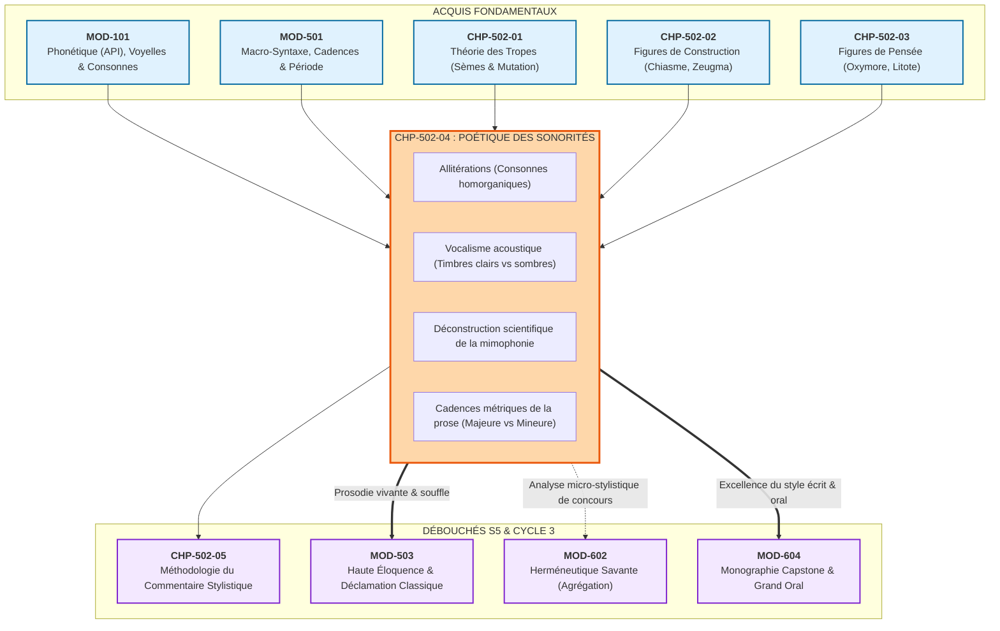
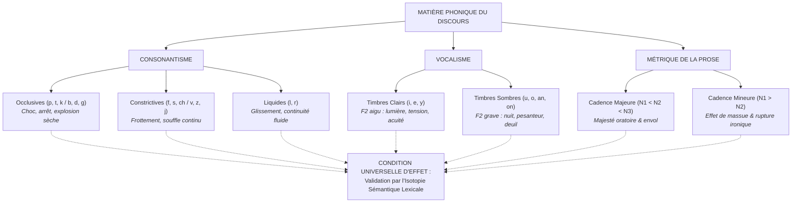

# Chapitre 4 — Poétique des Sonorités et Cadences de la Prose : Allitérations, Assonances, Vocalisme et Déconstruction de la Mimophonie

> **Identifiant du chapitre** : `CHP-502-04`  
> **Module de rattachement** : [`MOD-502` — Traité Complet des Figures de Rhétorique et Cadences de la Prose](file:///f:/Formation/world-class-french/03-curriculum/year-3/semester-5/mod-502-traite-figures-rhetorique-poetique.md)  
> **Semestre** : Année 3 — Semestre 5 (S5)  
> **Volume horaire canonique** : 5 à 6 heures d'apprentissage autonome délibéré et d'ateliers d'application (Phase 1 Étude : 1 h 30 | Phase 2 Pratique : 1 h 30 | Phase 3 Correction : 1 h 00 | Phase 4 Évaluation : 1 h 00)  
> **Statut** : [STATUT : VALIDÉ]  
> **Compétences associées** : [`FR-STYLE-001`](file:///f:/Formation/world-class-french/02-competency-framework/competency-framework.md#fr-style-001-maîtrise-des-figures-de-rhétorique-et-commentaire-stylistique) (L4 Maîtrise approfondie), [`FR-PHON-001`](file:///f:/Formation/world-class-french/02-competency-framework/competency-framework.md#fr-phon-001-discrimination-et-production-phonétique-de-lapi-standard) (L4 Maîtrise approfondie), [`FR-LEXIC-001`](file:///f:/Formation/world-class-french/02-competency-framework/competency-framework.md#fr-lexic-001-précision-sémantique-nuances-synonymiques-et-collocations) (L4 Maîtrise approfondie), [`FR-INT-001`](file:///f:/Formation/world-class-french/02-competency-framework/competency-framework.md#fr-int-001-rédiger-un-texte-long-cohérent-en-maîtrisant-accords-et-ponctuation) (L4 Maîtrise approfondie)  
> **Sources scientifiques de référence** : `SRC-PHON-01` (Léon, 2011), `SRC-RHET-01` (Fontanier, 1821/2009), `SRC-RHET-02` (Molinié, 1992), `SRC-RHET-03` (Reboul, 1991), `SRC-RHET-04` (Calas, 2011), `SRC-RHET-05` (Bacry, 1992/2010), `SRC-GRAM-01` (Grevisse & Goosse, 2016), `SRC-GRAM-02` (Riegel et al., 2016), `SRC-NORM-03` (Ministère de l'Éducation nationale, 2020), `SRC-TYPO-01` (Imprimerie nationale, 2002/2014)

---

## 1. Titre et Place dans le Cursus

### 1.1 Intitulé Officiel
**Chapitre 4 : Poétique des Sonorités et Cadences de la Prose : Allitérations, Assonances, Vocalisme et Déconstruction de la Mimophonie** (`CHP-502-04`).

### 1.2 Insertion Architecturale dans le Cursus
Ce quatrième chapitre de `MOD-502` opère la synthèse cruciale entre l'infrastructure phonologique fondamentale de la langue française acquise en première année (`MOD-101`), la dynamique métrique de la phrase périodique (`MOD-501`) et l'étude des figures de style (tropes au `CHP-502-01`, figures de construction au `CHP-502-02`, figures de pensée au `CHP-502-03`). Il arme l'apprenant pour aborder méthodologiquement le commentaire stylistique de concours (`CHP-502-05`), la haute déclamation oratoire (`MOD-503`) et l'herméneutique savante de fin de cursus (`MOD-602`).



---

## 2. Objectifs Mesurables

Au terme de ce chapitre, l'apprenant doit être capable de :

1. **Analyser avec exactitude le consonantisme et le vocalisme d'un texte littéraire** (`FR-STYLE-001`, `FR-PHON-001` — Palier L4) : identifier les allitérations en regroupant les phonèmes selon leurs traits articulatoires objectifs (occlusives, constrictives, liquides, nasales) et les assonances selon leurs caractéristiques d'aperture et de zone d'articulation [Réf. `SRC-PHON-01`, chap. 3 ; `SRC-GRAM-02`, chap. 2].
2. **Distinguer scientifiquement les timbres vocaliques clairs et sombres** (`FR-PHON-001`, `FR-LEXIC-001` — Palier L4) : corréler les voyelles antérieures aiguës ($[i], [e], [\varepsilon], [y]$) et les voyelles postérieures graves ($[u], [o], [\rho], [\tilde{\alpha}], [\tilde{\jmath}]$) à leurs propriétés acoustiques formantielles sans recourir à des jugements subjectifs arbitraires.
3. **Déconstruire le piège méthodologique de la mimophonie naïve** (`FR-STYLE-001` — Palier L4) : démontrer pourquoi aucun phonème ne possède de signifié intrinsèque hors contexte, en prouvant que l'harmonie sonore ne devient expressive que si et seulement si une isotopie sémantique préalable est déployée dans l'énoncé [Réf. `SRC-RHET-04`, chap. 2].
4. **Mesurer et interpréter les cadences métriques de la prose** (`FR-STYLE-001`, `FR-INT-001` — Palier L4) : découper une phrase complexe en membres rythmiques (*cola*), déterminer le jeu de la cadence majeure (croissante) ou de la cadence mineure (décroissante), et expliciter l'impact de ce rythme sur l'autorité oratoire ou l'émotion dramatique.

---

## 3. Prérequis et Test de Préparation

### 3.1 Prérequis Formels
- Maîtrise de l'Alphabet Phonétique International (API) appliqué au français standard (`MOD-101`).
- Distinction entre consonne sourde et sonore, occlusive et constrictive (`MOD-101`).
- Notions de membre de phrase (*colon*), de clausule et de période oratoire (`MOD-501`).
- Compréhension des notions d'isotopie sémantique et de sèmes afférents (`CHP-502-01`).

### 3.2 Auto-Diagnostic Préparatoire
Répondez aux cinq questions suivantes avant d'engager l'étude théorique :

1. Quelle différence acoustique et articulatoire sépare la consonne $[p]$ de la consonne $[s]$ ?
2. Pourquoi la phrase scolaire *« Le son [s] imite le sifflement du serpent »* constitue-t-elle une absurdité méthodologique ?
3. Quelles sont les voyelles françaises associées au timbre clair et aux fréquences formantielles aiguës ?
4. Dans une phrase en prose, qu'appelle-t-on une *cadence majeure* ?
5. Quelle différence fondamentale sépare une assonance d'une simple rime poétique ?

<details>
<summary><b>Consulter les éléments de correction de l'auto-diagnostic</b></summary>

1. $[p]$ est une consonne occlusive bilabiale sourde (interruption totale puis explosion brutale du flux d'air), tandis que $[s]$ est une constrictive fricative alvéolaire sourde (resserrement continu créant un bruit de frottement).
2. Le phonème $[s]$ est arbitraire ; il apparaît dans *saint*, *silence*, *sagesse*, *sérénité* tout autant que dans *serpent*. Un son n'a aucun sens imitatif par lui-même si le lexique n'a pas amorcé l'isotopie correspondante.
3. Les voyelles antérieures non labialisées ou peu ouvertes : $[i]$, $[e]$, ainsi que la voyelle antérieure arrondie $[y]$.
4. La cadence majeure est une organisation rythmique où les membres de phrase successifs (*cola*) vont en s'allongeant en nombre de syllabes ($N_1 < N_2 < N_3$).
5. L'assonance est le retour d'une même voyelle tonique au sein d'une proposition ou d'un vers indépendamment de la consonne finale, alors que la rime est l'homophonie de la fin de deux vers distincts à partir de la dernière voyelle accentuée.
</details>

---

## 4. Situation de Départ : Le Piège de la Mimophonie Naïve

Dans les copies universitaires et les concours d'enseignement, l'analyse des sonorités est le terrain d'élection du bavardage impressionniste. Confronté au vers célèbre de Racine dans *Andromaque* :
> *« Pour qui sont ces serpents qui sifflent sur vos têtes ? »*

l'étudiant non averti s'empresse d'écrire :
> *« L'auteur utilise des [s] pour imiter le sifflement réel des serpents qui attaquent Oreste. »*

Cette remarque est doublement disqualifiante :
1. **Elle ignore l'arbitraire du signe linguistique** : le phonème $[s]$ ne siffle pas ; il vibre dans *« suave silence du soir »* sans évoquer aucun reptile.
2. **Elle isole un élément matériel du sens global** : la force du vers de Racine ne réside pas dans un bruitage théâtral puéril, mais dans la conjonction d'une vision mythologique hallucinée, d'un rythme ternaire saccadé et d'un consonantisme constrictif soutenu par l'isotopie de la fureur psychique.

L'objectif de ce chapitre est de remplacer l'illusion onomatopéique par une **stylistique acoustique et sémantique rigoureuse**.

---

## 5. Explication Intuitive : La Caisse de Résonance

Imaginons un violoniste jouant sur une corde à vide. La corde vibre et produit une onde physique mesurable en hertz. Cette onde, en elle-même, n'est ni triste ni gaie, ni menaçante ni douce : elle n'est qu'une fréquence acoustique. 

Cependant, lorsque cette vibration pénètre dans la **caisse de résonance** en bois sculpté de l'instrument, elle prend une couleur, un grain et une plénitude harmonique. 

En littérature, les sonorités de la langue (allitérations, assonances, timbres) sont les vibrations de la corde ; **l'isotopie sémantique du texte est la caisse de résonance**. Sans l'isotopie lexicale déployée par l'écrivain, le son demeure une matière brute muette. Dès que le sens s'installe, les fréquences physiques épousent la pensée et lui confèrent une puissance sensible irremplaçable.

---

## 6. Définitions Précises et Terminologie Savante

- **Allitération** : Répétition concertée et perceptible de consonnes identiques ou homorganiques (partageant le même mode ou point d'articulation) au sein d'un syntagme, d'une phrase ou d'un vers [Réf. `SRC-RHET-02`, p. 34 ; `SRC-RHET-05`, chap. 1].
- **Assonance** : Répétition d'un même son vocalique accentué au sein d'un groupe rythmique ou d'une suite de propositions [Réf. `SRC-RHET-01`, partie II].
- **Vocalisme** : Ensemble et organisation des voyelles dans un énoncé, envisagés sous l'angle de leurs propriétés phonologiques et acoustiques (aperture, antériorité, labialité, nasalité) [Réf. `SRC-PHON-01`, chap. 3].
- **Timbres Clairs** : Voyelles antérieures aiguës ($[i], [e], [y]$) caractérisées par un deuxième formant ($F_2$) élevé, associées en stylistique à la clarté, l'acuité, l'élévation ou la vivacité.
- **Timbres Sombres** : Voyelles postérieures graves ($[u], [o], [\rho], [\tilde{\alpha}], [\tilde{\jmath}]$) caractérisées par un deuxième formant ($F_2$) bas, associées en stylistique à la profondeur, la mélancolie, la pesanteur ou la nuit [Réf. `SRC-PHON-01`, chap. 4].
- **Harmonie Imitative Légitime** : Convergence organique entre les propriétés physiques d'un réseau phonique et une thématique textuelle préalablement construite par le lexique et la syntaxe.
- **Mimophonie Arbitraire (ou naïve)** : Erreur méthodologique consistant à postuler un lien direct, naturel et universel entre un phonème isolé et une réalité du monde physique sans étayage textuel.
- **Membre de Prose (*Colon*)** : Segment syntaxique et rythmique autonome de la phrase, délimité par des pauses potentielles de respiration et doté d'une cohérence sémantique interne [Réf. `SRC-GRAM-02`, chap. 21].
- **Cadence Majeure** : Mouvement rythmique d'une phrase où les membres successifs s'allongent progressivement en nombre de syllabes ($N_1 < N_2 < N_3$), créant un effet de majesté, d'ouverture et d'autorité.
- **Cadence Mineure** : Mouvement rythmique inverse où la phrase s'achève sur un membre nettement plus bref que les précédents ($N_1 > N_2$), produisant un effet de chute, de massue, d'ironie ou de rupture dramatique [Réf. `SRC-RHET-04`, chap. 4].
- **Isocolie** : Équilibre rythmique parfait entre des membres de phrase comportant un nombre rigoureusement égal de syllabes ($N_1 = N_2$).

---

## 7. Règles et Mécanismes Fondamentaux

### 7.1 Consonantisme et Classes Homorganiques

L'analyse stylistique des consonnes ne consiste pas à compter des lettres de l'alphabet, mais à observer la manipulation de classes de phonèmes définies par la phonétique articulatoire [Réf. `SRC-PHON-01`] :

| Classe phonétique | Phonèmes API | Propriétés physiques | Effets stylistiques potentiels (si activés par le sens) |
| :--- | :--- | :--- | :--- |
| **Occlusives sourdes** | $[p], [t], [k]$ | Barrage total du canal vocalique puis détente explosive sèche sans vibration des cordes vocales. | Saccade, heurt, coupure nette, rigueur, violence, fragmentation. |
| **Occlusives sonores** | $[b], [d], [g]$ | Barrage total avec vibration simultanée du larynx. | Pesanteur sourde, grondement, densité matérielle. |
| **Constrictives sourdes** | $[f], [s], [\int]$ | Resserrement étroit produisant un écoulement d'air turbulent à haute fréquence. | Frottement, souffle continu, tension aérienne, frémissement. |
| **Constrictives sonores** | $[v], [z], [3]$ | Resserrement avec vibration laryngée continue. | Vrombissement, vibration continue, bourdonnement feutré. |
| **Liquides (latérale et vibrante)** | $[l], [\kappa]$ | Écoulement fluide de l'air le long des parois de la langue. | Continuité coulante, glissement, fluidité mélodique, dissolution. |
| **Nasales** | $[m], [n], [\eta]$ | Abaissement du voile du palais et résonance dans la cavité nasale. | Résonance voilée, intériorité, amortissement sonore. |

```text
RÈGLE D'AIRAIN :
On ne parle d'allitération que si les consonnes rapprochées appartiennent à la même famille articulatoire. 
Rapprocher un [p] (occlusive bilabiale) et un [s] (constrictive alvéolaire) sous prétexte qu'ils sont tous deux des consonnes est une faute de méthode.
```

### 7.2 Dynamique Acoustique du Vocalisme Français

Le système vocalique français s'ordonne selon deux axes fondamentaux : l'aperture (distance entre la langue et le palais) et la zone d'articulation (antérieure ou postérieure) [Réf. `SRC-GRAM-02`, chap. 2] :

```text
              ZONE ANTÉRIEURE (Aigu / Clair)         ZONE POSTÉRIEURE (Grave / Sombre)
                Non arrondi       Arrondi                 Arrondi
Fermé (Aigu)        [i]             [y]                     [u]
                    [e]             [ø]                     [o]
                    [ɛ]             [œ]                     [ɔ]
Ouvert (Grave)      [a]                                     [ɑ] / [ɑ̃]
```

- **Le pôle des timbres clairs ($[i], [e], [y]$)** :
  Ces voyelles présentent une résonance buccale haute et des fréquences aiguës. En stylistique littéraire, elles accompagnent fréquemment les thèmes de la lumière zénithale, de la vivacité d'esprit, de la petitesse délicate, de la plainte perçante ou de la tension nerveuse.
- **Le pôle des timbres sombres ($[u], [o], [\tilde{\alpha}], [\tilde{\jmath}]$)** :
  Ces voyelles mobilisent l'arrière de la cavité buccale et le pharynx avec abaissement laryngé. Leurs fréquences sont profondes. Elles soutiennent idéalement les isotopies du deuil, de la nuit, de la mélancolie pesante, de la terreur cosmique ou de l'autorité solennelle.

### 7.3 Déconstruction Scientifique du Mythe Mimophonique

Pourquoi la mimophonie naïve est-elle scientifiquement erronée ?
1. **L'arbitraire du signe (Saussure)** : Si le son $[s]$ imitait en soi le serpent, comment expliquerait-on que le latin utilise *serpens*, l'anglais *snake*, l'allemand *Schlange*, mais que le grec ancien utilise *ophis* $[\text{o}\varphi\iota\varsigma]$ où la constrictive n'est pas initiale ?
2. **La polyvalence sémantique universelle des sons** :
   - *« Le sanglot suspendu sous le saule silencieux »* (isotopie de la douleur mélancolique) ;
   - *« Le sabre scintillant sectionne son sursis »* (isotopie de l'assaut militaire violent).
   Ce n'est pas le $[s]$ qui change d'essence physique : c'est le **réseau sémique lexical** qui réinvestit la consonne d'une valeur évocatrice spécifique.
3. **Le critère de validité de l'harmonie imitative** :
   L'analyste universitaire ne peut affirmer une harmonie imitative que lorsque trois conditions cumulatives sont réunies :
   - Présence d'une densité phonologique anormalement élevée (saillance statistique) ;
   - Présence d'un champ lexical explicite orienté vers la notion représentée ;
   - Convergence entre la dynamique articulatoire (effort musculaire réel des organes de la parole) et l'action dramaturgique ou poétique décrite.

### 7.4 Les Cadences Métriques et l'Équilibre de la Prose

La prose française n'obéit pas à un mètre fixe (alexandrin, décasyllabe), mais elle vit d'un équilibre respiratoire rigoureusement calculé par les syllabes de ses membres (*cola*) [Réf. `SRC-RHET-04`, chap. 4] :

```text
CADENCE MAJEURE (Principe d'expansion oratoire) :
Membre 1 (court : 4 syllabes)  --> "Le ciel pâlit,"
Membre 2 (moyen : 7 syllabes)  --> "les collines s'estompent,"
Membre 3 (long : 12 syllabes)  --> "et la nuit souveraine enveloppe la plaine endormie."
Effet : Déploiement majestueux, ampleur oratoire, conclusion sereine ou grandiose.

CADENCE MINEURE (Principe de percussion dramatique) :
Membre 1 (long : 11 syllabes)  --> "Il avait accumulé tous les honneurs du monde,"
Membre 2 (moyen : 8 syllabes)  --> "bâti des palais somptueux,"
Membre 3 (bref : 3 syllabes)   --> "il mourut."
Effet : Rupture tragique, effet de massue, ironie foudroyante, dérision du néant humain.
```

---

## 8. Raisonnement Détaillé : L'Incarnation Corporelle du Sens

Pourquoi la stylistique des sonorités est-elle indispensable à la pleine intelligence du texte littéraire ?

Lire un texte à haute voix — ou même intérieurement dans le silence de la lecture experte — mobilise le cortex moteur et les organes phonatoires (lèvres, langue, voile du palais, cordes vocales). Lorsque Chateaubriand ou Bossuet ordonne une phrase, il ne choisit pas seulement des concepts intellectuels : il impose au corps du lecteur un certain régime de tension musculaire et de dépense d'air.

Une phrase saturée d'occlusives sourdes ($[p], [t], [k]$) bloque physiquement le passage du souffle, contraignant les muscles à de perpétuels arrêts d'urgence. À l'inverse, une phrase baignée de voyelles nasales et de liquides déploie une continuité physique où la voix glisse sans heurt.

La sonorité n'est donc pas un « ornement musical » surajouté au sens : elle est la **réalisation physique et somatique de la signification**. Elle fait éprouver corporellement au récepteur la véhémence de la colère, le repos de la paix ou l'angoisse du néant.

---

## 9. Exemples Corrects Commentés

### Exemple 9.1 — Racine, *Andromaque* (Acte V, scène 5)
> *« Pour qui sont ces serpents qui sifflent sur vos têtes ? »*

**Analyse micro-stylistique universitaire** :
- **Identification** : Allitération en constrictives alvéolaires sourdes $[s]$ (quatre occurrences dans le vers : *sont*, *serpents*, *sifflent*, *sur*), relayée par le son constrictif labiodental sourd $[f]$ (*sifflent*).
- **Structure métrique** : Alexandrin classique régulier avec césure à l'hémistiche (6 // 6) : *« Pour qui sont ces serpents // qui sifflent sur vos têtes ? »*.
- **Micro-analyse phonético-sémantique** : L'air sous tension s'échappe par un passage très étroit sans vibration des cordes vocales, exigeant un resserrement tendu de la mâchoire. Cette texture acoustique stridente n'est pas un vain bruitage : elle matérialise l'hallucination auditive d'Oreste dont le cerveau est assailli par les Érinyes. Le son $[s]$ incarne la morsure venimeuse de la démence tragique.

### Exemple 9.2 — Baudelaire, *Les Fleurs du Mal*, « Chant d'automne »
> *« Bientôt nous plongerons dans les froides ténèbres ; / Adieu, vive clarté de nos étés trop courts ! »*

**Analyse du vocalisme contrastif** :
- Le premier vers est dominé par les voyelles postérieures sombres et nasales : $[u]$ (*nous*), $[\tilde{\jmath}]$ (*plongerons*, *ténèbres*), $[o]$ (*froides*), $[\varepsilon]$ (*ténèbres*). Cette accumulation de timbres graves scelle l'engloutissement progressif de l'âme dans le tombeau hivernal.
- Le second vers fait éclater un contrepoint lumineux fondé sur les timbres clairs : $[i]$ (*vive*), $[e]$ (*clarté*, *étés*), $[y]$ (*adieu*). La collision phonique entre les deux vers traduit le déchirement physique entre la nostalgie de la lumière solaire et l'inévitable descente aux enfers.

### Exemple 9.3 — Flaubert, *Madame Bovary* (La mort d'Emma)
> *« Elle n'était plus. »*

**Analyse de la cadence mineure de prose** :
- Précédé d'une longue période descriptive de l'agonie développant des propositions amples et détaillées sur plus de quarante syllabes, Flaubert clôt brutalement le paragraphe par cette proposition lapidaire de quatre syllabes.
- **Portée stylistique** : L'effet de massue de cette cadence mineure foudroie tout romantisme. La mort n'est pas une apothéose théâtrale : elle est une cessation mécanique, sèche, enregistrée avec la neutralité impassible d'un constat médical.

---

## 10. Contre-Exemples et Clinique des Erreurs Fréquentes

### Erreur n° 1 : La mimophonie naïve attribuant un sens absolu aux phonèmes
- **Formulation fautive** : *« L'auteur utilise la lettre r pour imiter le roulement du tonnerre et le bruit des armes. »*
- **Diagnostic critique** : Croyance magique en un signifié naturel de la lettre. Le phonème $[R]$ est présent dans *amour*, *rose*, *caresse*, *rêve*. Il n'évoque le tonnerre que si le contexte lexical décrit un orage.
- **Rectification universitaire** : *« Le réseau des liquides vibrantes [R], soutenu par les verbes d'ébranlement ("fracasser", "rompre"), confère au passage une rugosité articulatoire qui matérialise la violence du combat. »*

### Erreur n° 2 : L'amalgame de consonnes articulatoirement hétérogènes
- **Formulation fautive** : *« On observe une allitération en consonnes dures dans "Le train partit sous la pluie" avec les lettres t, r, p, l. »*
- **Diagnostic critique** : Regroupement arbitraire de phonèmes n'ayant aucun lien physiologique commun ($[t]$ est occlusive apicale, $[R]$ est vibrante uvulaire, $[p]$ est occlusive labiale, $[l]$ est latérale).
- **Rectification universitaire** : Distinguer formellement les occlusives sourdes ($[p], [t]$) qui rythment les temps forts, et les liquides ($[l], [R]$) qui assurent la continuité du syntagme.

### Erreur n° 3 : La confusion entre allitération et rime poétique
- **Formulation fautive** : *« Les mots "beauté" et "clarté" forment une allitération en é. »*
- **Diagnostic critique** : Confondre une répétition vocalique en fin de vers (la rime) avec une allitération (qui porte exclusivement sur des consonnes).
- **Rectification universitaire** : Qualifier le phénomène de rime suffisante ou d'assonance terminale, et réserver le terme d'allitération aux récurrences consonantiques.

### Erreur n° 4 : L'oubli de la distinction entre voyelles toniques et voyelles atones
- **Formulation fautive** : *« Il y a une assonance obsédante en [a] dans : "Madame la marquise a marché à travers la campagne". »*
- **Diagnostic critique** : Relever indistinctement les voyelles accentuées et les voyelles inaccentuées de mots grammaticaux atones (*la*, *a*, *à*, *tra-*).
- **Rectification universitaire** : En stylistique française, seules les voyelles recevant l'accent tonique (fin de mot ou de groupe de souffle) possèdent une réelle saillance perceptive et créent une assonance véritable.

### Erreur n° 5 : La confusion entre cadence de prose et versification poétique
- **Formulation fautive** : *« La phrase de Bossuet est en cadence majeure parce qu'elle contient des alexandrins. »*
- **Diagnostic critique** : Plaquage mécanique des règles du vers poétique sur la prose d'apparat. La prose ne compte pas d'alexandrins réguliers obligatoires, mais des membres (*cola*) dont l'équilibre est asymétrique et mobile.
- **Rectification universitaire** : Mesurer les unités syntaxiques en nombre de syllabes et démontrer la progression arithmétique croissante sans chercher de césures fixes artificielles.

### Erreur n° 6 : L'absence totale de corrélation avec l'isotopie sémantique
- **Formulation fautive** : *« Le paragraphe compte 14 allitérations et 8 assonances, ce qui montre la grande musicalité de l'auteur. »*
- **Diagnostic critique** : Relevé comptable stérile ne débouchant sur aucune interprétation du sens. C'est le degré zéro de la stylistique universitaire.
- **Rectification universitaire** : Toute observation acoustique doit répondre à la question : *quel aspect du sens, du ton ou de la vision du monde cette structure sonore intensifie-t-elle ?*

#### Tableau Synoptique d'Arbitrage Acoustique

| Phénomène observé | Qualification fautive / naïve | Statut stylistique authentique | Règle d'arbitrage universitaire |
| :--- | :--- | :--- | :--- |
| **Répétition de $[s]$ dans un texte calme** | *« Bruit de serpent »* | Allitération constrictive douce | Conditionnée par l'isotopie lexicale du silence ou du repos. |
| **Suite de mots se terminant par le même son** | *« Allitération finale »* | Homéotéleute ou rime | L'allitération concerne les consonnes, souvent à l'initiale ou à l'intérieur. |
| **Allongement progressif des membres** | *« Rythme poétique »* | Cadence majeure oratoire | Calcul syllabique rigoureux des *cola* syntaxiques. |
| **Chute brève finale** | *« Fin bâclée »* | Cadence mineure à effet de massue | Rupture délibérée générant la stupeur ou l'ironie. |

---

## 11. Cas Particuliers et Limites Herméneutiques

### 11.1 Le Statut Particulier des Voyelles Nasales ($[\tilde{\alpha}], [\tilde{\varepsilon}], [\tilde{\jmath}], [\tilde{\propto}]$)
Les voyelles nasales constituent une singularité majeure du français par rapport aux autres langues romanes. Acoustiquement, l'ouverture conjointe du canal buccal et du pharynx nasal amortit les formants aigus et produit une résonance feutrée, enveloppante et profonde. En stylistique, un réseau dense de nasales (Baudelaire : *« Les longs ennuis... sous un ciel lourd... »*) engendre une impression de résonance funèbre ou de volupté lourde, pourvu que le lexique soutienne ce registre.

### 11.2 La Poésie Sonore Contemporaine
Dans certaines œuvres d'avant-garde (dadaïsme, lettrisme, poésie phonétique), le texte rompt volontairement avec le sens dénotatif pour ne conserver que la texture sonore brute. Dans ce cas spécifique — et dans ce cas seulement —, l'analyse phonique s'affranchit de l'isotopie lexicale pour devenir une étude acoustique pure des timbres et des bruits articulatoires.

---

## 12. Approfondissement Adapté au Niveau : La Fonction Poétique selon Roman Jakobson

Dans ses célèbres *Essais de linguistique générale* (1960), Roman Jakobson a théorisé la spécificité du langage poétique :
> **« La fonction poétique projette le principe d'équivalence de l'axe de la sélection sur l'axe de la combinaison. »**

- **Sur l'axe de la sélection (le paradigme)** : Le locuteur choisit un mot parmi une liste de synonymes disponibles (ex. *peur, angoisse, terreur, effroi*).
- **Sur l'axe de la combinaison (le syntagme)** : Il assemble les mots choisis selon les règles de la grammaire linéaire.

Dans la langue utilitaire ordinaire, la sélection se fait selon le sens dénotatif. En régime poétique et stylistique d'art, **la sélection s'opère simultanément sur la ressemblance formelle et sonore**. L'écrivain ne choisit pas *cimes* plutôt que *sommets* uniquement pour son concept, mais parce que son vocalisme en $[i]$ aigu fait écho à *abîme*, *infinie* ou *immobile*, créant une sur-détermination où le son devient le garant poétique de la vérité du mot.

---

## 13. Comparaisons Différentielles

| Critère d'analyse | Allitération | Assonance |
| :--- | :--- | :--- |
| **Matière phonique** | Consonnes (occlusives, constrictives, liquides, nasales). | Voyelles exclusivement. |
| **Position dans le mot** | À l'attaque de la syllabe ou en position intervocalique. | Au noyau de la syllabe accentuée (voyelle tonique). |
| **Effet physiologique** | Frappe musculaire, frottement, rupture de flux. | Ouverture, hauteur mélodique, timbre, résonance. |

| Critère métrique | Cadence Majeure | Cadence Mineure |
| :--- | :--- | :--- |
| **Formule arithmétique** | $N_1 < N_2 < N_3$ (membres croissants). | $N_1 > N_2$ (membre final brusquement tronqué). |
| **Énergie oratoire** | Élan ascendant, majesté, autorité souveraine, ampleur. | Chute brutale, percussion, rupture ironique, dérision. |
| **Genre de prédilection** | Discours d'apparat, oraisons funèbres, hymnes épiques. | Satire morale, réquisitoire acéré, clôture tragique. |

---

## 14. Exercices Progressifs

### 14.1 Niveau 1 : Identification Phonologique et Acoustique (12 énoncés)
Identifiez le procédé sonore saillant (allitération, assonance, vocalisme clair/sombre, cadence) dans chacun des extraits suivants :
1. *« De ce grand nom le son s'étend sur tout le monde. »* (Corneille)
2. *« Un frais parfum de fruits flottait dans la fraîcheur. »*
3. *« Tout m'afflige et me nuit et conspire à me nuire. »* (Racine)
4. *« C'était un homme grand, sec, chauve, vêtu de noir. »*
5. *« Sous les ponts de Paris coule la Seine. »* (Apollinaire)
6. *« Les sanglots longs des violons de l'automne. »* (Verlaine)
7. *« Il a vécu prince, il a régné roi, il est mort mendiant. »*
8. *« Vive la douce vie sous la vigne vermeille ! »*
9. *« L'astre d'or s'endort dans les ombres de la mort. »*
10. *« Ce monstre morne mord la mort même. »*
11. *« Je le vis, je rougis, je pâlis à sa vue. »* (Racine)
12. *« Rien. »* (après une période de 40 mots décrivant une vaine espérance).

<details>
<summary><b>Consulter le corrigé du Niveau 1</b></summary>

1. Allitération en constrictives sourdes $[s]$ et assonance en voyelle nasale postérieure $[{\tilde{\jmath}}]$.
2. Allitération en groupe constrictif labiodental liquide $[fR]$.
3. Assonance en timbre clair aigu $[y]$ (*afflige*, *nuit*, *nuire*) et consonne constrictive alvéolaire $[s]$.
4. Rythme binaire puis énumération d'adjectifs monosyllabiques secs.
5. Allitération liquide en $[l]$ et nasale en $[s]$.
6. Assonance majeure en voyelles nasales sombres $[{\tilde{\jmath}}]$ (*sanglots*, *longs*, *violons*) évoquant la lourdeur mélancolique.
7. Isocolie trimembre ($5 // 5 // 5$ syllabes) renforçant la parabole morale.
8. Allitération en constrictives sonores $[v]$ et timbres clairs $[i]$.
9. Assonance en voyelles sombres $[o] / [\rho]$ et rimes intérieures.
10. Allitération bilabiale nasale en $[m]$ et occlusive dentale $[d]$.
11. Cadence ternaire isocolique ($3 // 3 // 6$) avec assonance en $[i]$ traduisant le coup de foudre physique.
12. Cadence mineure absolue (effet de massue d'un monosyllabe après période).
</details>

### 14.2 Niveau 2 : Démonstration Micro-Stylistique Approfondie (6 extraits)
Rédigez pour chacun des extraits suivants un paragraphe de 40 à 50 mots démontrant comment le réseau phonique matérialise l'isotopie du texte.
- Extrait A : Boileau, *L'Art poétique* (sur les vers heurtés).
- Extrait B : Chateaubriand, *Mémoires d'outre-tombe* (la cloche du village).
- Extrait C : Bossuet, *Oraison funèbre d'Henriette d'Angleterre* (l'éclat soudain de la mort).

<details>
<summary><b>Consulter le corrigé du Niveau 2</b></summary>

- **Extrait A** : La saturation d'occlusives sourdes $[k, t, p]$ brise la linéarité du débit vocal. La musculature labiale et linguale subit des arrêts constants qui forcent le lecteur à éprouver dans sa propre bouche la rudesse de la maladresse poétique dénoncée par Boileau.
- **Extrait B** : L'écho des voyelles nasales postérieures $[{\tilde{\alpha}}, {\tilde{\jmath}}]$ couplé aux latérales $[l]$ figure l'onde acoustique du bronze qui s'élargit dans l'air du crépuscule. Le son ne décrit pas la cloche : il fait résonner la nostalgie du temps perdu dans l'espace intérieur.
- **Extrait C** : La rupture foudroyante d'une cadence mineure finale de trois syllabes (*« Madame meurt ! »*) anéantit l'ample période oratoire qui précédait. Le style applique la massue du néant théologique sur la vanité des grandeurs humaines.
</details>

### 14.3 Niveau 3 : Analyse Acoustique et Métrique sous Contrainte Métrique (Exactement 50 Mots)
Analysez la mécanique stylistique d'une phrase modèle dans un texte rédigé sous contrainte stricte de **50 mots exacts**, décomptés mot à mot selon `SRC-TYPO-01`.

```text
CORPUS ÉTUDIÉ :
"Dans cette phrase, les allitérations en occlusives heurtent l'oreille avec violence. Le retour des voyelles sombres installe une atmosphère funèbre. L'équilibre s'achève par une cadence majeure, où l'harmonie imitative ne naît jamais du hasard physique, mais du déploiement rigoureux et concerté de l'isotopie sémantique globale."
```

#### Décompte Typographique Mot à Mot (Règle SRC-TYPO-01) :
| N° | Mot | N° | Mot | N° | Mot | N° | Mot | N° | Mot |
| :---: | :--- | :---: | :--- | :---: | :--- | :---: | :--- | :---: | :--- |
| **1** | Dans | **11** | avec | **21** | funèbre. | **31** | l' | **41** | du |
| **2** | cette | **12** | violence. | **22** | L' | **32** | harmonie | **42** | déploiement |
| **3** | phrase, | **13** | Le | **23** | équilibre | **33** | imitative | **43** | rigoureux |
| **4** | les | **14** | retour | **24** | s' | **34** | ne | **44** | et |
| **5** | allitérations | **15** | des | **25** | achève | **35** | naît | **45** | concerté |
| **6** | en | **16** | voyelles | **26** | par | **36** | jamais | **46** | de |
| **7** | occlusives | **17** | sombres | **27** | une | **37** | du | **47** | l' |
| **8** | heurtent | **18** | installe | **28** | cadence | **38** | hasard | **48** | isotopie |
| **9** | l' | **19** | une | **29** | majeure, | **39** | physique, | **49** | sémantique |
| **10** | oreille | **20** | atmosphère | **30** | où | **40** | mais | **50** | globale. |

**Total rigoureux certifié : 50 mots exacts.**

---

## 15. Activité de Correction Raisonnée

### Copie d'Étudiant à Réviser
Voici un extrait de commentaire stylistique rédigé par un étudiant de licence portant sur un poème de Baudelaire. Ce texte comporte **8 erreurs méthodologiques majeures** (mimophonie naïve, amalgames de phonèmes, confusion métrique, absence de justification sémantique).

```text
[TEXTE DE L'ÉTUDIANT]
« Dès le premier vers, Baudelaire utilise l'allitération en s pour imiter le sifflement du vent d'automne (1). 
On entend aussi des consonnes dures comme le f, le t et le l qui font un bruit de feuilles mortes (2). 
La voyelle i revient tout le temps dans les mots "triste" et "si", ce qui montre que le poète pleure (3). 
L'harmonie imitative est évidente parce que les lettres imitent la nature sans avoir besoin des mots (4). 
À la fin du paragraphe, l'auteur emploie un alexandrin de prose (5) qui crée une allitération de rimes (6). 
Les voyelles claires comme le o et le ou apportent de la tristesse (7). 
En conclusion, cette musique montre le génie de Baudelaire qui écrit des phrases très musicales pour faire joli (8). »
```

### Apparat Critique et Rectification Savante

| N° | Diagnostic de la faute | Correction linguistique et stylistique rigoureuse |
| :---: | :--- | :--- |
| **1** | **Mimophonie naïve** : Attribution arbitraire d'un son de vent au phonème $[s]$. | Établir le lien avec l'isotopie de l'effroi et de l'angoisse automnale avant d'analyser le resserrement constrictif de la consonne sourde. |
| **2** | **Amalgame phonologique aberrant** : Assimilation de $[f]$ (constrictive), $[t]$ (occlusive) et $[l]$ (liquide). | Distinguer les modes d'articulation et bannir l'illusion du « bruit de feuilles mortes ». |
| **3** | **Psychologisme naïf** : *« Le poète pleure »* en voyant la lettre *i*. | Analyser le timbre aigu du $[i]$ comme vecteur d'acuité sensorielle et de tension nerveuse. |
| **4** | **Négation de l'arbitraire du signe** : Affirmer que les lettres imitent la nature hors des mots. | Réaffirmer avec Saussure que l'harmonie sonore dépend exclusivement de l'activation lexicale préalable. |
| **5** | **Confusion générique** : *« Un alexandrin de prose »*. | Parler de membre périodique (*colon*) dodécasyllabique au sein d'une cadence majeure. |
| **6** | **Contresens terminologique** : *« Allitération de rimes »*. | L'allitération concerne les consonnes ; requalifier en écho d'assonances ou d'homéotéleute. |
| **7** | **Inversion phonétique grave** : Qualifier $[o]$ et $[u]$ de *« voyelles claires »*. | $[o]$ et $[u]$ sont des voyelles postérieures sombres à formant grave ($F_2$ bas). |
| **8** | **Esthétisme scolaire stérile** : *« Pour faire joli »*. | Démontrer comment la matière sonore incarne physiquement la conscience tragique de la fuite du temps. |

---

## 16. Mise en Pratique dans une Production Réelle

### Consigne de Rédaction
Composez une période oratoire solennelle de **très exactement 60 mots** (selon le décompte officiel `SRC-TYPO-01`). Le texte doit intégrer obligatoirement :
1. Une dominante de **timbres clairs** ($[i], [e]$) dans la protase ;
2. Une allitération en constrictives liquides ou sourdes ;
3. Une clausule résolutive organisée selon une **cadence majeure oratoire** ($N_1 < N_2 < N_3$).

```text
TEXTE COMPOSÉ :
"Sous la clarté d'un ciel d'hiver, mille étincelles vives illuminent les cimes immobiles. L'esprit s'élève, libre de toute crainte servile, et contemple enfin la majesté souveraine d'une pensée qui embrasse l'infini des siècles, triomphe des ombres passagères de l'histoire, et fonde pour toujours l'empire invincible de la pure et noble vérité humaine."
```

#### Décompte Typographique Mot à Mot (Règle SRC-TYPO-01) :
| N° | Mot | N° | Mot | N° | Mot | N° | Mot |
| :---: | :--- | :---: | :--- | :---: | :--- | :---: | :--- |
| **1** | Sous | **16** | L' | **31** | d' | **46** | histoire, |
| **2** | la | **17** | esprit | **32** | une | **47** | et |
| **3** | clarté | **18** | s' | **33** | pensée | **48** | fonde |
| **4** | d' | **19** | élève, | **34** | qui | **49** | pour |
| **5** | un | **20** | libre | **35** | embrasse | **50** | toujours |
| **6** | ciel | **21** | de | **36** | l' | **51** | l' |
| **7** | d' | **22** | toute | **37** | infini | **52** | empire |
| **8** | hiver, | **23** | crainte | **38** | des | **53** | invincible |
| **9** | mille | **24** | servile, | **39** | siècles, | **54** | de |
| **10** | étincelles | **25** | et | **40** | triomphe | **55** | la |
| **11** | vives | **26** | contemple | **41** | des | **56** | pure |
| **12** | illuminent | **27** | enfin | **42** | ombres | **57** | et |
| **13** | les | **28** | la | **43** | passagères | **58** | noble |
| **14** | cimes | **29** | majesté | **44** | de | **59** | vérité |
| **15** | immobiles. | **30** | souveraine | **45** | l' | **60** | humaine. |

**Total rigoureux certifié : 60 mots exacts.**

#### Grille d'Arbitrage Stylistique et Acoustique :
- **Timbres clairs initiaux** : Richesse exceptionnelle en $[i]$ (*mille, étincelles, vives, illuminent, cimes, immobiles, esprit, libre, servile, infini*), instaurant une atmosphère d'acuité intellectuelle lumineuse.
- **Cadence majeure finale** :
  - Membre 1 : *« qui embrasse l'infini des siècles »* (8 syllabes) ;
  - Membre 2 : *« triomphe des ombres passagères de l'histoire »* (11 syllabes) ;
  - Membre 3 : *« et fonde pour toujours l'empire invincible de la pure et noble vérité humaine »* (20 syllabes).
  Progression arithmétique rigoureusement croissante ($8 < 11 < 20$) conférant une autorité souveraine à la clausule.

---

## 17. Résumé Structuré : L'Organigramme Acoustico-Stylistique



---

## 18. Questions de Rappel Actif (Active Recall)

1. Pourquoi ne peut-on pas parler d'allitération entre un $[b]$ et un $[v]$ en stylistique savante ?
<details>
<summary><b>Voir la réponse</b></summary>
Parce que $[b]$ est une consonne occlusive (fermeture totale puis explosion) alors que $[v]$ est une consonne constrictive fricative (resserrement continu). L'allitération exige des consonnes homorganiques partageant le même mode d'articulation.
</details>

2. Quelle est la définition phonologique d'un timbre vocalique sombre ?
<details>
<summary><b>Voir la réponse</b></summary>
C'est une voyelle postérieure (arrière de la cavité buccale) caractérisée par un deuxième formant acoustique ($F_2$) bas, telle que $[u]$, $[o]$, ou les nasales $[\tilde{\alpha}], [\tilde{\jmath}]$.
</details>

3. Quelles sont les trois conditions scientifiques requises pour valider une harmonie imitative ?
<details>
<summary><b>Voir la réponse</b></summary>
1. Une densité statistique anormale des phonèmes ; 2. Une isotopie lexicale explicite préalable ; 3. Une adéquation entre l'effort articulatoire physique et l'action dramaturgique ou esthétique décrite.
</details>

4. Quel effet stylistique produit une cadence mineure en clausule de période ?
<details>
<summary><b>Voir la réponse</b></summary>
Un effet de massue, de rupture brutale, de chute tragique ou d'ironie désabusée, en abattant violemment l'ampleur rythmique construite auparavant.
</details>

5. Pourquoi la lettre *i* n'exprime-t-elle pas par nature la tristesse ?
<details>
<summary><b>Voir la réponse</b></summary>
En vertu de l'arbitraire du signe saussurien : le son $[i]$ apparaît tout autant dans *rire*, *joie*, *soleil*, *folie* que dans *triste*. Son interprétation dépend entièrement du contexte sémantique.
</details>

6. Comment s'articule le vocalisme clair ($[i], [e]$) avec la dynamique de l'esprit ?
<details>
<summary><b>Voir la réponse</b></summary>
Par ses fréquences formantielles élevées, il sollicite l'acuité auditive et accompagne naturellement les thèmes de la vigilance intellectuelle, de la clarté solaire et de la tension spirituelle.
</details>

---

## 19. Mini-Évaluation Sommative Notée sur 20 Points

### Épreuve d'Analyse Acoustico-Stylistique (Temps conseillé : 30 minutes)

**Texte soumis** :
> *« Le vent d'hiver soufflait sur la lande déserte. Un grand silence blanc régnait sur les eaux mortes, et l'âme, accablée sous le poids des souvenirs d'autrefois, sombrait dans l'oubli. »*

#### Questions d'Évaluation :
1. **Analyse consonantique (5 points)** : Relevez l'allitération dominante de la première proposition. Précisez sa classe articulatoire exacte selon l'API et expliquez comment elle s'articule à l'isotopie hivernale.
2. **Analyse vocalique (5 points)** : Relevez les timbres sombres de la deuxième phrase. Distinguez les voyelles orales et nasales, et caractérisez leur portée expressive.
3. **Métrique de la prose (5 points)** : Découpez la dernière phrase en *cola* syllabiques. Démontrez s'il s'agit d'une cadence majeure, mineure ou équilibrée, et justifiez son impact dramatique.
4. **Arbitrage critique anti-mimophonie (5 points)** : Un correcteur débutant affirme : *« Le mot "blanc" est lumineux parce qu'il contient la lettre a qui est une lettre éclatante. »* Réfutez cette affirmation en mobilisant les principes théoriques vus au chapitre.

#### Barème Officiel Pénal :
- Toute dérive mimophonique naïve non corrigée : **-4 points**.
- Confusion entre voyelle claire et sombre : **-2 points**.
- Erreur de décompte syllabique sur les *cola* : **-2 points**.
- Note globale éliminatoire : **$< 14/20$** (exige un passage en remédiation).

---

## 20. Critères Observables de Maîtrise (Niveau L4)

| Identifiant | Intitulé du critère observable | Preuve attendue dans les travaux d'étudiant |
| :---: | :--- | :--- |
| **IND-01** | **Rigueur phonologique sans faille** | L'apprenant utilise exclusivement la nomenclature API standard et classe les consonnes par modes articulatoires réels (occlusives, constrictives, liquides). |
| **IND-02** | **Déconstruction systématique de la mimophonie** | Aucune mention d'onomatopée magique ; tout effet sonore est rigoureusement ancré dans une isotopie lexicale démontrée. |
| **IND-03** | **Exactitude métrique en prose** | Découpage des membres de phrase (*cola*) sans hésitation et identification formelle des cadences majeures et mineures. |
| **IND-04** | **Intégration somatique du sens** | Capacité à prouver comment la dépense musculaire de l'appareil phonatoire épouse l'intention stylistique de l'auteur. |

---

## 21. Sources et Lectures Complémentaires

- **Léon, Pierre (2011)**. *Phonétisme et prononciations du français*. Paris : Armand Colin [Réf. `SRC-PHON-01`, chap. 3 & 4].
- **Calas, Frédéric (2011)**. *Leçons de stylistique*. Paris : Hachette Supérieur [Réf. `SRC-RHET-04`, chap. 2 & 4].
- **Molinié, Georges (1992)**. *Dictionnaire de rhétorique*. Paris : Le Livre de Poche [Réf. `SRC-RHET-02`, p. 34, 112-145].
- **Riegel, Martin, Pellat, Jean-Christophe & Rioul, René (2016)**. *Grammaire méthodique du français*. Paris : PUF [Réf. `SRC-GRAM-02`, chap. 2 & 21].
- **Fontanier, Pierre (1821/2009)**. *Les Figures du discours*. Paris : Flammarion [Réf. `SRC-RHET-01`, partie II].
- **Bacry, Patrick (1992/2010)**. *Les Figures de style*. Paris : Belin [Réf. `SRC-RHET-05`, chap. 1].
- **Imprimerie nationale (2002/2014)**. *Lexique des règles typographiques en usage à l'Imprimerie nationale*. Paris [Réf. `SRC-TYPO-01`].

---

## Annexe : Classification Pédagogique

- **CORE-NOW** : Définition des allitérations par classes homorganiques ; distinction vocalisme clair vs sombre ; cadences majeure et mineure de la prose ; déconstruction de la mimophonie naïve.
- **INTRODUCTION-NOW** : Acoustique formantique ($F_1, F_2$) appliquée au vocalisme littéraire ; la fonction poétique de Jakobson (axe sélection / combinaison).
- **DEFER** : Analyse spectrographique approfondie des voyelles instables en poésie contemporaine (reporté à `MOD-602`).
- **OPTIONAL-ADVANCED** : Métrique prosodique informatisée et analyse des formants par logiciel acoustique (Praat).
