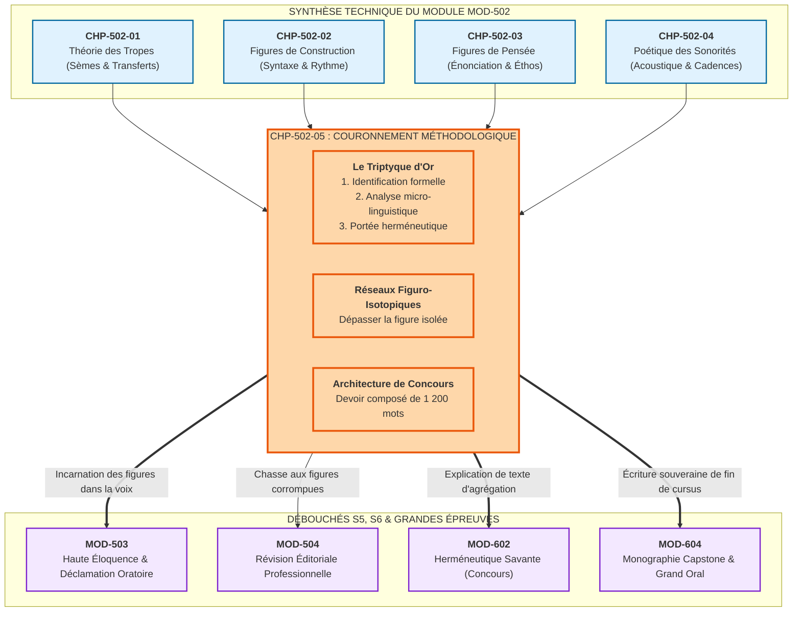
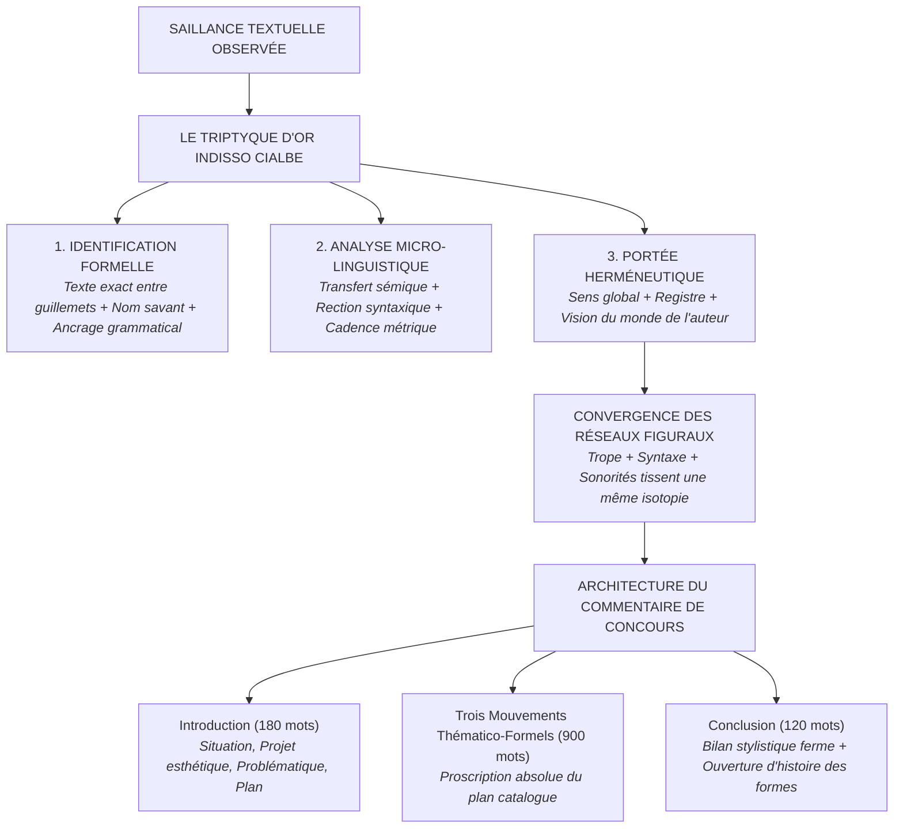

# Chapitre 5 — Méthodologie Universitaire du Commentaire Stylistique : Le Triptyque d'Or, Réseaux Figuro-Isotopiques et Épreuve ENS/Agrégation

> **Identifiant du chapitre** : `CHP-502-05`  
> **Module de rattachement** : [`MOD-502` — Traité Complet des Figures de Rhétorique et Cadences de la Prose](file:///f:/Formation/world-class-french/03-curriculum/year-3/semester-5/mod-502-traite-figures-rhetorique-poetique.md)  
> **Semestre** : Année 3 — Semestre 5 (S5)  
> **Volume horaire canonique** : 5 à 6 heures d'apprentissage autonome délibéré et d'ateliers d'application (Phase 1 Étude : 1 h 30 | Phase 2 Pratique : 1 h 30 | Phase 3 Correction : 1 h 00 | Phase 4 Évaluation : 1 h 00)  
> **Statut** : [STATUT : VALIDÉ]  
> **Compétences associées** : [`FR-STYLE-001`](file:///f:/Formation/world-class-french/02-competency-framework/competency-framework.md#fr-style-001-maîtrise-des-figures-de-rhétorique-et-commentaire-stylistique) (L4 Maîtrise approfondie), [`FR-INT-001`](file:///f:/Formation/world-class-french/02-competency-framework/competency-framework.md#fr-int-001-rédiger-un-texte-long-cohérent-en-maîtrisant-accords-et-ponctuation) (L4 Maîtrise approfondie), [`FR-LEXIC-001`](file:///f:/Formation/world-class-french/02-competency-framework/competency-framework.md#fr-lexic-001-précision-sémantique-nuances-synonymiques-et-collocations) (L4 Maîtrise approfondie), [`FR-SYNTAX-003`](file:///f:/Formation/world-class-french/02-competency-framework/competency-framework.md#fr-syntax-003-maîtrise-de-la-grande-période-oratoire-et-de-la-macro-syntaxe) (L4 Maîtrise approfondie)  
> **Sources scientifiques de référence** : `SRC-RHET-04` (Calas, 2011), `SRC-RHET-01` (Fontanier, 1821/2009), `SRC-RHET-02` (Molinié, 1992), `SRC-RHET-03` (Reboul, 1991), `SRC-RHET-05` (Bacry, 1992/2010), `SRC-GRAM-01` (Grevisse & Goosse, 2016), `SRC-GRAM-02` (Riegel et al., 2016), `SRC-NORM-03` (Ministère de l'Éducation nationale, 2020), `SRC-TYPO-01` (Imprimerie nationale, 2002/2014)

---

## 1. Titre et Place dans le Cursus

### 1.1 Intitulé Officiel
**Chapitre 5 : Méthodologie Universitaire du Commentaire Stylistique : Le Triptyque d'Or, Réseaux Figuro-Isotopiques et Épreuve ENS/Agrégation** (`CHP-502-05`).

### 1.2 Insertion Architecturale dans le Cursus
Couronnement terminal du module `MOD-502`, ce chapitre synthétise l'ensemble des savoirs techniques acquis au fil des chapitres précédents : la théorie des tropes (`CHP-502-01`), les figures de construction syntaxique (`CHP-502-02`), les figures de pensée énonciative (`CHP-502-03`) et la poétique des sonorités et cadences (`CHP-502-04`). Il forge la méthode opératoire souveraine du **commentaire stylistique universitaire**, exercice roi des concours de l'École Normale Supérieure et de l'Agrégation de Lettres.



---

## 2. Objectifs Mesurables

Au terme de ce chapitre, l'apprenant doit être capable de :

1. **Appliquer systématiquement le Triptyque d'Or à toute saillance textuelle** (`FR-STYLE-001`, `FR-INT-001` — Palier L4) : articuler sans omission l'identification grammaticale exacte, l'analyse micro-linguistique du mécanisme verbal et l'interprétation philosophique ou dramatique [Réf. `SRC-RHET-04`, chap. 1].
2. **Démonter les réseaux figuro-isotopiques d'un texte littéraire** (`FR-STYLE-001`, `FR-LEXIC-001` — Palier L4) : prouver comment des figures de nature différente (trope, chiasme, cadence majeure) convergent pour tisser une même isotopie directrice, sans jamais traiter les figures de manière isolée [Réf. `SRC-RHET-02`, p. 210-218].
3. **Bannir radicalement l'étiquetage descriptif scolaire et le plan catalogue** (`FR-STYLE-001` — Palier L4) : éliminer toute remarque ornementale vide (*« l'auteur fait une métaphore pour embellir »*) et structurer son commentaire en trois mouvements thématico-formels dynamiques plutôt qu'en catégories techniques artificielles (*I. Les figures, II. La syntaxe*).
4. **Composer un commentaire stylistique universitaire de concours de 1 200 mots** (`FR-STYLE-001`, `FR-INT-001` — Palier L4) : rédiger une étude suivie et approfondie d'un extrait de prose classique respectant les canons de composition, d'élégance et de rigueur philologique des épreuves de l'ENS et de l'Agrégation.

---

## 3. Prérequis et Test de Préparation

### 3.1 Prérequis Formels
- Connaissance taxinomique des 25 figures majeures du cursus (`CHP-502-01`, `CHP-502-02`, `CHP-502-03`).
- Maîtrise des critères de cadences et de vocalisme (`CHP-502-04`).
- Méthodologie générale de la composition française et du paragraphe unitaire (`MOD-203`, `MOD-403`).
- Aptitude à analyser la syntaxe de la phrase complexe (`MOD-301`, `MOD-501`).

### 3.2 Auto-Diagnostic Préparatoire
Répondez aux cinq questions suivantes avant d'aborder la méthode :

1. Quelles sont les trois composantes obligatoires du Triptyque d'Or de l'explication stylistique ?
2. Pourquoi un plan de commentaire divisé en : *I. Les métaphores, II. La syntaxe, III. Les sonorités* est-il sanctionné d'une note éliminatoire aux concours ?
3. Quelle différence sépare un commentaire linéaire d'un commentaire composé ?
4. Que désigne l'expression « saillance stylistique » dans la théorie de Georges Molinié ?
5. Comment définit-on une « isotopie sémantique » selon la sémiotique littéraire ?

<details>
<summary><b>Consulter les éléments de correction de l'auto-diagnostic</b></summary>

1. 1° Identification formelle et grammaticale irréprochable ; 2° Analyse micro-linguistique du mécanisme verbal (sèmes, rections, rythme) ; 3° Interprétation de la portée esthétique, dramatique ou philosophique.
2. C'est un plan catalogue purement formel qui dissocie artificiellement les procédés de la production du sens, réduisant le texte à une liste d'épicerie technique.
3. Le commentaire linéaire suit la chronologie du texte ligne par ligne pour en révéler le déploiement dynamique, tandis que le commentaire composé réordonne les observations selon des axes thématico-formels transversaux.
4. Un fait de langue qui se détache de l'environnement textuel neutre par son intensité, sa rupture ou son étrangeté, sollicitant impérativement l'attention critique du lecteur.
5. La redondance d'un faisceau de sèmes tout au long d'un texte qui assure sa cohérence thématique et rend possible une lecture homogène du sens.
</details>

---

## 4. Situation de Départ : Le Piège du Relevé d'Épicerie

L'épreuve de stylistique est redoutée parce qu'elle sanctionne sans pitié le vice intellectuel le plus répandu des études secondaires : **le repérage de figures sans explication**.

Examinons la copie d'un candidat recalé à l'ENS :
> *« À la ligne 3, l'auteur emploie une métaphore : "le gouffre de ses yeux". Puis à la ligne 7, nous trouvons une anaphore du mot "toujours", ce qui renforce l'émotion. Enfin, à la ligne 12, il y a un chiasme. Ces figures de style rendent le texte harmonieux et poétique. »*

Cette prose accumule tous les péchés capitaux de la discipline :
- **L'étiquetage descriptif stérile** : nommer la figure sans expliquer son fonctionnement interne ;
- **L'illusion ornementale** : postuler que la figure sert simplement à « faire joli » ;
- **L'émiettement atomique** : traiter les figures comme des papillons morts épinglés séparément, sans voir la trame globale qui les unit ;
- **La tautologie creuse** : déclarer que l'anaphore « renforce l'émotion » sans préciser *quelle* émotion ni par *quelle* mécanique syntaxique.

L'explication stylistique universitaire exige une révolution copernicienne : **la forme n'est pas un vêtement du fond, elle est la matrice qui engendre le sens**.

---

## 5. Explication Intuitive : La Tapisserie et l'Enquête Balistique

Imaginons une tapisserie de haute lisse. Un observateur superficiel se contente de désigner du doigt : *« Ici il y a du fil bleu, là un nœud rouge, et là un fil d'or »*. Cette description matérielle est indigente.

Le maître lissier ou le restaurateur d'art adopte une démarche inverse : il montre comment le croisement spécifique du fil bleu (un trope) et du fil d'or (une cadence périodique) sous une certaine tension de trame (un chiasme) fait surgir sous le regard du spectateur le visage tragique d'une reine ou la majesté d'un paysage d'orage.

De même, l'analyste stylistique travaille à la manière d'un enquêteur criminaliste : la figure de style est une **empreinte balistique**. Il ne s'agit pas d'admirer la douille, mais de reconstituer la trajectoire de la balle, la force de percussion de la poudre et l'impact précis qu'elle a provoqué dans la cible : la conscience du lecteur.

---

## 6. Définitions Précises et Terminologie Opératoire

- **Commentaire Stylistique Universitaire** : Exercice académique d'explication de texte consistant à démontrer scientifiquement comment la matérialité linguistique d'un extrait littéraire (lexique, syntaxe, figures, prosodie) engendre sa signification esthétique, dramaturgique et philosophique [Réf. `SRC-RHET-04`, chap. 1].
- **Triptyque d'Or** : Protocole méthodologique tripartite et indissociable régissant l'analyse de chaque saillance verbale :
  $$\text{Triptyque d'Or} = \text{Identification Formelle} + \text{Analyse Micro-Linguistique} + \text{Portée Herméneutique}$$
- **Identification Formelle** : Dénomination savante exacte de la figure accompagnée de son ancrage grammatical (classe de mots, structure syntaxique, délimitation textuelle exacte entre guillemets).
- **Analyse Micro-Linguistique** : Décomposition technique du procédé : isolement des sèmes inhérents et afférents, analyse de la rection syntaxique, observation des ruptures d'accord ou des cadences métriques syllabiques.
- **Portée Herméneutique** : Démonstration de l'apport de la figure au sens global du texte, à la stratégie de persuasion de l'auteur, au registre esthétique ou à la vision philosophique déployée.
- **Réseau Figuro-Isotopique** : Système interconnecté de figures de natures diverses qui concourent ensemble à saturer le texte d'un même faisceau sémique dominant [Réf. `SRC-RHET-02`, p. 210].
- **Projet Esthétique** : Intention créatrice et direction de sens directrice qui commande l'organisation formelle de l'extrait étudié.
- **Plan Thématico-Formel** : Architecture de commentaire où chaque grande partie formule une thèse d'interprétation substantielle articulée à l'analyse d'un dispositif linguistique majeur, refusant absolument la séparation du fond et de la forme.

---

## 7. Règles et Mécanismes Fondamentaux

### 7.1 La Règle d'Or : Proscription de l'Étiquetage Descriptif Scolaire

Tout commentaire stylistique digne du niveau universitaire applique un principe absolu :
```text
INTERDICTION FORMELLE :
Ne JAMAIS citer le nom d'une figure sans engager immédiatement 
sa démonstration micro-linguistique et son interprétation sémantique.
Une copie qui identifie 15 figures sans les expliquer obtiendra 04/20 ;
une copie qui n'en étudie que 5 mais les décortique magistralement obtiendra 17/20.
```

### 7.2 Le Triptyque d'Or en Action (Calas, Molinié)

Chaque unité d'analyse dans un paragraphe de commentaire doit impérativement parcourir les trois phases suivantes [Réf. `SRC-RHET-04`] :

```text
PHASE 1 : IDENTIFICATION FORMELLE RIGOUREUSE
- Citer le segment textuel précis entre guillemets avec renvoi à la ligne.
- Nommer la figure par son étiquette savante exacte (attestée dans Fontanier ou Molinié).
- Décrire son ancrage grammatical : "le verbe transitif X régissant deux compléments coordonnés...",
  "le syntagme nominal associant un substantif abstrait et une épithète concrète...".

PHASE 2 : ANALYSE MICRO-LINGUISTIQUE DU MÉCANISME
- Démonter le ressort interne de l'écart :
  * Pour un trope : teneur, véhicule, sèmes communs et sèmes afférents transférés.
  * Pour une figure de syntaxe : schéma géométrique (AB/B'A'), rection, dislocation.
  * Pour le rythme : compte des syllabes des cola, cadence majeure ou mineure.
  * Pour le son : allitération homorganique ou contraste de timbres vocalisés.

PHASE 3 : PORTÉE HERMÉNEUTIQUE ET ESTHÉTIQUE
- Répondre impérativement à la question : "En quoi ce mécanisme fait-il exister l'idée ?"
- Relier la saillance au registre (tragique, pathétique, satirique, sublime).
- Articuler la figure à la thèse philosophique ou à la dramaturgie globale de l'œuvre.
```

### 7.3 L'Analyse des Réseaux Figuro-Isotopiques

Les grands textes ne juxtaposent pas des figures isolées ; ils tissent des **faisceaux de convergence**.

Prenons l'exemple d'un passage où Bossuet évoque la mort d'une princesse :
1. Une **métaphore** assimile la cour à un édifice doré ;
2. Un **chiasme** oppose l'éclat présent à la poussière future ;
3. Une **allitération** en occlusives sourdes martèle les verbes de ruine ;
4. Une **cadence mineure** foudroie la période oratoire.

L'analyste d'élite ne sépare pas ces quatre observations dans des tiroirs étanches. Il démontre comment le trope (teneur architecturale), la syntaxe (miroir de vanité), le son (choc sec) et le rythme (chute brutale) unissent leurs forces pour créer **l'isotopie du néant soudain des grandeurs humaines**.

### 7.4 Architecture Canonique du Devoir de Concours (1 200 Mots)

Le commentaire stylistique de concours (agrégation, CAPES, ENS) s'organise selon un protocole rigoureux :

```text
1. INTRODUCTION CANONIQUE (environ 180 mots) :
   - Mouvement 1 : Situation historique, générique et dramaturgique de l'extrait.
   - Mouvement 2 : Définition du projet esthétique et stylistique nodal de l'auteur.
   - Mouvement 3 : Problématique stylistique (la tension dialectique entre forme et sens).
   - Mouvement 4 : Annonce fluide des trois mouvements thématico-formels du plan.

2. TROIS GRANDES PARTIES ÉQUILIBRÉES (3 x 300 mots = 900 mots) :
   - Chaque partie explore une étape de la progression dynamique du sens.
   - Chaque sous-partie analyse un nœud stylistique associant au moins deux procédés complémentaires.
   - Transition rigoureuse en fin de partie I et II (bilan partiel + relance).

3. CONCLUSION SOUVERAINE (environ 120 mots) :
   - Bilan stylistique ferme répondant à la problématique sans faux-fuyant.
   - Ouverture mesurée sur la place de cette écriture dans l'histoire de la langue française.
```

---

## 8. Raisonnement Détaillé : La Légitimité Épistémologique de la Stylistique

Pourquoi la stylistique est-elle la discipline reine des humanités littéraires ?

Tant qu'on lit un texte en se contentant de résumer « ce que l'auteur veut dire », on reste dans le domaine de la paraphrase et de l'opinion subjective. N'importe quel lecteur peut projeter ses fantasmes sur un texte philosophique ou poétique.

La stylistique apporte le **fondement scientifique et matériel de la critique**. Le texte littéraire est une suite concrète de graphèmes, de phonèmes, de relations syntaxiques et d'accords. En disséquant comment chaque virgule, chaque trope et chaque cadence produit l'émotion ou impose une vérité, la stylistique arrache l'analyse littéraire au flou de l'impressionnisme pour l'élever à la dignité d'une science rigoureuse de la signification verbale.

---

## 9. Exemples Corrects Commentés

### Exemple 9.1 — Commentaire d'une Période de Chateaubriand (*Mémoires d'outre-tombe*)
> *« La lune se levait sur la cime des forêts ; un vent glacé soufflait du pôle, et l'âme, errant dans les solitudes de la nuit, cherchait en vain un asile contre le temps qui dévore tout. »*

**Application exemplaire du Triptyque d'Or** :
1. **Identification formelle** : Période ternaire coordonnée par la conjonction *et*, achevée par une proposition subordonnée relative adjective déterminative (*« qui dévore tout »*) introduite par le pronom relatif sujet *qui*, modifiant l'antécédent substantival *le temps*.
2. **Analyse micro-linguistique** : La proposition relative finale enferme une métaphore *in praesentia* d'un verbe d'ingestion destructrice (*dévorer*) appliqué à une entité abstraite (*le temps*), doté d'un pronom indéfini à valeur d'universalité absolue (*tout*). Rythmiquement, la phrase culmine sur une cadence majeure ($8 // 7 // 22$ syllabes), où la clausule s'élargit en une ampleur désolée soutenue par l'assonance en voyelles ouvertes et sombres ($[\tilde{\alpha}]$ dans *temps*, $[u]$ dans *tout*).
3. **Portée herméneutique** : Par ce dispositif, Chateaubriand ne se borne pas à peindre un paysage nocturne : il métamorphose le décor boréal en théâtre tragique de la condition humaine. L'allongement majestueux de la cadence oppose la petitesse fugitive de l'âme errante à l'appétit insatiable de l'éternité destructrice, instaurant le sublime romantique du deuil cosmique.

---

## 10. Contre-Exemples et Clinique des Erreurs Fréquentes

### Erreur n° 1 : Le catalogage descriptif scolaire sans commentaire de sens
- **Formulation fautive** : *« À la ligne 4, nous avons une métaphore, et à la ligne 6 un chiasme. »*
- **Diagnostic critique** : C'est le degré zéro de la critique littéraire. Aucune analyse micro-linguistique, aucun lien avec le sens.
- **Rectification universitaire** : Toujours coupler la figure à sa décomposition sémique et à son retentissement thématique dans l'extrait.

### Erreur n° 2 : La séparation artificielle du fond et de la forme (le plan catalogue)
- **Formulation fautive** : Structurer son devoir en : *« I. Les thèmes du texte, II. Les figures de style, III. La métrique »*.
- **Diagnostic critique** : Hérésie méthodologique rédhibitoire sanctionnée aux concours. Les procédés stylistiques ne sont pas des appendices extérieurs aux idées.
- **Rectification universitaire** : Adopter des axes thématico-formels où chaque mouvement analyse conjointement un versant de la pensée et les mécanismes stylistiques qui l'engendrent.

### Erreur n° 3 : L'étiquetage fantaisiste ou approximatif
- **Formulation fautive** : Qualifier un chiasme d'« inversion croisée stylistique » ou un zeugma de « mélange de mots bizarre ».
- **Diagnostic critique** : Méconnaissance du métalangage universitaire officiel. Le candidat perd immédiatement sa crédibilité d'expert.
- **Rectification universitaire** : Mobiliser exclusivement la terminologie rigoureuse de Fontanier, Molinié et Calas (`SRC-RHET-01`, `SRC-RHET-02`, `SRC-RHET-04`).

### Erreur n° 4 : La paraphrase narrative citant le texte sans démonstration linguistique
- **Formulation fautive** : *« L'auteur montre ensuite que le héros souffre beaucoup lorsqu'il dit "mon cœur saigne d'angoisse", ce qui nous touche profondément. »*
- **Diagnostic critique** : Raconter l'histoire en répétant les mots de l'auteur au lieu d'analyser la métaphore corporelle et l'isotopie affective.
- **Rectification universitaire** : Démonter le transfert sémique de la douleur physique vers l'agonie psychologique et qualifier le registre pathétique.

### Erreur n° 5 : L'oubli de l'analyse micro-syntaxique
- **Formulation fautive** : Se focaliser exclusivement sur le lexique et les images sans jamais regarder la grammaire, la longueur des propositions ni la ponctuation.
- **Diagnostic critique** : Réduire la stylistique au vocabulaire. La syntaxe est la charpente architecturale qui porte les figures.
- **Rectification universitaire** : Toujours observer la rection, l'ordre des mots, l'asymétrie des propositions et le rythme périodique.

### Erreur n° 6 : L'interprétation psychologique naïve hors du texte
- **Formulation fautive** : *« Racine utilise ce chiasme parce qu'il était lui-même très jaloux dans sa vie privée. »*
- **Diagnostic critique** : Dérive biographique hors-sujet. L'analyse stylistique étudie la clôture textuelle de l'œuvre et non la psychologie empirique de l'homme privé.
- **Rectification universitaire** : Restreindre l'interprétation à l'univers esthétique, aux structures de pensée de l'époque et à la mécanique de la pièce.

#### Tableau Synoptique d'Arbitrage Méthodologique

| Démarche observée | Statut universitaire | Conséquence au concours | Rectification obligatoire |
| :--- | :--- | :--- | :--- |
| **Plan séparant le fond et la forme** | Rédhibitoire | Note plafonnée $< 08/20$ | Fusionner impérativement en axes thématico-formels. |
| **Citation de figure sans analyse sémique** | Faux pas scolaire | Pénalité sévère (-3 à -5 pts) | Appliquer systématiquement le Triptyque d'Or. |
| **Étude du lexique sans la syntaxe** | Analyse amputée | Manque de technicité | Observer la structure périodique et les cadences. |
| **Reconstitution biographique subjective** | Hors-sujet herméneutique | Perte de temps et de points | Se concentrer sur l'effet textuel interne. |

---

## 11. Cas Particuliers et Limites Herméneutiques

### 11.1 Le Commentaire de Texte en Vers vs en Prose Oratoire
L'analyse de la poésie versifiée impose de confronter la syntaxe de la phrase au mètre poétique : l'étude des rejets, contre-rejets, enjambements et césures devient indissociable de l'analyse des figures. En prose, à l'inverse, l'armature est assurée par le calcul des *cola*, la loi des membres croissants (loi de Deloffre) et les équilibres périodiques (`MOD-501`).

### 11.2 Les Textes Antiques ou Étrangers Traduits
L'explication stylistique s'applique par essence à la matérialité de la langue française. Commenter le style d'un auteur étranger à travers une traduction exige d'analyser le travail du traducteur français (ex. Amyot traduisant Plutarque, Baudelaire traduisant Poe) en tant qu'œuvre stylistique française autonome.

---

## 12. Approfondissement Adapté au Niveau : Histoire Épistémologique de la Stylistique

La stylistique moderne s'est constituée à la charnière de la rhétorique classique et de la linguistique contemporaine :
- **Charles Bally (1909)** (*Traité de stylistique française*) : Père fondateur de la discipline, il définit la stylistique comme l'étude de l'expression affective et émotionnelle des faits de langue dans la communication vivante.
- **Leo Spitzer (1948)** (*Linguistics and Literary History*) : Inventeur de la stylistique génétique et du « cercle philologique », il postule qu'un trait stylistique récurrent chez un auteur est le symptôme révélateur de son « étincelle créatrice » et de son âme psychique.
- **Michael Riffaterre (1971)** (*Essais de stylistique structurale*) : Il émancipe la stylistique du psychologisme d'auteur pour la refonder sur la perception du lecteur (l'archilecteur) confronté aux saillances et ruptures de normes du texte littéraire.
- **Georges Molinié (1992)** : Il consacre la sémostylistique moderne, associant la rigueur descriptive de la linguistique formelle et l'amplitude de l'herméneutique philosophique [Réf. `SRC-RHET-02`].

---

## 13. Comparaisons Différentielles

| Critère de méthode | Commentaire Stylistique Universitaire | Commentaire Littéraire Général |
| :--- | :--- | :--- |
| **Point de départ** | La matérialité linguistique précise (mots, syntaxe, figures). | Les idées générales, les personnages, l'intrigue. |
| **Rigueur requise** | Emploi rigoureux du métalangage philologique et sémique. | Vocabulaire thématique plus large et littéraire. |
| **Démonstration** | Preuve grammaticale et sémique directe de chaque affirmation. | Déduction argumentative fondée sur des citations larges. |

| Critère de plan | Plan Thématico-Formel d'Excellence | Plan Catalogue Scolaire (Proscrit) |
| :--- | :--- | :--- |
| **Structure d'axe** | *I. La dramaturgie du néant par la rupture syntaxique.* | *I. L'étude des figures de style.* |
| **Dynamique** | Suit la progression du sens dans le texte. | Découpe le texte en tiroirs techniques artificiels. |
| **Note attendue** | $\ge 15/20$ (Concours ENS / Agrégation). | $\le 06/20$ (Élimination directe). |

---

## 14. Exercices Progressifs

### 14.1 Niveau 1 : Rédaction de 4 Triptyques d'Or Complets
Rédigez pour chacun des faits de style suivants un paragraphe complet respectant les trois étapes du Triptyque d'Or :
1. L'oxymore *« cette obscure clarté »* chez Corneille (*Le Cid*).
2. L'hyperbate *« Albe vous a nommé, je ne vous connais plus. — Je vous connais encore, et ce coup me déchire »* chez Corneille (*Horace*).
3. Le zeugma *« Vêtu de probité candide et de lin blanc »* chez Hugo (*Booz endormi*).
4. La métonymie *« Le fer a tranché le fil de ses jours »*.

<details>
<summary><b>Consulter le corrigé du Niveau 1</b></summary>

1. **Oxymore** : 1° Le syntagme nominal *« cette obscure clarté »* associe le substantif *clarté* à l'adjectif sémantiquement contradictoire *obscure*. 2° Le transfert sémique unit deux contraires dans un même nœud immédiat, créant un tiers sémantique paradoxal. 3° Cette figure matérialise l'atmosphère nocturne de la bataille navale où la lueur lunaire suffit à guider le combat sans dissiper la terreur de l'ombre, reflétant le trouble moral de Rodrigue.
2. **Hyperbate** : 1° La réplique de Curiace s'achève par la proposition coordonnée inattendue *« et ce coup me déchire »* après la clôture sémantique *« Je vous connais encore »*. 2° Cette adjonction postposée prolonge la phrase au-delà de sa limite attendue. 3° Elle traduit le sursaut d'humanité et le déchirement affectif de Curiace qui refuse la rigidité stoïque de son rival.
3. **Zeugma sémantique** : 1° Le participe passé passif *vêtu* régit deux syntagmes prépositionnels coordonnés par *et* : *de probité candide* et *de lin blanc*. 2° Le verbe fonctionne au sens moral abstrait pour le premier complément et au sens matériel concret pour le second. 3° Cet attelage poétique transfigure le patriarche biblique en une figure d'innocence totale où la pureté de l'âme se confond avec la blancheur immaculée du vêtement.
4. **Métonymie** : 1° Le syntagme nominal *le fer* désigne l'épée par sa matière constituante. 2° La relation de contiguïté matérielle substitue le métal à l'arme guerrière. 3° Cette métonymie désindividualise l'acte meurtrier pour n'en souligner que la froideur tranchante et l'infaillible rigueur du destin guerrier.
</details>

### 14.2 Niveau 2 : Élaboration de la Problématique et des Axes Thématico-Formels
Sur un extrait de Bossuet (*Oraison funèbre d'Henriette de France*), formulez :
1. Une problématique stylistique universitaire en deux phrases articulant la tension forme/sens ;
2. Les trois intitulés de grandes parties d'un plan thématico-formel refusant tout catalogage.

<details>
<summary><b>Consulter le corrigé du Niveau 2</b></summary>

- **Problématique** : *Comment l'ampleur monumentale de la période oratoire et la violence des antithèses se conjuguent-elles pour transformer le destin tragique d'une reine déchue en une éclatante leçon théologique sur la vanité des empires terrestres ?*
- **Axes Thématico-Formels** :
  - **Axe I** : La dramatisation théâtrale des grandeurs royales à travers le déploiement majestueux de la période cicéronienne et des hyperboles dynastiques.
  - **Axe II** : Le surgissement catastrophique de la ruine politique orchestré par les ruptures d'anacoluthes et les cadences mineures de la prose.
  - **Axe III** : L'apaisement spirituel et le triomphe de la transcendance divine consacrés par le réseau des oxymores mystiques et des clausules apaisées.
</details>

### 14.3 Niveau 3 : Analyse Stylistique Intégrale sous Contrainte (Exactement 50 Mots)
Rédigez la synthèse méthodologique de la discipline sous la contrainte d'un texte calibré à **exactement 50 mots**, certifié mot à mot selon `SRC-TYPO-01`.

```text
TEXTE ÉTUDIÉ :
"Le triptyque d'or proscrit l'étiquetage scolaire stérile. L'analyste identifie d'abord la classe grammaticale exacte de la figure, démonte ensuite son mécanisme sémique et syntaxique singulier, puis démontre souverainement comment cette déviation formelle engendre la portée dramatique, philosophique et esthétique de l'œuvre littéraire globale tout entière."
```

#### Décompte Typographique Mot à Mot (Règle SRC-TYPO-01) :
| N° | Mot | N° | Mot | N° | Mot | N° | Mot | N° | Mot |
| :---: | :--- | :---: | :--- | :---: | :--- | :---: | :--- | :---: | :--- |
| **1** | Le | **11** | analyste | **21** | figure, | **31** | démontre | **41** | philosophique |
| **2** | triptyque | **12** | identifie | **22** | démonte | **32** | souverainement | **42** | et |
| **3** | d' | **13** | d' | **23** | ensuite | **33** | comment | **43** | esthétique |
| **4** | or | **14** | abord | **24** | son | **34** | cette | **44** | de |
| **5** | proscrit | **15** | la | **25** | mécanisme | **35** | déviation | **45** | l' |
| **6** | l' | **16** | classe | **26** | sémique | **36** | formelle | **46** | œuvre |
| **7** | étiquetage | **17** | grammaticale | **27** | et | **37** | engendre | **47** | littéraire |
| **8** | scolaire | **18** | exacte | **28** | syntaxique | **38** | la | **48** | globale |
| **9** | stérile. | **19** | de | **29** | singulier, | **39** | portée | **49** | tout |
| **10** | L' | **20** | la | **30** | puis | **40** | dramatique, | **50** | entière. |

**Total rigoureux certifié : 50 mots exacts.**

---

## 15. Activité de Correction Raisonnée

### Copie Universitaire Défaillante à Réviser
Voici l'introduction et le premier paragraphe d'un devoir de stylistique d'étudiant portant sur un extrait de Saint-Simon. Ce texte comporte **8 fautes méthodologiques rédhibitoires** à auditer et redresser :

```text
[TEXTE DE L'ÉTUDIANT]
« Saint-Simon était un noble très fier qui détestait le roi Louis XIV (1). Dans ce texte magnifique, il utilise plein de figures 
de style pour nous montrer sa haine (2). Nous verrons dans une première partie les métaphores, puis dans une deuxième partie 
les figures de syntaxe, et enfin la musique des mots (3). 
Dès la première ligne, l'auteur emploie une métaphore : "ce colosse d'orgueil" (4). Cela veut dire que le roi était très orgueilleux 
et méchant avec les courtisans (5). Plus loin, il y a une anaphore de "il voulut" qui montre que le roi voulait tout commander (6). 
Ces figures de style embellissent beaucoup le style de Saint-Simon qui écrit très bien (7). Enfin, l'allitération en p montre 
le dégoût de l'auteur pour la cour de Versailles (8). »
```

### Apparat Critique et Refonte Universitaire

| N° | Diagnostic méthodologique | Traitement et réécriture de haut niveau |
| :---: | :--- | :--- |
| **1** | **Biographisme naïf réducteur** : Ramener le génie d'écriture à une rancœur personnelle. | Recentrer sur la posture énonciative du mémorialiste et la scénographie satirique de l'absolutisme. |
| **2** | **Formulation triviale et vide** : *« Plein de figures pour montrer sa haine »*. | Énoncer un projet esthétique rigoureux : la démythification subversive de la théâtralité versaillaise. |
| **3** | **Plan catalogue formel rédhibitoire** : *I. Métaphores, II. Syntaxe, III. Musique*. | Substituer un plan thématico-formel en trois mouvements dynamiques de sens. |
| **4** | **Relevé brut sans analyse grammaticale** : Citation isolée sans Triptyque d'Or. | Identifier le syntagme nominal apposé et la construction génitive métaphorique. |
| **5** | **Paraphrase plate et bavardage moral** : *« Le roi était méchant »*. | Décomposer la teneur monarchique et le véhicule statuaire pour révéler la démesure idolâtre. |
| **6** | **Tautologie scolaire sur l'anaphore** : *« Montre qu'il voulait »*. | Analyser le martèlement verbal comme scansion tyrannique d'un absolutisme sans partage. |
| **7** | **Cliché esthétique vide** : *« Embellissent le style »*. | Démontrer l'efficacité chirurgicale de la prose mémorialiste qui dissèque la comédie du pouvoir. |
| **8** | **Mimophonie naïve arbitraire** : *« Allitération en p = dégoût »*. | Requalifier en allitération occlusive sourde renforçant la dureté méprisante du blâme aristocratique. |

---

## 16. Mise en Pratique dans une Production Réelle

### Consigne de Rédaction
Rédigez une séquence de commentaire stylistique universitaire calibrée à **très exactement 60 mots** (selon le décompte officiel `SRC-TYPO-01`). Le texte doit appliquer de manière exemplaire les trois phases du Triptyque d'Or sur l'oxymore classique de Bossuet : *« cette obscure clarté »*.

```text
TEXTE COMPOSÉ :
"Dans ce fragment célèbre de Bossuet, l'oxymore obscure clarté associe deux notions inconciliables au sein d'un même syntagme. Ce télescopage sémantique soudain brise la logique rationnelle ordinaire pour contraindre l'esprit du lecteur à contempler l'indicible mystère de la grandeur divine, où la splendeur céleste aveugle mortellement les yeux trop faibles de la créature humaine toujours mortelle."
```

#### Décompte Typographique Mot à Mot (Règle SRC-TYPO-01) :
| N° | Mot | N° | Mot | N° | Mot | N° | Mot |
| :---: | :--- | :---: | :--- | :---: | :--- | :---: | :--- |
| **1** | Dans | **16** | sein | **31** | contraindre | **46** | la |
| **2** | ce | **17** | d' | **32** | l' | **47** | splendeur |
| **3** | fragment | **18** | un | **33** | esprit | **48** | céleste |
| **4** | célèbre | **19** | même | **34** | du | **49** | aveugle |
| **5** | de | **20** | syntagme. | **35** | lecteur | **50** | mortellement |
| **6** | Bossuet, | **21** | Ce | **36** | à | **51** | les |
| **7** | l' | **22** | télescopage | **37** | contempler | **52** | yeux |
| **8** | oxymore | **23** | sémantique | **38** | l' | **53** | trop |
| **9** | obscure | **24** | soudain | **39** | indicible | **54** | faibles |
| **10** | clarté | **25** | brise | **40** | mystère | **55** | de |
| **11** | associe | **26** | la | **41** | de | **56** | la |
| **12** | deux | **27** | logique | **42** | la | **57** | créature |
| **13** | notions | **28** | rationnelle | **43** | grandeur | **58** | humaine |
| **14** | inconciliables | **29** | ordinaire | **44** | divine, | **59** | toujours |
| **15** | au | **30** | pour | **45** | où | **60** | mortelle. |

**Total rigoureux certifié : 60 mots exacts.**

#### Grille d'Arbitrage et Validation du Triptyque d'Or :
- **Phase 1 (Identification)** : Mots 1 à 20 : Localisation textuelle, dénomination savante (*oxymore*), identification des constituants et de l'unité syntagmatique.
- **Phase 2 (Micro-analyse)** : Mots 21 à 35 : Décomposition du télescopage sémique qui fracture la dénotation rationnelle ordinaire.
- **Phase 3 (Portée herméneutique)** : Mots 36 à 60 : Interprétation théologique et philosophique de la transcendance divine aveuglant la fragilité humaine.

---

## 17. Résumé Structuré : Le Protocole du Styliste Agrégatif



---

## 18. Questions de Rappel Actif (Active Recall)

1. Quelle est la sanction automatique infligée à un candidat qui propose un plan divisé en *I. Le vocabulaire, II. La syntaxe, III. Les sonorités* ?
<details>
<summary><b>Voir la réponse</b></summary>
La note est automatiquement plafonnée à moins de 08/20 en raison du vice de méthode du « plan catalogue », qui sépare artificiellement les procédés de la production du sens.
</details>

2. Que doit contenir impérativement la Phase 2 du Triptyque d'Or ?
<details>
<summary><b>Voir la réponse</b></summary>
La décomposition micro-linguistique du mécanisme verbal : analyse des sèmes inhérents/afférents pour les tropes, géométrie syntaxique (chiasme, inversion, rection) et mesure syllabique des cadences.
</details>

3. Pourquoi l'étiquetage descriptif scolaire est-il disqualifiant ?
<details>
<summary><b>Voir la réponse</b></summary>
Parce qu'il réduit la littérature à un répertoire d'étiquettes vides sans démontrer comment l'écart formel engendre l'émotion ou la pensée philosophique du texte.
</details>

4. Comment s'articule un axe thématico-formel dans un plan de commentaire ?
<details>
<summary><b>Voir la réponse</b></summary>
Il formule conjointement une étape de la progression du sens (le thème) et le dispositif stylistique dominant qui la construit (la forme), ex. : *« L'avènement du néant par la rupture des cadences oratoires »*.
</details>

5. Quel rôle joue la trame isotopique dans l'analyse des figures ?
<details>
<summary><b>Voir la réponse</b></summary>
Elle assure la cohérence d'ensemble : elle montre comment des figures d'ordres différents (trope, cadence, consonne) se répondent et s'amplifient mutuellement autour d'un même faisceau de sèmes redondants.
</details>

6. Quelle différence fondamentale sépare la paraphrase de l'explication stylistique ?
<details>
<summary><b>Voir la réponse</b></summary>
La paraphrase redit platement ce que le texte raconte, tandis que l'explication stylistique démonte la machinerie verbale pour prouver *comment* la langue produit l'effet esthétique.
</details>

---

## 19. Mini-Évaluation Sommative Notée sur 20 Points

### Épreuve de Méthodologie et d'Audit Critique (Durée conseillée : 30 minutes)

**Consignes d'Évaluation** :
1. **Épreuve théorique (5 points)** : Explicitez les trois composantes du Triptyque d'Or et justifiez pourquoi l'absence de l'une d'elles ruine l'analyse stylistique.
2. **Audit de copie d'étudiant (5 points)** : Corrigez l'analyse suivante : *« L'auteur emploie une métaphore quand il dit "le lion rugissant du peuple", ce qui rend son texte très expressif et vivant. »* Rédigez la version L4 conforme.
3. **Conception architecturale de plan (5 points)** : Sur un extrait de Bossuet démontrant la chute d'une monarchie, proposez une problématique stylistique et les trois intitulés d'un plan thématico-formel de niveau concours.
4. **Micro-analyse appliquée (5 points)** : Rédigez un triptyque complet (60 mots) sur le chiasme de Pascal : *« Le cœur a ses raisons que la raison ne connaît point. »*

#### Barème Officiel de Sanction :
- Présence d'un plan catalogue : **-5 points forfaitaires**.
- Étiquetage scolaire sans micro-analyse : **-3 points par occurrence**.
- Paraphrase narrative non démontrée : **-2 points**.
- Seuil d'admissibilité L4 : **Note globale $\ge 14/20$**.

---

## 20. Critères Observables de Maîtrise (Niveau L4)

| Identifiant | Intitulé de la performance observable | Indicateur objectif de réussite |
| :---: | :--- | :--- |
| **IND-01** | **Application systématique du Triptyque d'Or** | Chaque saillance commentée contient sans exception l'identification exacte, la décomposition micro-linguistique et la portée herméneutique. |
| **IND-02** | **Maîtrise du plan thématico-formel** | Absence totale de plan catalogue ; formulation d'axes articulant dynamiquement pensée et faits de langue. |
| **IND-03** | **Détection des réseaux figuro-isotopiques** | Capacité à relier au moins trois figures de natures différentes au sein d'une même démonstration textuelle. |
| **IND-04** | **Haute tenue d'expression critique** | Prose de commentaire fluide, élégante, rythmée, exempte de toute formule scolaire vide ou de biographisme naïf. |

---

## 21. Sources et Lectures Complémentaires

- **Calas, Frédéric (2011)**. *Leçons de stylistique*. Paris : Hachette Supérieur [Réf. `SRC-RHET-04`, chap. 1, 3 & 5].
- **Molinié, Georges (1992)**. *Dictionnaire de rhétorique*. Paris : Le Livre de Poche, coll. « Les Usuels » [Réf. `SRC-RHET-02`, p. 210-218].
- **Fontanier, Pierre (1821/2009)**. *Les Figures du discours*. Paris : Flammarion [Réf. `SRC-RHET-01`].
- **Reboul, Olivier (1991)**. *Introduction à la rhétorique*. Paris : PUF [Réf. `SRC-RHET-03`, chap. 5].
- **Bacry, Patrick (1992/2010)**. *Les Figures de style*. Paris : Belin [Réf. `SRC-RHET-05`, chap. 1 & 4].
- **Riegel, Martin et al. (2016)**. *Grammaire méthodique du français*. Paris : PUF [Réf. `SRC-GRAM-02`].
- **Imprimerie nationale (2002/2014)**. *Lexique des règles typographiques en usage à l'Imprimerie nationale*. Paris [Réf. `SRC-TYPO-01`].

---

## Annexe : Classification Pédagogique

- **CORE-NOW** : Le Triptyque d'Or (identification, micro-analyse, herméneutique) ; proscription de l'étiquetage descriptif scolaire ; conception du plan thématico-formel de concours.
- **INTRODUCTION-NOW** : Histoire épistémologique de la stylistique (Bally, Spitzer, Riffaterre, Molinié) ; théorie des réseaux figuro-isotopiques.
- **DEFER** : Stylistique génétique sur manuscrits et variantes d'auteurs (reporté à `MOD-602`).
- **OPTIONAL-ADVANCED** : Sémostylistique computationnelle et concordances textométriques appliquées aux corpus classiques.
