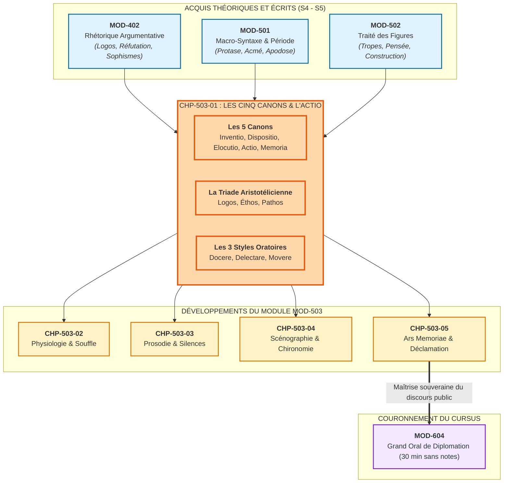
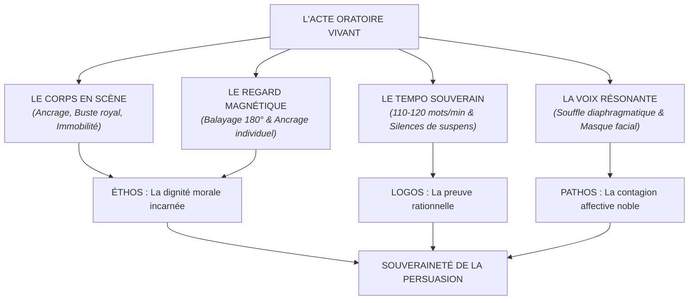

# Chapitre 1 — Les Cinq Canons de la Rhétorique Classique et la Souveraineté de l'Actio : Inventio, Dispositio, Elocutio, Actio, Memoria et Triade Aristotélicienne

> **Identifiant du chapitre** : `CHP-503-01`  
> **Module de rattachement** : [`MOD-503` — Haute Éloquence : Déclamation Classique, Souffle et Présence Oratoire](file:///f:/Formation/world-class-french/03-curriculum/year-3/semester-5/mod-503-haute-eloquence-declamation-presence-oratoire.md)  
> **Semestre** : Année 3 — Semestre 5 (S5)  
> **Volume horaire canonique** : 5 à 6 heures d'apprentissage autonome délibéré et d'ateliers d'application (Phase 1 Étude : 1 h 30 | Phase 2 Pratique : 1 h 30 | Phase 3 Correction : 1 h 00 | Phase 4 Évaluation : 1 h 00)  
> **Statut** : [STATUT : VALIDÉ]  
> **Compétences associées** : [`FR-INT-005`](file:///f:/Formation/world-class-french/02-competency-framework/competency-framework.md#fr-int-005-présenter-oralement-un-raisonnement-structuré-et-éloquent) (L4 Maîtrise approfondie), [`FR-INT-004`](file:///f:/Formation/world-class-french/02-competency-framework/competency-framework.md#fr-int-004-adapter-instantanément-son-registre-de-langue-au-contexte) (L4 Maîtrise approfondie), [`FR-STYLE-001`](file:///f:/Formation/world-class-french/02-competency-framework/competency-framework.md#fr-style-001-maîtrise-des-figures-de-rhétorique-et-commentaire-stylistique) (L4 Maîtrise approfondie), [`FR-LEXIC-001`](file:///f:/Formation/world-class-french/02-competency-framework/competency-framework.md#fr-lexic-001-précision-sémantique-nuances-synonymiques-et-collocations) (L4 Maîtrise approfondie)  
> **Sources scientifiques de référence** : `SRC-RHET-03` (Reboul, 1991), `SRC-RHET-01` (Fontanier, 1821/2009), `SRC-RHET-02` (Molinié, 1992), `SRC-RHET-04` (Calas, 2011), `SRC-GRAM-01` (Grevisse & Goosse, 2016), `SRC-GRAM-02` (Riegel et al., 2016), `SRC-NORM-03` (Ministère de l'Éducation nationale, 2020), `SRC-TYPO-01` (Imprimerie nationale, 2002/2014)

---

## 1. Titre et Place dans le Cursus

### 1.1 Intitulé Officiel
**Chapitre 1 : Les Cinq Canons de la Rhétorique Classique et la Souveraineté de l'Actio : Inventio, Dispositio, Elocutio, Actio, Memoria et Triade Aristotélicienne** (`CHP-503-01`).

### 1.2 Insertion Architecturale dans le Cursus
Ce premier chapitre de `MOD-503` marque l'entrée dans le domaine souverain de l'art oratoire vivant. Il fait la transition entre l'artisanat du texte écrit (`MOD-402` argumentation, `MOD-403` dissertation, `MOD-501` période oratoire, `MOD-502` figures de rhétorique) et l'incarnation physique de la parole en scène.



---

## 2. Objectifs Mesurables

Au terme de ce chapitre, l'apprenant doit être capable de :

1. **Articuler les cinq canons de la rhétorique classique dans une démarche oratoire complète** (`FR-INT-005` — Palier L4) : expliciter les fonctions respectives de l'*inventio*, de la *dispositio*, de l'*elocutio*, de l'*actio* et de la *memoria*, et démontrer pourquoi un discours parfait à l'écrit s'effondre s'il est privé d'une *actio* souveraine [Réf. `SRC-RHET-03`, chap. 2].
2. **Équilibrer la triade persuasive aristotélicienne (*logos*, *éthos*, *pathos*)** (`FR-INT-005`, `FR-INT-004` — Palier L4) : calibrer son intervention orale pour faire converger la validité des preuves rationnelles (*logos*), l'autorité morale et le sang-froid corporel (*éthos*), et la contagion affective maîtrisée de l'auditoire (*pathos*) sans jamais verser dans l'hystérie démagogique [Réf. `SRC-RHET-03`, chap. 2].
3. **Moduler les trois styles de l'éloquence antique selon les finalités oratoires** (`FR-STYLE-001`, `FR-LEXIC-001` — Palier L4) : discriminer et mobiliser à bon escient le style simple (*docere* : instruire avec clarté), le style tempéré (*delectare* : plaire et séduire par l'élégance) et le style sublime (*movere* : émouvoir et bouleverser les consciences) [Réf. `SRC-RHET-01`, partie IV].
4. **Analyser les chefs-d'œuvre oratoires de l'histoire française** (`FR-INT-005`, `FR-LEXIC-001` — Palier L4) : disséquer la scénographie vocale et textuelle des grands discours républicains, parlementaires et funèbres (Bossuet, Mirabeau, Jaurès, Malraux, Badinter) pour y identifier les points de bascule de l'*actio*.

---

## 3. Prérequis et Test de Préparation

### 3.1 Prérequis Formels
- Maîtrise de la logique argumentative et de la détection des sophismes (`MOD-402`).
- Compréhension de la structure dynamique de la grande période oratoire (protase, acmé, apodose) (`MOD-501`).
- Maîtrise des figures de pensée (antithèse, oxymore, prétérition) et de construction (chiasme, anaphore) (`MOD-502`).
- Contrôle de la phonétique articulatoire de base (`MOD-101`).

### 3.2 Auto-Diagnostic Préparatoire
Répondez aux cinq questions suivantes avant d'engager l'étude théorique :

1. Quels sont, dans l'ordre chronologique de la composition antique, les cinq canons de la rhétorique ?
2. Quelle fut la réponse célèbre de Démosthène lorsqu'on lui demanda quelle était la qualité première de l'orateur ?
3. En quoi l'*éthos* oratoire se distingue-t-il du simple statut social préalable de l'orateur ?
4. Quelles sont les trois finalités du discours oratoire définies par Cicéron (*tria officia oratoris*) ?
5. Pourquoi le style sublime (*movere*) ne peut-il pas être maintenu continuellement pendant tout un discours ?

<details>
<summary><b>Consulter les éléments de correction de l'auto-diagnostic</b></summary>

1. 1° *Inventio* (trouver les arguments), 2° *Dispositio* (ordonner le plan), 3° *Elocutio* (choisir le style et les figures), 4° *Actio* (prononciation, voix, corps), 5° *Memoria* (mémorisation active).
2. Démosthène répondit : *« L'actio »* ; à la deuxième : *« L'actio »* ; à la troisième : *« Encore l'actio »*.
3. L'*éthos* n'est pas la réputation antérieure, mais l'image morale et psychologique que l'orateur construit activement par sa tenue corporelle, son regard, sa bienveillance et son timbre vocal dès les premières secondes de prise de parole.
4. *Docere* (instruire, convaincre la raison), *Delectare* (plaire, charmer l'imagination) et *Movere* (émouvoir, emporter la décision par les passions).
5. Parce que l'émotion intense sature rapidement le système nerveux de l'auditeur. Le sublime continu engendre l'épuisement, l'incrédulité ou le ridicule ; il doit être préparé par le style simple et soutenu par le style tempéré.
</details>

---

## 4. Situation de Départ : Le Naufrage du Texte Mort

Dans la pratique contemporaine, l'immense majorité des orateurs publics — ministres, universitaires, avocats ou dirigeants — commet une erreur tragique : **confondre le discours oratoire avec la lecture d'un rapport écrit**.

L'orateur monte à la tribune, baisse les yeux sur ses feuillets, saisit le pupitre des deux mains comme une barricade et lit à toute vitesse un texte rédigé pour les yeux. Le public perçoit un bourdonnement monotone. La voix est écrasée dans la gorge, le regard est absent, le corps est figé ou agité de tics nerveux. Même si les arguments sont brillants (*logos* parfait), l'auditoire décroche, s'ennuie ou s'endort.

Ce naufrage prouve la vérité du diagnostic de Cicéron dans le *De Oratore* : **un discours n'est pas une suite de signes sur du papier ; c'est un acte physique total**. L'orateur ne transmet pas une information neutre : il engage sa présence charnelle, son souffle et son regard pour forcer l'adhésion de ses semblables.

---

## 5. Explication Intuitive : L'Arbalète et le Projecteur

Pour saisir la fonction de l'*actio*, imaginons une arbalète de guerre :
- L'*inventio* est le choix de la pointe métallique (la vérité de l'argument) ;
- La *dispositio* est le fût en bois calibré (la trajectoire équilibrée) ;
- L'*elocutio* est l'empennage de plumes d'aigle qui donne la grâce et la stabilité aérodynamique (les figures et le rythme) ;
- Mais sans la **corde tendue et la détente musculaire** — c'est-à-dire l'***actio*** —, le carreau reste inerte sur l'établi. L'*actio* est l'énergie cinétique pure qui propulse la pensée dans le cœur de la cible.

De même, l'orateur est semblable à un projecteur de phare maritime : la nuit peut être épaisse (la réticence ou l'hostilité de l'auditoire), si la lentille de verre (l'*éthos*) est transparente et si la lampe à arc (le *pathos*) est alimentée par un générateur puissant (le *logos*), le faisceau perce les ténèbres à des lieues à la ronde.

---

## 6. Définitions Précises et Terminologie Opératoire

- **Les Cinq Canons de la Rhétorique** : Division doctrinale classique organisant l'élaboration et la délivrance du discours civique et d'apparat [Réf. `SRC-RHET-03`, chap. 2] :
  - *Inventio* : Recherche méthodique des idées, preuves objectives (*pisteis entechnoi*) et arguments probants ;
  - *Dispositio* : Art d'ordonner stratégiquement les mouvements du discours (exorde, narration, confirmation, réfutation, péroraison) ;
  - *Elocutio* : Choix du registre lexical, ciselure des figures de rhétorique et cadences métriques de la phrase ;
  - *Actio* (ou *Pronuntiatio*) : Interprétation vocale, prosodique, posturale, faciale et gestuelle du discours en direct ;
  - *Memoria* : Intériorisation topographique et mnésique du discours permettant une déclamation souveraine sans notes écrites.
- **Logos** : Dimension rationnelle et démonstrative du discours (syllogismes, preuves factuelles, déductions logiques, chiffres, jurisprudence) [Réf. `SRC-RHET-03`, chap. 2].
- **Éthos** : Crédibilité morale, modération, autorité naturelle et sang-froid que l'orateur projette par son comportement physique et son timbre dès son entrée en scène.
- **Pathos** : Faisceau des passions, émotions et affects suscités chez l'auditoire (compassion, ferveur, crainte, indignation sacrée, fierté).
- **Style Simple (*Genus Subtile*)** : Registre dépouillé, précis, naturel, orienté vers la clarté explicative (*docere / instruire*).
- **Style Tempéré (*Genus Medium*)** : Registre élégant, fleuri, harmonieux, ménageant des agréments stylistiques et des figures légères (*delectare / charmer*).
- **Style Sublime (*Genus Grande*)** : Registre ample, véhément, majestueux, employant la grande période oratoire et les figures de pensée majeures pour bouleverser les âmes (*movere / émouvoir*) [Réf. `SRC-RHET-01`, partie IV].
- **Chironomie** : Rhétorique savante des gestes des bras et des mains accompagnant avec dignité l'émission de la parole.

---

## 7. Règles et Mécanismes Fondamentaux

### 7.1 L'Édifice des Cinq Canons selon Cicéron et Quintilien

L'orateur d'élite ne sépare jamais la phase de conception écrite de la phase de délivrance corporelle :

```text
CONCEPTION DU DISCOURS (Cabinet d'étude) :
├── 1. INVENTIO   : Que vais-je prouver ? Quels sont mes faits irréfutables ?
├── 2. DISPOSITIO : Dans quel ordre dramatique vais-je frapper les esprits ?
└── 3. ELOCUTIO   : Quels mots nobles, quelles cadences et quelles figures vont incarner cette idée ?

INCARNATION DU DISCOURS (Tribune & Scène) :
├── 4. MEMORIA    : Comment mon esprit habite-t-il l'armature sans béquille papier ?
└── 5. ACTIO      : Comment mon souffle, ma voix, mes yeux et mes mains font-ils vibrer l'assemblée ?
```

### 7.2 La Triade Aristotélicienne en Équilibre Dynamique

Selon Aristote (*Rhétorique*, Livre I), la persuasion repose sur un trépied où chaque pied compense et renforce les deux autres :

| Composante | Organe mobilisé | Danger si hypertrophié | Danger si absent |
| :--- | :--- | :--- | :--- |
| **Logos (Raison)** | Intellect, cerveau | Sècheresse doctorale, ennui mortel, jargon abstrait. | Bavardage creux, démagogie incohérente, sophisme. |
| **Éthos (Posture)** | Corps, regard, timbre | Arrogance hautaine, morgue aristocratique, mépris. | Perte de crédit immédiate, nervosité risible, méfiance. |
| **Pathos (Cœur)** | Émotion, souffle | Hystérie larmoyante, mélo de foire, manipulation. | Indifférence glaciale, absence totale de passage à l'acte. |

```text
RÈGLE D'OR DE LA PERSUASION :
L'éthos ouvre la porte de l'attention ;
le logos convainc le jugement ;
le pathos déclenche la décision et l'action.
```

### 7.3 Les Trois Styles et la Régulation de la Tension Oratoire

L'orateur classique ne crie pas pendant quinze minutes. Il navigue magistralement entre les trois registres stylistiques selon la progression de son discours :

1. **L'Exorde (Style simple à tempéré)** : L'orateur pose calmement le problème. Le ton est posé, humble et digne (*captatio benevolentiae*). Il installe son *éthos*.
2. **La Narration et la Confirmation (Style tempéré à soutenu)** : Déploiement des faits et des preuves. Le style s'élève, les métaphores éclairent la démonstration (*logos*).
3. **La Péroraison (Style sublime)** : Sommet du discours. La grande période oratoire se déploie en cadence majeure, les oxymores et antithèses dramatisent l'enjeu, la voix s'élargit pour emporter l'assentiment absolu de la foule (*pathos*).

---

## 8. Raisonnement Détaillé : Pourquoi l'Actio est-elle Souveraine ?

La supériorité de l'*actio* sur le simple texte rédigé s'explique par la nature neurobiologique et sociale de l'espèce humaine.

Avant d'être des lecteurs de graphèmes abstraits, les êtres humains ont communiqué pendant des dizaines de millénaires par la voix, l'intonation, le regard et la posture corporelle. Le système limbique de l'auditeur analyse instantanément les micro-signaux du locuteur :
- Une respiration courte et saccadée signale la panique ou le mensonge ;
- Un regard qui frotte le sol trahit la honte ou le manque de conviction ;
- Un timbre chaud, résonnant sans effort dans les cavités faciales, soutenu par un souffle abdominal profond, signale la force vitale, la probité et la sérénité.

L'auditeur ne croit pas ce qu'il entend ; **il croit ce qu'il voit et ce qu'il ressent corporellement chez l'orateur**. Si la voix dit *« Je suis calme »* mais que les mains tremblent et que la glotte se serre dans les aigus, l'auditoire enregistre uniquement le tremblement. L'*actio* est le juge de paix universel de l'authenticité oratoire.

---

## 9. Exemples Corrects Commentés

### Exemple 9.1 — Mirabeau à la tribune de l'Assemblée nationale (1789)
> *« Allez dire à votre maître que nous sommes ici par la volonté du peuple, et que nous n'en sortirons que par la force des baïonnettes ! »*

**Dissection de l'Actio** :
- **Éthos** : Refus physique de quitter la salle ; buste droit défiant les ordres royaux apportés par le marquis de Dreux-Brézé.
- **Logos** : Antithèse politique irrévocable opposant la *« volonté du peuple »* (légitimité de droit) à la *« force des baïonnettes »* (contrainte matérielle brute).
- **Actio & Chironomie** : Geste impérieux du bras tendu désignant la sortie au représentant de la monarchie, voix de stentor projetée sans tremblement, silence glacial de trois secondes consécutif au mot *baïonnettes*.

### Exemple 9.2 — Robert Badinter à l'Assemblée nationale (17 septembre 1981)
> *« Demain, grâce à vous, la justice française ne sera plus une justice qui tue. Demain, grâce à vous, il n'y aura plus, dans nos prisons, à l'aube, de ces exécutions furtives. Demain, les pages sanglantes de notre histoire judiciaire seront tournées. »*

**Dissection de l'Actio** :
- **Éthos** : Sobriété ascétique, costume noir, voix grave, refus de tout effet théâtral voyant.
- **Logos & Elocutio** : Anaphore ternaire en *« Demain, grâce à vous »*, cadence périodique ascendante.
- **Actio** : Débit mesuré à 110 mots/minute, pauses dramatiques de deux secondes après chaque *Demain*, regard circulaire embrassant la gauche et la droite de l'hémicycle sans animosité, engageant la conscience morale de chaque parlementaire.

---

## 10. Contre-Exemples et Clinique des Erreurs Fréquentes

### Erreur n° 1 : L'illusion du prompteur et de la lecture déguisée
- **Formulation fautive** : L'orateur prétend déclamer son discours mais garde les yeux rivés sur ses feuilles, levant la tête de manière saccadée toutes les dix secondes.
- **Diagnostic critique** : Rupture du fil magnétique. Dès que les yeux quittent le public pour le papier, l'*éthos* s'effondre et l'assemblée décroche.
- **Rectification universitaire** : Adopter la méthode des lieux (*ars memoriae*). Si un aide-mémoire est toléré, il ne doit comporter que 5 mots clés sur une fiche bristol.

### Erreur n° 2 : La dysphonie de forçage par serrage laryngé
- **Formulation fautive** : L'orateur crie de la gorge pour se faire entendre au fond de la salle, sa voix devient suraiguë et se casse après cinq minutes.
- **Diagnostic critique** : Respiration thoracique haute bloquant les cordes vocales.
- **Rectification universitaire** : Enfoncer le diaphragme, détendre la gorge et amplifier le son par résonance osseuse faciale (le masque).

### Erreur n° 3 : Le débit mitraillette provoqué par le trac
- **Formulation fautive** : Débiter 180 mots par minute sans reprendre son souffle pour écourter l'épreuve de la prise de parole.
- **Diagnostic critique** : L'anxiété vole le temps de parole. L'auditeur ne peut assimiler les arguments.
- **Rectification universitaire** : Ralentir volontairement à 110 mots/minute. La lenteur maîtrisée est le signe visible du pouvoir souverain.

### Erreur n° 4 : Le dandinement podal et les gestes parasites
- **Formulation fautive** : Se balancer d'un pied sur l'autre, tripoter sa bague, rajuster ses lunettes sans cesse.
- **Diagnostic critique** : Fuite d'énergie motrice parasitant le message intellectuel.
- **Rectification universitaire** : Ancrer fermement les talons au sol, bras au repos, immobilité habitée du corps.

### Erreur n° 5 : Le faux pathos larmoyant ou hystérique
- **Formulation fautive** : Pleurer ou hurler sur scène pour tenter d'émouvoir l'auditoire.
- **Diagnostic critique** : Le ridicule de l'emphase. L'auditoire se recule avec gêne face à l'impudeur émotionnelle.
- **Rectification universitaire** : Plus le sujet est tragique, plus l'orateur doit faire preuve d'une retenue stoïque absolue. C'est la retenue de la voix qui fait couler les larmes du public.

### Erreur n° 6 : Le massacre des liaisons du style solennel
- **Formulation fautive** : *« Il est temps / de partir »* sans liaison noble, ou prononcer *« et-z-aussi »*.
- **Diagnostic critique** : Ignorance du code phonologique noble de la langue française.
- **Rectification universitaire** : Lier noblement après le verbe (*« ils furen[t]admirables »*) et proscrire toute liaison vicieuse après *et*.

#### Tableau Synoptique des Vices et Vertus de l'Actio

| Comportement fautif | Cause physiologique / psychologique | Effet désastreux sur le public | Comportement L4 d'excellence |
| :--- | :--- | :--- | :--- |
| **Regard au pupitre** | Peur du trou de mémoire | Désintérêt poli, perte d'autorité | Regard circulaire englobant à 180°. |
| **Cri laryngé aigu** | Respiration claviculaire haute | Agressivité sonore, mal de gorge | Projection par le masque facial à voix posée. |
| **Précipitation verbale** | Fuite du trac | Incompréhension, perte du logos | Tempo lento à 110-120 mots/min avec silences. |
| **Moulinets de mains** | Énergie motrice non canalisée | Distraction comique | Chironomie sobre partant du buste. |

---

## 11. Cas Particuliers et Limites Pragmatiques

### 11.1 L'Orateur Face au Microphone et à la Caméra
Dans un studio de télévision ou devant un micro à haute sensibilité, l'amplitude vocale doit être réduite pour préserver l'intimité du timbre, mais la précision articulatoire et la verticalité posturale demeurent identiques. L'orateur évite les gestes trop amples qui sortent du cadre de la caméra.

### 11.2 Le Discours d'Apparat en Plein Air ou sans Amplification
Dans une vaste arène ou sur une place publique, l'orateur élargit au maximum le diamètre de ses résonateurs pharyngés et ralentit son tempo pour laisser aux ondes acoustiques le temps de rebondir sans chevauchement d'écho.

---

## 12. Approfondissement Adapté au Niveau : La Philosophie de la Voix chez Paul Zumthor

Le médiéviste et théoricien de la littérature Paul Zumthor a profondément renouvelé la compréhension de l'oralité poétique dans *La Présence de la voix* (1987) :
> **« La voix est le corps en tant qu'il se fait espace et relation. »**

L'écriture fixe le texte dans un espace géométrique bidimensionnel mort ; la voix déclamatoire réintroduit la quatrième dimension : le temps vécu, la respiration collective et la présence physique d'une communauté assemblée. La déclamation n'est pas l'exécution d'un texte préexistant, elle est **l'événement même de la parole**.

---

## 13. Comparaisons Différentielles

| Critère d'évaluation | Élocution Écrite (Elocutio) | Action Oratoire Vivante (Actio) |
| :--- | :--- | :--- |
| **Support de diffusion** | Page blanche, typographie, œil du lecteur. | Voix humaine, corps debout, oreille de la foule. |
| **Moteur d'autorité** | Rigueur syntaxique, richesse lexicale. | Ancrage postural, regard magnétique, respiration. |
| **Gestion du temps** | Rythme libre laissé à la lecture individuelle. | Tempo imposé souverainement par l'orateur. |

| Démarche persuasive | Orateur Authentique d'Apparat | Démagogue / Comédien de Foires |
| :--- | :--- | :--- |
| **Fondement du logos** | Démonstration rationnelle solide et vérifiable. | Sophismes émotionnels, affirmations péremptoires. |
| **Poste de l'éthos** | Modération, dignité, respect de l'auditoire. | Narcissisme agressif, victimisation outrancière. |
| **Usage du pathos** | Retenue digne suscitant le frisson intérieur. | Hystérie vocale, pleurs forcés, excitation de la haine. |

---

## 14. Exercices Progressifs

### 14.1 Niveau 1 : Diction, Partition et Liaisons Nobles (12 items)
Annotez les liaisons obligatoires ($\smile$), nobles ($\smile_{\text{noble}}$) et interdites ($\times$) dans les segments suivants :
1. *« Ils ont été informés. »*
2. *« Un grand et noble projet. »*
3. *« Nous devons agir sans tarder. »*
4. *« C'était un homme vertueux. »*
5. *« Les soldats sont arrivés hier. »*
6. *« Un silence admirable régnait. »*
7. *« Ils avaient enfin compris. »*
8. *« Vous et eux serez entendus. »*
9. *« Des discours éclatants. »*
10. *« Quand il est apparu. »*
11. *« Toujours aimable et digne. »*
12. *« C'est un devoir sacré. »*

<details>
<summary><b>Consulter le corrigé du Niveau 1</b></summary>

1. Ils$\smile$[z]ont$\smile$[t]été informés.
2. Un grand$\smile$[t]et $\times$ noble projet (liaison interdite après *et*).
3. Nous devon$\smile_{\text{noble}}$[z]agir sans tarder.
4. C'était$\smile$[t]un homme vertueux.
5. Les soldats son$\smile_{\text{noble}}$[t]arrivés hier.
6. Un silence $\times$ admirable (pas de liaison singulier nom/adjectif postposé).
7. Ils avaien$\smile_{\text{noble}}$[t]enfin compris.
8. Vous et $\times$ eux (interdite après *et*).
9. Des discours $\times$ éclatants (ou noble en [z] en poésie d'apparat).
10. Quan$\smile$[t]il est$\smile$[t]apparu.
11. Toujour$\smile_{\text{noble}}$[z]aimable et $\times$ digne.
12. C'est$\smile$[t]un devoir sacré.
</details>

### 14.2 Niveau 2 : Partition Prosodique Complète d'une Période
Prenez la période de Bossuet :
> *« Grand Dieu, qui tenez en vos mains les destinées des empires, abaissez vos regards sur ce peuple fidèle, et faites éclater votre justice ! »*
Annotez la montée mélodique de la protase ($\nearrow$), le silence suspensif à l'acmé ($[//\ 2s]$) et la descente résolutive de l'apodose ($\searrow$).

<details>
<summary><b>Consulter le corrigé du Niveau 2</b></summary>

- Protase montante ($\nearrow$) : *« Grand Dieu, / qui tenez en vos mains les destinées des empires, $\nearrow$ »*
- Acmé suspensive ($[//\ 2s]$) : *« abaissez vos regards sur ce peuple fidèle, $\rightarrow$ [//\ 2s] »*
- Apodose résolutive ($\searrow$) : *« et faites éclater votre justice ! $\searrow$ [//\ 3s] »*
</details>

### 14.3 Niveau 3 : Analyse Critique sous Contrainte Métrique (Exactement 50 Mots)
Rédigez la synthèse de l'*actio* oratoire sous la contrainte d'un texte calibré à **exactement 50 mots**, certifié mot à mot selon `SRC-TYPO-01`.

```text
TEXTE ÉTUDIÉ :
"L'actio constitue la clé de voûte de l'art oratoire. Sans la voix, le regard et le maintien physique, l'armature rationnelle la plus solide reste une lettre morte. L'orateur accomplit le prodige d'unir la justesse du logos, l'autorité de l'éthos et l'émotion souveraine."
```

#### Décompte Typographique Mot à Mot (Règle SRC-TYPO-01) :
| N° | Mot | N° | Mot | N° | Mot | N° | Mot | N° | Mot |
| :---: | :--- | :---: | :--- | :---: | :--- | :---: | :--- | :---: | :--- |
| **1** | L' | **11** | oratoire. | **21** | l' | **31** | L' | **41** | logos, |
| **2** | actio | **12** | Sans | **22** | armature | **32** | orateur | **42** | l' |
| **3** | constitue | **13** | la | **23** | rationnelle | **33** | accomplit | **43** | autorité |
| **4** | la | **14** | voix, | **24** | la | **34** | le | **44** | de |
| **5** | clé | **15** | le | **25** | plus | **35** | prodige | **45** | l' |
| **6** | de | **16** | regard | **26** | solide | **36** | d' | **46** | éthos |
| **7** | voûte | **17** | et | **27** | reste | **37** | unir | **47** | et |
| **8** | de | **18** | le | **28** | une | **38** | la | **48** | l' |
| **9** | l' | **19** | maintien | **29** | lettre | **39** | justesse | **49** | émotion |
| **10** | art | **20** | physique, | **30** | morte. | **40** | du | **50** | souveraine. |

**Total rigoureux certifié : 50 mots exacts.**

---

## 15. Activité de Correction Raisonnée

### Débriefing Vidéo d'une Prestation Oratoire d'Étudiant
Voici la transcription des observations faites lors de l'enregistrement vidéo d'un étudiant déclamant un discours de réception. Ce cas clinique comporte **8 défaillances majeures d'actio** à redresser :

```text
[OBSERVATIONS DU JURY]
« L'orateur est monté à la tribune en regardant ses pieds et a commencé à parler immédiatement sans marquer de pause (1). 
Il tenait des feuilles de papier dans sa main gauche qui tremblait visiblement devant les auditeurs (2). 
Sa voix est partie d'emblée dans des aigus criards avec une respiration thoracique bruyante soulevant les épaules (3). 
Son débit a atteint 180 mots par minute, avalant les finales de mots et supprimant toutes les liaisons (4). 
Le regard est resté fixé sur la feuille, sauf trois coups d'œil furtifs vers le plafond (5). 
Pour exprimer la colère, l'orateur a soudainement frappé le pupitre de sa main droite en hurlant (6). 
Il n'y a eu aucun silence de suspension au sommet de la période (7). 
Enfin, au dernier mot, l'orateur a immédiatement ramassé ses feuilles et tourné le dos à la salle en fuyant la scène (8). »
```

### Apparat Critique et Protocole de Remédiation

| N° | Diagnostic du vice d'actio | Protocole technique de remédiation L4 |
| :---: | :--- | :--- |
| **1** | **Absence de silence d'exorde** | S'immobiliser au centre, planter les talons, balayer la salle du regard pendant 4 secondes et inspirer avant le son. |
| **2** | **Béquille papier trahissant le tremblement** | Bannir toute feuille entière ; adopter l'*ars memoriae* topographique ou une fiche rigide 10x15 cm posée à plat. |
| **3** | **Forçage laryngé par respiration haute** | Descendre le diaphragme, détendre le cou et envoyer le souffle dans les résonateurs du masque facial. |
| **4** | **Précipitation motrice sous l'effet du trac** | Réguler le tempo à 110-120 mots/minute à l'aide d'un métronome intérieur ; articuler chaque finale. |
| **5** | **Regard fuyant et rupture de contact** | Méthode des trois faisceaux : fixer un auditeur spécifique pendant 3 secondes avant de pivoter lentement. |
| **6** | **Pathos violent et gesticulation triviale** | Remplacer le coup de poing par une frappe d'accent d'insistance dans la voix et un regard impérieux d'immobilité. |
| **7** | **Étouffement de l'acmé périodique** | Marquer une pause suspensive de 2 secondes au sommet de la période pour faire peser la tension syntaxique. |
| **8** | **Fuite honteuse détruisant la péroraison** | Maintenir le silence de péroraison pendant 3 secondes après le mot final, buste droit, regard souverain sur la salle. |

---

## 16. Mise en Pratique dans une Production Réelle

### Consigne de Déclamation
Composez un extrait d'exorde d'apparat solennel calibré à **très exactement 60 mots** (décomptés selon `SRC-TYPO-01`). Le texte doit mobiliser conjointement les trois instances aristotéliciennes (*logos*, *éthos*, *pathos*) et prescrire un silence inaugural d'exorde.

```text
TEXTE COMPOSÉ :
"Debout devant cette assemblée auguste, je ne viens point flatter vos oreilles par de vains artifices d'élocution trompeuse. La vérité des faits parle seule à votre raison souveraine, tandis que la gravité de notre destin commun commande un engagement moral absolu. Écoutez ici le cri des générations futures, refusez la peur, et scellez pour toujours le pacte d'honneur."
```

#### Décompte Typographique Mot à Mot (Règle SRC-TYPO-01) :
| N° | Mot | N° | Mot | N° | Mot | N° | Mot |
| :---: | :--- | :---: | :--- | :---: | :--- | :---: | :--- |
| **1** | Debout | **16** | artifices | **31** | que | **46** | cri |
| **2** | devant | **17** | d' | **32** | la | **47** | des |
| **3** | cette | **18** | élocution | **33** | gravité | **48** | générations |
| **4** | assemblée | **19** | trompeuse. | **34** | de | **49** | futures, |
| **5** | auguste, | **20** | La | **35** | notre | **50** | refusez |
| **6** | je | **21** | vérité | **36** | destin | **51** | la |
| **7** | ne | **22** | des | **37** | commun | **52** | peur, |
| **8** | viens | **23** | faits | **38** | commande | **53** | et |
| **9** | point | **24** | parle | **39** | un | **54** | scellez |
| **10** | flatter | **25** | seule | **40** | engagement | **55** | pour |
| **11** | vos | **26** | à | **41** | moral | **56** | toujours |
| **12** | oreilles | **27** | votre | **42** | absolu. | **57** | le |
| **13** | par | **28** | raison | **43** | Écoutez | **58** | pacte |
| **14** | de | **29** | souveraine, | **44** | ici | **59** | d' |
| **15** | vains | **30** | tandis | **45** | le | **60** | honneur. |

**Total rigoureux certifié : 60 mots exacts.**

#### Grille d'Arbitrage Rhétorique et Corporel :
- **Éthos (Mots 1 à 19)** : Présence physique affirmée (*Debout devant cette assemblée*), refus solennel de la flatterie courtisane, installation d'une probité austère.
- **Logos (Mots 20 à 42)** : Appel formel à la factualité vérifiable (*La vérité des faits parle seule*) et à la rationalité souveraine de l'auditoire.
- **Pathos (Mots 43 à 60)** : Vocation prophétique, appel à la fraternité universelle devant l'histoire (*le cri des générations futures*) et conclusion sacrée (*le pacte d'honneur*).

---

## 17. Résumé Structuré : L'Architecture Vivante de l'Actio



---

## 18. Questions de Rappel Actif (Active Recall)

1. Quelle différence sépare l'éthos préalable de l'éthos discursif ?
<details>
<summary><b>Voir la réponse</b></summary>
L'éthos préalable est la réputation sociale ou le titre de l'orateur avant d'entrer en scène ; l'éthos discursif est l'image morale et l'autorité que l'orateur construit activement par son corps, sa voix et sa parole durant la prestation.
</details>

2. Pourquoi la respiration costo-diaphragmatique est-elle indispensable à la projection sans fatigue ?
<details>
<summary><b>Voir la réponse</b></summary>
Elle permet d'emmagasiner un grand volume d'air sans crisper les épaules ni le cou, et fournit une pression sous-glottique stable grâce à la sangle abdominale, évitant tout serrage des cordes vocales.
</details>

3. Quelles sont les trois fonctions du silence dramatique ?
<details>
<summary><b>Voir la réponse</b></summary>
1. Silence d'exorde (s'emparer de l'espace) ; 2. Silence de suspens (faire peser l'acmé d'une période) ; 3. Silence de péroraison (laisser résonner la conclusion morale).
</details>

4. Quel est le tempo idéal de la haute prose d'apparat ?
<details>
<summary><b>Voir la réponse</b></summary>
Entre 105 et 125 mots par minute, en rupture délibérée avec le débit rapide de la conversation quotidienne (160 à 190 mots/min).
</details>

5. Qu'est-ce que la chironomie classique ?
<details>
<summary><b>Voir la réponse</b></summary>
La rhétorique mesurée du geste oratoire, où les mouvements des bras partent du buste et de la pensée, s'inscrivent entre la taille et la gorge, et proscrivent tout geste parasite.
</details>

6. En quoi consiste le « formant de l'orateur » en acoustique vocale ?
<details>
<summary><b>Voir la réponse</b></summary>
C'est un renforcement harmonique situé autour de 2 800 à 3 200 Hz, produit par l'élargissement du pharynx et la résonance faciale, permettant à la voix de percer le bruit d'une salle sans crier.
</details>

---

## 19. Mini-Évaluation Sommative Notée sur 20 Points

### Épreuve Théorique et Déclamatoire (Durée : 30 minutes)

**Questions d'Examen** :
1. **Théorie rhétorique (5 points)** : Restituez les cinq canons de la rhétorique classique et démontrez la hiérarchie doctrinale de l'*actio* selon Cicéron.
2. **Physiologie oratoire (5 points)** : Expliquez le mécanisme de la respiration costo-diaphragmatique et le rôle de l'appoggio abdominal.
3. **Audit de cas clinique (5 points)** : Un orateur parle très vite, crie à pleine gorge et regarde ses feuilles. Formulez le plan de redressement en trois prescriptions précises.
4. **Composition d'une partition oratoire (5 points)** : Annotez les césures, inflexions et silences sur une période classique de deux phrases.

#### Barème Officiel Pénal :
- Toute confusion entre crier et projeter : **-3 points**.
- Omission d'une des composantes de la triade aristotélicienne : **-3 points**.
- Note éliminatoire au concours : **$< 14/20$**.

---

## 20. Critères Observables de Maîtrise (Niveau L4)

| Identifiant | Intitulé de la compétence observable | Indicateur de preuve de haut niveau |
| :---: | :--- | :--- |
| **IND-01** | **Tenue corporelle et ancrage scénique** | Immobilité royale des appuis podaux ; absence totale de balancement ou de gestes parasites pendant 15 minutes. |
| **IND-02** | **Maîtrise du souffle et projection** | Voix posée, ronde, audible à 20 mètres sans micro ; zéro forçage laryngé ni essoufflement. |
| **IND-03** | **Gestion des silences et des tempi** | Débit souverainement régulé entre 105 et 125 mots/min ; insertion rigoureuse des silences d'exorde, d'acmé et de péroraison. |
| **IND-04** | **Restitution sans notes écrites** | Capacité à délivrer l'armature complète du discours par la méthode topographique des lieux sans prompteur. |

---

## 21. Sources et Lectures Complémentaires

- **Reboul, Olivier (1991)**. *Introduction à la rhétorique*. Paris : PUF, coll. « Premier Cycle » [Réf. `SRC-RHET-03`, chap. 2].
- **Fontanier, Pierre (1821/2009)**. *Les Figures du discours*. Paris : Flammarion [Réf. `SRC-RHET-01`, partie IV].
- **Léon, Pierre (2011)**. *Phonétisme et prononciations du français*. Paris : Armand Colin [Réf. `SRC-PHON-01`, chap. 3 & 4].
- **Wioland, François (1991)**. *Prononcer les mots du français : des sons et des rythmes*. Paris : Hachette FLE [Réf. `SRC-PHON-02`].
- **Molinié, Georges (1992)**. *Dictionnaire de rhétorique*. Paris : Le Livre de Poche [Réf. `SRC-RHET-02`].
- **Calas, Frédéric (2011)**. *Leçons de stylistique*. Paris : Hachette Supérieur [Réf. `SRC-RHET-04`].
- **Riegel, Martin et al. (2016)**. *Grammaire méthodique du français*. Paris : PUF [Réf. `SRC-GRAM-02`].
- **Imprimerie nationale (2002/2014)**. *Lexique des règles typographiques*. Paris [Réf. `SRC-TYPO-01`].

---

## Annexe : Classification Pédagogique

- **CORE-NOW** : Les cinq canons rhétoriques ; la triade logos-éthos-pathos ; la respiration costo-diaphragmatique ; l'architecture des silences oratoires.
- **INTRODUCTION-NOW** : L'histoire de la déclamation classique ; la théorie du formant de l'orateur ; la chironomie classique.
- **DEFER** : Déclamation poétique en vers baroques avec prononciation restituée du Grand Siècle (reporté à `MOD-601`).
- **OPTIONAL-ADVANCED** : Analyse acoustique informatisée de l'intonation oratoire par courbes de fréquence fondamentale ($F_0$).
