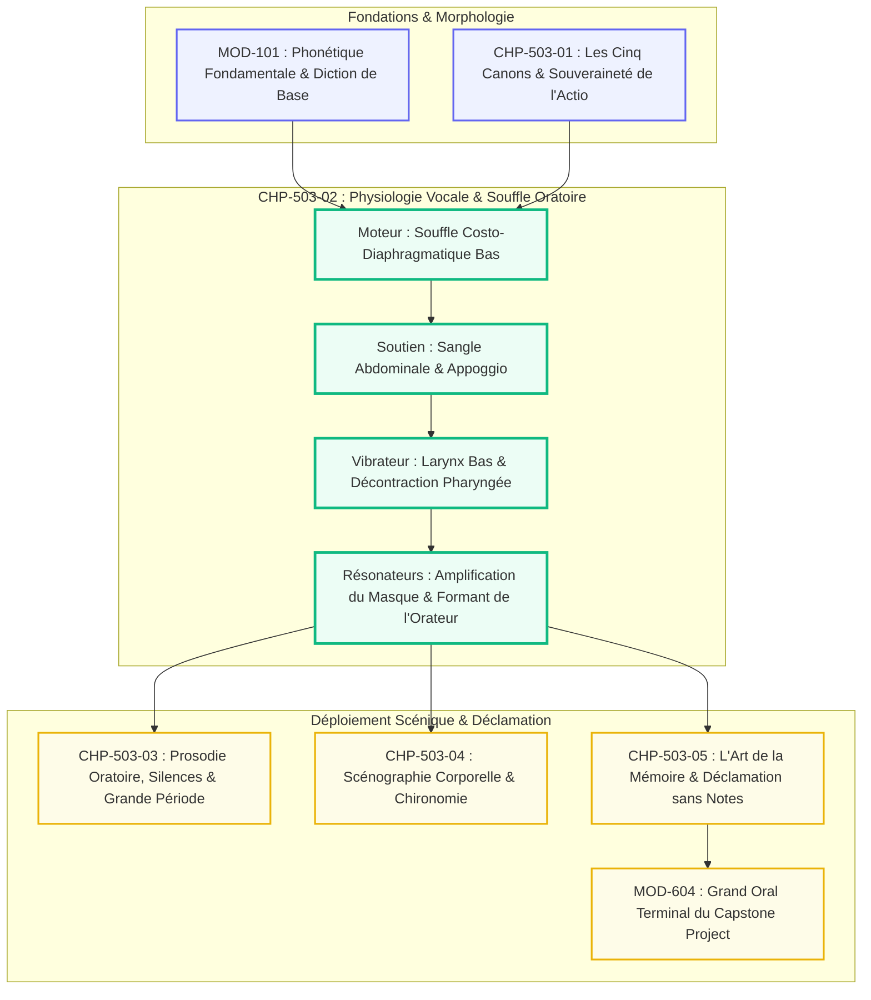
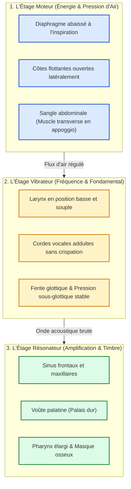

# Chapitre 2 — Physiologie de la Voix Parlée, Technique du Souffle et Projection Acoustique : De l'Ancrage Diaphragmatique aux Résonateurs du Masque

> **Identifiant du chapitre** : `CHP-503-02`  
> **Module de rattachement** : [`MOD-503` — Haute Éloquence : Déclamation Classique, Souffle et Présence Oratoire](file:///f:/Formation/world-class-french/03-curriculum/year-3/semester-5/mod-503-haute-eloquence-declamation-presence-oratoire.md)  
> **Semestre** : Année 3 — Semestre 5 (S5)  
> **Volume horaire canonique** : 5 à 6 heures d'apprentissage autonome délibéré et d'ateliers d'application (Phase 1 Étude théorique et acoustique : 1 h 30 | Phase 2 Entraînement au souffle et vocalises : 1 h 30 | Phase 3 Correction et diagnostic de forçage : 1 h 00 | Phase 4 Évaluation de projection : 1 h 00)  
> **Statut du document** : [STATUT : VALIDÉ]  
> **Alignement référentiel** : [`academic-structure.md`](file:///f:/Formation/world-class-french/01-architecture/academic-structure.md), [`competency-framework.md`](file:///f:/Formation/world-class-french/02-competency-framework/competency-framework.md) (`FR-INT-005`, `FR-PHON-001`), [`source-registry.md`](file:///f:/Formation/world-class-french/07-resources/source-registry.md) (`SRC-PHON-01`, `SRC-PHON-02`, `SRC-RHET-03`, `SRC-NORM-03`, `SRC-TYPO-01`)

---

## 1. Titre et Place dans le Cursus

Le présent chapitre constitue le fondement physiologique et acoustique de la parole oratoire dans le cursus *World-Class French*. Alors que le premier chapitre a restauré la suprématie rhétorique de l'*actio* (`CHP-503-01`), `CHP-503-02` descend dans l'anatomie de l'orateur pour transformer son organisme en un résonateur acoustique performant, capable d'emplir un vaste espace sans micro et sans aucune fatigue vocale.



---

## 2. Objectifs Mesurables

Au terme de l'étude et des ateliers d'application de ce chapitre, l'étudiant doit maîtriser les quatre compétences opérationnelles suivantes (niveau L4 — Maîtrise approfondie) :

1. **Exécuter une inspiration costo-diaphragmatique basse silencieuse** en moins de 1,5 seconde, sans aucun soulèvement claviculaire ni haussement d'épaules, avec une expansion latérale vérifiable des basses côtes flottantes [Réf. `SRC-PHON-01`, chap. 3].
2. **Maintenir un soutien vocal continu (*appoggio*)** régulé par le muscle transverse de l'abdomen, assurant une émission phonatoire stable sur voyelle tenue pendant au moins 25 secondes à 72 dB sans tremblement ni chute de pression.
3. **Placer le timbre vocal dans les résonateurs osseux du masque facial** (sinus, voûte palatine), déclenchant le *formant de l'orateur* (regroupement spectral d'énergie entre 2 800 et 3 200 Hz) audible distinctement à 20 mètres sans amplification [Réf. `SRC-PHON-01`].
4. **Appliquer un protocole complet de déverrouillage et d'hygiène vocale** avant toute prise de parole publique (massage du plancher buccal, ouverture vélo-pharyngée, résonance labiale en trille de lèvres) afin de préserver l'appareil laryngé de toute lésion ou dysphonie.

---

## 3. Prérequis et Test de Préparation

### 3.1 Prérequis Théoriques et Pratiques
- Connaissance de l'appareil phonatoire humain élémentaire (poumons, trachée, cordes vocales, bouche) [validé en `MOD-101`].
- Capacité à respirer par le nez de manière calme au repos sans forçage inspiratoire.
- Connaissance des principes de l'*actio* oratoire et de la posture d'apparat [validé en `CHP-503-01`].

### 3.2 Test Diagnostique de Préparation (5 questions)

<details>
<summary><strong>Question 1 : Quel est le principal muscle moteur de l'inspiration humaine ?</strong></summary>

**Réponse** : Le diaphragme. C'est un grand muscle en forme de coupole séparant la cavité thoracique de la cavité abdominale. En se contractant, il s'abaisse et s'aplatit, créant une dépression intrathoracique qui aspire l'air dans les poumons.
</details>

<details>
<summary><strong>Question 2 : Pourquoi la respiration claviculaire haute est-elle délétère pour l'orateur ?</strong></summary>

**Réponse** : Parce qu'elle sollicite les muscles accessoires du cou (scalènes, sternocléidomastoïdiens), verrouille le larynx en position haute, engendre une forte tension pharyngée et ne remplit que le sommet étroit des poumons, provoquant un essoufflement rapide et un forçage laryngé.
</details>

<details>
<summary><strong>Question 3 : En quoi consiste l'appoggio (ou soutien abdominal) de la technique vocale classique ?</strong></summary>

**Réponse** : C'est la régulation active de la remontée du diaphragme par la sangle abdominale basse (notamment le muscle transverse). L'orateur maintient une sensation d'ouverture des côtes basses pendant l'expiration, délivrant ainsi un débit d'air constant et maîtrisé aux cordes vocales.
</details>

<details>
<summary><strong>Question 4 : Qu'appelle-t-on les « résonateurs du masque » dans la tradition vocale ?</strong></summary>

**Réponse** : Ce sont les structures et cavités osseuses de la face supérieure : la voûte du palais dur, les sinus maxillaires, les fosses nasales et les sinus frontaux. Faire vibrer le son dans le masque amplifie les harmoniques aiguës sans forcer sur la gorge.
</details>

<details>
<summary><strong>Question 5 : Qu'est-ce que le « formant de l'orateur » (speaker's formant) sur le plan acoustique ?</strong></summary>

**Réponse** : C'est une concentration d'énergie acoustique dans la zone de fréquences située entre 2 800 et 3 200 Hz, obtenue par l'abaissement souple du larynx et l'ouverture du pharynx. Cette fréquence traverse les bruits ambiants et permet à la voix parlée d'être entendue de loin avec netteté.
</details>

---

## 4. Situation de Départ ou Problème Concret

Considérons la situation dramatique mais fréquente d'un jeune conférencier ou d'un juriste talentueux appelé à plaider dans une vaste salle d'audience sans sonorisation :

> *Dès les premières minutes, sous l'effet du trac, l'orateur respire en soulevant convulsivement les épaules. Chaque inspiration produit un sifflement sec. Sa voix, initialement posée, grimpe vers les aigus criards. Ses trapèzes et son cou se raidissent ; ses veines jugulaires saillent sous la peau. Au bout de sept minutes, la gorge s'assèche, une toux réflexe interrompt sa plaidoirie, et à la douzième minute, sa voix s'éteint dans un souffle rauque et éraillé. L'auditoire du fond de la salle renonce à écouter.*

Cet échec cuisant n'est pas imputable à la faiblesse des arguments (*logos*), mais à une méconnaissance radicale de la **physiologie du souffle et de l'acoustique corporelle**. L'orateur a cru que pour se faire entendre, il fallait « pousser » avec la gorge et hausser le ton, transformant son larynx en un étau destructeur.

---

## 5. Explication Intuitive

Pour comprendre l'anatomie de la voix oratoire, utilisons **l'analogie de la contrebasse et de son arche acoustique** :

```text
======================================================================
         ANALOGIE DE L'INSTRUMENT DE MUSIQUE APPLIQUÉE À L'ORATEUR
======================================================================
1. LE MOTEUR DU FLUX      : Le soufflet de forge / Le diaphragme bas
   -> Sans réserve d'air stable et profonde, aucun son ne peut durer.
----------------------------------------------------------------------
2. LE VIBRATEUR INITIAL   : Les cordes pincées / Les cordes vocales
   -> Elles ne créent qu'un bourdonnement faible (20 à 30 dB).
----------------------------------------------------------------------
3. LA CAISSE DE RÉSONANCE : Le corps en bois de l'instrument / Le masque
   -> C'est la boîte osseuse de la face qui transforme ce faible
      bourdonnement en un son puissant, cuivré et majestueux.
======================================================================
```

Si un contrebassiste serrait violemment la caisse de son instrument avec des sangles en fer, le bois ne vibrerait plus et l'instrument ne produirait qu'un claquement sec. De la même façon, lorsque l'orateur serre la gorge et contracte le cou, il étouffe sa propre caisse de résonance. Le secret du grand orateur ne réside pas dans la force musculaire de la gorge, mais dans la **totale décontraction du cou associée à la puissance du souffle abdominal**.

---

## 6. Définitions Précises et Terminologie

- **Appareil phonatoire** : Ensemble des organes concourant à la production de la voix parlée et chantée, articulé en trois sous-systèmes : le moteur respiratoire (poumons, diaphragme, abdomen), le vibrateur laryngé (larynx, cordes vocales) et les résonateurs supra-glottiques (pharynx, cavité buccale, cavités nasales et faciales).
- **Diaphragme** : Muscle strié transversal fermant la base de la cage thoracique, principal moteur inspiratoire dont l'abaissement passif ou commandé dilate les poumons dans le sens vertical.
- **Respiration costo-diaphragmatique** : Mode respiratoire optimal de l'orateur, caractérisé par un mouvement conjoint d'abaissement diaphragmatique et d'écartement latéral des fausses côtes et côtes flottantes, sans mobilité claviculaire.
- **Soutien vocal (*appoggio*)** : Pratique neuromusculaire issue du bel canto italien consistant à retenir activement le flux expiratoire par une tonicité mesurée de la paroi abdominale antérieure et des muscles intercostaux externes, maintenant une pression sous-glottique constante.
- **Pression sous-glottique** : Force aérodynamique exercée par la colonne d'air expiratoire sous les cordes vocales adduites, conditionnant l'intensité sonore et la stabilité de l'onde acoustique.
- **Masque osseux (ou « le masque »)** : Région antérieure de la face comprenant le maxillaire supérieur, les os propres du nez, les arcades sourcilières et les cavités sinusiennes, faisant office de récepteur et d'amplificateur des harmoniques de haute fréquence.
- **Formant de l'orateur (*speaker's formant*)** : Renforcement du spectre sonore obtenu entre 2,8 et 3,2 kHz par le couplage résonant de la cavité de Morgagni, du bas pharynx élargi et du vestibule laryngé abaissé.
- **Attaque vocale** : Instant précis d'accolement des cordes vocales lors du déclenchement du son. On distingue l'attaque douce (optimale), l'attaque soufflée (défaut de fermeture) et le coup de glotte (claquement traumatique proscrit).

---

## 7. Règles et Mécanismes Fondamentaux

### 7.1 L'Édifice Tripartite de l'Appareil Phonatoire

La production vocale souveraine repose sur la coordination millimétrée de trois étages physiologiques distincts :



### 7.2 La Respiration Costo-Diaphragmatique Basse

1. **Phase inspiratoire oratoire** :
   - Le diaphragme s'abaisse doucement ; les viscères abdominaux s'avancent sans heurt (le ventre se déploie sans effort) ;
   - Les côtes inférieures (7e à 10e) s'ouvrent vers l'extérieur comme les anses d'un seau qu'on soulève ;
   - Le cou, la mâchoire et les trapèzes demeurent dans une totale léthargie musculaire.
2. **Proscription absolue de la respiration claviculaire** :
   - Tout soulèvement de la poitrine ou des épaules active le réflexe de contraction du constricteur pharyngé, étranglant la source vocale.

### 7.3 Le Soutien Vocal (*Appoggio*) et la Colonne d'Air

- L'air ne doit jamais être expulsé passivement : il est **conduit et soutenu**.
- À l'attaque de la phrase, le muscle transverse abdominal commence une lente rétraction centripète (le bas-ventre remonte vers l'intérieur et vers le haut avec une fermeté souple).
- Cette poussée abdominale équilibre la détente du diaphragme : la pression sous-glottique reste millimétriquement constante du premier mot au mot terminal de la période oratoire.

### 7.4 La Projection Acoustique : Crier contre Projeter

| Paramètre physiologique | Le cri (Forçage pharyngé pathologique) | La projection oratoire (Amplification acoustique noble) |
| :--- | :--- | :--- |
| **Hauteur du larynx** | Remonté vers le haut, comprimé sous la mâchoire. | Abaissé et stabilisé dans une position neutre et souple. |
| **Muscles du pharynx** | Resserrement convulsif des constricteurs du pharynx. | Élargissement de l'arrière-gorge (sensation de « bâillement intérieur »). |
| **Zone de vibration ressentie** | Brûlure et raclement au niveau de la pomme d'Adam. | Chatouillement osseux vibrant sous le nez, les pommettes et les dents. |
| **Fatigabilité vocale** | Enrouement en 10 minutes, risque d'aphasie et de nodules. | Endurance de 3 heures de discours sans aucune altération de timbre. |
| **Portée dans l'espace** | Son criard, agressif à 2 mètres mais inintelligible à 25 mètres. | Son noble, rond, intelligible et velouté à 40 mètres. |

### 7.5 Le Protocole d'Échauffement Quotidien de l'Orateur

Chaque séance de prise de parole doit être précédée d'un rituel en quatre étapes de 10 minutes :
1. **Étape 1 : Réveil corporel et déverrouillage de l'axe** (enroulement vertébral, rotations lentes de la tête).
2. **Étape 2 : Respiration diaphragmatique dynamique** (inspirations courtes et silencieuses en 1 s, expirations freinées en [s] ou [f] sur 30 s).
3. **Étape 3 : Résonance labiale sans effort** (trille de lèvres *brrr...* en arpèges ascendants et descendants, connectant le souffle au masque).
4. **Étape 4 : Mâchonnement sonore et ouverture vélo-pharyngée** (sons de bouche fermée [m...] en faisant sonner les os de la face).

---

## 8. Raisonnement Détaillé

Pourquoi la projection vocale par le masque est-elle infiniment supérieure à l'augmentation du volume sonore brut ?

En acoustique physique, l'énergie d'un son s'atténue avec le carré de la distance selon la loi en champ libre. Si un orateur cherche à se faire entendre au fond d'un amphithéâtre en forçant son volume pulmonaire, il dépense une énergie considérable qui détériore les muqueuses glottiques : chaque doublement de puissance acoustique exige un décuplement d'effort musculaire sous-glottique.

À l'inverse, l'exploitation du **masque osseux** et du **formant de l'orateur** agit comme un transformateur d'impédance acoustique. Les cavités du pharynx et du visage regroupent l'énergie dans une bande spectrale spécifique ($2{,}8\text{--}3{,}2\text{ kHz}$) où deux phénomènes convergents se produisent :
1. **Sensibilité optimale de l'oreille humaine** : La courbe d'audibilité humaine (isosonique de Fletcher-Munson) présente sa sensibilité maximale précisément entre 2 500 et 4 000 Hz, zone du conduit auditif externe.
2. **Absence de concurrence spectrale** : Le brouhaha ambiant d'une assemblée humaine (toux, chuchotements, ventilation) concentre son spectre d'énergie sous 1 500 Hz. La voix de l'orateur passe littéralement « au-dessus » du bruit sans qu'il ait besoin d'élever la voix. Le verbe oratoire découpe le silence avec la netteté d'un diamant taillé.

---

## 9. Exemples Corrects Commentés

### 9.1 Exemple 1 : Attaque Vocale et Déploiement du Souffle sur une Période d'Apparat

Soit l'ouverture d'un discours solennel prononcé devant une vaste assemblée :

> *« Messieurs, au moment où s'ouvre cette délibération solennelle, nous mesurons le poids écrasant de nos devoirs. »*

#### Décorticage Physiologique Pas-à-Pas
1. **Pré-phonation (-2 secondes)** : L'orateur est immobile au pupitre. Inspiration basse nasale/buccale silencieuse en 1,5 seconde ; expansion bilatérale des côtes inférieures ; le ventre se détend sans projection forcée.
2. **Attaque du premier mot (*Messieurs*)** :
   - Mise en tension douce de la sangle abdominale (*appoggio*) ;
   - Le son [m] initial est intentionnellement prolongé pendant 0,3 seconde pour déclencher la vibration osseuse dans les sinus maxillaires ;
   - La voyelle [ø] s'appuie sur le pharynx dilaté, évitant tout pincement laryngé.
3. **Traversée de la proposition subordonnée** :
   - Le souffle est économisé ; la pression d'air reste constante grâce au soutien abdominal ;
   - Le débit est régulé sur le *tempo lento* (110 mots/min).
4. **Clausule terminale (*nos devoirs*)** :
   - Le dernier mot n'est pas soufflé ou étouffé par manque d'air : l'orateur achève la phrase avec un réservoir d'air résiduel de 30 %, garantissant un timbre ferme et rond jusqu'au point final.

### 9.2 Exemple 2 : L'Appel des Harmoniques du Masque sur une Voyelle Ouverte

Sur une exclamation oratoire noble :

> *« Quelle clarté s'élève sur nos destinées ! »*

- Le mot *clarté* est projeté en faisant vibrer la consonne occlusive sourde [k] contre le palais dur, suivie de la voyelle ouverte [a] qui s'épanouit dans toute la voûte buccale.
- L'orateur imagine que la voix sort par les yeux et le front plutôt que par la bouche : le son prend une brillance métallique flatteuse sans aucune acidité dans les aigus.

---

## 10. Contre-Exemples et Erreurs Fréquentes

Cette section présente six erreurs majeures de physiologie vocale fréquemment commises lors de la prise de parole publique.

### Erreur n° 1 : L'inspiration haute claviculaire avec haussement d'épaules
- **Manifestation** : L'orateur monte la poitrine et hausse les épaules avant chaque début de phrase, produisant un bruit d'aspiration rauque.
- **Diagnostic anatomique** : Paralysie du diaphragme par crispation psychologique ; remplissage exclusif des lobes pulmonaires supérieurs.
- **Remède chirurgical** : Poser une main sur le bas-ventre et une main sur les côtes flottantes. S'interdire formellement tout mouvement du buste supérieur devant un miroir.

### Erreur n° 2 : Le forçage vocal laryngé (« parler avec la gorge »)
- **Manifestation** : La voix devient criarde, métallique et abrasive au bout de cinq minutes d'intervention publique.
- **Diagnostic anatomique** : Le larynx est tiré vers le haut par les muscles sus-hyoïdiens ; les cordes vocales se heurtent violemment sans coussin d'air résonant.
- **Remède chirurgical** : Déclencher un réflexe de début de bâillement pour abaisser la pomme d'Adam et ouvrir le fond de la gorge.

### Erreur n° 3 : L'affaissement du soutien en fin de phrase (l'extinction finale)
- **Manifestation** : Les débuts de phrase sont sonores, mais les trois derniers mots deviennent inaudibles et s'effondrent dans un râle glottique.
- **Diagnostic anatomique** : Relâchement prématuré du muscle transverse de l'abdomen avant l'achèvement de l'unité de souffle.
- **Remède chirurgical** : Conserver la poussée d'appoggio jusqu'au silence complet. Penser la dernière syllabe de la phrase comme la plus lumineuse de la proposition.

### Erreur n° 4 : Le coup de glotte intempestif sur les voyelles d'attaque
- **Manifestation** : Chaque mot commençant par une voyelle est précédé d'un claquement sec et dur (*« ?Il faut ?agir »*).
- **Diagnostic anatomique** : Fermeture spasmodique des cordes vocales qui s'écartent brutalement sous une pression sous-glottique excessive.
- **Remède chirurgical** : Précéder l'attaque vocalique d'un imperceptible filet d'air doux (attaque douce liée).

### Erreur n° 5 : La voix de gorge enserrée sans exploitation du masque
- **Manifestation** : Voix étouffée, sourde, manquant cruellement de brillance, inaudible dès le troisième rang de la salle.
- **Diagnostic anatomique** : Voile du palais affaissé, résonateurs de la face complètement court-circuités.
- **Remède chirurgical** : S'exercer à fredonner sur [m...] et [n...] en posant l'index sur les narines pour ressentir la vibration vibratoire des os nasaux.

### Erreur n° 6 : Le raclement de gorge compulsif en cours de discours
- **Manifestation** : L'orateur toussote et se racle la gorge toutes les deux minutes pour « s'éclaircir la voix ».
- **Diagnostic anatomique** : Le raclement heurte violemment les cordes vocales entre elles, créant une inflammation immédiate et une hypersécrétion de mucus défensif.
- **Remède chirurgical** : Remplacer le raclement par une déglutition calme d'une goutte de salive ou une gorgée d'eau tempérée sans bulles.

```text
Tableau synoptique des dysfonctionnements physiologiques :
+---------------+------------------------+--------------------------+-----------------------+
| N° anomalie   | Symptôme visible       | Cause biomécanique       | Protocole correctif   |
+---------------+------------------------+--------------------------+-----------------------+
| Dysfonction 1 | Épaules soulevées      | Respiration claviculaire | Ancrage bas-ventre    |
| Dysfonction 2 | Voix criarde et serrée | Larynx haut comprimé     | Bâillement intérieur  |
| Dysfonction 3 | Fin de phrase avalée   | Rupture de soutien       | Appoggio prolongé     |
| Dysfonction 4 | Claquement glottique   | Attaque dure spasmodique | Attaque douce liée    |
| Dysfonction 5 | Voix sourde et mate    | Masque facial inactif    | Vocalises en [m]      |
| Dysfonction 6 | Raclements répétés     | Traumatisme frictionnel  | Déglutition douce     |
+---------------+------------------------+--------------------------+-----------------------+
```

---

## 11. Cas Particuliers et Limites

1. **La prise de parole en milieu très réverbérant (églises, grandes nefs de marbre)** :
   - Dans un lieu à réverbération longue ($> 2$ secondes), l'orateur doit impérativement ralentir son débit à 95-100 mots par minute et surarticuler les consonnes. Toute tentative d'élever la voix noie le discours dans un écho indistinct.
2. **La gestion de la prise de parole sous climatisation ou air sec** :
   - L'air conditionné assèche drastiquement la muqueuse des cordes vocales. L'orateur doit respirer exclusivement par le nez pendant les silences d'écoute pour réchauffer et humidifier l'air inspiré, et boire de l'eau à température ambiante (jamais glacée).
3. **La fatigue vocale aiguë (enrouement pré-conférence)** :
   - Si les cordes vocales sont fatiguées, s'abstenir formellement de chuchoter (le chuchotement fatigue davantage les cordes vocales que la parole normale). Utiliser le filet d'air détendu et maximiser l'amplification osseuse du masque.

---

## 12. Approfondissement Adapté au Niveau

### La Théorie Myoélastique-Aérodynamique et le Théorème de Titze

La phonation humaine est modélisée par la **théorie myoélastique-aérodynamique** de Van den Berg complétée par les travaux d'Ingo Titze sur les oscillateurs auto-entretenus non linéaires. Les cordes vocales ne s'ouvrent et ne se ferment pas par des impulsions nerveuses motrices individuelles pour chaque vibration, mais par l'effet Bernoulli aérodynamique combiné à l'élasticité propre du ligament vocal et de la muqueuse (complexe corps-couverture de Hirano).

Le couplage acoustique entre le tractus vocal supra-glottique et les cordes vocales permet une rétroaction positive d'inertance acoustique :
$$\text{Impédance } Z = R + j\omega L$$
Lorsque le tractus vocal est configuré avec un pharynx large et un rétrécissement épiglottique modéré (configuration du pavillon de trompette inversé), la charge acoustique devient inerte, diminuant la pression seuil de phonation ($P_{\text{th}}$). 

En termes pédagogiques : **plus l'arrière-gorge est ouverte et détendue, moins les cordes vocales ont besoin de pression d'air pour vibrer à pleine puissance**. C'est le triomphe de la forme géométrique du tractus vocal sur la force musculaire brute.

---

## 13. Comparaisons Différentielles

### 13.1 Souffle Thoracique Haut vs Souffle Costo-Diaphragmatique Bas

| Critère d'évaluation | Souffle thoracique haut (claviculaire) | Souffle costo-diaphragmatique bas |
| :--- | :--- | :--- |
| **Volume d'air inspiré** | Faible à moyen (lobes supérieurs étroits). | Maximal (base élargie des poumons). |
| **Temps d'inspiration** | 2,5 à 4 secondes (laborieux). | 0,8 à 1,5 seconde (instantané et silencieux). |
| **Impact sur le cou** | Tensions vives des trapèzes et sternocléidomastoïdiens. | Décontraction absolue du larynx et de la nuque. |
| **Soutien de la pression** | Aléatoire, saccadé, dépendant de l'affaissement thoracique. | Millimétrique, réglé par la sangle abdominale (*appoggio*). |
| **Effet psychologique** | Augmente le rythme cardiaque et le niveau d'anxiété. | Apaise le système nerveux autonome (tonus vagal). |

### 13.2 Forçage Laryngé vs Résonance du Masque

| Axe comparatif | Forçage de gorge | Résonance du masque osseux |
| :--- | :--- | :--- |
| **Physique du phénomène** | Friction musculaire et hématome muqueux. | Amplification par sympathie dans les cavités faciales. |
| **Fréquences renforcées** | Aigus stridents et instables (4 000-6 000 Hz). | Formant équilibré et chaleureux (2 800-3 200 Hz). |
| **Sensation oratoire** | Douleur, picotement, gorge nouée. | Vibrations chatouilleuses agréables aux lèvres et au nez. |
| **Clarté du verbe** | Brouillonne, avalée par les basses fréquences. | Cristalline, incisive, détachement des syllabes. |

---

## 14. Exercices Progressifs

### 14.1 Niveau 1 : Diagnostics Posturaux et Réflexes de Souffle
Effectuer les exercices suivants et consigner les observations :
1. *Allongé au sol sur le dos*, poser un livre épais sur le nombril. Inspirer : le livre doit monter de 4 à 6 cm sans que la poitrine ne bouge. Expirer : le livre redescend lentement en 20 secondes.
2. *Debout*, placer les deux pouces dans le dos et les doigts sur les basses côtes flottantes. Inspirer par le nez : sentir l'ouverture latérale des côtes repousser les mains vers l'extérieur.

### 14.2 Niveau 2 : Vocalises de Résonance du Masque et Déverrouillage Pharyngé
1. Émettre un son continu de bouche fermée [m...] sur une note médiane confortable. Chercher à faire vibrer les os du nez et le palais dur jusqu'à ressentir une vibration sensible sous l'ongle du doigt posé sur l'arête nasale.
2. Enchaîner sans rupture de souffle du son [m...] vers la voyelle ouverte [a] en maintenant exactement le même placement osseux : *« mmm-aaa-mmm-aaa »*. Vérifier que le son ne retombe pas dans la gorge lors du passage au [a].

### 14.3 Niveau 3 : Analyse Acoustique et Déclaration de Maîtrise d'un Orateur

Texte sous contrainte métrique stricte de 50 mots exacts (décompte selon `SRC-TYPO-01`) analysant le fonctionnement du masque chez un orateur d'apparat :

> *« Le souffle profond soutenu par l'appoggio abdominal monte sans heurt vers les cordes vocales détendues. En abaissant son larynx et en dilatant le pharynx, l'orateur projette l'onde dans le masque facial. Les harmoniques s'amplifient avec éclat, portant le verbe au fond de la vaste nef sonore. »*

#### Tableau de Décompte Mot à Mot Certifié (50 mots exacts)

| N° | Mot | Réf. Typographique | N° | Mot | Réf. Typographique |
| :---: | :--- | :--- | :---: | :--- | :--- |
| 1 | Le | Substantif déterminé | 26 | l' | Élision apostrophée (1 mot) |
| 2 | souffle | Nom commun | 27 | orateur | Nom commun |
| 3 | profond | Adjectif qualificatif | 28 | projette | Verbe transitif |
| 4 | soutenu | Participe passé | 29 | l' | Élision apostrophée (1 mot) |
| 5 | par | Préposition | 30 | onde | Nom commun |
| 6 | l' | Élision apostrophée (1 mot) | 31 | dans | Préposition |
| 7 | appoggio | Nom commun technique | 32 | le | Déterminant |
| 8 | abdominal | Adjectif qualificatif | 33 | masque | Nom commun |
| 9 | monte | Verbe intransitif | 34 | facial. | Nom avec point |
| 10 | sans | Préposition | 35 | Les | Déterminant majuscule |
| 11 | heurt | Nom commun | 36 | harmoniques | Nom commun |
| 12 | vers | Préposition | 37 | s' | Élision pronominale (1 mot) |
| 13 | les | Déterminant pluriel | 38 | amplifient | Verbe pronominal |
| 14 | cordes | Nom commun | 39 | avec | Préposition |
| 15 | vocales | Adjectif qualificatif | 40 | éclat, | Nom avec virgule |
| 16 | détendues. | Adjectif avec point | 41 | portant | Participe présent |
| 17 | En | Préposition majuscule | 42 | le | Déterminant |
| 18 | abaissant | Participe présent | 43 | verbe | Nom commun |
| 19 | son | Déterminant possessif | 44 | au | Article contracté |
| 20 | larynx | Nom commun | 45 | fond | Nom commun |
| 21 | et | Conjonction de coordination | 46 | de | Préposition |
| 22 | en | Préposition | 47 | la | Déterminant |
| 23 | dilatant | Participe présent | 48 | vaste | Adjectif qualificatif |
| 24 | le | Déterminant | 49 | nef | Nom commun |
| 25 | pharynx, | Nom avec virgule | 50 | sonore. | Adjectif avec point final |

---

## 15. Activité de Correction Raisonnée

Considérons le journal de bord d'un étudiant orateur confronté à un échec vocal :

> *« Extrait à redresser : Pour me faire entendre au fond du gymnase, j'ai pris une grande goulée d'air en gonflant bien la poitrine et les épaules, puis j'ai crié de toutes mes forces en poussant avec la gorge. Chaque fois que je sentais un chatouillement, je me raclais fort la glotte pour dégager les cordes vocales. Vers la fin, pour être plus fort, j'ai levé la tête vers le haut et serré les mâchoires pour concentrer la voix. Résultat : je suis aphone depuis trois jours. »*

### Analyse Critique des 5 Anomalies Physiologiques
1. *« gonflant bien la poitrine et les épaules »* : Respiration haute claviculaire traumatique qui bloque l'abaissement laryngé.
2. *« crié de toutes mes forces en poussant avec la gorge »* : Forçage pharyngé destructeur au lieu de projeter par les résonateurs faciaux.
3. *« raclais fort la glotte »* : Choc traumatique mécanique écrasant les muqueuses vocales irritées.
4. *« levé la tête vers le haut »* : Hyperextension cervicale bloquant le larynx contre la colonne vertébrale.
5. *« serré les mâchoires »* : Verrouillage mandibulaire fermant la cavité buccale et étouffant toute amplification acoustique.

### Version Corrigée selon les Règles de l'Art
> *« Pour porter souverainement jusqu'au fond de la vaste salle, j'ai exécuté une inspiration costo-diaphragmatique basse silencieuse, laissant le bas-ventre et les côtes flottantes s'ouvrir librement. Le larynx abaissé et le pharynx détendu, j'ai soutenu l'expiration par le muscle transverse de l'abdomen, guidant l'onde sonore vers la voûte palatine et les sinus du masque facial. La mâchoire déverrouillée et la nuque souple ont libéré le formant aigu sans aucune friction de gorge. À chaque pause, une déglutition calme a préservé mes muqueuses, maintenant intacte l'intégrité de mon timbre durant toute l'oraison. »*

---

## 16. Mise en Pratique dans une Production Réelle

Rédiger le protocole d'incarnation vocale d'un orateur d'apparat au pupitre, calibré à **exactement 60 mots** selon les normes de l'Imprimerie nationale (`SRC-TYPO-01`).

### Texte Calibré (60 mots exacts)

> *« Ancré sur ses deux pieds, l'orateur déploie une inspiration basse silencieuse. Le diaphragme descend sans tension, ouvrant les côtes flottantes. L'appoggio abdominal soutient le souffle vers le larynx abaissé. Projetée dans les cavités du masque osseux, la voix libère le formant aigu souverain. Le timbre puissant emplit la salle sans aucune fatigue musculaire, subjuguant d'emblée l'auditoire. »*

#### Tableau de Décompte Mot à Mot Certifié (60 mots exacts)

| N° | Mot | Nature grammaticale | N° | Mot | Nature grammaticale |
| :---: | :--- | :--- | :---: | :--- | :--- |
| 1 | Ancré | Participe passé adjectivé | 31 | abaissé. | Participe passé avec point |
| 2 | sur | Préposition | 32 | Projetée | Participe passé adjectivé |
| 3 | ses | Déterminant possessif | 33 | dans | Préposition |
| 4 | deux | Adjectif numéral | 34 | les | Déterminant pluriel |
| 5 | pieds, | Nom avec virgule | 35 | cavités | Nom commun pluriel |
| 6 | l' | Article élidé (1 mot) | 36 | du | Article contracté |
| 7 | orateur | Nom commun | 37 | masque | Nom commun |
| 8 | déploie | Verbe transitif | 38 | osseux, | Adjectif qualificatif avec virgule |
| 9 | une | Déterminant indéfini | 39 | la | Déterminant féminin |
| 10 | inspiration | Nom commun | 40 | voix | Nom commun |
| 11 | basse | Adjectif qualificatif | 41 | libère | Verbe transitif |
| 12 | silencieuse. | Adjectif avec point | 42 | le | Déterminant masculin |
| 13 | Le | Déterminant majuscule | 43 | formant | Nom commun |
| 14 | diaphragme | Nom commun | 44 | aigu | Adjectif qualificatif |
| 15 | descend | Verbe intransitif | 45 | souverain. | Adjectif avec point |
| 16 | sans | Préposition | 46 | Le | Déterminant majuscule |
| 17 | tension, | Nom avec virgule | 47 | timbre | Nom commun |
| 18 | ouvrant | Participe présent | 48 | puissant | Adjectif qualificatif |
| 19 | les | Déterminant pluriel | 49 | emplit | Verbe transitif |
| 20 | côtes | Nom commun pluriel | 50 | la | Déterminant féminin |
| 21 | flottantes. | Adjectif avec point | 51 | salle | Nom commun |
| 22 | L' | Article élidé (1 mot) | 52 | sans | Préposition |
| 23 | appoggio | Nom commun technique | 53 | aucune | Déterminant indéfini |
| 24 | abdominal | Adjectif qualificatif | 54 | fatigue | Nom commun |
| 25 | soutient | Verbe transitif | 55 | musculaire, | Adjectif avec virgule |
| 26 | le | Déterminant masculin | 56 | subjuguant | Participe présent |
| 27 | souffle | Nom commun | 57 | d' | Préposition élidée (1 mot) |
| 28 | vers | Préposition | 58 | emblée | Adverbe figé |
| 29 | le | Déterminant masculin | 59 | l' | Article élidé (1 mot) |
| 30 | larynx | Nom commun | 60 | auditoire. | Nom avec point final |

---

## 17. Résumé Structuré

```text
======================================================================
               LE CYCLE PHYSIOLOGIQUE DE LA VOIX SOUVERAINE
======================================================================
1. INSPIRATION BASSE SILENCIEUSE (< 1,5 s)
   -> Abaissement du diaphragme + Écartement des côtes flottantes
   -> Épaules immobiles | Cou souple | Mâchoire relâchée
----------------------------------------------------------------------
2. SOUTIEN ACTIF (APPOGGIO ABDOMINAL)
   -> Poussée mesurée et constante du muscle transverse vers le haut
   -> Pression sous-glottique stable du début à la fin de la période
----------------------------------------------------------------------
3. VIBRATION SANS SERRAGE (LARYNX BAS)
   -> Cordes vocales souples | Attaque liée douce | Pharynx dilaté
----------------------------------------------------------------------
4. PROJECTION ACOUSTIQUE DANS LE MASQUE
   -> Voûte palatine + Sinus maxillaires & frontaux
   -> Amplification du « formant de l'orateur » (2 800 - 3 200 Hz)
======================================================================
```

---

## 18. Questions de Rappel Actif (Active Recall)

<details>
<summary><strong>Question 1 : Quelle est la différence entre crier et projeter sa voix ?</strong></summary>

**Réponse** : Crier consiste à forcer musculairement sur les cordes vocales et le larynx resserré en expulsant brutalement de l'air, provoquant fatigue et enrouement rapide. Projeter consiste à maintenir un larynx bas et détendu tout en dirigeant le son vers les résonateurs osseux de la face (le masque) qui amplifient naturellement les harmoniques aiguës sans effort glottique.
</details>

<details>
<summary><strong>Question 2 : Comment repérer visuellement une respiration d'angoisse chez un orateur débutant ?</strong></summary>

**Réponse** : Par le soulèvement vertical des clavicules et des épaules à chaque inspiration, accompagné d'une crispation visible des muscles latéraux du cou et d'un sifflement inspiratoire sec.
</details>

<details>
<summary><strong>Question 3 : Pourquoi le raclement de gorge aggrave-t-il l'enrouement au lieu de le soulager ?</strong></summary>

**Réponse** : Parce que le raclement est une friction brutale des bords libres des cordes vocales l'un contre l'autre. Cette agression mécanique enflamme la muqueuse et stimule la production réflexe d'un mucus protecteur encore plus épais.
</details>

<details>
<summary><strong>Question 4 : Pourquoi le formant de l'orateur (2 800 - 3 200 Hz) traverse-t-il le bruit ambiant ?</strong></summary>

**Réponse** : Parce que le bruit ambiant d'une assemblée humaine se situe majoritairement en dessous de 1 500 Hz, et que la zone de 2 800 à 3 200 Hz correspond au pic de sensibilité acoustique du conduit auditif externe humain.
</details>

<details>
<summary><strong>Question 5 : Quel est le rôle du muscle transverse dans l'appoggio vocal ?</strong></summary>

**Réponse** : Le muscle transverse de l'abdomen forme une ceinture profonde qui régule la vitesse de remontée du diaphragme pendant l'expiration, délivrant un flux d'air à pression sous-glottique rigoureusement constante.
</details>

<details>
<summary><strong>Question 6 : Comment pratiquer le « bâillement intérieur » avant de prendre la parole ?</strong></summary>

**Réponse** : En amorçant l'inspiration bouche fermée ou entrouverte comme au début d'un bâillement naissant : le voile du palais monte, le larynx s'abaisse naturellement et l'arrière-gorge s'élargit, ouvrant l'espace de résonance optimal.
</details>

---

## 19. Mini-Évaluation Sommative Notée sur 20 Points

### Barème d'Évaluation de la Maîtrise Physiologique Vocale

| Critère d'évaluation | Indicateur observable | Points |
| :--- | :--- | :---: |
| **Mécanique du souffle** | Inspiration costo-diaphragmatique basse silencieuse ; immobilité claviculaire totale. | /5 |
| **Soutien et appoggio** | Régularité du flux expiratoire sur 15 minutes ; absence d'extinction des clausules finales. | /5 |
| **Placement et masque** | Brillance du timbre ; son ancré dans la face ; clarté acoustique à 15 mètres sans micro. | /5 |
| **Santé et endurance** | Larynx bas et détendu ; zéro raclement de gorge ; absence totale d'enrouement post-exercice. | /5 |
| **Total** | **Note globale de maîtrise vocale et physiologique** | **/20** |

*Clause éliminatoire* : Tout forçage laryngé audible entraînant un enrouement précoce ou un raclement compulsif répété au pupitre plafonne la note à un maximum de 09/20.

---

## 20. Critères Observables de Maîtrise

L'apprenant a validé ce chapitre s'il démontre, lors de l'examen pratique en direct :
- Un temps phonatoire soutenu $\ge 25$ secondes sur voyelle tenue à 70 dB avec un débit d'air stable.
- Une inspiration basse réalisée en moins de 1,5 seconde sans mouvement perceptible des épaules ni des clavicules.
- La projection distincte d'un texte d'apparat dans une salle de 150 places sans micro, confirmée par un jury placé au dernier rang sans perception de fatigue ni d'acidité dans les aigus.
- L'exécution autonome et sans aide du protocole d'échauffement phonatoire complet en 10 minutes.

---

## 21. Sources et Lectures Complémentaires

- **`SRC-PHON-01`** : Pierre LÉON, *Phonétique et prononciations du français*, Paris, Armand Colin (chapitre 3 : *Physiologie de la phonation, mécanique respiratoire et résonateurs*).
- **`SRC-PHON-02`** : Piet MERTENS, *La Prosodie du français : accentuation, intonation et syntaxe*, Louvain, Presses Universitaires (chapitre 2 : *Intensité, portée acoustique et débits oratoires*).
- **`SRC-RHET-03`** : Olivier REBOUL, *Introduction à la rhétorique*, Paris, PUF (chapitre 2 : *L'Actio oratoire et le corps parlant*).
- **`SRC-NORM-03`** : MINISTÈRE DE L'ÉDUCATION NATIONALE, *Terminologie grammaticale et phonétique officielle*, Paris.
- **`SRC-TYPO-01`** : IMPRIMERIE NATIONALE, *Lexique des règles typographiques en usage à l'Imprimerie nationale*, Paris.

---

## Annexe : Classification Pédagogique

- **CORE-NOW** : Respiration costo-diaphragmatique basse, soutien abdominal (*appoggio*), résonateurs du masque osseux, attaque douce.
- **INTRODUCTION-NOW** : Le formant de l'orateur (2 800-3 200 Hz), théorie myoélastique de Van den Berg et Titze.
- **DEFER** : Rééducation orthophonique avancée des pathologies laryngées sévères (nodules, polypes) $\to$ domaine médical spécialisé.
- **MOVE** : Prosodie et tempi oratoires $\to$ approfondis dans [`CHP-503-03`](file:///f:/Formation/world-class-french/03-curriculum/year-3/semester-5/mod-503/chp-503-03-prosodie-oratoire-silences-metrique-periode.md).
- **OPTIONAL-ADVANCED** : Spectrographie vocale informatisée en temps réel et tracé des formants F1/F2/F3 sur logiciel Praat.
- **REMOVE** : Mythologies de l'orateur forçant sur la gorge avec des galets dans la bouche (pratique déformée de Démosthène conduisant à des traumatismes glottiques).
