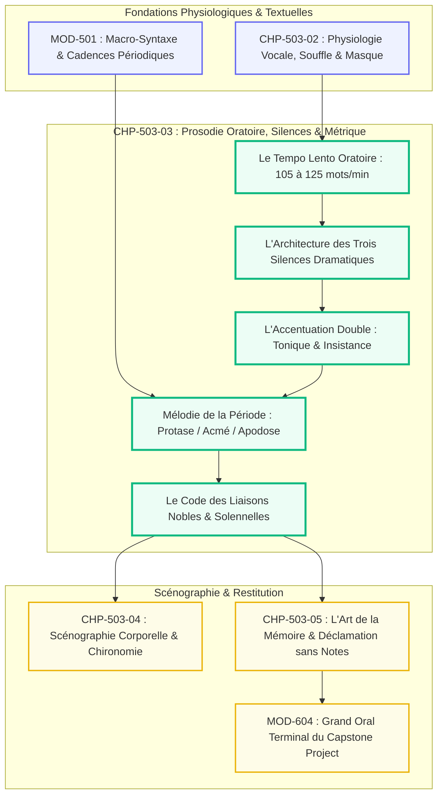
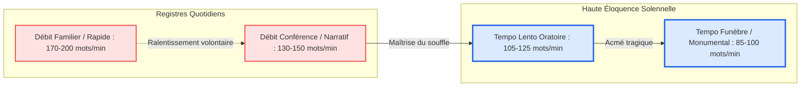

# Chapitre 3 — Prosodie Oratoire Avancée, Architecture des Silences et Métrique de la Période : Du Tempo Lento aux Trois Silences Dramatiques

> **Identifiant du chapitre** : `CHP-503-03`  
> **Module de rattachement** : [`MOD-503` — Haute Éloquence : Déclamation Classique, Souffle et Présence Oratoire](file:///f:/Formation/world-class-french/03-curriculum/year-3/semester-5/mod-503-haute-eloquence-declamation-presence-oratoire.md)  
> **Semestre** : Année 3 — Semestre 5 (S5)  
> **Volume horaire canonique** : 5 à 6 heures d'apprentissage autonome délibéré et d'ateliers d'application (Phase 1 Étude prosodique et métrique : 1 h 30 | Phase 2 Partition de textes et déclamation : 1 h 30 | Phase 3 Correction raisonnée et chronométrie : 1 h 00 | Phase 4 Évaluation en arène : 1 h 00)  
> **Statut du document** : [STATUT : VALIDÉ]  
> **Alignement référentiel** : [`academic-structure.md`](file:///f:/Formation/world-class-french/01-architecture/academic-structure.md), [`competency-framework.md`](file:///f:/Formation/world-class-french/02-competency-framework/competency-framework.md) (`FR-INT-005`, `FR-SYNTAX-003`, `FR-PHON-001`), [`source-registry.md`](file:///f:/Formation/world-class-french/07-resources/source-registry.md) (`SRC-PHON-02`, `SRC-PHON-01`, `SRC-RHET-03`, `SRC-GRAM-01`, `SRC-NORM-03`, `SRC-TYPO-01`)

---

## 1. Titre et Place dans le Cursus

Le présent chapitre explore l'architecture temporelle, musicale et rythmique de la haute éloquence française. Après avoir solidifié l'ancrage respiratoire et l'amplification acoustique du son dans [`CHP-503-02`](file:///f:/Formation/world-class-french/03-curriculum/year-3/semester-5/mod-503/chp-503-02-physiologie-voix-souffle-projection-acoustique.md), `CHP-503-03` élève la parole au rang d'une composition musicale savante où les syllabes, les accents d'insistance et, par-dessus tout, **les silences dramatiques** sculptent la conscience de l'auditoire.



---

## 2. Objectifs Mesurables

Au terme de l'étude et des ateliers d'application de ce chapitre, l'étudiant doit maîtriser les quatre compétences opérationnelles suivantes (niveau L4 — Maîtrise approfondie) :

1. **Réguler son débit verbal moyen sur le tempo lento d'apparat (105 à 125 mots par minute)**, attesté par chronométrage officiel sur un discours continu de 10 minutes sans emballement ni inertie léthargique [Réf. `SRC-PHON-02`, chap. 2].
2. **Orchestrer l'architecture des trois silences dramatiques** : exécuter avec autorité le silence inaugural d'exorde (4 à 6 s), le silence de suspens à l'acmé (2 à 3 s) et le silence conclusif de péroraison (3 à 5 s) sans aucune fuite visuelle ni geste parasite.
3. **Placer judicieusement l'accent d'insistance oratoire** (intellectuel sur la première consonne d'attaque ou affectif sur la voyelle initiale) sans dénaturer l'accent tonique final du groupe rythmique français [Réf. `SRC-PHON-01`, chap. 4].
4. **Déclamer une grande période oratoire trimembre ou quadrimembre** en épousant fidèlement la courbe mélodique (élévation tonale sur la protase, palier à l'acmé, chute résolutive en cadence majeure sur l'apodose) avec l'exécution impeccable des liaisons nobles du registre solennel [Réf. `SRC-GRAM-01`, `SRC-NORM-03`].

---

## 3. Prérequis et Test de Préparation

### 3.1 Prérequis Formels
- Maîtrise de la respiration costo-diaphragmatique basse et de l'*appoggio* [validé en [`CHP-503-02`](file:///f:/Formation/world-class-french/03-curriculum/year-3/semester-5/mod-503/chp-503-02-physiologie-voix-souffle-projection-acoustique.md)].
- Maîtrise théorique de la structure de la grande période oratoire (protase, acmé, apodose) [validé en `MOD-501`].
- Connaissance des règles canoniques des liaisons obligatoires et interdites du français standard [validé en `MOD-101`].

### 3.2 Test Diagnostique de Préparation (5 questions)

<details>
<summary><strong>Question 1 : Où se situe l'accent tonique fondamental en français standard ?</strong></summary>

**Réponse** : En français, l'accent tonique n'est pas lexical mais syntaxique : il frappe toujours la dernière syllabe pleine (non féminine en e muet) du groupe rythmique (syntagme).
</details>

<details>
<summary><strong>Question 2 : Quelle est la différence entre l'accent d'insistance intellectuel et l'accent d'insistance affectif ?</strong></summary>

**Réponse** : L'accent d'insistance intellectuel frappe avec netteté la première consonne du mot pour souligner une distinction conceptuelle (*« C'est une erreur **p**olitique et non **j**uridique »*). L'accent affectif frappe la voyelle initiale en l'allongeant pour exprimer une émotion vive (*« C'est un **i**mmense désastre »*).
</details>

<details>
<summary><strong>Question 3 : Quel est le débit moyen d'une conversation ordinaire comparé à celui de la haute éloquence ?</strong></summary>

**Réponse** : La conversation courante s'établit entre 160 et 190 mots par minute. La haute éloquence solennelle impose un tempo ralenti (*tempo lento*) compris entre 105 et 125 mots par minute.
</details>

<details>
<summary><strong>Question 4 : Pourquoi ne doit-on JAMAIS faire de liaison après la conjonction de coordination « et » ?</strong></summary>

**Réponse** : Parce qu'en français classique et moderne, la consonne *t* de la conjonction *et* est rigoureusement muette en toute circonstance. Y faire la liaison (*« et-z-alors », « et-t-ensuite »*) constitue une faute phonologique majeure et disqualifiante.
</details>

<details>
<summary><strong>Question 5 : Qu'appelle-t-on le silence d'acmé dans la déclamation d'une période ?</strong></summary>

**Réponse** : C'est une pause respiratoire et dramatique de 2 à 3 secondes suspendue au point culminant de la tension syntaxique, juste avant la bascule vers la proposition principale ou l'apodose résolutive.
</details>

---

## 4. Situation de Départ ou Problème Concret

Examinons le cas d'un candidat à un grand concours oratoire prononçant un discours parfaitement rédigé :

> *Dès son arrivée à la tribune, le candidat commence à parler avant même d'avoir stabilisé ses pieds au sol. Il récite son texte à une allure vertigineuse de 180 mots par minute. Terrifié à l'idée qu'un silence puisse être perçu comme un trou de mémoire, il remplit chaque intervalle par des « euh », des « en fait » ou des inspirations bruyantes. Il ne ralentit jamais ; chaque mot est crié avec la même intensité monocorde. Lorsqu'il arrive à la conclusion la plus poignante, il l'expédie sans pause et s'assied immédiatement.*

Bien que le texte écrit fût remarquable, la prestation est un désastre oratoire. L'orateur n'a pas compris que **le sens ne réside pas seulement dans les syllabes prononcées, mais dans les intervalles qui les séparent**. En supprimant le silence et le rythme, il a privé son auditoire de la possibilité de comprendre, de ressentir et d'adhérer.

---

## 5. Explication Intuitive

Imaginons la parole de l'orateur comme **l'architecture d'un temple grec à colonnade** :

```text
======================================================================
               L'ANALOGIE DE LA COLONNADE ET DE L'ESPACE
======================================================================
1. LES COLONNES DE MARBRE     : Les groupes rythmiques accentués
   -> Elles portent la structure, la matière verbale et la force.
----------------------------------------------------------------------
2. LES ENTRECOLONNEMENTS VIDES : Les silences dramatiques habités
   -> Sans l'espace vide entre les colonnes, il n'y a pas de temple,
      mais un mur aveugle et étouffant.
----------------------------------------------------------------------
3. LE FRONTON TRIANGULAIRE    : L'acmé de la grande période oratoire
   -> C'est le point le plus haut vers lequel converge tout le regard.
======================================================================
```

Un discours débité sans silence ressemble à un empilement chaotique de pierres sans lumière. Le silence n'est pas le néant de la parole : c'est l'espace respiratoire sacré qui donne à chaque colonne verbale sa majesté et sa proportion.

---

## 6. Définitions Précises et Terminologie

- **Prosodie** : Ensemble des traits phoniques qui affectent des unités supérieures au phonème (syllabes, mots, groupes de souffle) : hauteur tonale (mélodie), intensité (accent d'énergie), durée (quantité) et rythme.
- **Groupe rythmique (ou syntagme de souffle)** : Unité prosodique et sémantique fondamentale en français, regroupant un ensemble de mots étroitement liés par le sens et close par un accent tonique final.
- **Accent tonique** : Allongement et renforcement mélodique de la dernière syllabe d'un groupe rythmique.
- **Accent d'insistance (ou accent oratoire)** : Accent secondaire facultatif à visée expressive ou logique, placé sur la première consonne ou la voyelle initiale d'un mot pour le détacher du flux verbal.
- **Tempo lento** : Cadence d'émission oratoire solennelle ralentie (105 à 125 mots par minute), caractéristique des oraisons, manifestes d'État et plaidoyers majeurs.
- **Silence d'exorde** : Pause solennelle de 4 à 6 secondes observée par l'orateur dès sa prise de pupitre, imposant le recueillement avant la prononciation du premier mot.
- **Silence d'acmé** : Suspension dramatique de 2 à 3 secondes opérée au sommet de la protase, maintenant l'auditoire dans l'attente du dénouement de la pensée.
- **Silence de péroraison** : Immobilité sonore et physique de 3 à 5 secondes succédant à la clausule finale, permettant à l'onde morale du discours de se fixer dans l'esprit des auditeurs.
- **Liaison noble** : Réalisation, dans le registre solennel, de liaisons facultatives non employées dans la langue courante (après verbe conjugué, pluriel nominal poétique, adverbe complexe), conférant au style une fluidité majestueuse.

---

## 7. Règles et Mécanismes Fondamentaux

### 7.1 L'Échelle des Tempi et la Chronométrie de la Parole



1. **L'illusion de la lenteur** : L'orateur débutant qui parle à 110 mots/min a l'impression intérieure d'être d'une lenteur ridicule ; pour l'auditeur au fond de la salle, ce tempo est perçu comme souverain, intelligible et imposant.
2. **L'accélération mesurée** : Les variations de tempo ne doivent jamais excéder $\pm 15$ mots/min par rapport au tempo de base pour ne pas rompre la dignité de l'éthos.

### 7.2 L'Architecture des Trois Silences Dramatiques

```text
======================================================================
               CHRONOMÉTRIE DES SILENCES EN HAUTE ÉLOQUENCE
======================================================================
[ENTRÉE SCÉNIQUE]
   │
   ├── 1. SILENCE D'EXORDE (4 à 6 s)
   │      -> Balayage du regard, ancrage au sol, extinction des bruits
   │      -> Inspiration costo-diaphragmatique basse silencieuse
   │
[PROTASE : Tension montante de la période]
   │
   ├── 2. SILENCE D'ACMÉ (2 à 3 s)
   │      -> Suspension au sommet de la question ou de l'antithèse
   │      -> Regard fixe, mâchoire détendue, respiration suspendue
   │
[APODOSE : Résolution cadencée de la période]
   │
   └── 3. SILENCE DE PÉRORAISON (3 à 5 s)
          -> Maintien immobile après le mot final
          -> Communion silencieuse avant le salut et le départ
======================================================================
```

### 7.3 La Mélodie Périodique : Protase, Acmé et Apodose

La déclamation vocale d'une grande période oratoire suit fidèlement la métrique syntaxique établie en `MOD-501` :
1. **La Protase ($\nearrow$)** :
   - Élévation progressive de la fréquence fondamentale ($F_0$) de 2 à 4 demi-tons ;
   - Accélération contenue du débit syllabique ;
   - Resserrement de la tension dramatique.
2. **L'Acmé ($\rightarrow$)** :
   - Palier tonal soutenu sur la note la plus haute du discours ;
   - Suspension du temps par le silence d'acmé ($2\text{ s}$).
3. **L'Apodose ($\searrow$)** :
   - Retombée mélodique majestueuse vers les graves chaleureux ;
   - Élargissement des voyelles de la clausule terminale en **cadence majeure**.

### 7.4 Le Code des Liaisons Nobles et de la Diction Classique

Dans le style solennel de la haute éloquence, les liaisons constituent un marqueur décisif d'autorité linguistique :

| Catégorie | Exemples de déclamation noble | Transcription et Réalisation |
| :--- | :--- | :--- |
| **Liaison après verbe être/avoir** | *« Ils sont arrivés »*, *« Nous avons appris »* | [il sɔ̃ z‿aʁive], [nu z‿avɔ̃ z‿apʁi] $\to$ **Obligatoire** |
| **Liaison après formes verbales conjuguées** | *« Ils parurent admirables »*, *« Il doit agir »* | [il paʁyʁ t‿admiʁabl], [il dwa t‿aʒiʁ] $\to$ **Noble et requise** |
| **Liaison après pluriels poétiques/solennels** | *« De grands esprits »*, *« Des périls immenses »* | [də gʁɑ̃ z‿ɛspʁi], [de peʁil z‿imɑ̃s] $\to$ **Noble et requise** |
| **Liaison après adverbes monosyllabiques** | *« Très ému »*, *« Trop aimable »*, *« Bien instruit »* | [tʁɛ z‿emy], [tʁo p‿ɛmabl], [bjɛ̃ n‿ɛ̃stʁɥi] $\to$ **Obligatoire** |
| **Liaison INTERDITE après « et »** | *« Et // ils partirent »*, *« Gloire et // honneur »* | [e // il paʁtiʁ] $\to$ **PROSCRIPTION ABSOLUE DU [t] OU [z]** |
| **Liaison INTERDITE après nom singulier** | *« Le soldat // avance »*, *« Un débat // houleux »* | [lə sɔlda // avɑ̃s] $\to$ **Liaison vulgaire interdite** |

---

## 8. Raisonnement Détaillé

Pourquoi le silence est-il l'arme suprême de la persuasion oratoire ?

Sur le plan de la psychologie cognitive et de la neurobiologie de l'attention, un flux continu de paroles sans aspérité sature la mémoire de travail de l'auditeur : l'oreille s'accoutume au bruit continu et déconnecte l'analyse sémantique profonde (phénomène d'habituation auditive).

Le **silence dramatique concerté** opère une triple rupture :
1. **Rupture sensorielle** : L'interruption brusque du son réveille le système réticulaire activateur du cerveau. L'assemblée, surprise par l'absence d'onde sonore, redouble d'attention visuelle et auditive.
2. **Espace d'assimilation cognitive** : Une période oratoire complexe contient plusieurs propositions imbriquées. Si l'orateur enchaîne immédiatement avec la suite, l'auditeur ne peut pas digérer la proposition ; le silence lui accorde les deux secondes nécessaires pour mesurer la portée de l'argument.
3. **Preuve d'autorité morale (*éthos*)** : Seul un orateur d'une souveraineté absolue ose se taire cinq secondes devant deux cents personnes qui le regardent. Le novice fuit le silence car il l'interprète comme un vide ; le maître habite le silence car il sait qu'il y détient le pouvoir suprême sur l'auditoire.

---

## 9. Exemples Corrects Commentés

### 9.1 Partition Prosodique Annotée d'une Période Solennelle

Soit la célèbre sentence de Victor Hugo sur la conscience civique :

> *« Quand la liberté rentre dans un pays, elle y rentre par toutes les portes ; mais quand elle en sort, elle n'y laisse que la nuit. »*

#### Partition de Déclamation d'Apparat
```text
[SILENCE D'EXORDE : 4 s]
(Protase montante ↗)
Quand la liberté‿rentre [ / 0,5s ] dans un pays, ↗
elle y rentre [ / 0,5s ] par toutes les portes ; ↗↗
[SILENCE D'ACMÉ ET DE PIVOT : 2,5 s]
(Apodose descendante ↘)
mais quand elle en sort, ↘
elle n'y laisse [ / 0,8s ] que la nuit. ↘↘ [CADENCE MAJEURE ÉLARGIE]
[SILENCE DE PÉRORAISON : 4 s]
```

#### Analyse de la Déclamation
- **Attaque** : Le mot *liberté* reçoit un accent d'insistance intellectuel sur la liquide [l] initiale ;
- **Pivot médian** : Le point-virgule et la conjonction *mais* sont précédés d'un silence d'acmé de 2,5 secondes où l'orateur fige son regard sur le centre de la salle ;
- **Chute finale** : Le mot *nuit* est prononcé avec une voix de poitrine grave, la voyelle [ɥi] étant prolongée de 0,5 seconde pour laisser résonner l'obscurité sémantique de l'image.

---

## 10. Contre-Exemples et Erreurs Fréquentes

Cette section présente six erreurs majeures de prosodie et de rythme fréquemment observées chez les orateurs néophytes.

### Erreur n° 1 : Le débit conversationnel précipité (la mitraillette)
- **Manifestation** : Débit supérieur à 160 mots/min ; les syllabes sont avalées, les consonnes finales disparaissent (*« d't'façon », « y a »*).
- **Conséquence oratoire** : Perte totale d'autorité ; l'assemblée décroche dès la troisième minute.
- **Remède technique** : S'exercer avec un métronome réglé à 110 pulsations par minute en prononçant une seule syllabe par battement.

### Erreur n° 2 : La peur panique du silence et le remplissage par des tics vocaux
- **Manifestation** : Dès que l'orateur cherche sa phrase, il comble l'intervalle par un *« euh... »* sonore ou un raclement de gorge.
- **Conséquence oratoire** : L'éthos s'effondre ; l'orateur apparaît immature et paniqué.
- **Remède technique** : Sceller hermétiquement les lèvres dès que la phrase s'achève. Faire de chaque hésitation un silence majestueux.

### Erreur n° 3 : L'accentuation d'insistance systématique sur chaque mot
- **Manifestation** : Frapper lourdement le début de chaque adjectif et de chaque verbe avec une violence martelée.
- **Conséquence oratoire** : Effet de caricature agressive et d'hystérie tribunitienne fatigante.
- **Remède technique** : Réserver l'accent d'insistance à un ou deux mots majeurs par minute de discours.

### Erreur n° 4 : La monotonie psalmodiée sans inflexion protase/apodose
- **Manifestation** : Débit régulier comme une litanie d'église, voix qui retombe systématiquement sur la même note à chaque fin de virgule.
- **Conséquence oratoire** : Endormissement léthargique de l'auditoire.
- **Remède technique** : Dessiner physiquement la vague mélodique sur la partition : monter dans les aigus sur la subordonnée, descendre dans les graves sur la principale.

### Erreur n° 5 : La liaison fautive et disqualifiante après la conjonction « et »
- **Manifestation** : Dire *« et-t-ensuite »* ou *« et-z-aussi »*.
- **Conséquence oratoire** : Faute de français grossière sanctionnée immédiatement par tout jury académique ou institutionnel.
- **Remède technique** : Marquer une micro-pause nette après *et* : *« et [pause] ensuite »*.

### Erreur n° 6 : L'omission des liaisons obligatoires et nobles du registre d'apparat
- **Manifestation** : Dire *« ils parurent / admirables »* ou *« des hommes / illustres »* sans lier.
- **Conséquence oratoire** : Style appauvri, sec et heurté, indigne de la haute éloquence classique.
- **Remède technique** : Répéter les formules d'apparat en marquant au feutre rouge les liaisons nobles obligatoires.

```text
Tableau synoptique des anomalies prosodiques :
+---------+------------------------+--------------------------+-----------------------+
| Cas n°  | Symptôme acoustique    | Cause prosodique         | Règle de redressement |
+---------+------------------------+--------------------------+-----------------------+
| Cas 1   | Débit précipité        | Trac et manque d'ancrage | Imposer tempo lento   |
| Cas 2   | Remplissage en « euh » | Peur du vide sonore      | Bouche close & pause  |
| Cas 3   | Martèlement continu    | Emphase désordonnée      | Sélection sobre       |
| Cas 4   | Récitation monocorde   | Absence de dynamique     | Courbe protase/apodose|
| Cas 5   | Liaison après « et »   | Hypercorrection fautive  | Silence absolu post-et|
| Cas 6   | Rupture de liaisons    | Diction relâchée         | Lier les verbes/noms  |
+---------+------------------------+--------------------------+-----------------------+
```

---

## 11. Cas Particuliers et Limites

1. **La déclamation en vers alexandrins classiques (Racine, Corneille)** :
   - Contrairement à la prose d'apparat où la césure suit la logique sémantique, le vers alexandrin impose le respect scrupuleux de l'hémistiche (6/6) et la prononciation du *e* muet devant consonne, tout en évitant le ronronnement mécanique de la scansion poétique élémentaire.
2. **Le discours funèbre ou commémoratif d'État** :
   - Le tempo s'abaisse encore davantage (90 à 105 mots/min). Les silences s'allongent jusqu'à 6 ou 7 secondes, conférant au texte une gravité quasi liturgique.
3. **Le débat contradictoire ou joute oratoire rapide** :
   - Si la réplique du tac au tac exige parfois un tempo plus vif (130-140 mots/min), l'orateur supérieur conserve l'avantage en imposant un silence glacé de trois secondes avant d'asséner une réfutation concise.

---

## 12. Approfondissement Adapté au Niveau

### La Théorie de la Métrique de la Période selon Antoine Deloffre et Piet Mertens

Les travaux linguistiques de Piet Mertens (`SRC-PHON-02`) et d'Antoine Deloffre ont mis en évidence la **structure arborescente de la prosodie française**. Contrairement aux langues germaniques à accent lexical libre, le français structure le discours par des **paliers tonals macro-syntaxiques**.

Le modèle prosodique de la grande période oratoire française se formalise par une équation d'intonation étagée :
$$\Delta F_0 = \sum_{k=1}^{n} (\alpha_k \cdot \text{Tension}_k) - (\beta \cdot \text{Résolution})$$
Dans la protase, chaque syntagme intermédiaire monte sur un niveau tonal supérieur au précédent ($H_1 < H_2 < H_3$), créant un escalier acoustique ascendant. L'acmé correspond à l'apogée spectral ($H_{\max}$). 

L'apodose opère un effondrement contrôlé vers le fondamental physiologique ($L_0$), assurant la détente conclusive. C'est cette géométrie intonative précise qui produit chez l'auditeur la sensation indubitable d'une **démonstration close et irréfutable**.

---

## 13. Comparaisons Différentielles

### 13.1 Débit Conversationnel vs Tempo Lento d'Apparat

| Paramètre temporel | Conversation ordinaire (170 mots/min) | Haute Éloquence d'Apparat (110 mots/min) |
| :--- | :--- | :--- |
| **Durée moyenne d'une syllabe** | 160 à 200 millisecondes. | 300 à 450 millisecondes. |
| **Allongement des voyelles accentuées** | Minime (+20 %). | Majeur (+80 à +100 % sur la clausule). |
| **Fréquence des silences** | Rare et brève (< 0,5 s). | Fréquente, architecturée (1,5 à 5 s). |
| **Intelligibilité en grande salle** | Dégradée dès 10 mètres. | Parfaite jusqu'à 50 mètres sans micro. |

### 13.2 Accent Tonique vs Accent d'Insistance

| Caractéristique | Accent tonique syntaxique | Accent d'insistance oratoire |
| :--- | :--- | :--- |
| **Position dans le mot** | Dernière syllabe pleine du groupe. | Première consonne ou voyelle initiale. |
| **Caractère normatif** | Obligatoire dans la langue française. | Facultatif, stylistique et expressif. |
| **Nature de la frappe** | Allongement de la durée vocalique. | Augmentation d'énergie et surpression consonantique. |
| **Fonction discursive** | Délimiter les syntagmes grammaticaux. | Opposer des concepts ou dramatiser un affect. |

---

## 14. Exercices Progressifs

### 14.1 Niveau 1 : Chronométrie et Domptage du Débit
Lire un texte de 220 mots à haute voix avec un chronomètre.
- *Objectif* : Atteindre très exactement 2 minutes d'enregistrement ($\pm 3$ secondes), correspondant à un tempo régulé de 110 mots par minute.
- Répéter l'exercice jusqu'à intégrer le métronome intérieur de la haute éloquence.

### 14.2 Niveau 2 : Partition Prosodique et Pose des Silences
Annoter un extrait des *Oraisons funèbres* de Bossuet en indiquant :
- Les montées de protase ($\nearrow$) et descentes d'apodose ($\searrow$) ;
- Les silences d'acmé ($[//\ 2s]$) ;
- Les liaisons nobles obligatoires ($\smile_{\text{noble}}$).
Enregistrer la déclamation et vérifier le respect absolu des annotations.

### 14.3 Niveau 3 : Déclaration Oratoire sous Contrainte Métrique Stricte

Texte sous contrainte métrique stricte de 50 mots exacts (décompte selon `SRC-TYPO-01`) analysant l'envolée prosodique d'une période :

> *« L'orateur amorce sa protase sur un tempo lento rigoureusement mesuré. La voix monte avec fermeté, marquant l'accent d'insistance sur chaque consonne clé. Au sommet de l'acmé, un silence suspend l'haleine des juges, avant que l'apodose ne retombe en une noble cadence majeure sans réplique. »*

#### Tableau de Décompte Mot à Mot Certifié (50 mots exacts)

| N° | Mot | Nature grammaticale | N° | Mot | Nature grammaticale |
| :---: | :--- | :--- | :---: | :--- | :--- |
| 1 | L' | Article élidé (1 mot) | 26 | Au | Article contracté majuscule |
| 2 | orateur | Nom commun | 27 | sommet | Nom commun |
| 3 | amorce | Verbe transitif | 28 | de | Préposition |
| 4 | sa | Déterminant possessif | 29 | l' | Article élidé (1 mot) |
| 5 | protase | Nom commun | 30 | acmé, | Nom avec virgule |
| 6 | sur | Préposition | 31 | un | Déterminant indéfini |
| 7 | un | Déterminant indéfini | 32 | silence | Nom commun |
| 8 | tempo | Nom commun technique | 33 | suspend | Verbe transitif |
| 9 | lento | Adjectif musical | 34 | l' | Article élidé (1 mot) |
| 10 | rigoureusement | Adverbe | 35 | haleine | Nom commun |
| 11 | mesuré. | Adjectif avec point | 36 | des | Article contracté |
| 12 | La | Déterminant majuscule | 37 | juges, | Nom avec virgule |
| 13 | voix | Nom commun | 38 | avant | Préposition |
| 14 | monte | Verbe intransitif | 39 | que | Conjonction de subordination |
| 15 | avec | Préposition | 40 | l' | Article élidé (1 mot) |
| 16 | fermeté, | Nom avec virgule | 41 | apodose | Nom commun |
| 17 | marquant | Participe présent | 42 | ne | Adverbe explétif |
| 18 | l' | Article élidé (1 mot) | 43 | retombe | Verbe intransitif |
| 19 | accent | Nom commun | 44 | en | Préposition |
| 20 | d' | Préposition élidée (1 mot) | 45 | une | Déterminant indéfini |
| 21 | insistance | Nom commun | 46 | noble | Adjectif qualificatif |
| 22 | sur | Préposition | 47 | cadence | Nom commun |
| 23 | chaque | Déterminant indéfini | 48 | majeure | Adjectif qualificatif |
| 24 | consonne | Nom commun | 49 | sans | Préposition |
| 25 | clé. | Nom apposé avec point | 50 | réplique. | Nom avec point final |

---

## 15. Activité de Correction Raisonnée

Considérons la transcription brute d'un discours de concours entaché de fautes prosodiques :

> *« Transcription fautive : Mesdames et-t-messieurs... euh... nous sommes réunis aujourd'hui pour commémorer des grands-z-hommes... et-z-alors que la crise monte, nous devons agir vite-vite sans perdre une seconde, car le temps presse et-t-il faut vaincre ! »*

### Diagnostic des 5 Fautes Prosodiques et Phonologiques
1. *« et-t-messieurs »* : Liaison fautive intempestive après la conjonction *et*.
2. *« euh... »* : Tic d'hésitation comblant maladroitement le silence au lieu de respirer bouche close.
3. *« des grands-z-hommes »* : Liaison fautive avec [z] sur *grands hommes* (la liaison se fait par [t] : *grand[t]homme* ou [z] sur le pluriel *grands[z]hommes*, mais sans rupture de rythme).
4. *« et-z-alors »* : Récidive de liaison vicieuse après *et*.
5. *« vite-vite »* et précipitation : Débit haché ruinant le tempo lento de l'apparat.

### Version Rénovée selon les Règles de la Haute Diction
> *« [Silence d'exorde de 4 secondes] Mesdames et messieurs, [pause de 1 s] nous voici réunis en ce jour solennel pour célébrer la mémoire d'illustres devanciers. [Silence d'acmé de 2 secondes] Alors même que l'épreuve redouble d'intensité, [pause] l'honneur nous commande de déployer notre résolution tout entière, [pause] car le temps n'attend plus et le devoir s'impose à nos âmes. [Silence de péroraison de 4 secondes] »*

---

## 16. Mise en Pratique dans une Production Réelle

Rédiger la partition prosodique commentée d'un exorde solennel, calibrée à **exactement 60 mots** selon les règles de l'Imprimerie nationale (`SRC-TYPO-01`).

### Texte Calibré (60 mots exacts)

> *« Après six secondes d'un silence d'exorde habité, la voix s'élève sur un rythme souverain. L'orateur scande chaque groupe avec lenteur, réalisant les nobles liaisons du style d'apparat. À l'acmé, la pause dramatique fige l'assemblée attentive. Enfin, l'apodose majestueuse résout la période dans un accord solennel que le silence terminal prolonge avec gravité. »*

#### Tableau de Décompte Mot à Mot Certifié (60 mots exacts)

| N° | Mot | Nature grammaticale | N° | Mot | Nature grammaticale |
| :---: | :--- | :--- | :---: | :--- | :--- |
| 1 | Après | Préposition majuscule | 31 | d' | Préposition élidée (1 mot) |
| 2 | six | Adjectif numéral | 32 | apparat. | Nom avec point |
| 3 | secondes | Nom commun pluriel | 33 | À | Préposition majuscule |
| 4 | d' | Préposition élidée (1 mot) | 34 | l' | Article élidé (1 mot) |
| 5 | un | Déterminant indéfini | 35 | acmé, | Nom avec virgule |
| 6 | silence | Nom commun | 36 | la | Déterminant |
| 7 | d' | Préposition élidée (1 mot) | 37 | pause | Nom commun |
| 8 | exorde | Nom commun | 38 | dramatique | Adjectif qualificatif |
| 9 | habité, | Participe adjectivé avec virgule | 39 | fige | Verbe transitif |
| 10 | la | Déterminant | 40 | l' | Article élidé (1 mot) |
| 11 | voix | Nom commun | 41 | assemblée | Nom commun |
| 12 | s' | Pronom réfléchi élidé (1 mot) | 42 | attentive. | Adjectif avec point |
| 13 | élève | Verbe pronominal | 43 | Enfin, | Adverbe avec virgule |
| 14 | sur | Préposition | 44 | l' | Article élidé (1 mot) |
| 15 | un | Déterminant indéfini | 45 | apodose | Nom commun |
| 16 | rythme | Nom commun | 46 | majestueuse | Adjectif qualificatif |
| 17 | souverain. | Adjectif avec point | 47 | résout | Verbe transitif |
| 18 | L' | Article élidé (1 mot) | 48 | la | Déterminant |
| 19 | orateur | Nom commun | 49 | période | Nom commun |
| 20 | scande | Verbe transitif | 50 | dans | Préposition |
| 21 | chaque | Déterminant indéfini | 51 | un | Déterminant indéfini |
| 22 | groupe | Nom commun | 52 | accord | Nom commun |
| 23 | avec | Préposition | 53 | solennel | Adjectif qualificatif |
| 24 | lenteur, | Nom avec virgule | 54 | que | Pronom relatif |
| 25 | réalisant | Participe présent | 55 | le | Déterminant |
| 26 | les | Déterminant pluriel | 56 | silence | Nom commun |
| 27 | nobles | Adjectif qualificatif | 57 | terminal | Adjectif qualificatif |
| 28 | liaisons | Nom commun pluriel | 58 | prolonge | Verbe transitif |
| 29 | du | Article contracté | 59 | avec | Préposition |
| 30 | style | Nom commun | 60 | gravité. | Nom avec point final |

---

## 17. Résumé Structuré

```text
======================================================================
               LES RÈGLES D'OR DE LA PROSODIE D'APPARAT
======================================================================
1. LE RYTHME : TEMPO LENTO (105-125 mots/min)
   -> Bannir la précipitation | Donner du poids à chaque syllabe
----------------------------------------------------------------------
2. LA TRILOGIE DES SILENCES
   -> Silence d'exorde (4-6 s) : Dompter l'espace avant le verbe
   -> Silence d'acmé (2-3 s) : Suspendre l'émotion au sommet
   -> Silence de péroraison (3-5 s) : Sceller l'autorité de la clausule
----------------------------------------------------------------------
3. L'ACCENTUATION ÉCLAIRÉE
   -> Respecter l'accent tonique terminal du syntagme
   -> Frapper la consonne d'attaque sur l'accent d'insistance logique
----------------------------------------------------------------------
4. LA PURETÉ DES LIAISONS
   -> Lier les verbes et les pluriels nobles
   -> ZÉRO liaison après la conjonction « et »
======================================================================
```

---

## 18. Questions de Rappel Actif (Active Recall)

<details>
<summary><strong>Question 1 : Combien de mots par minute l'orateur d'apparat doit-il viser en moyenne ?</strong></summary>

**Réponse** : Entre 105 et 125 mots par minute. Ce tempo ralenti garantit l'intelligibilité, la solennité et le confort auditif de l'assemblée.
</details>

<details>
<summary><strong>Question 2 : Quelles sont les trois fonctions du silence inaugural d'exorde ?</strong></summary>

**Réponse** : 1. Obtenir l'extinction totale des bruits parasites de la salle ; 2. Ancrer physiquement et visuellement la souveraineté de l'orateur ; 3. Permettre une inspiration basse silencieuse préparant une première phrase puissante et posée.
</details>

<details>
<summary><strong>Question 3 : Quelle est la conséquence d'une liaison après la conjonction « et » ?</strong></summary>

**Réponse** : C'est une faute phonologique majeure qui disqualifie immédiatement la prétention de l'orateur à incarner le style châtié ou académique.
</details>

<details>
<summary><strong>Question 4 : Comment la voix évolue-t-elle mélodiquement entre la protase et l'apodose ?</strong></summary>

**Réponse** : La voix s'élève progressivement en hauteur tonale sur la protase jusqu'à son zénith à l'acmé, puis elle redescend doucement vers les graves stables sur l'apodose en s'élargissant sur la clausule.
</details>

<details>
<summary><strong>Question 5 : Pourquoi le silence de péroraison doit-il être prolongé après le mot de la fin ?</strong></summary>

**Réponse** : Pour empêcher les applaudissements immédiats d'étouffer le retentissement moral de la clausule finale, et pour démontrer la totale maîtrise de soi de l'orateur qui n'a pas hâte de fuir la scène.
</details>

<details>
<summary><strong>Question 6 : Sur quel type de phonème porte l'accent d'insistance intellectuel ?</strong></summary>

**Réponse** : Il porte sur la première consonne d'attaque du mot clé (ex. le [p] de *politique* face au [m] de *militaire*).
</details>

---

## 19. Mini-Évaluation Sommative Notée sur 20 Points

### Barème d'Évaluation de la Prosodie Oratoire

| Critère d'évaluation | Indicateur observable | Points |
| :--- | :--- | :---: |
| **Régulation du débit** | Respect rigoureux du tempo lento (105-125 mots/min) sur 10 minutes. | /5 |
| **Gestion des silences** | Présence des 3 silences (exorde $\ge 4$ s, acmé $\ge 2$ s, péroraison $\ge 3$ s) sans aucun parasite. | /5 |
| **Mélodie périodique** | Respect de la courbe protase/acmé/apodose ; absence totale de ton monocorde. | /5 |
| **Liaisons et diction** | Réalisation des liaisons nobles ; zéro liaison interdite (notamment après *et*). | /5 |
| **Total** | **Note globale de prosodie et cadence oratoire** | **/20** |

*Clause éliminatoire* : Toute liaison fautive après la conjonction *et* entraîne un retrait forfaitaire immédiat de 4 points sur la note globale.

---

## 20. Critères Observables de Maîtrise

L'apprenant a validé ce chapitre s'il démontre, lors de l'épreuve de déclamation enregistrée :
- Un débit moyen chronométré entre 105 et 125 mots/min sur une durée continue de 10 minutes.
- L'exécution sans défaillance des trois silences cardinaux chronométrés à la seconde près.
- L'élévation mélodique distincte d'au moins 2 demi-tons sur la protase et une cadence majeure résolutive sur l'apodose.
- Une exactitude phonologique absolue sur l'ensemble des liaisons obligatoires et nobles du texte déclamé.

---

## 21. Sources et Lectures Complémentaires

- **`SRC-PHON-02`** : Piet MERTENS, *La Prosodie du français : accentuation, intonation et syntaxe*, Louvain, Presses Universitaires (chapitres 2 et 4 : *Hiérarchies prosodiques, intonation périodique et pauses discursives*).
- **`SRC-PHON-01`** : Pierre LÉON, *Phonétique et prononciations du français*, Paris, Armand Colin (chapitre 4 : *L'accentuation et les liaisons du français soigné*).
- **`SRC-RHET-03`** : Olivier REBOUL, *Introduction à la rhétorique*, Paris, PUF (chapitre 2 : *Le Rythme oratoire et la déclamation*).
- **`SRC-GRAM-01`** : Maurice GREVISSE et André GOOSSE, *Le Bon Usage*, Bruxelles, De Boeck Supérieur (sections sur *Les liaisons et l'e caduc*).
- **`SRC-NORM-03`** : MINISTÈRE DE L'ÉDUCATION NATIONALE, *Terminologie grammaticale et phonétique officielle*, Paris.
- **`SRC-TYPO-01`** : IMPRIMERIE NATIONALE, *Lexique des règles typographiques en usage à l'Imprimerie nationale*, Paris.

---

## Annexe : Classification Pédagogique

- **CORE-NOW** : Tempo lento (105-125 mots/min), trois silences dramatiques (exorde, acmé, péroraison), courbe protase/apodose, liaisons obligatoires et nobles.
- **INTRODUCTION-NOW** : Modélisation mathématique du $F_0$ par escalier prosodique de Mertens, distinction accent intellectuel vs affectif.
- **DEFER** : Prosodie dialectale et intonations régionales du français $\to$ étudié dans le module de sociolinguistique [`MOD-404`](file:///f:/Formation/world-class-french/03-curriculum/year-2/semester-4/mod-404-sociolinguistique-francophone-ouest-africaine-norme.md).
- **MOVE** : Scénographie corporelle et chironomie $\to$ approfondis dans [`CHP-503-04`](file:///f:/Formation/world-class-french/03-curriculum/year-3/semester-5/mod-503/chp-503-04-scenographie-corporelle-ancrage-chironomie.md).
- **OPTIONAL-ADVANCED** : Scansion métrique gréco-latine appliquée à la prose française (clausules crétiques, péoniques et spondéennes).
- **REMOVE** : Diction théâtrale ampoulée du XIXe siècle avec trémolo artificiel et roulement forcé des [r].
