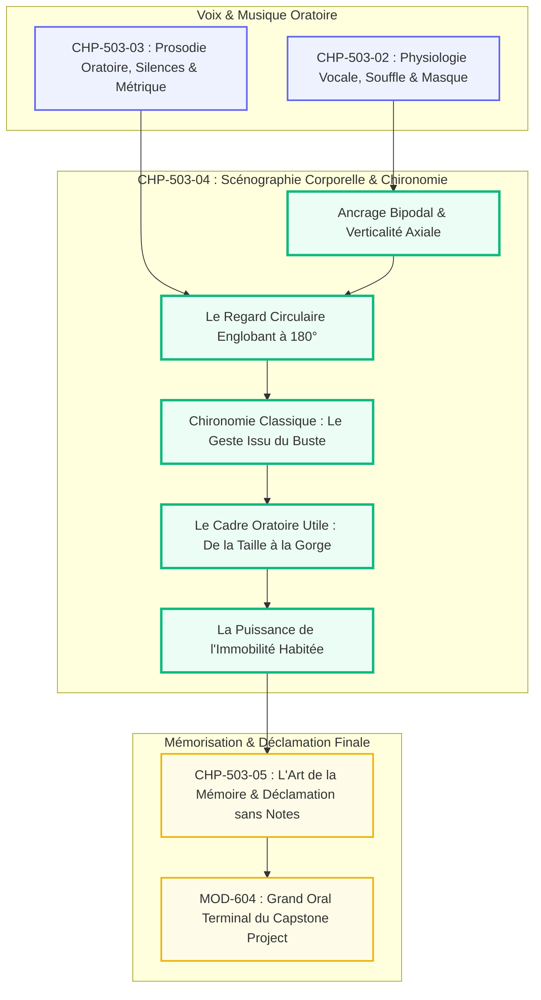
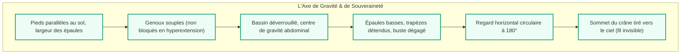

# Chapitre 4 — Scénographie Corporelle, Ancrage Postural et Chironomie du Geste : Du Balayage Circulaire à l'Immobilité Habitée

> **Identifiant du chapitre** : `CHP-503-04`  
> **Module de rattachement** : [`MOD-503` — Haute Éloquence : Déclamation Classique, Souffle et Présence Oratoire](file:///f:/Formation/world-class-french/03-curriculum/year-3/semester-5/mod-503-haute-eloquence-declamation-presence-oratoire.md)  
> **Semestre** : Année 3 — Semestre 5 (S5)  
> **Volume horaire canonique** : 5 à 6 heures d'apprentissage autonome délibéré et d'ateliers d'application (Phase 1 Étude théorique et scénographique : 1 h 30 | Phase 2 Ateliers d'ancrage postural et chironomie : 1 h 30 | Phase 3 Correction vidéo raisonnée : 1 h 00 | Phase 4 Évaluation en arène scénique : 1 h 00)  
> **Statut du document** : [STATUT : VALIDÉ]  
> **Alignement référentiel** : [`academic-structure.md`](file:///f:/Formation/world-class-french/01-architecture/academic-structure.md), [`competency-framework.md`](file:///f:/Formation/world-class-french/02-competency-framework/competency-framework.md) (`FR-INT-005`, `FR-INT-004`), [`source-registry.md`](file:///f:/Formation/world-class-french/07-resources/source-registry.md) (`SRC-RHET-01`, `SRC-RHET-03`, `SRC-PHON-01`, `SRC-NORM-03`, `SRC-TYPO-01`)

---

## 1. Titre et Place dans le Cursus

Le présent chapitre traite de l'incarnation visuelle, spatiale et corporelle de l'orateur. Si [`CHP-503-02`](file:///f:/Formation/world-class-french/03-curriculum/year-3/semester-5/mod-503/chp-503-02-physiologie-voix-souffle-projection-acoustique.md) a établi la respiration profonde et [`CHP-503-03`](file:///f:/Formation/world-class-french/03-curriculum/year-3/semester-5/mod-503/chp-503-03-prosodie-oratoire-silences-metrique-periode.md) la musique du verbe, `CHP-503-04` ordonne la présence physique de l'orateur sur la scène : **la posture royale, la technique du regard englobant à 180° et la chironomie mesurée** (la rhétorique du geste classique), transformant le corps en vecteur souverain d'*éthos*.



---

## 2. Objectifs Mesurables

Au terme de l'étude et des ateliers d'application de ce chapitre, l'étudiant doit maîtriser les quatre compétences opérationnelles suivantes (niveau L4 — Maîtrise approfondie) :

1. **Maintenir un ancrage bipodal stable au sol pendant 15 minutes continues**, sans aucun dandinement, pas chassé ni croisement des jambes, le bassin déverrouillé et les épaules basses [Réf. `SRC-RHET-01`, partie IV].
2. **Déployer un balayage visuel circulaire sectorisé à 180°**, accrochant individuellement les yeux d'auditeurs ciblés pendant 3 à 5 secondes (technique des trois faisceaux : gauche, centre, droite) sans aucun regard fuyant vers le sol, le plafond ou les notes.
3. **Appliquer les règles canoniques de la chironomie classique** : inscrire rigoureusement l'ensemble des gestes dans le *cadre oratoire utile* (entre la ceinture et la gorge), faire naître le geste du buste et de l'épaule plutôt que du poignet isolé, et soutenir le geste jusqu'au terme de l'argument.
4. **Pratiquer l'immobilité habitée souveraine** : supprimer tout tic gestuel parasite (frottement des mains, manipulation d'alliance, de lunettes ou de stylos), démontrant que le calme corporel absolu décuple l'autorité du propos (*éthos* d'apparat) [Réf. `SRC-RHET-03`, chap. 2].

---

## 3. Prérequis et Test de Préparation

### 3.1 Prérequis Formels
- Maîtrise de la respiration costo-diaphragmatique basse [validé en [`CHP-503-02`](file:///f:/Formation/world-class-french/03-curriculum/year-3/semester-5/mod-503/chp-503-02-physiologie-voix-souffle-projection-acoustique.md)].
- Maîtrise du silence d'exorde et du tempo lento [validé en [`CHP-503-03`](file:///f:/Formation/world-class-french/03-curriculum/year-3/semester-5/mod-503/chp-503-03-prosodie-oratoire-silences-metrique-periode.md)].
- Connaissance de la notion rhétorique d'*éthos* [validé en [`CHP-503-01`](file:///f:/Formation/world-class-french/03-curriculum/year-3/semester-5/mod-503/chp-503-01-cinq-canons-rhetorique-souverainete-actio.md)].

### 3.2 Test Diagnostique de Préparation (5 questions)

<details>
<summary><strong>Question 1 : Qu'appelle-t-on la « chironomie » dans la tradition rhétorique classique ?</strong></summary>

**Réponse** : La chironomie (du grec *kheir*, la main, et *nomos*, la loi) est la discipline et l'art de régler le mouvement des mains, des bras et du corps pour accompagner harmonieusement et rehausser le discours oratoire.
</details>

<details>
<summary><strong>Question 2 : Quel doit être l'écartement des pieds au sol pour un ancrage postural d'autorité ?</strong></summary>

**Réponse** : L'écartement idéal correspond très exactement à la largeur des épaules (bassin), les pieds parallèles ou légèrement ouverts, le poids du corps réparti à égalité entre les deux talons et la plante des pieds.
</details>

<details>
<summary><strong>Question 3 : Pourquoi le pupitre de conférence est-il souvent un piège pour l'orateur débutant ?</strong></summary>

**Réponse** : Parce qu'il sert de barricade inconsciente rassurante : l'orateur s'y agrippe des deux mains, affaisse son buste vers l'avant, bloque sa respiration et dissimule son corps, détruisant tout rayonnement physique.
</details>

<details>
<summary><strong>Question 4 : Quelles sont les limites spatiales du « cadre oratoire utile » pour les mains ?</strong></summary>

**Réponse** : Le cadre oratoire utile s'étend verticalement de la taille (ceinture) jusqu'à la base de la gorge, et latéralement à la largeur du buste. Tout geste en dessous de la taille affaiblit l'autorité ; tout geste au-dessus des yeux relève du théâtre outrancier.
</details>

<details>
<summary><strong>Question 5 : Qu'est-ce que « l'immobilité habitée » ?</strong></summary>

**Réponse** : C'est un état de présence corporelle totale sans mouvement extérieur : le corps est tonique, les yeux magnétiques, le souffle posé, sans aucune agitation parasite. Loin d'être une rigidité cadavérique, c'est le calme dense d'une statue vivante.
</details>

---

## 4. Situation de Départ ou Problème Concret

Considérons l'attitude scénique d'un plaideur brillant lors de sa première prise de parole solennelle :

> *Dès son entrée, l'orateur se précipite vers le pupitre et s'y cramponne à pleines mains, les jointures blanchies par la pression. Pendant les dix premières minutes, son poids oscille sans cesse : il transfère sa masse sur la hanche gauche, puis sur la hanche droite, effectuant un dandinement métronomique incessant. Ses yeux ne fixent personne : ils balaient nerveusement le plafond ou plongent dans ses notes. Lorsqu'il lâche le pupitre, ses mains frottent frénétiquement son stylo ou se réfugient dans les poches de sa veste.*

Cet orateur anéantit la force persuasive de ses arguments. L'auditoire n'écoute plus le raisonnement (*logos*) : il est distrait, agacé ou hypnotisé par le balancement corporel et la manipulation d'objets. Le corps trahit la terreur intérieure, détruisant instantanément l'autorité morale (*éthos*).

---

## 5. Explication Intuitive

Pour saisir l'art de la scénographie corporelle, utilisons **l'analogie de l'arbre séculaire et du chêne d'airain** :

```text
======================================================================
               L'ANALOGIE DU CHÊNE ET DES BRANCHES
======================================================================
1. LES RACINES PROFONDES      : L'ancrage podal des deux pieds
   -> L'arbre ne vacille pas au vent ; son tronc s'enracine dans la terre.
----------------------------------------------------------------------
2. LE TRONC MAJESTUEUX        : La verticalité axiale et le buste royal
   -> Droit sans raideur, ouvert vers le ciel, soutenant la cime.
----------------------------------------------------------------------
3. LES BRANCHES MAÎTRESSES    : La chironomie sobre des bras et mains
   -> Elles ne gesticulent pas ; elles s'ouvrent avec lenteur et
      dessinent de grands arcs harmonieux pour accueillir la lumière.
======================================================================
```

Un arbre dont les racines glisseraient à chaque brise s'effondrerait immédiatement. L'orateur doit offrir au regard la même force de granit et d'enracinement : c'est parce que le bas du corps est totalement immobile et solide que le geste des mains acquiert une portée souveraine.

---

## 6. Définitions Précises et Terminologie

- **Scénographie oratoire** : Art d'occuper, de structurer et d'habiter l'espace scénique ou la tribune par la disposition du corps, l'orientation du buste et la relation aux objets (pupitre, micro).
- **Ancrage podal** : Positionnement au sol des pieds assurant la stabilité gravitationnelle de l'orateur, caractérisé par un écartement égal à la largeur des épaules et un contact ferme des talons.
- **Verticalité axiale** : Alignement vertébral dynamique reliant le sommet du crâne au sacrum, préservant la courbure naturelle de la colonne sans cambrure excessive ni avachissement.
- **Regard circulaire sectorisé (ou balayage à 180°)** : Technique de contact oculaire embrassant successivement les trois secteurs de l'assemblée (flanc gauche, centre, flanc droit), avec des points de fixation individuels de 3 à 5 secondes.
- **Chironomie** : Rhétorique classique du geste appliquée aux mains et aux bras, codifiant leur départ, leur amplitude, leur durée et leur retombée.
- **Cadre oratoire utile** : Zone spatiale comprise verticalement entre l'ombilic et le menton, et horizontalement entre les deux épaules, dans laquelle tout geste oratoire doit obligatoirement s'inscrire pour être perçu avec netteté.
- **Geste déictique** : Geste de désignation spatiale ou conceptuelle orientant le regard vers une direction ou une réalité évoquée (*« Regardez cette jeunesse... »*).
- **Geste iconique** : Geste figuratif esquissant la forme, la taille ou le contour physique d'un objet (*« Un gouffre immense s'ouvre devant nous »*).
- **Geste métaphorique** : Geste abstrait visualisant un concept philosophique ou dialectique (ex. les deux mains ouvertes pesant deux arguments contraires sur une balance imaginaire).
- **Immobilité habitée** : Posture de présence physique totale dénuée de tout mouvement superficiel, incarnant le recueillement, la force contenue et la solennité.

---

## 7. Règles et Mécanismes Fondamentaux

### 7.1 L'Armature Corporelle : De la Plante des Pieds au Sommet du Crâne



1. **La règle d'or des pieds au sol** : Dès que l'orateur prend position, ses pieds sont scellés. Tout déplacement ultérieur doit être motivé par une rupture logique du discours (passage d'une partie à une autre), accompli avec une lenteur majestueuse (trois pas calmes) et suivi d'un réancrage immédiat.
2. **Le déverrouillage des genoux** : Verrouiller les genoux en hyperextension coupe la circulation veineuse et provoque des malaises vagaux à la tribune. Les genoux doivent conserver une souplesse imperceptible.

### 7.2 La Maîtrise du Regard : La Technique des Trois Faisceaux

Le regard est le conducteur magnétique de l'autorité oratoire. Cicéron proclamait dans le *De Oratore* : *« L'âme tout entière réside dans les yeux »* [Réf. `SRC-RHET-03`].

```text
======================================================================
               LE BALAYAGE CIRCULAIRE SECTORISÉ À 180°
======================================================================
             [ORATEUR À LA TRIBUNE]
                  /     |     \
                 /      |      \
                /       |       \
               v        v        v
         SECTEUR A  SECTEUR B  SECTEUR C
          (Gauche)   (Centre)   (Droite)
         [3 à 5 s]  [3 à 5 s]  [3 à 5 s]
======================================================================
```

- **Règle des 3 secondes** : Ne jamais survoler la salle d'un regard balayé façon phare maritime. Choisir un visage au hasard dans le secteur A ; le regarder dans les yeux pendant 3 à 5 secondes en lui adressant une proposition entière. Toute la rangée environnante se sentira personnellement interpellée.
- Basculer ensuite avec lenteur vers le secteur B, puis vers le secteur C.

### 7.3 Les Lois Canoniques de la Chironomie Classique

1. **La source motrice du geste** : Le geste oratoire noble part du centre du corps (le cœur, le sternum) et se déploie par l'épaule et le coude avant d'atteindre la main. Un geste qui ne bouge que le poignet est étriqué et ridicule.
2. **La règle de la paume ouverte** : Dans le style délibératif et académique, les paumes s'ouvrent vers le haut ou légèrement inclinées, symbolisant l'offrande de la vérité et la clarté. L'index pointé accusateur est réservé au réquisitoire judiciaire et doit être manié avec une extrême parcimonie.
3. **La synchronie geste-pensée** : Le geste oratoire doit **anticiper imperceptiblement la parole** (d'un dixième de seconde) ou l'accompagner exactement. Un geste qui arrive après le mot est perçu comme faux ou mécanique.
4. **La retombée majestueuse** : Après avoir soutenu l'acmé de la proposition, le bras retombe avec lenteur le long du corps ou revient se poser délicatement sur le pupitre sans aucun claquement ni chute brutale.

---

## 8. Raisonnement Détaillé

Pourquoi l'immobilité corporelle produit-elle un ascendant psychologique supérieur à l'agitation scénique ?

En éthologie humaine et en sociologie de la domination symbolique (Bourdieu), les mouvements compulsifs, le dandinement et les gesticulations continues sont les marqueurs universels du stress, de l'insécurité statutaire et de la soumission à l'environnement. L'individu dominé bouge sans cesse pour évacuer son angoisse motrice.

À l'inverse, l'individu dominant s'approprie l'espace par **le privilège de l'immobilité et de l'économie de moyens** :
1. **Économie sémiotique** : Dans un champ visuel immobile, le moindre mouvement d'un doigt ou d'une main acquiert une force décuplée. Si l'orateur bouge les bras en permanence, aucun de ses gestes n'a de sens ; s'il reste immobile pendant deux minutes, le seul déploiement de sa main droite vers l'assemblée produit l'effet d'un foudre rhétorique.
2. **Projection de sang-froid (*éthos* monarchique)** : L'immobilité signale à l'auditoire que l'orateur ne craint ni le jugement de l'assemblée, ni le silence, ni l'imprévu. Il est le maître absolu de la tribune.

---

## 9. Exemples Corrects Commentés

### 9.1 Exemple 1 : Déploiement Chironomique d'une Antithèse Oratoire

Soit la sentence :

> *« Vous avez le choix entre la facilité du renoncement qui flétrit, et le courage de l'effort qui élève. »*

#### Partition Gestuelle et Corporelle
1. *« Vous avez le choix »* : Buste immobile, regard fixé au centre de l'assemblée, mains jointes ou au repos sur le pupitre.
2. *« entre la facilité du renoncement qui flétrit »* :
   - La main gauche s'ouvre lentement, paume vers le bas, s'abaissant légèrement vers la gauche du corps à hauteur de hanche ;
   - Le visage exprime une réserve sobre.
3. *« et le courage de l'effort »* :
   - Suspension de 1 seconde au centre ;
   - La main droite se déploie depuis le plexus solaire, paume tournée vers le haut et les doigts unis, s'élevant majestueusement jusqu'à la hauteur du cœur.
4. *« qui élève »* :
   - La main droite soutient sa position au zénith pendant tout le mot *élève* ;
   - Le regard embrasse le secteur droit de la salle.
5. *Clausule finale* : La main redescend avec gravité sur le silence conclusif de 3 secondes.

---

## 10. Contre-Exemples et Erreurs Fréquentes

Cette section présente six erreurs majeures de scénographie et de chironomie fréquemment observées à la tribune.

### Erreur n° 1 : Le dandinement pendulaire (le pas chassé de l'angoisse)
- **Manifestation** : Transfert permanent et métronomique du poids du corps de la jambe gauche sur la jambe droite.
- **Effet psychologique** : Donne le mal de mer à l'auditoire et trahit une immaturité motrice complète.
- **Remède scénique** : Imaginer que les pieds sont scellés dans du béton frais ; sentir la pression égale des deux talons au sol.

### Erreur n° 2 : L'agrippement au pupitre comme rempart défensif
- **Manifestation** : Les deux mains crispées sur les rebords de la table de tribune, les épaules remontées vers les oreilles.
- **Effet psychologique** : L'orateur donne l'impression d'être un accusé à la barre ou un naufragé s'accrochant à une planche.
- **Remède scénique** : Reculer d'un pas par rapport au pupitre ; poser seulement le bout des doigts à plat sur la surface ou parler en scène ouverte.

### Erreur n° 3 : Le regard fuyant ou stroboscopique au plafond et au sol
- **Manifestation** : Les yeux se lèvent vers les lustres ou fixent la pointe des chaussures de l'orateur.
- **Effet psychologique** : Rupture du fil hypnotique ; l'auditoire décroche instantanément.
- **Remède scénique** : Travailler avec trois points de repère visuels à hauteur d'yeux au fond de la salle.

### Erreur n° 4 : Les tics manipulateurs et bruits gestuels parasites
- **Manifestation** : Cliquer compulsivement sur un stylo à bille, tripoter son alliance, recoiffer une mèche de cheveux imaginaire.
- **Effet psychologique** : Bruit visuel parasitant totalement l'écoute du texte.
- **Remède scénique** : Vider scrupuleusement ses poches et poser tout objet sur la table avant de prendre la parole.

### Erreur n° 5 : La moulinette continue des poignets (la gesticulation dévaluée)
- **Manifestation** : Les mains tournoient sans arrêt en petits cercles rapides au niveau du nombril.
- **Effet psychologique** : Geste impuissant qui déprécie la noblesse de la langue.
- **Remède scénique** : Conserver les bras morts le long du corps jusqu'au moment où un argument crucial exige impérativement un geste.

### Erreur n° 6 : Les gestes hors cadre au-dessus de la tête ou sous la ceinture
- **Manifestation** : Bras levés au ciel comme un prédicateur de tréteaux ou mains s'agitant au niveau des cuisses.
- **Effet psychologique** : Exagération mélodramatique ou geste honteux étouffé.
- **Remède scénique** : Respecter scrupuleusement le cadre oratoire utile compris entre la ceinture et le menton.

```text
Tableau synoptique des pathologies scéniques :
+---------+------------------------+--------------------------+-----------------------+
| Cas n°  | Symptôme corporel      | Origine psychomotrice    | Protocole de maîtrise |
+---------+------------------------+--------------------------+-----------------------+
| Cas 1   | Dandinement continu    | Fuite inconsciente       | Enracinement bipodal  |
| Cas 2   | Cramponnement pupitre  | Réflexe d'abris          | Recul d'un pas franc  |
| Cas 3   | Yeux au plafond        | Quête mnésique anxieuse  | Regard circulaire 180°|
| Cas 4   | Manipulation d'objets  | Tic de décharge motrice  | Mains libres et nues  |
| Cas 5   | Moulinets des mains    | Agitation superficielle  | Immobilité habitée    |
| Cas 6   | Bras levés au ciel     | Emphase mélodramatique   | Cadre utile buste     |
+---------+------------------------+--------------------------+-----------------------+
```

---

## 11. Cas Particuliers et Limites

1. **La prise de parole assise (table ronde, jury de soutenance)** :
   - L'ancrage podal demeure identique : les deux pieds sont à plat au sol, le dos décollé du dossier du siège, les avant-bras posés sur la table dans une attitude d'ouverture vigilante sans avachissement sur les coudes.
2. **La présence devant caméra ou visioconférence d'État** :
   - Le cadre utile se resserre encore davantage (du sternum au menton). Les mouvements latéraux doivent être diminués de moitié pour éviter les sorties de champ visuel. Le regard doit fixer la lentille de la caméra et non l'écran.
3. **L'usage légitime du pupitre présidentiel** :
   - Le pupitre n'est pas interdit s'il est utilisé comme un socle majestueux : l'orateur s'y tient droit, mains ouvertes et calmes, sans jamais s'y appuyer de tout son poids.

---

## 12. Approfondissement Adapté au Niveau

### La Théorie de la Chironomie Rhétorique chez John Bulwer et Gilbert Austin

L'étude savante de la gestuelle oratoire trouve son apogée dans la *Chironomia* de Gilbert Austin (1806) et la *Philocophus* de John Bulwer (1644). Austin a formalisé un **système de notation sphérique tridimensionnel du geste oratoire** préfigurant la biomécanique moderne :

```text
               Z (Zénith : 90° - Sublime / Divin)
               |
               |      Y (Médian : 45° - Raison / Hommes)
               |     /
               |    /
  -X ----------+---------- +X (Horizontal : 0° - Matière / Terre)
```

Chaque mouvement est repéré par ses coordonnées angulaires :
- L'élévation vers le zénith ($+90^\circ$) accompagne l'invocation des principes éternels et la justice idéale ;
- L'extension médiane ($+45^\circ$) correspond au dialogue civil et à la délibération parlementaire ;
- L'abaissement vers la terre ($-45^\circ$) sanctionne la réprobation, le mépris du sophisme ou le deuil.

Cette rigueur géométrique démontre que dans la haute tradition oratoire, **aucun geste n'est livré au hasard de l'humeur impulsive** : chaque mouvement est un signe sémiotique calculé pour imprimer la vérité dans les cœurs.

---

## 13. Comparaisons Différentielles

### 13.1 Gesticulation Nerveuse vs Chironomie Classique

| Critère d'analyse | Gesticulation nerveuse ordinaire | Chironomie oratoire classique |
| :--- | :--- | :--- |
| **Origine du mouvement** | Extrémités (poignets, doigts crispés). | Centre de masse corporel (buste, épaule). |
| **Fréquence** | Continue, ininterrompue, incontrôlée. | Rare, sélectionnée, signifiante. |
| **Amplitude** | Petite, étriquée, convulsive. | Ample, noble, dessinée dans l'espace. |
| **Arrêt du geste** | Chute abrupte ou interruption désordonnée. | Maintien jusqu'au bout du souffle et retombée lente. |

### 13.2 Regard Balayé vs Regard Ancré Circulaire

| Paramètre visuel | Regard balayé superficiel | Regard ancré circulaire à 180° |
| :--- | :--- | :--- |
| **Temps par personne** | Moins de 0,5 seconde (fuite). | 3 à 5 secondes pleines par point d'appui. |
| **Portée psychologique** | L'auditoire se sent ignoré et anonyme. | Chaque auditeur se sent personnellement sondé. |
| **Effet sur l'orateur** | Accroît le sentiment de solitude et de trac. | Crée un lien rassurant de communion d'yeux à yeux. |

---

## 14. Exercices Progressifs

### 14.1 Niveau 1 : Le Test de la Statue Vivante (Immobilité d'Apparat)
- Se tenir debout en scène ouverte, pieds écartés de la largeur des épaules, bras souples le long du corps.
- Maintenir une immobilité absolue pendant 3 minutes complètes en silence, sans gratter son nez, sans ciller excessivement et sans balancer son poids.
- Mesurer le passage du malaise initial à la sensation profonde de puissance et d'enracinement.

### 14.2 Niveau 2 : Balayage à 180° sur Période Périodique
Déclamer une période de 40 mots en distribuant précisément son regard :
- Protase : secteur gauche (fixer une personne précise pendant 5 secondes) ;
- Acmé : pivot lent vers le centre de la salle (silence d'acmé de 2 secondes au centre) ;
- Apodose : déploiement vers le secteur droit (clausule délivrée droit dans les yeux d'un auditeur de droite).

### 14.3 Niveau 3 : Analyse Scénique sous Contrainte Métrique Stricte

Texte sous contrainte métrique stricte de 50 mots exacts (décompte selon `SRC-TYPO-01`) décrivant l'enracinement corporel d'un maître de l'éloquence :

> *« Debout au centre de la scène, l'orateur enracine ses deux appuis dans le sol. Le buste royal demeure impassible, tandis que son regard balaie l'assemblée en trois faisceaux concentriques. Ses mains sobres, inscrites entre la taille et la gorge, sculptent l'idée pure sans aucune gesticulation parasite vaine. »*

#### Tableau de Décompte Mot à Mot Certifié (50 mots exacts)

| N° | Mot | Nature grammaticale | N° | Mot | Nature grammaticale |
| :---: | :--- | :--- | :---: | :--- | :--- |
| 1 | Debout | Adverbe majuscule | 26 | l' | Article élidé (1 mot) |
| 2 | au | Article contracté | 27 | assemblée | Nom commun |
| 3 | centre | Nom commun | 28 | en | Préposition |
| 4 | de | Préposition | 29 | trois | Adjectif numéral |
| 5 | la | Déterminant | 30 | faisceaux | Nom commun pluriel |
| 6 | scène, | Nom avec virgule | 31 | concentriques. | Adjectif avec point |
| 7 | l' | Article élidé (1 mot) | 32 | Ses | Déterminant possessif |
| 8 | orateur | Nom commun | 33 | mains | Nom commun pluriel |
| 9 | enracine | Verbe transitif | 34 | sobres, | Adjectif avec virgule |
| 10 | ses | Déterminant possessif | 35 | inscrites | Participe passé |
| 11 | deux | Adjectif numéral | 36 | entre | Préposition |
| 12 | appuis | Nom commun pluriel | 37 | la | Déterminant |
| 13 | dans | Préposition | 38 | taille | Nom commun |
| 14 | le | Déterminant | 39 | et | Conjonction de coordination |
| 15 | sol. | Nom avec point | 40 | la | Déterminant |
| 16 | Le | Déterminant majuscule | 41 | gorge, | Nom avec virgule |
| 17 | buste | Nom commun | 42 | sculptent | Verbe transitif |
| 18 | royal | Adjectif qualificatif | 43 | l' | Article élidé (1 mot) |
| 19 | demeure | Verbe d'état | 44 | idée | Nom commun |
| 20 | impassible, | Adjectif avec virgule | 45 | pure | Adjectif qualificatif |
| 21 | tandis | Conjonction | 46 | sans | Préposition |
| 22 | que | Conjonction | 47 | aucune | Déterminant indéfini |
| 23 | son | Déterminant possessif | 48 | gesticulation | Nom commun |
| 24 | regard | Nom commun | 49 | parasite | Adjectif qualificatif |
| 25 | balaie | Verbe transitif | 50 | vaine. | Adjectif avec point final |

---

## 15. Activité de Correction Raisonnée

Considérons le compte rendu d'audit vidéo d'un intervenant défaillant :

> *« Diagnostic vidéo à réviser : Dès qu'il a pris la parole, l'orateur a enfoui ses deux mains au fond des poches de son pantalon en bombant le dos. Tout en parlant, il tournait sur lui-même en marchant de long en large sur l'estrade comme un fauve en cage. Pour souligner un chiffre, il levait le bras droit au-dessus de sa tête en pointant son index vers le plafond, puis se retournait pour regarder longuement le mur derrière lui. »*

### Identification des 5 Anomalies Scénographiques
1. *« mains enfouies dans les poches »* : Posture familière dégradante interdisant toute chironomie noble.
2. *« bombant le dos »* : Affaissement cyphotique écrasant la cage thoracique et détruisant l'éthos.
3. *« marchant de long en large comme un fauve »* : Déplacement fébrile continu traduisant une angoisse motrice non canalisée.
4. *« bras levé au-dessus de la tête »* : Geste hors cadre théâtral excessif rompant la dignité classique.
5. *« regardant le mur derrière lui »* : Rupture complète du lien visuel magnétique avec l'assemblée.

### Version Corrigée selon les Standards de Haute Éloquence
> *« Parfaitement établi au centre de l'espace oratoire, l'orateur adopte une verticalité royale : épaules détendues, colonne étirée, pieds ancrés à la largeur du bassin. Ses mains libres et nues reposent au repos le long du corps ou ouvertes à hauteur du plexus solaire. Refusant toute errance scénique fébrile, il conserve une immobilité de socle d'où jaillit une présence magnétique. Ses gestes, rares et amples, s'élèvent du buste pour soutenir la force du logos sans jamais dépasser la ligne des yeux. Son regard circulaire enlace avec sérénité chaque travée de l'assemblée, maintenant un contact soutenu qui emporte l'adhésion unanime. »*

---

## 16. Mise en Pratique dans une Production Réelle

Rédiger la charte de présence physique d'un orateur d'État à la tribune, calibrée à **exactement 60 mots** selon les normes de l'Imprimerie nationale (`SRC-TYPO-01`).

### Texte Calibré (60 mots exacts)

> *« Éloigné du pupitre, l'orateur affirme son ascendant par une immobilité souveraine. Les pieds parallèles fixent son axe vertical. D'un regard circulaire calme, il enlace chaque secteur de la salle sans jamais vaciller. Un geste sobre s'élève alors du buste pour appuyer l'argument, avant de retomber avec lenteur dans un silence lourd d'autorité et de grâce. »*

#### Tableau de Décompte Mot à Mot Certifié (60 mots exacts)

| N° | Mot | Nature grammaticale | N° | Mot | Nature grammaticale |
| :---: | :--- | :--- | :---: | :--- | :--- |
| 1 | Éloigné | Participe adjectivé | 31 | salle | Nom commun |
| 2 | du | Article contracté | 32 | sans | Préposition |
| 3 | pupitre, | Nom avec virgule | 33 | jamais | Adverbe |
| 4 | l' | Article élidé (1 mot) | 34 | vaciller. | Verbe avec point |
| 5 | orateur | Nom commun | 35 | Un | Déterminant majuscule |
| 6 | affirme | Verbe transitif | 36 | geste | Nom commun |
| 7 | son | Déterminant possessif | 37 | sobre | Adjectif qualificatif |
| 8 | ascendant | Nom commun | 38 | s' | Pronom réfléchi élidé (1 mot) |
| 9 | par | Préposition | 39 | élève | Verbe pronominal |
| 10 | une | Déterminant indéfini | 40 | alors | Adverbe |
| 11 | immobilité | Nom commun | 41 | du | Article contracté |
| 12 | souveraine. | Adjectif avec point | 42 | buste | Nom commun |
| 13 | Les | Déterminant majuscule | 43 | pour | Préposition |
| 14 | pieds | Nom commun pluriel | 44 | appuyer | Verbe transitif |
| 15 | parallèles | Adjectif qualificatif | 45 | l' | Article élidé (1 mot) |
| 16 | fixent | Verbe transitif | 46 | argument, | Nom avec virgule |
| 17 | son | Déterminant possessif | 47 | avant | Préposition |
| 18 | axe | Nom commun | 48 | de | Préposition |
| 19 | vertical. | Adjectif avec point | 49 | retomber | Verbe intransitif |
| 20 | D' | Préposition élidée (1 mot) | 50 | avec | Préposition |
| 21 | un | Déterminant indéfini | 51 | lenteur | Nom commun |
| 22 | regard | Nom commun | 52 | dans | Préposition |
| 23 | circulaire | Adjectif qualificatif | 53 | un | Déterminant indéfini |
| 24 | calme, | Adjectif avec virgule | 54 | silence | Nom commun |
| 25 | il | Pronom personnel sujet | 55 | lourd | Adjectif qualificatif |
| 26 | enlace | Verbe transitif | 56 | d' | Préposition élidée (1 mot) |
| 27 | chaque | Déterminant indéfini | 57 | autorité | Nom commun |
| 28 | secteur | Nom commun | 58 | et | Conjonction de coordination |
| 29 | de | Préposition | 59 | de | Préposition |
| 30 | la | Déterminant | 60 | grâce. | Nom avec point final |

---

## 17. Résumé Structuré

```text
======================================================================
               LE DÉCALOGUE SCÉNIQUE DU GRAND ORATEUR
======================================================================
1. ANCRAGE AU SOL       : Pieds largeur épaules | Zéro dandinement
2. VERTICALITÉ ROYALE   : Colonne étirée | Épaules basses | Buste ouvert
3. REGARD MAGNÉTIQUE    : Balayage à 180° | 3 à 5 secondes par regard
4. CADRE DU GESTE       : Inscription stricte de la taille à la gorge
5. DYNAMIQUE DU GESTE   : Naissance dans l'épaule | Déploiement noble
6. RETOMBÉE CONTRÔLÉE   : Pas de chute brusque | Fin sur le silence
7. PROSCRIPTION TOTALE  : Mains en poches | Tics | Stylos tripotés
8. RELATION AU PUPITRE  : Appui léger des doigts | Jamais de barricade
9. DÉPLACEMENTS RARES   : 3 pas lents motivés par une rupture logique
10. FORCE DE L'IMMOBILE : L'immobilité habitée commande l'assemblée
======================================================================
```

---

## 18. Questions de Rappel Actif (Active Recall)

<details>
<summary><strong>Question 1 : Pourquoi la position des pieds au sol détermine-t-elle l'assurance de la voix ?</strong></summary>

**Réponse** : Parce qu'un ancrage podal stable équilibre le centre de gravité au niveau du bassin, libérant le diaphragme de toute tension posturale et permettant à la colonne d'air d'être soutenue avec force par la sangle abdominale.
</details>

<details>
<summary><strong>Question 2 : Quelles sont les limites du cadre oratoire utile pour les gestes ?</strong></summary>

**Réponse** : Verticalement, entre la ceinture (ombilic) et la base du cou (gorge) ; horizontalement, dans l'emprise de la largeur du buste. Tout geste hors de cette zone perd en netteté ou verse dans la grandiloquence grotesque.
</details>

<details>
<summary><strong>Question 3 : En quoi consiste la règle des trois secondes pour le regard oratoire ?</strong></summary>

**Réponse** : Elle prescrit de maintenir le contact visuel direct avec une personne précise de l'auditoire pendant 3 à 5 secondes consécutives avant de déplacer lentement son regard vers un autre secteur, évitant ainsi le regard fuyant ou balayé sans fixation.
</details>

<details>
<summary><strong>Question 4 : Pourquoi ne doit-on jamais gesticuler uniquement à partir des poignets ?</strong></summary>

**Réponse** : Parce que le geste de poignet isolé produit une impression de faiblesse, de préciosité ou d'agitation mesquine. Le geste classique doit naître de l'épaule et du tronc pour signifier que tout l'être porte l'affirmation de la pensée.
</details>

<details>
<summary><strong>Question 5 : Que doit faire un orateur de ses mains lorsqu'il ne fait aucun geste signifiant ?</strong></summary>

**Réponse** : Il doit les laisser reposer au calme : soit souples le long du corps dans une totale détente, soit les doigts délicatement posés à plat sur la table ou le pupitre, sans crispation ni tripotage d'objets.
</details>

<details>
<summary><strong>Question 6 : Quand un déplacement sur scène est-il légitime dans un discours d'apparat ?</strong></summary>

**Réponse** : Uniquement lors d'une transition macro-syntaxique majeure (changement de grande partie du plan, passage de la narration à la réfutation). Il s'effectue avec calme (trois pas mesurés) et s'achève par un nouvel ancrage bipodal absolu avant la reprise de la parole.
</details>

---

## 19. Mini-Évaluation Sommative Notée sur 20 Points

### Barème d'Évaluation de la Présence Scénique et Chironomique

| Critère d'évaluation | Indicateur observable | Points |
| :--- | :--- | :---: |
| **Stabilité posturale** | Ancrage des pieds au sol pendant 15 minutes ; zéro dandinement ni pas chassé parasite. | /5 |
| **Balayage oculaire** | Regard circulaire sectorisé à 180° ; fixations individuelles de 3 à 5 s ; zéro fuite visuelle. | /5 |
| **Précision du geste** | Chironomie inscrite dans le cadre utile (taille à gorge) ; gestes issus du buste et soutenus. | /5 |
| **Éthos et immobilité** | Absence totale de tics manipulateurs ; souveraineté physique ; immobilité habitée. | /5 |
| **Total** | **Note globale de présence scénique et corporelle** | **/20** |

*Clause éliminatoire* : Tout dandinement continu d'un pied sur l'autre ou le maintien prolongé des mains dans les poches entraîne un plafonnement immédiat de la note à 08/20.

---

## 20. Critères Observables de Maîtrise

L'apprenant a validé ce chapitre s'il démontre, lors de l'enregistrement vidéo d'un discours d'apparat de 15 minutes :
- Une immobilité podale absolue avec une tolérance maximale d'un seul déplacement motivé par partie.
- L'accroche visuelle effective des trois secteurs de l'assemblée attestée par le jury.
- L'exécution d'au moins 6 gestes chironomiques nobles parfaitement synchronisés avec les figures de style majeures du discours.
- L'éradication complète de tout objet parasite (stylos, lunettes tripotées, feuilles froissées).

---

## 21. Sources et Lectures Complémentaires

- **`SRC-RHET-01`** : Pierre FONTANIER, *Les Figures du discours*, Paris, Flammarion (quatrième partie : *De l'action et du geste oratoire*).
- **`SRC-RHET-03`** : Olivier REBOUL, *Introduction à la rhétorique*, Paris, PUF (chapitre 2 : *L'Actio : voix, regard et chironomie*).
- **`SRC-PHON-01`** : Pierre LÉON, *Phonétique et prononciations du français*, Paris, Armand Colin (chapitre 3 : *Posture, axe corporel et projection vocale*).
- **`SRC-NORM-03`** : MINISTÈRE DE L'ÉDUCATION NATIONALE, *Terminologie grammaticale et phonétique officielle*, Paris.
- **`SRC-TYPO-01`** : IMPRIMERIE NATIONALE, *Lexique des règles typographiques en usage à l'Imprimerie nationale*, Paris.

---

## Annexe : Classification Pédagogique

- **CORE-NOW** : Ancrage podal bipodal, verticalité axiale, regard circulaire à 180°, cadre oratoire utile (taille à gorge), immobilité habitée.
- **INTRODUCTION-NOW** : Chironomie historique d'Austin et notation tridimensionnelle des angles gestuels.
- **DEFER** : Déplacements théâtraux d'arène scénique à 360° (mise en scène d'opéra ou de théâtre antique) $\to$ conservatoire d'art dramatique.
- **MOVE** : Méthode des lieux mnésiques pour parler sans pupitre $\to$ approfondi dans [`CHP-503-05`](file:///f:/Formation/world-class-french/03-curriculum/year-3/semester-5/mod-503/chp-503-05-art-memoire-memoria-declamation-sans-notes.md).
- **OPTIONAL-ADVANCED** : Analyse kinésique informatisée des micro-mouvements faciaux lors de la déclamation publique.
- **REMOVE** : Gestuelle stéréotypée des manuels d'éloquence du XIXe siècle (main sur le cœur façon mélo-drame, bras levé au ciel avec trémolo).
