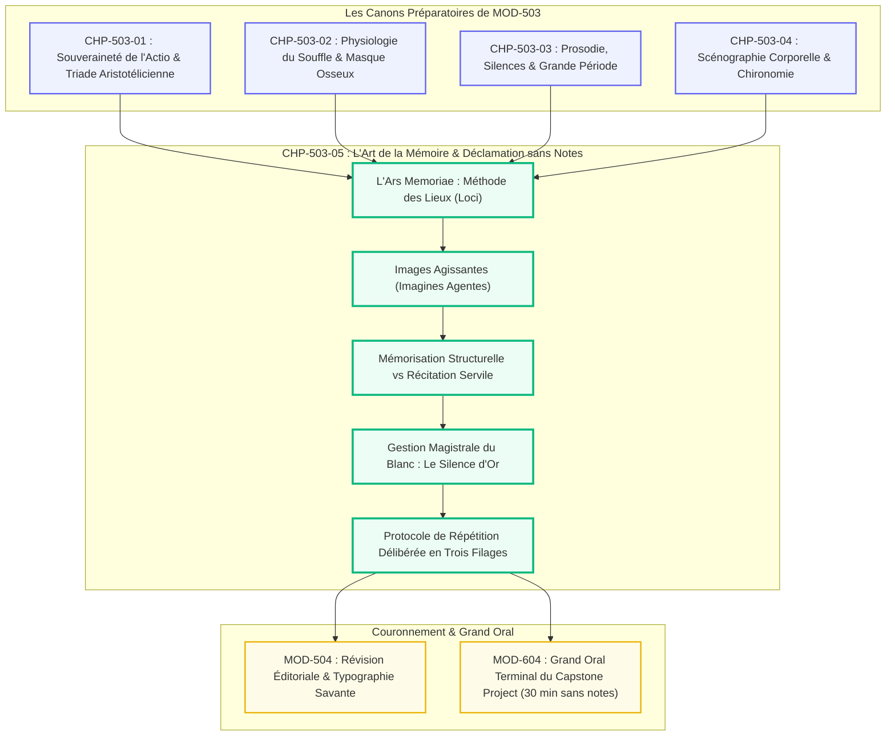
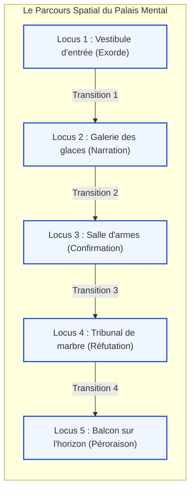

# Chapitre 5 — L'Art de la Mémoire (Memoria) et la Déclamation sans Notes : Palais Mental, Images Agissantes et Gestion du Blanc Mnésique

> **Identifiant du chapitre** : `CHP-503-05`  
> **Module de rattachement** : [`MOD-503` — Haute Éloquence : Déclamation Classique, Souffle et Présence Oratoire](file:///f:/Formation/world-class-french/03-curriculum/year-3/semester-5/mod-503-haute-eloquence-declamation-presence-oratoire.md)  
> **Semestre** : Année 3 — Semestre 5 (S5)  
> **Volume horaire canonique** : 5 à 6 heures d'apprentissage autonome délibéré et d'ateliers d'application (Phase 1 Étude de la memoria et architecture mentale : 1 h 30 | Phase 2 Encodage d'images et filages progressifs : 1 h 30 | Phase 3 Gestion simulée des incidents et blancs : 1 h 00 | Phase 4 Déclamation magistrale de 15 min sans notes : 1 h 00)  
> **Statut du document** : [STATUT : VALIDÉ]  
> **Alignement référentiel** : [`academic-structure.md`](file:///f:/Formation/world-class-french/01-architecture/academic-structure.md), [`competency-framework.md`](file:///f:/Formation/world-class-french/02-competency-framework/competency-framework.md) (`FR-INT-005`, `FR-INT-004`, `FR-SYNTAX-003`), [`source-registry.md`](file:///f:/Formation/world-class-french/07-resources/source-registry.md) (`SRC-RHET-03`, `SRC-RHET-01`, `SRC-PHON-01`, `SRC-NORM-03`, `SRC-TYPO-01`)

---

## 1. Titre et Place dans le Cursus

Le présent chapitre constitue le couronnement terminal du module `MOD-503` et le sommet technique de l'art oratoire vivant dans le cursus *World-Class French*. Ayant dompté les canons de l'actio (`CHP-503-01`), la physiologie du souffle (`CHP-503-02`), la prosodie des silences (`CHP-503-03`) et la scénographie corporelle (`CHP-503-04`), l'étudiant affronte ici l'ultime canon antique : **la memoria (l'art de la mémoire)**. Il s'agit d'éradiquer définitivement toute béquille écrite pour déclamer avec plénitude un discours continu de 15 minutes sans notes, grâce à la technique romaine des palais mentaux et à la métamorphose du blanc mnésique en silence souverain.



---

## 2. Objectifs Mesurables

Au terme de l'étude et des ateliers d'application de ce chapitre, l'étudiant doit maîtriser les quatre compétences opérationnelles suivantes (niveau L4 — Maîtrise approfondie) :

1. **Bâtir mentalement un palais de mémoire topographique cohérent** comportant au moins 5 pièces ou étapes géographiques distinctes, associant à chaque lieu (*locus*) une image saisissante (*imago agens*) encodant l'argument maître de chaque partie du discours [Réf. `SRC-RHET-03`, chap. 2].
2. **Déclamer publiquement en direct un discours d'apparat complet de 15 minutes sans aucune note écrite**, prompteur ni support numérique, dans une tolérance chronométrique stricte de $\pm 30$ secondes.
3. **Restituer sans altération l'armature logique, les transitions charnières et trois formules ciselées gravées** (sentences ou aphorismes majeurs), tout en conservant une liberté totale de formulation lexicale intermédiaire.
4. **Gérer un incident mnésique (« trou de mémoire ») en direct sans rupture d'éthos** : transformer le blanc en silence dramatique habité, réactiver le souffle costo-diaphragmatique bas et relancer la déclamation par une reformulation souveraine sans qu'aucun auditeur ne soupçonne l'hésitation.

---

## 3. Prérequis et Test de Préparation

### 3.1 Prérequis Formels
- Maîtrise de l'ancrage postural, de la verticalité axiale et du regard à 180° [validé en [`CHP-503-04`](file:///f:/Formation/world-class-french/03-curriculum/year-3/semester-5/mod-503/chp-503-04-scenographie-corporelle-ancrage-chironomie.md)].
- Maîtrise des silences d'exorde, d'acmé et de péroraison [validé en [`CHP-503-03`](file:///f:/Formation/world-class-french/03-curriculum/year-3/semester-5/mod-503/chp-503-03-prosodie-oratoire-silences-metrique-periode.md)].
- Maîtrise de la projection dans le masque osseux sans fatigue vocale [validé en [`CHP-503-02`](file:///f:/Formation/world-class-french/03-curriculum/year-3/semester-5/mod-503/chp-503-02-physiologie-voix-souffle-projection-acoustique.md)].

### 3.2 Test Diagnostique de Préparation (5 questions)

<details>
<summary><strong>Question 1 : Dans quel texte antique anonyme la méthode des lieux (ars memoriae) a-t-elle été exposée pour la première fois avec précision ?</strong></summary>

**Réponse** : Dans la *Rhétorique à Hérennius* (*Rhetorica ad Herennium*, Livre III), traité latin attribué jadis à Cicéron et rédigé vers 85 av. J.-C.
</details>

<details>
<summary><strong>Question 2 : Pourquoi l'apprentissage par cœur mot à mot est-il le piège le plus dangereux pour l'orateur ?</strong></summary>

**Réponse** : Parce qu'il repose sur une mémoire linéaire fragile comme un fil de verre. Dès qu'un seul mot disparaît, tout l'enchaînement syntaxique se brise, provoquant la panique du trou noir et l'incapacité totale d'improviser.
</details>

<details>
<summary><strong>Question 3 : Qu'appelle-t-on une imago agens (image agissante) dans l'art de la mémoire ?</strong></summary>

**Réponse** : C'est une image mentale concrète, inhabituelle, dramatique, colorée ou frappante (souvent teintée d'émotion, d'action ou de paradoxe), déposée dans un lieu précis de la mémoire pour déclencher instantanément le rappel d'un concept abstrait.
</details>

<details>
<summary><strong>Question 4 : Que doit faire physiquement l'orateur lorsqu'un trou de mémoire survient à la tribune ?</strong></summary>

**Réponse** : Ne jamais avouer son oubli ni chercher ses mots en l'air. S'immobiliser, regarder l'assemblée avec une gravité sereine, prendre une inspiration basse silencieuse (transformant le blanc en un silence dramatique de recueillement), et visualiser la pièce suivante de son palais mental.
</details>

<details>
<summary><strong>Question 5 : Qu'est-ce que le « filage italien » dans le protocole de répétition théâtrale et oratoire ?</strong></summary>

**Réponse** : C'est une répétition ultrarapide du discours sans intonation ni jeu d'acteur, récitée à toute allure d'un bout à l'autre pour vérifier la solidité mécanique des enchaînements logiques et mnésiques.
</details>

---

## 4. Situation de Départ ou Problème Concret

Considérons le cauchemar classique d'un candidat à une grande chaire universitaire ou à un concours diplomatique :

> *Après avoir rédigé un discours parfait, le candidat l'a appris par cœur mot à mot, répétant chaque phrase cinquante fois devant sa feuille. Arrivé à la tribune, sans notes, tout commence admirablement pendant quatre minutes. Soudain, au milieu de la confirmation, il hésite sur un adjectif. Le mot manquant bloque toute la phrase. Le candidat se fige ; ses yeux s'écarquillent de terreur ; il bafouille : « Excusez-moi, j'ai oublié la suite... ». Le silence devient insoutenable ; il plonge nerveusement ses mains dans ses poches à la recherche désespérée d'un brouillon, mais ses poches sont vides. Anéanti, il quitte la tribune avant le terme.*

Le drame ne réside pas dans une faiblesse d'intelligence, mais dans **l'erreur fatale d'avoir confondu la memoria rhétorique avec le par-cœur scolaire de l'écolier**. La memoria classique n'est pas un texte écrit déroulé comme un ruban de papier dans la tête : c'est **une architecture spatiale vivante dans laquelle l'orateur se déplace librement**.

---

## 5. Explication Intuitive

Pour assimiler l'ars memoriae, utilisons **l'analogie de la visite guidée dans une somptueuse demeure familière** :

```text
======================================================================
               L'ANALOGIE DU PALAIS DE MÉMOIRE (LOCI)
======================================================================
1. LE VESTIBULE D'ENTRÉE      : L'Exorde solennel
   -> Une épée de justice sur un socle de marbre (capter l'attention).
----------------------------------------------------------------------
2. LA GRANDE GALERIE VITRÉE   : La Narration des faits
   -> Une horloge brisée gisant au sol (le récit du temps et du conflit).
----------------------------------------------------------------------
3. LA SALLE D'ARMES CENTRALE  : La Confirmation des preuves
   -> Trois boucliers d'airain étincelants (les 3 arguments majeurs).
----------------------------------------------------------------------
4. LA SALLE DU CONSEIL        : La Réfutation des objections
   -> Un miroir brisant les illusions adverses (la ruine des sophismes).
----------------------------------------------------------------------
5. LA TERRASSE VERS L'HORIZON : La Péroraison souveraine
   -> Un soleil d'or se levant sur la cité (l'ouverture sur l'avenir).
======================================================================
```

Personne n'a jamais de trou de mémoire pour savoir où se trouve la cuisine par rapport au salon de son propre appartement d'enfance. L'orateur classique dépose ses idées dans des pièces spatiales immuables : pour savoir quoi dire, il lui suffit de franchir mentalement la porte de la pièce suivante.

---

## 6. Définitions Précises et Terminologie

- **Memoria (Mémoire rhétorique)** : Cinquième et dernier canon de la rhétorique classique, consistant à intérioriser la substance conceptuelle, la disposition dramatique et les formules clés d'un discours pour le proférer sans notes avec aisance et souveraineté.
- **Ars memoriae (Méthode des lieux / Palais de mémoire)** : Système mnémotechnique antique fondé sur la projection imaginaire d'un itinéraire spatial connu (*loci*) sur lequel sont déposées des représentations visuelles symboliques (*imagines*).
- **Locus (pluriel : Loci)** : Espace architectural ou topographique distinct (pièce, seuil, niche, monument) servant de case de rangement mental pour une unité de pensée.
- **Imago agens (pluriel : Imagines agentes)** : Image saisissante, dynamique, bizarre ou chargée d'affect, conçue pour marquer durablement la mémoire épisodique et déclencher instantanément le souvenir d'un concept abstrait.
- **Mémoire structurelle** : Intériorisation exclusive de l'enchaînement logique des idées maîtresses, des nœuds de transition et des cadences majeures, laissant libre le choix du tissu verbal conjoncturel.
- **Mémoire servile (ou par-cœur littéral)** : Récitation mot à mot d'un texte figé, caractérisée par une rigidité syntaxique absolue et une vulnérabilité extrême au moindre oubli.
- **Formule gravée** : Phrase-matrice ou sentence aphoristique ciselée d'avance (exorde, acmé, péroraison), apprise à la virgule près pour garantir un éclat stylistique irréprochable aux moments décisifs.
- **Blanc mnésique** : Interruption accidentelle de la remémoration au pupitre. En haute éloquence, le blanc est requalifié en « silence de délibération » habité par le regard et le souffle.

---

## 7. Règles et Mécanismes Fondamentaux

### 7.1 L'Architecture des Loci selon Quintilien et l'Ad Herennium



1. **Règle de familiarité des lieux** : Le lieu choisi doit être connu dans ses moindres recoins (maison d'enfance, musée familier, faculté, itinéraire urbain quotidien). On ne doit pas dépenser d'énergie à imaginer les murs.
2. **Règle de l'ordre linéaire irréversible** : Le parcours doit être strictement séquentiel (on ne revient jamais en arrière) pour respecter la marche démonstrative du discours.
3. **Règle de l'espacement suffisant** : Chaque locus doit être séparé du précédent d'au moins six mètres imaginaires pour éviter toute confusion ou superposition d'images.

### 7.2 La Fabrique des Imagines Agentes (Images Agissantes)

Une bonne image mnésique ne doit jamais être banale ou terne. Pour imprimer la mémoire vive du cerveau, elle doit satisfaire à **la quadruple loi de l'affect mnésique** :
1. **L'action dramatique** : L'image doit bouger, frapper, brûler ou se briser (jamais une statue inerte).
2. **L'émotion ou le grotesque** : Une charge comique, effrayante, noble ou surprenante active les amygdales cérébrales et fixe le souvenir.
3. **La relation métaphorique univoque** : L'objet visualisé doit symboliser immédiatement l'argument (ex. pour l'inflation monétaire : une balance dont un plateau doré s'effondre dans un brasier).
4. **La couleur et la lumière** : Éclairer l'image d'un éclat vif (torche, rayon d'or, contraste d'ombre).

### 7.3 Le Protocole Antipanique en Cas de Blanc Mnésique

Lorsque la mémoire défaille à la tribune, l'orateur applique le **protocole souverain des quatre étapes** :

```text
======================================================================
               PROTOCOLE DE TRANSFORMATION DU BLANC EN OR
======================================================================
1. IMMOBILITÉ PHYSIQUE TOTALE (0 à 2 s)
   -> Ne rien dire | Ne pas bouger | Ne pas regarder en l'air
   -> Regarder calmement un auditeur dans les yeux
----------------------------------------------------------------------
2. RESPIRATION COSTO-DIAPHRAGMATIQUE BASSE (2 à 4 s)
   -> Inspiration silencieuse par le nez | Détente de la mâchoire
   -> Transformer l'oubli en un silence dramatique de recueillement
----------------------------------------------------------------------
3. DÉAMBULATION DANS LA SALLE SUIVANTE DU PALAIS (4 à 5 s)
   -> Quitter la phrase en panne | Sauter mentalement au locus suivant
   -> Repérer l'image agissante suivante
----------------------------------------------------------------------
4. REPRISE PAR NOMINALISATION OU REFORMULATION MAJESTUEUSE (6 s)
   -> Ex. « Tel est l'enjeu crucial : abordons désormais... »
   -> L'assemblée croit à une pause délibérée de génie oratoire.
======================================================================
```

### 7.4 Le Protocole des Trois Filages Répétés

Pour garantir 15 minutes d'aisance souveraine, la préparation s'articule en trois étapes de filage obligatoire :
1. **Le Filage Morcelé (Table de travail)** : Répéter chaque locus séparément avec ses images jusqu'à fluidité complète de l'argument.
2. **Le Filage Italien (Chronomètre ultrarapide)** : Réciter tout le discours à toute allure, sans respirer ni jouer le texte, en moins de 7 minutes, vérifiant que le fil d'Ariane spatial est inaltérable.
3. **Le Filage en Arène (Conditions réelles d'apparat)** : Déclamer debout, costume d'apparat, sans pupitre ni notes, avec le tempo lento officiel (110 mots/min) et les silences complets face à un jury ou une caméra témoin.

---

## 8. Raisonnement Détaillé

Pourquoi la déclamation sans notes confère-t-elle une force de persuasion infiniment supérieure au texte lu ou consulté ?

Dans la relation oratoire, la crédibilité morale (*éthos*) repose sur l'illusion d'une **parole naissante et sincère**. Lorsque l'orateur a les yeux rivés sur ses feuilles, l'auditeur sait qu'il lit un texte préparé à froid dans son cabinet : la parole est médiatisée, protégée, administrative. L'orateur se dérobe derrière le papier.

Dès lors que l'orateur avance au milieu de la scène, mains nues, sans pupitre ni notes :
1. **Preuve de courage et d'engagement total** : L'assemblée perçoit le risque physique de l'orateur. Se présenter sans armure devant une foule force le respect immédiat et suspend tout bavardage.
2. **Liberté du regard et de la chironomie** : N'ayant plus à surveiller son texte, le regard est libre d'accrocher chaque regard dans la salle ; les mains sont libres de sculpter l'espace.
3. **Puissance de l'incarnation vivante** : Les idées ne semblent plus être lues, mais pensées au moment même où elles sont proférées. L'auditoire a le sentiment d'assister à l'enfantement d'une vérité en direct, conférant au discours une autorité magnétique irrésistible.

---

## 9. Exemples Corrects Commentés

### 9.1 Exemple d'Encodage d'un Discours dans un Palais Mental

Soit un discours de 15 minutes portant sur la souveraineté intellectuelle de la jeunesse :

```text
+-----------------------+----------------------------------+--------------------------------------+
| Partie du Discours    | Locus Architectural              | Imago Agens Encodée                  |
+-----------------------+----------------------------------+--------------------------------------+
| 1. Exorde (3 min)     | Le Seuil de la Faculté           | Un jeune homme brisant des chaînes   |
|                       |                                  | de livres poussiéreux sous un flambeau|
+-----------------------+----------------------------------+--------------------------------------+
| 2. Narration (3 min)  | La Grande Cour Carrée            | Deux armées de chiffres en guerre    |
|                       |                                  | sur une carte géographique déchirée  |
+-----------------------+----------------------------------+--------------------------------------+
| 3. Confirmation (4 m) | L'Amphithéâtre d'Honneur         | Trois piliers de marbre blanc        |
|                       |                                  | soutenant une voûte d'étoiles        |
+-----------------------+----------------------------------+--------------------------------------+
| 4. Réfutation (3 min) | La Bibliothèque des Réfutations  | Un souffle de vent glacé éteignant   |
|                       |                                  | des bougies de faux savants          |
+-----------------------+----------------------------------+--------------------------------------+
| 5. Péroraison (2 min) | Le Grand Balcon des Lauriers     | Un aigle d'or prenant son essor      |
|                       |                                  | au soleil levant sur la cité         |
+-----------------------+----------------------------------+--------------------------------------+
```

Lors de la déclamation, lorsque l'orateur achève la confirmation, il lui suffit de franchir mentalement la porte de la bibliothèque pour voir immédiatement les bougies s'éteindre : l'idée de réfuter les objections des faux savants surgit instantanément, sans aucune hésitation.

---

## 10. Contre-Exemples et Erreurs Fréquentes

Cette section présente six erreurs majeures relatives à la mémoire et à la restitution sans notes.

### Erreur n° 1 : L'apprentissage mécanique mot à mot (le piège du trou noir)
- **Manifestation** : Tenter d'apprendre par cœur chaque préposition et chaque adjectif comme une poésie d'école primaire.
- **Conséquence fatale** : À la première hésitation sur un synonyme, l'édifice s'effondre dans un trou de mémoire insurmontable.
- **Remède technique** : N'apprendre mot à mot que l'amorce de l'exorde et la phrase finale de péroraison ; mémoriser tout le reste par l'architecture des idées et les images spatiales.

### Erreur n° 2 : La panique du « blanc » et les aveux verbaux d'impuissance
- **Manifestation** : Dire à voix haute : *« Attendez, j'ai oublié... », « Où en étais-je ? »* en riant nerveusement.
- **Conséquence fatale** : Destruction irréversible de l'autorité oratoire et humiliation publique.
- **Remède technique** : Garder le silence absolu, respirer par le bas, regarder la salle avec solennité et sauter à l'idée suivante.

### Erreur n° 3 : L'architecture floue du palais mental (les lieux indistincts)
- **Manifestation** : Choisir un lieu imaginaire vague ou un bâtiment dont on ne maîtrise pas la géométrie exacte.
- **Conséquence fatale** : L'orateur se perd dans son propre palais mental en cours de discours.
- **Remède technique** : Utiliser impérativement un lieu réel arpenté des centaines de fois dans sa vie réelle.

### Erreur n° 4 : La surabondance d'images abstraites et non saisissantes
- **Manifestation** : Imaginer un papier avec le mot *« justice »* écrit dessus.
- **Conséquence fatale** : L'image est terne et n'active aucune émotion, s'effaçant sous l'effet du stress.
- **Remède technique** : Remplacer l'abstraction par une image agissante brutale : un glaive de feu fendant un bouclier corrompu.

### Erreur n° 5 : L'absence de filage en conditions réelles d'arène
- **Manifestation** : Répéter uniquement assis sur son lit ou en murmurant son texte dans sa tête.
- **Conséquence fatale** : Panique totale le jour J lorsque le corps doit se tenir debout sous le regard de deux cents personnes.
- **Remède technique** : Exécuter au moins deux filages intégraux debout, à voix pleine et chronométrés à la seconde près.

### Erreur n° 6 : Le regard éteint vers l'intérieur (le déconnectage de la salle)
- **Manifestation** : L'orateur récite son texte les yeux vitreux, absorbé par son écran mental intérieur, ignorant la salle.
- **Conséquence fatale** : L'auditoire sent la récitation mécanique et se désintéresse du propos.
- **Remède technique** : L'image mentale n'est qu'un repère d'une demi-seconde ; dès qu'elle est captée, le regard revient se planter avec flamme dans les yeux du public.

```text
Tableau synoptique des pathologies mnésiques :
+---------+------------------------+--------------------------+-----------------------+
| Cas n°  | Symptôme de panne      | Cause cognitive          | Protocole de redresse |
+---------+------------------------+--------------------------+-----------------------+
| Cas 1   | Trou noir subit        | Apprentissage mot à mot  | Architecture d'idées  |
| Cas 2   | Aveu d'oubli à voix    | Panique du silence       | Silence habité d'or   |
| Cas 3   | Égarement dans les loci| Bâtiment fictif ou flou  | Lieu réel familier    |
| Cas 4   | Oubli des symboles     | Images ternes/abstraites | Imagines agentes vives|
| Cas 5   | Tétanie à la tribune   | Répétitions assises      | Filage en arène réelle|
| Cas 6   | Regard absent vitreux  | Hypnose mnésique interne | Reconnexion oculaire  |
+---------+------------------------+--------------------------+-----------------------+
```

---

## 11. Cas Particuliers et Limites

1. **La citation textuelle obligatoire (verbatim d'un texte de loi ou d'un auteur)** :
   - Si une citation précise doit être citée au mot près, l'orateur a le droit d'extraire d'une poche de veste une sobre fiche cartonnée de format carte de visite, d'y lire la citation avec déférence, puis de la ranger calmement avant de reprendre la parole sans notes. Ce geste, accompli avec gravité, rehausse le respect de la source.
2. **Le discours technique à chiffres multiples (bilan budgétaire ou économique)** :
   - Encodage des chiffres par le système grand-maître mnémotechnique (conversion chiffre-consonne) ou projection des graphiques sur écran sans jamais avoir de feuilles en mains.
3. **Le trou de mémoire total irréductible (panne absolue de plus de 8 secondes)** :
   - Si tout le palais s'éteint, l'orateur prononce la phrase de secours universelle : *« Telle est la question fondamentale que je soumets à votre réflexion ; mais considérons l'essentiel... »*, et il bascule immédiatement sur sa péroraison finale gravée.

---

## 12. Approfondissement Adapté au Niveau

### La Neurobiologie de la Mémoire Spatiale et le Système Hippocampique

Les neurosciences contemporaines (travaux de John O'Keefe, May-Britt Moser et Edvard Moser, Prix Nobel 2014) ont validé scientifiquement l'intuition millénaire de l'*ars memoriae*. Le cerveau humain possède un système de cartographie spatiale fondé sur deux types de neurones spécialisés situés dans l'hippocampe et le cortex entorhinal :
1. **Les cellules de lieu (*place cells*)** : S'activent dès que l'individu se situe ou s'imagine dans un lieu géographique précis.
2. **Les cellules de grille (*grid cells*)** : Forment un repère métrique hexagonal universel permettant la navigation et la mesure des distances.

En ancrant les arguments du discours dans des lieux architecturaux familiers, l'orateur court-circuite la mémoire de travail verbale (étroite et saturée par le stress) pour mobiliser **la mémoire spatiale et épisodique profonde**, qui dispose d'une capacité de stockage quasi illimitée et résiste remarquablement aux décharges de cortisol induites par le trac.

---

## 13. Comparaisons Différentielles

### 13.1 Récitation Mot à Mot vs Déclamation par Palais Mental

| Paramètre | Récitation mot à mot (Servile) | Déclamation par Loci (Souveraine) |
| :--- | :--- | :--- |
| **Zone cognitive mobilisée** | Boucle phonologique temporale (fragile). | Complexe hippocampique spatial (robuste). |
| **Effet du trac** | Risque maximal de blocage catatonique. | Continuité assurée par la navigation spatiale. |
| **Liberté d'adaptation** | Nulle : impossible de rallonger ou d'abréger. | Totale : possibilité de développer selon l'auditoire. |
| **Présence scénique** | Yeux vitreux tournés vers l'effort intérieur. | Regard disponible, vif et connecté à la salle. |

### 13.2 Panique du Trou Noir vs Métamorphose du Blanc

| Comportement | Panique ordinaire du novice | Maîtrise d'or de l'orateur d'apparat |
| :--- | :--- | :--- |
| **Physique** | Bafouillements, rougeur, mains agitées. | Statue vivante, buste immobile, ancrage podal. |
| **Respiration** | Halètement thoracique court et saccadé. | Inspiration costo-diaphragmatique basse. |
| **Interprétation du public** | « Il a oublié son texte, c'est pénible ». | « Quelle profondeur ! Il pèse la gravité de son mot ». |

---

## 14. Exercices Progressifs

### 14.1 Niveau 1 : Construction d'un Palais Mental à 5 Pièces
- Choisir sa demeure ou son lieu d'étude familier.
- Délimiter un parcours fixe en 5 étapes numérotées : 1. Entrée, 2. Couloir, 3. Salon, 4. Bureau, 5. Balcon.
- Y déposer 5 objets insolites (un lion de cristal, un violon en flammes, un compas géant, une épée brisée, un drapeau d'or).
- Parcourir mentalement le lieu à l'endroit, puis à l'envers, en nommant les objets en moins de 30 secondes.

### 14.2 Niveau 2 : Déclamation d'un Plaidoyer de 5 Minutes sans Notes
- Encodage de 5 arguments majeurs sur les 5 loci.
- Déclamation debout en scène ouverte, enregistrée au smartphone.
- Vérifier la fluidité des transitions et l'absence totale de consultation de notes.

### 14.3 Niveau 3 : Analyse Mnésique sous Contrainte Métrique Stricte

Texte sous contrainte métrique stricte de 50 mots exacts (décompte selon `SRC-TYPO-01`) décrivant l'aisance d'un orateur guidé par son palais de mémoire :

> *« Arpentant en pensée son palais de mémoire, l'orateur découvre chaque image agissante déposée dans les salles successives. Libéré du texte servile, il suit l'armature logique souveraine, transformant tout blanc en silence habité, pour délivrer son grand discours d'apparat sans aucune note écrite dans une liberté d'esprit. »*

#### Tableau de Décompte Mot à Mot Certifié (50 mots exacts)

| N° | Mot | Nature grammaticale | N° | Mot | Nature grammaticale |
| :---: | :--- | :--- | :---: | :--- | :--- |
| 1 | Arpentant | Participe présent majuscule | 26 | armature | Nom commun |
| 2 | en | Préposition | 27 | logique | Adjectif qualificatif |
| 3 | pensée | Nom commun | 28 | souveraine, | Adjectif avec virgule |
| 4 | son | Déterminant possessif | 29 | transformant | Participe présent |
| 5 | palais | Nom commun | 30 | tout | Déterminant indéfini |
| 6 | de | Préposition | 31 | blanc | Nom commun |
| 7 | mémoire, | Nom avec virgule | 32 | en | Préposition |
| 8 | l' | Article élidé (1 mot) | 33 | silence | Nom commun |
| 9 | orateur | Nom commun | 34 | habité, | Participe adjectivé avec virgule |
| 10 | découvre | Verbe transitif | 35 | pour | Préposition |
| 11 | chaque | Déterminant indéfini | 36 | délivrer | Verbe transitif |
| 12 | image | Nom commun | 37 | son | Déterminant possessif |
| 13 | agissante | Adjectif qualificatif | 38 | grand | Adjectif qualificatif |
| 14 | déposée | Participe passé | 39 | discours | Nom commun |
| 15 | dans | Préposition | 40 | d' | Préposition élidée (1 mot) |
| 16 | les | Déterminant pluriel | 41 | apparat | Nom commun |
| 17 | salles | Nom commun pluriel | 42 | sans | Préposition |
| 18 | successives. | Adjectif avec point | 43 | aucune | Déterminant indéfini |
| 19 | Libéré | Participe adjectivé majuscule | 44 | note | Nom commun |
| 20 | du | Article contracté | 45 | écrite | Adjectif qualificatif |
| 21 | texte | Nom commun | 46 | dans | Préposition |
| 22 | servile, | Adjectif avec virgule | 47 | une | Déterminant indéfini |
| 23 | il | Pronom personnel sujet | 48 | liberté | Nom commun |
| 24 | suit | Verbe transitif | 49 | d' | Préposition élidée (1 mot) |
| 25 | l' | Article élidé (1 mot) | 50 | esprit. | Nom avec point final |

---

## 15. Activité de Correction Raisonnée

Considérons le compte rendu de répétition d'un orateur ayant subi un blocage :

> *« Rapport de répétition à corriger : Au bout de six minutes, j'ai eu un trou de mémoire complet au milieu de mon deuxième argument. J'ai immédiatement baissé la tête en regardant mes chaussettes et j'ai dit : "Pardonnez-moi, j'ai oublié ma phrase". J'ai sorti mon texte froissé de ma poche arrière, j'ai mis mes lunettes pour trouver la ligne, et j'ai recommencé à lire à toute vitesse le nez collé sur la feuille sans plus jamais regarder la salle. »*

### Identification des 5 Fautes d'Éthos et de Méthode
1. *« baissé la tête en regardant mes chaussettes »* : Rupture corporelle avouant la défaite et coupant le fil visuel.
2. *« Pardonnez-moi, j'ai oublié ma phrase »* : Trahison fatale révélant à l'auditoire une faiblesse de mémoire là où un silence souverain aurait paru magistral.
3. *« sorti mon texte froissé de ma poche »* : Destruction de la dignité scénique et dégradation de la posture oratoire.
4. *« lire à toute vitesse »* : Bascule désastreuse dans la récitation honteuse précipitée.
5. *« sans plus jamais regarder la salle »* : Élimination complète de l'actio et rupture de toute communion avec le public.

### Version Corrigée selon la Haute École Oratoire
> *« Parvenu au cœur de la confirmation, la formulation exacte s'étant dérobée, j'ai refusé tout aveu de faiblesse : demeurant parfaitement ancré sur mes deux pieds, le buste royal et le regard soutenu au centre de l'assemblée, j'ai accueilli ce suspens par une respiration basse silencieuse. Ce silence habité de quatre secondes a créé une tension dramatique saisissante dans la salle. Arpentant mentalement la pièce suivante de mon palais de mémoire, j'ai visualisé l'image agissante du glaive de justice. Sans aucune consultation de papier, j'ai relancé la période par une formule souveraine : "Considérons alors la rigueur du devoir qui s'impose à nous", emportant l'admiration du jury pour cette maîtrise absolue de l'imprévu. »*

---

## 16. Mise en Pratique dans une Production Réelle

Rédiger le manifeste d'exécution d'un grand discours de 15 minutes sans notes, calibré à **exactement 60 mots** selon les normes de l'Imprimerie nationale (`SRC-TYPO-01`).

### Texte Calibré (60 mots exacts)

> *« Guidé par son palais mental, l'orateur avance sur la scène sans aucun papier. De l'exorde à la péroraison, les images agissantes lui dictent chaque articulation démonstrative. Si un trou survient, il respire calmement, métamorphose l'attente en suspens tragique, puis reprend son chemin avec une éloquence souveraine qui subjugue le jury durant quinze minutes d'un triomphe absolu. »*

#### Tableau de Décompte Mot à Mot Certifié (60 mots exacts)

| N° | Mot | Nature grammaticale | N° | Mot | Nature grammaticale |
| :---: | :--- | :--- | :---: | :--- | :--- |
| 1 | Guidé | Participe adjectivé | 31 | trou | Nom commun |
| 2 | par | Préposition | 32 | survient, | Verbe avec virgule |
| 3 | son | Déterminant possessif | 33 | il | Pronom personnel sujet |
| 4 | palais | Nom commun | 34 | respire | Verbe intransitif |
| 5 | mental, | Adjectif avec virgule | 35 | calmement, | Adverbe avec virgule |
| 6 | l' | Article élidé (1 mot) | 36 | métamorphose | Verbe transitif |
| 7 | orateur | Nom commun | 37 | l' | Article élidé (1 mot) |
| 8 | avance | Verbe intransitif | 38 | attente | Nom commun |
| 9 | sur | Préposition | 39 | en | Préposition |
| 10 | la | Déterminant | 40 | suspens | Nom commun |
| 11 | scène | Nom commun | 41 | tragique, | Adjectif avec virgule |
| 12 | sans | Préposition | 42 | puis | Conjonction |
| 13 | aucun | Déterminant indéfini | 43 | reprend | Verbe transitif |
| 14 | papier. | Nom avec point | 44 | son | Déterminant possessif |
| 15 | De | Préposition majuscule | 45 | chemin | Nom commun |
| 16 | l' | Article élidé (1 mot) | 46 | avec | Préposition |
| 17 | exorde | Nom commun | 47 | une | Déterminant indéfini |
| 18 | à | Préposition | 48 | éloquence | Nom commun |
| 19 | la | Déterminant | 49 | souveraine | Adjectif qualificatif |
| 20 | péroraison, | Nom avec virgule | 50 | qui | Pronom relatif sujet |
| 21 | les | Déterminant pluriel | 51 | subjugue | Verbe transitif |
| 22 | images | Nom commun pluriel | 52 | le | Déterminant |
| 23 | agissantes | Adjectif qualificatif | 53 | jury | Nom commun |
| 24 | lui | Pronom personnel | 54 | durant | Préposition |
| 25 | dictent | Verbe transitif | 55 | quinze | Adjectif numéral |
| 26 | chaque | Déterminant indéfini | 56 | minutes | Nom commun pluriel |
| 27 | articulation | Nom commun | 57 | d' | Préposition élidée (1 mot) |
| 28 | démonstrative. | Adjectif avec point | 58 | un | Déterminant indéfini |
| 29 | Si | Conjonction majuscule | 59 | triomphe | Nom commun |
| 30 | un | Déterminant indéfini | 60 | absolu. | Adjectif avec point final |

---

## 17. Résumé Structuré

```text
======================================================================
               LE CYCLE D'AIRAIN DE LA MEMORIA SOUVERAINE
======================================================================
1. LE FONDEMENT SPATIAL (LOCI)
   -> 5 à 7 pièces d'un lieu familier réel | Ordre de visite immuable
----------------------------------------------------------------------
2. L'ENCODAGE DES IMAGES (IMAGINES AGENTES)
   -> Images dramatiques, insolites, animées | 1 idée majeure par salle
----------------------------------------------------------------------
3. CE QU'ON APPREND AU MOT PRÈS
   -> L'Exorde initial (amorce) + La Péroraison finale (clausule d'or)
   -> 3 formules aphoristiques gravées | Tout le reste est libre
----------------------------------------------------------------------
4. L'ANTIDOTE AU BLANC MNÉSIQUE
   -> Immobilité de granit | Respiration basse | Silence dramatique
   -> Saut mental au locus suivant | Relance souveraine sans excuses
----------------------------------------------------------------------
5. LA RÈGLE DES TROIS FILAGES
   -> Filage morcelé (table) -> Filage italien (vitesse) -> Arène réelle
======================================================================
```

---

## 18. Questions de Rappel Actif (Active Recall)

<details>
<summary><strong>Question 1 : Pourquoi la mémoire des lieux (loci) résiste-t-elle mieux au trac que le par-cœur textuel ?</strong></summary>

**Réponse** : Parce qu'elle sollicite la mémoire spatiale et épisodique profonde de l'hippocampe, alors que le par-cœur textuel repose sur la boucle phonologique temporale, facilement brouillée par la décharge d'adrénaline et de cortisol liée au trac.
</details>

<details>
<summary><strong>Question 2 : Quelles sont les quatre caractéristiques d'une bonne « imago agens » ?</strong></summary>

**Réponse** : 1. Être en action dramatique ou mouvement ; 2. Comporter une charge émotionnelle ou frappante ; 3. Présenter une relation métaphorique évidente avec l'idée ; 4. Être visuellement lumineuse et contrastée.
</details>

<details>
<summary><strong>Question 3 : Combien de parties textuelles doivent être apprises mot à mot dans un discours de 15 minutes ?</strong></summary>

**Réponse** : Deux parties seulement : l'amorce de l'exorde (première phrase) et la clausule terminale de la péroraison (dernière phrase), ainsi que deux ou trois sentences clés gravées. Tout le corps démonstratif doit être mémorisé sous forme d'idées et de jalons spatiaux.
</details>

<details>
<summary><strong>Question 4 : Quelle est l'erreur la plus fatale lorsqu'un trou de mémoire survient devant un jury ?</strong></summary>

**Réponse** : Avouer verbalement son oubli (*« j'ai un trou », « excusez-moi »*), baisser la tête et chercher fébrilement ses notes, brisant irrémédiablement l'illusion de l'autorité et du sang-froid oratoire.
</details>

<details>
<summary><strong>Question 5 : En quoi consiste l'exercice du « filage italien » ?</strong></summary>

**Réponse** : C'est une récitation ultrarapide du discours sans intonation ni pause, accomplie en moins de la moitié du temps officiel, destinée à tester la robustesse absolue des connexions mnésiques entre les idées.
</details>

<details>
<summary><strong>Question 6 : Comment la neurobiologie moderne justifie-t-elle l'ars memoriae antique ?</strong></summary>

**Réponse** : Par la découverte des cellules de lieu et de grille dans l'hippocampe (O'Keefe, Moser), démontrant que le cerveau humain est pré-câblé pour retenir prioritairement les informations organisées spatialement.
</details>

---

## 19. Mini-Évaluation Sommative Notée sur 20 Points

### Barème d'Évaluation de la Déclamation de 15 Minutes sans Notes

| Critère d'évaluation | Indicateur observable | Points |
| :--- | :--- | :---: |
| **Autonomie mnésique totale** | Déclamation continue de 15 min ($\pm 30$ s) sans aucun papier, fiche ni prompteur. | /5 |
| **Armature logique et transitions** | Enchaînement fluide des 5 parties canoniques sans saut incohérent ni oubli d'axe. | /5 |
| **Formules gravées et clausule** | Restitution exacte de l'exorde, de la péroraison et de 3 sentences aphoristiques. | /5 |
| **Sang-froid et gestion des blancs** | Métamorphose des hésitations en silences dramatiques habités ; zéro aveu de faiblesse. | /5 |
| **Total** | **Note globale de déclamation souveraine sans notes** | **/20** |

*Clause éliminatoire* : La consultation d'une feuille de notes ou l'interruption du discours avec aveu verbal d'oubli entraîne un échec immédiat avec une note maximale de 07/20.

---

## 20. Critères Observables de Maîtrise

L'apprenant a validé ce chapitre s'il démontre, lors de la soutenance officielle devant le grand jury :
- Une durée de prestation comprise rigoureusement entre 14 minutes 30 secondes et 15 minutes 30 secondes sans montre visible.
- L'absence absolue de tout document écrit, prompteur ou carte dans les mains ou sur le pupitre.
- La description écrite préalable de son palais de mémoire (5 loci et 5 imagines agentes) vérifiée par la concordance parfaite des idées lors de la prestation.
- L'intégrité intacte de son maintien corporel et de son regard d'un bout à l'autre de l'épreuve.

---

## 21. Sources et Lectures Complémentaires

- **`SRC-RHET-03`** : Olivier REBOUL, *Introduction à la rhétorique*, Paris, PUF (chapitre 2 : *La Memoria et l'art des lieux*).
- **`SRC-RHET-01`** : Pierre FONTANIER, *Les Figures du discours*, Paris, Flammarion (quatrième partie : *De la mémoire et de l'incarnation oratoire*).
- **`SRC-PHON-01`** : Pierre LÉON, *Phonétique et prononciations du français*, Paris, Armand Colin (chapitres sur *L'énergie articulatoire et la tenue du discours continu*).
- **`SRC-NORM-03`** : MINISTÈRE DE L'ÉDUCATION NATIONALE, *Terminologie grammaticale et phonétique officielle*, Paris.
- **`SRC-TYPO-01`** : IMPRIMERIE NATIONALE, *Lexique des règles typographiques en usage à l'Imprimerie nationale*, Paris.

---

## Annexe : Classification Pédagogique

- **CORE-NOW** : Méthode des lieux (*loci*), images agissantes (*imagines agentes*), distinction mémoire d'idées vs par-cœur servile, métamorphose du blanc en silence d'or, protocole des trois filages.
- **INTRODUCTION-NOW** : Neurobiologie de l'hippocampe (cellules de lieu d'O'Keefe et Moser), tradition de la *Rhétorique à Hérennius*.
- **DEFER** : Systèmes mnémotechniques de mémorisation de chiffres à 1 000 décimales (chiffres PAO) $\to$ domaine des compétitions de mémoire.
- **MOVE** : Soutenance orale terminale de recherche $\to$ appliquée dans le cadre du Capstone Project [`MOD-604`](file:///f:/Formation/world-class-french/03-curriculum/year-3/semester-6/mod-604-capstone-project-grand-oral.md).
- **OPTIONAL-ADVANCED** : Palais de mémoire imbriqués à plusieurs étages pour des discours de plus d'une heure.
- **REMOVE** : Cartes mentales griffonnées sur papier affichées à la tribune (illusion d'assistance qui détruit le regard oratoire).
