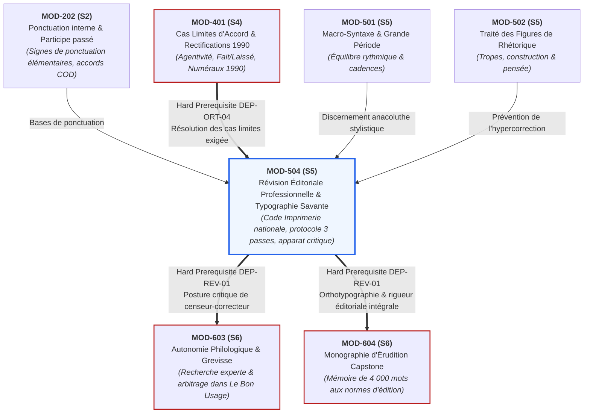

# Fiche Pédagogique Opérationnelle — Module MOD-504

> **Identifiant** : `MOD-504`  
> **Titre** : *Révision Éditoriale Professionnelle, Typographie Savante et Haute Tenue Écrite*  
> **Semestre** : Année 3 — Semestre 5 (S5)  
> **Domaines mobilisés** : DOM-02 (Orthographe grammaticale et lexicale), DOM-03 (Grammaire et morphosyntaxe), DOM-07 (Expression écrite et stylistique), DOM-12 (Correction, révision et contrôle qualité éditorial), DOM-13 (Intégration et haute expertise)  
> **Volume horaire estimé** : 18 heures (Étude théorique : 5 h | Pratique délibérée : 7 h | Correction raisonnée : 3 h 30 | Révision active : 2 h 30)  
> **Statut** : [STATUT : PROPOSÉ — EN ATTENTE DE VALIDATION]  
> **Alignement** : [`academic-structure.md` (S5)](file:///f:/Formation/world-class-french/01-architecture/academic-structure.md#6-fiche-détaillée--semestre-5-s5), [`dependency-graph.md` (DEP-ORT-04, Axe Révision & Censure)](file:///f:/Formation/world-class-french/01-architecture/dependency-graph.md), [`competency-framework.md` (FR-INT-003, FR-STYLE-001, FR-ORTHO-001)](file:///f:/Formation/world-class-french/02-competency-framework/competency-framework.md#fr-int-003-réviser-et-corriger-un-texte-tiers-en-justifiant-les-interventions), [`assessment-rubrics.md` (Section 3)](file:///f:/Formation/world-class-french/02-competency-framework/assessment-rubrics.md#3-grille-dévaluation-de-la-révision-éditoriale-correction-dépreuves), [`syllabus.md` (S5)](file:///f:/Formation/world-class-french/03-curriculum/year-3/semester-5/syllabus.md#module-mod-504--révision-éditoriale-professionnelle-typographie-savante-et-haute-tenue-écrite), [`source-registry.md`](file:///f:/Formation/world-class-french/07-resources/source-registry.md)

---

## 1. Présentation et Intérêt du Module

Le module `MOD-504` constitue l'acmé critique et méthodologique du Semestre 5 du cursus **World-Class French**. Alors que les modules `MOD-501` (Macro-syntaxe et période oratoire), `MOD-502` (Traité des figures de rhétorique) et `MOD-503` (Haute éloquence et déclamation) développent la puissance créatrice, expressive et vocale de l'apprenant, `MOD-504` installe la posture complémentaire indispensable à toute souveraineté linguistique : **celle du censeur-correcteur et réviseur d'édition professionnel**.

Écrire avec éclat ne suffit pas ; l'excellence de niveau international (« World-Class ») exige l'œil impitoyable capable d'expurger un texte de ses moindres scories, de ses hésitations normatives et de ses fautes typographiques imperceptibles pour le profane. La haute tenue d'un texte littéraire, philosophique ou juridique ne se mesure pas seulement à la noblesse de son lexique ou à l'amplitude de ses périodes : elle réside dans l'exactitude absolue de sa ponctuation, la rigueur de ses espaces insécables, le respect scrupuleux des capitales accentuées, l'éradication méthodique des solécismes et impropriétés, et la justification scientifique de chaque amendement.

Ce module répond à quatre nécessités fondamentales du lettré et du professionnel de l'écrit :
1. **La traque des pathologies insidieuses du texte** : Dépasser le niveau scolaire de la faute d'orthographe brute pour diagnostiquer les vices profonds de la langue écrite : solécismes (ruptures syntaxiques et fautes de rection), barbarismes (mots estropiés ou inexistants), impropriétés lexicales (paronymes savants, confusions de registre), pléonasmes vicieux et faux-amis sémantiques [Réf. SRC-GRAM-01, § 160-175 ; SRC-LEX-01].
2. **La maîtrise intégrale du Code typographique officiel** : S'approprier les règles impératives fixées par le *Lexique des règles typographiques en usage à l'Imprimerie nationale* [Réf. SRC-TYPO-01]. La micro-typographie (espaces insécables, ponctuation double, famille des tirets, capitales accentuées, règles de l'italique et écriture des nombres) n'est pas un ornement secondaire : elle forme le socle matériel de la lisibilité et de la dignité textuelle.
3. **Le protocole professionnel de révision en trois passes étanches** : Rompre avec la relecture intuitive et désordonnée au profit d'un algorithme de contrôle éprouvé en maison d'édition, ségréguant la macro-structure logique (Passe 1), la méso-syntaxe et la cohésion (Passe 2), et la micro-typographie orthotypographique (Passe 3).
4. **La confection d'un apparat critique et le refus de l'hypercorrection** : L'acte de correction ne saurait être un caprice d'humeur. Tout amendement doit être scientifiquement motivé par le renvoi aux autorités légitimes (*Le Bon Usage* de Grevisse, la *Grammaire méthodique du français*, le *Dictionnaire de l'Académie française*, le *TLFi*), tout en proscrivant l'hypercorrection — cette faute suprême du réviseur débutant qui mutile une tournure rare mais parfaitement attestée.

---

## 2. Place dans le Cursus

- **Position séquentielle** : Semaines 11 et 12 du Semestre 5 (S5). Il clôt l'enseignement régulier du semestre en opérant la synthèse de tous les apprentissages formels avant les révisions cumulatives (Semaine 13) et les épreuves de la Porte 5 (Semaine 14).
- **Rôle architectural** : Pivot de l'axe *Révision & Censure éditoriale* ([`dependency-graph.md`](file:///f:/Formation/world-class-french/01-architecture/dependency-graph.md)). Il dote l'apprenant du recul métalinguistique indispensable pour relire ses propres productions et auditer des manuscrits tiers avec le regard d'un secrétaire de rédaction ou d'un préparateur de copie universitaire.
- **Relations fonctionnelles amont / aval** :
  - *En amont* :
    - `MOD-202` (Ponctuation interne et accords canoniques) : bases des signes de ponctuation et de l'analyse du COD ;
    - `MOD-303` (Accords des verbes pronominaux) : maîtrise du calcul actanciel des clitiques ;
    - `MOD-401` (Lien bloquant direct *Hard Prerequisite*, [`dependency-graph.md`, DEP-ORT-04](file:///f:/Formation/world-class-french/01-architecture/dependency-graph.md#22-axe-orthographe-grammaticale--accords-du-canonique-aux-cas-limites)) : résolution des cas limites d'accord (*fait/laissé + infinitif*, verbes de perception) et maîtrise des rectifications de l'orthographe de 1990 ;
    - `MOD-501` & `MOD-502` : connaissance de l'harmonie périodique et des figures de style, permettant de discerner une audace stylistique d'une véritable incorrection.
  - *En aval* :
    - Ouvre directement sur `MOD-603` (Semestre 6 : Autonomie philologique, maniement approfondi de Grevisse et recherche lexicographique avancée au TLFi) ;
    - Prépare l'exercice de l'herméneutique savante (`MOD-602`) ;
    - Conditionne la réussite du *Capstone Project* (`MOD-604`), où la monographie d'érudition finale de 4 000 mots doit être soumise selon les normes orthotypographiques strictes de l'Imprimerie nationale sans la moindre coquille.

---

## 3. Prérequis et Diagnostic

### 3.1 Prérequis Stricts
1. **Résolution infaillible des accords complexes** (`MOD-401`, `FR-ORTHO-003`, `FR-ORTHO-004`, palier L4) : Maîtrise absolue des participes passés suivis d'un infinitif (*fait* invariable, *laissé* selon la tradition ou 1990, verbes de perception selon l'agentivité) et des verbes pronominaux.
2. **Maîtrise des Rectifications orthographiques de 1990** (`MOD-401`, `SRC-NORM-02`) : Trait d'union dans les numéraux, pluriel des mots composés Verbe + Nom, gestion des accents circonflexes discriminants (*mûr, sûr, jeûne, dû*).
3. **Syntaxe de la phrase complexe** (`MOD-301`, `MOD-302`, `MOD-501`, palier L3+) : Hiérarchisation des propositions, régimes prépositionnels, concordance des modes et des temps.
4. **Analyse logique et détection des sophismes** (`MOD-402`, palier L3) : Capacité à discerner une rupture de cohérence argumentative dans un paragraphe.

### 3.2 Protocole Diagnostique d'Entrée (Semaine 11, 45 minutes)
Avant d'entamer l'apprentissage du protocole de révision, l'apprenant est soumis à un diagnostic tripartite sur table :
- **Volet A — Audit micro-typographique aveugle (10 items, 15 min)** : Détection d'espaces insécables manquantes, d'inversions de tirets et de capitales non accentuées sur de courtes phrases.
- **Volet B — Épreuve de criblage des pathologies du texte (10 items, 15 min)** : Distinction nette entre solécisme, barbarisme, impropriété et pléonasme sur un corpus d'énoncés corrompus.
- **Volet C — Test de prévention de l'hypercorrection (5 items, 15 min)** : Confrontation à 5 phrases rares ou archaïsantes mais irréprochables (ex. subjonctif imparfait rare, négation sans *pas*, accord de l'adjectif *feu* antéposé). L'apprenant doit déclarer la conformité sans altérer le texte.
- **Seuil d'alerte** : Tout résultat inférieur à **24/30** ($80\,\%$) déclenche une session de remédiation immédiate de 2 heures axée sur le repérage des paronymes et la nomenclature de l'Imprimerie nationale.

---

## 4. Objectifs Pédagogiques Mesurables

Au terme des 18 heures d'enseignement et d'ateliers du module `MOD-504`, l'apprenant doit être capable de :

1. **Identifier et classifier** avec une fiabilité de $100\,\%$ les cinq pathologies majeures du texte écrit :
   - solécismes (fautes de construction syntaxique, rections prépositionnelles fausses, anacoluthes fautives) ;
   - barbarismes (altérations morphologiques, interversions de phonèmes/graphèmes, mots inexistants) ;
   - impropriétés lexicales (confusions paronymiques, contresens sur le registre ou l'étymologie) ;
   - pléonasmes vicieux et redondances lexicales tautologiques ;
   - faux-amis savants et anglicismes sémantiques dissimulés [Réf. SRC-GRAM-01, § 160-175 ; SRC-LEX-01].
2. **Appliquer rigoureusement les normes micro-typographiques de l'Imprimerie nationale** [Réf. SRC-TYPO-01] :
   - insérer l'espace insécable appropriée devant les signes de ponctuation doubles (deux-points, point-virgule, point d'interrogation, point d'exclamation), après le guillemet ouvrant « et avant le guillemet fermant » ;
   - employer à bon escient la famille des tirets : trait d'union (-) pour la composition lexicale et la césure, tiret demi-cadratin (–) pour les incises et les énumérations, tiret cadratin (—) pour les répliques dialoguées ;
   - accentuer sans exception les majuscules et capitales (*À, É, È, Ê, Î, Ô, Û, Ç*) en vertu du principe selon lequel l'accent a pleine valeur orthographique ;
   - appliquer les règles d'emploi de l'italique (titres d'œuvres, termes et locutions étrangers non francisés, autonymes) sans cumuler fautivement guillemets et italiques ;
   - transcrire les nombres en toutes lettres ou en chiffres arabes/romains conformément aux usages éditoriaux (cardinaux dans le texte courant, siècles en chiffres romains petites capitales, ordinaux canoniques).
3. **Exécuter méthodiquement le protocole de révision en 3 passes étanches** :
   - Passe 1 : Contrôle macro-structurel, cohérence argumentative, équilibre des paragraphes, titraille et pagination ;
   - Passe 2 : Contrôle méso-syntaxique, régimes des verbes, anacoluthes, coordination, fluidité périodique ;
   - Passe 3 : Contrôle micro-typographique, orthotypographie, ponctuation fine, coquilles lexicales et césures.
4. **Rédiger un apparat critique de révision professionnel** : consigner chaque intervention dans une fiche de justification mentionnant le texte source corrompu, la correction proposée, la taxonomie de l'erreur et le renvoi scientifique précis aux autorités reconnues ([SRC-GRAM-01], [SRC-TYPO-01], [SRC-GRAM-02], [SRC-LEX-01]).
5. **Prévenir rigoureusement toute hypercorrection** : résister à la tentation de modifier une tournure littéraire, rare ou poétique légitime sous prétexte qu'elle s'écarte de l'usage oral contemporain, et respecter scrupuleusement la voix auctoriale.

---

## 5. Compétences Visées et Niveaux de Maîtrise Attendus

| Identifiant | Intitulé officiel de la compétence | Palier d'entrée | Palier cible MOD-504 | Preuve observable spécifique |
| :--- | :--- | :---: | :---: | :--- |
| [`FR-INT-003`](file:///f:/Formation/world-class-french/02-competency-framework/competency-framework.md#fr-int-003-réviser-et-corriger-un-texte-tiers-en-justifiant-les-interventions) | **Révision critique et correction éditoriale professionnelle** | L3 | **L4 (Maîtrise approfondie)** | Correction intégrale d'une épreuve de 500 mots comportant 30 pièges semés : taux de détection $\ge 95\,\%$, zéro hypercorrection, apparat critique irréprochable avec note $\ge 16/20$. |
| [`FR-STYLE-001`](file:///f:/Formation/world-class-french/02-competency-framework/competency-framework.md#fr-style-001-maîtrise-des-figures-de-rhétorique-et-commentaire-stylistique) | **Dissection stylistique et respect de la liberté auctoriale** | L3 | **L4 (Maîtrise approfondie)** | Capacité à distinguer une figure de construction (hyperbate, asyndète, anacoluthe concertée) d'un solécisme fautif. |
| [`FR-ORTHO-001`](file:///f:/Formation/world-class-french/02-competency-framework/competency-framework.md#fr-ortho-001-maîtrise-de-lorthographe-lexicale-et-des-familles-de-mots) | **Orthotypographie savante et haute tenue lexicale** | L3 | **L4 (Maîtrise approfondie)** | Application instantanée des normes de l'Imprimerie nationale et détection de $100\,\%$ des barbarismes et paronymes. |

### Descripteurs Observables du Palier L4 pour `FR-INT-003` :
Face à une épreuve littéraire ou universitaire complexe corrompue, l'expert certifié au palier **L4** :
1. Ne pratique jamais la lecture hâtive à voix haute ; il isole visuellement et séquentiellement les trois niveaux de traitement (macro, méso, micro).
2. Repère instantanément les manquements typographiques invisibles au lecteur ordinaire (espace manquante avant un point d'exclamation, césure illicite, utilisation d'un tiret court d'union dans un dialogue).
3. Ne confond jamais un barbarisme (mot forgé ou déformé) avec une impropriété (mot existant mais employé hors de son acception propre).
4. Ne corrige aucune forme sans être capable d'énoncer le paragraphe de référence du *Bon Usage* ou la règle du *Lexique des règles typographiques*.
5. Ne commet aucune hypercorrection : face à une inversion noble, un subjonctif imparfait de haute volée ou un mot rare du XVIIe siècle, il s'abstient de toute censure intempestive.

---

## 6. Plan Détaillé des Chapitres

```text
ARCHITECTURE PÉDAGOGIQUE DU MODULE MOD-504 (18 HEURES)
├── CHAPITRE 1 : SÉMIOLOGIE DES PATHOLOGIES DU TEXTE ÉCRIT (3 h 30)
│   ├── 1.1 Taxonomie fondamentale : vice de langue vs licence poétique vs néologisme
│   ├── 1.2 Les solécismes : fautes de rection verbale (se rappeler de, pallier à), ruptures de construction, coordinations illicites
│   ├── 1.3 Les barbarismes : altérations morphologiques (rénumérer, disgresser, infractus, dilemne)
│   ├── 1.4 Les impropriétés lexicales : paronymes savants (recouvrer/recouvrir, circonscription/circonspection, collision/collusion)
│   ├── 1.5 Les pléonasmes vicieux : tautologies lexicales (monopole exclusif, panacée universelle, voire même)
│   └── 1.6 Les faux-amis savants et calques anglo-saxons (opportunité, initier, définitivement)
├── CHAPITRE 2 : LE CODE TYPOGRAPHIQUE OFFICIEL (IMPRIMERIE NATIONALE) : ESPACES ET PONCTUATION (3 h 30)
│   ├── 2.1 Histoire et statut du « Lexique des règles typographiques en usage à l'Imprimerie nationale »
│   ├── 2.2 L'espace insécable : définition technique, justification esthétique et gestion des blancs
│   ├── 2.3 Ponctuation simple (, .) vs ponctuation double (; : ? !) : règles de composition
│   ├── 2.4 Typographie des guillemets français (« ») : espace insécable interne, citation de second rang (« “ ” »)
│   └── 2.5 Points de suspension, parenthèses et crochets : voisinage des ponctuations
├── CHAPITRE 3 : FAMILLE DES TIRETS, CAPITALES ACCENTUÉES ET RÈGLES DE L'ITALIQUE (3 h 30)
│   ├── 3.1 La triade des tirets : trait d'union (-), tiret demi-cadratin (–) et tiret cadratin (—)
│   ├── 3.2 L'accentuation impérative des majuscules et capitales : valeur phonétique et sémantique (À, É, È, Î, Ô, Ç)
│   ├── 3.3 L'emploi rigoureux de l'italique : titres d'œuvres, périodiques, œuvres d'art
│   ├── 3.4 Italique et langues étrangères : locutions latines non francisées et xénismes
│   └── 3.5 L'autonymie : démarcation typographique du mot pris comme signifiant
├── CHAPITRE 4 : NUMÉRATION ÉDITORIALE ET PROTOCOLE DE RÉVISION EN 3 PASSES (4 h)
│   ├── 4.1 Nombres en toutes lettres vs en chiffres arabes : contextes littéraires vs scientifiques
│   ├── 4.2 Les chiffres romains : siècles (XIXe siècle), dynasties royales, tomes et grandes divisions
│   ├── 4.3 Architecture du protocole en 3 passes étanches :
│   │   ├── Passe 1 : Macro-structure, cohérence logique, progression thématique, paragraphes et titraille
│   │   ├── Passe 2 : Méso-syntaxe, rections, concordance, anacoluthes, clitiques et cohésion textuelle
│   │   └── Passe 3 : Micro-typographie, orthotypographie, ponctuation fine, coquilles et insécables
│   └── 4.4 Les signes conventionnels de correction d'épreuves (norme ISO / Imprimerie nationale)
└── CHAPITRE 5 : L'APPARAT CRITIQUE, DÉONTOLOGIE ÉDITORIALE ET HYPERCORRECTION (3 h 30)
    ├── 5.1 Confection méthodique d'un apparat critique universitaire et professionnel
    ├── 5.2 Citation rigoureuse des autorités : Grevisse, Riegel, Académie française, TLFi
    ├── 5.3 La déontologie du correcteur : servir l'auteur sans se substituer à lui
    ├── 5.4 L'hypercorrection : mécanismes psycholinguistiques, pièges classiques et neutralisation
    └── 5.5 Grille synoptique d'audit éditorial pour certification de copie
```

---

## 7. Concepts Fondamentaux et Notions Avancées

### 7.1 Concepts Fondamentaux

#### 1. Le Protocole de Révision en Trois Passes Étanches
La correction d'un texte ne saurait être menée de manière holistique ou désordonnée : la charge cognitive humaine est incapable de scruter simultanément la pertinence d'une argumentation conceptuelle et l'absence d'une espace insécable avant un point-virgule. La pratique professionnelle impose **l'étanchéité absolue de trois passes successives** :

```text
MATRICE DU PROTOCOLE DE RÉVISION PROFESSIONNELLE EN TROIS PASSES
├── PASSE 1 : MACRO-STRUCTURE & FOND (Focalisation globale)
│   ├── Cohérence logique de la thèse et validité des transitions
│   ├── Découpage équilibré des paragraphes et hiérarchie de la titraille
│   ├── Vérification factuelle élémentaire (citations, dates, noms propres)
│   └── Intégrité de la pagination et ordonnancement des sections
├── PASSE 2 : MÉSO-SYNTAXE & COHÉSION TEXTUELLE (Focalisation phrastique)
│   ├── Éradication des solécismes et rectitude des rections verbales
│   ├── Contrôle de l'anacoluthe fautive vs anacoluthe stylistique
│   ├── Équilibre de la coordination et neutralisation des asymétries syntaxiques
│   └── Concordance des modes et des temps au sein des systèmes subordonnés
└── PASSE 3 : MICRO-TYPOGRAPHIE & ORTHOTYPOGRAPHIE (Focalisation microscopique)
    ├── Espaces insécables systématiques devant ; : ? ! et dans les guillemets « »
    ├── Famille des tirets : respect strict de la triade (trait d'union, demi-cadratin, cadratin)
    ├── Majuscules et capitales accentuées (À, É, È, Î, Ô, Ç)
    ├── Italiques canoniques (titres d'œuvres, xénismes, autonymes)
    └── Orthographe lexicale, accords limites (participes passés, 1990) et césures
```

#### 2. La Distinction Linguistique : Solécisme vs Barbarisme vs Impropriété
Une rigueur terminologique absolue est exigée pour qualifier les vices de langue [Réf. SRC-GRAM-01, § 160-165 ; SRC-GRAM-02, chap. 2] :
- **Le Solécisme** : Faute contre les règles de la syntaxe. Les mots employés existent tous dans le dictionnaire, mais leur agencement enfreint le système grammatical.  
  *Exemples canoniques* :
  - *« Se rappeler de »* au lieu de *se rappeler quelque chose* (ou *se souvenir de*) [Réf. SRC-GRAM-01, § 287].
  - *« Pallier à »* au lieu de *pallier un manque* (le verbe *pallier* est transitif direct) [Réf. SRC-GRAM-01, § 288].
  - *« Après qu'il soit parti »* au lieu de *après qu'il est parti* (*après que* régit l'indicatif, l'action étant accomplie) [Réf. SRC-GRAM-01, § 1111].
  - *« Elle s'est faite avoir »* au lieu de *elle s'est fait avoir* (*fait + infinitif* est strictement invariable) [Réf. SRC-GRAM-01, § 961].
- **Le Barbarisme** : Faute contre la morphologie ou le lexique. Il s'agit de l'emploi d'un mot forgé de toutes pièces, inexistant dans la langue, ou d'une déformation morphologique d'un mot réel par interversion, omission ou adjonction indue de phonèmes/graphèmes.  
  *Exemples canoniques* :
  - *\*« Rénumérer »* pour *rémunérer* (métathèse fautive).
  - *\*« Disgresser »* pour *digresser*.
  - *\*« Infractus »* pour *infarctus*.
  - *\*« Dilemne »* pour *dilemme* (faute graphique tenace).
  - *\*« Pécunier »* pour *pécuniaire* (l'adjectif masculin est *pécuniaire*, non *\*pécunier*).
- **L'Impropriété lexicale** : Emploi d'un mot réel et correctement orthographié, mais dans un sens qui n'est pas le sien, souvent par confusion paronymique ou glissement sémantique incontrôlé.  
  *Exemples canoniques* :
  - Confondre *recouvrer* (rentrer en possession de sa santé, de ses sens) et *recouvrir* (mettre un couvercle, cacher entièrement) [Réf. SRC-LEX-01].
  - Confondre *circonscription* (découpage territorial) et *circonspection* (prudence attentive et mesurée).
  - Confondre *collision* (choc matériel violent) et *collusion* (entente secrète frauduleuse au détriment d'un tiers).
  - Confondre *notoire* (connu publiquement de tous) et *notable* (remarquable, considérable).

#### 3. Pléonasmes Vicieux et Faux-Amis Savants
- **Le Pléonasme vicieux** : Redondance sémantique tautologique où le déterminant ou le modificateur répète inutilement un sème déjà intégralement contenu dans le mot déterminé.  
  *Exemples proscrits* : *monopole exclusif* (un monopole est par essence exclusif) ; *panacée universelle* (la panacée guérit par définition tous les maux) ; *voire même* (*voire* signifiant déjà « et même » en latin classique *vere*) ; *hasard imprévu* ; *collaborer ensemble* ; *ajouter en plus* ; *premier prémice* (*les prémices* étant le commencement).
- **Le Faux-ami savant / Anglicisme sémantique** :
  - *Opportunité* employé pour « occasion favorable » (calque de l'anglais *opportunity*) : en français classique, l'*opportunité* désigne exclusivement le caractère de ce qui est opportun (la convenance temporelle) [Réf. SRC-LEX-02].
  - *Initier* employé pour « commencer, engager, déclencher » (calque de *to initiate*) : en français, on *initie quelqu'un à un savoir ou à un mystère* ; on n'initie pas une procédure, on l'engage ou on l'ouvre.
  - *Supporter* employé pour « soutenir » (calque de *to support*) : en français, *supporter* signifie endurer avec patience ou porter physiquement une charge.

---

### 7.2 Notions Avancées

#### 1. Le Code Typographique Officiel de l'Imprimerie Nationale
Le *Lexique des règles typographiques en usage à l'Imprimerie nationale* [SRC-TYPO-01] fixe les normes qui confèrent à l'écrit sa dignité académique et éditoriale :

| Domaine typographique | Règle officielle de l'Imprimerie nationale | Exemple conforme | Contre-exemple fautif |
| :--- | :--- | :--- | :--- |
| **Espaces insécables & Ponctuation double** | Espace insécable obligatoire avant les signes doubles : deux-points (:), point-virgule (;), point d'interrogation (?), point d'exclamation (!). | *Que dit-il&nbsp;? Rien&nbsp;: tout est dit.* | *\*Que dit-il? Rien: tout est dit.* (ou espace sécable coupée en bout de ligne) |
| **Guillemets français** | Guillemets en chevrons (« ») avec espace insécable après l'ouvrant et avant le fermant. Les guillemets anglais (" ") sont proscrits en français de premier rang. | *Il s'écria&nbsp;: «&nbsp;Jamais&nbsp;!&nbsp;»* | *\*Il s'écria : "Jamais!"* |
| **Tiret cadratin (—)** | Réservé exclusivement à la composition des dialogues pour marquer le changement d'interlocuteur. Suivi d'une espace ordinaire. | *— Que cherchez-vous&nbsp;?<br/>— La vérité.* | *\*- Que cherchez-vous ?<br/>\*- La vérité.* (trait d'union interdit) |
| **Tiret demi-cadratin (–)** | Réservé aux incises dans la narration et aux énumérations. Précédé et suivi d'une espace (insécable avant l'incise fermante). | *Cette démarche – osée, il est vrai – porta ses fruits.* | *\*Cette démarche - osée, il est vrai - porta ses fruits.* (tirets courts) |
| **Trait d'union (-)** | Réservé à l'union lexicale des mots composés (*arc-en-ciel*), à la liaison verbale (*va-t-il*) et à la césure étymologique de fin de ligne. | *Peut-être viendra-t-elle.* | *\*Peut–être viendra–t–elle.* |
| **Majuscules accentuées** | Les majuscules et capitales doivent impérativement conserver leurs accents, trémas et cédilles. « L'accent a pleine valeur orthographique » [Académie]. | *À l'aube, Émile médite.* | *\*A l'aube, Emile médite.* |
| **Règles de l'italique** | Obligatoire pour : 1. Titres d'œuvres et périodiques ; 2. Mots et locutions étrangers non francisés (*in situ, a priori, curriculum vitæ*) ; 3. Mots autonymes. | *Dans Le Monde, il cite Le Cid.* | *\*Dans « Le Monde », il cite « Le Cid ».* (guillemets superflus) |
| **Écriture des nombres** | En toutes lettres dans le cours ordinaire du récit ou du discours. Chiffres romains pour les siècles (*XIXe siècle* en petites capitales). | *Il marcha durant trois jours et parcourut quinze kilomètres.* | *\*Il marcha durant 3 jours et parcourut 15 km.* (prose littéraire) |

#### 2. Micro-typographie vs Macro-typographie
- **La Macro-typographie** concerne l'architecture spatiale du livre ou du mémoire : format du papier, empagement, justification, marges de tête, de pied, de grand et de petit fond, interlignage, disposition des têtes de chapitre, blancs tournants et équilibre des masses de gris typographique.
- **La Micro-typographie (ou orthotypographie)** gouverne le détail microscopique des signes et des caractères : dessin précis des glyphes, ligatures esthétiques indispensables (*œ* dans *œuvre, œil* ; *æ* dans *curriculum vitæ, ex æquo*), apostrophes courbes typographiques (’) à l'exclusion de l'apostrophe droite dactylographique d'ordinateur ('), et respect des césures (ne jamais couper un mot sur une syllabe muette ni isoler une voyelle unique en bout de ligne).

#### 3. L'Apparat Critique et la Posture Déontologique du Censeur
La révision éditoriale professionnelle se distingue radicalement du barbouillage d'écolier. Tout amendement doit être documenté dans un **apparat critique** structuré selon le formalisme suivant :
$$\text{Fiche d'amendement} = \langle \text{Localisation}, \text{Leçon fautive}, \text{Leçon rétablie}, \text{Typologie de l'erreur}, \text{Justification normative et autorité} \rangle$$
La déontologie du correcteur impose de ne jamais réécrire un texte pour imposer ses goûts esthétiques personnels : le correcteur est le serviteur de l'auteur et le gardien de la langue. Face à une singularité de style qui respecte la syntaxe, le correcteur s'incline.

---

## 8. Erreurs et Confusions Fréquentes

### 1. L'Omission des Capitales Accentuées
- **Erreur courante** : Écrire *\*A la fin, \*ETAT, \*EVITER, \*Ca alors*.
- **Origine de la faute** : Héritage mécanique des machines à écrire mécaniques francophones du XXe siècle, dont le chariot manquait de course verticale pour frapper les majuscules avec accent sans briser les plombs.
- **Règle absolue** : En typographie française et selon l'Académie française, l'accent a pleine valeur orthographique. Son omission altère la prononciation (*E* muet vs *É* fermé) et engendre de graves confusions sémantiques (*LE PECHEUR* : pêcheur ou pécheur ? ; *LES ENFANTS SONT LEGITIMES* : légitimés ou légitimes ? ; *A PARIS* : préposition *À* ou verbe *A* ?).
- **Norme** : Écrire impérativement *À, É, È, Ê, Î, Ô, Û, Ç*.

### 2. L'Omission ou la Mauvaise Gestion des Espaces Insécables
- **Erreur courante** : Laisser une espace ordinaire devant un point d'exclamation ou un deux-points, provoquant le rejet disgracieux du signe de ponctuation seul en début de ligne suivante (signe « orphelin »).
- **Règle absolue** : L'espace insécable lie mécaniquement le mot et la ponctuation double. Dans le traitement de texte professionnel, insérer une espace insécable (`Ctrl + Maj + Espace` sous Word, `Alt + Espace` sous macOS, ou `&nbsp;` en HTML).

### 3. La Correction Fautive par Hypercorrection
- **Erreur courante** : Un relecteur zélé rencontre la phrase : *« Quoiqu'il en soit, il eût mieux valu qu'il prît garde »* et corrige le subjonctif imparfait *prît* en indicatif présent *\*prend*, ou censure l'adjectif *feu* dans *« feu la reine »* en l'accordant fautivement *\*feue*.
- **Origine de la faute** : Méconnaissance de la syntaxe classique et application mécanique de règles simplistes enseignées au premier degré.
- **Règle absolue** : Avant de déclarer une tournure fautive, le réviseur doit consulter les traités de référence ([SRC-GRAM-01]). L'hypercorrection est pénalisée deux fois plus sévèrement que l'omission d'une faute réelle.

### 4. La Confusion au sein de la Famille des Tirets
- **Erreur courante** : Utiliser indifféremment le trait d'union (-) pour ouvrir un dialogue ou encadrer une incise, ou employer un tiret long pour relier un mot composé (*\arc—en—ciel*).
- **Règle absolue** :
  - Trait d'union (-) = 1/4 de cadratin : mots composés, liaisons verbales, césures.
  - Tiret demi-cadratin (–) = 1/2 cadratin : incises de narration, listes à puces.
  - Tiret cadratin (—) = 1 cadratin : dialogue et changement d'interlocuteur.

---

## 9. Exemples Simples, Intermédiaires et Complexes

### 9.1 Modèle Annoté d'une Épreuve Éditoriale Corrompue de 30 Pièges

Voici le modèle d'une épreuve éditoriale de 350 mots issue d'un essai de critique littéraire fictif, délibérément corrompue de **trente (30) pièges étalonnés**, illustrant l'ensemble des pathologies du texte et des infractions typographiques :

> #### Texte de l'Épreuve Modèle (Corpus Corrompu) :
> A l'orée du [1] 20ème siècle [2], la critique littéraire s'est vue confrontée [3] à une crise sans précédent : les académiciens, voulant moderniser la langue [4], la commission les a fait siéger [5] d'urgence. Les réformes qu'ils ont prétendu [6] imposer devaient pallier à [7] l'anarchie des usages. Pourtant, un aréopage de linguistes [8] renommés s'est empressé de disgresser [9] sur ce projet, dénonçant une collision [10] manifeste entre l'autorité ministérielle et les gens de lettres.
> « Le monopole exclusif [11] de la norme ne saurait appartenir à l'Etat [12] », déclarait un célèbre philologue dans Le figaro [13] : [14] - [15] « Il faut se rappeler de [16] la tradition classique ! [17] » Ce savant, dont la circonspection [18] verbale forçait l'admiration, avait consacré 3 [19] décennies à recouvrer [20] les manuscrits oubliés du grand siècle. Il refusait qu'on initie [21] une refonte brutale, voire même [22] arbitraire, sans mesurer l'opportunité [23] exacte de chaque graphie.
> Les écrivains que nous avons entendu [24] protester craignaient une régression esthétique. En effet, - [25] disait-on dans les salons -, [26] l'accent circonflexe confère une noblesse certaine à des termes tels que mûr ou jeûne [27]. Les difficultés financières étaient aussi un problème pécunier [28] récurrent : les éditeurs, face aux coûts d'impression, se sont plaint [29] de ne pouvoir rééditer les chefs d'oeuvre [30] selon les nouveaux canons.

---

### 9.2 Corrigé Synoptique et Apparat Critique de l'Épreuve Modèle

| N° | Leçon Corrompue | Leçon Rectifiée | Catégorie du Vice de Langue | Justification Normative & Références Scientifiques |
| :---: | :--- | :--- | :--- | :--- |
| **1** | *A l'orée* | **À l'orée** | Micro-typographie (Accentuation) | Accent obligatoire sur la capitale prépositionnelle *À*. « L'accent a pleine valeur orthographique » [Réf. SRC-TYPO-01, p. 104 ; Académie française]. |
| **2** | *20ème siècle* | **XXe siècle** | Typographie (Numération) | Les siècles s'écrivent en chiffres romains grandes ou petites capitales avec la désinence *e* en exposant (non *ème*) [Réf. SRC-TYPO-01, p. 162]. |
| **3** | *s'est vue confrontée* | **s'est vu confronter** / **s'est trouvée confrontée** | Solécisme / Accord fautif | Le verbe pronominal de sentiment *se voir* suivi d'un participe passif : le réfléchi *se* est COI (*confronter à elle*), mais la tournure est lourde ; dans l'usage soigné, préférer *s'est trouvée confrontée* ou *s'est vu confronter* [Réf. SRC-GRAM-01, § 964]. |
| **4** | *les académiciens, voulant... la commission...* | **Alors que les académiciens voulaient moderniser la langue, la commission...** | Solécisme (Anacoluthe fautive) | Rupture de construction : le participe présent *voulant* est suspendu sans sujet grammatical dans la proposition principale régie par *la commission* [Réf. SRC-GRAM-02, chap. 11]. |
| **5** | *les a fait siéger* | **les a fait siéger** (Correct : piège d'hypercorrection !) | Hypercorrection déjouée | *Fait + infinitif* est strictement invariable. Ne pas modifier en *\*faites*. L'épreuve teste la neutralisation du geste intempestif [Réf. SRC-GRAM-01, § 961]. |
| **6** | *ont prétendu imposer* | **ont prétendu imposer** (Correct : piège d'hypercorrection !) | Hypercorrection déjouée | Le pronom relatif *que* est COD de l'infinitif *imposer*, non du verbe recteur *prétendre*. Le participe *prétendu* demeure invariable. Conserver sans faute [Réf. SRC-GRAM-01, § 963]. |
| **7** | *pallier à l'anarchie* | **pallier l'anarchie** | Solécisme (Rection prépositionnelle) | Le verbe *pallier* est transitif direct (*pallier quelque chose*). La construction avec préposition *à* est un solécisme notoire [Réf. SRC-GRAM-01, § 288 ; SRC-LEX-02]. |
| **8** | *un aréopage de linguistes* | **un collège de linguistes** ou **un cercle de linguistes** | Impropriété lexicale | L'Aréopage est historiquement le tribunal d'Athènes ; par dérivation, une assemblée de magistrats ou de juges éminents. L'appliquer à des linguistes sans mandat est une impropriété de registre [Réf. SRC-LEX-01]. |
| **9** | *disgresser* | **digresser** | Barbarisme (Morphologie) | Métathèse et adjonction fautive d'un *s*. Le verbe français est *digresser* (du latin *digredi*) [Réf. SRC-LEX-01, s.v. « digresser »]. |
| **10** | *collision manifeste* | **collusion manifeste** | Impropriété lexicale (Paronymie) | Confusion entre *collision* (choc matériel violent) et *collusion* (entente secrète illicite ou frauduleuse contre des tiers) [Réf. SRC-LEX-01 ; SRC-GRAM-01, § 170]. |
| **11** | *monopole exclusif* | **monopole** | Pléonasme vicieux | Un monopole étant par définition un privilège exclusif, l'adjectif *exclusif* est un pléonasme tautologique [Réf. SRC-GRAM-01, § 167]. |
| **12** | *l'Etat* | **l'État** | Micro-typographie (Accentuation) | Majuscule obligatoire pour l'institution politique (*État*), et accent aigu impératif sur le *É* [Réf. SRC-TYPO-01, p. 77]. |
| **13** | *Le figaro* | ***Le Figaro*** | Micro-typographie (Italique & Majuscule) | Les titres de journaux et périodiques s'écrivent en italique avec majuscule initiale au premier substantif et à l'article défini intégré [Réf. SRC-TYPO-01, p. 102]. |
| **14** | *: [sans espace insécable]* | **&nbsp;:** | Micro-typographie (Espace) | Les deux-points doivent obligatoirement être précédés d'une espace insécable [Réf. SRC-TYPO-01, p. 149]. |
| **15** | *- [trait d'union]* | **— [tiret cadratin]** | Typographie (Famille des tirets) | L'introduction d'une citation directe en forme de prise de parole exige le tiret cadratin (—), le trait d'union étant proscrit [Réf. SRC-TYPO-01, p. 167]. |
| **16** | *se rappeler de la tradition* | **se rappeler la tradition** | Solécisme (Rection prépositionnelle) | *Se rappeler* régit un COD direct (*se rappeler quelque chose*). C'est *se souvenir* qui exige la préposition *de* [Réf. SRC-GRAM-01, § 287 ; SRC-LEX-02]. |
| **17** | *! [sans insécable avant guillemet]* | **&nbsp;!»** | Micro-typographie (Espace) | Espace insécable obligatoire avant le point d'exclamation et avant le guillemet fermant [Réf. SRC-TYPO-01, p. 90, 149]. |
| **18** | *sa circonspection* | **son élocution** ou **sa rigueur** | Impropriété lexicale | *Circonspection* désigne la retenue prudente dans l'action, non l'éloquence ou l'art oratoire. Paronyme déplacé [Réf. SRC-LEX-01]. |
| **19** | *3 décennies* | **trois décennies** | Typographie (Numération) | Dans le cours ordinaire d'une prose littéraire ou historique, les nombres cardinaux s'écrivent en toutes lettres [Réf. SRC-TYPO-01, p. 123]. |
| **20** | *recouvrer les manuscrits* | **recouvrer les manuscrits** (Correct : piège d'hypercorrection !) | Hypercorrection déjouée | *Recouvrer* signifie exactement « rentrer en possession de ce qu'on avait perdu ». L'étudiant qui substitue *\*recouvrir* commet un contresens. Conserver la graphie exacte [Réf. SRC-LEX-01]. |
| **21** | *qu'on initie une refonte* | **qu'on engage une refonte** / **qu'on entreprenne une refonte** | Faux-ami savant (Anglicisme) | En français correct, *initier* s'emploie transitivement pour instruire quelqu'un aux premiers éléments (*initier un novice*). Employer *engager* ou *commencer* [Réf. SRC-LEX-02 ; SRC-GRAM-01, § 172]. |
| **22** | *voire même* | **voire** ou **et même** | Pléonasme vicieux | *Voire* provient du latin *vere* et signifie déjà « et même ». La collocation *voire même* est un pléonasme condamné par l'Académie [Réf. SRC-LEX-02 ; SRC-GRAM-01, § 1083]. |
| **23** | *l'opportunité exacte* | **la pertinence exacte** ou **l'à-propos exact** | Faux-ami savant (Anglicisme) | Calque de l'anglais *opportunity* (occasion). En français, l'*opportunité* est le caractère de ce qui convient en un temps donné. Ici, la valeur requise est la *pertinence* [Réf. SRC-LEX-02]. |
| **24** | *avons entendu protester* | **avons entendus protester** | Accord grammatical (Verbe de perception) | Le COD antéposé *que* (les écrivains) accomplit lui-même l'action exprimée par l'infinitif *protester* (les écrivains protestent). Le participe passé s'accorde au masculin pluriel : *entendus* [Réf. SRC-GRAM-01, § 957]. |
| **25** | *En effet, - disait-on* | **En effet, – disait-on** | Typographie (Famille des tirets) | Une incise dans la narration s'ouvre obligatoirement par un tiret demi-cadratin (–) entouré d'espaces, et non par un trait d'union [Réf. SRC-TYPO-01, p. 167]. |
| **26** | *les salons -,* | **les salons –,** | Typographie (Ponctuation & Tiret) | Tiret demi-cadratin fermant, et la virgule suit immédiatement le tiret d'incise, sans espace intercalée [Réf. SRC-TYPO-01, p. 168]. |
| **27** | *termes tels que mûr ou jeûne* | **termes tels que *mûr* ou *jeûne*** | Micro-typographie (Autonymie) | Les mots cités pour eux-mêmes comme objets d'analyse linguistique (autonymes) doivent obligatoirement être composés en italique [Réf. SRC-TYPO-01, p. 102]. |
| **28** | *problème pécunier* | **problème pécuniaire** | Barbarisme (Morphologie lexicale) | L'adjectif masculin est *pécuniaire* (du latin *pecuniarius*). La forme *\*pécunier* est une réfection analogique barbare [Réf. SRC-LEX-01, s.v. « pécuniaire » ; SRC-GRAM-01, § 554]. |
| **29** | *se sont plaint* | **se sont plaints** | Accord grammatical (Verbe pronominal) | *Se plaindre* est un verbe essentiellement pronominal (ou à sens réfléchi direct historique). Le participe s'accorde avec le sujet *les éditeurs* : *plaints* [Réf. SRC-GRAM-01, § 948]. |
| **30** | *chefs d'oeuvre* | **chefs-d'œuvre** | Orthotypographie (Ligature & Trait) | Absence fautive du trait d'union et omission de la ligature obligatoire *œ*. Écrire : *chefs-d'œuvre* [Réf. SRC-TYPO-01, p. 107 ; SRC-NORM-02]. |

---

## 10. Activités d'Observation et de Découverte

### Activité 1 : La Confrontation des Épreuves d'Auteurs (Balzac & Flaubert)
- **Objectif** : Découvrir la matérialité de l'épreuve d'imprimerie et comprendre pourquoi la révision d'épreuves est un acte d'artisanat intellectuel de haute précision.
- **Support** : Fac-similés d'épreuves d'imprimerie corrigées de la main d'Honoré de Balzac pour *La Comédie humaine* et de Gustave Flaubert pour *Madame Bovary*.
- **Tâche d'analyse** :
  1. Identifier les signes conventionnels employés par les proteurs d'imprimerie du XIXe siècle (deleatur $\vartheta$, coquille inversée, appel de note en marge, demande d'espace).
  2. Démêler sur l'épreuve flaubertienne la correction de scories typographiques de la reprise stylistique de cadence et d'harmonie sonore (chasse aux assonances involontaires).
  3. Formuler en deux paragraphes la distinction fondamentale entre la réécriture auctoriale et la correction de copie éditoriale.

### Activité 2 : Autopsie Typographique de la Presse Numérique Contemporaine
- **Objectif** : Aiguiser l'acuité visuelle sur les dégradations micro-typographiques engendrées par les systèmes de gestion de contenu modernes (CMS Web).
- **Support** : Sélection de 5 articles récents issus de quotidiens francophones de référence (Le Monde, Le Figaro, Le Devoir).
- **Tâche d'analyse** :
  1. Repérer les césures accidentelles orphelines (ex. un « ? » ou un « % » renvoyé à la ligne).
  2. Évaluer la proportion de majuscules ayant perdu leur accentuation originelle et identifier les ambiguïtés de lecture qui en découlent.
  3. Relever les collisions entre guillemets dactylographiques (" ") et chevrons français (« »).

---

## 11. Exercices Progressifs (3 Niveaux)

### Niveau 1 : Fondations Micro-typographiques et Lexicales (Exercices d'Application Directe)
*Consigne : Rétablir la typographie exacte et la rectitude lexicale des phrases suivantes en explicitant la règle appliquée.*
1. *A quelle heure l'assemblée generale va-t-elle voter la loi ?*  
   $\rightarrow$ Rétablir : *À quelle heure l'assemblée générale va-t-elle voter la loi&nbsp;?* (Majuscule accentuée *À*, accent aigu sur *générale*, espace insécable avant le point d'interrogation).
2. *Cette décision créera une panacée universelle, voire même un miracle économique.*  
   $\rightarrow$ Rétablir : *Cette décision offrira une panacée, voire un miracle économique.* (Élimination des pléonasmes vicieux *universelle* et *voire même*).
3. *Le témoin a déclaré - sous serment - qu'il n'avait rien vu.*  
   $\rightarrow$ Rétablir : *Le témoin a déclaré – sous serment – qu'il n'avait rien vu.* (Substitution des traits d'union courts par des tirets demi-cadratins d'incise).
4. *Nous devons pallier à ce manque pécunier avant la fin du 19ème siècle.*  
   $\rightarrow$ Rétablir : *Nous devons pallier ce manque pécuniaire avant la fin du XIXe siècle.* (Suppression de *à*, barbarisme *pécunier* corrigé en *pécuniaire*, écriture canonique du siècle).

### Niveau 2 : Désenchevêtrement Méso-syntaxique et Traque des Solécismes
*Consigne : Identifier l'erreur de construction ou de rection dans chaque fragment, qualifier la pathologie syntaxique et proposer une réécriture de niveau universitaire.*
1. *Voulant achever le manuscrit avant l'aube, la plume de l'écrivain s'est brisée net.*  
   $\rightarrow$ **Diagnostic** : Anacoluthe fautive (le participe présent *Voulant* n'a pas pour sujet grammatical *la plume*).  
   $\rightarrow$ **Réécriture** : *Comme l'écrivain voulait achever son manuscrit avant l'aube, sa plume s'est brisée net.*
2. *Il s'agit d'une question dont nous devons nous rappeler et que nous devons débattre.*  
   $\rightarrow$ **Diagnostic** : Double solécisme de rection (*se rappeler* est transitif direct $\rightarrow$ *nous devons nous rappeler quelque chose* ; *débattre de quelque chose* est indirect $\rightarrow$ asymétrie de coordination).  
   $\rightarrow$ **Réécriture** : *Il s'agit d'une question dont nous devons nous souvenir et sur laquelle nous devons débattre.* (ou : *d'une question que nous devons nous rappeler et dont nous devons débattre*).
3. *Après que le censeur ait examiné le dossier, les pièces ont été détruites.*  
   $\rightarrow$ **Diagnostic** : Solécisme modal (*après que* régit l'indicatif accompli, non le subjonctif).  
   $\rightarrow$ **Réécriture** : *Après que le censeur a examiné le dossier, les pièces ont été détruites.*

### Niveau 3 : Épreuve Combinée sur Court Texte Éditorial
*Consigne : Détecter et corriger les 8 vices de langue et fautes typographiques dissimulés dans le paragraphe suivant, puis rédiger une fiche justificative pour chacun.*
> *« En 1945, le ministre a initié une consultation pour solutionner le problème des archives. Les experts qu'il a fait venir ont disgressé durant 4 jours sans trouver d'alternative possible : fallait-il brûler ou classer ? »*
- **Corrigé attendu** :
  1. *a initié* $\rightarrow$ *a engagé* ou *a ouvert* (faux-ami savant) ;
  2. *solutionner* $\rightarrow$ *résoudre* (barbarisme / impropriété de registre) ;
  3. *qu'il a fait venir* $\rightarrow$ Conserver scrupuleusement (piège d'hypercorrection : invariabilité absolue de *fait + infinitif*) ;
  4. *disgressé* $\rightarrow$ *digressé* (barbarisme morphologique) ;
  5. *4 jours* $\rightarrow$ *quatre jours* (écriture littéraire des nombres cardinaux) ;
  6. *alternative possible* $\rightarrow$ *alternative* (pléonasme vicieux : une alternative porte déjà le caractère de la possibilité de choix) ;
  7. *sans trouver d'alternative* $\rightarrow$ vérifier le sens strict (choix binaire entre deux termes) ;
  8. *:* et *?* $\rightarrow$ insertion impérative des espaces insécables avant les deux ponctuations doubles.

---

## 12. Ateliers de Correction et de Révision

### Atelier A : Laboratoire Pratique de Correction d'Épreuves Typographiques (Hebdomadaire — 1 h 30)
- **Objectif** : Automatiser l'utilisation des signes conventionnels normalisés de correction de copie (norme ISO 5776 / Imprimerie nationale).
- **Déroulement** : Les étudiants reçoivent une sortie papier d'un texte d'imprimerie composé en plomb ou PAO haute définition, comportant des coquilles physiques (inversions de lettres, mauvaises fontes, coquilles d'espace, césures vicieuses). Travail au stylo correcteur rouge avec signes conventionnels en marge (signe de deleatur, signe de redressement, signe de paragraphe, signe d'adjonction de blanc insécable).

### Atelier B : Table Ronde Contradictoire de Révision et Déontologie (Hebdomadaire — 1 h 30)
- **Objectif** : Défendre son apparat critique face à un pair-auteur et purger la révision de tout arbitraire ou hypercorrection.
- **Déroulement** : Travail en binôme inversé (Auteur vs Censeur). L'auteur a rédigé une période oratoire dense ; le censeur soumet son rapport de révision. L'auteur a le droit de récuser un amendement si le censeur est incapable d'invoquer un article du Grevisse ou une règle de l'Imprimerie nationale. Toute hypercorrection infligée par le censeur lui retire 2 points de crédit déontologique.

---

## 13. Production Intégratrice

La production intégratrice du module `MOD-504` constitue l'épreuve reine sanctionnant la maîtrise de la compétence [`FR-INT-003`](file:///f:/Formation/world-class-french/02-competency-framework/competency-framework.md#fr-int-003-réviser-et-corriger-un-texte-tiers-en-justifiant-les-interventions) au palier **L4 (Maîtrise approfondie)** :

### Consigne Officielle de l'Épreuve Sommative :
L'apprenant reçoit l'épreuve littéraire et philosophique brute ci-dessous (500 mots), intitulée *« De la déchéance du style à l'illusion du modernisme »*. Ce texte a été volontairement truffé de **trente (30) pièges étalonnés** (pathologies lexicales, solécismes syntaxiques, accords complexes, manquements micro-typographiques, infractions au code de l'Imprimerie nationale).

L'apprenant doit :
1. **Établir le texte parfaitement assaini** en appliquant l'ensemble des règles de révision et de typographie savante ;
2. **Rédiger le rapport de révision éditoriale** (300 mots) analysant la qualité intrinsèque du manuscrit et formulant des préconisations de publication ;
3. **Dresser l'apparat critique complet** sous la forme d'un tableau synoptique de 30 entrées, numérotant chaque intervention, consignant la leçon corrompue, la leçon rétablie, la qualification précise de l'erreur et la justification scientifique avec renvoi obligatoire aux sources de référence ([SRC-TYPO-01], [SRC-GRAM-01], [SRC-GRAM-02], [SRC-LEX-01]).

---

### Corpus Officiel de l'Épreuve Sommative (Texte Corrompu de 500 mots) :

> #### *De la déchéance du style à l'illusion du modernisme*
> A [P-01] la fin du 19ème siècle [P-02], les théoriciens de la littérature ont cru observer une dissolution inexorable de la langue française. Voulant à tout prix démocratiser l'écriture [P-03], les règles classiques ont semblé [P-04] devenir un carcan inutile aux yeux de la jeunesse. Les censeurs qu'on a fait [P-05] intervenir n'ont pu pallier aux [P-06] dérives de ce laxisme grandissant. Pourtant, un aréopage d'écrivains [P-07] lucides a tenté d'initier [P-08] un sursaut salutaire, refusant de disgresser [P-09] sur des querelles secondaires pour se concentrer sur l'essentiel : [P-10] la défense du verbe.
> « Le monopole exclusif [P-11] de la beauté formelle ne relève point de la convention bourgeoise », affirmait un critique dans Le temps [P-12] : [P-13] - [P-14] « Il faut se rappeler des [P-15] maîtres du grand siècle ! [P-16] » Cet essaiiste, dont la circonspection [P-17] stylistique était pourtant notoire, passa 4 [P-18] années entières à recouvrer [P-19] les leçons perdues des manuscrits de Racine. Il déplorait que les jeunes générations eussent recours à des barbarismes pécuniers [P-20], dénonçant une collision [P-21] secrète entre la hâte marchande et le mépris de la cadence.
> Les tragédiennes que nous avons regardé [P-22] répéter sur la scène nationale partageaient cette amertume. En effet, - [P-23] constatait-on dans les coulisses -, [P-24] les acteurs s'étaient plaint [P-25] de ne pouvoir prononcer ces périodes sans trahir leur harmonie native. La polémique s'est encore envenimée après que la commission ait publié [P-26] ses conclusions hâtives. L'opportunité [P-27] de cette publication fut vivement contestée par les partisans de la tradition, qui y voyaient une panacée universelle [P-28] illusoire, voire même [P-29] une capitulation sans gloire devant la facilité ambiante de chefs d'oeuvres [P-30] défigurés.

---

## 14. Évaluation et Barème

L'évaluation sommative du module `MOD-504` est notée sur **20 points**. Conformément aux impératifs de la formation de réviseurs d'élite, elle intègre une **note éliminatoire absolue fixée à 14/20** :

### Grille d'Attribution et Barème Officiel de Correction :
Le barème applique le principe professionnel de la déduction sur une base pleine de **20 points** :

$$\text{Note Finale} = 20 - \sum \text{Pénalités de Détection et d'Édition}$$

| Motif de pénalité | Valeur unitaire | Justification didactique & professionnelle |
| :--- | :---: | :--- |
| **Piège manqué (omission d'une faute réelle)** | **-1,0 pt** | Une erreur non repérée est transmise à l'imprimeur et entache le tirage officiel du livre. |
| **Correction fautive par hypercorrection** | **-2,0 pt** | Altérer à tort un texte valide ou imposer une graphie erronée constitue la faute professionnelle la plus grave du correcteur d'édition. |
| **Justification absente ou scientifiquement erronée** | **-0,5 pt** | La détection sans compréhension métalinguistique ne garantit pas la pérennité de la compétence experte. |
| **Coquille ou faute introduite par le réviseur** | **-2,0 pt** | Faute rédhibitoire : le réviseur ne saurait introduire ses propres erreurs dans la copie de l'auteur. |

### Matrice des Seuils et Sanction Éliminatoire :
- **Note $\ge 18/20$ (Validation avec Mention Très Honorable)** : Au moins 28 pièges sur 30 parfaitement assainis avec apparat critique irréprochable et zéro hypercorrection. L'apprenant est certifié au palier **L4**.
- **Note entre $14,0$ et $17,5/20$ (Validation standard de la Porte 5)** : Entre 24 et 27 pièges corrigés. Admis au semestre 6.
- **Note $< 14,0/20$ (Échec Éliminatoire)** : Dès lors que 7 pièges sont omis (ou 4 pièges omis et 1 hypercorrection commise), la note chute sous le seuil de $14/20$. L'apprenant est immédiatement réorienté vers le **Sas de Remédiation Éditoriale de S5** (durée : 3 semaines) et ne peut se présenter à l'évaluation terminale de la Porte 5.

---

## 15. Critères de Maîtrise

Le module `MOD-504` est formellement validé au palier **L4 (Maîtrise approfondie)** de la compétence `FR-INT-003` lorsque l'apprenant apporte la preuve observable des cinq aptitudes suivantes :

1. **Infaillibilité micro-typographique** :
   - Insertion automatique et rigoureuse des espaces insécables devant la ponctuation double et dans les guillemets français ;
   - Emploi exact des tirets cadratin, demi-cadratin et trait d'union selon leur fonction sémantique ;
   - Accentuation systématique de 100 % des majuscules et capitales.
2. **Discrimination absolue des pathologies lexicales et syntaxiques** :
   - Capacité à distinguer et nommer sans hésitation un solécisme, un barbarisme, une impropriété, un pléonasme et un anglicisme sémantique ;
   - Rectification immédiate des fausses rections (*pallier*, *se rappeler*).
3. **Précision actancielle sur les accords limites** :
   - Maintien sans faille de l'invariabilité de *fait + infinitif* ;
   - Justification de l'accord sur les verbes de perception selon l'agentivité de l'infinitif ;
   - Résolution des accords pronominaux et conformité aux recommandations de 1990.
4. **Immunité totale contre l'hypercorrection** :
   - Neutralisation démontrée des impulsions de censure sur des tournures littéraires rares, subjonctifs imparfaits ou archaïsmes choisis.
5. **Rigueur scientifique de l'apparat critique** :
   - Rédaction d'annotations sobres, objectives, exemptes d'ironie condescendante, avec renvoi normatif explicite aux chapitres et paragraphes du *Bon Usage* et du *Lexique de l'Imprimerie nationale*.

---

## 16. Révisions Espacées Recommandées

Pour ancrer durablement la discipline visuelle et le réflexe orthotypographique, le calendrier de réactivation spiralé suivant est programmé :

- **J+3 après validation du module** : Test flash de criblage (15 minutes) : 10 phrases chronométrées axées exclusivement sur les espaces insécables et la famille des tirets.
- **J+7** : Audit express d'une épreuve corrompue de 150 mots comportant 10 pièges de paronymie et de solécismes.
- **J+21** : Exercice d'immunisation contre l'hypercorrection : analyse de 8 phrases d'auteurs classiques du XVIIe siècle aux accords surprenants mais licites.
- **J+45 (Semaine 13 de S5 — Révision Cumulative Pré-Porte 5)** : Épreuve blanche de révision éditoriale complète en temps limité (2 heures sur table, corpus de 500 mots, 30 pièges).
- **Semestre 6 (S6)** : Réinvestissement permanent dans `MOD-603` (Philologie) et contrôle de conformité éditoriale obligatoire pour le dépôt de la Monographie de fin d'études (`MOD-604`).

---

## 17. Sources de Référence Vérifiées

Toutes les prescriptions normatives, règles typographiques et analyses linguistiques de ce module s'appuient exclusivement sur les autorités réelles et incontestées du registre officiel des sources :

1. **Imprimerie nationale (2002/2014)**. *Lexique des règles typographiques en usage à l'Imprimerie nationale*. Paris : Imprimerie nationale.  
   $\rightarrow$ Ouvrage cardinal fixant les normes officielles françaises : règles des espaces insécables (p. 149-150), famille des tirets (p. 167-168), accentuation impérative des capitales (p. 104-105), règles de composition de l'italique (p. 101-103), composition des nombres en toutes lettres et en chiffres romains (p. 123-126) [Réf. `SRC-TYPO-01`].
2. **Grevisse, Maurice & Goosse, André (2016)**. *Le Bon Usage* (16e éd.). Bruxelles : De Boeck Supérieur.  
   $\rightarrow$ Autorité suprême pour la taxonomie des vices de langue : solécismes et barbarismes (§ 160-175), rections verbales de *se rappeler* (§ 287) et *pallier* (§ 288), accord du participe passé suivi d'infinitif (§ 956-965), accord des pronominaux (§ 938-955), et valeur modale de *après que* (§ 1111) [Réf. `SRC-GRAM-01`].
3. **Riegel, Martin, Pellat, Jean-Christophe & Rioul, René (2016/2021)**. *Grammaire méthodique du français*. Paris : PUF, coll. « Quadrige ».  
   $\rightarrow$ Référence universitaire pour la macro-syntaxe, l'analyse des anacoluthes fautives vs concertées (chap. 11), la coordination asymétrique et la cohésion textuelle (chap. 20-21) [Réf. `SRC-GRAM-02`].
4. **ATILF / CNRS (2026)**. *Trésor de la Langue Française informatisé (TLFi)*. Nancy : Université de Lorraine.  
   $\rightarrow$ Dictionnaire d'autorité pour la vérification des acceptions étymologiques, la traque des paronymes savants (*collision/collusion, recouvrer/recouvrir*) et l'attestation des emplois historiques [Réf. `SRC-LEX-01`].
5. **Académie française (1992-2024)**. *Dictionnaire de l'Académie française* (9e éd.). Paris : Imprimerie nationale / Académie française.  
   $\rightarrow$ Arbitrage institutionnel officiel des impropriétés lexicales, proscription des pléonasmes vicieux (*voire même, panacée universelle*) et doctrine sur l'accentuation des majuscules [Réf. `SRC-LEX-02`].
6. **Conseil supérieur de la langue française (1990)**. *Les rectifications de l'orthographe (Journal officiel de la République française)*. Documents administratifs n° 100, 6 décembre 1990. Paris.  
   $\rightarrow$ Norme officielle pour l'invariabilité de *laissé + infinitif*, le trait d'union des numéraux composés et le pluriel régularisé des mots composés [Réf. `SRC-NORM-02`].

---

## 18. Liens avec les Modules Précédents et Suivants


