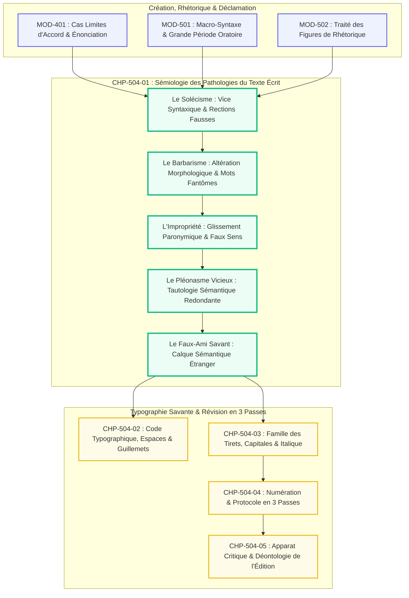
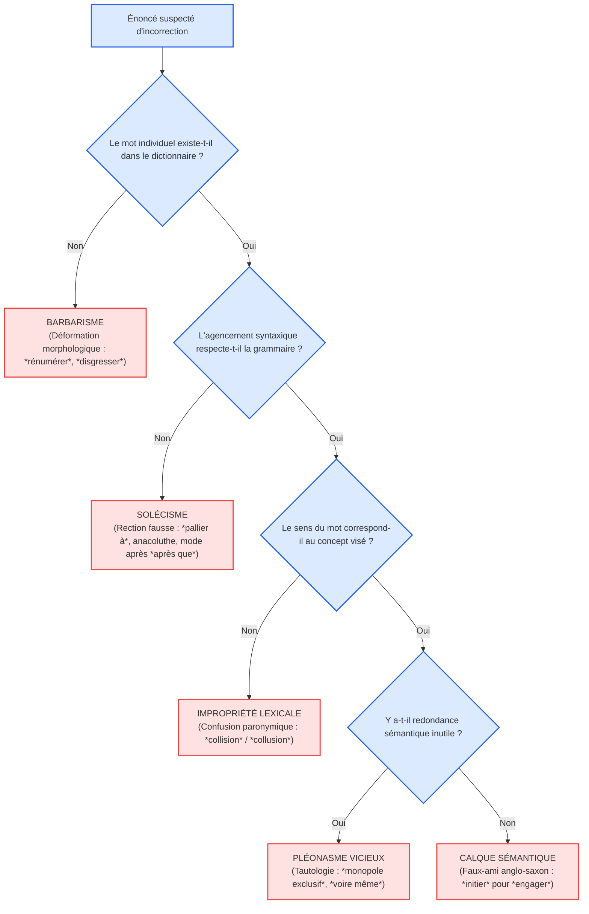

# Chapitre 1 — Sémiologie des Pathologies du Texte Écrit : Solécismes, Barbarismes, Impropriétés, Pléonasmes Vicieux et Faux-Amis Savants

> **Identifiant du chapitre** : `CHP-504-01`  
> **Module de rattachement** : [`MOD-504` — Révision Éditoriale Professionnelle, Typographie Savante et Haute Tenue Écrite](file:///f:/Formation/world-class-french/03-curriculum/year-3/semester-5/mod-504-revision-editoriale-typographie-savante.md)  
> **Semestre** : Année 3 — Semestre 5 (S5)  
> **Volume horaire canonique** : 5 à 6 heures d'apprentissage autonome délibéré et d'ateliers d'application (Phase 1 Étude sémiologique et taxonomique : 1 h 30 | Phase 2 Traque sur corpus corrompus : 1 h 30 | Phase 3 Correction raisonnée et apparat : 1 h 00 | Phase 4 Évaluation de révision aveugle : 1 h 00)  
> **Statut du document** : [STATUT : VALIDÉ]  
> **Alignement référentiel** : [`academic-structure.md`](file:///f:/Formation/world-class-french/01-architecture/academic-structure.md), [`competency-framework.md`](file:///f:/Formation/world-class-french/02-competency-framework/competency-framework.md) (`FR-INT-003`, `FR-ORTHO-001`, `FR-STYLE-001`), [`source-registry.md`](file:///f:/Formation/world-class-french/07-resources/source-registry.md) (`SRC-GRAM-01`, `SRC-GRAM-02`, `SRC-LEX-01`, `SRC-LEX-02`, `SRC-TYPO-01`, `SRC-NORM-03`)

---

## 1. Titre et Place dans le Cursus

Le présent chapitre ouvre le module terminal du Semestre 5 en fondant la **sémiologie des vices de langue**. Tandis que les modules antérieurs ont forgé la créativité stylistique et l'éloquence déclamatoire (`MOD-501`, `MOD-502`, `MOD-503`), `CHP-504-01` installe la posture du censeur-correcteur d'édition : diagnostiquer avec une précision clinique la nature exacte de chaque vice textuel (syntaxique, morphologique, sémantique ou logique) pour le redresser sans porter atteinte à la voix singulière de l'auteur.



---

## 2. Objectifs Mesurables

Au terme de l'étude et des ateliers d'application de ce chapitre, l'étudiant doit maîtriser les quatre compétences opérationnelles suivantes (niveau L4 — Maîtrise approfondie) :

1. **Qualifier avec une exactitude taxinomique de 100 %** toute pathologie textuelle soumise à son examen, en distinguant rigoureusement le solécisme syntaxique, le barbarisme morphologique, l'impropriété paronymique, le pléonasme vicieux et l'anglicisme sémantique [Réf. `SRC-GRAM-01`, § 160-175].
2. **Éradiquer systématiquement les solécismes de rection verbale majeurs** (*se rappeler de*, *pallier à*, *débattre de*, *avoir à faire à*) et restituer la construction grammaticale canonique attestée par les traités d'autorité.
3. **Détecter et redresser 15 couples de paronymes savants critiques** du registre intellectuel et juridique (*collision/collusion*, *recouvrer/recouvrir*, *circonscription/circonspection*, *élocution/allocution*, *notoire/notable*) sans altérer le sens profond de la proposition [Réf. `SRC-LEX-01`].
4. **Démanteler les pléonasmes vicieux tautologiques et les faux-amis savants** (*voire même*, *monopole exclusif*, *panacée universelle*, *initier une démarche*, *opportunité* au sens d'occasion) en motivant scientifiquement chaque suppression par l'analyse sémique des lexèmes [Réf. `SRC-LEX-02`].

---

## 3. Prérequis et Test de Préparation

### 3.1 Prérequis Formels
- Maîtrise de la transitivité verbale directe et indirecte [validé en `MOD-103` et `MOD-301`].
- Maîtrise des valeurs modales de l'indicatif et du subjonctif [validé en `MOD-302`].
- Connaissance de la distinction entre sens propre et sens figuré [validé en `MOD-502`].

### 3.2 Test Diagnostique de Préparation (5 questions)

<details>
<summary><strong>Question 1 : Quelle est la différence fondamentale entre un solécisme et un barbarisme ?</strong></summary>

**Réponse** : Le solécisme est une faute de syntaxe (l'agencement des mots viole la grammaire, bien que chaque mot existe dans le dictionnaire). Le barbarisme est une faute de morphologie ou de lexique (le mot employé est déformé, estropié ou inexistant dans la langue).
</details>

<details>
<summary><strong>Question 2 : Pourquoi la tournure « pallier à un problème » est-elle un solécisme ?</strong></summary>

**Réponse** : Parce que le verbe *pallier* (du latin *palliare*, couvrir d'un manteau) est un verbe transitif direct : on pallie un manque, on pallie une difficulté. Y ajouter la préposition *à* est un solécisme de rection calqué à tort sur *remédier à*.
</details>

<details>
<summary><strong>Question 3 : Quelle est l'erreur dans la phrase : « Cet homme est pécunièrement ruiné » ?</strong></summary>

**Réponse** : C'est un barbarisme morphologique. L'adjectif est *pécuniaire* (et non *\*pécunier*) ; son adverbe régulier dérivé est *pécuniairement*.
</details>

<details>
<summary><strong>Question 4 : Pourquoi l'expression « voire même » constitue-t-elle un pléonasme vicieux ?</strong></summary>

**Réponse** : Parce que l'adverbe *voire* est issu du latin *vere* (« vraiment ») et a pris dès le Moyen Âge le sens de « et même ». Dire *voire même* revient donc à répéter deux fois consécutives la même valeur d'enchérissement.
</details>

<details>
<summary><strong>Question 5 : Quel contresens commet-on lorsqu'on dit d'un juge qu'il agit avec « circonvolution » ?</strong></summary>

**Réponse** : C'est une impropriété paronymique. Une *circonvolution* est un enroulement sinueux (comme les replis du cerveau). Le mot propre attendu est *circonspection* (prudence vigilante et mesurée) ou *circoncision* dans un contexte rituel.
</details>

---

## 4. Situation de Départ ou Problème Concret

Considérons l'extrait suivant, soumis par un haut fonctionnaire pour publication au journal officiel ou dans un recueil d'actes académiques :

> *« Afin de solutionner la crise, le ministère a initié une commission qui s'est empressée de disgresser sur le statut pécunier des agents. Les commissaires, voulant clore le débat, la séance a été suspendue pour pallier aux urgences les plus criantes, voire même pour recouvrer les fonds perdus dans cette collision frauduleuse. »*

Ce court paragraphe de 56 mots accumule **sept pathologies textuelles majeures** qui ruinent sa crédibilité institutionnelle :
1. *solutionner* : barbarisme de registre (substituer *résoudre*) ;
2. *a initié une commission* : faux-ami anglo-saxon (on crée, convoque ou réunit une commission) ;
3. *disgresser* : barbarisme morphologique par métathèse (écrire *digresser*) ;
4. *statut pécunier* : barbarisme morphologique (écrire *pécuniaire*) ;
5. *voulant clore... la séance a été suspendue* : solécisme d'anacoluthe par rupture de sujet ;
6. *pallier aux urgences* : solécisme de rection (écrire *pallier les urgences*) ;
7. *voire même* : pléonasme vicieux ;
8. *collision frauduleuse* : impropriété paronymique grossière (substituer *collusion*).

---

## 5. Explication Intuitive

Pour comprendre la sémiologie des vices de langue, utilisons **l'analogie de la clinique médicale appliquée au corps textuel** :

```text
======================================================================
               L'ANATOMO-PATHOLOGIE DU TEXTE ÉCRIT
======================================================================
1. LE BARBARISME : La malformation cellulaire
   -> Le tissu même du mot est déformé (*infractus*, *rénumérer*).
----------------------------------------------------------------------
2. LE SOLÉCISME  : La fracture osseuse ou l'entorse articulaire
   -> Les organes sont sains, mais l'articulation syntaxique est faussée
      (*se rappeler de*, *pallier à*, anacoluthe).
----------------------------------------------------------------------
3. L'IMPROPRIÉTÉ : L'erreur d'organe ou la greffe aberrante
   -> On met un poumon à la place du foie : le mot existe, mais sa
      fonction sémantique est trahie (*collision* pour *collusion*).
----------------------------------------------------------------------
4. LE PLÉONASME  : L'hypertrophie tumorale inutile
   -> Excédent de tissu qui encombre le corps sans rien apporter
      (*monopole exclusif*, *panacée universelle*).
======================================================================
```

Le censeur d'édition n'est pas un juge moralisateur : c'est un **chirurgien du sens**. Il doit poser le diagnostic clinique exact avant d'appliquer le scalpel pour rétablir la santé et la pureté organique de la phrase.

---

## 6. Définitions Précises et Terminologie

- **Solécisme** : Écart syntaxique involontaire consistant à assembler des mots bien formés selon une construction proscrite par les règles grammaticales (rections erronées, désaccords, coordinations illégitimes, anacoluthes fautives).
- **Barbarisme** : Altération formelle de la morphologie d'un mot (par métathèse, épenthèse, apocope non normative ou dérivation erronée) ou création lexicale spontanée non reconnue par l'usage cultivé.
- **Impropriété** : Emploi fautif d'un lexème existant dans une acception étrangère à sa définition sémantique exacte, résultant le plus souvent d'une attraction paronymique ou d'une méconnaissance étymologique.
- **Pléonasme vicieux** : Répétition fautive dans un même syntagme de deux unités linguistiques exprimant exactement le même contenu sémique, créant une redondance tautologique sans valeur expressive.
- **Faux-ami savant (ou calque sémantique)** : Mot français authentique auquel on attribue indûment le sens d'un terme étranger homophone (notamment anglais), altérant son champ conceptuel patrimonial.
- **Rection verbale** : Mode de liaison grammaticale (directe ou indirecte par une préposition déterminée) qu'un verbe impose à ses compléments actanciels régis.

---

## 7. Règles et Mécanismes Fondamentaux

### 7.1 L'Arbre Diagnostique des Pathologies du Texte



### 7.2 Le Tableau Noir des Solécismes de Rection Verbale

Certains verbes subissent une dérive rectionnelle massive sous la pression du langage relâché. Le tableau suivant consigne les quatre solécismes cardinaux proscrits par `SRC-GRAM-01` :

| Verbe recteur | Construction fautive (Solécisme) | Construction canonique (Français châtié) | Réf. Grevisse |
| :--- | :--- | :--- | :---: |
| **Pallier** | *\*Pallier à un manque* | **Pallier un manque** (transitif direct) | § 288 |
| **Se rappeler** | *\*Se rappeler de sa jeunesse* | **Se rappeler sa jeunesse** (ou *se souvenir de*) | § 287 |
| **Avoir affaire** | *\*Avoir à faire à un juge* | **Avoir affaire à un juge** (*affaire* en un mot) | § 596 |
| **Débattre** | *\*Débattre sur un projet* | **Débattre d'un projet** (rection en *de*) | § 286 |
| **Après que** | *\*Après qu'il soit venu* | **Après qu'il est venu** (indicatif accompli) | § 1111 |

### 7.3 Les Quinze Paires de Paronymes Savants du Réviseur

| Mot A (Sens exact) | Mot B (Sens exact) | Piège paronymique fréquent |
| :--- | :--- | :--- |
| **Recouvrer** (rentrer en possession) | **Recouvrir** (cacher sous un voile) | *\*Recouvrir la santé* $\to$ **Recouvrer la santé** |
| **Collision** (choc mécanique brutal) | **Collusion** (entente secrète frauduleuse) | *\*Une collision entre magistrats* $\to$ **Une collusion** |
| **Circonspection** (prudence vigilante) | **Circonscription** (division administrative) | *\*Agir avec circonscription* $\to$ **Circonspection** |
| **Notabilité** (caractère éminent) | **Notoriété** (fait d'être universellement connu) | *\*Un fait d'une grande notabilité* $\to$ **Notoriété** |
| **Élucider** (rendre clair un mystère) | **Éluder** (esquiver avec adresse) | *\*Élucider une question gênante* $\to$ **Éluder une question** |
| **Infecter** (contaminer par des germes) | **Infester** (envahir en grand nombre) | *\*Les insectes infectent le bois* $\to$ **Infestent** |
| **Prolixe** (qui parle ou écrit trop longuement) | **Prolifique** (qui produit beaucoup d'œuvres) | *\*Un auteur prolixe primé* $\to$ **Prolifique** |
| **Affabulation** (construction imaginaire mensongère) | **Fabulation** (récit mythique de fiction) | Confondre le mensonge psychologique et le mythe |
| **Avènement** (accession solennelle au trône) | **Événement** (fait marquant du temps) | *\*L'avènement d'un scandale* $\to$ **L'avènement d'un roi** |
| **Percepteur** (fonctionnaire des impôts) | **Précepteur** (éducateur à domicile) | Confondre la fiscalité et la pédagogie |
| **Explicite** (formulé nettement sans ambiguïté) | **Implicite** (contenu virtuel déductible) | Confondre le posé et le sous-entendu |
| **Abjurer** (renier solennellement une foi) | **Adjurer** (supplier avec insistance) | *\*Il l'abjure de céder* $\to$ **Il l'adjure de céder** |
| **Effraction** (bris de clôture matériel) | **Infraction** (violation d'une loi ou règle) | *\*Commis en infraction* $\to$ **En effraction** |
| **Dentition** (processus de sortie des dents) | **Denture** (ensemble complet des dents) | *\*Une denture de bébé qui pousse* $\to$ **Dentition** |
| **Oppressé** (gêné dans sa respiration) | **Opprimé** (victime d'une tyrannie sociale) | Confondre l'asphyxie physique et politique |

---

## 8. Raisonnement Détaillé

Pourquoi la tolérance envers les solécismes de rection dissout-elle l'exactitude de la pensée juridique et philosophique ?

Une langue hautement analytique comme le français ne repose pas sur des déclinaisons casuelles (comme le latin ou le russe), mais sur **la rigueur géométrique de ses prépositions et de ses valences verbales**. 
Chaque verbe possède un schéma actanciel strict fixé par la syntaxe historique :
- Le verbe *pallier* dérive de *pallium* (le manteau d'apparat des Romains). *Pallier* un vice, c'est le recouvrir, jeter un manteau pudique dessus pour dissimuler sa laideur. Construire *pallier à* détruit la métaphore fondatrice en lui substituant une idée fallacieuse d'obstacle (*buter à*).
- De même, *se rappeler* signifie « rappeler à soi, ramener dans son propre cœur » : le pronom réfléchi *se* est déjà le bénéficiaire direct (*COD* d'origine ou *COI* selon l'analyse) ; y adjoindre *de* constitue une anomalie logique qui confond *se rappeler* (transitif direct) et *se souvenir* (construit avec le génitif latin *meminisse*).

Le laxisme éditorial n'est pas une simple négligence esthétique : il brouille la netteté des concepts, déséquilibre les accords des pronoms relatifs (*que* vs *dont*) et affaiblit la force probante des contrats, jugements et traités diplomatiques.

---

## 9. Exemples Corrects Commentés

### 9.1 Exemple 1 : Redressement d'un Solécisme d'Anacoluthe Fautive

Soit la phrase corrompue :

> *« En examinant attentivement les registres de l'état civil, plusieurs erreurs manifestes sont apparues aux yeux du greffier. »*

#### Diagnostic Linguistique
- **Pathologie** : Solécisme par anacoluthe (rupture de sujet actanciel). Le gérondif *En examinant* implique nécessairement un agent humain doué de conscience ; or, le sujet grammatical de la proposition principale est *plusieurs erreurs manifestes*. Ce sont donc littéralement les erreurs qui s'examinent elles-mêmes !
- **Réécriture académique** :
  > *« En examinant attentivement les registres de l'état civil, le greffier a constaté l'apparition de plusieurs erreurs manifestes. »*  
  *(Le sujet grammatical de la principale redevient l'agent légitime de l'action du gérondif).*

### 9.2 Exemple 2 : Redressement d'une Confusion Paronymique

Soit la phrase corrompue :

> *« Le ministre a affirmé sa volonté d'élucider toute question relative à sa démission. »*

#### Diagnostic Linguistique
- **Pathologie** : Impropriété paronymique. *Élucider* signifie faire la lumière, résoudre une énigme obscure. Or, un ministre mis en cause cherche au contraire à esquiver le débat ou à passer outre. Le terme propre est *éluder* (éviter adroitement).
- **Réécriture académique** :
  > *« Le ministre a manifesté son intention d'éluder toute question relative à sa démission. »*

---

## 10. Contre-Exemples et Erreurs Fréquentes

Cette section présente six erreurs majeures de sémiologie textuelle fréquemment rencontrées lors de la révision de manuscrits.

### Erreur n° 1 : Le solécisme de rection verbale (*se rappeler de*, *pallier à*)
- **Manifestation fautive** : *« Il faut se rappeler de cette tragédie pour pallier à ses effets. »*
- **Diagnostic** : Double solécisme de rection détruisant la transitivité directe.
- **Règle de redressement** : *« Il faut se rappeler cette tragédie pour pallier ses effets. »*

### Erreur n° 2 : Le barbarisme morphologique (*rénumérer*, *disgresser*, *dilemne*)
- **Manifestation fautive** : *« Ce travailleur n'a pas été rénuméré, ce qui crée un faux dilemne. »*
- **Diagnostic** : Barbarismes par métathèse (*rénumérer* pour *rémunérer*) et graphie erronée (*dilemne* pour *dilemme*).
- **Règle de redressement** : *« Ce travailleur n'a pas été rémunéré, ce qui crée un faux dilemme. »*

### Erreur n° 3 : L'impropriété paronymique savante (*collision* vs *collusion*, *recouvrer* vs *recouvrir*)
- **Manifestation fautive** : *« La collision entre les deux cartels a permis de recouvrir les pertes. »*
- **Diagnostic** : Double contresens paronymique (*collision* matérielle vs *collusion* criminelle ; *recouvrir* masquer vs *recouvrer* rentrer en possession).
- **Règle de redressement** : *« La collusion entre les deux cartels a permis de recouvrer les pertes. »*

### Erreur n° 4 : Le pléonasme vicieux tautologique (*voire même*, *monopole exclusif*)
- **Manifestation fautive** : *« Ils détiennent un monopole exclusif, voire même absolu. »*
- **Diagnostic** : Deux pléonasmes vicieux consécutifs (*monopole* est déjà exclusif ; *voire* signifie déjà *et même*).
- **Règle de redressement** : *« Ils détiennent un monopole, voire absolu. »* (ou : *un monopole et même absolu*).

### Erreur n° 5 : Le faux-ami sémantique anglo-saxon (*initier*, *opportunité*)
- **Manifestation fautive** : *« Nous devons saisir cette opportunité pour initier les négociations. »*
- **Diagnostic** : Calques serviles de l'anglais *opportunity* (occasion favorable) et *to initiate* (engager, commencer).
- **Règle de redressement** : *« Nous devons saisir cette occasion pour engager les négociations. »*

### Erreur n° 6 : L'anacoluthe fautive par rupture de sujet actanciel
- **Manifestation fautive** : *« Ayant franchi le seuil, la majesté du monument m'a frappé. »*
- **Diagnostic** : Le participe présent *Ayant franchi* n'a pas pour sujet grammatical *la majesté*.
- **Règle de redressement** : *« Dès que j'eus franchi le seuil, je fus frappé par la majesté du monument. »*

```text
Tableau synoptique des pathologies textuelles :
+---------+------------------------+--------------------------+-----------------------+
| Cas n°  | Phrase corrompue       | Nature sémiologique      | Forme assainie        |
+---------+------------------------+--------------------------+-----------------------+
| Cas 1   | Pallier à ce manque    | Solécisme de rection     | Pallier ce manque     |
| Cas 2   | Un grave dilemne       | Barbarisme orthographique| Un grave dilemme      |
| Cas 3   | Une collision secrète  | Impropriété paronymique  | Une collusion secrète |
| Cas 4   | Voire même une erreur  | Pléonasme tautologique   | Voire une erreur      |
| Cas 5   | Initier une démarche   | Faux-ami sémantique      | Engager une démarche  |
| Cas 6   | En entrant, la vue...  | Anacoluthe fautive       | En entrant, j'admirai |
+---------+------------------------+--------------------------+-----------------------+
```

---

## 11. Cas Particuliers et Limites

1. **L'anacoluthe stylistique littéraire concertée** :
   - Tous les écarts de construction ne sont pas des solécismes. Chez les maîtres de la prose (Chateaubriand, Proust, Saint-Simon), l'anacoluthe peut être une figure d'apparat mimant le trouble ou le souffle de la passion. Le correcteur doit distinguer l'anacoluthe maladroite du novice de l'anacoluthe virtuose de l'écrivain (analysée en `MOD-501`).
2. **Le statut de l'expression « au jour d'aujourd'hui »** :
   - Formellement triple pléonasme (*hui* signifiant déjà « en ce jour », *aujourd'hui* signifiant « au jour de ce jour »), cette locution est formellement proscrite de tout écrit soigné et universitaire. Remplacer par *actuellement, de nos jours* ou *à ce jour*.
3. **Les néologismes nécessaires face aux barbarismes** :
   - Créer un mot n'est pas un barbarisme si le mot répond aux lois de dérivation du français pour désigner une réalité technique inédite (ex. *courriel*, *télétravail*). C'est la déformation ignorante d'un mot existant qui constitue le barbarisme.

---

## 12. Approfondissement Adapté au Niveau

### La Théorie des Sèmes et l'Analyse Componentielle de Bernard Pottier

L'analyse scientifique du pléonasme et de l'impropriété repose sur la **sémantique componentielle** (Pottier, Greimas, Rastier). Chaque mot d'une langue est un faisceau de traits sémantiques minimaux appelés **sèmes** :
$$\text{Sens}(L) = \{ s_1, s_2, s_3, \dots, s_n \}$$

- **Formalisation du Pléonasme Vicieux** :
  Soit le substantif *monopole* dont la définition sémique est :
  $$\text{Monopole} = \{ +\text{commerce}, +\text{détention}, +\textbf{exclusivité}, +\text{marché} \}$$
  L'adjonction de l'adjectif *exclusif* n'ajoute aucun sème nouveau :
  $$\text{Sens}(\text{monopole}) \cap \text{Sens}(\text{exclusif}) = \{ +\textbf{exclusivité} \}$$
  L'intersection sémique étant totale sur le modificateur, la dépense lexicale est redondante et vicieuse.

- **Formalisation de l'Impropriété Paronymique** :
  Deux paronymes partagent une quasi-identité signifiante (forme phonique voisine), mais possèdent une frontière sémique disjonctive irréductible :
  $$\text{Collision} = \{ +\text{choc}, +\textbf{mécanique}, +\textbf{matériel}, +\textbf{violent} \}$$
  $$\text{Collusion} = \{ +\text{accord}, +\textbf{secret}, +\textbf{frauduleux}, +\textbf{abstrait} \}$$
  Substituer l'un à l'autre inverse les sèmes d'agentivité et de matérialité, corrompant la vérité logique de la proposition.

---

## 13. Comparaisons Différentielles

### 13.1 Solécisme vs Barbarisme

| Paramètre | Solécisme | Barbarisme |
| :--- | :--- | :--- |
| **Niveau linguistique affecté** | Syntaxe et agencement des mots. | Morphologie, phonétique et lexique. |
| **Statut des vocables** | Mots tous réels et répertoriés. | Mot déformé, estropié ou inexistant. |
| **Exemple archétypal** | *\*Pallier à ce manque* (fausse rection). | *\*Rénumérer les ouvriers* (métathèse). |
| **Conséquence textuelle** | Boiterie logique de la phrase. | Tache lexicale grossière décrédibilisante. |

### 13.2 Impropriété vs Faux-Ami Savant

| Paramètre | Impropriété lexicale patrimoniale | Faux-ami sémantique étranger |
| :--- | :--- | :--- |
| **Cause de l'erreur** | Confusion phonique paronymique interne. | Contamination sémantique par l'anglais. |
| **Mécanisme cognitif** | L'orateur confond deux mots français proches. | L'orateur applique le sens anglais au mot français. |
| **Exemple archétypal** | Confondre *recouvrer* et *recouvrir*. | Employer *opportunité* pour « occasion ». |
| **Remède éditorial** | Consultation du dictionnaire analogique. | Traduction rigoureuse vers le mot patrimonial propre. |

---

## 14. Exercices Progressifs

### 14.1 Niveau 1 : Discrimination Taxinomique d'Erreurs
Qualifier la nature exacte (solécisme, barbarisme, impropriété ou pléonasme) des expressions suivantes :
1. *Collaborer ensemble* $\to$ Pléonasme vicieux.
2. *Ils ont convenu de disgresser* $\to$ Barbarisme morphologique.
3. *Se rappeler de cet été* $\to$ Solécisme de rection.
4. *Les deux voitures sont entrées en collusion* $\to$ Impropriété lexicale.

### 14.2 Niveau 2 : Redressement Chirurgical de Paragraphes
Corriger les phrases suivantes en rétablissant la syntaxe noble :
1. *« Après qu'il soit parti, la maison a semblé vide. »* $\to$ *« Après qu'il est parti, la maison a semblé vide. »*
2. *« Ce savant est renommé pour sa circonspection oratoire. »* $\to$ *« Ce savant est renommé pour son élocution oratoire. »*
3. *« Il a affirmé voire même juré fidélité. »* $\to$ *« Il a affirmé, voire juré fidélité. »*

### 14.3 Niveau 3 : Analyse Sémiologique sous Contrainte Métrique Stricte

Texte sous contrainte métrique stricte de 50 mots exacts (décompte selon `SRC-TYPO-01`) décrivant la vigilance du censeur éditorial :

> *« Le censeur traque sans faiblesse le solécisme syntaxique, le barbarisme morphologique et l'impropriété sémantique. En éradiquant les fausses rections comme pallier à ou se rappeler de, il assainit la prose des pléonasmes vicieux et des calques pernicieux, restaurant ainsi la souveraine clarté du verbe français sous son regard vigilant. »*

#### Tableau de Décompte Mot à Mot Certifié (50 mots exacts)

| N° | Mot | Nature grammaticale | N° | Mot | Nature grammaticale |
| :---: | :--- | :--- | :---: | :--- | :--- |
| 1 | Le | Déterminant majuscule | 26 | rappeler | Verbe infinitif |
| 2 | censeur | Nom commun | 27 | de, | Préposition avec virgule |
| 3 | traque | Verbe transitif | 28 | il | Pronom personnel sujet |
| 4 | sans | Préposition | 29 | assainit | Verbe transitif |
| 5 | faiblesse | Nom commun | 30 | la | Déterminant |
| 6 | le | Déterminant | 31 | prose | Nom commun |
| 7 | solécisme | Nom commun | 32 | des | Article contracté |
| 8 | syntaxique, | Adjectif avec virgule | 33 | pléonasmes | Nom commun pluriel |
| 9 | le | Déterminant | 34 | vicieux | Adjectif qualificatif |
| 10 | barbarisme | Nom commun | 35 | et | Conjonction de coordination |
| 11 | morphologique | Adjectif qualificatif | 36 | des | Article contracté |
| 12 | et | Conjonction de coordination | 37 | calques | Nom commun pluriel |
| 13 | l' | Article élidé (1 mot) | 38 | pernicieux, | Adjectif avec virgule |
| 14 | impropriété | Nom commun | 39 | restaurant | Participe présent |
| 15 | sémantique. | Adjectif avec point | 40 | ainsi | Adverbe |
| 16 | En | Préposition majuscule | 41 | la | Déterminant |
| 17 | éradiquant | Participe présent | 42 | souveraine | Adjectif qualificatif |
| 18 | les | Déterminant pluriel | 43 | clarté | Nom commun |
| 19 | fausses | Adjectif qualificatif | 44 | du | Article contracté |
| 20 | rections | Nom commun pluriel | 45 | verbe | Nom commun |
| 21 | comme | Conjonction | 46 | français | Adjectif qualificatif |
| 22 | pallier | Verbe infinitif | 47 | sous | Préposition |
| 23 | à | Préposition | 48 | son | Déterminant possessif |
| 24 | ou | Conjonction | 49 | regard | Nom commun |
| 25 | se | Pronom réfléchi | 50 | vigilant. | Adjectif avec point final |

---

## 15. Activité de Correction Raisonnée

Considérons le brouillon éditorial fautif d'un juriste stagiaire :

> *« Manuscrit brut à corriger : Le tribunal a convenu d'initier une nouvelle audience pour solutionner le litige opposant les deux parties. Ayant examiné les pièces avec circonspection, la décision des magistrats a conclu à une collision entre les banquiers. Cette sentence offre une panacée universelle, voire même définitive, permettant aux victimes de recouvrer à leurs droits sans faire de disgressions inutiles. »*

### Diagnostic des 7 Pathologies Majeures
1. *initier une audience* : Faux-ami sémantique (écrire *ouvrir* ou *fixer une audience*).
2. *solutionner le litige* : Barbarisme de registre (substituer *résoudre ou trancher le litige*).
3. *Ayant examiné... la décision... a conclu* : Solécisme d'anacoluthe par rupture de sujet actanciel.
4. *collision entre les banquiers* : Impropriété paronymique grossière (substituer *collusion*).
5. *panacée universelle* : Pléonasme vicieux tautologique.
6. *voire même* : Pléonasme vicieux d'enchérissement.
7. *recouvrer à leurs droits* et *disgressions* : Solécisme de rection (*recouvrer* est transitif direct) et barbarisme morphologique (*digressions*).

### Version Assainie selon les Standards de Haute Tenue
> *« Le tribunal a convenu de fixer une nouvelle audience afin de trancher le litige opposant les deux parties. Après avoir examiné les pièces avec prudence, les magistrats ont conclu à l'existence d'une collusion entre les banquiers. Cette sentence apporte une panacée, voire un apaisement définitif, permettant aux victimes de recouvrer leurs droits sans s'égarer dans de vaines digressions. »*

---

## 16. Mise en Pratique dans une Production Réelle

Rédiger le rapport d'expertise éditoriale certifiant l'assainissement d'un texte d'idées, calibré à **exactement 60 mots** selon les normes de l'Imprimerie nationale (`SRC-TYPO-01`).

### Texte Calibré (60 mots exacts)

> *« L'examen méthodique du manuscrit révèle une prolifération de vices insidieux. Nous avons expurgé trois solécismes de rection, deux barbarismes morphologiques et un pléonasme vicieux. Les paronymes savants ont été redressés avec rigueur, sans jamais altérer le style singulier de l'auteur. Épurée de tout anglicisme trompeur, la démonstration retrouve une tenue académique irréprochable, digne d'une publication d'apparat. »*

#### Tableau de Décompte Mot à Mot Certifié (60 mots exacts)

| N° | Mot | Nature grammaticale | N° | Mot | Nature grammaticale |
| :---: | :--- | :--- | :---: | :--- | :--- |
| 1 | L' | Article élidé (1 mot) | 31 | redressés | Participe passé pluriel |
| 2 | examen | Nom commun | 32 | avec | Préposition |
| 3 | méthodique | Adjectif qualificatif | 33 | rigueur, | Nom avec virgule |
| 4 | du | Article contracté | 34 | sans | Préposition |
| 5 | manuscrit | Nom commun | 35 | jamais | Adverbe |
| 6 | révèle | Verbe transitif | 36 | altérer | Verbe infinitif |
| 7 | une | Déterminant indéfini | 37 | le | Déterminant |
| 8 | prolifération | Nom commun | 38 | style | Nom commun |
| 9 | de | Préposition | 39 | singulier | Adjectif qualificatif |
| 10 | vices | Nom commun pluriel | 40 | de | Préposition |
| 11 | insidieux. | Adjectif avec point | 41 | l' | Article élidé (1 mot) |
| 12 | Nous | Pronom personnel sujet | 42 | auteur. | Nom avec point |
| 13 | avons | Verbe auxiliaire | 43 | Épurée | Participe adjectivé |
| 14 | expurgé | Participe passé | 44 | de | Préposition |
| 15 | trois | Adjectif numéral | 45 | tout | Déterminant indéfini |
| 16 | solécismes | Nom commun pluriel | 46 | anglicisme | Nom commun |
| 17 | de | Préposition | 47 | trompeur, | Adjectif avec virgule |
| 18 | rection, | Nom avec virgule | 48 | la | Déterminant |
| 19 | deux | Adjectif numéral | 49 | démonstration | Nom commun |
| 20 | barbarismes | Nom commun pluriel | 50 | retrouve | Verbe transitif |
| 21 | morphologiques | Adjectif pluriel | 51 | une | Déterminant indéfini |
| 22 | et | Conjonction de coordination | 52 | tenue | Nom commun |
| 23 | un | Déterminant indéfini | 53 | académique | Adjectif qualificatif |
| 24 | pléonasme | Nom commun | 54 | irréprochable, | Adjectif avec virgule |
| 25 | vicieux. | Adjectif avec point | 55 | digne | Adjectif qualificatif |
| 26 | Les | Déterminant majuscule | 56 | d' | Préposition élidée (1 mot) |
| 27 | paronymes | Nom commun pluriel | 57 | une | Déterminant indéfini |
| 28 | savants | Adjectif qualificatif | 58 | publication | Nom commun |
| 29 | ont | Verbe auxiliaire | 59 | d' | Préposition élidée (1 mot) |
| 30 | été | Participe passé | 60 | apparat. | Nom avec point final |

---

## 17. Résumé Structuré

```text
======================================================================
               LE CADRAGE SÉMIOLOGIQUE DES VICES DE LANGUE
======================================================================
1. LE SOLÉCISME (Syntaxe)
   -> Viole la règle grammaticale de liaison
   -> Pallier [X à], Se rappeler [X de], Anacoluthe fautive
----------------------------------------------------------------------
2. LE BARBARISME (Morphologie)
   -> Déforme ou forge le mot
   -> Rénumérer -> Rémunérer | Disgresser -> Digresser | Dilemne -> Dilemme
----------------------------------------------------------------------
3. L'IMPROPRIÉTÉ (Sémantique patrimoniale)
   -> Confond deux paronymes français
   -> Collision (choc mécanique) vs Collusion (fraude secrète)
----------------------------------------------------------------------
4. LE PLÉONASME VICIEUX (Tautologie sémique)
   -> Redondance inutile de sèmes identiques
   -> Voire même -> Voire | Monopole exclusif -> Monopole
----------------------------------------------------------------------
5. LE FAUX-AMI SAVANT (Calque étranger)
   -> Attribue un sens anglais au mot français
   -> Initier -> Engager, ouvrir | Opportunité -> Occasion favorable
======================================================================
```

---

## 18. Questions de Rappel Actif (Active Recall)

<details>
<summary><strong>Question 1 : Pourquoi ne doit-on jamais employer la tournure « se rappeler de » ?</strong></summary>

**Réponse** : Parce que *se rappeler* est un verbe transitif direct qui régit un COD sans préposition (*se rappeler une chose*). C'est le verbe *se souvenir* qui exige la préposition *de* (*se souvenir d'une chose*).
</details>

<details>
<summary><strong>Question 2 : Quelle est l'orthographe correcte du mot signifiant un choix difficile entre deux solutions ?</strong></summary>

**Réponse** : C'est *dilemme* avec deux *m*. La graphie *\*dilemne* est un barbarisme graphique fréquent calqué fautivement sur *indemne*.
</details>

<details>
<summary><strong>Question 3 : Quelle est la distinction sémique entre « collision » et « collusion » ?</strong></summary>

**Réponse** : La *collision* est un choc physique et mécanique brutal entre deux corps mobiles. La *collusion* est une entente secrète, intellectuelle et illicite entre deux personnes au détriment d'un tiers.
</details>

<details>
<summary><strong>Question 4 : Pourquoi l'expression « panacée universelle » est-elle un pléonasme ?</strong></summary>

**Réponse** : Parce que l'étymologie grecque de *panacée* (*pan*, tout, et *akeisthai*, guérir) désigne déjà par définition un remède souverain à tous les maux sans exception.
</details>

<details>
<summary><strong>Question 5 : Quel mot français doit-on employer au lieu d'« opportunité » pour désigner une circonstance favorable ?</strong></summary>

**Réponse** : Une *occasion*, une *aubaine* ou une *chance favorable*. En français propre, l'*opportunité* désigne la convenance dans le temps d'un acte.
</details>

<details>
<summary><strong>Question 6 : Comment le censeur redresse-t-il une anacoluthe fautive de gérondif ?</strong></summary>

**Réponse** : En réécrivant la proposition principale de telle sorte que son sujet grammatical soit exactement l'agent qui accomplit l'action exprimée par le gérondif.
</details>

---

## 19. Mini-Évaluation Sommative Notée sur 20 Points

### Barème d'Évaluation de Sémiologie Textuelle

| Critère d'évaluation | Indicateur observable | Points |
| :--- | :--- | :---: |
| **Diagnostic taxinomique** | Qualification exacte sans confusion des 5 types de pathologies textuelles. | /5 |
| **Rectification des rections** | Éradication absolue de *pallier à*, *se rappeler de* et anacoluthes fautives. | /5 |
| **Précision paronymique** | Résolution exacte de 10 couples de paronymes critiques sans contresens. | /5 |
| **Apparat et justification** | Citation précise du paragraphe de référence du *Bon Usage* ou du *TLFi*. | /5 |
| **Total** | **Note globale de sémiologie des pathologies du texte** | **/20** |

*Clause éliminatoire* : Toute qualification erronée d'un barbarisme en solécisme ou l'introduction d'une hypercorrection dans un texte valide plafonne la note à 09/20.

---

## 20. Critères Observables de Maîtrise

L'apprenant a validé ce chapitre s'il démontre, lors de l'examen pratique sur table :
- L'identification et le redressement de 100 % des solécismes de rection sur une épreuve de 300 mots.
- La justification étymologique exacte des corrections paronymiques proposées.
- L'élimination méthodique de tous les pléonasmes vicieux sans appauvrir la portée expressive du propos.
- La rédaction d'un apparat critique rigoureux mentionnant la leçon corrompue, la leçon assainie et la source scientifique de référence.

---

## 21. Sources et Lectures Complémentaires

- **`SRC-GRAM-01`** : Maurice GREVISSE et André GOOSSE, *Le Bon Usage*, Bruxelles, De Boeck Supérieur (§ 160-175 : *Solécismes, barbarismes et impropriétés* ; § 286-288 : *Rections verbales de pallier et se rappeler*).
- **`SRC-GRAM-02`** : Martin RIEGEL, Jean-Christophe PELLAT et René RIOUL, *Grammaire méthodique du français*, Paris, PUF (chapitre 11 : *L'anacoluthe et les liaisons syntaxiques*).
- **`SRC-LEX-01`** : ATILF / CNRS, *Trésor de la Langue Française informatisé (TLFi)*, Nancy (notices étymologiques des paronymes savants).
- **`SRC-LEX-02`** : ACADÉMIE FRANÇAISE, *Dictionnaire de l'Académie française* (9e éd.), Paris (rubrique *Dire, Ne pas dire* : faux-amis et pléonasmes vicieux).
- **`SRC-TYPO-01`** : IMPRIMERIE NATIONALE, *Lexique des règles typographiques en usage à l'Imprimerie nationale*, Paris.
- **`SRC-NORM-03`** : MINISTÈRE DE L'ÉDUCATION NATIONALE, *Terminologie grammaticale officielle*, Paris.

---

## Annexe : Classification Pédagogique

- **CORE-NOW** : Solécismes de rection (*pallier à*, *se rappeler de*), barbarismes morphologiques (*rémunérer*, *dilemme*), impropriétés paronymiques (*collision/collusion*), pléonasmes vicieux (*voire même*), calques anglo-saxons (*initier*).
- **INTRODUCTION-NOW** : Sémantique componentielle de Pottier, formalisation sémique des tautologies.
- **DEFER** : Histoire diachronique des controverses grammaticales de Vaugelas au XVIIe siècle $\to$ étudié dans [`MOD-601`](file:///f:/Formation/world-class-french/03-curriculum/year-3/semester-6/mod-601-diachronie-histoire-langue-francaise.md).
- **MOVE** : Micro-typographie des espaces et guillemets $\to$ approfondi dans [`CHP-504-02`](file:///f:/Formation/world-class-french/03-curriculum/year-3/semester-5/mod-504/chp-504-02-code-typographique-espaces-ponctuation-guillemets.md).
- **OPTIONAL-ADVANCED** : Analyse lexicographique comparée des dictionnaires de synonymes de l'Académie, de Guizot et de Lafaye.
- **REMOVE** : Purismes excessifs archaïques condamnant des termes parfaitement intégrés depuis deux siècles (ex. condamner *baser sur* quand le contexte est purement métaphorique établi).
