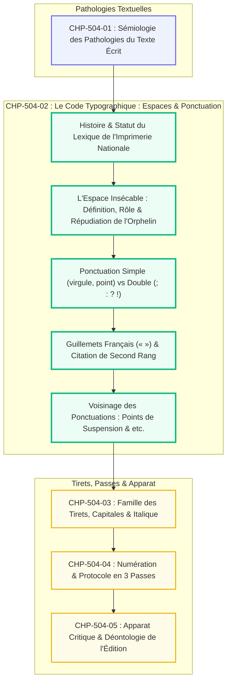
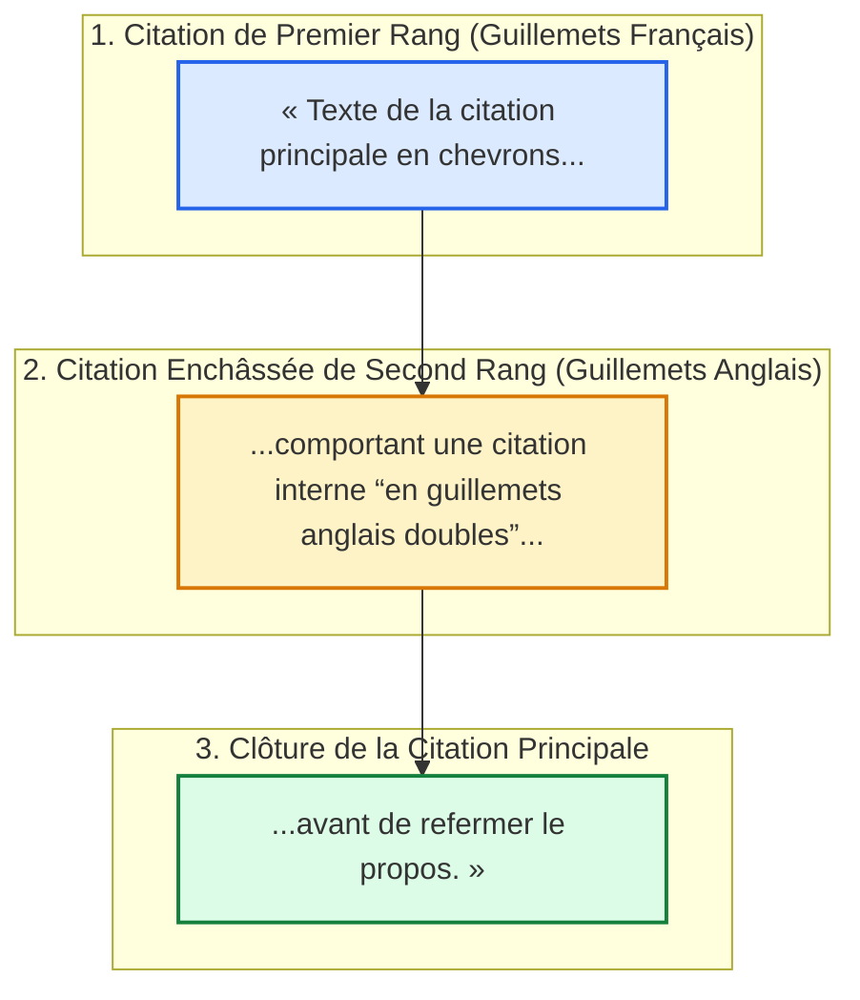

# Chapitre 2 — Le Code Typographique Officiel (Imprimerie Nationale) : Espaces Insécables, Ponctuation Simple vs Double et Guillemets Français

> **Identifiant du chapitre** : `CHP-504-02`  
> **Module de rattachement** : [`MOD-504` — Révision Éditoriale Professionnelle, Typographie Savante et Haute Tenue Écrite](file:///f:/Formation/world-class-french/03-curriculum/year-3/semester-5/mod-504-revision-editoriale-typographie-savante.md)  
> **Semestre** : Année 3 — Semestre 5 (S5)  
> **Volume horaire canonique** : 5 à 6 heures d'apprentissage autonome délibéré et d'ateliers d'application (Phase 1 Étude du Code typographique et des espaces : 1 h 30 | Phase 2 Ateliers de composition et chasse aux orphelins : 1 h 30 | Phase 3 Correction raisonnée d'épreuves : 1 h 00 | Phase 4 Évaluation orthotypographique aveugle : 1 h 00)  
> **Statut du document** : [STATUT : VALIDÉ]  
> **Alignement référentiel** : [`academic-structure.md`](file:///f:/Formation/world-class-french/01-architecture/academic-structure.md), [`competency-framework.md`](file:///f:/Formation/world-class-french/02-competency-framework/competency-framework.md) (`FR-INT-003`, `FR-ORTHO-001`), [`source-registry.md`](file:///f:/Formation/world-class-french/07-resources/source-registry.md) (`SRC-TYPO-01`, `SRC-GRAM-01`, `SRC-NORM-03`)

---

## 1. Titre et Place dans le Cursus

Le présent chapitre plonge au cœur de la **micro-typographie française savante**. Après avoir analysé la sémiologie des vices de langue dans [`CHP-504-01`](file:///f:/Formation/world-class-french/03-curriculum/year-3/semester-5/mod-504/chp-504-01-semiologie-pathologies-texte-ecrit.md), `CHP-504-02` arme l'apprenant pour la maîtrise du *Lexique des règles typographiques en usage à l'Imprimerie nationale* (`SRC-TYPO-01`). Il traite de la matérialité de la mise en page noble : **la physique des espaces insécables, la distinction entre ponctuation simple et double, et la manipulation rigoureuse des guillemets français en chevrons**.



---

## 2. Objectifs Mesurables

Au terme de l'étude et des ateliers d'application de ce chapitre, l'étudiant doit maîtriser les quatre compétences opérationnelles suivantes (niveau L4 — Maîtrise approfondie) :

1. **Appliquer les règles d'espacement des signes de ponctuation** avec un taux de réussite de 100 % : zéro espace avant la ponctuation simple (virgule, point), espace insécable obligatoire avant la ponctuation double (deux-points, point-virgule, point d'interrogation, point d'exclamation) [Réf. `SRC-TYPO-01`, p. 149].
2. **Garantir l'intégrité des lignes en éliminant tout signe ou mot orphelin** par l'usage systématique des espaces insécables devant les symboles et abréviations normées (*15&nbsp;km*, *XIXe&nbsp;siècle*, *p.&nbsp;45*).
3. **Composer les citations selon les normes des guillemets français («&nbsp; »)** : insertion de l'espace insécable après le guillemet ouvrant et avant le guillemet fermant, et hiérarchisation en guillemets anglais (" ") pour les citations enchâssées de second rang [Réf. `SRC-TYPO-01`, p. 90].
4. **Résoudre les conflits de voisinage de ponctuation** : proscription absolue du cumul des points de suspension avec la locution *etc.*, gestion du point final à l'intérieur ou à l'extérieur des guillemets selon la nature syntaxique de la citation.

---

## 3. Prérequis et Test de Préparation

### 3.1 Prérequis Formels
- Maîtrise de la ponctuation syntaxique interne et des propositions incises [validé en `MOD-202` et `MOD-501`].
- Connaissance de la sémiologie des erreurs textuelles [validé en [`CHP-504-01`](file:///f:/Formation/world-class-french/03-curriculum/year-3/semester-5/mod-504/chp-504-01-semiologie-pathologies-texte-ecrit.md)].

### 3.2 Test Diagnostique de Préparation (5 questions)

<details>
<summary><strong>Question 1 : En typographie française, « espace » est-il masculin ou féminin ?</strong></summary>

**Réponse** : En typographie professionnelle, le mot « espace » est traditionnellement du genre **féminin** pour désigner la lamelle de plomb ou le blanc typographique inséré entre deux caractères (*une espace insécable*, *une espace fine*). Dans le langage courant, le masculin est toléré, mais l'usage noble et savant maintient le féminin.
</details>

<details>
<summary><strong>Question 2 : Quels sont les quatre signes de ponctuation dits « doubles » en français ?</strong></summary>

**Réponse** : Le point-virgule (;), les deux-points (:), le point d'interrogation (?) et le point d'exclamation (!). Ils sont qualifiés de doubles car ils sont graphiquement composés de deux éléments distincts.
</details>

<details>
<summary><strong>Question 3 : Pourquoi ne doit-on jamais écrire « etc... » ?</strong></summary>

**Réponse** : Parce que l'abréviation *etc.* (du latin *et cætera*, « et toutes les autres choses ») indique déjà l'inachèvement de l'énumération. Y ajouter des points de suspension constitue un pléonasme graphique fautif. L'abréviation s'écrit toujours *etc.* avec un seul point final abréviatif.
</details>

<details>
<summary><strong>Question 4 : Où place-t-on le point final d'une phrase se terminant par une citation partielle ?</strong></summary>

**Réponse** : Lorsque la citation est partielle et fondue dans la syntaxe de la phrase d'accueil, le point final se place **à l'extérieur** des guillemets fermants (*Il a qualifié cette mesure d'« inique ».*).
</details>

<details>
<summary><strong>Question 5 : Quel raccourci clavier permet d'insérer une espace insécable sous Windows et sous macOS ?</strong></summary>

**Réponse** : Sous Windows / Word : `Ctrl + Maj + Espace` (ou code Unicode `U+00A0`). Sous macOS : `Option + Espace` (ou `Alt + Espace`). En code HTML : `&nbsp;`.
</details>

---

## 4. Situation de Départ ou Problème Concret

Considérons une épreuve de thèse ou un manuscrit soumis à une maison d'édition prestigieuse :

> *À la fin de la page 42, l'imprimé présente la ligne suivante :  
> « [...] cette décision politique est-elle vraiment légitime  
> ? L'auteur affirme : "La république ne saurait faillir". »*

Le lecteur cultivé et le jury universitaire sont immédiatement heurtés :
1. Le point d'interrogation se trouve isolé, seul, au début de la ligne suivante (signe « orphelin »), provoquant une rupture visuelle grotesque due à l'oubli de l'espace insécable ;
2. La citation emploie des guillemets anglais dactylographiques droits (" "), interdits en composition française soignée de premier rang ;
3. Les deux-points sont collés au mot précédent sans blanc respiratoire ;
4. Le point final de la citation est placé à l'intérieur des guillemets alors qu'il s'agit d'une phrase incomplète dans la matrice.

Ces négligences techniques déclassent instantanément un mémoire de recherche au rang de travail amateur bâclé.

---

## 5. Explication Intuitive

Pour comprendre le rôle de la micro-typographie, utilisons **l'analogie de la maçonnerie de pierre de taille** :

```text
======================================================================
               L'ANALOGIE DES PIERRES ET DU MORTIER TYPOGRAPHIQUE
======================================================================
1. LES PIERRES DE TAILLE   : Les caractères alphabétiques et les mots
   -> Ils portent le sens brut, la matière et le poids du texte.
----------------------------------------------------------------------
2. LE MORTIER INVISIBLE    : Les espaces inter-mots et insécables
   -> Sans mortier calibré, les pierres s'entrechoquent ou s'effondrent.
      L'espace insécable est le crampon de fer qui lie la pierre
      de ponctuation au mot qui la précède pour qu'elle ne tombe pas.
----------------------------------------------------------------------
3. LES ÉCRINS DE FAÇADE    : Les guillemets français en chevrons (« »)
   -> Ils délimitent l'oratoire étranger avec noblesse et relief.
======================================================================
```

Un texte sans espaces insécables ressemble à un mur dont les pierres du faîte se détacheraient au premier coup de vent. La rigueur typographique est l'armature invisible qui garantit la stabilité et la pureté architecturale de la page imprimée.

---

## 6. Définitions Précises et Terminologie

- **Espace typographique** : Intervalle blanc calibré séparant deux mots ou un mot d'un signe de ponctuation. En typographie traditionnelle, il s'agit d'un lingot métallique sans œil.
- **Espace insécable (*non-breaking space*)** : Espace à largeur fixe ou proportionnelle ayant pour propriété informatique et optique d'interdire toute rupture de ligne entre les deux éléments qu'elle relie, interdisant le rejet d'un signe au début de la ligne suivante.
- **Ponctuation simple** : Signes n'étant précédés d'aucun blanc et suivis d'une espace ordinaire sécable : la virgule (,) et le point final (.).
- **Ponctuation double** : Signes graphiques composés de deux parties superposées : le point-virgule (;), les deux-points (:), le point d'interrogation (?) et le point d'exclamation (!). Ils exigent impérativement une espace insécable avant eux et une espace ordinaire sécable après eux.
- **Guillemets français (chevrons « »)** : Signes canoniques de citation dans l'édition française, constitués de doubles chevrons tournés vers l'extérieur. Ils reçoivent une espace insécable après l'ouvrant et avant le fermant.
- **Guillemets anglais (“ ” ou " ")** : Guillemets secondaires réservés exclusivement aux citations de second rang (citation à l'intérieur d'une citation déjà entre guillemets français).
- **Ligne veuve** : Dernière ligne d'un paragraphe apparaissant seule au sommet d'une page (défaut macro-typographique proscrit).
- **Mot ou signe orphelin** : Mot très court ou signe de ponctuation rejeté seul au début d'une ligne par manque d'espace insécable.

---

## 7. Règles et Mécanismes Fondamentaux

### 7.1 Le Code des Espaces selon l'Imprimerie Nationale

Le tableau suivant récapitule les prescriptions obligatoires du *Lexique des règles typographiques* (`SRC-TYPO-01`, p. 149) :

| Signe de ponctuation | Espace AVANT le signe | Espace APRÈS le signe | Exemple de composition conforme |
| :--- | :--- | :--- | :--- |
| **Point (.)** | Aucune (collé) | Une espace sécable | *Le débat est clos. Passons au vote.* |
| **Virgule (,)** | Aucune (collé) | Une espace sécable | *Il parla avec force, sans trembler.* |
| **Point-virgule (;)** | **Une espace insécable** | Une espace sécable | *La séance est levée&nbsp;; nous sortons.* |
| **Deux-points (:)** | **Une espace insécable** | Une espace sécable | *Il s'écria&nbsp;: la vérité vaincra.* |
| **Point d'interrogation (?)** | **Une espace insécable** | Une espace sécable | *Que décidez-vous&nbsp;? Rien d'injuste.* |
| **Point d'exclamation (!)** | **Une espace insécable** | Une espace sécable | *Quel spectacle grandiose&nbsp;!* |
| **Points de suspension (...)** | Aucune (collé au mot) | Une espace sécable | *Il hésita, attendit... puis refusa.* |
| **Guillemet ouvrant («)** | Une espace sécable | **Une espace insécable** | *Il cita&nbsp;: «&nbsp;L'honneur commande...* |
| **Guillemet fermant (»)** | **Une espace insécable** | Une espace sécable | *...le devoir absolu.&nbsp;»* |
| **Parenthèse ouvrante (()** | Une espace sécable | Aucune (collé) | *Cette loi (votée hier) s'applique.* |
| **Parenthèse fermante ())** | Aucune (collé) | Une espace sécable | *Cette loi (votée hier) s'applique.* |

### 7.2 L'Espace Insécable dans les Unités, Numéraux et Abréviations

L'espace insécable ne concerne pas seulement la ponctuation ; elle doit lier indissolublement tout élément dépendant de son contexte immédiat :
1. **Entre le nombre et l'unité de mesure** : *50&nbsp;km*, *12&nbsp;heures*, *15&nbsp;%*, *30&nbsp;€*.
2. **Dans les nombres cardinaux de plus de trois chiffres** : *10&nbsp;000&nbsp;hommes*, *1&nbsp;500&nbsp;000&nbsp;euros* (jamais de point séparateur en français standard).
3. **Entre le siècle et le mot siècle** : *XXe&nbsp;siècle*, *IVe&nbsp;siècle*.
4. **Entre l'abréviation et le nom** : *p.&nbsp;12*, *t.&nbsp;II*, *M.&nbsp;Dupont*, *vol.&nbsp;3*.

### 7.3 Les Règles Canoniques des Guillemets et Citations Enchâssées



1. **Hiérarchisation stricte** : Si un texte cité contient lui-même une citation, on compose la seconde en guillemets anglais en forme de doubles virgules tournées (“ ”).
2. **Position du point final** :
   - *Citation formant une phrase complète introduite par deux-points* : La majuscule est conservée, et le point final se place **avant** le guillemet fermant :  
     *L'orateur déclara&nbsp;: «&nbsp;Le courage civique sauvera la cité.&nbsp;»*
   - *Citation partielle fondue dans le corps de la phrase* : Le point final se place **après** le guillemet fermant :  
     *L'orateur affirma que ce geste constituait «&nbsp;un honneur insigne&nbsp;».*

---

## 8. Raisonnement Détaillé

Pourquoi la micro-typographie française impose-t-elle des espaces insécables avant les signes doubles, contrairement à la typographie anglo-saxonne ?

En typographie anglaise, le point d'interrogation, le point d'exclamation et le point-virgule sont collés directement au mot précédent (*What? Really!*). En français, cette pratique est formellement proscrite.

Cette divergence plonge ses racines dans l'histoire esthétique du plomb d'imprimerie et la physiologie de la lecture :
1. **L'autonomie sémiotique du signe en français** : Dans la langue française classique, la ponctuation n'est pas un simple appendice phonétique collé à la consonne ; c'est un **signe discursif plein** porteur d'une valeur logique ou dramatique propre. Les deux-points annoncent la cause ou la parole ; le point-virgule balance deux membres équilibrés. L'espace fine ou insécable matérialise visuellement cette autonomie intellectuelle.
2. **Le confort rétinien du gris typographique** : En composition justifiée, coller un point d'exclamation ou deux-points crée une tache noire compacte qui heurte le regard et alourdit la silhouette des mots. L'espace insécable aère la ligne sans briser la solidarité du syntagme. C'est l'équilibre parfait entre lisibilité optique et cohésion logique.

---

## 9. Exemples Corrects Commentés

### 9.1 Exemple 1 : Composition d'un Dialogue d'Apparat avec Citation Double

> *Le procureur général se leva et prit la parole d'une voix ferme&nbsp;:*  
> *«&nbsp;Messieurs les jurés, l'accusé a osé prétendre devant vous&nbsp;: “Je n'ai fait qu'obéir aux ordres”, espérant ainsi esquiver la rigueur des lois.&nbsp;»*

#### Décorticage Micro-typographique
- Deux-points de narration précédés d'une espace insécable (`ferme&nbsp;:`) ;
- Ouverture des guillemets français avec espace insécable interne (`«&nbsp;Messieurs`) ;
- Citation interne de second rang ouverte par des guillemets anglais (“Je... ordres”) sans blanc interne ;
- Fermeture des guillemets français avec espace insécable avant le chevron (`lois.&nbsp;»`) ;
- Le point final se place avant le guillemet fermant car la citation constitue une phrase syntaxiquement complète.

### 9.2 Exemple 2 : Enchaînement de Ponctuations et Unités Numériques

> *En l'an IV de la République, les troupes parcoururent plus de 1&nbsp;200&nbsp;km en l'espace de 40&nbsp;jours&nbsp;; l'exploit parut surhumain.*

- Espace insécable entre les milliers et les centaines (*1&nbsp;200*) ;
- Espace insécable entre le nombre et l'abréviation de l'unité (*km*) et le substantif (*jours*) ;
- Espace insécable avant le point-virgule (`40&nbsp;jours&nbsp;;`).

---

## 10. Contre-Exemples et Erreurs Fréquentes

Cette section présente six erreurs majeures de micro-typographie fréquemment commises dans les manuscrits.

### Erreur n° 1 : L'espace ordinaire sécable devant la ponctuation double
- **Manifestation fautive** : Taper une barre d'espace ordinaire avant `?`, provoquant son rejet seul en début de ligne suivante.
- **Diagnostic** : Rupture visuelle grotesque (signe orphelin).
- **Règle de redressement** : Remplacer systématiquement par une espace insécable (`Ctrl+Maj+Espace`).

### Erreur n° 2 : L'absence totale d'espace devant les deux-points ou le point d'interrogation
- **Manifestation fautive** : *« Pourquoi:tout est fini? »* (calque anglo-saxon).
- **Diagnostic** : Contamination de la typographie anglaise détruisant le code français.
- **Règle de redressement** : *« Pourquoi&nbsp;: tout est fini&nbsp;? »*

### Erreur n° 3 : L'utilisation des guillemets dactylographiques droits (" ") en premier rang
- **Manifestation fautive** : *Il a déclaré: "Je reviendrai".*
- **Diagnostic** : Emploi des guillemets informatiques bruts d'ordinateur à la place des chevrons nationaux.
- **Règle de redressement** : *Il a déclaré&nbsp;: «&nbsp;Je reviendrai.&nbsp;»*

### Erreur n° 4 : L'espace manquante ou sécable à l'intérieur des guillemets français
- **Manifestation fautive** : *«Le texte est parfait»* ou *« [espace coupée] Le texte... »*.
- **Diagnostic** : Absence d'aération des chevrons ou rejet du guillemet fermant en début de ligne.
- **Règle de redressement** : *«&nbsp;Le texte est parfait.&nbsp;»*

### Erreur n° 5 : La confusion entre ponctuation simple collée et ponctuation double espacée
- **Manifestation fautive** : Mettre une espace avant la virgule ou le point (*« Il parla , calmement . »*).
- **Diagnostic** : Erreur de débutant distendant artificiellement les syntagmes.
- **Règle de redressement** : Coller impérativement la virgule et le point au mot précédent.

### Erreur n° 6 : Le cumul fautif des points de suspension avec la locution « etc. »
- **Manifestation fautive** : *« Les armes, les canons, les munitions, etc... »*
- **Diagnostic** : Pléonasme graphique vicieux et redondance fautive.
- **Règle de redressement** : *« Les armes, les canons, les munitions, etc. »*

```text
Tableau synoptique des anomalies micro-typographiques :
+---------+------------------------+--------------------------+-----------------------+
| Cas n°  | Graphie corrompue      | Vice micro-typographique | Forme canonique       |
+---------+------------------------+--------------------------+-----------------------+
| Cas 1   | Pourquoi ? [orphelin]  | Espace sécable ordinaire | Pourquoi&nbsp;?       |
| Cas 2   | Rien: c'est ainsi      | Omission d'espace        | Rien&nbsp;: c'est     |
| Cas 3   | "La patrie"            | Guillemets anglais en P1 | «&nbsp;La patrie&nbsp;»|
| Cas 4   | «Sans blanc interne»   | Chevrons collés          | «&nbsp;Sans blanc...&nbsp;»|
| Cas 5   | Il dit , que non       | Espace avant virgule     | Il dit, que non       |
| Cas 6   | Des livres, etc...     | Pléonasme suspension/etc.| Des livres, etc.      |
+---------+------------------------+--------------------------+-----------------------+
```

---

## 11. Cas Particuliers et Limites

1. **La composition en ligne de commande, code informatique ou Markdown brut** :
   - Dans le code source (HTML, CSS, JSON) ou les instructions terminal, les guillemets droits simples (') ou doubles (") sont obligatoires pour la syntaxe informatique. La règle des chevrons s'applique exclusivement à la prose textuelle humaine destinée à la lecture.
2. **Le point d'interrogation ou d'exclamation en fin de titre d'œuvre** :
   - Lorsqu'un titre d'œuvre se termine par un point d'exclamation ou d'interrogation, ce signe fait partie intégrante du titre en italique : *Nous avons relu* Le Cid *et* Qu'est-ce que la littérature&nbsp;? *de Sartre.*
3. **Le traitement des citations en bloc détaché (exergue ou citation longue de plus de 4 lignes)** :
   - Une citation longue détachée du corps du texte (en corps réduit et retrait d'alinéa) ne prend pas de guillemets : le retrait typographique et le blanc tournant signalent à eux seuls le statut de citation.

---

## 12. Approfondissement Adapté au Niveau

### La Géométrie des Espaces Typographiques selon la Tradition Didot

La typographie française savante, codifiée par Firmin Didot et perpétuée par l'Imprimerie nationale, distingue plusieurs largeurs d'espaces rigoureusement calibrées en fractions du cadratin (le cadratin étant la largeur de la lettre capitale *M* dans le corps utilisé) :
- **Le Cadratin ($1\text{ em}$)** : Espace maximale servant d'unité étalon.
- **Le Demi-cadratin ($1/2\text{ em}$)** : Largeur standard de l'espace justifiée inter-mots en texte courant.
- **L'Espace fine ($1/4$ ou $1/6\text{ em}$)** :
  Dans la haute typographie au plomb, la ponctuation double (à l'exception des deux-points) ne recevait pas une espace inter-mots entière, mais une **espace fine insécable** ($1/4$ de cadratin).
  - Devant les deux-points (:) : une espace insécable inter-mots normale ;
  - Devant le point-virgule, le point d'interrogation et le point d'exclamation : une espace fine insécable.
  
En typographie numérique contemporaine standard (web et traitement de texte), l'espace insécable ordinaire (`U+00A0`) ou l'espace fine insécable (`U+202F`) est utilisée pour reproduire fidèlement cette perfection optique.

---

## 13. Comparaisons Différentielles

### 13.1 Typographie Française vs Typographie Anglo-Saxonne

| Critère d'édition | Norme française (Imprimerie nationale) | Norme anglaise (Oxford / Chicago Manual) |
| :--- | :--- | :--- |
| **Espace avant ponctuation double** | **Obligatoire et insécable** (*&nbsp;? &nbsp;! &nbsp;: &nbsp;;*). | **Proscrite** (*? ! : ;* collés au mot). |
| **Forme des guillemets primaires** | **Chevrons français** («&nbsp; »). | **Guillemets doubles courbes** (“ ”). |
| **Blancs internes aux guillemets** | **Espace insécable** après « et avant ». | **Aucun blanc** (collé au texte). |
| **Ponctuation de fin de citation** | Selon la logique syntaxique de la phrase. | Toujours à l'intérieur des guillemets (*"word."*). |

### 13.2 Ponctuation Simple vs Ponctuation Double

| Paramètre | Ponctuation simple (virgule, point) | Ponctuation double (; : ? !) |
| :--- | :--- | :--- |
| **Morphologie du glyphe** | Un seul point ou crochet au sol. | Deux éléments verticaux superposés. |
| **Comportement amont** | Strictement collé au caractère précédent. | Espace insécable obligatoire. |
| **Comportement aval** | Espace sécable ordinaire. | Espace sécable ordinaire. |
| **Risque d'anomalie** | Espace indue avant la virgule. | Rejet orphelin en début de ligne suivante. |

---

## 14. Exercices Progressifs

### 14.1 Niveau 1 : Rétablissement des Espaces Insécables
Insérer les espaces insécables obligatoires dans les phrases suivantes :
1. *« Que voulez-vous ? Rien de plus : tout est accompli ! »*  
   $\to$ *«&nbsp;Que voulez-vous&nbsp;? Rien de plus&nbsp;: tout est accompli&nbsp;!&nbsp;»*
2. *L'armée marcha 25 km avant la fin du 18ème siècle.*  
   $\to$ *L'armée marcha 25&nbsp;km avant la fin du XVIIIe&nbsp;siècle.*

### 14.2 Niveau 2 : Traque des Fautes dans un Texte Enchâssé
Rétablir la typographie intégrale du passage suivant :
*« Le censeur a crié : "Arrêtez tout !" sans attendre la fin des débats, etc... »*  
$\to$ *Le censeur a crié&nbsp;: «&nbsp;Arrêtez tout&nbsp;!&nbsp;» sans attendre la fin des débats, etc.*

### 14.3 Niveau 3 : Analyse Micro-typographique sous Contrainte Métrique Stricte

Texte sous contrainte métrique stricte de 50 mots exacts (décompte selon `SRC-TYPO-01`) célébrant l'artisanat du préparateur de copie :

> *« Le préparateur de copie applique avec rigueur les normes de l'Imprimerie nationale. Il place une espace insécable avant chaque signe double, ouvre les guillemets français en chevrons et proscrit tout rejet en début de ligne. Cette discipline millimétrique confère au texte imprimé une dignité visuelle et un éclat souverain. »*

#### Tableau de Décompte Mot à Mot Certifié (50 mots exacts)

| N° | Mot | Nature grammaticale | N° | Mot | Nature grammaticale |
| :---: | :--- | :--- | :---: | :--- | :--- |
| 1 | Le | Déterminant majuscule | 26 | français | Adjectif qualificatif |
| 2 | préparateur | Nom commun | 27 | en | Préposition |
| 3 | de | Préposition | 28 | chevrons | Nom commun pluriel |
| 4 | copie | Nom commun | 29 | et | Conjonction de coordination |
| 5 | applique | Verbe transitif | 30 | proscrit | Verbe transitif |
| 6 | avec | Préposition | 31 | tout | Déterminant indéfini |
| 7 | rigueur | Nom commun | 32 | rejet | Nom commun |
| 8 | les | Déterminant pluriel | 33 | en | Préposition |
| 9 | normes | Nom commun pluriel | 34 | début | Nom commun |
| 10 | de | Préposition | 35 | de | Préposition |
| 11 | l' | Article élidé (1 mot) | 36 | ligne. | Nom avec point |
| 12 | Imprimerie | Nom propre | 37 | Cette | Déterminant démonstratif |
| 13 | nationale. | Adjectif avec point | 38 | discipline | Nom commun |
| 14 | Il | Pronom personnel sujet | 39 | millimétrique | Adjectif qualificatif |
| 15 | place | Verbe transitif | 40 | confère | Verbe transitif |
| 16 | une | Déterminant indéfini | 41 | au | Article contracté |
| 17 | espace | Nom féminin technique | 42 | texte | Nom commun |
| 18 | insécable | Adjectif qualificatif | 43 | imprimé | Participe adjectivé |
| 19 | avant | Préposition | 44 | une | Déterminant indéfini |
| 20 | chaque | Déterminant indéfini | 45 | dignité | Nom commun |
| 21 | signe | Nom commun | 46 | visuelle | Adjectif qualificatif |
| 22 | double, | Adjectif avec virgule | 47 | et | Conjonction de coordination |
| 23 | ouvre | Verbe transitif | 48 | un | Déterminant indéfini |
| 24 | les | Déterminant pluriel | 49 | éclat | Nom commun |
| 25 | guillemets | Nom commun pluriel | 50 | souverain. | Adjectif avec point final |

---

## 15. Activité de Correction Raisonnée

Considérons une épreuve d'article académique soumise avec des scories micro-typographiques :

> *« Manuscrit à assainir : L'éditeur a souligné : "Nous devons refuser ces épreuves"!En effet , les chiffres sont aberrants : 10000 euros de pertes en 18ème siècle... Comment accepter cela?Les auteurs , affolés , ont répondu: "C'est une erreur , etc..." »*

### Diagnostic des 7 Fautes Micro-typographiques
1. *a souligné : "Nous...* : Absence d'espace insécable avant les deux-points et emploi illicite des guillemets droits informatiques.
2. *épreuves"!En effet* : Point d'exclamation collé aux guillemets et absence d'espace après la clôture.
3. *En effet ,* et *Les auteurs ,* : Espaces fautives avant la virgule.
4. *10000 euros* : Absence d'espace insécable séparatrice de millier (*10&nbsp;000*).
5. *18ème siècle...* : Graphie fautive du siècle (écrire *XVIIIe&nbsp;siècle*).
6. *accepter cela?Les* : Absence d'espace insécable avant le point d'interrogation et absence d'espace après.
7. *etc...* : Pléonasme graphique proscrit des points de suspension après *etc.*

### Version Épurée selon les Règles de l'Imprimerie Nationale
> *« L'éditeur a souligné&nbsp;: «&nbsp;Nous devons refuser ces épreuves&nbsp;!&nbsp;» En effet, les chiffres sont aberrants&nbsp;: 10&nbsp;000&nbsp;euros de pertes au XVIIIe&nbsp;siècle. Comment accepter cela&nbsp;? Les auteurs, affolés, ont répondu&nbsp;: «&nbsp;C'est une erreur, etc.&nbsp;» »*

---

## 16. Mise en Pratique dans une Production Réelle

Rédiger la charte micro-typographique pour la composition d'une épreuve académique, calibrée à **exactement 60 mots** selon les normes de l'Imprimerie nationale (`SRC-TYPO-01`).

### Texte Calibré (60 mots exacts)

> *« En composition soignée, toute ponctuation double commande l'insertion d'une espace insécable. Les deux-points, points-virgules, points d'interrogation et d'exclamation ne doivent jamais errer en tête d'alinéa. Encadrées de blancs insécables, les citations s'illuminent entre de véritables guillemets français, garantissant au lecteur une fluidité visuelle constante et une haute tenue éditoriale digne de la grande tradition. »*

#### Tableau de Décompte Mot à Mot Certifié (60 mots exacts)

| N° | Mot | Nature grammaticale | N° | Mot | Nature grammaticale |
| :---: | :--- | :--- | :---: | :--- | :--- |
| 1 | En | Préposition majuscule | 31 | Encadrées | Participe passé pluriel |
| 2 | composition | Nom commun | 32 | de | Préposition |
| 3 | soignée, | Adjectif avec virgule | 33 | blancs | Nom commun pluriel |
| 4 | toute | Déterminant indéfini | 34 | insécables, | Adjectif avec virgule |
| 5 | ponctuation | Nom commun | 35 | les | Déterminant pluriel |
| 6 | double | Adjectif qualificatif | 36 | citations | Nom commun pluriel |
| 7 | commande | Verbe transitif | 37 | s' | Pronom réfléchi élidé (1 mot) |
| 8 | l' | Article élidé (1 mot) | 38 | illuminent | Verbe pronominal |
| 9 | insertion | Nom commun | 39 | entre | Préposition |
| 10 | d' | Préposition élidée (1 mot) | 40 | de | Préposition |
| 11 | une | Déterminant indéfini | 41 | véritables | Adjectif qualificatif |
| 12 | espace | Nom féminin | 42 | guillemets | Nom commun pluriel |
| 13 | insécable. | Adjectif avec point | 43 | français, | Adjectif avec virgule |
| 14 | Les | Déterminant majuscule | 44 | garantissant | Participe présent |
| 15 | deux-points, | Nom composé avec virgule | 45 | au | Article contracté |
| 16 | points-virgules, | Nom composé avec virgule | 46 | lecteur | Nom commun |
| 17 | points | Nom commun pluriel | 47 | une | Déterminant indéfini |
| 18 | d' | Préposition élidée (1 mot) | 48 | fluidité | Nom commun |
| 19 | interrogation | Nom commun | 49 | visuelle | Adjectif qualificatif |
| 20 | et | Conjonction de coordination | 50 | constante | Adjectif qualificatif |
| 21 | d' | Préposition élidée (1 mot) | 51 | et | Conjonction de coordination |
| 22 | exclamation | Nom commun | 52 | une | Déterminant indéfini |
| 23 | ne | Adverbe de négation | 53 | haute | Adjectif qualificatif |
| 24 | doivent | Verbe semi-auxiliaire | 54 | tenue | Nom commun |
| 25 | jamais | Adverbe de négation | 55 | éditoriale | Adjectif qualificatif |
| 26 | errer | Verbe intransitif | 56 | digne | Adjectif qualificatif |
| 27 | en | Préposition | 57 | de | Préposition |
| 28 | tête | Nom commun | 58 | la | Déterminant |
| 29 | d' | Préposition élidée (1 mot) | 59 | grande | Adjectif qualificatif |
| 30 | alinéa. | Nom avec point | 60 | tradition. | Nom avec point final |

---

## 17. Résumé Structuré

```text
======================================================================
               LE DÉCALOGUE MICRO-TYPOGRAPHIQUE DU CODE
======================================================================
1. PONCTUATION SIMPLE (, .)  : Zéro espace avant | 1 espace sécable après
2. PONCTUATION DOUBLE (; : ? !): 1 espace insécable avant | 1 espace après
3. GUILLEMETS FRANÇAIS (« ») : 1 espace insécable après « | 1 espace avant »
4. GUILLEMETS SECONDAIRES    : Guillemets anglais (" ") à l'intérieur de « »
5. PROSCRIPTION ABSOLUE      : Jamais de « etc... » | Jamais de signe orphelin
6. NOMBRES ET UNITÉS         : Espace insécable obligatoire (50 km, 15 %)
7. SÉPARATEUR DE MILLIERS    : Espace insécable (10 000) | Zéro point
8. SIÈCLES CANONIQUES        : Chiffres romains + e (XIXe siècle)
9. POSITION DU POINT FINAL   : Avant » si phrase complète | Après » si partielle
10. GENRE DE L'ESPACE        : Féminin en typographie savante (une espace)
======================================================================
```

---

## 18. Questions de Rappel Actif (Active Recall)

<details>
<summary><strong>Question 1 : Quelle est la conséquence mécanique d'une espace ordinaire devant un point-virgule ?</strong></summary>

**Réponse** : En fin de ligne, le logiciel de traitement de texte peut couper la ligne entre le mot et le point-virgule, rejetant ce dernier au début de la ligne suivante comme un signe orphelin disgracieux.
</details>

<details>
<summary><strong>Question 2 : Quels guillemets doit-on obligatoirement employer en premier rang dans l'édition française ?</strong></summary>

**Réponse** : Les guillemets français en chevrons («&nbsp; ») dotés de leurs espaces insécables internes. Les guillemets anglais (" ") sont strictement subordonnés et réservés au second rang.
</details>

<details>
<summary><strong>Question 3 : Comment compose-t-on le nombre 25000 en typographie française soignée ?</strong></summary>

**Réponse** : Avec une espace insécable entre les milliers et les centaines (*25&nbsp;000*). Le point séparateur (*25.000*) ou la virgule (*25,000*) sont proscrits en français.
</details>

<details>
<summary><strong>Question 4 : Pourquoi ne met-on jamais d'espace avant une virgule ?</strong></summary>

**Réponse** : Parce que la virgule est une ponctuation simple qui appartient organiquement au mot qui la précède pour marquer une micro-respiration syntagmatique sans rupture spatiale amont.
</details>

<details>
<summary><strong>Question 5 : Que prescrit l'Imprimerie nationale pour la composition des siècles ?</strong></summary>

**Réponse** : Les siècles s'écrivent en chiffres romains grandes ou petites capitales, suivis de la lettre *e* en exposant (*XXe siècle*, *XVIIIe siècle*), reliés par une espace insécable au mot *siècle*.
</details>

<details>
<summary><strong>Question 6 : Où se place le point final si une phrase s'achève par une citation partielle sans deux-points ?</strong></summary>

**Réponse** : Le point final se place à l'extérieur des guillemets fermants, car il clôt la phrase principale d'accueil et non la bribe de citation.
</details>

---

## 19. Mini-Évaluation Sommative Notée sur 20 Points

### Barème d'Évaluation Micro-typographique

| Critère d'évaluation | Indicateur observable | Points |
| :--- | :--- | :---: |
| **Gestion des espaces insécables** | Présence sans omission avant la ponctuation double (; : ? !) et les unités. | /5 |
| **Guillemets et citations** | Emploi exclusif des chevrons français (« ») avec blancs internes conformes. | /5 |
| **Ponctuation simple et césures** | Adhérence stricte des virgules et points ; éradication de tout signe orphelin. | /5 |
| **Proscriptions normatives** | Zéro « etc... » ; siècles canoniques en chiffres romains ; rigueur d'ensemble. | /5 |
| **Total** | **Note globale de micro-typographie officielle** | **/20** |

*Clause éliminatoire* : La présence d'un seul signe orphelin rejeté en tête de ligne ou l'emploi de guillemets anglais en premier rang sur un devoir plafonne la note à un maximum de 10/20.

---

## 20. Critères Observables de Maîtrise

L'apprenant a validé ce chapitre s'il démontre, lors de la révision d'épreuves d'imprimerie :
- L'insertion automatique de 100 % des espaces insécables requises sur un texte de 500 mots.
- La substitution immédiate des guillemets dactylographiques par les guillemets français en chevrons.
- L'absence de toute ligne coupée séparant un nombre de son unité ou un siècle de son substantif.
- Le placement irréprochable du point final en relation avec les guillemets fermants.

---

## 21. Sources et Lectures Complémentaires

- **`SRC-TYPO-01`** : IMPRIMERIE NATIONALE, *Lexique des règles typographiques en usage à l'Imprimerie nationale*, Paris (chapitre *Espaces*, p. 149-150 ; chapitre *Guillemets*, p. 90-93 ; chapitre *Ponctuation*, p. 147-152 ; chapitre *Chiffres et nombres*, p. 123-126).
- **`SRC-GRAM-01`** : Maurice GREVISSE et André GOOSSE, *Le Bon Usage*, Bruxelles, De Boeck Supérieur (§ 108-142 : *La ponctuation et les blancs de l'écrit*).
- **`SRC-NORM-03`** : MINISTÈRE DE L'ÉDUCATION NATIONALE, *Terminologie grammaticale et typographique officielle*, Paris.

---

## Annexe : Classification Pédagogique

- **CORE-NOW** : Espaces insécables devant ponctuation double, guillemets français en chevrons (« ») avec blanc interne, ponctuation simple collée, suppression de « etc... », écriture des siècles en chiffres romains.
- **INTRODUCTION-NOW** : Espace fine insécable au plomb selon Didot, hiérarchisation des guillemets anglais au second rang.
- **DEFER** : Règles de typographie mathématique et formules scientifiques complexes $\to$ manuels d'édition spécialisés LaTeX.
- **MOVE** : Famille des tirets (cadratin, demi-cadratin) et capitales accentuées $\to$ approfondis dans [`CHP-504-03`](file:///f:/Formation/world-class-french/03-curriculum/year-3/semester-5/mod-504/chp-504-03-famille-tirets-capitales-accentuees-italique.md).
- **OPTIONAL-ADVANCED** : Codage Unicode des espaces typographiques fines insécables (`U+202F`) et cadratines (`U+2003`).
- **REMOVE** : Dactylographie mécanique sur machine à écrire interdisant l'accentuation des majuscules.
